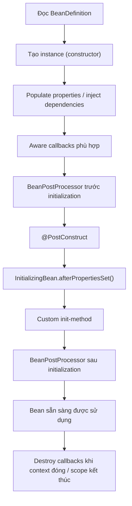
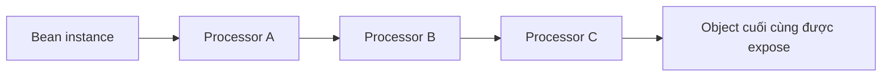
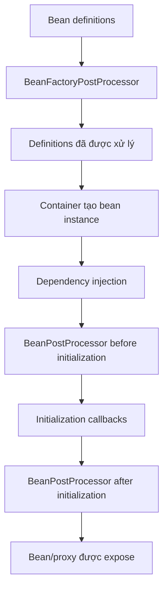
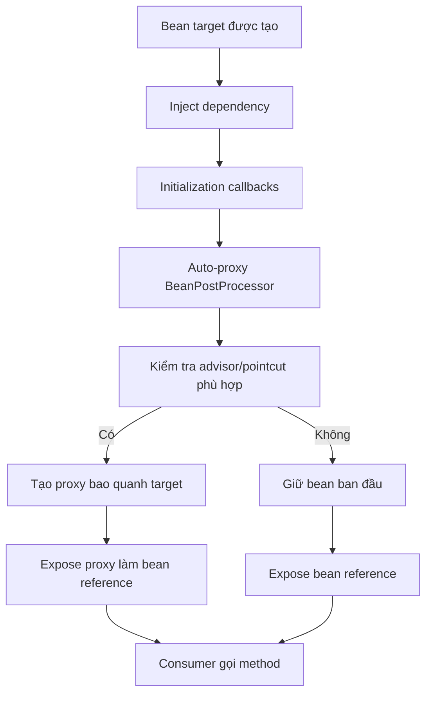

# BeanPostProcessor trước, sau khởi tạo và khả năng trả về proxy

Trong Spring, bean không chỉ được tạo rồi đưa ngay cho ứng dụng sử dụng. Trong quá trình xây dựng `ApplicationContext`, container còn thực hiện nhiều bước để inject dependency, gọi callback vòng đời, áp dụng cấu hình và có thể bọc đối tượng bằng proxy. Một cơ chế quan trọng tham gia vào quá trình này là **`BeanPostProcessor`**.

`BeanPostProcessor` cho phép Spring hoặc ứng dụng can thiệp vào **bean instance** trước và sau các initialization callback. Hai phương thức chính là `postProcessBeforeInitialization` và `postProcessAfterInitialization`. Mỗi phương thức có thể trả lại chính object ban đầu hoặc một object khác thay thế, thường là một proxy bao quanh bean gốc.

Trong chương **Vòng đời bean** của *Spring Boot Fundamentals*, cần hiểu rõ vị trí của hai callback này trong lifecycle, cách các processor được nối thành chuỗi, vì sao Spring AOP có thể tạo proxy, và những hệ quả khi bean được inject dưới dạng proxy thay vì class instance ban đầu.

## 1. BeanPostProcessor làm việc với bean instance

`BeanPostProcessor` là một extension point của Spring Framework. Nó cho phép đăng ký một đối tượng có khả năng nhận bean khi container tạo chúng, sau đó thực hiện một hành động trước hoặc sau giai đoạn khởi tạo.

Interface có hai phương thức cốt lõi:

```java
package org.springframework.beans.factory.config;

import org.springframework.beans.BeansException;

public interface BeanPostProcessor {

    Object postProcessBeforeInitialization(
            Object bean,
            String beanName
    ) throws BeansException;

    Object postProcessAfterInitialization(
            Object bean,
            String beanName
    ) throws BeansException;
}
```

Đoạn trên minh họa hợp đồng của Spring; khi viết ứng dụng, ta import interface từ thư viện Spring thay vì tự định nghĩa lại. Hai tham số có ý nghĩa:

- `bean` là object hiện tại mà container đang xử lý. Nó có thể là instance ban đầu hoặc object đã được một processor trước đó bọc lại.
- `beanName` là tên bean trong container, hữu ích khi processor chỉ áp dụng cho một bean hoặc một nhóm bean nhất định.

Hai phương thức trả về `Object` vì processor có thể trả lại:

1. Chính bean đầu vào, nếu chỉ cần quan sát hoặc điều chỉnh trạng thái.
2. Một wrapper/proxy khác, nếu muốn thay đổi cách các thành phần khác tương tác với bean.

**BeanPostProcessor xử lý object instance.** Đây là điểm khác với `BeanFactoryPostProcessor`, vốn làm việc với bean definitions và metadata cấu hình trước khi các bean thông thường được tạo.

## 2. Vị trí của BeanPostProcessor trong vòng đời bean

Một singleton bean thông thường trải qua nhiều bước. Ở mức khái niệm:



Sơ đồ lược giản để thể hiện thứ tự chính. Một số callback như `@PostConstruct` được gọi thông qua một BeanPostProcessor của Spring trong pha `postProcessBeforeInitialization`, nên nó không phải một bước độc lập nằm ngoài hệ thống post-processor.

### 2.1. Trước initialization không có nghĩa là trước constructor

`postProcessBeforeInitialization` được gọi **sau khi instance đã được tạo và các dependency/property cần thiết đã được populate**. Nó không phải hook chạy trước khi constructor được gọi.

Do đó, processor có thể quan sát một bean đã có trạng thái ban đầu và các dependency đã được inject. Tuy nhiên, initialization callback của bean vẫn chưa hoàn tất.

Ví dụ:

```java
@Component
public class ReportService {

    private final ReportRepository repository;

    public ReportService(ReportRepository repository) {
        this.repository = repository;
    }

    @PostConstruct
    void initialize() {
        // Chuẩn bị trạng thái sau khi dependency đã được inject.
    }
}
```

Khi một processor xử lý `ReportService` ở pha before initialization, constructor đã chạy và `repository` đã được cung cấp. `@PostConstruct` vẫn chưa được gọi tại thời điểm đó nếu processor đang đứng trước processor thực hiện callback này theo thứ tự xử lý.

### 2.2. @PostConstruct nằm ở đâu?

Trong Spring hiện đại, `@PostConstruct` được xử lý bởi một BeanPostProcessor chuyên biệt (thông qua cơ chế xử lý annotation lifecycle). Vì vậy, nó được thực thi trong pha `postProcessBeforeInitialization`.

Với thứ tự initialization callback phổ biến:

1. Các processor trước initialization được áp dụng; processor của Spring gọi method `@PostConstruct`.
2. `InitializingBean.afterPropertiesSet()` được gọi nếu bean implement interface này.
3. Custom init method được gọi nếu được cấu hình, ví dụ qua `@Bean(initMethod = "...")`.
4. Các processor sau initialization được áp dụng.

Không nên nhầm `@PostConstruct` với `BeanPostProcessor.postProcessAfterInitialization`. Một cái là callback khởi tạo trên bean; cái còn lại là extension point chạy sau các initialization callback.

## 3. Viết một BeanPostProcessor chỉ quan sát bean

Ví dụ đơn giản nhất là ghi log khi bean đi qua hai pha:

```java
package com.example.shop.infrastructure;

import org.springframework.beans.BeansException;
import org.springframework.beans.factory.config.BeanPostProcessor;

public class LifecycleTracePostProcessor implements BeanPostProcessor {

    @Override
    public Object postProcessBeforeInitialization(
            Object bean,
            String beanName
    ) throws BeansException {
        System.out.println("Before initialization: " + beanName);
        return bean;
    }

    @Override
    public Object postProcessAfterInitialization(
            Object bean,
            String beanName
    ) throws BeansException {
        System.out.println("After initialization: " + beanName);
        return bean;
    }
}
```

Processor này chỉ quan sát tên bean rồi trả lại đúng object ban đầu. Nó không thay đổi bean và cũng không tạo proxy.

### 3.1. Đăng ký processor trong Spring context

Có thể đăng ký qua một phương thức `@Bean`:

```java
package com.example.shop.config;

import com.example.shop.infrastructure.LifecycleTracePostProcessor;
import org.springframework.context.annotation.Bean;
import org.springframework.context.annotation.Configuration;

@Configuration
public class LifecycleConfiguration {

    @Bean
    static LifecycleTracePostProcessor lifecycleTracePostProcessor() {
        return new LifecycleTracePostProcessor();
    }
}
```

Điểm đáng chú ý là phương thức tạo BeanPostProcessor được khai báo `static`. Spring phải đăng ký và sử dụng BeanPostProcessor khá sớm trong quá trình khởi tạo context. Khai báo factory method static giúp container lấy processor mà không cần khởi tạo sớm instance của configuration class, giảm nguy cơ một số bean bị tạo trước khi toàn bộ processor được đăng ký.

Một cách khác là class processor được đăng ký như bean bằng cơ chế phù hợp. Nhưng cần nhớ: **BeanPostProcessor phải có mặt đủ sớm để tham gia xử lý các bean thông thường**.

### 3.2. Kết quả quan sát

Khi ứng dụng khởi động, log có thể chứa các dòng dạng:

```text
Before initialization: reportService
After initialization: reportService
Before initialization: orderRepository
After initialization: orderRepository
```

Thứ tự và danh sách bean thực tế phụ thuộc vào quá trình khởi tạo, dependency graph, lazy initialization và các processor khác. Không nên dùng thứ tự log của mọi bean làm một hợp đồng nghiệp vụ ổn định.

Processor có thể được gọi cho nhiều loại bean trong context, không chỉ class có `@Component`. Bean tạo qua `@Bean`, bean từ auto-configuration và nhiều thành phần hạ tầng khác cũng có thể đi qua chuỗi post-processor phù hợp.

## 4. Hai callback có thể trả về object khác

Điểm mạnh của `BeanPostProcessor` là phương thức không bắt buộc trả về đúng object đầu vào. Một processor có thể thay thế bean bằng wrapper:

```java
@Override
public Object postProcessAfterInitialization(
        Object bean,
        String beanName
) {
    if (bean instanceof SomeService) {
        return new SomeServiceWrapper((SomeService) bean);
    }
    return bean;
}
```

`SomeServiceWrapper` là kiểu giả định trong ví dụ. Nếu nó không tương thích với type mà các điểm inject yêu cầu, việc tạo proxy/wrapper có thể khiến dependency resolution hoặc lời gọi method thất bại. Vì vậy, wrapper phải bảo đảm **tương thích với hợp đồng mà các bean khác nhìn thấy**.

Khi processor trả về proxy, các thành phần được inject sau đó có thể nhận proxy thay cho target object. Proxy nhận lời gọi rồi chuyển tiếp tới target, có thể bổ sung logic trước/sau lời gọi.

Một số mục tiêu thường gặp:

- Đo thời gian thực thi method.
- Ghi nhận invocation hoặc metrics.
- Áp dụng transaction, security hoặc caching.
- Thêm cơ chế lazy lookup hoặc truy cập từ xa.
- Thay implementation bằng adapter/proxy có hành vi tương đương.

Trong thực tế, Spring AOP và các infrastructure processor đã cung cấp nhiều chức năng này. Tự viết proxy bằng BeanPostProcessor hữu ích để hiểu cơ chế hoặc triển khai một integration đặc biệt, nhưng không nên tự thay thế các abstraction sẵn có nếu không có nhu cầu.

## 5. Ví dụ trả về proxy sau initialization

Giả sử ứng dụng có hợp đồng thanh toán:

```java
package com.example.shop.payment;

import java.math.BigDecimal;

public interface PaymentGateway {
    String charge(BigDecimal amount);
}
```

Một implementation đơn giản:

```java
package com.example.shop.payment;

import java.math.BigDecimal;
import org.springframework.stereotype.Component;

@Component
public class DemoPaymentGateway implements PaymentGateway {

    @Override
    public String charge(BigDecimal amount) {
        return "PAYMENT-" + amount.toPlainString();
    }
}
```

Ta muốn đo thời gian thực thi lời gọi tới gateway. Một BeanPostProcessor có thể bọc bean sau initialization bằng proxy:

```java
package com.example.shop.infrastructure;

import com.example.shop.payment.PaymentGateway;
import org.aopalliance.intercept.MethodInterceptor;
import org.springframework.aop.framework.ProxyFactory;
import org.springframework.beans.BeansException;
import org.springframework.beans.factory.config.BeanPostProcessor;

public class PaymentTimingPostProcessor implements BeanPostProcessor {

    @Override
    public Object postProcessAfterInitialization(
            Object bean,
            String beanName
    ) throws BeansException {
        if (!(bean instanceof PaymentGateway)) {
            return bean;
        }

        ProxyFactory proxyFactory = new ProxyFactory();
        proxyFactory.setTarget(bean);
        proxyFactory.setInterfaces(PaymentGateway.class);
        proxyFactory.addAdvice((MethodInterceptor) invocation -> {
            long startedAt = System.nanoTime();
            try {
                return invocation.proceed();
            } finally {
                long elapsed = System.nanoTime() - startedAt;
                System.out.println(
                        "PaymentGateway." + invocation.getMethod().getName()
                                + " took " + elapsed + " ns"
                );
            }
        });

        return proxyFactory.getProxy();
    }
}
```

Ví dụ dùng `ProxyFactory` của Spring AOP và `MethodInterceptor` từ AOP Alliance. Proxy được cấu hình để triển khai interface `PaymentGateway`, nên các consumer nên inject qua interface này.

Đăng ký processor:

```java
@Configuration
public class PaymentInfrastructureConfiguration {

    @Bean
    static PaymentTimingPostProcessor paymentTimingPostProcessor() {
        return new PaymentTimingPostProcessor();
    }
}
```

Một service sử dụng:

```java
@Service
public class CheckoutService {

    private final PaymentGateway paymentGateway;

    public CheckoutService(PaymentGateway paymentGateway) {
        this.paymentGateway = paymentGateway;
    }

    public String checkout(BigDecimal amount) {
        return paymentGateway.charge(amount);
    }
}
```

Khi `CheckoutService` được tạo, nó nhận bean đã đi qua chuỗi post-processor. Nếu `PaymentTimingPostProcessor` tạo proxy thành công, dependency được inject là proxy triển khai `PaymentGateway`. Khi gọi `charge`:

1. Consumer gọi method trên proxy.
2. Interceptor ghi thời điểm bắt đầu.
3. `invocation.proceed()` chuyển tiếp tới target `DemoPaymentGateway`.
4. Interceptor ghi thời gian kết thúc trong `finally`.
5. Kết quả từ target được trả về consumer.

Đây là cách minh họa khả năng trả về proxy của `postProcessAfterInitialization`. Với đo thời gian trong ứng dụng thật, Micrometer Observation, metrics hoặc Spring AOP có thể phù hợp hơn một processor tự viết.

### 5.1. Vì sao ví dụ dùng interface?

`ProxyFactory` được cấu hình với `PaymentGateway.class`, vì vậy nó tạo proxy dựa trên interface. Proxy này có thể được inject vào biến kiểu `PaymentGateway`.

Nếu consumer yêu cầu `DemoPaymentGateway` cụ thể, JDK dynamic proxy không phải instance của class đó. Khi ấy việc inject theo concrete type có thể thất bại. Thiết kế theo interface giúp consumer phụ thuộc vào hợp đồng ổn định và không cần biết implementation hoặc proxy được tạo bằng cách nào.

Spring cũng hỗ trợ class-based proxy (thường dựa trên subclassing). Tuy nhiên, class final hoặc method final/private có các giới hạn đối với proxy dựa trên kế thừa. Lựa chọn proxy strategy phải phù hợp với kiểu bean và API mà consumer yêu cầu.

## 6. Chuỗi BeanPostProcessor hoạt động như thế nào?

Một application context có thể đăng ký nhiều BeanPostProcessor. Spring áp dụng chúng theo thứ tự đăng ký cho từng bean. Kết quả từ processor trước trở thành đầu vào của processor tiếp theo.

Giả sử có ba processor:



Ví dụ:

- Processor A ghi log lifecycle.
- Processor B bọc bean thành proxy đo thời gian.
- Processor C kiểm tra hoặc bổ sung metadata trên object đã nhận.

Nếu processor B trả proxy, processor C có thể nhận proxy đó chứ không còn nhận target instance ban đầu. Do đó, thứ tự processor ảnh hưởng đến object mà processor sau quan sát và object cuối cùng được expose.

### 6.1. Hai pha có chuỗi riêng

Spring áp dụng chuỗi `postProcessBeforeInitialization` trước các initialization callback và chuỗi `postProcessAfterInitialization` sau các callback. Một processor có thể chỉ override một trong hai phương thức; phương thức còn lại mặc định trả lại bean.

Nếu processor A thay object ở pha before initialization, các bước tiếp theo có thể làm việc với object đã thay thế. Nếu processor B bọc object ở pha after initialization, các consumer sẽ nhận kết quả sau khi chuỗi after initialization hoàn tất.

Không nên giả định mọi processor luôn nhận cùng một object identity ở mọi callback. Hãy xem giá trị return của từng processor.

### 6.2. Trả về null có ý nghĩa gì?

Theo hợp đồng của Spring, nếu một processor trả về `null`, chuỗi xử lý tương ứng sẽ dừng áp dụng các BeanPostProcessor còn lại cho bean đó. Spring giữ lại object hiện tại trước khi processor trả null làm kết quả của chuỗi, thay vì coi null là bean cuối cùng để inject.

Vì vậy, khi viết processor thông thường, nên **luôn trả về bean hoặc wrapper hợp lệ**, trừ khi có chủ đích rõ ràng muốn ngừng chuỗi. Vô tình trả null có thể khiến các processor khác không chạy cho bean đó và tạo ra hành vi khó điều tra.

## 7. Thứ tự đăng ký BeanPostProcessor

Khi nhiều processor cùng tồn tại, thứ tự có thể ảnh hưởng đến proxy và lifecycle. Spring hỗ trợ các cơ chế ordering:

- `PriorityOrdered`: nhóm processor được ưu tiên đăng ký trước.
- `Ordered`: nhóm processor có thứ tự sau nhóm PriorityOrdered, theo giá trị order.
- Các processor không triển khai các interface ordering được xử lý theo thứ tự đăng ký còn lại.

Không nên dựa vào `@Order` trên BeanPostProcessor như thể nó luôn có cùng tác dụng với ordering của bean thông thường. Đối với chính các BeanPostProcessor, hãy sử dụng hợp đồng `PriorityOrdered`/`Ordered` khi cần kiểm soát thứ tự đăng ký.

Ví dụ:

```java
public class OrderedTracePostProcessor
        implements BeanPostProcessor, Ordered {

    @Override
    public int getOrder() {
        return 100;
    }

    @Override
    public Object postProcessAfterInitialization(
            Object bean,
            String beanName
    ) {
        return bean;
    }
}
```

Giá trị order nhỏ hơn có độ ưu tiên cao hơn trong nhóm ordering tương ứng. Nhưng nếu có một processor implement `PriorityOrdered`, nó vẫn thuộc nhóm ưu tiên trước các processor chỉ implement `Ordered`, bất kể so sánh số order giữa hai nhóm.

Với processor không cần thứ tự đặc biệt, không nên thêm ordering chỉ để “chắc chắn”. Mỗi ràng buộc thứ tự làm tăng phụ thuộc giữa các thành phần hạ tầng.

## 8. BeanPostProcessor được khởi tạo rất sớm

Một điểm quan trọng khi đăng ký processor trong Spring Boot: container cần tạo các BeanPostProcessor trước khi hoàn tất quá trình tạo các bean thông thường. Điều này tạo ra một số hệ quả.

### 8.1. Bean được tạo quá sớm có thể bỏ lỡ một số processor

Nếu một BeanPostProcessor phụ thuộc vào một bean khác, dependency ấy có thể bị tạo sớm trong lúc container đang đăng ký processor. Bean được tạo sớm có thể chưa được xử lý bởi toàn bộ BeanPostProcessor trong context.

Spring có thể phát cảnh báo cho biết một bean **không đủ điều kiện để được xử lý bởi tất cả BeanPostProcessor**. Điều đó không nhất thiết khiến bean không dùng được, nhưng có thể khiến nó không nhận proxy hoặc các hành vi mà ta kỳ vọng.

### 8.2. Dùng static @Bean để khai báo BeanPostProcessor

Với configuration class:

```java
@Configuration
public class InfrastructureConfiguration {

    @Bean
    static BeanPostProcessor tracePostProcessor() {
        return new LifecycleTracePostProcessor();
    }
}
```

Phương thức static giúp Spring tạo processor mà không cần khởi tạo instance cấu hình sớm. Đây là khuyến nghị quan trọng khi khai báo BeanPostProcessor qua Java configuration.

### 8.3. Hạn chế dependency của chính processor

BeanPostProcessor nên có dependency tối thiểu. Tránh inject một service nghiệp vụ lớn, repository hoặc bean có nhiều dependency vào processor nếu không thực sự cần. Những dependency này có thể bị khởi tạo sớm và không đi qua toàn bộ chuỗi xử lý như bean thông thường.

Nếu processor cần metadata hoặc cấu hình đơn giản, hãy cân nhắc truyền giá trị trực tiếp qua constructor/factory method hoặc dùng một abstraction nhỏ được tạo sớm một cách có chủ đích.

## 9. Phân biệt BeanPostProcessor và BeanFactoryPostProcessor

Hai tên rất gần nhau nhưng tác động lên hai tầng khác nhau:

| Tiêu chí | BeanFactoryPostProcessor | BeanPostProcessor |
| --- | --- | --- |
| Đối tượng xử lý | Bean definitions / metadata cấu hình | Bean instances |
| Thời điểm | Trước khi khởi tạo các bean thông thường | Trong quá trình khởi tạo từng bean |
| Mục đích | Điều chỉnh định nghĩa bean, property metadata, cấu hình container | Quan sát, điều chỉnh hoặc bọc object instance |
| Có thể trực tiếp trả proxy instance? | Không phải mục đích của extension point này | Có, thông qua giá trị return của callback |
| Ví dụ | Đọc/điều chỉnh property placeholder trong cấu hình | Tạo proxy, xử lý annotation lifecycle |

Sơ đồ:



Nếu muốn thay đổi **metadata mô tả bean trước khi instance tồn tại**, hãy tìm hiểu BeanFactoryPostProcessor. Nếu muốn can thiệp **object đã được tạo**, BeanPostProcessor phù hợp hơn.

## 10. @PostConstruct và BeanPostProcessor không phải cùng một thứ

`@PostConstruct` thường được dùng để thực hiện một công việc khởi tạo trên chính bean:

```java
@Component
public class ReferenceDataCache {

    @PostConstruct
    void load() {
        // Nạp dữ liệu khởi tạo cần thiết.
    }
}
```

Method `load()` thuộc về lifecycle của bean `ReferenceDataCache`. Trong khi đó, `BeanPostProcessor` là một thành phần hạ tầng có thể áp dụng cho nhiều bean khác nhau.

| Câu hỏi | @PostConstruct | BeanPostProcessor |
| --- | --- | --- |
| Ai viết? | Class bean cần khởi tạo | Thành phần mở rộng container |
| Phạm vi | Một bean/method cụ thể | Có thể áp dụng nhiều bean |
| Thời điểm | Trong pha before initialization của cơ chế Spring | Trước hoặc sau initialization callback |
| Có thể thay object được expose? | Không phải mục tiêu của callback | Có thể trả về wrapper/proxy |
| Dùng để làm gì? | Hoàn tất trạng thái nội bộ sau inject | Xử lý xuyên suốt, kiểm tra, wrap hoặc proxy bean |

Không nên chuyển mọi logic khởi tạo của một bean sang BeanPostProcessor. Nếu class cần nạp dữ liệu nội bộ của chính nó, callback lifecycle trên bean thường dễ hiểu hơn. Nếu cần một cơ chế áp dụng chung cho nhiều bean, BeanPostProcessor mới là extension point thích hợp.

## 11. Spring AOP sử dụng khả năng post-process để tạo proxy

Các tính năng như transaction, method security, caching hoặc một số chức năng AOP thường cần một proxy bao quanh bean mục tiêu. Proxy cho phép chèn hành vi trước/sau lời gọi method mà không phải sửa logic của class nghiệp vụ.

Một luồng khái quát:



Trong thực tế, Spring AOP dùng các infrastructure processor như auto-proxy creator để quyết định bean nào cần proxy. Không phải bean nào cũng được proxy. Bean phải phù hợp với advisor/pointcut hoặc cơ chế AOP tương ứng.

### 11.1. Ví dụ @Transactional

```java
@Service
public class OrderService {

    private final OrderRepository repository;

    public OrderService(OrderRepository repository) {
        this.repository = repository;
    }

    @Transactional
    public void placeOrder(Order order) {
        repository.save(order);
    }
}
```

Ở mức khái niệm, Spring có thể cung cấp một proxy cho `OrderService`. Khi consumer gọi `placeOrder` trên proxy, transaction advice bắt đầu transaction, chuyển lời gọi tới target, rồi commit hoặc rollback theo kết quả.

Code nghiệp vụ vẫn viết lời gọi repository bình thường. Proxy thực hiện hành vi xuyên suốt. Đây là một ví dụ điển hình về lý do `BeanPostProcessor` có khả năng trả proxy quan trọng trong Spring.

Tuy nhiên, `@Transactional` không phải chỉ là “một dòng BeanPostProcessor”. Cơ chế thực tế còn bao gồm transaction advisor, pointcut, interceptor, transaction manager và quy tắc proxy. Việc có annotation không bảo đảm transaction hoạt động nếu cấu hình hoặc lời gọi không đi qua proxy theo cách phù hợp.

### 11.2. Self-invocation và proxy

Với proxy-based AOP, nếu một method trong target gọi trực tiếp method khác của chính object bằng `this.otherMethod()`, lời gọi nội bộ thường không đi qua proxy. Vì thế advice như `@Transactional` trên method được gọi nội bộ có thể không được áp dụng theo kỳ vọng.

Ví dụ:

```java
@Service
class ReportService {

    public void generate() {
        this.writeReport();
    }

    @Transactional
    public void writeReport() {
        // ...
    }
}
```

Nếu `generate()` được gọi từ bên ngoài qua proxy, lời gọi `this.writeReport()` bên trong target không quay lại proxy. Transaction advice của `writeReport()` có thể không chạy như mong muốn. Cách thiết kế thường là tách method cần transaction sang bean khác hoặc tổ chức lời gọi để đi qua proxy đúng cách.

Đây là hệ quả của proxy-based interception, không phải lỗi riêng của `BeanPostProcessor`.

## 12. Proxy được tạo sau initialization có phải luôn là proxy duy nhất?

Không nhất thiết. Spring có thể có nhiều cơ chế wrap bean, chẳng hạn processor tự viết, auto-proxy creator của AOP hoặc processor từ thư viện khác. Khi nhiều cơ chế cùng tham gia, cần hiểu thứ tự và cách chúng phối hợp để tránh proxy lồng nhau không mong muốn.

Một số lưu ý:

- Processor sau có thể nhận một proxy đã được processor trước tạo ra.
- Một bean có thể bị wrap nhiều lớp nếu các processor độc lập không phối hợp.
- Spring AOP có cơ chế hạ tầng để phối hợp advisor và proxy trong những trường hợp thông thường; không nên tự thêm một proxy riêng cho cùng mục đích nếu không có lý do.
- Proxy có thể làm thay đổi type mà consumer nhìn thấy, đặc biệt khi dùng JDK interface proxy.
- Một số framework cần tham chiếu target sớm trong circular dependency và có cơ chế liên quan tới early references; không phải mọi proxy đều được tạo đúng một lần tại callback after initialization đơn giản.

### 12.1. Early proxy reference trong circular dependency

Trong một số trường hợp circular dependency với singleton, Spring có thể cần cung cấp một tham chiếu sớm tới bean trước khi quá trình khởi tạo hoàn tất. Các processor thuộc nhóm `SmartInstantiationAwareBeanPostProcessor` có thể tham gia cơ chế lấy early bean reference, ví dụ để đảm bảo proxy được dùng nhất quán.

Đây là tình huống nâng cao. Ở mức Fundamentals, cần nhớ rằng **không nên giả định mọi proxy đều chỉ được tạo tại postProcessAfterInitialization**. Auto-proxy creator của Spring có thể phối hợp thêm cơ chế early reference để xử lý vòng phụ thuộc.

Nếu ứng dụng gặp lỗi kiểu một nơi nhận raw bean, nơi khác nhận proxy trong circular reference, cần đọc thông báo Spring và xem thiết kế vòng phụ thuộc trước khi cố bật cơ chế cho phép circular references.

## 13. Bean được inject có thể là proxy, không phải class gốc

Giả sử bean target là `DemoPaymentGateway` nhưng processor trả về JDK proxy triển khai `PaymentGateway`. Consumer nhận interface:

```java
private final PaymentGateway gateway;
```

và lời gọi hoạt động qua proxy.

Nhưng nếu consumer yêu cầu:

```java
private final DemoPaymentGateway gateway;
```

thì JDK proxy không phải instance của `DemoPaymentGateway`. Dependency có thể không inject được hoặc ép kiểu sẽ thất bại.

Điều này nhấn mạnh một nguyên tắc thiết kế: **consumer nên phụ thuộc vào contract mà bean cung cấp**, đặc biệt khi framework có thể thay implementation bằng proxy.

### 13.1. JDK dynamic proxy

JDK proxy triển khai một hoặc nhiều interface. Nó phù hợp khi consumer gọi các method thuộc interface được proxy expose.

### 13.2. Class-based proxy

Class-based proxy tạo subclass của target class. Nó có thể expose method của class mà không cần interface, nhưng bị giới hạn bởi cơ chế kế thừa: class final hoặc method final không thể được override theo cách cần thiết; constructor và visibility cũng cần được xét.

Không nên giả định mọi ứng dụng Spring Boot đều sử dụng một loại proxy cố định. Proxy strategy phụ thuộc cấu hình Spring AOP, lựa chọn framework và cách proxy được tạo. Ví dụ `ProxyFactory` ở bài này chủ động cấu hình interface để minh họa JDK proxy.

## 14. Những gì không nên làm trong BeanPostProcessor

BeanPostProcessor là cơ chế ở tầng container. Vì nó chạy trên nhiều bean và ở thời điểm rất sớm, logic bên trong cần cẩn thận.

Tránh các cách làm sau:

- **Chạy nghiệp vụ của ứng dụng trong processor:** processor không phải nơi đặt quy trình đặt hàng, thanh toán hoặc gửi thông báo theo request.
- **Inject nhiều service phụ thuộc lẫn nhau vào processor:** có thể làm các bean bị khởi tạo sớm, bỏ lỡ một số processor hoặc tạo vòng phụ thuộc.
- **Tạo proxy không tương thích type:** consumer yêu cầu class cụ thể nhưng processor trả JDK proxy chỉ implement interface.
- **Trả null vô ý:** làm dừng chuỗi post-processor cho bean đó.
- **Tự wrap tất cả bean mà không có điều kiện:** có thể làm thay đổi type, debug và performance trên phạm vi lớn.
- **Tự triển khai lại @Transactional/AOP không cần thiết:** dễ bỏ sót exception semantics, proxy behavior và tích hợp hạ tầng.
- **Giữ trạng thái mutable toàn cục trong processor:** processor thường là singleton và có thể xử lý nhiều bean/thread; trạng thái chia sẻ phải được quản lý an toàn.

Nếu processor cần áp dụng cho một nhóm bean, hãy chọn bằng type, annotation hoặc metadata rõ ràng. Nếu chỉ muốn quan sát lifecycle, processor nên giữ hành vi càng đơn giản càng tốt.

## 15. Kiểm tra một bean có đang được proxy hay không

Spring cung cấp các tiện ích để kiểm tra proxy trong lúc phát triển và kiểm thử. Ví dụ:

```java
import org.springframework.aop.support.AopUtils;

boolean proxy = AopUtils.isAopProxy(bean);
boolean jdkProxy = AopUtils.isJdkDynamicProxy(bean);
boolean cglibProxy = AopUtils.isCglibProxy(bean);
```

Các hàm trên giúp quan sát loại proxy. Chúng không chứng minh advice cụ thể đã chạy hoặc transaction đã được commit. Muốn xác nhận hành vi, cần gọi method qua reference được inject và kiểm tra kết quả/hệ quả thực tế.

### 15.1. Test BeanPostProcessor tạo proxy

Một test context tối giản có thể kiểm tra bean lấy ra là JDK proxy:

```java
import static org.junit.jupiter.api.Assertions.assertTrue;

import com.example.shop.infrastructure.PaymentTimingPostProcessor;
import com.example.shop.payment.DemoPaymentGateway;
import com.example.shop.payment.PaymentGateway;
import org.junit.jupiter.api.Test;
import org.springframework.aop.support.AopUtils;
import org.springframework.beans.factory.config.BeanPostProcessor;
import org.springframework.context.annotation.AnnotationConfigApplicationContext;
import org.springframework.context.annotation.Bean;
import org.springframework.context.annotation.Configuration;

class PaymentProxyTest {

    @Configuration
    static class TestConfiguration {

        @Bean
        static BeanPostProcessor paymentPostProcessor() {
            return new PaymentTimingPostProcessor();
        }

        @Bean
        PaymentGateway paymentGateway() {
            return new DemoPaymentGateway();
        }
    }

    @Test
    void paymentGatewayIsExposedAsJdkProxy() {
        try (var context =
                     new AnnotationConfigApplicationContext(TestConfiguration.class)) {
            PaymentGateway gateway =
                    context.getBean(PaymentGateway.class);

            assertTrue(AopUtils.isJdkDynamicProxy(gateway));
            gateway.charge(new java.math.BigDecimal("100"));
        }
    }
}
```

Test trên là ví dụ minh họa cơ chế, cần các class/interface và dependency Spring AOP/JUnit phù hợp trong project. Nó xác nhận proxy được expose và method có thể được gọi qua interface. Để xác minh logic đo thời gian, có thể inject một collector/test recorder thay vì chỉ quan sát stdout.

### 15.2. Test lifecycle callback

Để kiểm tra before/after initialization, có thể dùng một bean test có method `@PostConstruct` và một processor ghi lại sự kiện. Thứ tự kỳ vọng về mặt khái niệm:

```text
processor.beforeInitialization
    -> @PostConstruct
    -> InitializingBean.afterPropertiesSet
    -> custom init-method
    -> processor.afterInitialization
```

Trong test thật, nên ghi các sự kiện vào một collection test-owned và assert thứ tự cụ thể của các callback mà ứng dụng dựa vào. Không nên assert toàn bộ thứ tự của mọi processor nội bộ Spring nếu điều đó không thuộc hợp đồng của ứng dụng.

## 16. BeanPostProcessor có thể thay đổi bean trước initialization không?

Có. Hợp đồng của `postProcessBeforeInitialization` cũng trả về `Object`, nên về mặt kỹ thuật processor có thể trả một wrapper hoặc object khác trước khi initialization callback tiếp tục.

Tuy nhiên, cần thận trọng:

- Initialization callback tiếp theo sẽ làm việc với object được chuyển tiếp trong chuỗi.
- Wrapper phải tương thích với các callback và type mà container cần.
- Việc thay target quá sớm có thể ảnh hưởng đến cách Spring gọi initialization interface hoặc annotation lifecycle.
- Một số wrapper/proxy cần target đã hoàn tất khởi tạo, vì thế after-initialization thường là thời điểm phù hợp hơn cho proxy thông thường.

Nếu chỉ muốn thay đổi hành vi lời gọi method sau khi bean đã khởi tạo, `postProcessAfterInitialization` thường dễ hiểu và an toàn hơn. Dùng before-initialization cho các mục tiêu cụ thể khi đã hiểu đầy đủ lifecycle và hợp đồng của wrapper.

## 17. Khi nào cần BeanPostProcessor và khi nào không?

| Nhu cầu | Cơ chế thường phù hợp |
| --- | --- |
| Khởi tạo trạng thái nội bộ của một bean | `@PostConstruct` hoặc init callback |
| Cung cấp một object có constructor/configuration đặc biệt | `@Bean` |
| Tạo bean theo package scanning | `@Component` và `@ComponentScan` |
| Chỉnh metadata/bean definitions trước khi tạo instance | `BeanFactoryPostProcessor` |
| Áp dụng một hành vi xuyên suốt cho nhiều bean instance | `BeanPostProcessor` hoặc Spring AOP |
| Transaction, caching, method security | Cơ chế Spring AOP/annotation chuyên biệt |
| Đo metrics/tracing theo hoạt động | Micrometer/Observation và integration tương ứng |
| Thực hiện công việc nghiệp vụ sau khi ứng dụng sẵn sàng | Application event listener hoặc runner phù hợp |

BeanPostProcessor là extension point mạnh, nhưng không phải công cụ mặc định để giải quyết mọi vấn đề lifecycle. Nếu một tính năng đã có abstraction cấp cao hơn, hãy ưu tiên abstraction đó để giảm code hạ tầng tự viết.

## 18. Bài tập thực hành

### Bài tập 1 – Ghi lại hai pha post-processing

Viết một `LifecycleTracePostProcessor` implement `BeanPostProcessor`. Trong mỗi callback, ghi tên bean và tên phương thức callback. Đăng ký processor bằng static `@Bean`.

Tạo một component có `@PostConstruct`. Quan sát và mô tả callback before, `@PostConstruct` và callback after theo thứ tự.

### Bài tập 2 – Phân biệt thời điểm

Một bean có constructor, một field dependency, `@PostConstruct` và `InitializingBean.afterPropertiesSet()`. Hãy vẽ thứ tự các bước mà Spring thực hiện. Giải thích vì sao `postProcessBeforeInitialization` không chạy trước constructor.

### Bài tập 3 – Bọc PaymentGateway bằng proxy

Tạo `PaymentTimingPostProcessor` dùng `ProxyFactory` và `MethodInterceptor`. Chỉ wrap bean thực hiện `PaymentGateway`. Gọi `charge` từ một service nhận interface và quan sát log thời gian.

Sau đó thử inject implementation class cụ thể thay cho interface. Giải thích vì sao JDK proxy có thể không thỏa type đó.

### Bài tập 4 – Thứ tự nhiều processor

Tạo hai processor:

- Processor A ghi log và trả bean ban đầu.
- Processor B kiểm tra bean và trả một wrapper/proxy.

Quan sát processor nào nhận object gốc và processor nào nhận wrapper. Thử thay đổi thứ tự đăng ký, rồi giải thích tác động tới object cuối cùng.

### Bài tập 5 – Phân biệt BeanFactoryPostProcessor và BeanPostProcessor

Cho hai yêu cầu:

1. Thay đổi một property value trong bean definition trước khi bean được tạo.
2. Đo thời gian method trên một bean sau khi khởi tạo.

Chọn extension point phù hợp cho từng yêu cầu và giải thích vì sao.

### Bài tập 6 – Xử lý cảnh báo bean khởi tạo quá sớm

Một BeanPostProcessor inject trực tiếp một service lớn, và Spring cảnh báo service đó không được xử lý bởi tất cả processor. Hãy giải thích vì sao processor được khởi tạo sớm, sau đó đề xuất cách giảm dependency và khai báo factory method static.

## 19. Những điểm cần nhớ

`BeanPostProcessor` là cơ chế mở rộng vòng đời bean ở cấp **instance**. `postProcessBeforeInitialization` chạy sau khi object đã được tạo và inject dependency nhưng trước các initialization callback. `postProcessAfterInitialization` chạy sau các callback khởi tạo và là nơi phổ biến để trả về một proxy thay thế bean gốc.

Hãy ghi nhớ các phân biệt:

- `@PostConstruct` là callback của bean; BeanPostProcessor là thành phần xử lý nhiều bean.
- BeanFactoryPostProcessor chỉnh bean definitions; BeanPostProcessor xử lý bean instances.
- Processor có thể trả về target ban đầu hoặc wrapper/proxy tương thích.
- Processor được áp dụng theo thứ tự; processor sau có thể nhận object đã được processor trước bọc lại.
- BeanPostProcessor cần đăng ký sớm; static `@Bean` và dependency tối thiểu giúp tránh khởi tạo bean không đúng thời điểm.
- Proxy có thể thay đổi type nhìn thấy ở consumer; phụ thuộc vào interface giúp giảm ràng buộc với implementation cụ thể.
- Spring AOP dùng cơ chế proxy và infrastructure processor cho nhiều tính năng; không cần tự viết processor để thay thế `@Transactional` hoặc các abstraction đã có.

Khi một service được inject, object mà nó nhận có thể là proxy do Spring tạo ra chứ không phải instance class ban đầu. Hiểu đúng hai pha post-processing sẽ giúp giải thích cách Spring bổ sung hành vi xuyên suốt mà không buộc mã nghiệp vụ phải chứa toàn bộ logic hạ tầng.
