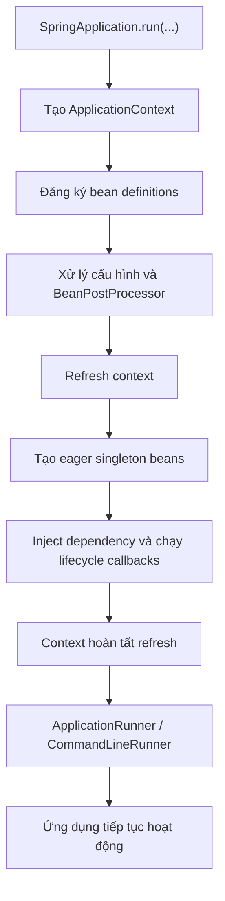
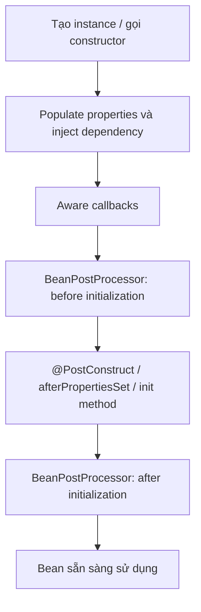
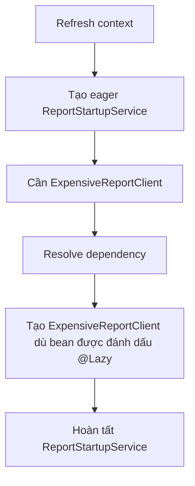

# Eager initialization, @Lazy và thời điểm phát hiện lỗi cấu hình

Khi một ứng dụng Spring Boot khởi động, Spring phải tạo và kết nối nhiều bean trước khi ứng dụng sẵn sàng. Theo mặc định, các singleton bean thông thường được **khởi tạo sớm (eager initialization)** trong quá trình refresh application context. Nhờ vậy, nhiều lỗi cấu hình và lỗi tạo bean được phát hiện ngay lúc startup. Với những bean chưa cần dùng ngay, Spring cho phép trì hoãn việc tạo instance bằng **lazy initialization**, thường thông qua `@Lazy`.

Lựa chọn eager hay lazy ảnh hưởng trực tiếp đến thời gian khởi động, thời điểm lỗi xuất hiện và độ trễ của lần sử dụng đầu tiên. Bài học thuộc chương **Vòng đời bean** của *Spring Boot Fundamentals*. Ta sẽ theo dõi vòng đời singleton trong lúc context refresh, thử trì hoãn một bean, tìm hiểu vì sao dependency của một bean eager có thể khiến bean lazy vẫn được tạo sớm, rồi so sánh lazy bean với lazy-resolution proxy và cấu hình lazy toàn ứng dụng.

Ví dụ sử dụng Java 21 và Spring Boot 3.x. Các đoạn code tập trung vào Spring container; phần kiểm chứng có thể chạy trong một dự án Spring Boot hoặc một dự án Spring Context phù hợp.

## 1. Eager initialization là gì?

**Eager initialization** có nghĩa là bean được tạo sớm trong quá trình khởi tạo container, thay vì đợi đến lần đầu có code yêu cầu bean. Với scope `singleton`, Spring mặc định tạo trước các singleton bean không được đánh dấu lazy khi application context được refresh.

Ví dụ:

```java
package com.example.demo.service;

import org.springframework.stereotype.Component;

@Component
public class CatalogService {

    public CatalogService() {
        System.out.println("CatalogService constructor");
    }

    public String findCatalogName() {
        return "Main catalog";
    }
}
```

Với component scan bình thường và không bật lazy initialization, constructor của `CatalogService` thường được gọi trong lúc Spring khởi tạo context, dù chưa có controller hay runner nào gọi `findCatalogName()`.

Lý do Spring chọn eager initialization làm mặc định là để phát hiện lỗi cấu hình sớm. Nếu constructor không thể chạy, dependency bắt buộc không có hoặc callback khởi tạo ném exception, ứng dụng có thể thất bại ngay trong startup thay vì chờ tới khi một người dùng vô tình gọi chức năng đó.

### Eager không có nghĩa mọi object đều được tạo ngay

Quy tắc trên chủ yếu nói về **singleton bean không lazy**. Không nên suy ra rằng Spring tạo mọi object trong ứng dụng ngay khi khởi động:

- Prototype bean thường được tạo khi container được yêu cầu cung cấp instance, không được pre-instantiate như singleton.
- Bean được đánh dấu `@Lazy` có thể được trì hoãn.
- Bean do code tự tạo bằng `new` bên ngoài container không thuộc quá trình pre-instantiation của Spring.
- Một số object nội bộ, factory, infrastructure bean có quy tắc khởi tạo riêng.

Vì vậy khi quan sát log constructor, hãy xác định scope và cách đăng ký bean trước khi kết luận về eager initialization.

## 2. Spring tạo eager singleton ở giai đoạn nào?

Một ứng dụng Spring Boot bắt đầu từ:

```java
@SpringBootApplication
public class DemoApplication {
    public static void main(String[] args) {
        SpringApplication.run(DemoApplication.class, args);
    }
}
```

Trong quá trình chạy, Boot tạo và refresh `ApplicationContext`. Ở mức khái quát, các bước quan trọng liên quan đến bean gồm:

1. Đọc và đăng ký bean definitions từ configuration, component scan, auto-configuration và các nguồn khác.
2. Xử lý những phần mở rộng của container như `BeanFactoryPostProcessor` và đăng ký `BeanPostProcessor`.
3. Refresh context và pre-instantiate các singleton bean không lazy.
4. Với từng bean được tạo, Spring giải dependency, khởi tạo instance và chạy các callback vòng đời phù hợp.
5. Khi context hoàn tất refresh, ứng dụng tiếp tục các bước startup của Spring Boot; những runner như `ApplicationRunner` và `CommandLineRunner` được gọi ở giai đoạn sau của quá trình khởi động.

Sơ đồ rút gọn:



Đây là mô hình để hiểu thời điểm khởi tạo, không phải danh sách đầy đủ mọi callback hoặc mọi bước nội bộ của Spring Boot. Điểm cần nhớ: **eager singleton được tạo trong quá trình refresh context, trước khi ứng dụng hoàn tất startup và chạy runner**.

## 3. Vòng đời bean và lỗi trong quá trình khởi tạo

Khi Spring tạo một bean, một chuỗi bước phổ biến là:



Thứ tự chi tiết có thể có thêm bước và khác biệt theo loại bean, nhưng ví dụ cho thấy lỗi có thể phát sinh ở nhiều giai đoạn:

- Constructor ném exception.
- Spring không tìm thấy dependency bắt buộc.
- Dependency của bean lại không thể tạo.
- Method `@PostConstruct` ném exception.
- `InitializingBean.afterPropertiesSet()` hoặc custom init method thất bại.
- Một BeanPostProcessor hoặc proxy infrastructure gặp lỗi khi xử lý bean.

Với eager singleton, các lỗi thuộc quá trình tạo bean thường xuất hiện ngay lúc refresh context. Đó là hành vi **fail fast**: ứng dụng không báo sẵn sàng khi một phần cấu hình cần thiết chưa thể khởi tạo.

### Ví dụ bean lỗi ngay lúc startup

```java
package com.example.demo.service;

import org.springframework.stereotype.Component;

@Component
public class BrokenClient {

    public BrokenClient() {
        throw new IllegalStateException("Missing client configuration");
    }
}
```

Nếu `BrokenClient` nằm trong vùng component scan và không được đánh dấu lazy, Spring thường cố tạo bean khi refresh context. Constructor ném exception khiến việc khởi tạo bean thất bại; lỗi có thể làm application context không refresh thành công và Spring Boot không hoàn tất startup.

Đây là lỗi cố ý tạo để học. Trong ứng dụng thật, constructor nên kiểm tra cấu hình bắt buộc và khởi tạo trạng thái nội bộ; các thao tác mạng hoặc kết nối bên ngoài nên được thiết kế với timeout và chính sách lỗi rõ ràng.

## 4. `@Lazy` là gì?

`@Lazy` là annotation của Spring, import từ:

```java
import org.springframework.context.annotation.Lazy;
```

Nó cho container biết bean hoặc configuration được đánh dấu nên **được khởi tạo khi cần** thay vì tạo sớm trong lúc refresh context.

Đánh dấu một component:

```java
package com.example.demo.report;

import org.springframework.context.annotation.Lazy;
import org.springframework.stereotype.Component;

@Component
@Lazy
public class ExpensiveReportClient {

    public ExpensiveReportClient() {
        System.out.println("ExpensiveReportClient initialized");
    }

    public String loadReport() {
        return "Report data";
    }
}
```

Nếu không có bean eager nào cần `ExpensiveReportClient` ngay lúc startup và không có code nào yêu cầu nó trong quá trình khởi động, constructor có thể chưa chạy sau khi context refresh hoàn tất.

Khi một bean khác hoặc code ứng dụng lần đầu yêu cầu bean này từ container, Spring mới tạo instance. Với singleton lazy, instance sau khi được tạo vẫn là singleton của context đó.

**Lazy initialization trì hoãn thời điểm tạo bean; nó không xóa bean khỏi context và cũng không làm bean biến thành prototype.**

## 5. Kiểm chứng thời điểm tạo bean bằng một context nhỏ

Bạn có thể quan sát eager và lazy mà không cần dựng REST API. Ví dụ dùng `AnnotationConfigApplicationContext`:

```java
import org.springframework.context.annotation.AnnotationConfigApplicationContext;
import org.springframework.context.annotation.Bean;
import org.springframework.context.annotation.Configuration;
import org.springframework.context.annotation.Lazy;

public class LazyDemo {

    static class EagerClient {
        EagerClient() {
            System.out.println("EagerClient created");
        }
    }

    static class LazyClient {
        LazyClient() {
            System.out.println("LazyClient created");
        }
    }

    @Configuration(proxyBeanMethods = false)
    static class AppConfig {

        @Bean
        EagerClient eagerClient() {
            return new EagerClient();
        }

        @Bean
        @Lazy
        LazyClient lazyClient() {
            return new LazyClient();
        }
    }

    public static void main(String[] args) {
        try (var context =
                     new AnnotationConfigApplicationContext(AppConfig.class)) {
            System.out.println("Context is ready");

            context.getBean(LazyClient.class);
            System.out.println("Lazy client was requested");
        }
    }
}
```

Kết quả theo thứ tự sẽ tương đương:

```text
EagerClient created
Context is ready
LazyClient created
Lazy client was requested
```

Khi context được refresh, `eagerClient()` được gọi vì bean là singleton không lazy. `lazyClient()` chưa được gọi cho đến khi `context.getBean(LazyClient.class)` yêu cầu bean. Đây là bằng chứng trực tiếp về sự khác nhau giữa eager và lazy.

Trong ví dụ Spring Boot thực tế, cùng nguyên lý áp dụng cho bean đăng ký qua `@Component`, `@Bean` và những bean definition được tạo từ các nguồn cấu hình khác, miễn là bean definition đó hỗ trợ quy tắc lazy tương ứng.

## 6. Đánh dấu lazy trên component, bean method và configuration class

### 6.1. Đánh dấu một component

```java
@Component
@Lazy
public class PdfRenderer {
    // ...
}
```

Chỉ bean `PdfRenderer` được đánh dấu lazy. Những component khác vẫn theo quy tắc eager/lazy của chúng.

### 6.2. Đánh dấu một method `@Bean`

```java
@Configuration(proxyBeanMethods = false)
public class ReportConfiguration {

    @Bean
    @Lazy
    PdfRenderer pdfRenderer() {
        return new PdfRenderer();
    }

    @Bean
    ReportFormatter reportFormatter() {
        return new ReportFormatter();
    }
}
```

Trong ví dụ, `pdfRenderer` được trì hoãn; `reportFormatter` vẫn eager theo mặc định nếu không có điều kiện khác.

### 6.3. Đánh dấu cả configuration class

```java
@Configuration(proxyBeanMethods = false)
@Lazy
public class OptionalIntegrationConfiguration {

    @Bean
    ExternalDocumentClient externalDocumentClient() {
        return new ExternalDocumentClient();
    }

    @Bean
    DocumentPreviewService documentPreviewService(
            ExternalDocumentClient client) {
        return new DocumentPreviewService(client);
    }
}
```

Đặt `@Lazy` trên configuration class khiến các `@Bean` method trong configuration đó mặc định lazy, trừ khi một bean cụ thể được override bằng `@Lazy(false)`. Cấu hình này hữu ích khi cả một nhóm integration không cần thiết ở startup.

Tuy nhiên, nếu một bean eager bên ngoài yêu cầu `ExternalDocumentClient`, dependency đó vẫn có thể bị tạo sớm. Chỉ đánh dấu configuration class lazy không ngăn được một bean eager cần dependency của nó.

## 7. Một điểm quan trọng: bean lazy vẫn có thể được tạo eager vì dependency

Hãy xem:

```java
@Component
@Lazy
public class ExpensiveReportClient {
    public ExpensiveReportClient() {
        System.out.println("Report client created");
    }
}

@Component
public class ReportStartupService {

    private final ExpensiveReportClient client;

    public ReportStartupService(ExpensiveReportClient client) {
        this.client = client;
    }
}
```

`ExpensiveReportClient` được đánh dấu lazy, nhưng `ReportStartupService` là eager singleton và constructor cần client. Trong lúc tạo `ReportStartupService`, Spring phải resolve dependency. Để thỏa mãn constructor, Spring tạo `ExpensiveReportClient` ngay cả khi bean definition của client được đánh dấu lazy.

Vì vậy, `@Lazy` trên **bean definition** chỉ nói rằng container không chủ động pre-instantiate bean đó khi refresh. Nó không có nghĩa Spring từ chối tạo bean khi một dependency bắt buộc yêu cầu nó.



Đây là một trong những lý do khiến người học bật `@Lazy` nhưng không thấy thời gian startup giảm như mong đợi.

## 8. `@Lazy` tại injection point: lazy-resolution proxy

Nếu mục tiêu là **không tạo dependency ngay cả khi bean tiêu thụ là eager**, bạn có thể đặt `@Lazy` ở điểm tiêm:

```java
@Component
public class ReportStartupService {

    private final ExpensiveReportClient client;

    public ReportStartupService(@Lazy ExpensiveReportClient client) {
        this.client = client;
    }

    public String preview() {
        return client.loadReport();
    }
}
```

Trong trường hợp này, Spring có thể cung cấp một **lazy-resolution proxy** cho tham số constructor. `ReportStartupService` vẫn được tạo trong startup, nhưng dependency thật `ExpensiveReportClient` được resolve khi proxy được sử dụng lần đầu.

Sự khác nhau:

| Vị trí `@Lazy` | Ý nghĩa |
|---|---|
| Trên class `@Component` hoặc method `@Bean` | Bean definition được đánh dấu lazy; container không chủ động pre-instantiate singleton đó. |
| Trên class `@Configuration` | Các `@Bean` method trong configuration mặc định lazy, trừ khi có override. |
| Trên injection point (constructor parameter, field, setter parameter) | Tạo cơ chế proxy/lazy resolution cho dependency được tiêm, để bean thật có thể được resolve khi được sử dụng. |

### Khi nào dependency thật được tạo?

Với lazy-resolution proxy, lần gọi method nghiệp vụ qua proxy sẽ yêu cầu target bean. Spring resolve và tạo target nếu chưa tồn tại, sau đó chuyển tiếp lời gọi. Nếu constructor của target hoặc quá trình khởi tạo target thất bại, lỗi xuất hiện ở thời điểm proxy cần target.

Điều đó có nghĩa ứng dụng có thể hoàn tất startup, nhưng lần đầu người dùng mở trang báo cáo lại thất bại vì `ExpensiveReportClient` không thể khởi tạo. **Lỗi đã được trì hoãn chứ chưa được sửa**.

### Proxy có thể tạo ra khác biệt gì?

Code consumer giữ reference tới proxy, không nhất thiết là instance thật của implementation. Điều này thường hoạt động minh bạch khi consumer chỉ gọi các method nghiệp vụ trên dependency. Với kiểu class cụ thể, Spring cần cơ chế proxy phù hợp; các ràng buộc của kiểu class hoặc cách gọi method có thể ảnh hưởng khả năng proxy. Khi thiết kế abstraction, tiêm qua interface thường giúp ranh giới dependency rõ ràng hơn.

Nếu muốn kiểm soát rõ thời điểm lấy dependency, có thể cân nhắc `ObjectProvider<T>` thay vì lazy proxy:

```java
@Component
public class ReportStartupService {

    private final ObjectProvider<ExpensiveReportClient> clientProvider;

    public ReportStartupService(
            ObjectProvider<ExpensiveReportClient> clientProvider) {
        this.clientProvider = clientProvider;
    }

    public String preview() {
        return clientProvider.getObject().loadReport();
    }
}
```

Ở đây, consumer chủ động yêu cầu bean bằng `getObject()` khi cần. Cách này làm thời điểm resolve dependency hiện rõ trong code. `ObjectProvider` còn có các phương thức hữu ích cho dependency tùy chọn hoặc nhiều candidate, tùy nhu cầu.

## 9. Bật lazy initialization cho toàn bộ ứng dụng Spring Boot

Thay vì đánh dấu từng bean, Spring Boot cho phép bật lazy initialization ở cấp ứng dụng qua property:

```yaml
spring:
  main:
    lazy-initialization: true
```

Hoặc trong `application.properties`:

```properties
spring.main.lazy-initialization=true
```

Khi bật, Boot cấu hình các bean ứng dụng theo hướng lazy initialization trên diện rộng. Điều này có thể làm giảm công việc khởi tạo trong startup, đặc biệt với các bean chỉ được dùng ở một số chức năng ít khi chạy.

Bạn cũng có thể truyền property khi chạy:

```bash
./gradlew bootRun --args='--spring.main.lazy-initialization=true'
```

Trên Windows PowerShell:

```powershell
.\gradlew.bat bootRun --args="--spring.main.lazy-initialization=true"
```

Một bean có thể được yêu cầu eager trở lại bằng `@Lazy(false)` ở cấu hình phù hợp:

```java
@Component
@Lazy(false)
public class StartupValidationService {
    // Cần được tạo sớm để kiểm tra cấu hình bắt buộc.
}
```

Không nên coi global lazy initialization là công tắc làm **mọi công việc** biến mất khỏi startup. Bean nào được một bean eager cần làm dependency vẫn có thể phải tạo; các thành phần infrastructure, quá trình xử lý bean definitions và những tác vụ khởi động khác vẫn chạy theo vòng đời riêng.

## 10. Thời điểm phát hiện lỗi thay đổi như thế nào?

Đây là hệ quả quan trọng nhất khi lựa chọn lazy initialization.

### 10.1. Eager bean: lỗi thường lộ ở startup

Giả sử một bean kết nối dịch vụ bên ngoài có cấu hình bắt buộc:

```java
@Component
public class ExternalCatalogClient {

    public ExternalCatalogClient(CatalogProperties properties) {
        if (properties.baseUrl() == null
                || properties.baseUrl().isBlank()) {
            throw new IllegalStateException("catalog.base-url is required");
        }
    }
}
```

Nếu bean được khởi tạo eager và property thiếu, context có thể thất bại trong quá trình refresh. Nhóm phát triển phát hiện ngay cấu hình thiếu khi triển khai hoặc chạy ứng dụng.

### 10.2. Lazy bean: lỗi có thể xuất hiện ở lần sử dụng đầu

Nếu đánh dấu bean trên class:

```java
@Component
@Lazy
public class ExternalCatalogClient {
    // ...
}
```

và không có eager dependency nào yêu cầu nó, Spring có thể hoàn tất startup dù cấu hình client sai. Khi một request đầu tiên cần client, Spring mới tạo bean và lỗi cấu hình xuất hiện lúc đó.

| Thời điểm | Eager initialization | Lazy initialization |
|---|---|---|
| Context refresh | Cố tạo bean singleton không lazy | Có thể bỏ qua bean lazy chưa được yêu cầu |
| Lỗi constructor/init | Thường làm startup thất bại | Có thể bị trì hoãn đến lần tạo bean đầu tiên |
| Lỗi dependency bắt buộc | Thường được phát hiện khi resolve bean lúc startup | Có thể được trì hoãn nếu dependency cũng được lazy/proxy |
| Lần sử dụng đầu | Bean đã tồn tại; thường không chịu chi phí khởi tạo ban đầu | Có thể phải trả chi phí tạo bean và gặp lỗi lần đầu |
| Tính sẵn sàng | Cấu hình thiết yếu được kiểm tra sớm hơn | Startup có thể thành công dù một chức năng chưa sẵn sàng |

### 10.3. Lazy không trì hoãn mọi lỗi cấu hình

Không phải lỗi nào cũng đợi tới lần sử dụng bean. Một số lỗi xảy ra trước hoặc độc lập với việc tạo instance:

- Cú pháp hoặc cấu trúc cấu hình không hợp lệ.
- Lỗi đọc bean definitions, import configuration hoặc xử lý một số factory/post processor.
- Thiếu class cần thiết trên classpath khi class đó được nạp/được tham chiếu.
- Lỗi resolve placeholder hoặc cấu hình mà một bean eager khác cần.
- Dependency của một eager singleton buộc bean lazy phải được tạo.
- Lỗi trong các tác vụ startup khác không phụ thuộc bean lazy đó.

Vì vậy, mô tả chính xác là **lazy có thể trì hoãn việc tạo bean và các lỗi phát sinh trong quá trình tạo bean đó**. Nó không phải cách tắt kiểm tra toàn bộ cấu hình Spring.

## 11. Lợi ích và đánh đổi của lazy initialization

### Khi lazy có ích

- Ứng dụng có nhiều module tùy chọn, nhưng mỗi môi trường chỉ dùng một phần.
- Một client kết nối hệ thống bên ngoài chỉ cần khi chức năng tương ứng được gọi.
- Một tác vụ tạo report, xử lý file hoặc khởi tạo tài nguyên tốn kém chỉ chạy theo yêu cầu.
- Muốn giảm thời gian startup trong môi trường phát triển hoặc một số ứng dụng có workload phù hợp.

### Khi eager có ích

- Bean là thành phần thiết yếu để phục vụ mọi request.
- Cấu hình sai cần được phát hiện trước khi ứng dụng báo sẵn sàng.
- Cần kiểm tra sớm việc kết nối hoặc tạo tài nguyên bắt buộc.
- Muốn tránh lần gọi đầu tiên chịu độ trễ khởi tạo lớn.

| Tiêu chí | Eager | Lazy |
|---|---|---|
| Thời gian startup | Có thể lâu hơn vì tạo nhiều singleton | Có thể ngắn hơn nếu nhiều bean thực sự chưa cần |
| Phát hiện lỗi | Nhiều lỗi bean xuất hiện sớm | Một số lỗi chuyển sang lần sử dụng đầu |
| Độ trễ lần gọi đầu | Thường thấp hơn vì bean đã tạo | Có thể cao do khởi tạo lần đầu |
| Tài nguyên | Có thể giữ tài nguyên của bean chưa được dùng | Có thể tránh tạo tài nguyên không cần |
| Trạng thái sẵn sàng | Kiểm tra sớm hơn các singleton eager | Có thể che giấu chức năng chưa sẵn sàng |

Đánh đổi không chỉ là “startup nhanh hay chậm”. Một hệ thống production cần biết rằng **readiness** phải phản ánh khả năng phục vụ workload dự kiến. Nếu một chức năng bắt buộc chỉ phát hiện lỗi ở request đầu tiên, người dùng có thể trở thành người đầu tiên phát hiện cấu hình sai.

## 12. Lazy initialization và hiệu năng thực tế

Giả sử ứng dụng có 100 bean, trong đó 30 bean chỉ dùng cho chức năng xuất báo cáo và chức năng này hiếm khi được gọi. Lazy initialization có thể tránh tạo những bean đó trong startup. Nhưng lợi ích thực tế phụ thuộc vào dependency graph:

- Nếu một eager bean cần một trong 30 bean, bean đó vẫn được tạo.
- Nếu runner gọi report service khi startup, các dependency cần thiết sẽ được tạo trong startup.
- Nếu tất cả bean lazy đều được gọi trong vài giây đầu, tổng công việc chỉ bị dời thời điểm chứ không biến mất.
- Nếu bean giữ connection, thread pool hoặc cache, lazy có thể giảm tài nguyên ban đầu nhưng lần đầu dùng phải chịu thời gian chuẩn bị.

Ví dụ một `ApplicationRunner`:

```java
@Component
public class StartupReportRunner implements ApplicationRunner {

    private final ReportService reportService;

    public StartupReportRunner(ReportService reportService) {
        this.reportService = reportService;
    }

    @Override
    public void run(ApplicationArguments args) {
        reportService.prepareSummary();
    }
}
```

Ngay cả khi `ReportService` hoặc dependency của nó được đánh dấu lazy, runner eager cần service trong constructor và gọi method trong startup. Vì vậy chúng vẫn có thể được tạo trước khi ứng dụng hoàn tất quá trình khởi động.

Nếu mục tiêu là giảm thời gian startup, cần đo thời gian thực tế và xem bean nào chiếm nhiều thời gian. Bật lazy toàn cục mà không quan sát có thể chỉ chuyển độ trễ sang request đầu tiên hoặc làm readiness không còn phản ánh đầy đủ.

## 13. Kiểm chứng eager và lazy bằng test

Một cách rõ ràng là dùng `AnnotationConfigApplicationContext` và đếm số lần constructor được gọi:

```java
import java.util.concurrent.atomic.AtomicInteger;

import org.junit.jupiter.api.Test;
import org.springframework.context.annotation.AnnotationConfigApplicationContext;
import org.springframework.context.annotation.Bean;
import org.springframework.context.annotation.Configuration;
import org.springframework.context.annotation.Lazy;

import static org.assertj.core.api.Assertions.assertThat;

class InitializationTimingTest {

    static class EagerWorker {
        static final AtomicInteger creations = new AtomicInteger();

        EagerWorker() {
            creations.incrementAndGet();
        }
    }

    static class LazyWorker {
        static final AtomicInteger creations = new AtomicInteger();

        LazyWorker() {
            creations.incrementAndGet();
        }
    }

    @Configuration(proxyBeanMethods = false)
    static class Config {

        @Bean
        EagerWorker eagerWorker() {
            return new EagerWorker();
        }

        @Bean
        @Lazy
        LazyWorker lazyWorker() {
            return new LazyWorker();
        }
    }

    @Test
    void eagerIsCreatedDuringRefreshAndLazyOnFirstRequest() {
        EagerWorker.creations.set(0);
        LazyWorker.creations.set(0);

        try (var context = new AnnotationConfigApplicationContext(Config.class)) {
            assertThat(EagerWorker.creations.get()).isEqualTo(1);
            assertThat(LazyWorker.creations.get()).isZero();

            context.getBean(LazyWorker.class);

            assertThat(LazyWorker.creations.get()).isEqualTo(1);
        }
    }
}
```

Test này minh họa hai mốc: sau khi context được tạo, eager worker đã được khởi tạo còn lazy worker chưa; khi gọi `getBean(LazyWorker.class)`, lazy worker mới được tạo. Trong dự án thực tế, hãy tránh để static counter dùng chung giữa các test song song nếu test suite có thể chạy đồng thời.

### Kiểm chứng dependency eager buộc bean lazy được tạo

Thêm consumer:

```java
static class EagerConsumer {
    final LazyWorker worker;

    EagerConsumer(LazyWorker worker) {
        this.worker = worker;
    }
}
```

và factory method:

```java
@Bean
EagerConsumer eagerConsumer(LazyWorker worker) {
    return new EagerConsumer(worker);
}
```

Giờ `EagerConsumer` là singleton eager và constructor cần `LazyWorker`. Khi context refresh, Spring phải tạo worker để hoàn tất consumer. Bộ đếm `LazyWorker.creations` sẽ tăng ngay trong startup, dù bean definition của worker có `@Lazy`.

Nếu đổi tham số method thành:

```java
@Bean
EagerConsumer eagerConsumer(@Lazy LazyWorker worker) {
    return new EagerConsumer(worker);
}
```

Spring có thể tiêm lazy-resolution proxy, vì vậy bean thật `LazyWorker` được trì hoãn đến khi consumer sử dụng proxy.

## 14. Xử lý lỗi khi dùng lazy initialization

### 14.1. Ứng dụng startup thành công nhưng request đầu tiên thất bại

Kiểm tra bean lazy nào được khởi tạo trong request đó. Đọc nguyên nhân sâu nhất của exception: lỗi constructor, thiếu property, kết nối hệ thống ngoài hay dependency khác.

Nếu bean đó là thành phần bắt buộc để phục vụ ứng dụng, cân nhắc bỏ lazy hoặc chủ động kiểm tra dependency trong giai đoạn startup/health check.

### 14.2. Đánh dấu lazy nhưng startup không nhanh hơn

Kiểm tra:

- Bean có đang được một eager singleton yêu cầu trong constructor không?
- Runner hoặc listener có gọi bean đó trong startup không?
- Có một bean khác khởi tạo chuỗi dependency khiến bean lazy được tạo không?
- Thời gian startup có thực sự nằm ở constructor/init của bean đó không?

Lazy không loại bỏ các dependency bắt buộc. Nó chỉ thay đổi thời điểm tạo khi không có yêu cầu sớm hơn.

### 14.3. Lần gọi đầu quá chậm

Đo thời gian tạo bean và các dependency của nó. Có thể chủ động warm up một số bean sau khi startup, nhưng cần cân nhắc vì việc warm up lại đưa công việc về giai đoạn khởi động. Với ứng dụng web, có thể dùng readiness/initialization strategy rõ ràng thay vì để request người dùng đầu tiên chịu toàn bộ chi phí.

### 14.4. Context test không phát hiện lỗi do bean chưa được tạo

Nếu test dùng lazy initialization, việc context refresh thành công chưa chứng minh tất cả bean lazy đều có thể khởi tạo. Hãy yêu cầu bean cụ thể trong test hoặc viết integration test đi qua chức năng thực sự sử dụng bean.

Ví dụ:

```java
@Autowired
ApplicationContext context;

@Test
void lazyClientCanBeCreated() {
    ExpensiveReportClient client =
            context.getBean(ExpensiveReportClient.class);
    assertThat(client).isNotNull();
}
```

Test này chủ động yêu cầu bean để lỗi tạo bean xuất hiện trong test, thay vì chỉ dựa vào việc context đã refresh.

## 15. Một số lưu ý về vòng đời và scope

### 15.1. Lazy singleton vẫn là singleton

`@Lazy` không đổi `scope`. Bean singleton lazy được tạo lần đầu khi cần, sau đó container giữ instance đó và trả lại cùng instance trong context.

### 15.2. Prototype không được pre-instantiate như singleton

Prototype bean thường được tạo mỗi khi container cung cấp một instance mới. Do đó, `@Lazy` trên prototype không mang cùng ý nghĩa thực tế như lazy singleton trong quá trình pre-instantiation; prototype vốn không được tạo hàng loạt lúc refresh theo quy tắc eager singleton.

### 15.3. Dependency được resolve vẫn có thể tạo bean

Một bean eager có constructor yêu cầu dependency lazy sẽ khiến dependency được tạo để thỏa mãn constructor. Nếu muốn trì hoãn cả dependency trong trường hợp này, dùng `@Lazy` ở injection point hoặc `ObjectProvider<T>`.

### 15.4. Lazy không phải giải pháp cho circular dependency

`@Lazy` ở injection point đôi khi được dùng để trì hoãn resolve dependency và có thể làm thay đổi thời điểm phát hiện một chu trình. Tuy nhiên, dùng lazy chỉ để che giấu một dependency cycle thường làm thiết kế khó hiểu hơn. Hãy xem lại trách nhiệm bean và hướng phụ thuộc trước khi giữ giải pháp này.

### 15.5. Hủy bean vẫn theo lifecycle của container

Lazy singleton đã được tạo vẫn thuộc quản lý của context. Khi context đóng, các callback hủy phù hợp như `@PreDestroy` hoặc destroy method có thể được thực hiện theo lifecycle. Bean lazy **chưa từng được tạo** thì không có instance để gọi callback hủy.

## 16. Chọn eager hay lazy trong ứng dụng Spring Boot

Một quy tắc thực tế:

- Dùng **eager** cho bean thiết yếu, cần xác thực cấu hình sớm hoặc cần đảm bảo ứng dụng sẵn sàng trước khi nhận traffic.
- Dùng **lazy cục bộ** cho thành phần tùy chọn, tốn tài nguyên và không cần trong startup, khi bạn chấp nhận thời điểm phát hiện lỗi muộn hơn.
- Dùng **global lazy initialization** khi đã đo đạc và hiểu tác động tới readiness, độ trễ lần đầu và phạm vi lỗi bị trì hoãn.
- Dùng **lazy-resolution proxy hoặc ObjectProvider** khi bean eager cần giữ một dependency nhưng không muốn tạo target cho đến lúc thực sự sử dụng.

Không có quy tắc “lazy luôn nhanh hơn” hay “eager luôn tốt hơn”. Hãy chọn theo yêu cầu sẵn sàng, độ trễ, tài nguyên và cách vận hành của ứng dụng.

## 17. Bài thực hành tổng hợp

Tạo hai bean `FastService` và `SlowService`; trong constructor của `SlowService`, in log hoặc tăng bộ đếm để quan sát thời điểm tạo.

**Bài A — Mặc định eager.** Đăng ký cả hai bean không có `@Lazy`. Khởi tạo context và ghi nhận constructor nào được gọi trước khi context sẵn sàng.

**Bài B — Lazy một bean.** Đặt `@Lazy` trên `SlowService`. Khởi tạo context, sau đó gọi `getBean(SlowService.class)`. So sánh thời điểm constructor được gọi.

**Bài C — Dependency bắt buộc.** Tạo `FastService` cần `SlowService` qua constructor. Giữ `@Lazy` trên `SlowService` và quan sát việc dependency eager buộc nó được tạo.

**Bài D — Lazy tại injection point.** Đặt `@Lazy` trên constructor parameter của `FastService`. Xác nhận context có thể khởi tạo mà chưa tạo `SlowService`; gọi method dùng proxy rồi quan sát thời điểm target được tạo.

**Bài E — Lỗi khởi tạo.** Cho `SlowService` ném exception trong constructor. So sánh lỗi xuất hiện lúc context refresh khi eager, và lúc yêu cầu bean/proxy khi lazy.

**Bài F — Global lazy.** Bật `spring.main.lazy-initialization=true`. Quan sát bean nào vẫn được tạo sớm do dependency, runner hoặc tác vụ startup.

Sau mỗi thí nghiệm, trả lời hai câu: **bean được tạo lúc nào? lỗi của bean sẽ lộ ra lúc nào?** Hai câu này là cách ngắn gọn để đánh giá tác động của eager/lazy.

## 18. Câu hỏi tự đánh giá

1. Vì sao Spring mặc định eager initialize các singleton bean thông thường?
2. Eager singleton được tạo ở giai đoạn nào của application context refresh?
3. `@Lazy` trên một component làm thay đổi điều gì?
4. Tại sao một bean được đánh dấu lazy vẫn có thể được tạo trong startup?
5. `@Lazy` trên bean definition khác `@Lazy` trên constructor parameter như thế nào?
6. Lazy-resolution proxy trì hoãn điều gì, và lỗi có thể xuất hiện ở thời điểm nào?
7. `spring.main.lazy-initialization=true` có nghĩa mọi công việc startup đều bị trì hoãn không?
8. Vì sao context test thành công chưa chắc chứng minh tất cả lazy bean có thể tạo?
9. Eager và lazy khác nhau ra sao về fail-fast, first-request latency và tài nguyên?
10. Khi nào nên dùng `ObjectProvider<T>` thay vì lazy proxy?

### Mẫu giải thích hoàn chỉnh

> Spring mặc định khởi tạo sớm các singleton bean không lazy trong lúc refresh application context. Cách này giúp dependency và lỗi khởi tạo của các thành phần cần thiết được phát hiện trước khi ứng dụng hoàn tất startup. `@Lazy` trên bean definition trì hoãn việc pre-instantiate bean đến khi container được yêu cầu, nhưng một eager bean có dependency bắt buộc vào bean đó vẫn có thể khiến nó được tạo sớm. Nếu đặt `@Lazy` ở injection point, Spring có thể cung cấp lazy-resolution proxy và chỉ resolve target khi proxy được sử dụng. Lazy initialization có thể giảm công việc startup nhưng chuyển một phần chi phí và lỗi sang lần sử dụng đầu; vì vậy cần cân nhắc readiness và độ trễ người dùng. Bật lazy toàn ứng dụng qua `spring.main.lazy-initialization` là quyết định ở cấp ứng dụng, không thay thế việc thiết kế dependency và kiểm tra cấu hình thiết yếu.

Khi có thể dự đoán chính xác bean nào được tạo trong lúc refresh, bean nào bị trì hoãn, và lỗi sẽ xuất hiện ở startup hay lần sử dụng đầu tiên, bạn đã hiểu được mối liên hệ giữa **vòng đời bean**, **eager initialization** và **`@Lazy`** trong Spring Boot.
