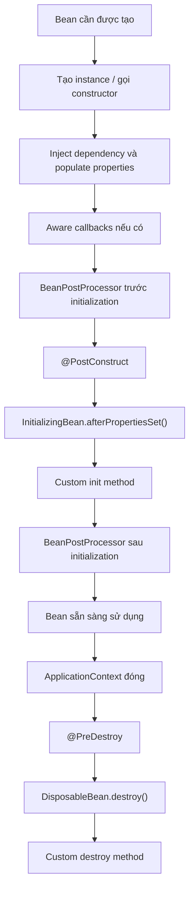
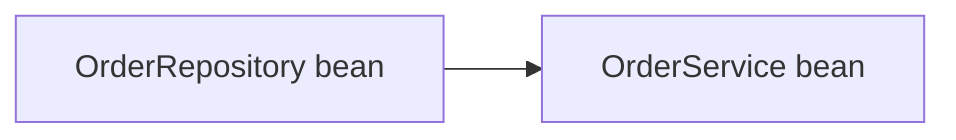
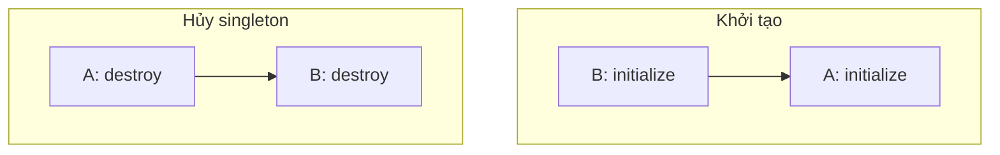
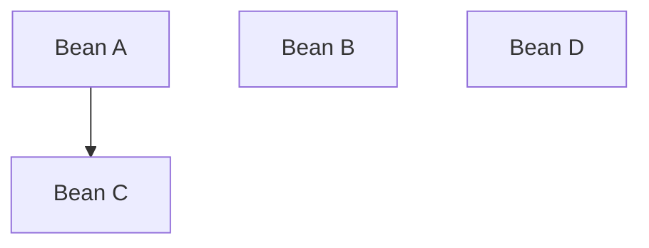

# @DependsOn và thứ tự khởi tạo, hủy giữa các bean

Spring quản lý vòng đời bean trong `ApplicationContext`: tạo instance, inject dependency, gọi callback khởi tạo, phục vụ ứng dụng và cuối cùng gọi callback hủy khi container đóng. Khi bean A cần bean B, dependency thông thường qua constructor hoặc property đã tạo ra quan hệ thứ tự tự nhiên: Spring phải tạo B trước khi có thể tạo và hoàn tất A.

Tuy nhiên, đôi khi một bean cần một bean khác được khởi tạo trước dù nó **không giữ tham chiếu và không inject bean đó**. Ví dụ, một thành phần cần registry toàn cục đã được bootstrap, một client cần một provider đã đăng ký side effect, hoặc một adapter cũ đọc metadata do initializer chuẩn bị. Annotation `@DependsOn` cho phép khai báo rõ ràng quan hệ phụ thuộc khởi tạo như vậy.

`@DependsOn` còn ảnh hưởng đến thứ tự hủy của singleton: bean phụ thuộc được hủy trước bean mà nó phụ thuộc vào. Đây là điều quan trọng với tài nguyên có vòng đời lồng nhau. Bài học giải thích cách dùng annotation, trình tự lifecycle, sự khác nhau với dependency injection và các cơ chế ordering khác, cùng cách kiểm thử thứ tự thực tế.

## 1. Vòng đời bean trong Spring

Một Spring bean không chỉ là một object được tạo bằng `new`. Container quản lý quá trình tạo và hủy theo bean definition, scope và các lifecycle callback đã khai báo.

Với singleton bean thông thường, quy trình khái quát:



Sơ đồ mô tả thứ tự phổ biến của lifecycle callback, đã lược bớt chi tiết nội bộ. Một bean không cần triển khai tất cả callback. Nếu dùng nhiều loại callback, Spring phối hợp chúng theo lifecycle contract tương ứng.

Các callback thường gặp:

| Cơ chế | Thời điểm | Mục đích |
| --- | --- | --- |
| Constructor | Khi tạo instance | Thiết lập trạng thái ban đầu |
| Constructor injection / field / setter injection | Trong quá trình populate bean | Cung cấp dependency |
| `@PostConstruct` | Sau khi dependency đã được inject, trong giai đoạn initialization | Khởi tạo bổ sung |
| `InitializingBean.afterPropertiesSet()` | Giai đoạn initialization | Callback khởi tạo theo Spring interface |
| `initMethod` của `@Bean` | Giai đoạn initialization | Gọi phương thức init do cấu hình khai báo |
| `@PreDestroy` | Khi singleton được hủy | Dọn dẹp trước khi object kết thúc vòng đời |
| `DisposableBean.destroy()` | Giai đoạn destruction | Callback hủy theo Spring interface |
| `destroyMethod` của `@Bean` | Giai đoạn destruction | Gọi phương thức đóng tài nguyên |

Trong ứng dụng thực tế, nên ưu tiên annotation chuẩn như `@PostConstruct` và `@PreDestroy` hoặc cấu hình lifecycle method rõ ràng. Không nên nhồi xử lý khởi tạo nặng, gọi mạng không kiểm soát hoặc nghiệp vụ dài vào constructor.

## 2. Dependency tự nhiên đã quyết định thứ tự như thế nào?

Giả sử `OrderService` cần `OrderRepository`:

```java
@Service
public class OrderService {
    private final OrderRepository repository;

    public OrderService(OrderRepository repository) {
        this.repository = repository;
    }
}
```

Spring phải giải quyết `OrderRepository` trước khi hoàn tất việc tạo `OrderService`. Đây là quan hệ dependency thực sự: service giữ tham chiếu repository và sử dụng nó trong quá trình xử lý.

Có thể biểu diễn:



Trong đồ thị này, repository được tạo và khởi tạo trước khi service có thể được tạo hoàn chỉnh. Khi context đóng, singleton dependent `OrderService` được hủy trước singleton dependency `OrderRepository` theo quan hệ phụ thuộc mà container quản lý.

### 2.1. Khi không có tham chiếu trực tiếp

Một số thành phần cần thứ tự vì side effect bên ngoài:

- Một initializer đăng ký provider vào registry dùng chung.
- Một bean nạp metadata vào thư viện bên thứ ba trước khi client được khởi tạo.
- Một bootstrapper tạo cấu trúc cần thiết cho adapter cũ.
- Một thành phần khởi tạo tài nguyên mà bean khác sẽ sử dụng qua API tĩnh hoặc cơ chế gián tiếp.

Trong những trường hợp này, bean consumer có thể không inject initializer. Spring không thể suy ra quan hệ chỉ từ việc hai lớp cùng nằm trong package hoặc cùng được component scan. `@DependsOn` dùng để khai báo quan hệ thứ tự tường minh.

Ví dụ:

```java
@Component("providerBootstrap")
public class ProviderBootstrap {
    @PostConstruct
    public void initialize() {
        // Đăng ký provider với một registry bên ngoài.
    }

    @PreDestroy
    public void shutdown() {
        // Gỡ đăng ký hoặc giải phóng provider nếu contract yêu cầu.
    }
}
```

```java
@Component
@DependsOn("providerBootstrap")
public class LegacyProviderClient {
    public LegacyProviderClient() {
        // Giả sử thư viện cũ đọc registry đã được bootstrap.
    }
}
```

Spring đảm bảo bean `providerBootstrap` được khởi tạo trước `LegacyProviderClient`. Khi context đóng, singleton `LegacyProviderClient` được hủy trước `providerBootstrap`.

Ví dụ minh họa một dependency side effect. Trong thiết kế mới, nếu client có thể nhận một interface/provider qua constructor thì injection trực tiếp thường rõ ràng hơn `@DependsOn`. Chỉ dùng `@DependsOn` khi quan hệ thứ tự có ý nghĩa nhưng không được thể hiện bằng dependency object thông thường.

## 3. `@DependsOn` là gì?

`@DependsOn` là annotation của Spring:

```java
import org.springframework.context.annotation.DependsOn;
```

Nó nhận một hoặc nhiều tên bean:

```java
@DependsOn("providerBootstrap")
@Component
public class LegacyProviderClient {
    // ...
}
```

Với nhiều bean:

```java
@DependsOn({
    "providerBootstrap",
    "schemaRegistry",
    "cryptoProvider"
})
@Component
public class LegacyIntegrationClient {
    // ...
}
```

Các giá trị trong annotation là **bean name** (hoặc tên alias được container nhận diện), không phải tên class Java đầy đủ. Hãy dùng tên bean ổn định và dễ hiểu, nhất là khi khai báo dependency từ một thư viện dùng chung.

Quy tắc chính:

1. Các bean được liệt kê trong `@DependsOn` phải được khởi tạo trước bean mang annotation.
2. `@DependsOn` không tự inject object vào bean hiện tại.
3. Với singleton bean, bean dependent được hủy trước các bean mà nó phụ thuộc theo quan hệ này.
4. Annotation không tạo ra một thứ tự tổng thể giữa mọi bean trong ứng dụng.
5. Bean được tham chiếu vẫn phải được đăng ký trong context; nếu tên không tồn tại, quá trình tạo bean có thể thất bại.

### 3.1. Khai báo trên component class

Khi dùng component scanning, có thể đặt annotation trên class:

```java
@Component("schemaRegistryBootstrap")
public class SchemaRegistryBootstrap {
    @PostConstruct
    public void loadSchemas() {
        // Nạp schema vào registry mà thư viện dùng chung truy cập.
    }

    @PreDestroy
    public void clearSchemas() {
        // Dọn registry khi ứng dụng đóng.
    }
}
```

```java
@Component
@DependsOn("schemaRegistryBootstrap")
public class LegacySchemaClient {
    @PostConstruct
    public void connect() {
        // Thực hiện kết nối sau khi schema registry đã sẵn sàng.
    }
}
```

Bean `LegacySchemaClient` được tạo sau khi `schemaRegistryBootstrap` đã hoàn tất khởi tạo. Khi context đóng, `LegacySchemaClient` được hủy trước `schemaRegistryBootstrap` nếu cả hai là singleton được container quản lý.

### 3.2. Khai báo trên @Bean method

Nếu bean được tạo bằng Java configuration, có thể đặt `@DependsOn` trên factory method:

```java
@Configuration(proxyBeanMethods = false)
public class IntegrationConfiguration {

    @Bean
    SchemaRegistryBootstrap schemaRegistryBootstrap() {
        return new SchemaRegistryBootstrap();
    }

    @Bean
    @DependsOn("schemaRegistryBootstrap")
    LegacySchemaClient legacySchemaClient() {
        return new LegacySchemaClient();
    }
}
```

Bean name mặc định của `@Bean` method thường là tên phương thức, nên `schemaRegistryBootstrap` là tên được tham chiếu trong ví dụ. Nếu đặt tên tường minh bằng `@Bean("...")`, `@DependsOn` cần dùng đúng tên đó.

Đặt annotation ở factory method giúp quan hệ nằm ngay tại nơi cấu hình bean. Đây thường là lựa chọn dễ đọc khi bean được tạo từ cấu hình Java, còn đặt trên class phù hợp với bean được component scan.

### 3.3. Một bean phụ thuộc nhiều bean

```java
@Bean
@DependsOn({
    "driverBootstrap",
    "schemaRegistryBootstrap",
    "securityProviderBootstrap"
})
LegacyIntegrationClient integrationClient() {
    return new LegacyIntegrationClient();
}
```

Spring phải khởi tạo các bean được liệt kê trước `integrationClient`. Thứ tự giữa các bean được liệt kê không nên được dùng như một hợp đồng thứ tự nội bộ nếu các bean đó cũng phụ thuộc lẫn nhau. Nếu thứ tự giữa initializer A và B là bắt buộc, hãy khai báo quan hệ tương ứng rõ ràng, ví dụ B phụ thuộc A.

## 4. Thứ tự khởi tạo và thứ tự hủy

Giả sử bean B phải sẵn sàng trước bean A:



`@DependsOn("B")` trên A tạo ra ý nghĩa:

- B được khởi tạo trước A.
- A được hủy trước B.

Vì sao hủy theo chiều ngược lại? Nếu A sử dụng tài nguyên do B quản lý, A cần được đóng trước khi B giải phóng tài nguyên. Đây là nguyên tắc reverse dependency order thường thấy trong quản lý tài nguyên.

Ví dụ, nếu client được khởi tạo dựa trên một provider đã đăng ký, client nên đóng kết nối trước khi provider bị gỡ đăng ký. `@DependsOn` giúp Spring ghi nhận quan hệ này đối với singleton bean.

### 4.1. Thứ tự callback bên trong từng bean

Giả sử cả A và B đều có `@PreDestroy` và custom destroy method. `@DependsOn` quyết định **bean nào được hủy trước bean nào**; nó không thay đổi thứ tự callback bên trong một bean.

Với một bean có các callback thông dụng, thứ tự destruction là:

1. Phương thức `@PreDestroy`.
2. `DisposableBean.destroy()` nếu bean triển khai interface.
3. Custom destroy method được khai báo, ví dụ `@Bean(destroyMethod = "close")`.

Ví dụ:

```java
public class ManagedConnection implements DisposableBean {
    @PreDestroy
    public void beforeDestroy() {
        // Callback annotation.
    }

    @Override
    public void destroy() {
        // Callback từ Spring interface.
    }

    public void close() {
        // Custom destroy method.
    }
}
```

```java
@Bean(destroyMethod = "close")
ManagedConnection managedConnection() {
    return new ManagedConnection();
}
```

Không nên khai báo nhiều callback cùng giải phóng một tài nguyên theo cách có thể đóng hai lần nếu API không hỗ trợ idempotent close. Chọn một cơ chế lifecycle chính hoặc thiết kế callback an toàn khi được gọi lặp theo contract.

### 4.2. Singleton mới có bảo đảm hủy theo quan hệ dependency?

`@DependsOn` có thể ép thứ tự khởi tạo bean ở nhiều scope, nhưng quy tắc hủy theo quan hệ phụ thuộc được Spring mô tả cho **singleton bean**. Với prototype, container tạo và cung cấp instance nhưng không quản lý đầy đủ destruction lifecycle của prototype sau khi trả nó cho caller.

Không nên dựa vào `@DependsOn` để mong Spring tự đóng mọi prototype object theo thứ tự ngược. Nếu ứng dụng sở hữu prototype resource, caller hoặc một scope/lifecycle manager phù hợp phải chịu trách nhiệm giải phóng nó.

Với request/session scope, vòng đời target do scope tương ứng quản lý và có thể có destruction callback. Không nên suy rộng bảo đảm destruction ordering của singleton sang mọi loại web scope.

## 5. @DependsOn khác constructor injection như thế nào?

Hai cơ chế đều có thể tạo ra thứ tự khởi tạo, nhưng diễn đạt hai quan hệ khác nhau.

### 5.1. Constructor injection là dependency thực

```java
@Service
public class InvoiceService {
    private final InvoiceRepository repository;

    public InvoiceService(InvoiceRepository repository) {
        this.repository = repository;
    }
}
```

Invoice service cần repository để làm việc và sử dụng nó trong method. Spring phải tạo repository trước để truyền vào constructor.

### 5.2. @DependsOn là quan hệ thứ tự

```java
@Component("timezoneRegistryBootstrap")
class TimezoneRegistryBootstrap {
    @PostConstruct
    void load() {
        // Nạp dữ liệu vào registry dùng chung của thư viện.
    }
}

@Component
@DependsOn("timezoneRegistryBootstrap")
class LegacyTimezoneClient {
    // Không giữ reference tới bootstrap bean.
}
```

`LegacyTimezoneClient` không sử dụng object `TimezoneRegistryBootstrap` trực tiếp. Nó chỉ cần registry bên ngoài đã được chuẩn bị trước khi khởi tạo. Đây là loại quan hệ `@DependsOn` diễn đạt.

Nếu có thể inject trực tiếp một collaborator và gọi API của nó, hãy ưu tiên dependency injection:

```java
@Component
class TimezoneClient {
    private final TimezoneRegistry registry;

    TimezoneClient(TimezoneRegistry registry) {
        this.registry = registry;
    }
}
```

Trong trường hợp này, Spring đã biết quan hệ phụ thuộc thông qua constructor; không cần thêm `@DependsOn` chỉ để lặp lại thứ tự.

### 5.3. Bảng so sánh

| Tiêu chí | Constructor/property injection | `@DependsOn` |
| --- | --- | --- |
| Mục đích | Cung cấp object dependency để bean sử dụng | Ép một bean khác được khởi tạo trước |
| Bean consumer giữ reference? | Có | Không tự động |
| Dependency thể hiện trong API class? | Có | Thể hiện ở metadata annotation |
| Thứ tự khởi tạo | Theo dependency graph | Theo tên bean khai báo |
| Thứ tự hủy singleton | Theo quan hệ dependency | Theo quan hệ depends-on |
| Dùng khi | Bean cần gọi collaborator | Cần thứ tự vì side effect hoặc quan hệ gián tiếp |
| Có thể thay bằng factory/service abstraction? | Thường là cấu trúc tự nhiên | Có thể, nếu quan hệ thực chất là dependency object |

Đừng dùng `@DependsOn` như cách né constructor injection. Nếu bean A cần gọi B, khai báo B trong constructor giúp code rõ ràng và dễ test hơn.

## 6. @DependsOn khác @Order như thế nào?

`@Order` và `Ordered` thường được dùng để sắp xếp các bean khi Spring cần một thứ tự cho collection hoặc một số extension point. Chúng không có cùng ý nghĩa với `@DependsOn`.

Ví dụ:

```java
@Component
@Order(1)
class FirstValidator implements OrderValidator {
    // ...
}

@Component
@Order(2)
class SecondValidator implements OrderValidator {
    // ...
}
```

Khi inject `List<OrderValidator>`, Spring có thể sắp xếp các phần tử theo order metadata thích hợp:

```java
@Service
class OrderValidationService {
    private final List<OrderValidator> validators;

    OrderValidationService(List<OrderValidator> validators) {
        this.validators = List.copyOf(validators);
    }
}
```

Ở đây `@Order` điều khiển thứ tự trong collection được inject, không nói rằng `FirstValidator` phải được khởi tạo trước `SecondValidator` trong toàn bộ container. Spring có thể tạo bean theo những yêu cầu khác của context.

So sánh:

| Annotation/interface | Điều khiển điều gì? | Không có nghĩa là |
| --- | --- | --- |
| `@DependsOn` | Quan hệ khởi tạo và hủy giữa bean cụ thể | Sắp xếp mọi bean |
| `@Order` | Thứ tự ưu tiên trong một số collection/extension point | Đảm bảo startup/shutdown order |
| `@Primary` | Bean ưu tiên khi resolve dependency đơn | Thứ tự khởi tạo |
| `@Qualifier` | Lọc bean candidate theo metadata | Khởi tạo bean trước bean khác |
| `@Lazy` | Trì hoãn khởi tạo bean theo cách cấu hình | Thiết lập thứ tự giữa mọi bean |

Nếu yêu cầu là “validator A chạy trước validator B khi duyệt danh sách”, `@Order` phù hợp. Nếu yêu cầu là “registry phải được bootstrap trước khi client khởi tạo”, `@DependsOn` có thể phù hợp.

## 7. @DependsOn không phải công cụ điều phối toàn bộ startup

Một ứng dụng có nhiều công việc cần thực hiện sau khi context đã khởi tạo. Ví dụ:

- Nạp dữ liệu ban đầu.
- Kiểm tra kết nối tới hệ thống ngoài.
- Khởi chạy consumer.
- Thực hiện một tác vụ sau khi application sẵn sàng.
- Quản lý dịch vụ có lifecycle start/stop riêng.

`@DependsOn` chỉ diễn đạt quan hệ tạo/hủy giữa bean. Nó không phải bộ điều phối nghiệp vụ startup, không chờ hệ thống bên ngoài đạt readiness và không thay thế orchestration giữa nhiều ứng dụng hoặc nhiều node.

### 7.1. ApplicationRunner và CommandLineRunner

Nếu cần thực hiện tác vụ sau khi Spring Boot đã tạo application context, có thể dùng `ApplicationRunner` hoặc `CommandLineRunner`:

```java
@Component
public class InitialDataLoader implements ApplicationRunner {
    @Override
    public void run(ApplicationArguments args) {
        // Thực hiện công việc sau khi context được khởi tạo.
    }
}
```

Nhiều runner có thể được sắp xếp bằng `@Order` hoặc `Ordered`. Đây là thứ tự gọi runner, không phải dependency order của bean lifecycle.

### 7.2. SmartLifecycle cho thành phần cần start/stop

Một số thành phần hạ tầng có vòng đời khởi chạy và dừng riêng, chẳng hạn listener container hoặc integration endpoint. Spring cung cấp `SmartLifecycle` để tham gia quá trình start/stop của context và hỗ trợ phase ordering.

```java
@Component
public class MessageEndpointLifecycle implements SmartLifecycle {
    private boolean running;

    @Override
    public void start() {
        // Bắt đầu nhận message.
        running = true;
    }

    @Override
    public void stop() {
        // Dừng nhận message và giải phóng tài nguyên.
        running = false;
    }

    @Override
    public boolean isRunning() {
        return running;
    }

    @Override
    public int getPhase() {
        return 100;
    }
}
```

Ví dụ là skeleton minh họa; implementation thực tế cần xử lý stop bất đồng bộ, callback nếu cần và đảm bảo idempotency. `SmartLifecycle` phase giúp điều khiển thứ tự start/stop giữa lifecycle component. Nó khác với `@DependsOn` vốn xác định quan hệ tạo bean.

### 7.3. Event listener cho phản ứng sau startup

Có thể lắng nghe `ApplicationReadyEvent` nếu một hành động chỉ nên chạy sau khi Spring Boot thông báo ứng dụng đã sẵn sàng:

```java
@Component
public class ReadyListener {
    @EventListener
    public void onReady(ApplicationReadyEvent event) {
        // Phản ứng khi ứng dụng đã sẵn sàng.
    }
}
```

Không dùng event chỉ để thay thế mọi quan hệ dependency. Nếu client cần registry trước khi khởi tạo, hãy biểu diễn dependency đó ở lifecycle phù hợp. Nếu một tác vụ chỉ cần chạy sau khi app ready, event hoặc runner phù hợp hơn.

## 8. Thứ tự giữa nhiều bean không liên quan

Giả sử context có ba bean A, B, C và không có dependency nào giữa chúng. Spring không cung cấp một hợp đồng tổng thể rằng A luôn khởi tạo trước B rồi đến C theo thứ tự file, package hoặc alphabet.

Không nên dựa vào:

- Thứ tự class xuất hiện trong thư mục.
- Thứ tự import trong IDE.
- Thứ tự file cấu hình được nhìn thấy.
- Tên class được sắp xếp alphabet.
- Thứ tự tình cờ của log khi ứng dụng khởi động.

Nếu có quan hệ bắt buộc, hãy khai báo bằng constructor dependency, factory method parameter hoặc `@DependsOn` khi dependency chỉ là side effect. Nếu chỉ cần thứ tự xử lý trong một collection, dùng `@Order`.

Ví dụ đồ thị:



Đồ thị chỉ quy định C cần A được khởi tạo trước. Nó không quy định B và D phải chạy trước hay sau A, cũng không tạo ra thứ tự tuyến tính giữa tất cả bean.

## 9. Nhiều tầng @DependsOn và dependency graph

Các quan hệ có thể nối thành chuỗi:

```java
@Component("providerBootstrap")
class ProviderBootstrap {
    @PostConstruct
    void start() {}
}

@Component("clientBootstrap")
@DependsOn("providerBootstrap")
class ClientBootstrap {
    @PostConstruct
    void start() {}
}

@Component
@DependsOn("clientBootstrap")
class BusinessAdapter {
    @PostConstruct
    void start() {}
}
```

Thứ tự khởi tạo được đảm bảo:

1. `providerBootstrap`.
2. `clientBootstrap`.
3. `businessAdapter`.

Thứ tự hủy của các singleton theo quan hệ phụ thuộc là chiều ngược lại:

1. `businessAdapter`.
2. `clientBootstrap`.
3. `providerBootstrap`.

Không cần thêm `@DependsOn("providerBootstrap")` vào `BusinessAdapter` nếu chuỗi phụ thuộc đã được biểu diễn qua `clientBootstrap`, trừ khi bean đó có một quan hệ trực tiếp riêng cần diễn đạt. Khai báo dư có thể làm đồ thị khó đọc.

### 9.1. Nhiều dependency độc lập

Nếu bean A phụ thuộc cả B và C:

```java
@Component
@DependsOn({"bootstrapB", "bootstrapC"})
class ClientA {
}
```

Spring phải đảm bảo B và C được khởi tạo trước A. Nếu B và C không phụ thuộc lẫn nhau, không nên dựa vào thứ tự tương đối giữa chúng. Nếu C bắt buộc phải sau B, hãy khai báo quan hệ đó riêng.

### 9.2. Tránh dependency cycle

Không tạo:

```java
@Component("bootstrapA")
@DependsOn("bootstrapB")
class BootstrapA {}

@Component("bootstrapB")
@DependsOn("bootstrapA")
class BootstrapB {}
```

Đây là vòng phụ thuộc tường minh. Spring không thể thỏa mãn cả hai điều kiện và có thể báo lỗi circular depends-on relationship khi tạo bean.

Cách giải quyết là xem lại quan hệ lifecycle: có thực sự A cần B và B cần A khởi tạo trước nhau không? Có thể tách một initializer thứ ba chuẩn bị tài nguyên chung, rồi cả A và B phụ thuộc initializer đó. Hoặc đưa giao tiếp thành dependency object/event có hướng rõ ràng.

Không nên thêm `@Lazy` chỉ để che một vòng thứ tự mà không giải quyết nguyên nhân.

## 10. Lazy initialization và @DependsOn

`@Lazy` trì hoãn việc tạo bean cho tới khi bean được yêu cầu, tùy vị trí và cấu hình. `@DependsOn` không có nghĩa mọi bean trong ứng dụng sẽ được khởi tạo sớm hơn; nó chỉ tác động khi bean dependent thực sự được tạo.

Ví dụ:

```java
@Component("cacheBootstrap")
@Lazy
class CacheBootstrap {
    @PostConstruct
    void warmUp() {
        // Chuẩn bị cache.
    }
}

@Component
@Lazy
@DependsOn("cacheBootstrap")
class CacheAwareClient {
    // ...
}
```

Khi `CacheAwareClient` được yêu cầu tạo, Spring phải giải quyết dependency depends-on trước khi hoàn tất bean này. Nếu bean dependent chưa được yêu cầu, việc lazy initialization vẫn có thể trì hoãn quá trình.

Cần phân biệt:

- `@Lazy` quyết định thời điểm tạo bean.
- `@DependsOn` quyết định bean nào phải được khởi tạo trước khi bean dependent được khởi tạo.
- `@DependsOn` không làm một lazy bean dependent trở thành eager singleton trong mọi trường hợp.

Nếu cần bảo đảm một startup action chạy trong giai đoạn cụ thể của ứng dụng, hãy cân nhắc runner, event hoặc lifecycle component thay vì dựa vào side effect của lazy bean.

## 11. Dùng @DependsOn cho resource initialization và cleanup

Một ví dụ hợp lý là client phụ thuộc vào một thư viện đã được cấu hình toàn cục. Bean bootstrap đăng ký provider; client đọc registry đó trong quá trình khởi tạo và đóng kết nối trước khi provider bị gỡ.

```java
@Component("providerBootstrap")
public class ProviderBootstrap {
    @PostConstruct
    public void registerProvider() {
        // Đăng ký provider với thư viện tích hợp.
    }

    @PreDestroy
    public void unregisterProvider() {
        // Gỡ provider sau khi các client dependent đã dừng.
    }
}
```

```java
@Component
@DependsOn("providerBootstrap")
public class LegacySdkClient {
    @PostConstruct
    public void open() {
        // SDK đọc provider đã đăng ký và mở tài nguyên.
    }

    @PreDestroy
    public void close() {
        // Đóng tài nguyên trước khi provider bị gỡ.
    }
}
```

Với singleton bean, thứ tự là:

```text
Khởi tạo:
ProviderBootstrap.registerProvider()
LegacySdkClient.open()

Hủy:
LegacySdkClient.close()
ProviderBootstrap.unregisterProvider()
```

Đây là lý do `@DependsOn` có ý nghĩa ở cả hai đầu lifecycle. Nếu chỉ bảo đảm khởi tạo mà quên hủy theo thứ tự phù hợp, client có thể đóng tài nguyên sau khi provider hoặc registry đã bị giải phóng.

Tuy vậy, global registry và side effect ẩn làm code khó test. Nếu thư viện cung cấp API để truyền provider/client trực tiếp qua constructor, nên ưu tiên cách đó. `@DependsOn` là công cụ cho các quan hệ thứ tự mà không thể biểu diễn hợp lý bằng object reference, không phải lý do để tạo thêm global mutable state.

## 12. Kiểm thử thứ tự khởi tạo và hủy

Không nên chỉ nhìn log khởi động để kết luận ordering. Có thể viết test context nhỏ ghi lại lifecycle event rồi đóng context và kiểm tra thứ tự.

Ví dụ dùng `AnnotationConfigApplicationContext`:

```java
import java.util.ArrayList;
import java.util.List;

public class LifecycleEvents {
    private final List<String> values = new ArrayList<>();

    public void add(String value) {
        values.add(value);
    }

    public List<String> values() {
        return List.copyOf(values);
    }
}
```

Hai bean ghi nhận callback:

```java
public class BootstrapBean {
    private final LifecycleEvents events;

    public BootstrapBean(LifecycleEvents events) {
        this.events = events;
    }

    public void start() {
        events.add("bootstrap:start");
    }

    public void close() {
        events.add("bootstrap:close");
    }
}
```

```java
public class ClientBean {
    private final LifecycleEvents events;

    public ClientBean(LifecycleEvents events) {
        this.events = events;
    }

    public void start() {
        events.add("client:start");
    }

    public void close() {
        events.add("client:close");
    }
}
```

Java configuration:

```java
import org.springframework.context.annotation.Bean;
import org.springframework.context.annotation.Configuration;
import org.springframework.context.annotation.DependsOn;

@Configuration(proxyBeanMethods = false)
public class LifecycleConfiguration {

    @Bean
    LifecycleEvents lifecycleEvents() {
        return new LifecycleEvents();
    }

    @Bean(initMethod = "start", destroyMethod = "close")
    BootstrapBean bootstrapBean(LifecycleEvents events) {
        return new BootstrapBean(events);
    }

    @Bean(initMethod = "start", destroyMethod = "close")
    @DependsOn("bootstrapBean")
    ClientBean clientBean(LifecycleEvents events) {
        return new ClientBean(events);
    }
}
```

Test:

```java
import static org.junit.jupiter.api.Assertions.assertEquals;

import java.util.List;
import org.junit.jupiter.api.Test;
import org.springframework.context.annotation.AnnotationConfigApplicationContext;

class DependsOnLifecycleTest {

    @Test
    void initializesDependencyFirstAndDestroysDependentFirst() {
        var context =
                new AnnotationConfigApplicationContext(LifecycleConfiguration.class);

        LifecycleEvents events = context.getBean(LifecycleEvents.class);

        assertEquals(
                List.of("bootstrap:start", "client:start"),
                events.values()
        );

        context.close();

        assertEquals(
                List.of(
                        "bootstrap:start",
                        "client:start",
                        "client:close",
                        "bootstrap:close"
                ),
                events.values()
        );
    }
}
```

Các bean `BootstrapBean` và `ClientBean` đều nhận `LifecycleEvents` qua factory method parameter, vì vậy Spring biết chúng phụ thuộc vào event collector. `@DependsOn("bootstrapBean")` bổ sung quan hệ thứ tự giữa client và bootstrap. Khi context đóng, client được hủy trước bootstrap.

Trong test này, context được đóng tường minh. Có thể dùng `try-with-resources` với context nếu muốn bảo đảm đóng trong mọi đường thực thi, rồi giữ tham chiếu `LifecycleEvents` bên ngoài để assertion sau khi đóng.

Test trên kiểm tra **lifecycle ordering**, không kiểm tra hành vi của một database, provider hoặc SDK thực tế. Với adapter thật, cần integration test phù hợp để xác nhận side effect đã hoàn tất trước khi consumer khởi tạo.

## 13. Các lỗi thường gặp

| Triệu chứng | Nguyên nhân | Cách xử lý |
| --- | --- | --- |
| `NoSuchBeanDefinitionException` hoặc lỗi không tìm thấy depends-on bean | Tên bean khai báo không tồn tại trong context | Kiểm tra bean name, alias, component scan và @Bean method |
| Startup báo circular depends-on | Hai hoặc nhiều bean phụ thuộc thứ tự vòng tròn | Tách initializer chung hoặc thiết kế lại hướng dependency |
| Bean được khởi tạo sai thứ tự kỳ vọng | Quan hệ chưa được khai báo hoặc đang dựa vào thứ tự tình cờ | Khai báo dependency thực hoặc @DependsOn |
| Bean vẫn không được inject dù đã @DependsOn | Annotation chỉ quy định thứ tự, không cung cấp object reference | Dùng constructor injection nếu consumer cần gọi bean kia |
| Destroy callback không chạy | Context chưa được đóng sạch, bean không có callback hoặc scope không được container quản lý destruction như mong đợi | Kiểm tra context shutdown và lifecycle contract |
| Prototype không được hủy tự động | Spring không quản lý đầy đủ destruction của prototype sau khi cấp instance | Caller chịu trách nhiệm cleanup |
| Background process vẫn chạy khi dependency đã đóng | Lifecycle component không có stop coordination phù hợp | Dùng SmartLifecycle hoặc cơ chế start/stop thích hợp |
| Thứ tự bean trong list không đúng | Dùng @DependsOn để mong sắp xếp collection | Dùng @Order/Ordered cho collection |
| Ứng dụng chỉ chạy sai ở môi trường cụ thể | Bean bị profile/condition/lazy config chi phối | Kiểm tra context và điều kiện đăng ký từng môi trường |

### 13.1. Sai bean name

Ví dụ:

```java
@Component("schemaBootstrap")
class SchemaBootstrap {}

@Component
@DependsOn("schemaRegistryBootstrap")
class SchemaClient {}
```

Tên khai báo và tên bean thực tế không khớp. Spring không tự suy luận rằng hai tên này chỉ cùng một class. Hãy dùng một tên thống nhất hoặc đặt tên bean rõ ràng ở nơi đăng ký.

### 13.2. Nhầm @DependsOn với @Autowired

Đoạn sau không inject `BootstrapBean` vào `ClientBean`:

```java
@Component
@DependsOn("bootstrapBean")
class ClientBean {
    // Không có field hoặc constructor parameter BootstrapBean.
}
```

Nếu code cần gọi `bootstrapBean.someMethod()`, hãy khai báo constructor dependency. `@DependsOn` chỉ đảm bảo thứ tự tạo/hủy; nó không tạo biến tham chiếu để gọi method.

### 13.3. Dựa vào thứ tự khởi tạo để đồng bộ hệ thống phân tán

`@DependsOn` chỉ điều khiển bean trong một Spring container. Nó không bảo đảm một service ở máy khác đã sẵn sàng, database đã replicate xong, message broker đã nhận metadata hoặc một pod khác đã hoàn tất migration.

Với phụ thuộc giữa process hoặc node, cần readiness probe, retry/backoff, health check, migration orchestration, leader election hoặc cơ chế đồng bộ phù hợp. Không dùng annotation trong JVM để thay thế coordination ở cấp hệ thống.

## 14. Lựa chọn cơ chế phù hợp

Có thể chọn theo câu hỏi thực tế:

| Yêu cầu | Cơ chế nên cân nhắc |
| --- | --- |
| Bean A cần gọi method của bean B | Constructor injection |
| Bean A cần bean B được khởi tạo trước vì side effect nhưng không giữ reference | `@DependsOn` |
| Cần sắp xếp validator/interceptor trong collection | `@Order` hoặc `Ordered` |
| Cần chọn bean mặc định khi có nhiều implementation | `@Primary` |
| Cần chọn implementation theo ý nghĩa nghiệp vụ | `@Qualifier` hoặc custom qualifier |
| Cần chạy tác vụ sau khi context được tạo | `ApplicationRunner` / `CommandLineRunner` |
| Cần start/stop listener hoặc lifecycle component theo phase | `SmartLifecycle` |
| Cần phản ứng khi ứng dụng đã ready | `ApplicationReadyEvent` |
| Cần chờ dịch vụ bên ngoài sẵn sàng | Health check, retry, readiness và orchestration phù hợp |

Một nguyên tắc dễ áp dụng: **thể hiện dependency bằng object reference khi bean thực sự cần sử dụng object đó; dùng @DependsOn khi điều cần thiết là thứ tự lifecycle và quan hệ đó không được biểu diễn qua injection.**

## 15. Bài tập thực hành

### Bài tập 1 — Quan sát thứ tự init và destroy

Tạo hai singleton bean `RegistryBootstrap` và `LegacyClient`. Mỗi bean có init method và destroy method ghi một chuỗi vào event collector. Dùng `@DependsOn("registryBootstrap")` trên client. Khởi tạo context, đóng context và xác nhận thứ tự sự kiện.

### Bài tập 2 — Phân biệt dependency object và dependency thứ tự

Viết hai phiên bản của một service:

- Phiên bản A nhận `SchemaRegistry` qua constructor và sử dụng nó.
- Phiên bản B không giữ tham chiếu registry, nhưng cần registry được bootstrap trước vì một thư viện cũ đọc global registry trong init method.

Giải thích phiên bản nào cần constructor injection và phiên bản nào có thể dùng `@DependsOn`.

### Bài tập 3 — Kiểm tra vòng depends-on

Tạo bean A depends-on B và B depends-on A. Quan sát lỗi khởi tạo. Sau đó trích xuất một bean C làm initializer chung và để A, B cùng phụ thuộc C. Giải thích vì sao đồ thị mới không còn vòng.

### Bài tập 4 — So sánh với @Order

Tạo ba `OrderValidator`, gắn `@Order` khác nhau và inject `List<OrderValidator>`. Quan sát thứ tự thực thi. Sau đó thêm `@DependsOn` giữa hai validator và giải thích vì sao nó không thay thế thứ tự trong list.

### Bài tập 5 — Chọn lifecycle API cho background listener

Giả sử ứng dụng có một message listener cần start sau khi connection manager sẵn sàng và stop trước khi connection manager đóng. Xác định phần nào là dependency injection, phần nào là start/stop lifecycle, và liệu `SmartLifecycle` phù hợp hơn việc chỉ dùng `@DependsOn` hay không.

## 16. Ghi nhớ

`@DependsOn` khai báo một quan hệ thứ tự giữa các bean theo tên: bean được chỉ định phải khởi tạo trước bean mang annotation. Với singleton, bean dependent được hủy trước bean mà nó phụ thuộc. Annotation đặc biệt hữu ích khi cần thứ tự vì side effect hoặc một quan hệ lifecycle không thể hiện qua constructor/property dependency.

`@DependsOn` không inject object, không sắp xếp toàn bộ quá trình startup, không thay thế `@Order` cho collection, không thay thế `SmartLifecycle` cho thành phần cần start/stop và không điều phối readiness giữa nhiều process. Nếu một bean cần sử dụng bean khác, hãy ưu tiên constructor injection. Nếu chỉ cần quan hệ thứ tự, dùng `@DependsOn` với bean name rõ ràng và kiểm thử cả init lẫn destroy order.

Khi hiểu rõ dependency graph, scope và lifecycle callback, bạn có thể chọn đúng cơ chế để bean khởi tạo trong trạng thái sẵn sàng và được hủy theo thứ tự an toàn.
