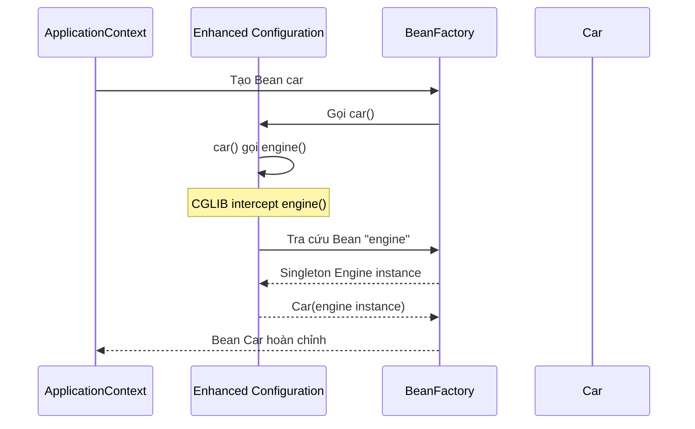
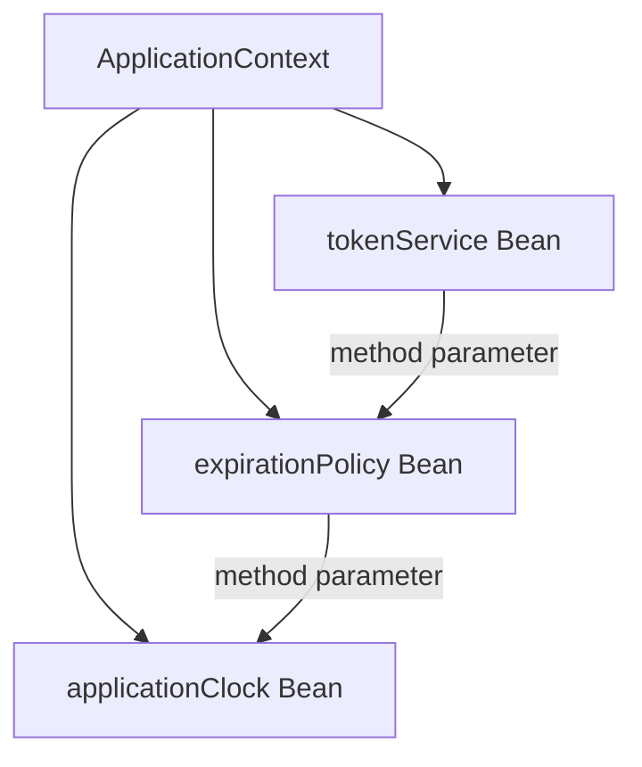

# Full configuration, lite configuration và xử lý lời gọi giữa các @Bean

Trong Spring, method được đánh dấu `@Bean` là một factory method: Spring gọi method để lấy object rồi đăng ký object đó thành Bean trong IoC container. Khi một Bean cần một Bean khác, ta thường thấy hai cách viết:

```java
@Bean
Engine engine() {
    return new Engine();
}

@Bean
Car car() {
    return new Car(engine());
}
```

Nhìn như Java thông thường, lời gọi `engine()` sẽ chạy method và tạo một object mới. Nhưng nếu hai method này nằm trong một class `@Configuration` theo chế độ mặc định, Spring có thể **can thiệp vào lời gọi giữa các method @Bean** để trả về Bean do container quản lý thay vì tạo một object độc lập.

Khả năng này liên quan đến hai chế độ cấu hình:

- **Full configuration:** `@Configuration(proxyBeanMethods = true)`. Đây là mặc định. Spring tăng cường class cấu hình bằng CGLIB để xử lý các lời gọi trực tiếp giữa các method `@Bean`.
- **Lite configuration:** `@Configuration(proxyBeanMethods = false)`, hoặc class kiểu `@Component`/class cấu hình lite khác có khai báo method `@Bean`. Các method `@Bean` vẫn đăng ký Bean, nhưng lời gọi Java từ method này sang method khác không được intercept để tra cứu Bean trong container.

Sự khác biệt này rất quan trọng. Cùng một dòng `new Car(engine())` có thể dùng lại singleton Bean trong full mode, nhưng tạo một `Engine` mới ngoài container trong lite mode. Cách viết rõ ràng và hoạt động ổn định trong cả hai chế độ là **đưa dependency vào tham số của method @Bean**.

## 1. @Bean là factory method, còn @Configuration là class chứa cấu hình

Một method `@Bean` mô tả cách tạo một Bean:

```java
@Configuration
public class VehicleConfiguration {

    @Bean
    Engine engine() {
        return new Engine();
    }
}
```

Khi cấu hình này được đăng ký và xử lý, Spring tạo BeanDefinition tương ứng với factory method `engine()`. Tên Bean mặc định là tên method, ở đây là `engine`; kiểu Bean được suy ra từ kiểu trả về và metadata liên quan.

Method `@Bean` không cần trả về class có annotation Spring. Đây là một cách đăng ký đối tượng từ thư viện bên ngoài hoặc từ class Java thuần mà bạn không thể sửa.

`@Configuration` đánh dấu class là nguồn định nghĩa Bean. Với chế độ mặc định `proxyBeanMethods = true`, Spring sử dụng cơ chế subclass enhancement để đảm bảo các lời gọi giữa method `@Bean` trong class đó có semantics của container.

### Phân biệt hai việc

| Thành phần | Trách nhiệm |
|---|---|
| `@Bean` | Đăng ký object do factory method trả về thành Bean |
| `@Configuration` | Đánh dấu class cấu hình và, ở full mode, bật enhancement cho lời gọi giữa các method Bean |
| `ApplicationContext` | Lưu định nghĩa, tạo và quản lý Bean instance, phân giải dependency |
| CGLIB enhancement | Intercept lời gọi method Bean trong full configuration để tuân theo quy tắc container |

Có thể có method `@Bean` trong class không mang `@Configuration`. Spring vẫn có thể xử lý chúng khi class được đăng ký như một component hoặc được import/đăng ký bằng cơ chế cấu hình phù hợp. Khi đó class thường hoạt động theo **lite configuration semantics**.

## 2. Full configuration: proxyBeanMethods mặc định là true

Khi viết:

```java
@Configuration
public class FullVehicleConfiguration {
    @Bean
    Engine engine() {
        return new Engine();
    }

    @Bean
    Car car() {
        return new Car(engine());
    }
}
```

Spring mặc định xử lý class này ở **full mode** vì `proxyBeanMethods` mặc định là `true`.

Trong quá trình xử lý cấu hình, Spring tạo một subclass được tăng cường bằng CGLIB. Các method `@Bean` có thể được override/intercept. Khi một method `@Bean` gọi method `@Bean` khác trên instance cấu hình đã được tăng cường, lời gọi được chuyển thành thao tác tra cứu Bean phù hợp trong container.

Vì vậy:

```java
@Bean
Car car() {
    return new Car(engine());
}
```

trong full configuration không đơn giản tương đương với:

```java
return new Car(new Engine());
```

Với Bean `engine` có scope singleton mặc định, lời gọi `engine()` được intercept và trả về singleton do container quản lý. Bean `Car` và Bean `Engine` vì vậy dùng cùng một instance Engine.

### Quan sát identity của Bean

Giả sử các class đơn giản:

```java
public class Engine {
}

public class Car {
    private final Engine engine;

    public Car(Engine engine) {
        this.engine = engine;
    }

    public Engine getEngine() {
        return engine;
    }
}
```

Kiểm tra:

```java
try (var context =
        new AnnotationConfigApplicationContext(FullVehicleConfiguration.class)) {

    Engine engineBean = context.getBean(Engine.class);
    Car carBean = context.getBean(Car.class);

    System.out.println(engineBean == carBean.getEngine()); // true
}
```

Kết quả `true` phản ánh semantics singleton của container: Bean được tra cứu qua context và Bean mà Car nhận từ lời gọi `engine()` trong full configuration là cùng một instance.

### Vì sao cần proxy?

Nếu Spring chỉ gọi factory method như method Java bình thường, mỗi lần gọi `engine()` có thể tạo một object mới. Khi đó:

- Bean `engine` trong container là một instance.
- Lời gọi `engine()` trong `car()` tạo instance thứ hai.
- Các object dùng một object ngoài container trong khi ứng dụng tưởng rằng chúng đang dùng cùng Bean singleton.

Full configuration tránh sự sai lệch đó bằng cách điều hướng lời gọi giữa các method Bean về container.

## 3. CGLIB enhancement làm gì?

Spring dùng CGLIB để tạo subclass của class cấu hình và override các method có thể intercept. Khi code gọi một method `@Bean` trên instance đã được tăng cường, Spring kiểm tra ngữ cảnh tạo Bean và lấy object tương ứng từ BeanFactory.



Sơ đồ mô tả trường hợp đơn giản với singleton. Với scope khác, container áp dụng quy tắc scope tương ứng khi lời gọi được intercept.

### Các giới hạn liên quan đến class/method

Vì full mode cần subclass enhancement:

- Class cấu hình không nên là `final`.
- Method `@Bean` cần được override/intercept; vì vậy không khai báo chúng là `private` hoặc `final` trong full mode.
- Cấu hình phải có khả năng được Spring tăng cường bằng CGLIB.

Nếu class hoặc method không thể được subclass/override, enhancement cần thiết không thực hiện được và Spring có thể báo lỗi cấu hình. Trong trường hợp không cần interception, lite mode là một lựa chọn rõ ràng.

Các method `static @Bean` là trường hợp đặc biệt: method static không được override theo cơ chế instance CGLIB. Không dựa vào interception giữa các method static để đảm bảo dùng lại Bean; hãy tránh gọi factory method này từ method Bean khác và dùng tham số method để biểu đạt dependency.

## 4. Lite configuration: không intercept lời gọi giữa các @Bean

Bạn có thể chủ động tắt method proxy:

```java
@Configuration(proxyBeanMethods = false)
public class LiteVehicleConfiguration {
    @Bean
    Engine engine() {
        return new Engine();
    }

    @Bean
    Car car() {
        return new Car(engine());
    }
}
```

Trong lite mode, Spring vẫn phát hiện hai method `@Bean` và đăng ký hai BeanDefinition. Tuy nhiên, nó không tạo enhanced subclass để intercept lời gọi `engine()` bên trong `car()`.

Vì vậy lời gọi này:

```java
return new Car(engine());
```

chạy như Java thông thường: gọi trực tiếp method `engine()` và tạo một object mới. Kết quả:

```java
try (var context =
        new AnnotationConfigApplicationContext(LiteVehicleConfiguration.class)) {

    Engine engineBean = context.getBean(Engine.class);
    Car carBean = context.getBean(Car.class);

    System.out.println(engineBean == carBean.getEngine()); // false
}
```

Container có Bean `engine` của riêng nó, nhưng Bean `car` lại giữ một Engine khác do method Java trực tiếp tạo ra. Object Engine thứ hai không được đăng ký như một Bean riêng, không được container inject và không nhận đầy đủ lifecycle processing như một Bean do container quản lý.

Đây là điểm cần hiểu khi chọn lite mode: nó không làm cho `@Bean` mất tác dụng. Nó chỉ thay đổi semantics của **lời gọi method Bean từ code Java**.

## 5. @Component có @Bean method cũng dùng lite semantics

Ví dụ:

```java
@Component
public class VehicleFactory {
    @Bean
    Engine engine() {
        return new Engine();
    }

    @Bean
    Car car() {
        return new Car(engine());
    }
}
```

Nếu class này được component scan hoặc đăng ký phù hợp, Spring có thể xử lý các method `@Bean` của nó. Nhưng `@Component` không tương đương `@Configuration` full mode. Lời gọi `engine()` trong `car()` là lời gọi Java trực tiếp, nên tạo object mới theo logic method.

Đây là một ví dụ của **lite configuration**: class đóng vai trò nguồn định nghĩa Bean nhưng không được tăng cường để intercept lời gọi giữa các method Bean.

Các nguồn lite configuration thường gặp:

- Class `@Configuration(proxyBeanMethods = false)`.
- Class `@Component` có khai báo các method `@Bean`.
- Các class cấu hình được đăng ký theo cơ chế lite tương ứng.

## 6. Bảng so sánh full và lite configuration

| Đặc điểm | Full configuration | Lite configuration |
|---|---|---|
| Khai báo phổ biến | `@Configuration` mặc định | `@Configuration(proxyBeanMethods = false)` |
| CGLIB enhancement cho class cấu hình | Có | Không |
| Lời gọi trực tiếp giữa các method `@Bean` | Được intercept để tra cứu Bean trong container | Chạy như method Java thông thường |
| Có thể khai báo `@Bean`? | Có | Có |
| BeanDefinition vẫn được đăng ký? | Có | Có |
| Phù hợp khi method Bean gọi trực tiếp method Bean khác và cần container semantics | Có | Không nên dựa vào direct call |
| Chi phí enhancement | Có thêm subclass/proxy processing | Tránh phần enhancement đó |
| Class/method final | Có giới hạn do cần subclass/override | Ít bị giới hạn bởi enhancement này |
| Cách thể hiện dependency khuyến nghị | Tham số method `@Bean` | Tham số method `@Bean` |

**Không nên hiểu full là “cấu hình tốt hơn” và lite là “cấu hình kém hơn”.** Chúng có semantics khác nhau. Nếu các method Bean độc lập hoặc đã khai báo dependency qua tham số, lite mode thường đơn giản và hiệu quả. Nếu bạn cố ý gọi method Bean trực tiếp và muốn container quản lý lời gọi đó như một lần tra cứu Bean, full mode đáp ứng mục đích ấy.

## 7. Cách viết tốt trong cả hai chế độ: inject qua tham số @Bean

Thay vì gọi trực tiếp:

```java
@Bean
Car car() {
    return new Car(engine());
}
```

hãy khai báo dependency trong tham số method:

```java
@Configuration(proxyBeanMethods = false)
public class VehicleConfiguration {
    @Bean
    Engine engine() {
        return new Engine();
    }

    @Bean
    Car car(Engine engine) {
        return new Car(engine);
    }
}
```

Spring phân giải tham số `Engine engine` từ container trước khi gọi factory method `car(...)`. Cách này hoạt động trong cả full và lite mode vì nó sử dụng dependency resolution chính thức, không phụ thuộc vào interception của lời gọi method Java.

Lợi ích:

1. Quan hệ phụ thuộc hiển thị ngay trong chữ ký method.
2. Không cần CGLIB interception để bảo đảm nhận đúng Bean.
3. Có thể chuyển từ full sang lite mode mà không làm thay đổi kết quả wiring.
4. Spring xử lý scope, qualifier, primary và các quy tắc phân giải dependency như thông thường.
5. Dễ đọc và dễ kiểm tra hơn việc dựa vào lời gọi ẩn giữa các factory method.

### Nếu có nhiều Bean cùng kiểu?

Bạn có thể sử dụng qualifier:

```java
@Configuration(proxyBeanMethods = false)
public class VehicleConfiguration {

    @Bean("dieselEngine")
    Engine dieselEngine() {
        return new DieselEngine();
    }

    @Bean("electricEngine")
    Engine electricEngine() {
        return new ElectricEngine();
    }

    @Bean
    Car car(@Qualifier("electricEngine") Engine engine) {
        return new Car(engine);
    }
}
```

Ví dụ giả định `DieselEngine` và `ElectricEngine` đều triển khai/kế thừa kiểu `Engine` phù hợp. Qualifier nói rõ Bean nào được truyền vào Car; không cần gọi trực tiếp method `electricEngine()`.

Nếu một Bean nên là mặc định cho mọi injection theo kiểu, có thể đánh dấu nó bằng `@Primary`. Tuy nhiên, qualifier tại tham số vẫn hữu ích khi một factory method cần lựa chọn có chủ đích.

## 8. So sánh kết quả với scope singleton và prototype

Mặc định, Bean khai báo bằng `@Bean` có scope singleton. Vì vậy sự khác biệt giữa full và lite dễ thấy nhất khi hai factory method phụ thuộc trực tiếp vào nhau:

```java
@Bean
Engine engine() {
    return new Engine();
}

@Bean
Car car() {
    return new Car(engine());
}
```

| Chế độ | Lời gọi `engine()` trong `car()` | Engine mà Car giữ |
|---|---|---|
| Full | Intercept, lấy Bean singleton từ container | Cùng instance với Bean `engine` |
| Lite | Gọi Java method, tạo object mới | Instance riêng, không phải Bean `engine` |

Với prototype:

```java
@Bean
@Scope(ConfigurableBeanFactory.SCOPE_PROTOTYPE)
Engine engine() {
    return new Engine();
}
```

Trong full mode, lời gọi được intercept và container tạo/lấy một prototype instance theo quy tắc scope khi Bean `car` được tạo. Trong lite mode, method được gọi trực tiếp và cũng tạo object mới theo thân method. Hai kết quả có thể trông giống nhau ở ví dụ đơn giản này, nhưng semantics vẫn khác: object do Java tạo trực tiếp không được container quản lý như một prototype Bean, không qua cùng quy trình Bean lifecycle và post-processing.

Nếu cần một Bean có scope đặc biệt, proxy, lifecycle hoặc dependency resolution, hãy lấy nó qua container semantics bằng tham số method/DI thay vì tự gọi factory method.

### Singleton không có nghĩa là một object cho mọi lời gọi Java

Singleton là scope của Bean definition trong container. Trong lite mode, gọi trực tiếp method factory không phải là yêu cầu container lấy Bean singleton; đó chỉ là lời gọi Java. Vì thế bạn có thể tạo object mới ngoài container dù Bean singleton cùng loại đã tồn tại.

Đây là lý do không nên suy luận “method có `@Bean` thì cứ gọi method là nhận singleton”. Điều đó chỉ đúng với lời gọi được Spring intercept trong full configuration, hoặc khi bạn chủ động tra cứu/inject Bean qua container.

## 9. @Bean method parameter giải quyết dependency như thế nào?

Ví dụ:

```java
@Configuration(proxyBeanMethods = false)
public class ApplicationConfiguration {

    @Bean
    Clock applicationClock() {
        return Clock.systemUTC();
    }

    @Bean
    ExpirationPolicy expirationPolicy(Clock applicationClock) {
        return new ExpirationPolicy(applicationClock);
    }

    @Bean
    TokenService tokenService(ExpirationPolicy expirationPolicy) {
        return new TokenService(expirationPolicy);
    }
}
```

Container xây dựng đồ thị phụ thuộc:



Spring nhìn vào tham số method và phân giải dependency như constructor injection. Thứ tự gọi factory method phụ thuộc vào quan hệ dependency và thời điểm cần Bean, không phụ thuộc vào thứ tự method được viết trong file cấu hình.

### Phụ thuộc tùy chọn

Nếu dependency thật sự có thể vắng mặt, có thể biểu đạt bằng kiểu phù hợp:

```java
@Bean
ReportService reportService(
        ObjectProvider<OptionalExporter> exporterProvider) {
    return new ReportService(exporterProvider);
}
```

Ví dụ này minh họa việc truyền provider để phân giải muộn; nếu exporter là bắt buộc, hãy inject trực tiếp kiểu exporter. Không dùng provider chỉ để tránh lỗi cấu hình cho một dependency mà nghiệp vụ không thể thiếu.

## 10. Full mode không phải cách để gọi Bean method tùy tiện ở mọi nơi

CGLIB enhancement có phạm vi cụ thể: các lời gọi method Bean trên instance cấu hình đã được Spring tăng cường. Nó không có nghĩa mọi lời gọi Java đến một method tên giống Bean đều trở thành tra cứu container.

Ví dụ:

```java
VehicleConfiguration config = new VehicleConfiguration();
Car car = config.car();
```

Đoạn này tạo một instance cấu hình bình thường bằng `new`, không phải instance được Spring enhancement. Vì vậy lời gọi `engine()` bên trong chạy như Java bình thường. Spring không thể intercept một object cấu hình bạn tự tạo bên ngoài container.

Tương tự, gọi một factory method qua một instance class cấu hình tự tạo trong unit test không tự mang theo semantics của full configuration. Nếu muốn kiểm tra cấu hình Spring, hãy khởi động một context test và lấy Bean từ context.

**Không nên lấy class cấu hình làm service nghiệp vụ rồi gọi các method @Bean từ code ứng dụng.** Những method đó mô tả cách container tạo Bean; consumer nên nhận Bean qua injection hoặc tra cứu container tại điểm tích hợp thực sự cần thiết.

## 11. Static @Bean methods và một số trường hợp đặc biệt

Một method `@Bean` có thể được khai báo `static` trong một số tình huống:

```java
@Configuration
public class InfrastructureConfiguration {
    @Bean
    static SomeInfrastructureProcessor infrastructureProcessor() {
        return new SomeInfrastructureProcessor();
    }
}
```

Static factory method có thể hữu ích khi cần đăng ký một số BeanFactoryPostProcessor hoặc infrastructure Bean sớm, tránh khởi tạo class cấu hình quá sớm. Nhưng static method không thể được override theo cơ chế CGLIB instance method.

Vì vậy:

- Không dựa vào full-mode interception cho lời gọi static.
- Tránh gọi static `@Bean` method từ một method Bean khác để mong nhận singleton container-managed.
- Nếu một factory method cần dependency, cân nhắc khai báo dependency qua tham số nếu lifecycle/loại processor cho phép.
- Với các processor đặc biệt cần được tạo rất sớm, đọc yêu cầu lifecycle của chính interface processor đó; đôi khi method static là chủ đích.

## 12. Khi nào chọn full, khi nào chọn lite?

### Full configuration phù hợp khi

- Bạn có lý do cụ thể để gọi trực tiếp một method `@Bean` từ method `@Bean` khác.
- Bạn muốn những lời gọi đó được intercept và tôn trọng scope/Bean lifecycle của container.
- Class cấu hình có thể được CGLIB subclass/override.
- Bạn đang duy trì một cấu hình cũ đã dựa vào semantics full và cần giữ hành vi tương thích.

Ví dụ:

```java
@Configuration
public class LegacyConfiguration {
    @Bean
    Engine engine() {
        return new Engine();
    }

    @Bean
    Car car() {
        return new Car(engine());
    }
}
```

### Lite configuration phù hợp khi

- Các method Bean độc lập hoặc dependency được truyền qua tham số method.
- Bạn muốn tránh enhancement CGLIB cho class cấu hình.
- Bạn muốn class cấu hình linh hoạt hơn về tính final/thiết kế.
- Bạn đang khai báo một số Bean trong class component hoặc cấu hình theo phong cách lite.

Ví dụ:

```java
@Configuration(proxyBeanMethods = false)
public class ModernConfiguration {
    @Bean
    Engine engine() {
        return new Engine();
    }

    @Bean
    Car car(Engine engine) {
        return new Car(engine);
    }
}
```

Trong cả hai trường hợp, container vẫn đăng ký và quản lý Bean. Khác biệt nằm ở cách xử lý lời gọi method Bean bên trong Java code.

### Bảng quyết định nhanh

| Câu hỏi | Hướng lựa chọn |
|---|---|
| Các method Bean không gọi trực tiếp lẫn nhau? | Lite mode thường phù hợp |
| Cần dependency từ Bean khác? | Khai báo tham số method; hoạt động ở cả hai mode |
| Cố ý gọi method Bean trực tiếp và cần nhận Bean container-managed? | Full mode |
| Cấu hình class/method không thể subclass/override? | Dùng lite mode và tránh direct inter-bean calls |
| Muốn giảm chi phí enhancement và làm dependency rõ? | Lite mode + method parameter injection |
| Cấu hình cũ đang dựa vào CGLIB interception? | Giữ full mode hoặc chuyển toàn bộ dependency sang method parameters rồi mới tắt proxy |

## 13. Lỗi thường gặp và cách chẩn đoán

| Hiện tượng | Nguyên nhân có thể | Cách xử lý |
|---|---|---|
| Hai Bean singleton tưởng cùng một loại nhưng identity khác nhau | Lite configuration gọi trực tiếp method `@Bean` và tạo object ngoài container | Đổi sang method parameter injection hoặc bật full mode nếu direct call có chủ đích |
| Bean phụ thuộc không nhận cùng singleton | Một object được tạo bằng `new` bên trong method thay vì lấy từ container | Khai báo tham số method hoặc tra cứu Bean theo cách được quản lý |
| Spring báo lỗi enhancement/proxy | Full configuration class hoặc method không thể subclass/override | Bỏ final/private ở vị trí cần thiết hoặc dùng lite mode |
| Bean method trong @Component tạo object mới mỗi lần được gọi | Class dùng lite semantics | Không gọi trực tiếp; dùng method parameter injection |
| Chuyển `proxyBeanMethods = true` sang `false` làm thay đổi hành vi | Code đang phụ thuộc vào interception ngầm | Tìm mọi lời gọi giữa method `@Bean` và chuyển thành tham số method |
| Unit test gọi method cấu hình nhưng kết quả khác context thật | Test tự `new` class cấu hình, không dùng enhanced instance | Dùng ApplicationContext test hoặc test Bean độc lập bằng constructor |

### Kiểm tra identity trong context

Khi nghi ngờ Bean bị tạo trùng, hãy so sánh identity:

```java
try (var context =
        new AnnotationConfigApplicationContext(VehicleConfiguration.class)) {
    Engine engine = context.getBean(Engine.class);
    Car car = context.getBean(Car.class);

    System.out.println(engine == car.getEngine());
}
```

Thay class cấu hình giữa bản full và lite để quan sát kết quả. Đây là một cách minh họa hữu ích, nhưng trong ứng dụng thật nên kiểm tra theo cấu hình và Bean cụ thể, không chỉ dựa vào một log identity.

## 14. Thực hành: chuyển từ direct call sang method injection

Bắt đầu với cấu hình full:

```java
@Configuration
class MessagingConfiguration {
    @Bean
    MessageFormatter formatter() {
        return new UppercaseFormatter();
    }

    @Bean
    MessageService messageService() {
        return new MessageService(formatter());
    }
}
```

**Bước 1:** đổi annotation thành:

```java
@Configuration(proxyBeanMethods = false)
```

**Bước 2:** quan sát xem `MessageService` đang giữ instance nào:

```java
MessageFormatter formatter =
        context.getBean(MessageFormatter.class);
MessageService service =
        context.getBean(MessageService.class);

System.out.println(formatter == service.getFormatter());
```

Trong lite mode, direct call có thể khiến kết quả là `false`.

**Bước 3:** sửa factory method:

```java
@Bean
MessageService messageService(MessageFormatter formatter) {
    return new MessageService(formatter);
}
```

Chạy lại, kết quả sẽ là `true` với Bean formatter singleton. Lúc này cấu hình có thể chạy ở lite mode mà dependency vẫn được phân giải qua container.

**Bước 4:** nếu có nhiều Bean `MessageFormatter`, thêm qualifier vào tham số:

```java
@Bean
MessageService messageService(
        @Qualifier("formatter") MessageFormatter formatter) {
    return new MessageService(formatter);
}
```

Qua thực hành này, bạn thấy rõ khác biệt giữa **gọi một method Java** và **yêu cầu container cung cấp một Bean**.

## 15. Những điều không nên nhầm lẫn

**Tắt proxy không tắt Bean registration.** `@Configuration(proxyBeanMethods = false)` vẫn đăng ký các Bean được khai báo bằng `@Bean`; nó chỉ không intercept lời gọi giữa các method.

**Lite không có nghĩa Bean không được Spring quản lý.** Object trả về trực tiếp từ factory method vẫn là Bean do Spring tạo và quản lý. Chỉ object được tạo thêm bởi lời gọi Java trực tiếp bên trong một method khác mới có thể nằm ngoài container.

**Full không làm mọi lời gọi method trong ứng dụng thành tra cứu Bean.** Cơ chế áp dụng cho lời gọi method Bean trên enhanced configuration instance.

**@Bean method parameter injection không cần full mode.** Đây là cách rõ ràng và portable giữa full/lite.

**Singleton là scope của Bean definition, không phải quy tắc cho mọi lệnh new.** Một class cấu hình lite có thể gọi method factory và tạo object mới dù container đang giữ singleton cùng kiểu.

**@Component có @Bean không tự trở thành full configuration.** Class component với các method Bean thường hoạt động theo lite semantics.

## 16. Kết nối với Java configuration và IoC container

Java configuration cung cấp cách mô tả Bean bằng code Java. `@Bean` chỉ ra factory method nào tạo Bean; `@Configuration` xác định cách class cấu hình được xử lý; còn ApplicationContext quản lý definition, instance và dependency graph.

```text
Full configuration:
    @Configuration (proxyBeanMethods = true)
        → CGLIB enhancement
        → lời gọi @Bean sang @Bean được intercept
        → nhận Bean theo quy tắc container

Lite configuration:
    @Configuration(proxyBeanMethods = false)
    hoặc @Component có @Bean
        → không intercept lời gọi giữa method
        → gọi method như Java thông thường
        → object tạo trực tiếp có thể nằm ngoài container

Cách khai báo dependency nên dùng:
    @Bean
    Car car(Engine engine) { ... }
        → container phân giải tham số
        → đúng trong cả full và lite mode
```

Khi thiết kế class cấu hình, hãy chọn chế độ dựa trên việc bạn có thực sự cần interception hay không. Nếu một Bean cần Bean khác, ưu tiên khai báo Bean đó thành tham số của factory method. Điều này làm dependency hiển thị, tránh vô tình tạo object ngoài container và cho phép cấu hình hoạt động rõ ràng ở cả full lẫn lite mode.
