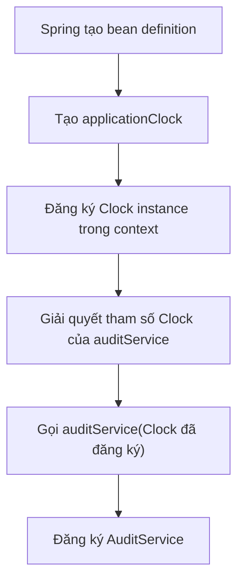
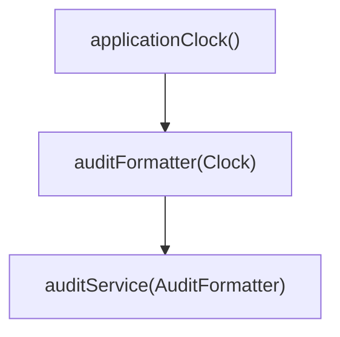

# Tiêm dependency qua tham số `@Bean` thay vì gọi phương thức thủ công

> **Spring Boot Fundamentals · Java configuration**  
> Một phương thức được đánh dấu `@Bean` là factory method mà Spring gọi để tạo và đăng ký bean. Khi một bean cần bean khác, cách rõ ràng và ổn định là **khai báo dependency trong danh sách tham số của phương thức `@Bean`**. Spring sẽ giải quyết tham số từ ApplicationContext rồi truyền vào factory method. Bài học này giải thích cách viết đó, vì sao gọi trực tiếp một phương thức `@Bean` có thể tạo object ngoài ý muốn, và mối liên hệ với `@Configuration(proxyBeanMethods = true/false)`.

## 1. Vấn đề: gọi phương thức cấu hình không phải lúc nào cũng lấy bean từ Spring

Giả sử ứng dụng cần một `Clock` dùng chung và một `AuditService` sử dụng clock đó.

Cách viết dễ gây nhầm:

```java
@Configuration(proxyBeanMethods = false)
public class AuditConfiguration {

    @Bean
    Clock applicationClock() {
        return Clock.systemUTC();
    }

    @Bean
    AuditService auditService() {
        return new AuditService(applicationClock());
    }
}
```

Nhìn qua, code có vẻ hợp lý: `auditService()` gọi `applicationClock()` để lấy clock. Nhưng khi cấu hình dùng `proxyBeanMethods = false`, lời gọi `applicationClock()` bên trong là **lời gọi Java thông thường**. Nó chạy thân phương thức và tạo thêm một `Clock` mới.

Kết quả có thể là:

- Spring gọi `applicationClock()` để tạo bean `applicationClock` và quản lý instance A.
- Spring gọi `auditService()` để tạo bean `auditService`.
- Bên trong `auditService()`, code gọi trực tiếp `applicationClock()`, tạo instance B.
- `AuditService` giữ instance B, còn container quản lý instance A.

Khi đó, object mà service sử dụng không phải bean `applicationClock` mà Spring đã đăng ký. Đây là nguồn gốc của những lỗi khó hiểu như cấu hình không đồng nhất, nhiều instance ngoài dự kiến hoặc lifecycle không được container quản lý như mong muốn.

Cách viết nên dùng:

```java
@Configuration(proxyBeanMethods = false)
public class AuditConfiguration {

    @Bean
    Clock applicationClock() {
        return Clock.systemUTC();
    }

    @Bean
    AuditService auditService(Clock applicationClock) {
        return new AuditService(applicationClock);
    }
}
```

Spring nhận thấy tham số `Clock applicationClock` là một dependency cần giải quyết. Container tìm bean phù hợp và truyền **instance đã được quản lý** vào factory method.



Điểm quan trọng: tham số của phương thức `@Bean` được xử lý như một điểm dependency injection. Bạn mô tả **bean cần gì**, còn Spring chịu trách nhiệm tìm và truyền bean phù hợp.

## 2. Phương thức `@Bean` là factory method do Spring quản lý

Một lớp cấu hình cơ bản:

```java
package com.example.catalog.config;

import java.time.Clock;

import org.springframework.context.annotation.Bean;
import org.springframework.context.annotation.Configuration;

@Configuration(proxyBeanMethods = false)
public class TimeConfiguration {

    @Bean
    Clock applicationClock() {
        return Clock.systemUTC();
    }
}
```

Khi `TimeConfiguration` được Spring nạp, phương thức `applicationClock()` được đăng ký như một bean factory method.

Một số khái niệm cần tách biệt:

| Thành phần | Vai trò |
| --- | --- |
| `@Configuration` | Đánh dấu lớp cấu hình để Spring xử lý các khai báo bean bên trong |
| `@Bean` | Đánh dấu phương thức factory có kết quả được đăng ký làm bean |
| Kiểu trả về | Cho biết loại object được factory method cung cấp |
| Tên phương thức | Thường là tên bean mặc định nếu không chỉ định tên khác |
| Tham số phương thức | Các dependency mà Spring cần giải quyết trước khi gọi factory method |
| Giá trị `return` | Object thực tế được đưa vào container |

Phương thức `@Bean` không phải một API để các class khác tùy ý gọi như helper method. Nó là một phần của cấu hình container. Có thể gọi method trong một số chế độ cấu hình, nhưng khi cần dependency, hãy khai báo dependency ở tham số.

### 2.1. Tham số được Spring giải quyết theo kiểu

Ví dụ:

```java
@Bean
AuditService auditService(Clock applicationClock) {
    return new AuditService(applicationClock);
}
```

Spring tìm bean có thể gán cho kiểu `Clock`. Nếu có đúng một bean phù hợp, bean đó được truyền vào.

Nếu có nhiều bean cùng kiểu, Spring áp dụng quy tắc chọn candidate, chẳng hạn `@Qualifier` hoặc `@Primary`. Nếu không có bean phù hợp và dependency là bắt buộc, context thường thất bại khi tạo bean.

### 2.2. Tên tham số không tự tạo ra bean

Trong ví dụ:

```java
@Bean
AuditService auditService(Clock applicationClock) {
    return new AuditService(applicationClock);
}
```

Tên `applicationClock` giúp người đọc hiểu vai trò, nhưng việc resolve trước hết dựa trên kiểu và metadata autowiring. Nếu có nhiều bean `Clock`, chỉ đổi tên tham số không phải cách đáng tin cậy để chọn một bean cụ thể trong mọi cấu hình/compiler.

Hãy dùng qualifier tường minh:

```java
@Bean
AuditService auditService(
        @Qualifier("utcClock") Clock clock) {
    return new AuditService(clock);
}
```

Như vậy ý định chọn bean đã được thể hiện trực tiếp.

## 3. Dependency injection qua tham số hoạt động trong cả full và lite configuration

Spring hỗ trợ phương thức `@Bean` trong nhiều kiểu lớp cấu hình. Cần phân biệt hai chế độ thường gặp:

- **Full configuration mode:** lớp được đánh dấu `@Configuration` với `proxyBeanMethods = true`, là mặc định.
- **Lite configuration mode:** ví dụ `@Configuration(proxyBeanMethods = false)` hoặc các lớp component khác có khai báo `@Bean`.

Trong cả hai chế độ, **Spring vẫn xử lý tham số phương thức `@Bean` như dependency injection**.

Điểm khác biệt chính nằm ở cách Spring xử lý khi một phương thức `@Bean` được gọi trực tiếp từ một phương thức khác trong cùng lớp cấu hình.

### 3.1. Full mode: `proxyBeanMethods = true`

Ví dụ:

```java
@Configuration
public class FullAuditConfiguration {

    @Bean
    Clock applicationClock() {
        return Clock.systemUTC();
    }

    @Bean
    AuditService auditService() {
        return new AuditService(applicationClock());
    }
}
```

`@Configuration` mặc định dùng `proxyBeanMethods = true`. Spring có thể tạo subclass proxy cho lớp cấu hình và intercept lời gọi giữa các `@Bean` method để bảo đảm lời gọi đó trả về bean được quản lý theo semantics của container, thay vì đơn giản tạo một object mới mỗi lần.

Vì vậy, trong full mode, lời gọi `applicationClock()` từ một `@Bean` method khác trong cùng cấu hình được proxy xử lý và thường trả về bean singleton tương ứng.

Tuy nhiên, cách này dựa vào cơ chế proxy và có những giới hạn:

- Lớp cấu hình phải có khả năng được subclass/proxy.
- Các phương thức `@Bean` được proxy không nên là `private` hoặc `final`.
- Lời gọi phải đi qua instance cấu hình được proxy; gọi method trên một object cấu hình được tạo bằng `new` bên ngoài container không có cùng semantics.
- Khi chuyển sang lite mode hoặc tắt proxy, lời gọi trực tiếp không còn được intercept.

Vì vậy, dù full mode có hỗ trợ inter-bean method reference, **khai báo dependency bằng tham số vẫn là cách rõ ràng và ít phụ thuộc cơ chế proxy hơn**.

### 3.2. Lite mode: `proxyBeanMethods = false`

Ví dụ:

```java
@Configuration(proxyBeanMethods = false)
public class LiteAuditConfiguration {

    @Bean
    Clock applicationClock() {
        return Clock.systemUTC();
    }

    @Bean
    AuditService auditService(Clock applicationClock) {
        return new AuditService(applicationClock);
    }
}
```

Trong lite mode, Spring không tạo CGLIB subclass để intercept các lời gọi method `@Bean` trong lớp. Tuy nhiên, Spring vẫn đọc metadata `@Bean` và gọi factory method để đăng ký bean.

Vì vậy:

- `@Bean` vẫn có hiệu lực.
- Phương thức factory vẫn được Spring gọi.
- Tham số factory method vẫn được dependency injection.
- Lời gọi trực tiếp `applicationClock()` từ code Java trong lớp là lời gọi bình thường và có thể tạo instance mới.

Lite mode có thể giảm nhu cầu proxy và phù hợp với cấu hình mà các bean được kết nối qua tham số method. Đây là một lý do quan trọng để ưu tiên method parameter injection.

### 3.3. Bảng so sánh full mode và lite mode

| Hành vi | Full mode: `proxyBeanMethods = true` | Lite mode: `proxyBeanMethods = false` |
| --- | --- | --- |
| Spring nhận diện `@Bean` method | Có | Có |
| Spring tạo bean từ factory method | Có | Có |
| Tham số `@Bean` được inject | Có | Có |
| Lời gọi trực tiếp `@Bean` method khác trong cùng config | Có thể được proxy intercept để lấy bean container | Lời gọi Java bình thường |
| Cần CGLIB subclass cho inter-bean method interception | Có | Không |
| Phù hợp khi các bean liên kết qua tham số method | Có | Có |
| Rủi ro tạo object mới do gọi method thủ công | Thấp hơn với lời gọi nội bộ được proxy hỗ trợ, nhưng vẫn có giới hạn | Có nếu gọi trực tiếp factory method |

Một quy tắc dễ nhớ: **đừng phụ thuộc vào việc Spring sẽ proxy một lời gọi Java trong lớp cấu hình; hãy để Spring resolve dependency qua tham số**.

## 4. Viết lại ví dụ theo cách khuyến nghị

Ta có ba bean:

- `Clock` cung cấp thời gian.
- `AuditFormatter` định dạng sự kiện audit.
- `AuditService` sử dụng clock và formatter.

### 4.1. Các class ứng dụng

```java
package com.example.catalog.audit;

import java.time.Clock;
import java.time.Instant;

public class AuditFormatter {

    private final Clock clock;

    public AuditFormatter(Clock clock) {
        this.clock = clock;
    }

    public String format(String message) {
        Instant timestamp = clock.instant();
        return timestamp + " - " + message;
    }
}
```

```java
package com.example.catalog.audit;

public class AuditService {

    private final AuditFormatter formatter;

    public AuditService(AuditFormatter formatter) {
        this.formatter = formatter;
    }

    public void record(String message) {
        System.out.println(formatter.format(message));
    }
}
```

Hai class này không cần annotation Spring. Chúng chỉ mô tả hành vi và dependency qua constructor.

### 4.2. Khai báo bean theo dependency graph

```java
package com.example.catalog.config;

import java.time.Clock;

import com.example.catalog.audit.AuditFormatter;
import com.example.catalog.audit.AuditService;

import org.springframework.context.annotation.Bean;
import org.springframework.context.annotation.Configuration;

@Configuration(proxyBeanMethods = false)
public class AuditConfiguration {

    @Bean
    Clock applicationClock() {
        return Clock.systemUTC();
    }

    @Bean
    AuditFormatter auditFormatter(Clock applicationClock) {
        return new AuditFormatter(applicationClock);
    }

    @Bean
    AuditService auditService(AuditFormatter auditFormatter) {
        return new AuditService(auditFormatter);
    }
}
```

Spring có thể xây dựng graph theo quan hệ dependency:



Thứ tự tạo bean được điều phối theo dependency cần thiết. Khi tạo `AuditService`, Spring bảo đảm có `AuditFormatter` phù hợp; khi tạo formatter, Spring giải quyết `Clock`.

Ta không cần gọi `applicationClock()` hoặc `auditFormatter()` trực tiếp. Cấu hình mô tả dependency graph, còn container quyết định thời điểm gọi factory method.

### 4.3. Lớp khởi động

```java
package com.example.catalog;

import com.example.catalog.audit.AuditService;
import org.springframework.boot.SpringApplication;
import org.springframework.boot.autoconfigure.SpringBootApplication;
import org.springframework.context.ConfigurableApplicationContext;

@SpringBootApplication
public class CatalogApplication {

    public static void main(String[] args) {
        ConfigurableApplicationContext context =
                SpringApplication.run(CatalogApplication.class, args);

        AuditService auditService = context.getBean(AuditService.class);
        auditService.record("Application started");
    }
}
```

Trong ứng dụng thực tế, thường inject `AuditService` vào controller, listener hoặc component khác thay vì tự gọi `getBean` trong `main`. Đoạn trên chỉ giúp minh họa rằng bean được đăng ký trong context và có thể được lookup.

## 5. Dependency graph và thứ tự tạo bean

Tham số phương thức `@Bean` giúp Spring biết một bean phụ thuộc vào bean nào.

Ví dụ:

```java
@Bean
PaymentGateway paymentGateway(HttpClient httpClient,
                              PaymentProperties properties) {
    return new PaymentGateway(httpClient, properties);
}
```

Factory method cần hai dependency:

- Một bean `HttpClient`.
- Một bean `PaymentProperties`.

Spring giải quyết cả hai trước khi gọi factory method.

Điều này tạo nên một dependency graph. Nếu `HttpClient` lại cần một bean `SslContext`, và bean `SslContext` cần một bean khác, container tiếp tục giải quyết graph theo các dependency đã khai báo.

### 5.1. Thứ tự khai báo method không phải cách điều khiển thứ tự tạo

Không cần đặt `@Bean httpClient()` ở trên `@Bean paymentGateway()` để đảm bảo client được tạo trước. Quan hệ dependency ở tham số đã diễn đạt điều đó.

Ví dụ:

```java
@Configuration(proxyBeanMethods = false)
class PaymentConfiguration {

    @Bean
    PaymentGateway paymentGateway(HttpClient httpClient) {
        return new PaymentGateway(httpClient);
    }

    @Bean
    HttpClient httpClient() {
        return HttpClient.newHttpClient();
    }
}
```

Dù method `paymentGateway` xuất hiện trước, Spring vẫn giải quyết `HttpClient` khi cần tạo gateway. Cách viết này giúp cấu hình không phụ thuộc vào thứ tự dòng trong file.

### 5.2. Không dùng `@DependsOn` thay cho dependency injection

`@DependsOn` có thể yêu cầu một bean được khởi tạo trước bean khác theo tên, nhưng nó **không truyền object** vào consumer.

Ví dụ:

```java
@Bean
@DependsOn("httpClient")
PaymentGateway paymentGateway() {
    return new PaymentGateway(...);
}
```

Cấu hình này chỉ thể hiện quan hệ thứ tự khởi tạo. Nó không đưa bean `httpClient` vào constructor, và code vẫn phải tự lấy hoặc tự tạo client bằng cách nào đó.

Nếu factory method cần `HttpClient`, hãy khai báo:

```java
@Bean
PaymentGateway paymentGateway(HttpClient httpClient) {
    return new PaymentGateway(httpClient);
}
```

Dùng dependency parameter vừa thể hiện thứ tự cần thiết vừa cung cấp đúng object.

### 5.3. Dependency parameter không phải là gọi method

Hai đoạn sau có ý nghĩa khác nhau:

```java
// Dependency injection do Spring giải quyết.
@Bean
PaymentGateway paymentGateway(HttpClient httpClient) {
    return new PaymentGateway(httpClient);
}
```

```java
// Lời gọi Java trực tiếp.
@Bean
PaymentGateway paymentGateway() {
    return new PaymentGateway(httpClient());
}
```

Ở đoạn thứ nhất, container tìm bean `HttpClient` rồi truyền vào. Ở đoạn thứ hai, code gọi method `httpClient()`. Kết quả của lời gọi thứ hai phụ thuộc vào full/lite configuration mode và có thể tạo object ngoài ý muốn.

## 6. Chọn bean đúng khi có nhiều dependency cùng kiểu

Tham số `@Bean` sử dụng quy tắc autowiring của Spring. Khi có nhiều bean cùng kiểu, cần xác định bean nào phù hợp.

### 6.1. Dùng `@Qualifier`

Ví dụ có hai HTTP client:

```java
@Configuration(proxyBeanMethods = false)
class HttpClientConfiguration {

    @Bean("internalHttpClient")
    HttpClient internalHttpClient() {
        return HttpClient.newBuilder()
                .followRedirects(HttpClient.Redirect.NEVER)
                .build();
    }

    @Bean("partnerHttpClient")
    HttpClient partnerHttpClient() {
        return HttpClient.newBuilder()
                .followRedirects(HttpClient.Redirect.NORMAL)
                .build();
    }
}
```

Factory method chọn client dành cho partner:

```java
@Bean
PartnerService partnerService(
        @Qualifier("partnerHttpClient") HttpClient httpClient) {
    return new PartnerService(httpClient);
}
```

`@Qualifier` xác định rõ candidate. Đây là cách nên dùng khi tên bean biểu diễn vai trò khác nhau.

### 6.2. Dùng `@Primary` cho ứng viên mặc định

Nếu phần lớn consumer nên dùng một client mặc định:

```java
@Bean
@Primary
HttpClient internalHttpClient() {
    return HttpClient.newHttpClient();
}
```

Một factory method nhận `HttpClient` mà không qualifier có thể nhận bean primary nếu các candidate khác cũng phù hợp.

Nhưng nếu một factory method cần client partner, vẫn nên dùng `@Qualifier("partnerHttpClient")`. `@Primary` không làm các bean khác biến mất.

### 6.3. Tham số collection khi cần nhiều bean

Nếu cần tất cả implementation:

```java
@Bean
NotificationDispatcher notificationDispatcher(
        List<NotificationSender> senders) {
    return new NotificationDispatcher(senders);
}
```

Spring có thể inject các bean phù hợp vào collection. Có thể dùng `Map<String, NotificationSender>` khi cần cả tên bean.

Nếu muốn tra cứu trễ, `ObjectProvider<NotificationSender>` cũng có thể được truyền vào factory method hoặc consumer. Chỉ dùng provider khi thật sự cần lookup theo thời điểm sử dụng hoặc cần duyệt candidate.

### 6.4. Dependency không bắt buộc

Tham số `Optional<T>` có thể biểu diễn bean có hoặc không:

```java
@Bean
AuditService auditService(
        Optional<AuditSink> auditSink) {
    return new AuditService(auditSink);
}
```

Điều này giả định `AuditService` có constructor nhận Optional và nghiệp vụ cho phép thiếu audit sink. Nếu audit là yêu cầu bắt buộc, nên inject `AuditSink` trực tiếp để Spring fail fast khi bean không tồn tại.

Với lookup linh hoạt hơn, `ObjectProvider<T>`. Còn nếu muốn tham số có thể nhận `null`, Spring hỗ trợ nullability annotation phù hợp, nhưng `Optional` thường thể hiện ý định rõ hơn trong code Java.

## 7. Tham số factory method có thể nhận property và cấu hình

Không phải mọi tham số của `@Bean` đều là một bean khác. Spring còn hỗ trợ các cơ chế resolve như `@Value` trên tham số.

Ví dụ:

```java
@Bean
HttpClient partnerHttpClient(
        @Value("${partner.connect-timeout-seconds:3}") long timeoutSeconds) {

    return HttpClient.newBuilder()
            .connectTimeout(Duration.ofSeconds(timeoutSeconds))
            .build();
}
```

Ở đây:

- `@Value` yêu cầu Spring resolve property.
- Nếu property không có, biểu thức dùng giá trị mặc định `3`.
- Factory method tạo client từ giá trị đã được bind.

Với một nhóm property lớn, nên dùng `@ConfigurationProperties` thay vì nhiều `@Value` rời rạc.

### 7.1. Dùng `@ConfigurationProperties` làm dependency

```java
@ConfigurationProperties(prefix = "partner")
public record PartnerProperties(
        URI endpoint,
        Duration connectTimeout
) {}
```

Đăng ký properties:

```java
@Configuration(proxyBeanMethods = false)
@EnableConfigurationProperties(PartnerProperties.class)
class PartnerConfiguration {

    @Bean
    HttpClient partnerHttpClient(PartnerProperties properties) {
        return HttpClient.newBuilder()
                .connectTimeout(properties.connectTimeout())
                .build();
    }

    @Bean
    PartnerService partnerService(
            HttpClient partnerHttpClient,
            PartnerProperties properties) {
        return new PartnerService(
                partnerHttpClient,
                properties.endpoint());
    }
}
```

`PartnerProperties` là bean được đăng ký nhờ `@EnableConfigurationProperties`. Các factory method nhận nó như dependency thông thường.

File `application.yml`:

```yaml
partner:
  endpoint: https://partner.example
  connect-timeout: 3s
```

Cấu hình được bind một lần theo cơ chế Spring Boot, rồi có thể được inject vào nhiều bean cần dùng. Cần kiểm tra validation và default value phù hợp; ví dụ trên giả định endpoint và timeout hợp lệ.

## 8. Tham số `@Bean` và scope của dependency

Khi factory method nhận dependency, scope của bean được resolve theo quy tắc Spring. Cần hiểu điều này khi kết hợp singleton, prototype hoặc request scope.

### 8.1. Singleton dependency

Ví dụ:

```java
@Bean
AuditFormatter auditFormatter(Clock applicationClock) {
    return new AuditFormatter(applicationClock);
}
```

Nếu `applicationClock` là singleton, formatter nhận instance clock được container quản lý. Vì `auditFormatter` cũng singleton mặc định, nó giữ tham chiếu tới clock đó trong vòng đời bean.

Đây là cách dùng phổ biến cho service/client/configuration bất biến hoặc thread-safe.

### 8.2. Prototype dependency trong singleton factory

Giả sử `TaskContext` là prototype:

```java
@Bean
@Scope(ConfigurableBeanFactory.SCOPE_PROTOTYPE)
TaskContext taskContext() {
    return new TaskContext();
}

@Bean
TaskCoordinator taskCoordinator(TaskContext taskContext) {
    return new TaskCoordinator(taskContext);
}
```

`TaskCoordinator` là singleton mặc định. Khi tạo coordinator, Spring resolve một `TaskContext` prototype và truyền vào. Coordinator sau đó giữ instance đã nhận.

**Tham số injection không tự gọi lại mỗi khi method của coordinator được sử dụng.** Nếu cần một `TaskContext` mới cho từng job, inject provider:

```java
@Bean
TaskCoordinator taskCoordinator(
        ObjectProvider<TaskContext> taskContextProvider) {
    return new TaskCoordinator(taskContextProvider);
}
```

Sau đó class `TaskCoordinator` có thể gọi `taskContextProvider.getObject()` cho mỗi job. Với prototype có resource, phải có kế hoạch cleanup vì container không quản lý destroy callback của prototype giống singleton.

### 8.3. Request-scoped dependency

Một factory method có thể nhận bean request-scoped khi cấu hình chạy trong web-aware context và scope được hỗ trợ. Nếu bean tạo ra là singleton, việc inject request-scoped bean trực tiếp thường cần scoped proxy hoặc cơ chế provider để truy cập đúng instance theo request.

Ví dụ:

```java
@Bean
RequestAwareService requestAwareService(RequestMetadata metadata) {
    return new RequestAwareService(metadata);
}
```

Nếu `RequestMetadata` là request-scoped bean được cấu hình proxy thích hợp, singleton service có thể giữ proxy và mỗi lần truy cập sẽ đi tới object của request hiện tại. Không được tạo một object request-scoped bằng `new` trong factory rồi coi nó đã có request scope.

## 9. Full configuration mode và lời gọi nội bộ: hiểu đúng proxy

Vì sao Spring cần proxy cho `@Configuration` mặc định?

Xét:

```java
@Configuration
class AppConfiguration {

    @Bean
    Clock clock() {
        return Clock.systemUTC();
    }

    @Bean
    AuditService auditService() {
        return new AuditService(clock());
    }
}
```

Trong full mode, Spring tạo lớp cấu hình được enhance. Khi code gọi `clock()` qua instance cấu hình đã được enhance, proxy có thể kiểm tra bean đã được container tạo chưa và trả về bean đó.

Nếu không có proxy, method call hoạt động theo Java semantics: chạy method và nhận giá trị trả về.

### 9.1. Proxy không phải cơ chế DI tổng quát

CGLIB enhancement chỉ liên quan đến inter-bean method call trong cấu hình được hỗ trợ. Nó không biến mọi lần gọi method trên bất kỳ object nào thành lookup container.

Ví dụ:

```java
AppConfiguration config = new AppConfiguration();
AuditService service = config.auditService();
```

Đây là object được tạo bằng `new` bên ngoài Spring. Không có container quản lý và không có enhanced proxy được áp dụng. Lời gọi `clock()` là Java method call bình thường.

Tương tự, nếu gọi method cấu hình qua một tham chiếu không phải instance đã được Spring enhance, không nên kỳ vọng container intercept.

### 9.2. Vì sao full mode có thể bị giới hạn bởi final/private?

Proxy cần override/intercept các method thích hợp. Một method `final` hoặc `private` không thể được override theo cách CGLIB cần. Lớp cấu hình `final` cũng không thể được subclass.

Vì vậy, khi dựa vào full mode, cần tuân thủ các giới hạn proxy của Spring. Cách tránh phụ thuộc những chi tiết này là dùng method parameter injection.

### 9.3. Lite mode không có nghĩa là cấu hình kém hơn

`@Configuration(proxyBeanMethods = false)` không làm `@Bean` mất hiệu lực. Nó chỉ tắt inter-bean method interception.

Nếu các bean được kết nối qua tham số:

```java
@Configuration(proxyBeanMethods = false)
class AppConfiguration {

    @Bean
    Clock clock() {
        return Clock.systemUTC();
    }

    @Bean
    AuditService auditService(Clock clock) {
        return new AuditService(clock);
    }
}
```

cấu hình vẫn có đầy đủ dependency injection và singleton semantics. Lite mode có thể phù hợp khi bạn muốn factory method rõ ràng và không cần lời gọi method giữa các bean.

## 10. Khi nào nên dùng tham số `@Bean` thay vì helper method?

Không phải lời gọi method nào trong configuration cũng sai. Có thể có helper method thuần Java để tính toán giá trị, chuẩn hóa chuỗi hoặc tạo một phần cấu trúc nội bộ. Vấn đề xuất hiện khi helper method đó thực chất là một factory method `@Bean` khác và bạn gọi trực tiếp nó để lấy dependency.

So sánh:

**Helper method thuần Java:**

```java
@Configuration(proxyBeanMethods = false)
class ClientConfiguration {

    private Duration defaultTimeout() {
        return Duration.ofSeconds(3);
    }

    @Bean
    HttpClient httpClient() {
        return HttpClient.newBuilder()
                .connectTimeout(defaultTimeout())
                .build();
    }
}
```

`defaultTimeout()` không được đánh dấu `@Bean` và chỉ trả một giá trị tính toán. Gọi trực tiếp là bình thường.

**Bean dependency:**

```java
@Configuration(proxyBeanMethods = false)
class ClientConfiguration {

    @Bean
    Clock clock() {
        return Clock.systemUTC();
    }

    @Bean
    AuditService auditService(Clock clock) {
        return new AuditService(clock);
    }
}
```

`clock()` là factory method tạo bean. Nếu cần bean đó, hãy yêu cầu nó qua tham số.

### 10.1. Khi cần gọi cùng logic tạo object ở nhiều nơi

Nếu nhiều factory method cần dùng một đoạn logic tạo object, có thể tách helper thuần Java hoặc factory class riêng:

```java
class HttpClientFactory {

    HttpClient create(Duration timeout) {
        return HttpClient.newBuilder()
                .connectTimeout(timeout)
                .build();
    }
}
```

Sau đó cấu hình factory:

```java
@Configuration(proxyBeanMethods = false)
class ClientConfiguration {

    @Bean
    HttpClientFactory httpClientFactory() {
        return new HttpClientFactory();
    }

    @Bean
    HttpClient partnerHttpClient(
            HttpClientFactory factory,
            PartnerProperties properties) {
        return factory.create(properties.connectTimeout());
    }

    @Bean
    HttpClient internalHttpClient(
            HttpClientFactory factory) {
        return factory.create(Duration.ofSeconds(1));
    }
}
```

Ở đây `HttpClientFactory` là dependency được inject; method `create` là helper tạo object theo tham số. Mỗi lần gọi `create` có thể tạo một client mới, đúng với mục đích của factory.

Nếu hai `HttpClient` là hai bean khác nhau, chúng có tên/qualifier riêng và consumer cần chọn đúng client.

## 11. Vòng phụ thuộc giữa các phương thức `@Bean`

Khai báo tham số làm dependency graph rõ ràng, nhưng nếu graph có vòng thì container không thể tự giải quyết một chu trình constructor/factory dependency đơn giản.

Ví dụ:

```java
@Bean
ServiceA serviceA(ServiceB serviceB) {
    return new ServiceA(serviceB);
}

@Bean
ServiceB serviceB(ServiceA serviceA) {
    return new ServiceB(serviceA);
}
```

`ServiceA` cần `ServiceB`, còn `ServiceB` cần `ServiceA`. Đây là circular dependency.

Spring có thể báo lỗi tạo bean, đặc biệt với constructor/factory method dependency. Đừng thay bằng cách gọi trực tiếp `serviceB()` hoặc `serviceA()` để cố né lỗi; điều đó có thể tạo object ngoài container và che giấu vòng phụ thuộc.

Cách xử lý thường tốt hơn:

1. Tách phần logic chung thành bean thứ ba mà cả A và B cùng phụ thuộc.
2. Đảo chiều dependency bằng interface hoặc event.
3. Dùng callback/provider/lazy lookup nếu có lý do kiến trúc rõ ràng và vòng phụ thuộc thực sự cần.
4. Xem lại trách nhiệm của hai class để loại bỏ quan hệ vòng.

Ví dụ tách phần chung:

```text
Trước:
ServiceA <----> ServiceB

Sau:
ServiceA ----> SharedPolicy <---- ServiceB
```

Dependency graph có hướng rõ ràng giúp khởi tạo và kiểm thử dễ hơn.

## 12. Tham số factory method và exception khi tạo bean

Khi Spring gọi `@Bean` method, nó phải resolve tham số trước. Có một số nhóm lỗi khác nhau:

| Lỗi | Nguyên nhân |
| --- | --- |
| Không tìm thấy bean cho tham số bắt buộc | Chưa đăng ký dependency, profile/condition không đúng hoặc class không được nạp |
| Có nhiều bean cùng kiểu | Chưa có qualifier/primary hoặc candidate không xác định |
| Bean dependency khởi tạo lỗi | Factory của dependency ném exception hoặc cấu hình bên trong không hợp lệ |
| Chính factory method ném exception | Code tạo object thất bại, property không hợp lệ, builder từ chối cấu hình |
| Circular dependency | Các bean phụ thuộc vòng vào nhau |
| Bean có đúng kiểu nhưng sai vai trò | Chọn candidate quá chung, thiếu qualifier hoặc kiểu trả về khai báo không đủ rõ |

Ví dụ:

```java
@Bean
PaymentGateway paymentGateway(
        HttpClient httpClient,
        PaymentProperties properties) {

    if (properties.endpoint() == null) {
        throw new IllegalStateException("Payment endpoint is required");
    }

    return new PaymentGateway(httpClient, properties.endpoint());
}
```

Nếu endpoint bắt buộc mà không có, fail fast ngay lúc tạo bean thường tốt hơn tạo một gateway ở trạng thái nửa cấu hình rồi để lỗi xuất hiện trong request đầu tiên.

### 12.1. Không dùng Optional để che cấu hình bắt buộc

Nếu gateway là thành phần cốt lõi, không nên khai báo:

```java
@Bean
PaymentGateway paymentGateway(
        Optional<HttpClient> httpClient) {
    // ...
}
```

rồi tự tạo client fallback không rõ chính sách. Điều đó có thể khiến ứng dụng chạy với cấu hình khác dự kiến.

Chỉ dùng Optional khi thiếu dependency là một trạng thái hợp lệ và có hành vi cụ thể. Nếu dependency bắt buộc, khai báo trực tiếp để Spring báo lỗi cấu hình ngay startup.

## 13. Kiểm thử wiring của phương thức `@Bean`

Có thể kiểm tra bean được tạo với dependency nào bằng Spring context test.

### 13.1. Test cấu hình với hai bean liên kết

Cấu hình:

```java
@Configuration(proxyBeanMethods = false)
class TestAuditConfiguration {

    @Bean
    Clock testClock() {
        return Clock.fixed(
                Instant.parse("2026-01-01T00:00:00Z"),
                ZoneOffset.UTC);
    }

    @Bean
    AuditFormatter auditFormatter(Clock testClock) {
        return new AuditFormatter(testClock);
    }
}
```

Test:

```java
@SpringJUnitConfig(TestAuditConfiguration.class)
class AuditConfigurationTest {

    @Autowired
    Clock clock;

    @Autowired
    AuditFormatter formatter;

    @Test
    void factoryMethodReceivesContainerManagedClock() {
        assertNotNull(clock);
        assertEquals(
                "2026-01-01T00:00:00Z - started",
                formatter.format("started"));
    }
}
```

Ví dụ giả định `AuditFormatter` dùng `clock.instant()` và định dạng chuỗi như đã trình bày ở phần 4. `@SpringJUnitConfig` tạo test context từ configuration class; không cần chạy toàn bộ web server.

### 13.2. Kiểm tra cùng instance

Có thể inject cả bean trực tiếp và consumer rồi quan sát dependency identity nếu class có accessor phù hợp:

```java
assertSame(clock, formatter.clock());
```

Trong ví dụ thật, chỉ nên expose accessor nếu nó có ý nghĩa cho API hoặc test. Không nên mở field nội bộ chỉ để assertion identity; có thể kiểm tra hành vi quan sát được thay thế.

### 13.3. So sánh full và lite mode

Tạo hai configuration độc lập:

- Một lớp `@Configuration` mặc định và có lời gọi `clock()` trực tiếp giữa các `@Bean` method.
- Một lớp `@Configuration(proxyBeanMethods = false)` dùng cùng kiểu lời gọi trực tiếp.
- Sau đó viết lại cả hai bằng tham số `Clock clock`.

Có thể dùng object identity để quan sát sự khác biệt. Khi thực hiện, nhớ không tạo cả hai cấu hình có cùng bean name vào một context nếu không có ý định kiểm tra xung đột.

Mục tiêu là hiểu semantics của proxy và thấy rằng method parameter injection cho kết quả rõ ràng trong cả hai mode.

## 14. Những cách viết nên tránh

| Cách viết | Vấn đề |
| --- | --- |
| Gọi trực tiếp `anotherBean()` trong lite mode để lấy dependency | Có thể gọi factory method như Java method và tạo object mới |
| Dùng `new SomeClient()` trong nhiều factory mà cần một client dùng chung | Tạo nhiều object ngoài dự kiến, khó chia sẻ lifecycle |
| Dùng `@DependsOn` nhưng không inject dependency | Chỉ điều khiển thứ tự, không truyền object |
| Dựa vào tên tham số để phân biệt nhiều bean | Dễ phụ thuộc compiler/metadata và không thể hiện ý định mạnh bằng qualifier |
| Đưa dependency bắt buộc thành Optional chỉ để tránh startup error | Che giấu lỗi cấu hình hoặc thành phần cốt lõi bị thiếu |
| Tạo vòng dependency rồi dựa vào proxy để xử lý | Proxy không giải quyết thiết kế dependency graph vòng |
| Gọi method `@Bean` trên object configuration tự tạo bằng `new` | Không có container proxy/lifecycle tương ứng |
| Tự khai báo bean cùng kiểu với bean Boot đã cấu hình mà không xem điều kiện | Có thể làm auto-configuration back off hoặc thay đổi behavior không mong muốn |

### 14.1. Gọi trực tiếp trong full mode có phải luôn sai?

Không. Spring hỗ trợ inter-bean method references trong full `@Configuration` mode. Một số code hiện hữu sử dụng cách đó hợp lệ.

Nhưng method parameter injection thường tốt hơn vì:

- Hoạt động rõ ràng trong full và lite mode.
- Không phụ thuộc proxy interception.
- Thể hiện dependency ngay trong chữ ký factory method.
- Dễ chuyển configuration sang `proxyBeanMethods = false`.
- Giúp người đọc nhìn thấy dependency graph.
- Giảm nguy cơ vô tình tạo object mới khi refactor hoặc gọi method từ object không được Spring quản lý.

Mục tiêu không phải ghi nhớ một lệnh cấm tuyệt đối; mục tiêu là viết cấu hình có semantics dễ dự đoán.

## 15. Bài thực hành: sửa cấu hình gọi method thủ công

### Bước 1 — Tạo hai bean

```java
@Configuration(proxyBeanMethods = false)
public class BillingConfiguration {

    @Bean
    Clock billingClock() {
        return Clock.systemUTC();
    }

    @Bean
    InvoiceService invoiceService() {
        return new InvoiceService(billingClock());
    }
}
```

`InvoiceService` là class ứng dụng có constructor nhận `Clock`.

### Bước 2 — Quan sát vấn đề

Trong test context, lookup bean `Clock` và lấy dependency mà `InvoiceService` đang giữ (thông qua accessor test hoặc hành vi quan sát phù hợp). So sánh identity. Với lite mode và lời gọi trực tiếp, bạn có thể nhận thấy hai object khác nhau.

### Bước 3 — Sửa bằng tham số

```java
@Bean
InvoiceService invoiceService(Clock billingClock) {
    return new InvoiceService(billingClock);
}
```

Chạy lại test. Factory method nhận instance do Spring resolve, không tự gọi factory method khác.

### Bước 4 — Chọn bean khi có hai clock

Thêm `utcClock` và `localClock`. Dùng `@Qualifier` trên tham số để chỉ rõ clock cho `InvoiceService`.

### Bước 5 — Thử full mode

Bỏ `proxyBeanMethods = false` để dùng mặc định `true`. Có thể quan sát lời gọi inter-bean method trong full mode được proxy xử lý. Sau đó vẫn giữ phiên bản tham số để so sánh độ rõ ràng và tính độc lập với proxy.

### Bước 6 — Thử prototype

Đổi một dependency thành prototype. Inject trực tiếp vào singleton factory và quan sát instance được giữ tại thời điểm tạo singleton. Sau đó dùng `ObjectProvider` để lấy instance mới theo từng thao tác.

### Câu hỏi tự kiểm tra

1. Tham số của phương thức `@Bean` được Spring xử lý như thế nào?
2. Vì sao `applicationClock()` được gọi trực tiếp trong lite mode có thể tạo object mới?
3. `@Configuration` mặc định dùng giá trị nào của `proxyBeanMethods`?
4. Tắt `proxyBeanMethods` có làm mất khả năng dependency injection qua tham số không?
5. Full configuration mode dùng proxy để giải quyết vấn đề gì khi gọi một `@Bean` method khác?
6. Vì sao parameter injection ít phụ thuộc implementation proxy hơn?
7. Khi có hai bean `HttpClient`, làm sao chọn đúng bean cho factory method?
8. `@DependsOn` khác dependency parameter như thế nào?
9. Thứ tự viết các phương thức `@Bean` trong file có quyết định thứ tự khởi tạo không?
10. Nếu factory method nhận prototype bean, singleton consumer có nhận prototype mới mỗi lần gọi method không?
11. Khi nào nên truyền `ObjectProvider<T>` thay cho `T`?
12. Nếu hai factory method phụ thuộc vòng vào nhau, vì sao gọi trực tiếp method không phải giải pháp đúng?

## 16. Bảng ghi nhớ

| Nhu cầu | Cách viết nên dùng |
| --- | --- |
| Factory cần một bean khác | Thêm bean đó vào tham số `@Bean` |
| Factory cần property | Dùng `@Value` trên tham số hoặc `@ConfigurationProperties` |
| Có nhiều bean cùng kiểu | Dùng `@Qualifier` hoặc `@Primary` |
| Muốn cấu hình lite mode | Dùng `@Configuration(proxyBeanMethods = false)` và kết nối bean qua tham số |
| Muốn dùng inter-bean method call | Hiểu rõ full mode và giới hạn proxy |
| Cần dependency không bắt buộc | `Optional<T>` hoặc nullable contract khi hợp lệ |
| Cần tra cứu bean trễ/nhiều lần | `ObjectProvider<T>` |
| Chỉ cần thứ tự khởi tạo | Xem `@DependsOn`, nhưng vẫn inject object riêng nếu cần |
| Cần object mới theo mỗi thao tác | Factory/provider hoặc prototype theo thiết kế |
| Cần tránh vòng dependency | Tách trách nhiệm, tạo abstraction hoặc đảo chiều dependency |

Khi một `@Bean` factory cần bean khác, hãy diễn đạt mối quan hệ đó ngay trong **tham số phương thức**. Spring sẽ resolve dependency, áp dụng qualifier/primary, quản lý scope và truyền instance phù hợp. Cách viết này hoạt động nhất quán trong cả full configuration mode và lite mode, đồng thời làm dependency graph hiện rõ trong code. Lời gọi trực tiếp một phương thức `@Bean` chỉ nên được dùng khi bạn chủ động dựa vào semantics proxy của full configuration; với cấu hình mới, method parameter injection thường là lựa chọn dễ hiểu và bền vững hơn.
