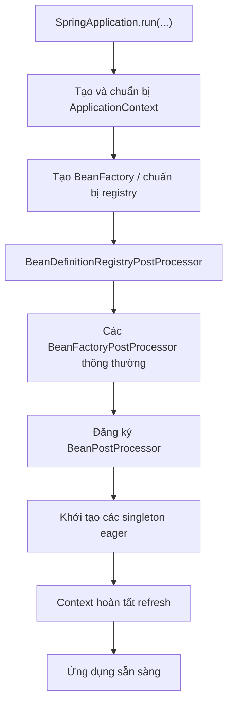
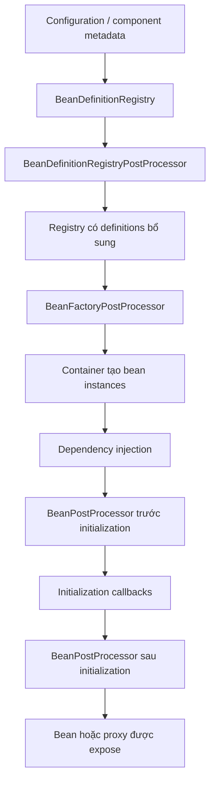
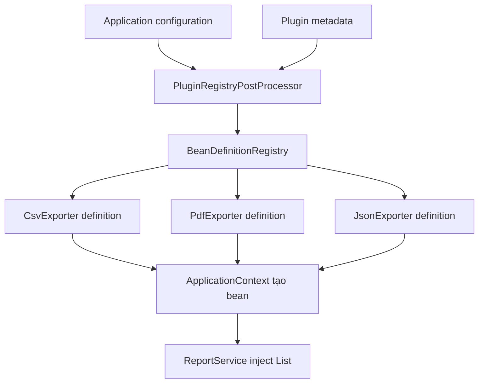

# BeanDefinitionRegistryPostProcessor và giai đoạn đăng ký bổ sung

Trong Spring, bean không xuất hiện trong application context chỉ vì class Java tồn tại trên classpath. Container cần có **bean definition** mô tả cách tạo và quản lý object đó. Thông thường, bean definition đến từ component scanning, các phương thức `@Bean`, cấu hình được import hoặc auto-configuration của Spring Boot.

Một số thư viện và ứng dụng cần đăng ký bean theo cách linh hoạt hơn: thêm bean definition dựa trên metadata, đăng ký một nhóm thành phần do module phát hiện, hoặc điều chỉnh registry trước khi Spring bắt đầu tạo các bean thông thường. Extension point dành cho nhu cầu này là **`BeanDefinitionRegistryPostProcessor`**.

`BeanDefinitionRegistryPostProcessor` (viết tắt BDRPP) mở rộng `BeanFactoryPostProcessor` và bổ sung một callback chạy trực tiếp trên `BeanDefinitionRegistry`. Nhờ đó, code có thể **đăng ký thêm, thay đổi hoặc loại bỏ bean definitions trong giai đoạn chuẩn bị context**, trước khi container khởi tạo phần lớn application beans.

Trong chương **Java configuration** của *Spring Boot Fundamentals*, bài học này tập trung vào:

- Phân biệt bean definition với bean instance.
- Hiểu hai callback của BDRPP và vị trí của chúng trong quá trình refresh context.
- Viết một registry post-processor để đăng ký bean bằng Java configuration.
- Hiểu thứ tự thực thi, việc phát hiện processor mới và các rủi ro do khởi tạo quá sớm.
- Phân biệt BDRPP với `BeanFactoryPostProcessor`, `BeanPostProcessor` và `ImportBeanDefinitionRegistrar`.

## 1. Tại sao cần một giai đoạn đăng ký bổ sung?

Trong một ứng dụng Spring Boot thông thường, ta có thể khai báo:

```java
@Component
public class InventoryService {
}
```

hoặc:

```java
@Configuration
public class InventoryConfiguration {

    @Bean
    InventoryService inventoryService() {
        return new InventoryService();
    }
}
```

Các cơ chế này phù hợp khi ta biết trước class hoặc bean cần đăng ký. Nhưng có những tình huống muốn **xây dựng danh sách bean definitions bằng chương trình**:

- Một module plugin cần đăng ký các adapter dựa trên metadata đã đọc được.
- Một thư viện tích hợp cần tạo các bean proxy hoặc factory cho một tập interface.
- Một framework cần đăng ký thành phần nội bộ trước khi các service thông thường được khởi tạo.
- Một cấu hình muốn kiểm tra registry hiện tại rồi bổ sung definition còn thiếu.

Ví dụ, module báo cáo có một implementation mặc định. Khi ứng dụng bật module, registry post-processor có thể đăng ký bean `ReportExporter` nếu chưa có bean definition tương ứng. Các service khác sau đó có thể nhận nó qua constructor injection.

Điểm cốt lõi là **đăng ký định nghĩa trước, tạo instance sau**. BDRPP không phải nơi xử lý từng request hoặc tạo một object mới mỗi khi người dùng gọi endpoint.

## 2. Bean definition khác bean instance như thế nào?

Spring quản lý hai khái niệm cần tách biệt:

**Bean definition** là metadata mô tả một bean. Nó có thể chứa:

- Class hoặc factory method dùng để tạo object.
- Constructor arguments và property values.
- Scope như singleton hoặc prototype.
- Lazy initialization, primary, role và các metadata khác.
- Quan hệ phụ thuộc và các thông tin liên quan đến cách container quản lý bean.

**Bean instance** là object Java được tạo từ bean definition khi container cần nó.

Ví dụ:

```text
BeanDefinition:
  bean name: reportExporter
  bean class: CsvReportExporter
  scope: singleton
  constructor argument: UTF-8
           |
           v
ApplicationContext xử lý definition
           |
           v
Instance: một object CsvReportExporter cụ thể
```

`BeanDefinitionRegistryPostProcessor` làm việc ở tầng metadata. Khi gọi `registry.registerBeanDefinition(...)`, ta yêu cầu container lưu một định nghĩa mới. Việc đó **không đồng nghĩa instance đã được tạo ngay tại dòng lệnh ấy**.

Sau giai đoạn đăng ký và các bước xử lý bean factory, Spring mới khởi tạo các singleton không lazy cùng các bean cần thiết theo dependency graph. Prototype thường được tạo khi được yêu cầu.

## 3. BeanDefinitionRegistryPostProcessor là gì?

Interface nằm trong package:

```java
org.springframework.beans.factory.support.BeanDefinitionRegistryPostProcessor
```

Về mặt cấu trúc, nó mở rộng `BeanFactoryPostProcessor` và khai báo thêm một phương thức:

```java
public interface BeanDefinitionRegistryPostProcessor
        extends BeanFactoryPostProcessor {

    void postProcessBeanDefinitionRegistry(
            BeanDefinitionRegistry registry
    ) throws BeansException;

    // Kế thừa từ BeanFactoryPostProcessor:
    void postProcessBeanFactory(
            ConfigurableListableBeanFactory beanFactory
    ) throws BeansException;
}
```

Trong source của ứng dụng, ta import interface từ Spring Framework; đoạn trên chỉ mô tả hợp đồng để giải thích.

Hai callback có trách nhiệm khác nhau:

| Callback | Đầu vào | Trách nhiệm |
| --- | --- | --- |
| `postProcessBeanDefinitionRegistry` | `BeanDefinitionRegistry` | Đăng ký, thay đổi hoặc xóa bean definitions |
| `postProcessBeanFactory` | `ConfigurableListableBeanFactory` | Tiếp tục xử lý bean factory sau giai đoạn registry callbacks |

Vì BDRPP là một loại BFPP, nó có cả hai giai đoạn. Phần đặc biệt của BDRPP là callback đầu tiên chạy khi registry vẫn đang mở cho việc đăng ký bean definitions bổ sung.

### 3.1. BeanDefinitionRegistry cung cấp những thao tác gì?

Registry là abstraction để thao tác các bean definitions. Một số phương thức thường gặp:

| Phương thức | Ý nghĩa |
| --- | --- |
| `registerBeanDefinition(name, definition)` | Đăng ký một definition dưới tên bean |
| `containsBeanDefinition(name)` | Kiểm tra registry có definition mang tên đó |
| `getBeanDefinition(name)` | Lấy definition để xem hoặc điều chỉnh metadata |
| `removeBeanDefinition(name)` | Xóa definition khỏi registry |
| `getBeanDefinitionNames()` | Lấy các tên bean definitions đã đăng ký |
| `getBeanDefinitionCount()` | Đếm số bean definitions |

`BeanDefinitionRegistry` thao tác với **definitions**, không phải một API tổng quát để lấy mọi object instance đang tồn tại. Ví dụ, `containsBeanDefinition` kiểm tra definition theo tên; nó không tương đương mọi cách kiểm tra singleton đã được đăng ký thủ công.

## 4. BDRPP nằm ở đâu trong quá trình khởi tạo ApplicationContext?

Trong một ứng dụng Spring Boot, `SpringApplication.run(...)` dẫn tới quá trình refresh của application context. Ở mức khái quát:



Đây là sơ đồ rút gọn. Trong thực tế, Spring còn xử lý environment, event multicaster, message source, lifecycle processor, listener và nhiều bước khác.

Điểm cần nhớ:

1. Bean definitions ban đầu được thu thập từ các nguồn cấu hình.
2. BDRPP được gọi trong giai đoạn xử lý bean factory, khi có thể đăng ký thêm definitions.
3. Sau các registry callbacks, các callback `postProcessBeanFactory` của BDRPP được thực hiện.
4. Các BFPP thông thường được gọi sau giai đoạn registry post-processing.
5. Spring đăng ký các BeanPostProcessor để xử lý bean instances.
6. Container tiến tới khởi tạo các singleton không lazy và hoàn tất refresh.

Vì vậy, BDRPP có thể bổ sung definitions **trước khi phần lớn bean instances được tạo**. Đây là lý do extension point này phù hợp với công việc đăng ký thành phần động ở startup.

## 5. Ví dụ: đăng ký bean definition bằng chương trình

Giả sử ứng dụng có một plugin đơn giản:

```java
package com.example.shop.plugin;

public class WelcomePlugin {

    private final String productName;

    public WelcomePlugin(String productName) {
        this.productName = productName;
    }

    public String message() {
        return "Welcome to " + productName;
    }
}
```

Ta muốn bean `WelcomePlugin` được đăng ký bởi một BDRPP. Class plugin không cần `@Component` và không cần nằm trong package scan.

### 5.1. Viết BeanDefinitionRegistryPostProcessor

```java
package com.example.shop.config;

import com.example.shop.plugin.WelcomePlugin;
import org.springframework.beans.BeansException;
import org.springframework.beans.factory.config.BeanDefinition;
import org.springframework.beans.factory.support.BeanDefinitionBuilder;
import org.springframework.beans.factory.support.BeanDefinitionRegistry;
import org.springframework.beans.factory.support.BeanDefinitionRegistryPostProcessor;
import org.springframework.beans.factory.config.ConfigurableListableBeanFactory;

public class PluginRegistryPostProcessor
        implements BeanDefinitionRegistryPostProcessor {

    @Override
    public void postProcessBeanDefinitionRegistry(
            BeanDefinitionRegistry registry
    ) throws BeansException {
        if (registry.containsBeanDefinition("welcomePlugin")) {
            return;
        }

        BeanDefinition definition = BeanDefinitionBuilder
                .genericBeanDefinition(WelcomePlugin.class)
                .addConstructorArgValue("Spring Boot")
                .setRole(BeanDefinition.ROLE_APPLICATION)
                .getBeanDefinition();

        registry.registerBeanDefinition("welcomePlugin", definition);
    }

    @Override
    public void postProcessBeanFactory(
            ConfigurableListableBeanFactory beanFactory
    ) throws BeansException {
        // Không cần điều chỉnh thêm bean factory trong ví dụ này.
    }
}
```

Đọc từng bước:

- `registry.containsBeanDefinition("welcomePlugin")` tránh đăng ký trùng tên trong ví dụ này.
- `BeanDefinitionBuilder.genericBeanDefinition(WelcomePlugin.class)` tạo một builder cho definition của class.
- `addConstructorArgValue("Spring Boot")` cung cấp tham số constructor.
- `setRole(BeanDefinition.ROLE_APPLICATION)` đánh dấu definition thuộc ứng dụng.
- `getBeanDefinition()` lấy metadata hoàn chỉnh.
- `registerBeanDefinition(...)` đưa definition vào registry.

BDRPP không gọi `new WelcomePlugin(...)` để giữ object instance. Nó đăng ký metadata; container sẽ tạo instance và quản lý dependency/lifecycle theo cơ chế bean thông thường.

### 5.2. Đăng ký chính BDRPP bằng Java configuration

Một BDRPP cũng cần được Spring biết tới. Cách thông dụng là khai báo một phương thức `@Bean` trả về đúng kiểu processor:

```java
package com.example.shop.config;

import org.springframework.context.annotation.Bean;
import org.springframework.context.annotation.Configuration;

@Configuration(proxyBeanMethods = false)
public class PluginRegistrationConfiguration {

    @Bean
    public static PluginRegistryPostProcessor pluginRegistryPostProcessor() {
        return new PluginRegistryPostProcessor();
    }
}
```

Phương thức factory được khai báo `static` vì BDRPP cần được tạo rất sớm. Nhờ đó, Spring có thể lấy processor mà không phải khởi tạo instance của `PluginRegistrationConfiguration` trước thời điểm phù hợp.

Đây là một quy tắc thực hành quan trọng: **các phương thức `@Bean` tạo BFPP/BDRPP nên là static khi có thể**. Nếu factory method không static, configuration class có thể bị khởi tạo sớm và không được xử lý bởi toàn bộ BeanPostProcessor như bean thông thường. Spring thường phát cảnh báo về việc bean được tạo quá sớm hoặc không đủ điều kiện để được post-process đầy đủ.

### 5.3. Sử dụng bean đã đăng ký

Một thành phần khác có thể nhận `WelcomePlugin` bằng constructor:

```java
package com.example.shop;

import com.example.shop.plugin.WelcomePlugin;
import org.springframework.stereotype.Component;

@Component
public class PluginRunner {

    private final WelcomePlugin plugin;

    public PluginRunner(WelcomePlugin plugin) {
        this.plugin = plugin;
    }

    public String run() {
        return plugin.message();
    }
}
```

Class ứng dụng:

```java
package com.example.shop;

import com.example.shop.config.PluginRegistrationConfiguration;
import org.springframework.boot.SpringApplication;
import org.springframework.boot.autoconfigure.SpringBootApplication;
import org.springframework.context.annotation.Import;

@SpringBootApplication
@Import(PluginRegistrationConfiguration.class)
public class ShopApplication {

    public static void main(String[] args) {
        SpringApplication.run(ShopApplication.class, args);
    }
}
```

Vì `PluginRegistrationConfiguration` được import, phương thức `@Bean` tạo BDRPP được xử lý. BDRPP đăng ký definition `welcomePlugin`; sau đó Spring có thể tạo `WelcomePlugin` và inject vào `PluginRunner`.

Một runner để quan sát:

```java
@Bean
CommandLineRunner pluginDemo(PluginRunner pluginRunner) {
    return args -> System.out.println(pluginRunner.run());
}
```

Khi ứng dụng khởi động, kết quả có dạng:

```text
Welcome to Spring Boot
```

Trong ví dụ, `@Import` đưa cấu hình đăng ký processor vào context; BDRPP bổ sung definition; container tạo bean; DI cung cấp bean cho runner/service. Đây là các bước riêng nhưng phối hợp với nhau.

## 6. Vì sao phải đăng ký BeanDefinition thay vì tự tạo object?

Một cách viết dễ nhầm là:

```java
public void postProcessBeanDefinitionRegistry(BeanDefinitionRegistry registry) {
    WelcomePlugin plugin = new WelcomePlugin("Spring Boot");
    // Không thể dùng registry để đăng ký object instance bằng API definition.
}
```

Đối tượng tạo bằng `new` không tự trở thành một bean definition. Nếu muốn container quản lý bean, ta cần đăng ký definition phù hợp hoặc sử dụng một API đăng ký singleton khác khi có lý do rất cụ thể.

Dùng bean definition có lợi ích:

- Container biết class/factory cần tạo object.
- Constructor arguments và property values có thể được mô tả trong metadata.
- Dependency injection được áp dụng theo cơ chế container.
- Bean có thể tham gia các bước lifecycle và post-processing thông thường.
- Scope, lazy initialization, primary và các metadata khác có thể được khai báo.

Nếu tự tạo object rồi giữ trong một static map hoặc registry riêng, ứng dụng phải tự quản lý nhiều việc mà Spring đã có cơ chế giải quyết.

**BDRPP là công cụ để bổ sung metadata cho container, không phải một factory nghiệp vụ thay thế Spring.**

## 7. Phân biệt BeanDefinitionRegistryPostProcessor và BeanFactoryPostProcessor

`BeanFactoryPostProcessor` (BFPP) là extension point cho phép điều chỉnh bean factory sau khi các bean definitions đã được tải. Nó thường dùng để thay đổi metadata hoặc property values trước khi bean instances được tạo.

BDRPP mở rộng BFPP và bổ sung một giai đoạn riêng để thao tác trực tiếp trên registry.

| Tiêu chí | BeanFactoryPostProcessor | BeanDefinitionRegistryPostProcessor |
| --- | --- | --- |
| Hợp đồng | `postProcessBeanFactory` | `postProcessBeanDefinitionRegistry` và `postProcessBeanFactory` |
| Trọng tâm | Điều chỉnh bean factory/definitions đã có | Đăng ký hoặc thay đổi definitions ở giai đoạn registry |
| Thời điểm đặc biệt | Sau registry post-processing | Trước các BFPP thông thường |
| Thêm definition | Có thể nếu bean factory đồng thời cung cấp registry, nhưng không phải mục đích chuyên biệt | Được thiết kế trực tiếp cho thao tác này |
| Ví dụ | Điều chỉnh metadata/property của definition | Đăng ký một nhóm bean definitions bằng chương trình |

Ví dụ BFPP:

```java
public class PricingDefinitionPostProcessor
        implements BeanFactoryPostProcessor {

    @Override
    public void postProcessBeanFactory(
            ConfigurableListableBeanFactory beanFactory
    ) throws BeansException {
        if (beanFactory.containsBeanDefinition("pricingService")) {
            BeanDefinition definition =
                    beanFactory.getBeanDefinition("pricingService");
            definition.setLazyInit(true);
        }
    }
}
```

Ví dụ này chỉ điều chỉnh metadata của definition đã tồn tại. Nếu nhiệm vụ chính là thêm nhiều definitions, BDRPP diễn đạt ý định trực tiếp hơn.

### 7.1. BDRPP cũng có callback postProcessBeanFactory

Một BDRPP có thể dùng callback registry để đăng ký definitions, sau đó dùng callback bean factory để thực hiện điều chỉnh bổ sung trên bean factory. Spring gọi các callback registry của các BDRPP trước, rồi mới gọi callback bean factory của chúng.

Không nên nhầm rằng `postProcessBeanFactory` của BDRPP chạy ngay sau `postProcessBeanDefinitionRegistry` của chính instance đó trong mọi trường hợp. Container xử lý theo giai đoạn: hoàn tất nhóm registry callbacks, rồi mới tới nhóm bean factory callbacks.

## 8. Phân biệt BeanDefinitionRegistryPostProcessor và BeanPostProcessor

Hai tên đều chứa từ “PostProcessor”, nhưng xử lý các đối tượng ở hai tầng khác nhau.

| Tiêu chí | BeanDefinitionRegistryPostProcessor | BeanPostProcessor |
| --- | --- | --- |
| Làm việc với | Bean definitions/registry | Bean instances |
| Thời điểm | Trước khi khởi tạo phần lớn bean thông thường | Trong quá trình khởi tạo từng bean |
| Có thể thêm definition? | Có | Không phải nhiệm vụ của interface này |
| Có thể trả về proxy thay instance? | Không qua callback registry | Có qua before/after initialization callback |
| Ví dụ | Đăng ký bean plugin động | Bọc service bằng proxy |

Sơ đồ tổng hợp:



Nếu mục tiêu là đăng ký một class mới để container có thể tạo nó, hãy nghĩ đến BDRPP. Nếu mục tiêu là quan sát hoặc bọc một object đã được tạo, hãy nghĩ đến BeanPostProcessor.

## 9. Phân biệt BDRPP và ImportBeanDefinitionRegistrar

`ImportBeanDefinitionRegistrar` cũng cho phép đăng ký bean definitions theo chương trình. Nó thường được dùng cùng `@Import` để đóng gói một tính năng hoặc annotation `@Enable...`.

Ví dụ dạng khái niệm:

```java
public class AuditRegistrar
        implements ImportBeanDefinitionRegistrar {

    @Override
    public void registerBeanDefinitions(
            AnnotationMetadata importingClassMetadata,
            BeanDefinitionRegistry registry
    ) {
        // Đăng ký bean definitions dựa trên metadata của class import.
    }
}
```

So sánh:

| Tiêu chí | BDRPP | ImportBeanDefinitionRegistrar |
| --- | --- | --- |
| Cách kích hoạt | Đăng ký BDRPP thành bean/processor trong context | Được gọi trong quá trình xử lý cấu hình có `@Import` |
| Ngữ cảnh đầu vào | Registry của bean factory | Metadata của class đang import và registry |
| Phạm vi | Extension point ở cấp bean factory/context | Gắn với quá trình xử lý cấu hình import |
| Thường dùng | Đăng ký definitions ở giai đoạn registry tổng quát | Thư viện cung cấp annotation kích hoạt tính năng |

### 9.1. Chọn registrar khi cấu hình được kích hoạt bởi @Import

Nếu thư viện muốn người dùng viết:

```java
@EnableAudit
class ApplicationConfiguration {
}
```

và việc đăng ký bean phụ thuộc vào metadata của class mang annotation, `ImportBeanDefinitionRegistrar` thường phù hợp hơn. Nó được gọi như một phần của quá trình xử lý configuration class và nhận được metadata của class đang import.

### 9.2. Chọn BDRPP khi cần một hook rộng hơn trên registry

Nếu cần xử lý registry ở cấp application context, không gắn chặt với một annotation `@Import` cụ thể, BDRPP có thể là lựa chọn thích hợp. Nó có thể kiểm tra definitions hiện có, đăng ký definitions bổ sung và tham gia thứ tự post-processing của bean factory.

Hai extension point không phải lựa chọn thay thế tuyệt đối. Cần xác định điểm kích hoạt và loại metadata mà logic đăng ký cần.

## 10. Vai trò đặc biệt của ConfigurationClassPostProcessor

Spring có một BDRPP quan trọng tên `ConfigurationClassPostProcessor`. Nó là một phần trung tâm của Java-based configuration.

Processor này xử lý các cấu hình liên quan tới:

- `@Configuration`.
- `@ComponentScan`.
- `@Import`.
- `@ImportResource`.
- Các phương thức `@Bean`.
- Các cơ chế import/selector liên quan.

Nhờ nó, Spring có thể đọc metadata của class cấu hình, phân tích component scan, xử lý import và đăng ký các bean definitions tương ứng trước khi khởi tạo bean thông thường.

### 10.1. Vì sao điều này quan trọng?

Khi ta viết:

```java
@Configuration
@Import(PricingConfiguration.class)
class ShopConfiguration {
}
```

Spring không cần chờ đến khi một service gọi `getBean` mới đọc annotation. Configuration class được xử lý trong giai đoạn bean-definition registration. Các definition từ `@Bean` và cấu hình được import được đưa vào registry trước giai đoạn khởi tạo bean thông thường.

Điều đó giải thích vì sao `@Import`, component scanning và các phương thức `@Bean` hoạt động như những cơ chế cấu hình khai báo, dù chúng không trực tiếp tạo mọi instance ngay tại thời điểm annotation được đọc.

### 10.2. Không nên can thiệp tùy tiện vào ConfigurationClassPostProcessor

`ConfigurationClassPostProcessor` là infrastructure processor quan trọng. Việc thay thứ tự, loại bỏ hoặc đăng ký nhiều cấu hình trùng lặp có thể làm thay đổi cách Spring đọc `@Configuration`, `@Import` và `@Bean`.

Với ứng dụng thông thường, hãy sử dụng các API cấu hình công khai. Chỉ làm việc trực tiếp với infrastructure processor khi đang xây framework/starter và đã hiểu thứ tự xử lý cũng như hợp đồng của phiên bản Spring đang dùng.

## 11. Thứ tự thực thi của nhiều BDRPP

Một application context có thể có nhiều BeanDefinitionRegistryPostProcessor. Spring phải xác định thứ tự gọi chúng vì một processor có thể đăng ký definition hoặc processor khác.

Ở mức khái quát, quá trình xử lý gồm:

1. Các BDRPP được đăng ký trực tiếp với bean factory/application context bằng API tương ứng được xử lý trước.
2. Các BDRPP được định nghĩa trong registry và implement `PriorityOrdered` được gọi theo thứ tự ưu tiên.
3. Các BDRPP implement `Ordered` được gọi tiếp.
4. Các BDRPP không implement ordering được gọi sau.
5. Spring kiểm tra lại registry để phát hiện BDRPP mới được đăng ký trong các lượt trước; việc phát hiện và gọi được lặp lại cho tới khi không còn processor mới cần xử lý.
6. Sau khi hoàn tất registry callbacks, Spring gọi `postProcessBeanFactory` của các BDRPP đã thu thập.
7. Sau đó các BeanFactoryPostProcessor thông thường mới được gọi.

Đây là lý do BDRPP có thể đăng ký thêm một BDRPP khác để Spring tiếp tục phát hiện trong giai đoạn registry. Nhưng việc dựa vào chuỗi đăng ký động như vậy cần được thiết kế cẩn thận, vì thứ tự có thể ảnh hưởng đến definition cuối cùng.

### 11.1. Implement PriorityOrdered hoặc Ordered

Ví dụ:

```java
public class PluginRegistryPostProcessor
        implements BeanDefinitionRegistryPostProcessor, Ordered {

    @Override
    public int getOrder() {
        return 100;
    }

    @Override
    public void postProcessBeanDefinitionRegistry(
            BeanDefinitionRegistry registry
    ) throws BeansException {
        // Đăng ký definitions.
    }

    @Override
    public void postProcessBeanFactory(
            ConfigurableListableBeanFactory beanFactory
    ) throws BeansException {
        // Xử lý bean factory nếu cần.
    }
}
```

`PriorityOrdered` là lựa chọn cho processor cần thuộc nhóm ưu tiên cao hơn nhóm `Ordered`. Không nên implement ordering nếu không có quan hệ phụ thuộc thực sự giữa các processor. Nếu hai processor độc lập, để Spring xử lý theo thứ tự mặc định thường giảm coupling.

### 11.2. Đừng nhầm thứ tự processor với thứ tự khởi tạo bean

Ordering của BDRPP quyết định thứ tự xử lý registry callbacks. Nó không phải cam kết rằng các bean instance được tạo theo đúng cùng thứ tự đó.

Thứ tự tạo bean thông thường chịu ảnh hưởng của dependency graph, eager/lazy initialization, scope và các cơ chế container khác. Nếu bean B cần bean A, dependency mới là cơ sở để Spring tạo A trước B khi cần.

## 12. Đăng ký thêm BDRPP trong một BDRPP khác

Một đặc điểm của giai đoạn registry là Spring có thể phát hiện processor mới được thêm vào trong quá trình xử lý. Ví dụ, một processor có thể đăng ký một definition khác mà chính definition đó là một BDRPP. Spring sẽ lặp lại việc tìm kiếm BDRPP để xử lý nó trong lượt tiếp theo.

Đây là cơ chế hữu ích cho hạ tầng/framework, nhưng không nên biến thành một chuỗi khó dự đoán trong ứng dụng nghiệp vụ.

Nếu một processor đăng ký một configuration class có `@Bean` method sau khi `ConfigurationClassPostProcessor` đã hoàn tất xử lý các configuration candidates của nó, không nên mặc định rằng các `@Bean` method mới sẽ tự động được parse như một configuration class thông thường. Để đăng ký bean thông thường, hãy tạo bean definition trực tiếp; nếu mục tiêu là kích hoạt xử lý configuration/import, hãy dùng extension point đúng pha như `ImportBeanDefinitionRegistrar` hoặc cơ chế import được thiết kế cho mục đích đó.

Nguyên tắc: **đăng ký một bean definition và yêu cầu Spring phân tích một configuration class là hai việc khác nhau**.

## 13. Điều chỉnh bean definition trong registry

BDRPP không chỉ thêm definitions. Nó còn có thể kiểm tra và điều chỉnh definition đã tồn tại.

Ví dụ, đặt một bean hiện có thành lazy:

```java
public class LazyDefinitionPostProcessor
        implements BeanDefinitionRegistryPostProcessor {

    @Override
    public void postProcessBeanDefinitionRegistry(
            BeanDefinitionRegistry registry
    ) throws BeansException {
        if (registry.containsBeanDefinition("largeReportService")) {
            BeanDefinition definition =
                    registry.getBeanDefinition("largeReportService");
            definition.setLazyInit(true);
        }
    }

    @Override
    public void postProcessBeanFactory(
            ConfigurableListableBeanFactory beanFactory
    ) throws BeansException {
    }
}
```

Đoạn này minh họa việc sửa metadata trước khi bean instance được tạo. Khi bean là singleton lazy, container trì hoãn tạo instance tới lúc nó được yêu cầu, trừ khi có một dependency khác khiến nó được khởi tạo sớm.

### 13.1. Thay đổi definition phải có chủ đích

Các thuộc tính như scope, lazy, primary, constructor argument và property value ảnh hưởng trực tiếp tới cách container tạo bean. Sửa chúng trong BDRPP có thể làm thay đổi hành vi toàn ứng dụng.

Trước khi sửa một definition, cần:

- Xác nhận bean name và definition đúng là thành phần cần tác động.
- Kiểm tra ai đã đăng ký definition đó.
- Xác định các bean khác có phụ thuộc vào type hoặc metadata liên quan không.
- Tránh thay đổi definition dùng chung ngoài phạm vi tính năng của processor.
- Đảm bảo hành vi không phụ thuộc vào thứ tự không được cam kết.

Nếu chỉ cần cung cấp một bean mặc định, hãy cân nhắc `@ConditionalOnMissingBean` trong auto-configuration hoặc cấu hình Java thông thường thay vì sửa definition của module khác.

## 14. BDRPP và đăng ký bean có điều kiện

Trong một số tình huống, BDRPP kiểm tra registry trước khi đăng ký:

```java
if (!registry.containsBeanDefinition("welcomePlugin")) {
    registry.registerBeanDefinition("welcomePlugin", definition);
}
```

Đây là một kiểm tra đơn giản để tránh trùng tên. Tuy nhiên, nó không phải cơ chế đầy đủ để xác định mọi bean cùng type, bởi:

- Nhiều bean name khác nhau có thể cùng type.
- Có thể có singleton đăng ký trực tiếp mà không có bean definition tương ứng.
- Bean definition có thể dùng factory method để tạo một implementation khác.
- Qualifier, primary và profile/conditional có thể ảnh hưởng việc chọn bean.

Nếu yêu cầu là “chỉ đăng ký default implementation khi chưa có bean kiểu `PaymentGateway`”, cần xem xét metadata của registry và những định nghĩa đã được đăng ký. Trong auto-configuration Spring Boot, `@ConditionalOnMissingBean` thường là abstraction phù hợp và dễ bảo trì hơn tự viết logic type matching trong BDRPP.

### 14.1. BDRPP không thay thế mọi conditional annotation

`@ConditionalOnClass`, `@ConditionalOnProperty`, `@ConditionalOnMissingBean` và các condition khác thuộc hệ thống conditional configuration của Spring Boot. Chúng giúp mô tả rõ điều kiện kích hoạt cấu hình.

BDRPP thích hợp khi cần thao tác registry bằng chương trình. Nếu chỉ cần một bean xuất hiện khi property bật, hãy ưu tiên cấu hình điều kiện phù hợp thay vì viết một registry post-processor riêng.

## 15. Vấn đề khởi tạo sớm và dependency của BDRPP

BDRPP phải được tạo trước nhiều bean thông thường để kịp tham gia giai đoạn registry. Vì vậy, nó là một loại **infrastructure bean khởi tạo sớm**.

Điều này có một số hệ quả:

- Constructor dependency của BDRPP có thể kéo theo các bean khác được tạo sớm.
- Những bean được tạo trong lúc đăng ký processor có thể chưa đi qua toàn bộ BeanPostProcessor.
- Bean có thể không nhận proxy AOP hoặc một số post-processing mà ứng dụng mong đợi.
- Inject một service lớn vào BDRPP có thể làm container khởi tạo quá nhiều thành phần ở giai đoạn không phù hợp.

### 15.1. Giữ processor nhỏ và ít dependency

Ví dụ không nên:

```java
public class PluginRegistryPostProcessor
        implements BeanDefinitionRegistryPostProcessor {

    private final UserService userService;
    private final OrderRepository orderRepository;

    public PluginRegistryPostProcessor(
            UserService userService,
            OrderRepository orderRepository
    ) {
        this.userService = userService;
        this.orderRepository = orderRepository;
    }
}
```

Processor này buộc container phải tạo các bean nghiệp vụ/persistence quá sớm để cung cấp constructor arguments. Chúng có thể không được xử lý như các bean thông thường vì một số post-processor khác chưa được đăng ký.

Thay vào đó, BDRPP nên tập trung vào metadata và registry. Nếu cần thông tin để quyết định đăng ký, hãy dùng dữ liệu cấu hình/metadata có thể truy cập an toàn trong giai đoạn sớm, hoặc chọn một abstraction được thiết kế phù hợp với vòng đời đó.

### 15.2. Phương thức @Bean static

Khi đăng ký BDRPP bằng Java configuration:

```java
@Bean
static PluginRegistryPostProcessor pluginRegistryPostProcessor() {
    return new PluginRegistryPostProcessor();
}
```

Khai báo `static` giúp tạo processor mà không cần khởi tạo configuration class chứa factory method. Đây là cách thường được khuyến nghị cho BFPP và BDRPP.

Nếu factory method trả về kiểu quá tổng quát như `Object`, Spring có thể khó dự đoán rằng bean đó là một BeanFactoryPostProcessor ở giai đoạn phát hiện sớm. Nên khai báo return type cụ thể là `PluginRegistryPostProcessor` hoặc ít nhất là interface processor tương ứng.

## 16. BDRPP có nên tạo bean instance trực tiếp không?

Thông thường không. Mục tiêu của registry post-processor là thao tác bean definitions. Việc tự tạo object rồi gọi `registry.registerBeanDefinition` không phù hợp vì phương thức đó nhận một `BeanDefinition` chứ không nhận instance.

Có API đăng ký singleton instance trên một số bean factory, nhưng nó có lifecycle và post-processing khác với việc đăng ký bean definition trước khi tạo object. Nếu không có yêu cầu đặc biệt, hãy dùng bean definition để container quản lý object theo quy trình bình thường.

Ví dụ đúng:

```java
RootBeanDefinition definition =
        new RootBeanDefinition(WelcomePlugin.class);
definition.getConstructorArgumentValues()
        .addIndexedArgumentValue(0, "Spring Boot");
registry.registerBeanDefinition("welcomePlugin", definition);
```

Hoặc dùng `BeanDefinitionBuilder` để diễn đạt gọn hơn như ví dụ trước. Cả hai cách đều cung cấp metadata cho container.

## 17. Kiểm thử BeanDefinitionRegistryPostProcessor

Vì BDRPP làm việc ở giai đoạn khởi tạo context, có thể kiểm thử nó bằng một context nhỏ thay vì phải khởi chạy toàn bộ hệ thống web.

Ví dụ với `AnnotationConfigApplicationContext`:

```java
import static org.junit.jupiter.api.Assertions.assertEquals;
import static org.junit.jupiter.api.Assertions.assertTrue;

import com.example.shop.config.PluginRegistrationConfiguration;
import com.example.shop.plugin.WelcomePlugin;
import org.junit.jupiter.api.Test;
import org.springframework.context.annotation.AnnotationConfigApplicationContext;

class PluginRegistryPostProcessorTest {

    @Test
    void registersPluginBeanDefinition() {
        try (var context =
                     new AnnotationConfigApplicationContext(
                             PluginRegistrationConfiguration.class
                     )) {
            assertTrue(context.containsBean("welcomePlugin"));

            WelcomePlugin plugin =
                    context.getBean("welcomePlugin", WelcomePlugin.class);

            assertEquals("Welcome to Spring Boot", plugin.message());
        }
    }
}
```

Test trên cần JUnit và Spring Context dependency phù hợp. Nó thực hiện:

1. Tạo context dựa trên configuration.
2. Refresh context, qua đó kích hoạt việc phát hiện và chạy BDRPP.
3. Kiểm tra bean name có trong context.
4. Lấy instance theo type và kiểm tra hành vi.
5. Đóng context khi test kết thúc.

### 17.1. Kiểm tra definition trước khi lấy instance

Nếu muốn kiểm tra đúng tầng registry, có thể dùng `ConfigurableApplicationContext` và truy cập bean factory sau khi refresh:

```java
var beanFactory = context.getBeanFactory();
assertTrue(beanFactory.containsBeanDefinition("welcomePlugin"));
```

Đây là kiểm tra metadata. Lệnh `context.getBean(...)` sau đó mới yêu cầu instance. Trong một số test, tách hai khẳng định này giúp xác định lỗi nằm ở đăng ký definition hay ở khởi tạo bean.

### 17.2. Kiểm thử điều kiện và trùng tên

Nếu processor chỉ đăng ký khi chưa có bean definition, nên có test cho cả hai tình huống:

- Registry ban đầu không có tên bean: definition được thêm.
- Registry đã có tên bean: processor không đăng ký trùng.

Nếu logic phụ thuộc type, profile hoặc property, cần test từng nhánh tương ứng. Đừng chỉ kiểm tra một happy path rồi kết luận mọi cấu hình đều hoạt động.

## 18. Tình huống thực tế: registry bổ sung plugin theo metadata

Hãy hình dung một ứng dụng có module extension. Mỗi plugin cung cấp một implementation khác nhau của interface `ReportExporter`. Một registry post-processor có thể đăng ký bean definitions từ danh sách plugin đã được cấu hình.

Ở mức kiến trúc:



Trong thiết kế này, BDRPP có thể:

1. Đọc danh sách plugin metadata được cung cấp hợp lệ.
2. Xác định implementation class hoặc factory bean phù hợp.
3. Tạo bean definition cho từng plugin với tên ổn định.
4. Đăng ký definition vào registry.
5. Để container quản lý instance và cung cấp chúng qua collection injection.

### 18.1. Tên bean phải ổn định và không trùng

Nếu plugin có ID `csv`, `pdf` và `json`, có thể tạo tên bean theo quy ước như `reportExporterCsv`. Cần chuẩn hóa ID và kiểm tra trùng trước khi đăng ký.

Không nên dùng tên từ dữ liệu không đáng tin cậy trực tiếp mà không kiểm tra. Bean name là định danh trong container; trùng tên có thể gây lỗi hoặc ghi đè tùy cấu hình cho phép.

### 18.2. Registry post-processor không phải plugin runtime manager

BDRPP chạy trong giai đoạn khởi tạo context. Nó không tự hỗ trợ nạp plugin mới sau khi ứng dụng đã refresh, cũng không phải công cụ quản lý vòng đời plugin động theo request.

Nếu hệ thống cần bật/tắt plugin trong runtime, cần một thiết kế riêng như registry nghiệp vụ, factory, event-driven module hoặc một cơ chế reload có kiểm soát. Đừng dùng BDRPP cho một yêu cầu runtime chỉ vì nó có chữ “Registry”.

## 19. Các lỗi thường gặp

| Triệu chứng | Nguyên nhân có thể | Hướng điều tra |
| --- | --- | --- |
| Bean không xuất hiện | BDRPP chưa được đăng ký hoặc chưa được Spring xử lý | Kiểm tra configuration, import và return type của `@Bean` |
| Consumer báo thiếu bean | Definition không được thêm hoặc type/constructor không phù hợp | Kiểm tra registry, bean name và bean class |
| Trùng bean name | Một processor khác đã đăng ký cùng tên | Kiểm tra `containsBeanDefinition` và nguồn đăng ký |
| Bean tạo quá sớm | BDRPP phụ thuộc bean thông thường | Giảm dependency, dùng static factory method |
| Bean không nhận proxy | Bean được tạo trước khi toàn bộ BPP được đăng ký | Xem cảnh báo early instantiation và dependency của processor |
| Configuration mới không tạo các @Bean như mong muốn | Đăng ký class như bean definition không đồng nghĩa luôn được parse như configuration candidate | Dùng import/registrar đúng giai đoạn |
| Thứ tự đăng ký không ổn định | Các processor có quan hệ phụ thuộc nhưng không định nghĩa ordering rõ | Dùng `PriorityOrdered`/`Ordered` khi thật cần |
| Instance không được Spring quản lý như kỳ vọng | Tự tạo object hoặc đăng ký instance thay vì definition | Đăng ký bean definition phù hợp |

### 19.1. Cách đọc lỗi theo tầng

Khi context khởi động thất bại, hãy xác định:

1. Lỗi xảy ra lúc phát hiện processor, đăng ký definition hay tạo bean instance?
2. Registry có chứa bean name dự kiến không?
3. Definition có đúng class và constructor arguments không?
4. Bean có dependency nào chưa được đăng ký?
5. Có bean nào bị tạo quá sớm do processor dependency không?
6. Một processor khác có thay đổi hoặc loại definition trước đó không?

Không nên sửa bằng cách bật bean overriding hoặc thay đổi ordering một cách tùy tiện. Trước hết cần xác định ai sở hữu definition và lý do có xung đột.

## 20. Khi nào nên dùng BDRPP và khi nào nên chọn cách đơn giản hơn?

| Nhu cầu | Cơ chế nên xem xét đầu tiên |
| --- | --- |
| Đăng ký một service của ứng dụng | `@Component` / `@Service` |
| Tạo một object với tham số cụ thể | `@Bean` |
| Đưa một cấu hình/module vào context | `@Import` |
| Đăng ký definitions gắn với một annotation kích hoạt | `ImportBeanDefinitionRegistrar` |
| Tạo bean theo điều kiện classpath/property/bean hiện có | `@Conditional...` hoặc Boot auto-configuration |
| Chỉnh metadata của definitions đã có | `BeanFactoryPostProcessor` |
| Bổ sung hoặc điều chỉnh nhiều definitions ở giai đoạn registry | `BeanDefinitionRegistryPostProcessor` |
| Bọc bean instance bằng proxy | `BeanPostProcessor` hoặc Spring AOP |
| Chọn implementation theo dữ liệu mỗi request | Strategy/factory/registry ở tầng ứng dụng |

BDRPP là một extension point cấp thấp và mạnh. Dùng nó khi yêu cầu thật sự liên quan đến thao tác bean definition registry trước khi bean thông thường được tạo. Với phần lớn ứng dụng Spring Boot, component scanning, Java configuration, import và conditional auto-configuration đã đủ.

## 21. Bài tập thực hành

### Bài tập 1 – Đăng ký một bean bằng BeanDefinitionBuilder

Tạo class `GreetingPlugin` có constructor nhận một chuỗi `language` và method `greet()`. Viết BDRPP đăng ký bean `greetingPlugin` với constructor argument `"vi"`.

Tạo service nhận `GreetingPlugin` qua constructor và gọi method. Xác nhận bean xuất hiện trong context dù class không có `@Component`.

### Bài tập 2 – Kiểm tra definition trước instance

Sau khi refresh context:

1. Dùng `containsBeanDefinition("greetingPlugin")` để kiểm tra definition.
2. Lấy bean bằng `getBean("greetingPlugin")`.
3. So sánh thời điểm đăng ký definition với thời điểm instance được tạo.

Giải thích vì sao hai thao tác này là hai tầng khác nhau.

### Bài tập 3 – Tránh đăng ký trùng

Tạo một configuration đã cung cấp bean `greetingPlugin`. Sau đó cho BDRPP cũng thử đăng ký cùng tên. Hãy bổ sung kiểm tra registry và giải thích vì sao phải có quy ước ownership cho bean definition.

### Bài tập 4 – So sánh hai extension point

Với hai yêu cầu:

- Thay đổi `lazyInit` của một definition đã có.
- Thêm definition cho một plugin mới.

Hãy chọn BFPP hoặc BDRPP và giải thích lựa chọn theo loại API mà mỗi interface cung cấp.

### Bài tập 5 – Quan sát thứ tự

Tạo hai BDRPP: một implement `PriorityOrdered`, một implement `Ordered`. Ghi log trong callback registry và callback bean factory. Quan sát thứ tự và giải thích vì sao toàn bộ registry callbacks được xử lý trước callback bean factory.

### Bài tập 6 – Thiết kế điểm kích hoạt module

Một thư viện muốn cung cấp annotation `@EnableAudit` để người dùng kích hoạt một nhóm bean. Hãy so sánh:

- Dùng `@Import(AuditConfiguration.class)`.
- Dùng `ImportBeanDefinitionRegistrar`.
- Đăng ký một BDRPP độc lập.

Nêu cách nào phù hợp khi cần metadata của class mang annotation và vì sao.

## 22. Những điều cần nhớ

`BeanDefinitionRegistryPostProcessor` là extension point mở rộng `BeanFactoryPostProcessor` để thao tác **bean definitions trong giai đoạn registry**. Nó cho phép đăng ký bổ sung hoặc điều chỉnh metadata trước khi container khởi tạo phần lớn bean instances.

Các điểm quan trọng:

- **Definition khác instance:** BDRPP đăng ký metadata; Spring vẫn chịu trách nhiệm tạo và quản lý bean instance.
- **Hai giai đoạn:** `postProcessBeanDefinitionRegistry` chạy để thao tác registry; `postProcessBeanFactory` chạy sau nhóm registry callbacks.
- **Thời điểm sớm:** BDRPP được tạo trước nhiều bean thông thường; giữ processor nhỏ, hạn chế dependency và dùng static `@Bean` factory method.
- **Thứ tự có ý nghĩa:** Spring xử lý nhóm PriorityOrdered, Ordered và các processor còn lại, đồng thời có thể phát hiện processor mới được đăng ký trong các lượt tiếp theo.
- **Đúng công cụ cho đúng tầng:** BDRPP thao tác definitions; BeanPostProcessor xử lý instances; ImportBeanDefinitionRegistrar gắn với quá trình `@Import`; BFPP điều chỉnh bean factory.
- **Không dùng cho runtime request:** BDRPP phục vụ startup/context registration, không phải cơ chế thêm plugin tùy ý sau khi context đã chạy.

Khi cần bổ sung một nhóm bean definitions bằng chương trình, hãy xác định rõ **definition nào cần được đăng ký, ai sở hữu tên bean, dependency nào cần thiết và processor phải chạy ở giai đoạn nào**. Một registry post-processor được thiết kế gọn và có phạm vi rõ sẽ giúp module tích hợp với Spring Boot linh hoạt mà vẫn để container quản lý lifecycle và dependency injection theo cách nhất quán.
