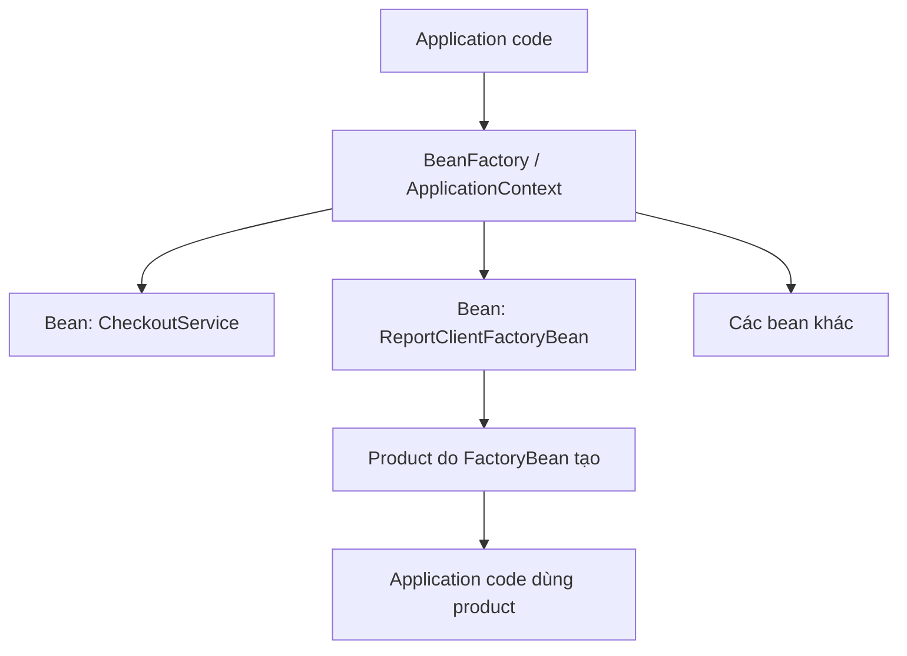
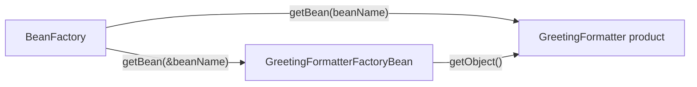
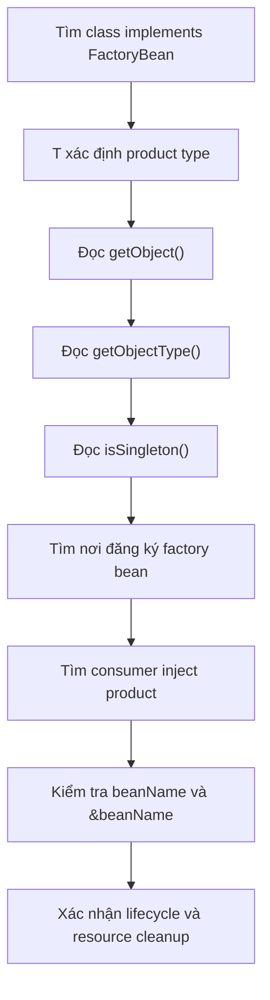

# FactoryBean khác với BeanFactory

Trong Spring, hai cái tên **`BeanFactory`** và **`FactoryBean`** trông gần như giống nhau, nhưng chúng mô tả hai khái niệm khác nhau. `BeanFactory` là hợp đồng cốt lõi của Spring IoC container: nơi quản lý bean và cung cấp bean cho ứng dụng. `FactoryBean` là một extension point mà **một bean cụ thể triển khai để tạo ra một object khác và để Spring công bố object đó như bean**.

Sự khác nhau này quan trọng khi đọc code cấu hình, tích hợp thư viện hoặc điều tra một bean có nguồn gốc từ factory. Bài học thuộc chương **Java configuration** của *Spring Boot Fundamentals*. Ta sẽ bắt đầu từ `BeanFactory`, xem cách `FactoryBean<T>` tạo product, tìm hiểu tiền tố `&` để lấy chính factory, phân biệt singleton của factory với singleton của product, rồi so sánh `FactoryBean` với method `@Bean` thông thường.

Ví dụ sử dụng Java 21 và Spring Boot 3.x. Các đoạn code có thể đặt trong một ứng dụng Spring Boot dùng dependency nền tảng hoặc trong một dự án Spring Context tương đương.

## 1. Hai tên gần nhau, hai vai trò khác nhau

| Khái niệm | Là gì? | Trách nhiệm chính |
|---|---|---|
| `BeanFactory` | Interface cốt lõi của Spring IoC container | Lưu trữ và quản lý bean definitions, tạo/cung cấp bean, giải quyết dependency và quản lý các quy tắc truy xuất bean. |
| `FactoryBean<T>` | Interface dành cho một bean đóng vai trò factory | Tạo hoặc cung cấp một product kiểu `T` để container công bố product đó như bean. |

Có thể nhớ bằng hai câu:

- **BeanFactory là container cung cấp các bean.**
- **FactoryBean là một bean được container quản lý, nhưng bean đó lại cung cấp một product khác.**

Sơ đồ:



`FactoryBean` không thay thế `BeanFactory` và cũng không phải một container thứ hai. Một `FactoryBean` được đăng ký bên trong container; container gọi nó để lấy product khi ứng dụng yêu cầu bean tương ứng.

## 2. `BeanFactory` là gì?

`BeanFactory` nằm trong package:

```java
import org.springframework.beans.factory.BeanFactory;
```

Đây là interface cơ bản của Spring IoC container. Nó định nghĩa những thao tác như:

- Lấy bean theo tên: `getBean(String name)`.
- Lấy bean theo kiểu: `getBean(Class<T> requiredType)`.
- Kiểm tra bean theo tên có tồn tại không: `containsBean(String name)`.
- Kiểm tra quy tắc singleton/prototype: `isSingleton(String name)`, `isPrototype(String name)`.
- Xác định kiểu bean: `getType(String name)`.
- Tra cứu alias: `getAliases(String name)`.

Ví dụ:

```java
BeanFactory beanFactory = applicationContext;

PaymentGateway gateway =
        beanFactory.getBean(PaymentGateway.class);

PaymentGateway namedGateway =
        beanFactory.getBean("cardPaymentGateway", PaymentGateway.class);
```

Đoạn trên giả định `applicationContext` là một biến kiểu `ApplicationContext` đã được tạo và có bean phù hợp. `ApplicationContext` mở rộng `BeanFactory`, nên có thể dùng như một `BeanFactory`.

### 2.1. `ApplicationContext` có phải là `BeanFactory` không?

Có. `ApplicationContext` là interface cấp cao hơn trong hệ sinh thái container của Spring. Nó kế thừa khả năng quản lý bean của `BeanFactory` và bổ sung nhiều khả năng ứng dụng như:

- Phát sự kiện và đăng ký event listener.
- Hỗ trợ message source và quốc tế hóa.
- Truy cập resource theo abstraction của Spring.
- Tích hợp các cơ chế cấu hình, lifecycle và xử lý annotation phù hợp với môi trường application context.

Trong ứng dụng Spring Boot, ta thường tương tác với `ApplicationContext` hoặc inject interface này thay vì tự tạo một `BeanFactory` cơ bản. Tuy nhiên, hiểu `BeanFactory` giúp nắm nền tảng của dependency injection.

### 2.2. Lấy bean từ container không đồng nghĩa tự tạo object

Khi gọi:

```java
PaymentGateway gateway = beanFactory.getBean(PaymentGateway.class);
```

bạn đang yêu cầu container cung cấp một bean đã được đăng ký và resolve theo quy tắc của Spring. Container có thể trả về instance đã có, tạo instance theo scope, hoặc báo lỗi nếu không tìm thấy candidate phù hợp.

`BeanFactory` không đơn giản là một helper gọi `new`. Nó làm việc với bean definitions, dependency injection, scope, lifecycle và các extension point của Spring.

## 3. `FactoryBean<T>` là gì?

`FactoryBean<T>` là interface của Spring, nằm trong package:

```java
import org.springframework.beans.factory.FactoryBean;
```

Một class triển khai `FactoryBean<T>` có nhiệm vụ cung cấp object kiểu `T` cho container. Các method chính:

| Method | Vai trò |
|---|---|
| `T getObject() throws Exception` | Tạo hoặc trả về product mà ứng dụng sẽ nhận khi lấy bean theo tên factory. |
| `Class<?> getObjectType()` | Cho container biết kiểu product mà factory cung cấp. |
| `boolean isSingleton()` | Cho biết product do factory cung cấp có được chia sẻ như singleton hay không. |

Trong các phiên bản Spring hiện đại, `isSingleton()` có default implementation trả về `true`, nhưng khi viết factory, bạn nên khai báo rõ nếu product không phải singleton để thể hiện đúng semantics.

**Điểm quan trọng:** `FactoryBean` itself cũng là một Spring bean. Container quản lý instance của factory, gọi `getObject()` để lấy product, rồi công bố product theo bean name tương ứng.

## 4. Ví dụ đầu tiên: FactoryBean tạo một formatter

Giả sử ứng dụng cần một `GreetingFormatter` được tạo từ một prefix cấu hình:

```java
package com.example.demo.greeting;

public interface GreetingFormatter {
    String format(String name);
}
```

Implementation:

```java
package com.example.demo.greeting;

public class PrefixGreetingFormatter implements GreetingFormatter {

    private final String prefix;

    public PrefixGreetingFormatter(String prefix) {
        this.prefix = prefix;
    }

    @Override
    public String format(String name) {
        return prefix + ", " + name + "!";
    }
}
```

Factory:

```java
package com.example.demo.greeting;

import org.springframework.beans.factory.FactoryBean;

public class GreetingFormatterFactoryBean
        implements FactoryBean<GreetingFormatter> {

    private final String prefix;

    public GreetingFormatterFactoryBean(String prefix) {
        this.prefix = prefix;
    }

    @Override
    public GreetingFormatter getObject() {
        return new PrefixGreetingFormatter(prefix);
    }

    @Override
    public Class<?> getObjectType() {
        return GreetingFormatter.class;
    }

    @Override
    public boolean isSingleton() {
        return true;
    }
}
```

Trong ví dụ:

1. `GreetingFormatterFactoryBean` là factory do Spring quản lý.
2. `getObject()` cung cấp product kiểu `GreetingFormatter`.
3. `getObjectType()` giúp Spring nhận biết product type ngay cả khi chưa cần gọi `getObject()`.
4. `isSingleton()` trả về `true`, cho biết product được chia sẻ như singleton theo semantics của FactoryBean.

Ta có thể đăng ký factory trong Java configuration:

```java
package com.example.demo.config;

import com.example.demo.greeting.GreetingFormatterFactoryBean;
import org.springframework.context.annotation.Bean;
import org.springframework.context.annotation.Configuration;

@Configuration(proxyBeanMethods = false)
public class GreetingConfiguration {

    @Bean
    GreetingFormatterFactoryBean greetingFormatterFactoryBean() {
        return new GreetingFormatterFactoryBean("Xin chào");
    }
}
```

`GreetingConfiguration` là configuration class được Spring xử lý. Method `@Bean` trả về **factory object**. Vì object trả về triển khai `FactoryBean`, Spring đăng ký factory và dùng nó để cung cấp product `GreetingFormatter`.

## 5. Lấy product và lấy chính FactoryBean bằng tiền tố `&`

Đây là quy tắc quan trọng nhất khi làm việc với `FactoryBean`.

Giả sử method cấu hình có tên `greetingFormatterFactoryBean`. Khi yêu cầu:

```java
GreetingFormatter formatter =
        context.getBean("greetingFormatterFactoryBean",
                GreetingFormatter.class);
```

Spring trả về **product** do `GreetingFormatterFactoryBean` cung cấp, tức một `GreetingFormatter`.

Nếu muốn lấy chính factory object:

```java
GreetingFormatterFactoryBean factory =
        context.getBean("&greetingFormatterFactoryBean",
                GreetingFormatterFactoryBean.class);
```

Tiền tố `&` yêu cầu container trả về **FactoryBean itself**, thay vì product mà factory cung cấp.

| Cách gọi | Đối tượng nhận được |
|---|---|
| `getBean("greetingFormatterFactoryBean")` | Product `GreetingFormatter` |
| `getBean("&greetingFormatterFactoryBean")` | Factory `GreetingFormatterFactoryBean` |
| `getBean("greetingFormatterFactoryBean", GreetingFormatter.class)` | Product theo kiểu yêu cầu |
| `getBean("&greetingFormatterFactoryBean", GreetingFormatterFactoryBean.class)` | Factory theo kiểu yêu cầu |

Spring định nghĩa hằng số `BeanFactory.FACTORY_BEAN_PREFIX` cho tiền tố `&`. Khi đọc code hoặc debug, hãy nhớ tên bean bình thường của một FactoryBean thường đại diện cho **product**.

### 5.1. Kiểm tra trong một runner

Ví dụ:

```java
package com.example.demo;

import com.example.demo.greeting.GreetingFormatter;
import com.example.demo.greeting.GreetingFormatterFactoryBean;
import org.springframework.boot.ApplicationArguments;
import org.springframework.boot.ApplicationRunner;
import org.springframework.context.ApplicationContext;
import org.springframework.stereotype.Component;

@Component
public class GreetingRunner implements ApplicationRunner {

    private final ApplicationContext context;

    public GreetingRunner(ApplicationContext context) {
        this.context = context;
    }

    @Override
    public void run(ApplicationArguments args) {
        GreetingFormatter formatter =
                context.getBean("greetingFormatterFactoryBean",
                        GreetingFormatter.class);

        GreetingFormatterFactoryBean factory =
                context.getBean("&greetingFormatterFactoryBean",
                        GreetingFormatterFactoryBean.class);

        System.out.println(formatter.format("Lan"));
        System.out.println(factory.getObjectType().getSimpleName());
    }
}
```

Kết quả minh họa:

```text
Xin chào, Lan!
GreetingFormatter
```

Runner lấy product để dùng nghiệp vụ và lấy factory khi muốn xem chính đối tượng tạo product. Trong code ứng dụng thông thường, bạn thường chỉ inject product type `GreetingFormatter`; việc lấy factory bằng `&` chủ yếu cần khi quản trị, kiểm tra hoặc tích hợp ở mức container.

## 6. Phân biệt singleton của FactoryBean và singleton của product

Một điểm dễ nhầm là `FactoryBean` có hai đối tượng cần nghĩ đến:

1. **Factory instance** — bean triển khai `FactoryBean<T>`.
2. **Product instance** — object trả về từ `getObject()`.

Factory instance có scope do bean definition quy định. Nếu factory được đăng ký qua một `@Bean` method thông thường, factory bean đó thường là singleton. Nhưng `isSingleton()` của `FactoryBean` mô tả **product**, không phải scope của factory instance.

Ví dụ:

```java
@Override
public boolean isSingleton() {
    return true;
}
```

nghĩa là product của factory được xem là singleton. Spring có thể cache product singleton để những lần truy cập product theo tên bean trả về cùng instance.

Nếu:

```java
@Override
public boolean isSingleton() {
    return false;
}
```

thì container không coi product là singleton; mỗi lần yêu cầu product có thể gọi factory để lấy một instance mới.

### Bảng so sánh

| Thuộc tính | Factory instance | Product instance |
|---|---|---|
| Là gì? | Object triển khai `FactoryBean<T>` | Object kiểu `T` từ `getObject()` |
| Ai quản lý? | Spring container như một bean thông thường | Container công bố product theo hợp đồng FactoryBean |
| Scope đến từ đâu? | Bean definition của factory | Quy tắc `isSingleton()` và cách factory cung cấp product |
| Truy cập bằng tên | `&beanName` | `beanName` |
| Ví dụ | `GreetingFormatterFactoryBean` | `PrefixGreetingFormatter` |

**Không nên dùng từ “singleton” mà không nói rõ đang nhắc đến factory hay product.**

## 7. `isSingleton()` nên trả về giá trị nào?

Giá trị phụ thuộc vào tính chất của product.

### Product bất biến hoặc an toàn khi chia sẻ

Nếu product là formatter không giữ trạng thái thay đổi, hoặc một client được thiết kế thread-safe và chia sẻ được, factory có thể cung cấp một singleton product:

```java
@Override
public boolean isSingleton() {
    return true;
}
```

Khi đó container có thể cache product và trả về cùng instance trong những lần lấy bean tiếp theo.

### Product có trạng thái thay đổi và không nên chia sẻ

Ví dụ `MessageDigest` giữ trạng thái giữa các lần cập nhật dữ liệu và không được thiết kế để nhiều luồng dùng chung một instance. Factory có thể tạo product mới mỗi lần:

```java
package com.example.demo.crypto;

import java.security.MessageDigest;
import java.security.NoSuchAlgorithmException;
import org.springframework.beans.factory.FactoryBean;

public class Sha256DigestFactoryBean
        implements FactoryBean<MessageDigest> {

    @Override
    public MessageDigest getObject() throws NoSuchAlgorithmException {
        return MessageDigest.getInstance("SHA-256");
    }

    @Override
    public Class<?> getObjectType() {
        return MessageDigest.class;
    }

    @Override
    public boolean isSingleton() {
        return false;
    }
}
```

Đăng ký factory:

```java
@Configuration(proxyBeanMethods = false)
public class CryptoConfiguration {

    @Bean
    Sha256DigestFactoryBean sha256DigestFactoryBean() {
        return new Sha256DigestFactoryBean();
    }
}
```

Lấy hai product:

```java
MessageDigest first =
        context.getBean("sha256DigestFactoryBean", MessageDigest.class);

MessageDigest second =
        context.getBean("sha256DigestFactoryBean", MessageDigest.class);

System.out.println(first == second); // false với product không singleton
```

Factory instance vẫn có thể là một singleton Spring bean; chỉ có product `MessageDigest` là non-singleton theo `isSingleton()`. Đây là ví dụ cụ thể cho việc hai khái niệm singleton không giống nhau.

Nếu factory có thể cung cấp nhiều loại product hoặc kiểu product chưa xác định trước khi tạo, `getObjectType()` có thể trả về `null`. Tuy nhiên, khi có thể, hãy trả về product type chính xác để Spring hỗ trợ type prediction, autowiring theo kiểu và truy vấn bean tốt hơn.

## 8. Tại sao `getObjectType()` quan trọng?

Spring không phải lúc nào cũng muốn tạo product chỉ để biết kiểu của bean. Ví dụ một service cần inject:

```java
public ReportService(ReportExporter exporter) {
    this.exporter = exporter;
}
```

Nếu factory khai báo:

```java
@Override
public Class<?> getObjectType() {
    return ReportExporter.class;
}
```

container có thêm thông tin để biết FactoryBean này có thể cung cấp product kiểu `ReportExporter`. Điều đó hỗ trợ việc resolve dependency theo kiểu và một số truy vấn metadata.

Nếu trả về `null` vì không biết product type, một số thao tác type prediction có thể không nhận diện được product trước khi factory thực sự tạo nó. Khi đó việc autowire theo kiểu hoặc truy vấn danh sách bean theo type có thể bị hạn chế hoặc cần khởi tạo factory/product tùy ngữ cảnh.

**Quy tắc thực hành:** nếu product có kiểu cố định, hãy trả về đúng kiểu trong `getObjectType()`. Đừng trả về kiểu của factory:

```java
// Không đúng nếu product thực sự là ReportExporter:
return ReportExporterFactoryBean.class;
```

Phải trả về kiểu product:

```java
return ReportExporter.class;
```

## 9. FactoryBean có phải là cách duy nhất để tạo bean bằng factory không?

Không. Spring có nhiều cách tạo bean. Cách thường gặp nhất trong ứng dụng hiện đại là dùng method `@Bean` trong `@Configuration`:

```java
@Configuration(proxyBeanMethods = false)
public class ExportConfiguration {

    @Bean
    ReportExporter reportExporter() {
        return new PdfReportExporter();
    }
}
```

Ở đây:

- Spring phát hiện `ExportConfiguration`.
- Method `reportExporter()` chạy để cung cấp một object.
- Object trả về là bean `ReportExporter`.
- Không có `FactoryBean` nào được đăng ký.

So sánh với FactoryBean:

```java
@Configuration(proxyBeanMethods = false)
public class ExportConfiguration {

    @Bean
    ReportExporterFactoryBean reportExporterFactoryBean() {
        return new ReportExporterFactoryBean();
    }
}
```

Ở biến thể thứ hai, method `@Bean` trả về một **FactoryBean**. Container đăng ký factory và dùng nó để cung cấp product `ReportExporter`. Vì vậy `getBean("reportExporterFactoryBean")` trả về product, còn `getBean("&reportExporterFactoryBean")` trả về factory.

| Tiêu chí | Method `@Bean` trả về object thông thường | Method `@Bean` trả về `FactoryBean<T>` |
|---|---|---|
| Object method tạo ra | Chính bean được ứng dụng dùng | Factory instance |
| Bean lấy bằng tên thông thường | Object trả về từ method | Product từ `FactoryBean.getObject()` |
| Lấy object do method trả về | Lấy bean theo tên | Dùng tiền tố `&` để lấy factory |
| Cách quyết định product | Method `@Bean` trả về trực tiếp | `FactoryBean.getObject()` |
| Khai báo product type | Kiểu trả về method `@Bean` | `FactoryBean.getObjectType()` cung cấp metadata product |

### Khi nào nên dùng `@Bean`?

Với object thông thường, một factory method `@Bean` thường ngắn, rõ và dễ đọc. Nó phù hợp cho:

- Tạo object từ thư viện bên ngoài.
- Cấu hình constructor với property hoặc dependency.
- Chọn implementation theo profile/condition.
- Tạo object cần một bước khởi tạo đơn giản.

### Khi nào nên dùng `FactoryBean`?

`FactoryBean` phù hợp khi cần đóng gói một cơ chế tạo object phức tạp thành một abstraction có thể tái sử dụng trong Spring container, đặc biệt khi:

- Product được tạo bằng một API factory đặc biệt hoặc thư viện bên thứ ba.
- Quá trình tạo product cần quản lý riêng, không phù hợp với một method `@Bean` đơn giản.
- Cần kiểm soát product type, product singleton/non-singleton và cách container công bố product.
- Cần tích hợp một hệ thống object/proxy phức tạp với Spring IoC.

Không nên triển khai `FactoryBean` chỉ để thay thế mọi method `@Bean`. Nếu việc tạo object chỉ gồm `return new SomeClient(properties)`, `@Bean` thường đủ rõ ràng.

## 10. FactoryBean không phải BeanFactory: một ví dụ đối chiếu trực tiếp

Xét code:

```java
BeanFactory container = applicationContext;

GreetingFormatter product =
        container.getBean("greetingFormatterFactoryBean",
                GreetingFormatter.class);

GreetingFormatterFactoryBean factory =
        container.getBean("&greetingFormatterFactoryBean",
                GreetingFormatterFactoryBean.class);
```

Trong ba dòng trên:

- Biến `container` là một tham chiếu tới IoC container thông qua interface `BeanFactory`.
- Biến `factory` là một Spring bean cụ thể triển khai `FactoryBean<GreetingFormatter>`.
- Biến `product` là object `GreetingFormatter` do factory cung cấp.

Sơ đồ quan hệ:



`BeanFactory` là API để yêu cầu container cung cấp bean. `FactoryBean` là một loại bean có hợp đồng đặc biệt để cung cấp product. Tên gần nhau không có nghĩa chúng cùng cấp hoặc thay thế nhau.

## 11. Vòng đời của factory và product

Một FactoryBean có hai vòng đời cần phân biệt:

1. **Factory instance lifecycle:** instance `FactoryBean` là một bean do container quản lý. Nó có thể được tạo, inject dependency và xử lý callback như các bean khác.
2. **Product lifecycle:** product được lấy từ `getObject()` và công bố cho consumer theo hợp đồng FactoryBean. Container có các bước xử lý product, nhưng cách tạo và semantics singleton do factory quyết định.

Factory có thể nhận dependency qua constructor:

```java
public class ReportExporterFactoryBean
        implements FactoryBean<ReportExporter> {

    private final ExportProperties properties;

    public ReportExporterFactoryBean(ExportProperties properties) {
        this.properties = properties;
    }

    @Override
    public ReportExporter getObject() {
        return new PdfReportExporter(properties.outputDirectory());
    }

    @Override
    public Class<?> getObjectType() {
        return ReportExporter.class;
    }
}
```

Khi đăng ký factory qua `@Bean`, Spring có thể tiêm `ExportProperties` vào factory method hoặc constructor của factory theo cấu hình tương ứng. Product được tạo khi container yêu cầu nó.

Đừng giả định factory và product luôn có cùng callback/lifecycle behavior. Nếu product giữ tài nguyên như file handle, connection hoặc thread, hãy thiết kế cơ chế đóng tài nguyên rõ ràng và xác nhận cách Spring quản lý destruction callback cho kiểu product đó. Với product non-singleton, cần đặc biệt chú ý ai chịu trách nhiệm giải phóng từng instance.

## 12. FactoryBean và dependency injection theo product type

Một lợi ích của FactoryBean là consumer có thể chỉ biết **product interface**, không cần phụ thuộc vào class factory.

Ví dụ:

```java
@Service
public class GreetingService {

    private final GreetingFormatter formatter;

    public GreetingService(GreetingFormatter formatter) {
        this.formatter = formatter;
    }

    public String greet(String name) {
        return formatter.format(name);
    }
}
```

Consumer chỉ yêu cầu `GreetingFormatter`. Spring có thể resolve product type mà FactoryBean cung cấp và tiêm product phù hợp. `GreetingService` không cần biết product được tạo bởi `@Bean` method thông thường, một component implementation hay `FactoryBean`.

Điều này tách biệt:

- **Cách tạo:** thuộc về factory/configuration.
- **Hợp đồng sử dụng:** thuộc về interface product.
- **Quản lý và phân phối bean:** thuộc về Spring container.

Nếu có nhiều FactoryBean cùng cung cấp product type giống nhau, vấn đề chọn bean vẫn áp dụng như dependency injection thông thường. Bạn có thể dùng `@Primary` hoặc `@Qualifier` trên bean/product theo cấu hình phù hợp; FactoryBean không loại bỏ quy tắc resolve candidate.

## 13. Tình huống thực tế thường gặp

`FactoryBean` thường xuất hiện trong tích hợp thư viện hoặc khi product cần được tạo theo một quy trình riêng. Một số ví dụ trong hệ sinh thái Spring:

- `ProxyFactoryBean` dùng để tạo proxy object từ cấu hình AOP.
- Các factory bean cho session factory hoặc resource integration trong một số module Spring.
- Thư viện tích hợp có thể cung cấp FactoryBean để che giấu bước tạo client, proxy hoặc object phức tạp.

Khi đọc code thư viện, nếu thấy một class triển khai `FactoryBean<T>`, hãy xác định:

1. Product type `T` là gì?
2. `getObject()` tạo product bằng cách nào?
3. `getObjectType()` cung cấp metadata gì?
4. `isSingleton()` nói product có được chia sẻ không?
5. Bean name nào dùng để lấy product và tiền tố `&` nào dùng để lấy factory?

Những câu hỏi này thường giúp hiểu integration nhanh hơn việc chỉ đọc tên class.

## 14. Kiểm thử FactoryBean

Ta có thể kiểm tra cả product và factory trong một Spring context test.

Ví dụ với `GreetingFormatterFactoryBean`:

```java
package com.example.demo.greeting;

import static org.assertj.core.api.Assertions.assertThat;
import static org.junit.jupiter.api.Assertions.assertSame;

import org.junit.jupiter.api.Test;
import org.springframework.context.annotation.AnnotationConfigApplicationContext;
import org.springframework.context.annotation.Bean;
import org.springframework.context.annotation.Configuration;

class GreetingFormatterFactoryBeanTest {

    @Configuration(proxyBeanMethods = false)
    static class TestConfig {
        @Bean
        GreetingFormatterFactoryBean greetingFormatterFactoryBean() {
            return new GreetingFormatterFactoryBean("Hello");
        }
    }

    @Test
    void exposesProductAndAllowsFactoryDereference() {
        try (var context =
                     new AnnotationConfigApplicationContext(TestConfig.class)) {

            GreetingFormatter first =
                    context.getBean("greetingFormatterFactoryBean",
                            GreetingFormatter.class);
            GreetingFormatter second =
                    context.getBean("greetingFormatterFactoryBean",
                            GreetingFormatter.class);

            GreetingFormatterFactoryBean factory =
                    context.getBean("&greetingFormatterFactoryBean",
                            GreetingFormatterFactoryBean.class);

            assertThat(first.format("Lan")).isEqualTo("Hello, Lan!");
            assertSame(first, second);
            assertThat(factory.getObjectType())
                    .isEqualTo(GreetingFormatter.class);
        }
    }
}
```

Test này chứng minh:

- Tên bean bình thường trả về product `GreetingFormatter`.
- Factory có thể được lấy qua tiền tố `&`.
- Vì factory khai báo `isSingleton()` là `true`, hai lần lấy product trả về cùng instance trong context.
- Product được tạo với prefix `Hello` đã cấu hình.

Nếu đổi factory thành `isSingleton()` trả về `false`, assertion `assertSame(first, second)` cần đổi thành assertion xác nhận hai instance khác nhau. Đừng kiểm tra factory instance khác product instance bằng cách so sánh tên class đơn giản; hãy yêu cầu rõ từng loại bằng tên bean và tiền tố dereference.

### Kiểm tra bằng unit test không có container

Bạn cũng có thể kiểm tra factory trực tiếp:

```java
@Test
void factoryCreatesFormatter() throws Exception {
    GreetingFormatterFactoryBean factory =
            new GreetingFormatterFactoryBean("Xin chào");

    GreetingFormatter formatter = factory.getObject();

    assertThat(formatter.format("Minh"))
            .isEqualTo("Xin chào, Minh!");
    assertThat(factory.getObjectType())
            .isEqualTo(GreetingFormatter.class);
}
```

Unit test này kiểm tra logic tạo product bên trong factory, nhưng **không** kiểm tra quy tắc đặc biệt của Spring khi truy cập bean bằng tên thường và tiền tố `&`. Muốn kiểm tra việc tích hợp factory với container, dùng context test như phần trên.

## 15. Những lỗi và nhầm lẫn thường gặp

| Hiện tượng | Nguyên nhân hoặc cách hiểu đúng |
|---|---|
| `getBean("myFactory")` trả về object khác kiểu class factory | Đây có thể là hành vi bình thường: tên thường trả về product của FactoryBean. |
| Không lấy được chính factory | Dùng `getBean("&myFactory")` để dereference FactoryBean. |
| Spring không nhận diện product theo kiểu khi autowire | Kiểm tra `getObjectType()`; nếu có thể hãy trả về kiểu product chính xác. |
| Mỗi lần lấy product nhận instance mới | Factory có thể khai báo `isSingleton()` là `false`. |
| Product bị chia sẻ ngoài ý muốn | Kiểm tra `isSingleton()`; product có mutable state hoặc không thread-safe không nên tùy tiện chia sẻ. |
| Factory được tạo nhưng product chưa tạo | Có thể product lazy hoặc chưa có consumer yêu cầu; factory và product là hai đối tượng khác nhau. |
| Có nhiều bean product cùng kiểu | Dùng quy tắc chọn bean thông thường như `@Primary` hoặc `@Qualifier`. |
| Tưởng `FactoryBean` là container | `FactoryBean` chỉ là contract của một bean factory; `BeanFactory` mới là container interface. |
| Tưởng `@Bean` và `FactoryBean` giống nhau | `@Bean` là annotation đánh dấu factory method; `FactoryBean` là interface mà một bean triển khai để cung cấp product. |

### Vì sao product type cần chính xác?

Nếu `getObjectType()` trả về sai kiểu, Spring có thể đưa ra kết quả type prediction không chính xác. Dependency injection theo kiểu, truy vấn bean theo type và các công cụ quan sát context có thể hoạt động không như mong đợi.

### Vì sao không nên khai báo FactoryBean chỉ để tạo object đơn giản?

Nếu một object có thể tạo dễ dàng trong method `@Bean`, việc thêm một class `FactoryBean` có thể làm code dài hơn và khiến người đọc phải nhớ quy tắc `&`. Chỉ dùng FactoryBean khi abstraction factory mang lại giá trị rõ ràng như đóng gói logic tạo phức tạp, product type hoặc product lifecycle đặc thù.

## 16. Quy trình đọc một FactoryBean trong codebase

Khi tìm thấy class triển khai `FactoryBean<T>`, hãy đọc theo trình tự:

1. **Xác định generic type:** `T` là product mà consumer nhận được.
2. **Đọc `getObject()`:** xem product được tạo mới, lấy từ cache hay xây dựng từ dependency nào.
3. **Đọc `getObjectType()`:** kiểm tra container có thể dự đoán product type hay không.
4. **Đọc `isSingleton()`:** xác định product có được chia sẻ như singleton hay không.
5. **Tìm nơi đăng ký factory:** `@Component`, method `@Bean`, XML configuration hoặc cơ chế đăng ký khác.
6. **Tìm consumer:** class nào inject product type?
7. **Tìm cách lấy factory:** có nơi nào dùng `&beanName` để truy cập factory instance không?
8. **Kiểm tra resource/lifecycle:** nếu product mở file, connection hoặc thread, xác định ai chịu trách nhiệm đóng và callback nào được áp dụng.



## 17. Bài thực hành tổng hợp

Tạo một Spring Boot project có package `com.example.demo` và thực hiện:

**Bước A — Tạo `BeanFactory` consumer.** Inject `ApplicationContext` vào một runner rồi gán nó cho biến kiểu `BeanFactory`. Lấy một bean theo tên và theo kiểu. Giải thích vì sao ApplicationContext có thể được dùng như BeanFactory.

**Bước B — Tạo FactoryBean.** Viết `GreetingFormatterFactoryBean implements FactoryBean<GreetingFormatter>` với prefix cấu hình. Đăng ký factory bằng method `@Bean`.

**Bước C — Lấy product.** Gọi `context.getBean("greetingFormatterFactoryBean")` và xác nhận kết quả là `GreetingFormatter`.

**Bước D — Lấy factory.** Gọi `context.getBean("&greetingFormatterFactoryBean")` và xác nhận kết quả là `GreetingFormatterFactoryBean`.

**Bước E — Thử singleton product.** Trả về `true` trong `isSingleton()`, lấy product hai lần và so sánh identity.

**Bước F — Thử non-singleton product.** Trả về `false`, lấy product hai lần và quan sát có hai instance khác nhau. Dùng product phù hợp, không chia sẻ state mutable giữa các lần sử dụng.

**Bước G — Thử type prediction.** Tạm cho `getObjectType()` trả về `null` hoặc một kiểu không chính xác trong môi trường thử nghiệm, quan sát khả năng autowire/query theo type thay đổi ra sao. Khôi phục kiểu product chính xác sau khi hoàn thành.

**Bước H — So sánh với `@Bean` thường.** Tạo một method `@Bean` trả trực tiếp `GreetingFormatter` và so sánh số lượng abstraction cần có với cách dùng FactoryBean.

Với mỗi bước, hãy trả lời: **container đang quản lý object nào, consumer đang nhận object nào, và tên bean cần dùng để truy cập object đó là gì?**

## 18. Câu hỏi tự đánh giá

1. `BeanFactory` là interface của thành phần nào trong Spring?
2. `FactoryBean<T>` có phải là một container thay thế `BeanFactory` không?
3. `getObject()` và `getObjectType()` có nhiệm vụ gì?
4. Khi gọi `getBean("myFactory")` với bean triển khai FactoryBean, vì sao thường nhận product?
5. Tiền tố `&` trong `getBean("&myFactory")` có ý nghĩa gì?
6. `isSingleton()` mô tả singleton của factory instance hay product instance?
7. Vì sao `getObjectType()` chính xác giúp Spring autowire theo kiểu tốt hơn?
8. Method `@Bean` trả về một object thông thường khác method `@Bean` trả về FactoryBean như thế nào?
9. Khi nào nên dùng FactoryBean thay vì một method `@Bean` đơn giản?
10. Nếu product có trạng thái mutable và không thread-safe, bạn cần cân nhắc điều gì khi triển khai `isSingleton()`?

### Mẫu giải thích hoàn chỉnh

> `BeanFactory` là interface cốt lõi của Spring IoC container, cung cấp API để quản lý và lấy bean. `FactoryBean<T>` là interface mà một bean cụ thể có thể triển khai để tạo product kiểu `T`. Khi container đăng ký một FactoryBean, truy cập bean bằng tên bình thường thường trả về product từ `getObject()`; thêm tiền tố `&` để lấy chính factory. `getObjectType()` giúp Spring biết kiểu product và `isSingleton()` mô tả product có được chia sẻ như singleton hay không. Factory instance vẫn là một Spring bean và có scope riêng. Method `@Bean` thông thường trả trực tiếp object mà ứng dụng dùng, còn method trả về FactoryBean đăng ký factory để container cung cấp product. Vì vậy, BeanFactory là container, FactoryBean là một bean đóng vai trò factory.

Khi có thể giải thích rõ **container**, **factory instance** và **product instance**, đồng thời biết khi nào dùng tên bean thường và khi nào cần tiền tố `&`, bạn đã nắm được khác biệt giữa `FactoryBean` và `BeanFactory` trong Spring.
