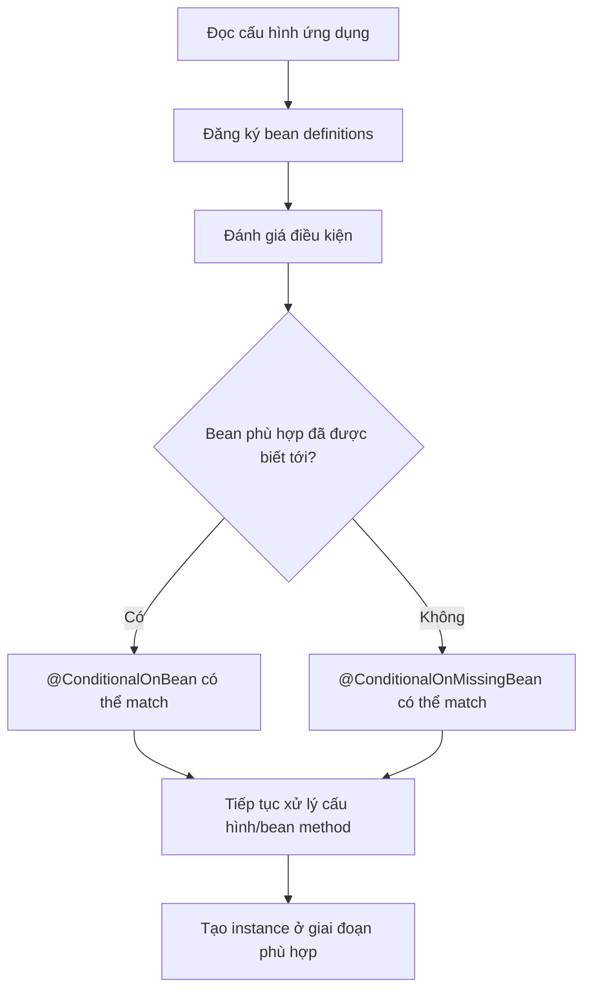
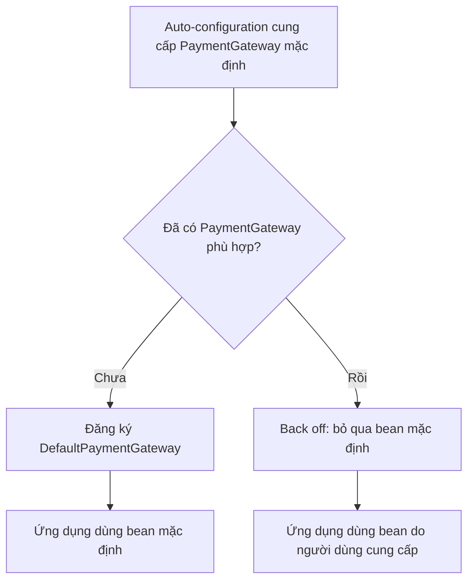

# @ConditionalOnBean, @ConditionalOnMissingBean và bean đã được biết tới

Trong Spring Boot, không phải mọi bean đều cần được đăng ký trong mọi ứng dụng. Một cấu hình có thể chỉ có ý nghĩa khi một bean khác đã tồn tại; ngược lại, một cấu hình mặc định chỉ nên tạo bean khi ứng dụng chưa cung cấp lựa chọn riêng.

Spring Boot hỗ trợ hai điều kiện thường dùng cho trường hợp này:

- **`@ConditionalOnBean`**: chỉ áp dụng cấu hình hoặc đăng ký bean khi BeanFactory đã biết tới bean phù hợp với điều kiện.
- **`@ConditionalOnMissingBean`**: chỉ áp dụng cấu hình hoặc đăng ký bean khi chưa có bean phù hợp với điều kiện.

Điểm quan trọng nằm ở cụm **“đã được biết tới”**. Điều kiện kiểm tra những bean definition mà container có thể nhận diện tại thời điểm điều kiện được đánh giá. Nó không phải phép kiểm tra xem object đã được khởi tạo hoàn chỉnh, đã kết nối database hay đang phục vụ request hay chưa.

Hiểu đúng thời điểm và phạm vi kiểm tra giúp bạn viết auto-configuration có thể tùy biến, tránh tạo bean trùng, và giải thích được vì sao một bean mặc định xuất hiện hoặc bị bỏ qua.

## 1. Hai điều kiện giải quyết hai tình huống khác nhau

Giả sử một ứng dụng có thể tích hợp một dịch vụ báo cáo. Tính năng báo cáo chỉ hoạt động khi có `DataSource`, còn thư viện muốn cung cấp một `ReportService` mặc định nếu ứng dụng chưa tự định nghĩa.

Hai câu hỏi:

1. **Đã có DataSource chưa?** Nếu có, đăng ký phần cấu hình phụ thuộc database.
2. **Đã có ReportService do ứng dụng cung cấp chưa?** Nếu chưa, đăng ký implementation mặc định.

Ví dụ:

```java
@Bean
@ConditionalOnBean(DataSource.class)
ReportRepository reportRepository(DataSource dataSource) {
    return new JdbcReportRepository(dataSource);
}
```

Bean `reportRepository` chỉ được đăng ký khi điều kiện tìm thấy một bean phù hợp với kiểu `DataSource`.

Ví dụ khác:

```java
@Bean
@ConditionalOnMissingBean(ReportService.class)
ReportService reportService(ReportRepository repository) {
    return new DefaultReportService(repository);
}
```

Bean `reportService` mặc định chỉ được đăng ký khi chưa có bean phù hợp với `ReportService`.

| Annotation | Điều kiện để cấu hình/bean được áp dụng | Cách dùng điển hình |
|---|---|---|
| `@ConditionalOnBean` | Bean phù hợp đã được biết tới trong BeanFactory | Chỉ bật tích hợp khi hạ tầng hoặc capability đã có |
| `@ConditionalOnMissingBean` | Không tìm thấy bean phù hợp | Cung cấp default bean nhưng cho ứng dụng quyền thay thế |

Hai annotation này đều là điều kiện tại **giai đoạn xây dựng ApplicationContext**. Chúng không phải câu lệnh runtime để mỗi lần gọi service lại kiểm tra xem bean có tồn tại hay không.

## 2. “Bean đã được biết tới” nghĩa là gì?

Để hiểu hai điều kiện, hãy phân biệt ba trạng thái:

1. **Bean definition đã được đăng ký:** BeanFactory biết tên, kiểu có thể suy ra, scope và thông tin tạo bean.
2. **Bean instance đã được tạo:** container đã gọi constructor/factory method và thực hiện các bước khởi tạo tương ứng.
3. **Bean đã sẵn sàng về mặt nghiệp vụ:** tài nguyên bên ngoài đã kết nối, dữ liệu đã nạp, hoặc dependency đã vượt qua kiểm tra readiness.

Điều kiện bean của Spring Boot chủ yếu làm việc với **thông tin bean có trong BeanFactory ở thời điểm đánh giá**, đặc biệt là bean definitions và kiểu mà container có thể suy ra. Điều kiện không đồng nghĩa bean đã hoàn tất initialization hoặc đã thực hiện một request thành công.

Ví dụ:

```java
@Bean
@Lazy
DataSource reportDataSource() {
    return createDataSource();
}
```

Một bean lazy vẫn có thể có bean definition trong container dù instance chưa được tạo. Vì vậy, điều kiện kiểm tra bean không nên được hiểu là “phải gọi constructor và khởi tạo object trước rồi mới kiểm tra”.

Hãy hình dung:



Đây là mô hình khái quát. Thứ tự thực tế phụ thuộc quá trình parse configuration, import và đăng ký bean definition. Chính thứ tự đó là một phần quan trọng của bài học.

### 2.1. Bean được đăng ký từ đâu?

Một bean có thể được biết tới BeanFactory thông qua nhiều nguồn:

- Component scanning phát hiện `@Component`, `@Service`, `@Repository`, `@Controller`.
- Phương thức `@Bean` trong lớp `@Configuration`.
- Cấu hình được nhập qua `@Import`.
- Spring Boot auto-configuration.
- Bean definition được đăng ký bằng API hoặc bởi một framework tích hợp.

Vì thế, “bean đã được biết tới” không chỉ có nghĩa class đó tồn tại trên classpath. **Có class trong dependency không đồng nghĩa bean của class đó đã được đăng ký.**

Ví dụ, thêm thư viện chứa class `ReportClient` vào Gradle/Maven chưa tự động tạo bean `ReportClient`. Bean chỉ xuất hiện nếu có cấu hình hoặc component registration phù hợp.

### 2.2. Bean definition có thể biết kiểu từ đâu?

Spring có thể suy ra kiểu bean từ:

- Class được component scan phát hiện.
- Kiểu trả về của phương thức `@Bean`.
- Metadata của factory hoặc bean definition.
- Các kiểu mà bean được công bố qua cấu hình.

Đối với method `@Bean`, khai báo kiểu trả về đủ cụ thể giúp điều kiện theo kiểu nhận diện bean đáng tin cậy hơn.

Ví dụ:

```java
@Bean
PaymentGateway paymentGateway() {
    return new StripePaymentGateway();
}
```

Kiểu khai báo là `PaymentGateway`. Nếu một điều kiện cần tìm `PaymentGateway`, metadata này phù hợp. Nếu điều kiện cần tìm chính xác `StripePaymentGateway`, nhưng method chỉ công bố interface `PaymentGateway`, Spring có thể chưa có đủ thông tin kiểu cụ thể để match tại giai đoạn điều kiện.

Khi kiểu implementation có ý nghĩa đối với điều kiện, hãy khai báo kiểu trả về đủ cụ thể:

```java
@Bean
StripePaymentGateway paymentGateway() {
    return new StripePaymentGateway();
}
```

Không nên dùng kiểu trả về quá tổng quát nếu các điều kiện hoặc cấu hình khác cần nhận diện implementation cụ thể. Đồng thời, trong thiết kế ứng dụng, vẫn nên để service nghiệp vụ phụ thuộc vào interface khi phù hợp.

## 3. @ConditionalOnBean hoạt động như thế nào?

`@ConditionalOnBean` là điều kiện của Spring Boot. Nó cho phép một cấu hình hoặc bean method chỉ được áp dụng khi BeanFactory đã chứa bean phù hợp với những tiêu chí được khai báo.

Ví dụ đơn giản:

```java
@Configuration
public class ReportingConfiguration {

    @Bean
    @ConditionalOnBean(DataSource.class)
    public ReportRepository reportRepository(DataSource dataSource) {
        return new JdbcReportRepository(dataSource);
    }
}
```

Nếu tại thời điểm điều kiện được đánh giá, BeanFactory đã biết tới một bean phù hợp với `DataSource`, Spring có thể đăng ký bean `reportRepository`.

Nếu không có `DataSource`, phương thức `@Bean` này bị bỏ qua. Spring không tạo `ReportRepository` từ method đó.

### 3.1. Điều kiện ở cấp class

Có thể đặt annotation trên cả lớp cấu hình:

```java
@Configuration
@ConditionalOnBean(DataSource.class)
public class JdbcReportingConfiguration {

    @Bean
    public ReportRepository reportRepository(DataSource dataSource) {
        return new JdbcReportRepository(dataSource);
    }

    @Bean
    public ReportExporter reportExporter(ReportRepository repository) {
        return new ReportExporter(repository);
    }
}
```

Khi điều kiện trên class không match, cấu hình đó không được xử lý như một configuration source hoạt động. Các bean method bên trong không được đăng ký từ cấu hình này.

Cách này hữu ích khi **toàn bộ nhóm bean** đều cần cùng một capability, ví dụ database, messaging hoặc một client API.

### 3.2. Điều kiện ở cấp method

Nếu chỉ một bean cần dependency cụ thể, đặt annotation trên phương thức `@Bean`:

```java
@Configuration
public class OptionalIntegrationConfiguration {

    @Bean
    @ConditionalOnBean(DataSource.class)
    public AuditRepository auditRepository(DataSource dataSource) {
        return new JdbcAuditRepository(dataSource);
    }

    @Bean
    public InMemoryAuditFormatter auditFormatter() {
        return new InMemoryAuditFormatter();
    }
}
```

Ở đây, `auditRepository` phụ thuộc vào `DataSource`, còn `auditFormatter` không phụ thuộc database nên vẫn có thể được đăng ký khi không có `DataSource`.

Đặt điều kiện ở đúng phạm vi giúp cấu hình linh hoạt hơn. Đừng đặt điều kiện trên toàn class nếu chỉ một bean trong class thực sự cần nó.

### 3.3. Có thể kiểm tra theo kiểu, tên hoặc annotation

Điều kiện có thể được mô tả bằng kiểu class:

```java
@ConditionalOnBean(PaymentGateway.class)
```

Hoặc theo tên bean:

```java
@ConditionalOnBean(name = "primaryDataSource")
```

Hoặc theo tên kiểu dưới dạng chuỗi:

```java
@ConditionalOnBean(type = "com.example.payment.PaymentGateway")
```

Cũng có thể kiểm tra các bean mang annotation cụ thể. Các thuộc tính thường dùng gồm:

| Thuộc tính | Mục đích |
|---|---|
| `value` | Các class cần kiểm tra |
| `type` | Tên đầy đủ của kiểu dưới dạng chuỗi |
| `name` | Tên bean cần tìm |
| `annotation` | Annotation gắn trên bean cần tìm |
| `search` | Phạm vi BeanFactory cần tìm, gồm current context hoặc context cha theo chiến lược được chọn |

Dùng `value`/class literal khi kiểu có mặt chắc chắn trên classpath. Dùng `type` dạng chuỗi có thể hữu ích trong auto-configuration tùy chọn, nơi không muốn tham chiếu class trực tiếp ở một vị trí có nguy cơ làm class loading thất bại.

Không nên khai báo quá nhiều tiêu chí nếu chỉ cần một điều kiện đơn giản. Tiêu chí càng phức tạp, việc giải thích vì sao condition match hoặc không match càng khó.

## 4. @ConditionalOnMissingBean hoạt động như thế nào?

`@ConditionalOnMissingBean` cho phép Spring Boot đăng ký bean mặc định **khi chưa có bean phù hợp**.

Đây là nền tảng của mô hình auto-configuration có thể tùy biến:

- Thư viện cung cấp implementation mặc định.
- Ứng dụng có thể tự định nghĩa implementation của mình.
- Khi bean tùy chỉnh đã được biết tới trước lúc auto-configuration đánh giá điều kiện, bean mặc định sẽ nhường chỗ.

Ví dụ:

```java
@Configuration
public class PaymentConfiguration {

    @Bean
    @ConditionalOnMissingBean(PaymentGateway.class)
    public PaymentGateway paymentGateway() {
        return new DefaultPaymentGateway();
    }
}
```

Nếu ứng dụng chưa có bean nào phù hợp với `PaymentGateway`, Spring đăng ký `DefaultPaymentGateway`.

Nếu ứng dụng đã có implementation riêng:

```java
@Configuration
public class CustomPaymentConfiguration {

    @Bean
    public PaymentGateway paymentGateway() {
        return new AcmePaymentGateway();
    }
}
```

thì bean mặc định từ cấu hình có điều kiện có thể bị bỏ qua, miễn bean tùy chỉnh đã được đăng ký trước khi điều kiện `@ConditionalOnMissingBean` được đánh giá.

### 4.1. Vì sao đây là cơ chế back off?

Trong tài liệu Spring Boot, hành vi này thường được gọi là **back off**: auto-configuration lùi lại khi ứng dụng đã cung cấp bean riêng.



Nhờ vậy, thư viện có thể cung cấp trải nghiệm “có sẵn để chạy” nhưng không khóa cứng ứng dụng vào một implementation.

### 4.2. Không chỉ định kiểu có thể dùng kiểu trả về của @Bean

Một cách thường gặp trong auto-configuration:

```java
@Bean
@ConditionalOnMissingBean
public Clock applicationClock() {
    return Clock.systemUTC();
}
```

Khi không khai báo `value`, `type`, `name` hoặc `annotation`, điều kiện trên `@Bean` method có thể suy ra kiểu cần kiểm tra từ **kiểu trả về của method**. Ví dụ trên có ý nghĩa: tạo bean `Clock` mặc định nếu chưa có bean phù hợp.

Để người đọc hiểu rõ và tránh phụ thuộc vào suy luận kiểu trong ví dụ phức tạp, bạn cũng có thể khai báo tường minh:

```java
@Bean
@ConditionalOnMissingBean(Clock.class)
public Clock applicationClock() {
    return Clock.systemUTC();
}
```

Nếu method trả về một interface, điều kiện mặc định suy ra từ interface đó. Hãy chọn kiểu trả về phản ánh đúng hợp đồng mà auto-configuration muốn cung cấp.

### 4.3. Điều kiện có thể kiểm tra tên bean

Ví dụ, chỉ đăng ký một bean có tên dự phòng nếu chưa có tên đó:

```java
@Bean
@ConditionalOnMissingBean(name = "legacyReportExporter")
public ReportExporter legacyReportExporter() {
    return new DefaultReportExporter();
}
```

Điều kiện theo tên hữu ích khi tên là một phần hợp đồng cấu hình. Tuy nhiên, với bean nghiệp vụ thông thường, kiểm tra theo kiểu thường linh hoạt hơn vì ứng dụng có thể đặt tên bean tùy ý mà vẫn cung cấp đúng abstraction.

## 5. Điểm cốt lõi: Điều kiện chỉ thấy bean đã được xử lý trước đó

Đây là nguyên tắc quan trọng nhất của hai annotation:

**`@ConditionalOnBean` và `@ConditionalOnMissingBean` chỉ xét các bean definition đã được xử lý và có thể nhận diện trong BeanFactory tại thời điểm điều kiện được đánh giá. Chúng không dự đoán bean sẽ được đăng ký ở bước tương lai.**

Vì thế, kết quả phụ thuộc vào thứ tự xử lý cấu hình.

### 5.1. Ví dụ về thứ tự xử lý

Giả sử có hai cấu hình:

```java
@Configuration
public class DefaultConfiguration {

    @Bean
    @ConditionalOnMissingBean(MessageSender.class)
    public MessageSender messageSender() {
        return new DefaultMessageSender();
    }
}
```

```java
@Configuration
public class UserConfiguration {

    @Bean
    public MessageSender customMessageSender() {
        return new CustomMessageSender();
    }
}
```

Mục tiêu là bean do người dùng cung cấp phải được biết tới trước khi điều kiện kiểm tra bean mặc định được đánh giá.

Nếu cấu hình mặc định được xử lý trước khi bean người dùng được đăng ký, điều kiện có thể thấy chưa có `MessageSender` và đăng ký default bean. Khi cấu hình người dùng được xử lý sau, hai bean có thể cùng tồn tại và gây ambiguity hoặc xung đột tùy tên/cấu hình.

Đó là lý do Spring Boot khuyến nghị sử dụng bean conditions chủ yếu trong **auto-configuration**, nơi thứ tự xử lý được tổ chức để các cấu hình ứng dụng của người dùng được xử lý trước auto-configuration.

### 5.2. Vì sao auto-configuration phù hợp hơn component scan?

Auto-configuration của Spring Boot được nhập theo cơ chế riêng và có thể được sắp xếp trước/sau các auto-configuration khác. Cấu hình ứng dụng của người dùng được xử lý theo giai đoạn phù hợp trước khi auto-configuration kiểm tra bean để quyết định back off.

Ngược lại, các lớp `@Configuration` được phát hiện qua component scan không nên dựa vào thứ tự scan tùy ý để quyết định một bean có tồn tại hay chưa.

Vì vậy:

- Dùng `@ConditionalOnMissingBean` để cung cấp default trong auto-configuration là pattern phổ biến.
- Dùng `@ConditionalOnBean` trong auto-configuration để bật tích hợp khi capability đã được đăng ký là hợp lý.
- Nếu đặt condition trên các cấu hình ứng dụng thông thường, phải hiểu rõ thứ tự parse/registration; không giả định mọi bean ở package khác đã được xử lý.
- Nếu điều kiện phụ thuộc một auto-configuration khác, hãy khai báo thứ tự phù hợp.

### 5.3. Sắp xếp auto-configuration

Spring Boot cung cấp các cơ chế như:

```java
@AutoConfiguration(after = DataSourceAutoConfiguration.class)
public class ReportingAutoConfiguration {
}
```

Hoặc các annotation ordering tương ứng như `@AutoConfigureAfter` và `@AutoConfigureBefore` trong những cách tổ chức auto-configuration phù hợp.

Mục đích là điều khiển **thứ tự xử lý cấu hình**, không phải thứ tự khởi tạo instance bean. Hai khái niệm này khác nhau:

| Thứ tự | Điều khiển điều gì? |
|---|---|
| Auto-configuration ordering | Cấu hình nào được xử lý trước để điều kiện nhìn thấy bean definitions thích hợp |
| Bean dependency ordering | Bean nào cần được cung cấp trước để tạo bean khác |
| `@DependsOn` | Ràng buộc khởi tạo giữa các bean cụ thể trong trường hợp có lý do phù hợp |

Không dùng `@DependsOn` để thay thế ordering của auto-configuration. Nó không làm một bean definition tương lai xuất hiện sớm hơn khi điều kiện được đánh giá.

## 6. Ví dụ hoàn chỉnh: Auto-configuration cung cấp bean mặc định

Giả sử một thư viện báo cáo muốn cung cấp tích hợp JDBC nếu ứng dụng có `DataSource`, đồng thời cho phép ứng dụng thay `ReportRepository` và `ReportService`.

### 6.1. Các abstraction

```java
public interface ReportRepository {
    long countReports();
}
```

```java
public interface ReportService {
    long reportCount();
}
```

Implementation mặc định:

```java
public class JdbcReportRepository implements ReportRepository {

    private final DataSource dataSource;

    public JdbcReportRepository(DataSource dataSource) {
        this.dataSource = dataSource;
    }

    @Override
    public long countReports() {
        // Truy vấn database trong implementation thực tế.
        return 0L;
    }
}
```

```java
public class DefaultReportService implements ReportService {

    private final ReportRepository repository;

    public DefaultReportService(ReportRepository repository) {
        this.repository = repository;
    }

    @Override
    public long reportCount() {
        return repository.countReports();
    }
}
```

### 6.2. Auto-configuration

```java
package com.example.reporting.autoconfigure;

import javax.sql.DataSource;

import com.example.reporting.DefaultReportService;
import com.example.reporting.JdbcReportRepository;
import com.example.reporting.ReportRepository;
import com.example.reporting.ReportService;

import org.springframework.boot.autoconfigure.AutoConfiguration;
import org.springframework.boot.autoconfigure.condition.ConditionalOnBean;
import org.springframework.boot.autoconfigure.condition.ConditionalOnClass;
import org.springframework.boot.autoconfigure.condition.ConditionalOnMissingBean;
import org.springframework.context.annotation.Bean;

@AutoConfiguration
@ConditionalOnClass(JdbcReportRepository.class)
@ConditionalOnBean(DataSource.class)
public class ReportingAutoConfiguration {

    @Bean
    @ConditionalOnMissingBean(ReportRepository.class)
    public ReportRepository reportRepository(DataSource dataSource) {
        return new JdbcReportRepository(dataSource);
    }

    @Bean
    @ConditionalOnMissingBean(ReportService.class)
    public ReportService reportService(ReportRepository repository) {
        return new DefaultReportService(repository);
    }
}
```

Đây là ví dụ minh họa cho một auto-configuration module:

- `@ConditionalOnClass` kiểm tra thư viện JDBC implementation có trên classpath.
- `@ConditionalOnBean(DataSource.class)` chỉ bật cấu hình khi ứng dụng có `DataSource` được biết tới.
- `@ConditionalOnMissingBean(ReportRepository.class)` cho phép ứng dụng thay repository mặc định.
- `@ConditionalOnMissingBean(ReportService.class)` cho phép ứng dụng thay service mặc định.

Trong một auto-configuration thực tế, cần khai báo class trong cơ chế import auto-configuration phù hợp với phiên bản Spring Boot đang dùng. Với Spring Boot hiện đại, danh sách auto-configuration thường được công bố trong file:

```text
META-INF/spring/org.springframework.boot.autoconfigure.AutoConfiguration.imports
```

Nội dung file chứa tên đầy đủ của auto-configuration class, ví dụ:

```text
com.example.reporting.autoconfigure.ReportingAutoConfiguration
```

### 6.3. Ứng dụng không có DataSource

Nếu ứng dụng không có bean `DataSource`:

- Điều kiện trên `ReportingAutoConfiguration` không match.
- Các bean method trong cấu hình này không được đăng ký từ auto-configuration.
- Ứng dụng vẫn có thể khởi động nếu không có thành phần bắt buộc nào khác yêu cầu `ReportService`.

Đây là cách module tích hợp tùy chọn tránh buộc mọi ứng dụng phải dùng JDBC.

### 6.4. Ứng dụng có DataSource nhưng chưa có implementation riêng

Nếu `DataSource` đã được đăng ký và class JDBC có mặt:

- Auto-configuration có thể được áp dụng.
- `ReportRepository` mặc định được đăng ký nếu chưa có repository phù hợp.
- `ReportService` mặc định được đăng ký nếu chưa có service phù hợp.

Ứng dụng có thể inject `ReportService` và sử dụng implementation mặc định.

### 6.5. Ứng dụng tự cung cấp ReportService

Ví dụ cấu hình phía ứng dụng:

```java
@Configuration
public class CustomReportingConfiguration {

    @Bean
    public ReportService reportService(ReportRepository repository) {
        return new CustomReportService(repository);
    }
}
```

Nếu bean `ReportService` này đã được biết tới trước khi điều kiện missing-bean trong auto-configuration được đánh giá, bean mặc định sẽ back off. Ứng dụng dùng implementation của mình.

### 6.6. Ứng dụng tự cung cấp ReportRepository

Tương tự:

```java
@Configuration
public class CustomRepositoryConfiguration {

    @Bean
    public ReportRepository reportRepository(DataSource dataSource) {
        return new CustomReportRepository(dataSource);
    }
}
```

Điều kiện `@ConditionalOnMissingBean(ReportRepository.class)` không match, nên auto-configuration bỏ qua repository mặc định. Bean service mặc định có thể sử dụng repository do ứng dụng cung cấp.

**Điểm quan trọng:** Auto-configuration cung cấp giá trị mặc định theo từng abstraction. Ứng dụng có thể thay một phần, không nhất thiết phải thay toàn bộ module.

## 7. Điều kiện bean không phải điều kiện classpath

Hai loại điều kiện thường đi cùng nhau nhưng trả lời câu hỏi khác nhau:

- `@ConditionalOnClass`: class có tồn tại trên classpath không?
- `@ConditionalOnBean`: bean phù hợp đã được đăng ký trong BeanFactory chưa?
- `@ConditionalOnMissingBean`: bean phù hợp chưa được đăng ký?
- `@ConditionalOnProperty`: property có giá trị phù hợp không?

Ví dụ:

```java
@AutoConfiguration
@ConditionalOnClass(ReportClient.class)
@ConditionalOnProperty(
        prefix = "app.reporting",
        name = "enabled",
        havingValue = "true"
)
public class ReportingAutoConfiguration {
    // ...
}
```

Cấu hình trên yêu cầu cả class cần thiết và property bật tính năng. Nếu một bean dependency cụ thể cũng cần tồn tại, có thể thêm điều kiện bean phù hợp.

Không nên dùng `@ConditionalOnBean` để kiểm tra classpath. Một class có mặt chưa chắc đã có bean. Ngược lại, bean có thể được đăng ký bằng factory hoặc proxy dù class implementation không được dùng trực tiếp ở nơi khai báo điều kiện.

## 8. Các tiêu chí tìm kiếm và phạm vi BeanFactory

Các bean conditions có thể xét theo kiểu, tên, annotation và phạm vi tìm kiếm.

### 8.1. Tìm theo kiểu

Đây là cách thường dùng:

```java
@ConditionalOnBean(Clock.class)
```

Điều kiện tìm bean phù hợp với kiểu `Clock`. Kiểu cần được container nhận diện từ bean definition hoặc metadata liên quan.

### 8.2. Tìm theo tên

```java
@ConditionalOnBean(name = "primaryDataSource")
```

Cách này hữu ích khi cấu hình thực sự phụ thuộc vào một bean có tên cụ thể. Tuy nhiên, nó tạo coupling vào tên bean: nếu ứng dụng đổi tên bean, điều kiện có thể không còn match dù kiểu capability vẫn tồn tại.

### 8.3. Tìm theo annotation

Có thể kiểm tra bean mang annotation cụ thể:

```java
@ConditionalOnBean(annotation = EnableReporting.class)
```

Đây là lựa chọn khi sự hiện diện của một loại bean được đánh dấu bằng annotation là tín hiệu kích hoạt tích hợp.

### 8.4. Search strategy: current context hay context cha?

Ứng dụng có thể có nhiều ApplicationContext, ví dụ context cha và context con trong một số kiến trúc web hoặc tích hợp. Bean conditions hỗ trợ chiến lược tìm kiếm như:

- `SearchStrategy.CURRENT`: chỉ tìm trong context hiện tại.
- `SearchStrategy.ANCESTORS`: tìm trong context cha theo phạm vi phù hợp.
- `SearchStrategy.ALL`: tìm trong context hiện tại và các context cha.

Ví dụ:

```java
@ConditionalOnBean(
        value = DataSource.class,
        search = SearchStrategy.CURRENT
)
```

Phạm vi tìm kiếm mặc định của bean conditions được cấu hình theo chiến lược tìm kiếm của annotation; khi ứng dụng có context hierarchy, hãy chỉ định search strategy nếu việc giới hạn hoặc mở rộng phạm vi là một phần yêu cầu thiết kế.

Đối với phần lớn ứng dụng Spring Boot đơn giản, thường chỉ có một application context nên bạn ít phải thay đổi thuộc tính này. Nhưng khi viết infrastructure dùng trong ứng dụng có context cha/con, phạm vi tìm kiếm cần được hiểu rõ.

## 9. Kiểu trả về của @Bean ảnh hưởng điều kiện như thế nào?

Điều kiện được đánh giá trong quá trình xử lý bean definitions. Spring có thể cần biết kiểu bean **trước khi instance thực sự được tạo**. Vì vậy kiểu trả về của `@Bean` method rất quan trọng.

Ví dụ:

```java
@Bean
@ConditionalOnMissingBean(PaymentGateway.class)
public PaymentGateway paymentGateway() {
    return new DefaultPaymentGateway();
}
```

Đây là cách khai báo rõ ràng nếu abstraction cần bảo vệ là `PaymentGateway`.

Nhưng nếu bạn viết:

```java
@Bean
public Object paymentGateway() {
    return new DefaultPaymentGateway();
}
```

thì metadata công khai của method chỉ cho biết kiểu `Object`. Điều kiện theo `PaymentGateway` có thể không nhận diện được bean definition này một cách đáng tin cậy khi chưa tạo instance.

Tương tự, nếu condition cần implementation cụ thể nhưng method chỉ trả về interface, thông tin kiểu có thể không đủ để match implementation đó.

**Quy tắc thực hành:** khai báo kiểu trả về của `@Bean` càng cụ thể càng tốt trong phạm vi abstraction mà các điều kiện và cấu hình khác cần nhận diện. Đừng trả `Object` chỉ để “linh hoạt” nếu container cần biết kiểu bean từ trước.

## 10. Một số lỗi và cách giải thích

### 10.1. Mong đợi @ConditionalOnBean match nhưng bean chưa được đăng ký

Ví dụ, bạn biết project có class `DataSource` và đã thêm dependency JDBC, nhưng `@ConditionalOnBean(DataSource.class)` không match.

Có thể vì:

- Dependency chỉ đưa class vào classpath, chưa tạo bean `DataSource`.
- Auto-configuration tạo DataSource chưa được kích hoạt do thiếu cấu hình hoặc driver.
- Bean definition được đăng ký sau thời điểm condition đã được đánh giá.
- Condition đang tìm ở sai context hoặc search strategy.
- Kiểu bean không thể suy ra từ metadata khai báo.

Hãy phân biệt **class có mặt** với **bean đã được đăng ký**.

### 10.2. @ConditionalOnMissingBean vẫn tạo default dù ứng dụng có bean tùy chỉnh

Kiểm tra thứ tự xử lý cấu hình:

- Bean tùy chỉnh có được đăng ký trước auto-configuration không?
- Cấu hình mặc định có phải auto-configuration thực sự hay chỉ là `@Configuration` được component scan?
- Bean tùy chỉnh có đúng kiểu mà condition kiểm tra không?
- `@Bean` method có khai báo kiểu trả về đủ cụ thể không?
- Điều kiện có tìm đúng tên/annotation/search scope không?

Đây thường là vấn đề **condition evaluation order** hoặc **metadata/type mismatch**, không phải Spring cố tình bỏ qua bean người dùng.

### 10.3. Hai bean cùng kiểu sau khi auto-configuration chạy

Có thể default condition không nhìn thấy bean tùy chỉnh ở thời điểm nó được đánh giá, hoặc điều kiện đang kiểm tra sai abstraction.

Khi đó hai bean cùng kiểu có thể được đăng ký, dẫn tới `NoUniqueBeanDefinitionException` khi inject theo kiểu.

Đừng xử lý ngay bằng `@Primary` nếu mục tiêu ban đầu là default bean phải back off. Trước tiên hãy sửa thứ tự hoặc tiêu chí condition để default bean không được đăng ký khi user bean đã tồn tại.

### 10.4. Bean đã có nhưng instance chưa được tạo

Điều này không tự động có nghĩa condition sẽ không match. Với bean lazy hoặc singleton chưa được khởi tạo, bean definition vẫn có thể được BeanFactory nhận diện.

Không dùng `@ConditionalOnBean` để hỏi “database đã kết nối thành công chưa?”. Hãy dùng health check, readiness hoặc cơ chế kiểm tra trạng thái runtime thích hợp cho câu hỏi đó.

## 11. Quan sát vì sao condition match hoặc không match

Khi auto-configuration không hoạt động như mong muốn, Spring Boot có thể cung cấp **Condition Evaluation Report** để giải thích những điều kiện đã match hoặc không match.

### 11.1. Bật debug khi chạy ứng dụng

Có thể khởi động ứng dụng với tham số:

```bash
java -jar app.jar --debug
```

Hoặc cấu hình:

```properties
debug=true
```

Trong quá trình startup, báo cáo điều kiện giúp bạn thấy:

- Auto-configuration nào được áp dụng.
- Auto-configuration nào bị loại vì thiếu class hoặc bean.
- Điều kiện nào không tìm thấy bean cần thiết.
- Điều kiện missing-bean nào không match vì đã có bean tương ứng.

Thông điệp thực tế tùy phiên bản và cấu hình logging. Hãy tìm phần **CONDITIONS EVALUATION REPORT**, các nhóm positive matches/negative matches và lý do cụ thể.

### 11.2. Actuator conditions endpoint

Trong ứng dụng có Spring Boot Actuator, endpoint điều kiện có thể cung cấp thông tin về condition evaluation. Endpoint này thường có id `conditions`; việc truy cập phụ thuộc dependency, exposure và security configuration.

Không nên expose endpoint quản trị nhạy cảm ra mạng công khai chỉ để debug. Trong môi trường phát triển, log `--debug` thường là cách đơn giản để bắt đầu.

## 12. Kiểm thử auto-configuration với ApplicationContextRunner

Spring Boot cung cấp `ApplicationContextRunner` để kiểm tra cấu hình trong một application context nhỏ, nhanh và có thể kiểm soát bean được thêm vào.

Mục tiêu là chứng minh hai hành vi:

1. Có `DataSource` thì cấu hình báo cáo được kích hoạt.
2. Nếu ứng dụng cung cấp `ReportService`, auto-configuration không đăng ký default service.

Ví dụ kiểm thử minh họa:

```java
import javax.sql.DataSource;

import org.junit.jupiter.api.Test;
import org.springframework.boot.autoconfigure.AutoConfigurations;
import org.springframework.boot.test.context.runner.ApplicationContextRunner;
import org.springframework.context.annotation.Bean;
import org.springframework.context.annotation.Configuration;

import static org.assertj.core.api.Assertions.assertThat;

class ReportingAutoConfigurationTests {

    private final ApplicationContextRunner contextRunner =
            new ApplicationContextRunner()
                    .withConfiguration(
                            AutoConfigurations.of(
                                    ReportingAutoConfiguration.class
                            )
                    );

    @Test
    void doesNotConfigureReportingWithoutDataSource() {
        contextRunner.run(context -> {
            assertThat(context).doesNotHaveBean(ReportRepository.class);
            assertThat(context).doesNotHaveBean(ReportService.class);
        });
    }

    @Test
    void backsOffWhenUserProvidesReportService() {
        contextRunner
                .withBean(DataSource.class, StubDataSource::new)
                .withUserConfiguration(UserReportConfiguration.class)
                .run(context -> {
                    assertThat(context).hasSingleBean(ReportService.class);
                    assertThat(context).hasBean("customReportService");
                    assertThat(context).doesNotHaveBean("reportService");
                });
    }

    @Configuration(proxyBeanMethods = false)
    static class UserReportConfiguration {

        @Bean
        ReportService customReportService() {
            return new CustomReportService();
        }
    }
}
```

`StubDataSource` và `CustomReportService` trong ví dụ là các class test do project định nghĩa, phải triển khai các contract cần thiết. Để test riêng auto-configuration, có thể dùng fake/stub tối giản hoặc cấu hình bean test phù hợp.

Tùy cấu trúc auto-configuration và dependency, test thứ hai cũng cần cung cấp các bean bắt buộc khác. Mục tiêu chính là cho thấy `ApplicationContextRunner` có thể thiết lập context với/không có bean để quan sát điều kiện.

### 12.1. Vì sao nên test cả trường hợp có và không có bean?

Một auto-configuration tốt cần chứng minh:

- Khi dependency không tồn tại, tính năng tùy chọn không làm context thất bại.
- Khi dependency xuất hiện, bean được đăng ký đúng.
- Khi người dùng cung cấp bean riêng, default bean back off.
- Khi property/classpath condition không thỏa, cấu hình không hoạt động ngoài ý muốn.

Đây là các test quan trọng hơn việc chỉ kiểm tra “context loads” một lần trong môi trường duy nhất.

## 13. Những annotation gần giống nhưng giải quyết câu hỏi khác

| Annotation | Câu hỏi nó trả lời | Ví dụ |
|---|---|---|
| `@ConditionalOnBean` | Đã có bean phù hợp chưa? | Chỉ tạo adapter nếu có `DataSource` |
| `@ConditionalOnMissingBean` | Chưa có bean phù hợp phải không? | Tạo `DefaultPaymentGateway` nếu user chưa cung cấp |
| `@ConditionalOnClass` | Class có mặt trên classpath không? | Bật integration khi thư viện client tồn tại |
| `@ConditionalOnProperty` | Property có được bật/đúng giá trị không? | Chỉ bật reporting khi `app.reporting.enabled=true` |
| `@ConditionalOnResource` | Resource được chỉ định có tồn tại không? | Chỉ bật cấu hình khi file resource có mặt |
| `@ConditionalOnSingleCandidate` | Có một candidate duy nhất hoặc một candidate được ưu tiên phù hợp không? | Chọn dependency theo kiểu khi có nhiều bean ứng viên |

Đặc biệt, `@ConditionalOnSingleCandidate` khác `@ConditionalOnBean`: có bean phù hợp chưa đủ để kết luận chỉ có một candidate. Nếu một cấu hình cần một dependency đơn lẻ và có thể có nhiều bean cùng kiểu, điều kiện single-candidate có thể phù hợp hơn.

## 14. Nguyên tắc thiết kế điều kiện bean

Khi viết auto-configuration hoặc cấu hình tùy chọn, hãy giữ các nguyên tắc sau:

1. **Kiểm tra đúng abstraction.** Nếu ứng dụng chỉ cần `PaymentGateway`, hãy condition theo `PaymentGateway` thay vì một implementation cụ thể không cần thiết.
2. **Dùng missing-bean cho default.** Đây là cách chuẩn để ứng dụng ghi đè bean mặc định.
3. **Đặt condition ở phạm vi nhỏ nhất hợp lý.** Một bean cần `DataSource` không có nghĩa mọi bean trong configuration đều cần database.
4. **Đảm bảo thứ tự xử lý.** Bean conditions chỉ thấy những bean definitions đã được xử lý; auto-configuration ordering phải phù hợp.
5. **Khai báo kiểu trả về rõ ràng.** Điều kiện theo kiểu phụ thuộc vào khả năng suy ra type từ bean metadata.
6. **Không dùng condition làm health check.** Bean tồn tại không đồng nghĩa tài nguyên hoạt động.
7. **Không dựa vào thứ tự component scan ngẫu nhiên.** Dùng cơ chế auto-configuration và ordering được hỗ trợ khi viết thư viện.
8. **Kiểm thử cả match lẫn back off.** Thử context có dependency, không có dependency và có bean tùy chỉnh.

## 15. Bài tập tự kiểm tra

### Bài 1: Điều kiện theo bean

```java
@Bean
@ConditionalOnBean(DataSource.class)
ReportRepository reportRepository(DataSource dataSource) {
    return new JdbcReportRepository(dataSource);
}
```

**Câu hỏi:** Nếu class `DataSource` có trên classpath nhưng chưa có bean `DataSource`, method có được áp dụng không?

**Gợi ý:** Không. Classpath presence và bean registration là hai điều kiện khác nhau.

### Bài 2: Default bean

```java
@Bean
@ConditionalOnMissingBean(PaymentGateway.class)
PaymentGateway paymentGateway() {
    return new DefaultPaymentGateway();
}
```

**Câu hỏi:** Khi ứng dụng đã đăng ký `AcmePaymentGateway` dưới kiểu `PaymentGateway` trước lúc auto-configuration đánh giá condition, điều gì xảy ra?

**Đáp án:** Condition không match và bean mặc định back off.

### Bài 3: Thứ tự xử lý

Cấu hình `DefaultConfiguration` có `@ConditionalOnMissingBean` được xử lý trước `UserConfiguration` chứa bean tùy chỉnh.

**Câu hỏi:** Có thể dựa vào condition để chắc chắn default bean sẽ back off không?

**Đáp án:** Không. Điều kiện chỉ xét bean definitions đã được xử lý đến thời điểm đó. Cần tổ chức thứ tự cấu hình/auto-configuration đúng.

### Bài 4: Bean lazy

Một bean `DataSource` có definition và được đánh dấu lazy, nhưng instance chưa được tạo.

**Câu hỏi:** Có thể kết luận `@ConditionalOnBean(DataSource.class)` chắc chắn không match vì chưa có object không?

**Đáp án:** Không. Bean condition xét bean đã được biết tới trong BeanFactory; việc instance đã được khởi tạo là câu hỏi khác.

### Bài 5: Kiểu trả về quá tổng quát

Một `@Bean` method trả về `Object`, nhưng điều kiện khác cần tìm `PaymentGateway`.

**Câu hỏi:** Vì sao metadata kiểu có thể gây vấn đề?

**Đáp án:** Khi condition được đánh giá, container có thể chỉ suy ra kiểu `Object` từ method signature. Hãy công bố kiểu trả về phù hợp với abstraction cần được nhận diện.

### Bài 6: Condition hay health check?

Ứng dụng muốn chỉ nhận request khi database có thể kết nối.

**Câu hỏi:** Có nên dùng `@ConditionalOnBean(DataSource.class)` để xác nhận database đang khỏe không?

**Đáp án:** Không. Annotation chỉ kiểm tra sự hiện diện của bean phù hợp trong context. Dùng health indicator/readiness hoặc kiểm tra kết nối ở runtime.

## 16. Ghi nhớ

- `@ConditionalOnBean` chỉ áp dụng cấu hình khi bean phù hợp đã được biết tới trong BeanFactory.
- `@ConditionalOnMissingBean` cung cấp default khi chưa có bean phù hợp, cho phép auto-configuration **back off** khi ứng dụng có implementation riêng.
- “Đã biết tới” chủ yếu nói về bean definitions/type metadata đã được xử lý, không có nghĩa instance đã khởi tạo hoặc tài nguyên đã sẵn sàng.
- Condition chỉ nhìn thấy bean đã được đăng ký trước thời điểm nó được đánh giá; thứ tự xử lý cấu hình rất quan trọng.
- Bean conditions phù hợp nhất với auto-configuration có ordering rõ ràng; không dựa vào thứ tự component scan tùy ý.
- Kiểu trả về của `@Bean` cần đủ cụ thể để các điều kiện theo kiểu có thể nhận diện bean.
- `@ConditionalOnClass`, `@ConditionalOnProperty` và bean conditions kiểm tra những loại thông tin khác nhau.
- Dùng Condition Evaluation Report và `ApplicationContextRunner` để giải thích, kiểm thử hành vi match/back off.

Khi đọc một bean condition, hãy tự hỏi: **“Bean nào đã được đăng ký trước lúc điều kiện này chạy, container nhận diện nó bằng kiểu hay tên nào, và cấu hình này cần match hay cần back off?”** Trả lời được ba câu hỏi đó sẽ giúp bạn viết auto-configuration Spring Boot dễ tùy biến và dự đoán hơn.
