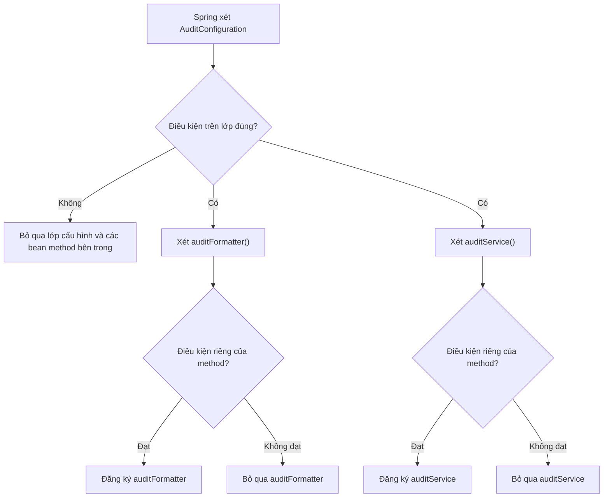

# Điều kiện trên lớp, trên phương thức `@Bean` và sự kết hợp

> **Spring Boot Fundamentals · Cấu hình theo điều kiện**  
> Spring Boot có thể đăng ký bean tùy theo classpath, property, môi trường web hoặc những bean đã có trong ApplicationContext. Các điều kiện có thể đặt **trên cả lớp cấu hình** hoặc **trên từng phương thức `@Bean`**. Vị trí đặt điều kiện quyết định phạm vi ảnh hưởng: bỏ qua toàn bộ một nhóm cấu hình hay chỉ bỏ qua một bean. Khi đặt điều kiện ở cả hai cấp, Spring phải thỏa mãn các điều kiện liên quan trước khi đăng ký bean.

## 1. Cấu hình theo điều kiện giải quyết vấn đề gì?

Một ứng dụng có thể chạy ở nhiều môi trường hoặc được dùng bởi nhiều loại ứng dụng khác nhau. Chẳng hạn:

- Tích hợp gửi email chỉ được bật khi có cấu hình SMTP.
- Một adapter chỉ có thể khởi tạo khi thư viện của vendor xuất hiện trên classpath.
- Ứng dụng cần dùng implementation mặc định nếu chưa có implementation tùy chỉnh.
- Một bean chỉ phù hợp với ứng dụng web, còn ứng dụng batch không cần nó.
- Một tính năng chỉ được tạo khi property tương ứng bật.

Nếu khai báo tất cả bean vô điều kiện, Spring có thể cố khởi tạo thành phần mà môi trường hiện tại không hỗ trợ. Kết quả có thể là thiếu class, thiếu cấu hình, lỗi kết nối hoặc các bean không cần thiết xuất hiện trong context.

Spring Framework cung cấp cơ chế `@Conditional`; Spring Boot xây dựng nhiều annotation điều kiện phổ biến dựa trên cơ chế đó, ví dụ:

| Annotation | Điều kiện tiêu biểu |
| --- | --- |
| `@ConditionalOnClass` | Một hoặc nhiều class có trên classpath |
| `@ConditionalOnMissingClass` | Một hoặc nhiều class không có trên classpath |
| `@ConditionalOnProperty` | Property có mặt hoặc có giá trị phù hợp |
| `@ConditionalOnBean` | Một bean phù hợp đã được đăng ký |
| `@ConditionalOnMissingBean` | Chưa có bean phù hợp |
| `@ConditionalOnResource` | Resource có thể được tìm thấy |
| `@ConditionalOnWebApplication` | Ứng dụng thuộc loại web được chỉ định |
| `@ConditionalOnNotWebApplication` | Ứng dụng không phải web application |
| `@ConditionalOnJava` | Phiên bản Java đáp ứng điều kiện |
| `@ConditionalOnExpression` | Biểu thức SpEL cho kết quả phù hợp |

Các annotation này thuộc gói `org.springframework.boot.autoconfigure.condition` trong những phiên bản Spring Boot tương ứng. Chi tiết thuộc tính có thể thay đổi theo version; ví dụ trong bài dùng phong cách API quen thuộc của Spring Boot 3.x.

## 2. Hai cấp độ: điều kiện trên lớp và điều kiện trên phương thức

Điểm cốt lõi của bài học là phân biệt **phạm vi của điều kiện**.

### 2.1. Đặt điều kiện trên lớp cấu hình

Ví dụ:

```java
@Configuration(proxyBeanMethods = false)
@ConditionalOnProperty(
        prefix = "features.audit",
        name = "enabled",
        havingValue = "true"
)
public class AuditConfiguration {

    @Bean
    AuditFormatter auditFormatter() {
        return new AuditFormatter();
    }

    @Bean
    AuditService auditService(AuditFormatter formatter) {
        return new AuditService(formatter);
    }
}
```

Khi property `features.audit.enabled` có giá trị `true`, lớp `AuditConfiguration` đủ điều kiện để được xử lý và các bean method bên trong có thể được đăng ký theo điều kiện riêng của chúng.

Khi property không đáp ứng điều kiện, Spring bỏ qua cấu hình này. Cả `auditFormatter` và `auditService` đều không được đăng ký từ lớp cấu hình đó.

Đây là cách phù hợp khi **toàn bộ nhóm bean cùng thuộc một tính năng** và không có ý nghĩa nếu chỉ một phần của nhóm được tạo.

### 2.2. Đặt điều kiện trên một phương thức `@Bean`

Ví dụ:

```java
@Configuration(proxyBeanMethods = false)
public class NotificationConfiguration {

    @Bean
    @ConditionalOnProperty(
            prefix = "features.notification",
            name = "email-enabled",
            havingValue = "true"
    )
    EmailSender emailSender() {
        return new EmailSender();
    }

    @Bean
    NotificationStatus notificationStatus() {
        return new NotificationStatus();
    }
}
```

Ở đây điều kiện chỉ áp dụng cho `emailSender`:

- Khi property thỏa mãn, bean `EmailSender` có thể được đăng ký.
- Khi property không thỏa mãn, bean `emailSender` không được đăng ký.
- Bean `notificationStatus` vẫn được đăng ký nếu lớp cấu hình được nạp và không có điều kiện khác ngăn nó.

Cách này phù hợp khi **một cấu hình chứa nhiều bean nhưng chỉ một số bean phụ thuộc vào điều kiện riêng**.

### 2.3. Hình dung phạm vi ảnh hưởng



Sơ đồ thể hiện nguyên tắc: **điều kiện lớp là cổng cho toàn bộ cấu hình; điều kiện method là cổng riêng cho bean được khai báo bởi method đó**.

## 3. Điều kiện trên lớp cấu hình: ví dụ tính năng audit

Giả sử ứng dụng có nhóm thành phần audit chỉ được dùng khi property bật.

File `application.yml`:

```yaml
features:
  audit:
    enabled: true
```

Lớp cấu hình:

```java
package com.example.orders.config;

import org.springframework.boot.autoconfigure.condition.ConditionalOnProperty;
import org.springframework.context.annotation.Bean;
import org.springframework.context.annotation.Configuration;

@Configuration(proxyBeanMethods = false)
@ConditionalOnProperty(
        prefix = "features.audit",
        name = "enabled",
        havingValue = "true"
)
public class AuditConfiguration {

    @Bean
    AuditFormatter auditFormatter() {
        return new AuditFormatter();
    }

    @Bean
    AuditSink auditSink(AuditFormatter formatter) {
        return new LoggingAuditSink(formatter);
    }
}
```

Các class `AuditFormatter`, `AuditSink` và `LoggingAuditSink` là kiểu do ứng dụng định nghĩa trong ví dụ.

### 3.1. Khi property bật

Với:

```yaml
features:
  audit:
    enabled: true
```

điều kiện trên lớp thỏa mãn. Spring xử lý các bean method trong `AuditConfiguration`, giải quyết dependency và đăng ký những bean đủ điều kiện.

### 3.2. Khi property tắt

Với:

```yaml
features:
  audit:
    enabled: false
```

lớp cấu hình không được áp dụng. Các bean `AuditFormatter` và `AuditSink` không được tạo từ lớp này.

Điều đó **không tự động loại bỏ** bean audit nếu một cấu hình khác hoặc component scan đăng ký cùng loại bean. Điều kiện chỉ kiểm soát nguồn cấu hình đang được gắn annotation.

### 3.3. Khi property không tồn tại

`@ConditionalOnProperty` có `matchIfMissing = false` theo mặc định. Nếu property không có, điều kiện thường không khớp, trừ khi bạn chủ động bật `matchIfMissing = true`.

Ví dụ mặc định tắt tính năng nếu chưa cấu hình:

```java
@ConditionalOnProperty(
        prefix = "features.audit",
        name = "enabled",
        havingValue = "true",
        matchIfMissing = false
)
```

Đây là cách thường phù hợp cho tính năng tích hợp tùy chọn: nếu chưa cấu hình, không khởi tạo nó.

## 4. Điều kiện trên phương thức `@Bean`: ví dụ nhiều implementation

Một lớp cấu hình có thể cung cấp nhiều implementation khác nhau cho cùng một vai trò.

Giả sử có interface:

```java
package com.example.orders.notification;

public interface NotificationSender {
    void send(String recipient, String message);
}
```

Cấu hình:

```java
@Configuration(proxyBeanMethods = false)
public class NotificationConfiguration {

    @Bean
    @ConditionalOnProperty(
            prefix = "notification",
            name = "provider",
            havingValue = "console"
    )
    NotificationSender consoleSender() {
        return new ConsoleNotificationSender();
    }

    @Bean
    @ConditionalOnProperty(
            prefix = "notification",
            name = "provider",
            havingValue = "email"
    )
    NotificationSender emailSender() {
        return new EmailNotificationSender();
    }
}
```

Cả hai method nằm trong cùng một lớp cấu hình không có điều kiện ở cấp lớp. Mỗi method có điều kiện riêng:

| Giá trị `notification.provider` | `consoleSender` | `emailSender` |
| --- | --- | --- |
| `console` | Được đăng ký | Bị bỏ qua |
| `email` | Bị bỏ qua | Được đăng ký |
| `sms` | Bị bỏ qua | Bị bỏ qua |
| Không có property | Bị bỏ qua | Bị bỏ qua |

Nếu consumer inject một `NotificationSender` bắt buộc, trường hợp không có provider hợp lệ sẽ khiến Spring không tìm được bean và báo lỗi. Điều này có thể là hành vi đúng: property không hợp lệ phải được phát hiện khi startup.

Nếu việc không có sender là hợp lệ, consumer có thể dùng `Optional<NotificationSender>` hoặc một no-op implementation theo thiết kế. Tuy nhiên, nếu property được khai báo mà mang giá trị không hỗ trợ, nên cân nhắc validate cấu hình để báo lỗi rõ ràng thay vì âm thầm bỏ qua.

### 4.1. Điều kiện trên method không làm mất các bean khác

Giả sử thêm một bean không phụ thuộc provider:

```java
@Bean
NotificationHealthIndicator notificationHealthIndicator() {
    return new NotificationHealthIndicator();
}
```

Bean này vẫn có thể được đăng ký ngay cả khi `notification.provider` không phải `console` hoặc `email`, bởi điều kiện chỉ gắn vào hai factory method đầu tiên.

Đây là điểm khác biệt quan trọng so với việc đặt cùng điều kiện trên lớp `NotificationConfiguration`: nếu đặt trên lớp, toàn bộ các bean method trong lớp đều nằm sau cổng điều kiện đó.

## 5. Kết hợp điều kiện trên lớp và phương thức

Có thể đặt điều kiện ở cả hai cấp khi muốn giới hạn một nhóm cấu hình, sau đó áp dụng thêm quy tắc riêng cho từng bean.

Ví dụ:

```java
@Configuration(proxyBeanMethods = false)
@ConditionalOnClass(name = "com.vendor.audit.AuditClient")
@ConditionalOnProperty(
        prefix = "features.audit",
        name = "enabled",
        havingValue = "true"
)
public class VendorAuditConfiguration {

    @Bean
    @ConditionalOnProperty(
            prefix = "features.audit",
            name = "mode",
            havingValue = "remote"
    )
    AuditClient remoteAuditClient(AuditProperties properties) {
        return new AuditClient(properties.endpoint());
    }

    @Bean
    @ConditionalOnProperty(
            prefix = "features.audit",
            name = "mode",
            havingValue = "local"
    )
    AuditSink localAuditSink() {
        return new LocalAuditSink();
    }
}
```

Cấu hình này có ba lớp quyết định:

1. **Class condition:** class `com.vendor.audit.AuditClient` phải có trên classpath.
2. **Class property condition:** `features.audit.enabled` phải là `true`.
3. **Method condition:** mỗi bean chỉ được đăng ký khi `features.audit.mode` khớp với giá trị riêng.

Điều kiện trên lớp và điều kiện trên method phải cùng thỏa mãn để bean method được áp dụng.

### 5.1. Kết quả kết hợp

| Vendor class | `features.audit.enabled` | `features.audit.mode` | Kết quả |
| --- | --- | --- | --- |
| Không có | `true` | `remote` | Bỏ qua cả lớp cấu hình |
| Có | `false` | `remote` | Bỏ qua cả lớp cấu hình |
| Có | `true` | `remote` | Có thể đăng ký `remoteAuditClient` |
| Có | `true` | `local` | Có thể đăng ký `localAuditSink` |
| Có | `true` | `unknown` | Lớp được xử lý nhưng hai bean method đều bị bỏ qua |

Trong bảng, “có thể đăng ký” còn phụ thuộc những điều kiện khác, dependency hợp lệ và việc không có lỗi khi tạo bean.

### 5.2. Các điều kiện được kết hợp theo logic AND

Khi một phần tử được gắn nhiều điều kiện, các điều kiện đó phải cùng thỏa mãn. Ví dụ:

```java
@Bean
@ConditionalOnClass(name = "com.vendor.audit.AuditClient")
@ConditionalOnProperty(
        prefix = "features.audit",
        name = "enabled",
        havingValue = "true"
)
AuditClient auditClient(AuditProperties properties) {
    return new AuditClient(properties.endpoint());
}
```

Bean chỉ được đăng ký nếu class có mặt **và** property có giá trị đúng.

Khi một bean method nằm trong lớp cấu hình có điều kiện, logic tổng thể là:

```text
Class-level conditions all match
                 AND
Method-level conditions all match
                 AND
Other relevant Spring conditions match
                 ↓
Bean definition can be registered
```

Điều kiện lớp không thay thế điều kiện method; method condition cũng không thể làm cho một lớp cấu hình đã bị loại được xử lý trở lại.

### 5.3. Một điều kiện không khớp sẽ dừng nhánh tương ứng

Nếu class condition không đạt, Spring không cần xét các bean method bên trong lớp đó để đăng ký bean từ cấu hình ấy. Nếu class condition đạt nhưng một method condition không đạt, chỉ bean do method đó khai báo bị bỏ qua.

Đây là cách chia phạm vi giúp cấu hình vừa gọn vừa linh hoạt.

## 6. Hiểu rõ `@ConditionalOnProperty`

`@ConditionalOnProperty` là một trong những annotation được dùng nhiều nhất để bật/tắt tính năng.

Cú pháp:

```java
@ConditionalOnProperty(
        prefix = "features.cache",
        name = "enabled",
        havingValue = "true",
        matchIfMissing = false
)
```

Ý nghĩa:

- `prefix`: phần tiền tố của property.
- `name`: tên property cần kiểm tra.
- `havingValue`: giá trị mong đợi.
- `matchIfMissing`: nếu property không tồn tại thì có cho điều kiện khớp hay không.

Với ví dụ trên, property đầy đủ là `features.cache.enabled`.

### 6.1. Khi không chỉ định `havingValue`

Nếu không đặt `havingValue`, property có mặt và giá trị khác `false` (không phân biệt chữ hoa/chữ thường theo quy tắc của Boot) thường được coi là khớp.

Ví dụ:

```java
@ConditionalOnProperty(
        prefix = "features.cache",
        name = "enabled"
)
```

Các giá trị `true`, `yes` hoặc `on` có thể được coi là giá trị khác `false` theo cách so sánh của annotation; tuy nhiên để cấu hình dễ hiểu, nên quy định và sử dụng boolean `true/false` rõ ràng.

### 6.2. Kiểm tra nhiều property

Ví dụ:

```java
@ConditionalOnProperty(
        prefix = "partner",
        name = {"enabled", "endpoint"}
)
```

Khi khai báo nhiều tên trong cùng annotation, các property được kiểm tra theo hướng **tất cả phải đáp ứng điều kiện**. Không nên hiểu danh sách tên là phép OR.

Nếu logic bật tính năng phức tạp hơn (ví dụ endpoint hợp lệ, credential có mặt và một chế độ khác), cân nhắc `@ConfigurationProperties` kết hợp validation hoặc một custom condition, thay vì cố nhồi mọi biểu thức vào một annotation property.

### 6.3. Property dạng collection có giới hạn

`@ConditionalOnProperty` không phải công cụ đáng tin cậy để kiểm tra một key cụ thể bên trong property dạng indexed collection, ví dụ `my.values[0]`. Với cấu trúc danh sách hoặc map, hãy bind bằng `@ConfigurationProperties` rồi kiểm tra dữ liệu bằng validation hoặc cơ chế phù hợp.

### 6.4. Dùng điều kiện trên lớp hay method cho property?

- Nếu toàn bộ cấu hình chỉ có ý nghĩa khi `features.audit.enabled=true`, đặt điều kiện trên lớp.
- Nếu lớp có một số bean luôn cần, nhưng một bean chỉ được bật theo `features.audit.remote-enabled`, đặt điều kiện riêng trên method.
- Nếu cả nhóm audit chỉ bật khi có class vendor, nhưng trong nhóm chỉ remote client cần property mode, kết hợp class-level và method-level như phần 5.

Chọn vị trí dựa vào **phạm vi thành phần cần bật/tắt**, không chỉ dựa vào việc annotation nào ngắn hơn.

## 7. Điều kiện theo classpath: `@ConditionalOnClass` và `@ConditionalOnMissingClass`

Một starter hoặc module tích hợp có thể cần thư viện tùy chọn. Nếu class không có, cấu hình tương ứng nên không được áp dụng.

Ví dụ điều kiện trên lớp:

```java
@Configuration(proxyBeanMethods = false)
@ConditionalOnClass(name = "com.vendor.payment.PaymentClient")
public class VendorPaymentConfiguration {

    @Bean
    PaymentAdapter paymentAdapter(
            PaymentClient paymentClient) {
        return new PaymentAdapter(paymentClient);
    }
}
```

Ví dụ này mang tính minh họa: khi class vendor có mặt, lớp cấu hình mới được xử lý. Cần có bean `PaymentClient` và các dependency phù hợp để factory method chạy thành công.

Dùng `name` là chuỗi fully qualified class name, hữu ích khi muốn tránh tham chiếu trực tiếp tới class optional trong source code của module cấu hình.

### 7.1. `@ConditionalOnMissingClass`

Ví dụ:

```java
@Configuration(proxyBeanMethods = false)
@ConditionalOnMissingClass("com.vendor.payment.PaymentClient")
public class FallbackPaymentConfiguration {

    @Bean
    PaymentAdapter fallbackPaymentAdapter() {
        return new OfflinePaymentAdapter();
    }
}
```

Lớp cấu hình fallback chỉ được áp dụng khi class vendor không có trên classpath. Đây là cách biểu diễn nhánh dự phòng dựa trên sự hiện diện của thư viện.

### 7.2. Cẩn thận với kiểu trả về của `@Bean`

Một điểm quan trọng khi dùng `@ConditionalOnClass` trên method: nếu method `@Bean` có kiểu trả về tham chiếu trực tiếp tới class tùy chọn, JVM hoặc framework có thể cần xử lý kiểu đó trong quá trình đọc phương thức trước khi điều kiện method được đánh giá như mong muốn.

Ví dụ rủi ro:

```java
@Configuration(proxyBeanMethods = false)
public class OptionalVendorConfiguration {

    @Bean
    @ConditionalOnClass(name = "com.vendor.payment.PaymentClient")
    com.vendor.payment.PaymentClient paymentClient() {
        return new com.vendor.payment.PaymentClient();
    }
}
```

Nếu class vendor thực sự không có, việc tham chiếu nó trong chữ ký method có thể gây lỗi tải class. Điều kiện method không phải lúc nào cũng bảo vệ được chữ ký chứa class vắng mặt.

Cách an toàn hơn là **tách cấu hình phụ thuộc thư viện tùy chọn thành một lớp cấu hình riêng**, rồi đặt `@ConditionalOnClass` ở cấp lớp:

```java
@Configuration(proxyBeanMethods = false)
public class PaymentAutoConfiguration {

    @Configuration(proxyBeanMethods = false)
    @ConditionalOnClass(name = "com.vendor.payment.PaymentClient")
    static class VendorPaymentConfiguration {

        @Bean
        com.vendor.payment.PaymentClient paymentClient() {
            return new com.vendor.payment.PaymentClient();
        }
    }
}
```

Đây là cấu trúc khái niệm cho trường hợp cấu hình được nạp đúng cách; khi viết starter thật, cần kiểm tra cách đăng ký/import configuration và metadata theo phiên bản Spring Boot đang dùng. Việc tách lớp cho phép Spring xét điều kiện class trước khi xử lý cấu hình phụ thuộc API vendor.

## 8. Điều kiện theo bean: `@ConditionalOnBean` và `@ConditionalOnMissingBean`

Các điều kiện này kiểm tra bean definition đã có trong context.

### 8.1. `@ConditionalOnBean`

Chỉ tạo bean khi một bean khác đã có:

```java
@Bean
@ConditionalOnBean(DataSource.class)
JdbcHealthReporter jdbcHealthReporter(DataSource dataSource) {
    return new JdbcHealthReporter(dataSource);
}
```

Nếu có `DataSource` phù hợp, bean reporter có thể được tạo. Nếu không, method bị bỏ qua.

### 8.2. `@ConditionalOnMissingBean`

Tạo implementation mặc định khi chưa có bean cùng vai trò:

```java
@Bean
@ConditionalOnMissingBean(NotificationSender.class)
NotificationSender defaultNotificationSender() {
    return new LoggingNotificationSender();
}
```

Đây là mẫu thường gặp trong auto-configuration: cung cấp default nhưng cho ứng dụng quyền tự khai báo implementation khác.

Ví dụ, ứng dụng có thể khai báo:

```java
@Bean
NotificationSender customNotificationSender() {
    return new CustomNotificationSender();
}
```

Khi bean tùy chỉnh đã được nhận diện trước lúc điều kiện đánh giá, default bean sẽ back off.

### 8.3. Đặt điều kiện bean trên lớp hay method?

Trên method:

```java
@Configuration(proxyBeanMethods = false)
class ReportingConfiguration {

    @Bean
    @ConditionalOnBean(DataSource.class)
    JdbcHealthReporter jdbcHealthReporter(DataSource dataSource) {
        return new JdbcHealthReporter(dataSource);
    }

    @Bean
    ReportFormatter reportFormatter() {
        return new ReportFormatter();
    }
}
```

Chỉ `jdbcHealthReporter` phụ thuộc sự hiện diện của `DataSource`; `reportFormatter` vẫn có thể được tạo.

Trên lớp:

```java
@Configuration(proxyBeanMethods = false)
@ConditionalOnBean(DataSource.class)
class JdbcReportingConfiguration {

    @Bean
    JdbcHealthReporter jdbcHealthReporter(DataSource dataSource) {
        return new JdbcHealthReporter(dataSource);
    }

    @Bean
    JdbcReportRepository jdbcReportRepository(DataSource dataSource) {
        return new JdbcReportRepository(dataSource);
    }
}
```

Toàn bộ nhóm cấu hình JDBC chỉ được xử lý khi điều kiện bean trên lớp đạt.

### 8.4. Thứ tự xử lý ảnh hưởng tới điều kiện bean

`@ConditionalOnBean` và `@ConditionalOnMissingBean` đánh giá dựa trên bean definitions mà ApplicationContext đã xử lý tại thời điểm condition được xét. Vì vậy, kết quả có thể phụ thuộc thứ tự đăng ký cấu hình.

Đây là lý do Spring Boot khuyến nghị dùng các điều kiện bean này chủ yếu trong **auto-configuration**, nơi có thể kiểm soát thứ tự cấu hình bằng các cơ chế ordering như `@AutoConfiguration(after = ...)` hoặc các annotation ordering tương ứng.

Nếu một auto-configuration cần biết bean do auto-configuration khác cung cấp, cần bảo đảm thứ tự trước/sau phù hợp. Không nên dùng `@ConditionalOnMissingBean` tùy tiện trong nhiều cấu hình ứng dụng độc lập rồi giả định Spring luôn nhìn thấy tất cả bean tương lai.

### 8.5. Condition trên bean không giống dependency injection

Hai việc sau khác nhau:

```java
@Bean
@ConditionalOnBean(DataSource.class)
JdbcHealthReporter reporter(DataSource dataSource) {
    return new JdbcHealthReporter(dataSource);
}
```

và:

```java
@Bean
JdbcHealthReporter reporter(DataSource dataSource) {
    return new JdbcHealthReporter(dataSource);
}
```

Đoạn đầu có điều kiện trước khi bean definition được đăng ký. Đoạn thứ hai khai báo dependency bắt buộc; nếu không có `DataSource`, Spring không thể tạo reporter và thường báo lỗi.

Khi muốn bean chỉ tồn tại nếu dependency có mặt, điều kiện diễn đạt ý định rõ hơn. Khi bean bắt buộc phải có dependency, injection bắt buộc và fail fast là phù hợp.

## 9. Kết hợp nhiều loại điều kiện trên cùng lớp và method

Một cấu hình có thể dùng đồng thời điều kiện classpath, property và bean.

Ví dụ:

```java
@Configuration(proxyBeanMethods = false)
@ConditionalOnClass(name = "com.vendor.search.SearchClient")
@ConditionalOnProperty(
        prefix = "search",
        name = "enabled",
        havingValue = "true"
)
public class SearchConfiguration {

    @Bean
    @ConditionalOnBean(SearchCredentials.class)
    SearchClient searchClient(SearchCredentials credentials) {
        return new SearchClient(credentials.token());
    }

    @Bean
    @ConditionalOnMissingBean(SearchIndexer.class)
    SearchIndexer defaultSearchIndexer(SearchClient searchClient) {
        return new SearchIndexer(searchClient);
    }
}
```

Ý nghĩa:

- Nếu thư viện search không có, toàn bộ cấu hình bị bỏ qua.
- Nếu `search.enabled` không phải `true`, toàn bộ cấu hình bị bỏ qua.
- Nếu hai điều kiện lớp đều đạt, từng bean method mới được xét.
- `searchClient` chỉ được đăng ký nếu có `SearchCredentials`.
- `defaultSearchIndexer` chỉ được đăng ký nếu chưa có `SearchIndexer` phù hợp và dependency `SearchClient` có thể được giải quyết.

Lưu ý rằng `defaultSearchIndexer` không tự có điều kiện “SearchClient tồn tại” ở metadata. Nó có dependency bắt buộc vào `SearchClient`. Nếu `searchClient` bị bỏ qua vì thiếu credentials, factory method của indexer có thể vẫn được xem xét và khi tạo sẽ thiếu dependency. Nếu muốn indexer cũng chỉ tồn tại khi client có mặt, thêm điều kiện rõ ràng:

```java
@Bean
@ConditionalOnBean(SearchClient.class)
@ConditionalOnMissingBean(SearchIndexer.class)
SearchIndexer defaultSearchIndexer(SearchClient searchClient) {
    return new SearchIndexer(searchClient);
}
```

Đây là ví dụ quan trọng về việc **dependency parameter và condition là hai lớp khác nhau**. Thêm `@ConditionalOnBean` giúp loại bean definition khi dependency chưa tồn tại thay vì chỉ chờ đến lúc tạo bean mới phát hiện thiếu.

## 10. `@Profile` cũng là điều kiện

`@Profile` là cách quen thuộc để bật cấu hình theo môi trường:

```java
@Configuration(proxyBeanMethods = false)
@Profile("dev")
public class DevelopmentConfiguration {

    @Bean
    NotificationSender consoleNotificationSender() {
        return new ConsoleNotificationSender();
    }
}
```

Cấu hình chỉ được áp dụng khi profile `dev` active.

Có thể đặt `@Profile` trên method `@Bean`:

```java
@Bean
@Profile("prod")
NotificationSender productionNotificationSender() {
    return new ProductionNotificationSender();
}
```

Và kết hợp với các condition khác:

```java
@Configuration(proxyBeanMethods = false)
@Profile("prod")
@ConditionalOnProperty(
        prefix = "notification",
        name = "enabled",
        havingValue = "true"
)
class ProductionNotificationConfiguration {

    @Bean
    NotificationSender productionNotificationSender() {
        return new ProductionNotificationSender();
    }
}
```

Cả profile lẫn property phải đáp ứng thì cấu hình mới được áp dụng. Dùng profile để phân biệt nhóm môi trường (dev/test/prod), còn property thường thích hợp cho feature toggle hoặc tùy chọn vận hành. Hai cách có thể phối hợp nhưng không nên dùng chồng chéo nếu một điều kiện đơn giản đã đủ.

## 11. Điều kiện trên component và cấu hình được import

`@Conditional` không chỉ dùng với `@Bean` method. Nó có thể gắn vào các loại component/configuration được Spring xử lý.

Ví dụ:

```java
@Component
@ConditionalOnProperty(
        prefix = "features",
        name = "recommendation",
        havingValue = "true"
)
public class RecommendationEngine {
}
```

Khi component scan phát hiện class, điều kiện quyết định component có được đăng ký hay không.

Với cấu hình được import:

```java
@Configuration(proxyBeanMethods = false)
@Import(RecommendationConfiguration.class)
class ApplicationFeatureConfiguration {
}
```

Nếu lớp được import có condition không đạt, nó không được xử lý như cấu hình hoạt động. Điều kiện gắn ở đúng loại metadata sẽ kiểm soát việc đăng ký theo cơ chế Spring tương ứng.

Không nhầm điều kiện class với component scan filter: `@Conditional` đánh giá một điều kiện để đăng ký thành phần; component scan filter là cơ chế lọc candidate theo loại/name/annotation/assignable type.

## 12. Tự viết condition khi annotation có sẵn không đủ

Các annotation Spring Boot có sẵn thường đáp ứng phần lớn nhu cầu. Khi logic phụ thuộc một quy tắc đặc thù, có thể tạo class triển khai `Condition` rồi dùng `@Conditional`.

Ví dụ:

```java
import org.springframework.context.annotation.Condition;
import org.springframework.context.annotation.ConditionContext;
import org.springframework.core.type.AnnotatedTypeMetadata;

public class RegionEnabledCondition implements Condition {

    @Override
    public boolean matches(
            ConditionContext context,
            AnnotatedTypeMetadata metadata) {

        String region = context.getEnvironment()
                .getProperty("app.region");

        return "apac".equalsIgnoreCase(region);
    }
}
```

Dùng trên cấu hình:

```java
@Configuration(proxyBeanMethods = false)
@Conditional(RegionEnabledCondition.class)
public class ApacConfiguration {

    @Bean
    RegionAwareService regionAwareService() {
        return new RegionAwareService();
    }
}
```

Condition nhận `ConditionContext` và `AnnotatedTypeMetadata` để kiểm tra môi trường, classloader, registry/resource loader và metadata của phần tử đang được xét.

### 12.1. Condition phải chạy sớm và giữ tính xác định

Condition thường được đánh giá trong giai đoạn xử lý cấu hình, trước khi toàn bộ singleton bean được tạo. Vì vậy:

- Không gọi `context.getBean()` để lấy application bean bên trong condition.
- Không khởi tạo client/database hoặc thực hiện I/O mạng chỉ để quyết định condition.
- Không phụ thuộc vào trạng thái runtime thay đổi sau startup.
- Dựa vào environment, classpath, metadata hoặc registry phù hợp.
- Giữ logic condition dễ kiểm thử và có kết quả xác định.

Nếu điều kiện cần thông tin cấu hình phức tạp, cân nhắc bind `@ConfigurationProperties` và validation ở giai đoạn phù hợp, thay vì viết condition thực hiện nhiều công việc.

### 12.2. Khi nào nên dùng annotation có sẵn?

Nếu yêu cầu là “có class”, “có bean”, “property bật”, “resource tồn tại” hoặc “ứng dụng web”, hãy ưu tiên annotation Spring Boot có sẵn. Custom condition chỉ nên xuất hiện khi logic thực sự không biểu diễn rõ bằng các điều kiện chuẩn.

## 13. Chẩn đoán vì sao cấu hình hoặc bean không được đăng ký

Một bean không xuất hiện trong context có thể do nhiều nguyên nhân:

- Điều kiện trên lớp không khớp.
- Điều kiện trên method không khớp.
- Profile không active.
- Class optional không có trên classpath.
- Bean condition được đánh giá trước khi candidate cần thiết được đăng ký.
- Cấu hình không được component scan/import.
- Một dependency bắt buộc bị thiếu khi tạo bean.
- Factory method ném exception.

### 13.1. Bật condition evaluation report

Chạy ứng dụng với `--debug`:

```bash
java -jar catalog-service.jar --debug
```

Hoặc Maven:

```bash
./mvnw spring-boot:run -Dspring-boot.run.arguments=--debug
```

Hoặc Gradle:

```bash
./gradlew bootRun --args='--debug'
```

Spring Boot có thể in Condition Evaluation Report, cho biết các auto-configuration nào khớp, không khớp hoặc bị loại và lý do tương ứng.

Báo cáo này đặc biệt hữu ích cho auto-configuration của Boot. Với cấu hình ứng dụng tùy chỉnh, log condition và test context vẫn có thể cần thiết để quan sát chính xác hơn.

### 13.2. Actuator conditions endpoint

Nếu ứng dụng có Actuator và endpoint `conditions` được bật/expose theo cấu hình phù hợp, có thể xem điều kiện đã đánh giá thông qua endpoint đó.

Endpoint này có thể tiết lộ class, property và cấu hình nội bộ. Không expose công khai chỉ để tiện debug; bảo vệ endpoint bằng cơ chế quản trị/bảo mật phù hợp.

### 13.3. Phân biệt “condition không đạt” và “bean khởi tạo lỗi”

| Hiện tượng | Ý nghĩa |
| --- | --- |
| Bean không có và condition không khớp | Cấu hình đã chủ động bỏ qua bean |
| Bean definition có nhưng factory method ném exception | Bean được chọn nhưng tạo object thất bại |
| Bean không có vì cấu hình chưa được import/scan | Condition có thể chưa từng được xét |
| Lỗi thiếu dependency khi tạo consumer | Bean consumer được đăng ký nhưng dependency bắt buộc không resolve được |
| Có nhiều bean cùng kiểu | Condition có thể đạt, nhưng autowiring không chọn được candidate duy nhất |

Đọc đúng nhóm lỗi giúp tránh thêm điều kiện sai chỗ. Nếu factory method ném exception do endpoint rỗng, thay đổi condition classpath sẽ không sửa được dữ liệu cấu hình.

## 14. Kiểm thử điều kiện bằng `ApplicationContextRunner`

Spring Boot cung cấp `ApplicationContextRunner` để test cấu hình theo điều kiện mà không cần khởi động toàn bộ ứng dụng web.

Ví dụ cấu hình:

```java
package com.example.orders.config;

import com.example.orders.AuditSink;
import com.example.orders.LoggingAuditSink;

import org.springframework.boot.autoconfigure.condition.ConditionalOnMissingBean;
import org.springframework.boot.autoconfigure.condition.ConditionalOnProperty;
import org.springframework.context.annotation.Bean;
import org.springframework.context.annotation.Configuration;

@Configuration(proxyBeanMethods = false)
@ConditionalOnProperty(
        prefix = "features.audit",
        name = "enabled",
        havingValue = "true"
)
public class AuditConfiguration {

    @Bean
    @ConditionalOnMissingBean(AuditSink.class)
    AuditSink auditSink() {
        return new LoggingAuditSink();
    }
}
```

Test:

```java
package com.example.orders.config;

import static org.assertj.core.api.Assertions.assertThat;

import com.example.orders.AuditSink;
import org.junit.jupiter.api.Test;
import org.springframework.boot.test.context.runner.ApplicationContextRunner;

class AuditConfigurationTest {

    private final ApplicationContextRunner contextRunner =
            new ApplicationContextRunner()
                    .withUserConfiguration(AuditConfiguration.class);

    @Test
    void doesNotCreateAuditBeanWhenFeatureIsDisabled() {
        contextRunner
                .withPropertyValues("features.audit.enabled=false")
                .run(context -> assertThat(context)
                        .doesNotHaveBean(AuditSink.class));
    }

    @Test
    void createsDefaultAuditBeanWhenFeatureIsEnabled() {
        contextRunner
                .withPropertyValues("features.audit.enabled=true")
                .run(context -> assertThat(context)
                        .hasSingleBean(AuditSink.class));
    }
}
```

Ví dụ dùng JUnit Jupiter, AssertJ và Spring Boot test support. `ApplicationContextRunner` tạo context nhỏ với cấu hình và property được chỉ định, sau đó đóng context sau callback.

### 14.1. Test từng điều kiện độc lập

Khi một bean phụ thuộc nhiều condition, test nên tách từng trường hợp:

| Classpath | Property | Bean dependency | Kết quả kỳ vọng |
| --- | --- | --- | --- |
| Có | Bật | Có | Bean có thể được tạo |
| Có | Tắt | Có | Cấu hình/bean bị bỏ qua theo condition |
| Không | Bật | Có | Cấu hình phụ thuộc class bị bỏ qua |
| Có | Bật | Không | Bean method có điều kiện bean bị bỏ qua |
| Có | Bật | Có custom bean | Default bean back off nếu `@ConditionalOnMissingBean` nhìn thấy custom bean |

Các test nên kiểm tra cả **sự có mặt** và **sự vắng mặt** của bean. Chỉ test trường hợp feature bật chưa chứng minh điều kiện tắt hoạt động đúng.

### 14.2. Test thứ tự của bean condition

Nếu dùng `@ConditionalOnBean` hoặc `@ConditionalOnMissingBean` trong auto-configuration, test cần mô phỏng thứ tự import/auto-configuration và custom bean thực tế. Một kết quả đúng trong cấu hình đơn giản không đảm bảo mọi thứ tự đăng ký đều tương đương.

Dùng ordering metadata phù hợp trong auto-configuration và viết test với cấu hình user-provided để xác nhận default bean thực sự back off khi người dùng cung cấp bean riêng.

## 15. Các lỗi thường gặp khi kết hợp điều kiện

| Triệu chứng | Nguyên nhân | Hướng xử lý |
| --- | --- | --- |
| Tắt một property nhưng nhiều bean biến mất ngoài dự kiến | Đặt điều kiện ở cấp lớp trong khi chỉ muốn tắt một bean | Chuyển điều kiện xuống method tương ứng |
| Property bật nhưng không có bean nào trong nhóm | Điều kiện classpath hoặc profile ở lớp không đạt | Kiểm tra tất cả điều kiện cấp lớp |
| Lớp được áp dụng nhưng một bean không xuất hiện | Điều kiện riêng trên method không đạt | Kiểm tra property/bean/resource của method |
| Có class vendor nhưng vẫn không tạo client | Property, dependency hoặc condition khác không khớp | Đọc condition report và dependency graph |
| `NoClassDefFoundError` dù có `@ConditionalOnClass` trên method | Chữ ký method tham chiếu class tùy chọn trước khi condition bảo vệ được cấu hình | Tách nested/standalone configuration và đặt condition ở cấp lớp |
| `@ConditionalOnMissingBean` vẫn tạo default dù app có custom bean | Custom bean chưa được xử lý tại thời điểm condition đánh giá | Xem ordering; ưu tiên dùng condition bean trong auto-configuration đúng thứ tự |
| Condition bean không khớp trong cấu hình ứng dụng | Candidate được đăng ký sau hoặc nằm trong context khác | Xem thời điểm xử lý và ranh giới ApplicationContext |
| Tính năng tắt nhưng consumer vẫn lỗi thiếu bean | Consumer inject dependency bắt buộc dù bean bị bỏ qua | Dùng fallback/optional hợp lệ hoặc điều kiện cho consumer |
| Nhiều implementation cùng được đăng ký | Các method condition cùng khớp hoặc property không được kiểm soát | Xác định mutually exclusive property và validate giá trị |
| Không có bean vì configuration không được nạp | Sai package scan, thiếu `@Import` hoặc metadata auto-configuration | Kiểm tra cách đăng ký lớp cấu hình |
| Condition luôn khớp dù property không có | `matchIfMissing=true` hoặc annotation không đặt `havingValue` như dự định | Xác định rõ hành vi khi thiếu property |
| Điều kiện custom gây startup chậm | Condition làm I/O hoặc khởi tạo service | Chỉ kiểm tra metadata/environment/classpath; chuyển công việc runtime sang bean |

### 15.1. Điều kiện method không tự bảo vệ consumer

Ví dụ:

```java
@Configuration(proxyBeanMethods = false)
class SearchConfiguration {

    @Bean
    @ConditionalOnProperty(
            prefix = "search",
            name = "enabled",
            havingValue = "true"
    )
    SearchClient searchClient() {
        return new SearchClient();
    }

    @Bean
    SearchService searchService(SearchClient searchClient) {
        return new SearchService(searchClient);
    }
}
```

Nếu `search.enabled=false`, `searchClient` bị bỏ qua nhưng `searchService` vẫn được xét và có dependency bắt buộc. Khi Spring tạo service, nó không tìm được `SearchClient`.

Nếu `SearchService` cũng chỉ có ý nghĩa khi search bật, hãy đặt điều kiện tương ứng:

```java
@Bean
@ConditionalOnProperty(
        prefix = "search",
        name = "enabled",
        havingValue = "true"
)
SearchService searchService(SearchClient searchClient) {
    return new SearchService(searchClient);
}
```

Hoặc đặt điều kiện trên lớp nếu toàn bộ nhóm search cùng bật/tắt. Đây là ví dụ trực tiếp về lý do cần hiểu **phạm vi điều kiện**.

### 15.2. Không tạo điều kiện trùng lặp vô nghĩa

Nếu lớp cấu hình đã yêu cầu `search.enabled=true`, đặt cùng điều kiện y hệt trên mọi bean method bên trong có thể dư thừa. Điều kiện method chỉ nên bổ sung khi bean có yêu cầu riêng hoặc khi việc tách cấu hình làm rõ trách nhiệm.

Giữ điều kiện ở nơi biểu đạt đúng phạm vi giúp người đọc không phải lần theo nhiều annotation lặp lại.

## 16. Quy tắc thiết kế cấu hình có điều kiện

1. **Đặt condition ở cấp lớp khi cả nhóm bean có cùng vòng đời tính năng.** Ví dụ toàn bộ tích hợp vendor chỉ có ý nghĩa khi thư viện và feature flag đều sẵn sàng.
2. **Đặt condition ở cấp method khi chỉ một bean phụ thuộc điều kiện.** Những bean còn lại trong configuration vẫn cần được tạo.
3. **Kết hợp class và method condition khi có hai phạm vi khác nhau.** Điều kiện lớp giới hạn nhóm; điều kiện method chọn bean bên trong.
4. **Hiểu logic AND.** Các condition liên quan phải cùng khớp; method condition không thể vượt qua class condition thất bại.
5. **Dùng property rõ ràng và có default có chủ đích.** Đặc biệt chú ý `matchIfMissing` và `havingValue`.
6. **Dùng `@ConditionalOnMissingBean` để cung cấp default có thể thay thế.** Trong auto-configuration, kiểm soát ordering để custom bean được nhận diện đúng lúc.
7. **Tách cấu hình phụ thuộc class optional.** Tránh để chữ ký `@Bean` làm class vắng mặt bị tải trước khi condition được đánh giá.
8. **Không nhầm condition với dependency injection.** Condition quyết định bean definition có được đăng ký; tham số quyết định dependency cần có để tạo bean.
9. **Không làm condition thực hiện công việc runtime.** Condition nên đánh giá metadata và môi trường, không gọi dịch vụ ngoài.
10. **Test cả trường hợp đạt và không đạt.** Một feature toggle cần có kiểm thử cho cả hai nhánh.
11. **Chẩn đoán bằng condition report.** Đừng thêm annotation mới trước khi hiểu vì sao bean hiện tại không được tạo.
12. **Giữ fallback có ý nghĩa nghiệp vụ.** Nếu bean không có, consumer phải có hành vi hợp lệ hoặc ứng dụng phải fail fast.

## 17. Bài thực hành: bật/tắt toàn bộ tính năng và một bean riêng

### Bước 1 — Tạo nhóm cấu hình audit

Tạo `AuditConfiguration` có điều kiện lớp:

```java
@Configuration(proxyBeanMethods = false)
@ConditionalOnProperty(
        prefix = "features.audit",
        name = "enabled",
        havingValue = "true"
)
class AuditConfiguration {

    @Bean
    AuditFormatter auditFormatter() {
        return new AuditFormatter();
    }

    @Bean
    AuditSink auditSink(AuditFormatter formatter) {
        return new LoggingAuditSink(formatter);
    }
}
```

### Bước 2 — Chạy với feature tắt

```yaml
features:
  audit:
    enabled: false
```

Kiểm tra context không có `AuditFormatter` và `AuditSink` được tạo từ cấu hình này.

### Bước 3 — Chạy với feature bật

Đổi property thành `true`. Kiểm tra cả hai bean xuất hiện và dependency `AuditFormatter` được truyền vào `AuditSink`.

### Bước 4 — Thêm điều kiện method

Trong `AuditConfiguration`, thêm một bean metrics chỉ tạo khi `features.audit.metrics-enabled=true`. Giữ feature audit bật nhưng metrics tắt; kiểm tra các bean audit chính vẫn có, metrics không có.

### Bước 5 — Thêm default bean

Tạo `@Bean` có `@ConditionalOnMissingBean(AuditSink.class)`. Thử cung cấp một implementation tùy chỉnh trong test configuration và xác nhận default bean back off trong điều kiện thứ tự phù hợp.

### Bước 6 — Thử classpath condition

Tạo một cấu hình riêng dùng `@ConditionalOnClass(name = "...")`. Thử cấu hình với class có và không có trong classpath test; quan sát condition report. Với class vendor optional, giữ tham chiếu tới class đó trong lớp cấu hình riêng được bảo vệ ở cấp lớp.

### Bước 7 — Đọc report

Chạy ứng dụng với `--debug`. Ghi lại điều kiện nào không khớp và lý do. Phân biệt trường hợp lớp bị bỏ qua với trường hợp chỉ một bean method bị bỏ qua.

### Câu hỏi tự kiểm tra

1. Điều kiện trên `@Configuration` ảnh hưởng tới những bean method nào trong lớp?
2. Điều kiện trên một `@Bean` method ảnh hưởng tới các bean khác cùng lớp không?
3. Khi đặt condition ở cả lớp và method, điều kiện nào phải thỏa mãn?
4. Các condition gắn cùng một phần tử được kết hợp theo logic nào?
5. `@ConditionalOnProperty` mặc định xử lý property không tồn tại ra sao?
6. Khác biệt giữa `@ConditionalOnBean` và dependency parameter bắt buộc là gì?
7. Vì sao `@ConditionalOnMissingBean` thường được dùng trong auto-configuration?
8. Tại sao thứ tự xử lý cấu hình quan trọng với bean conditions?
9. Vì sao condition trên `@Bean` method tham chiếu class optional trong return type có thể chưa đủ an toàn?
10. Khi nào nên tách một nested configuration có `@ConditionalOnClass`?
11. `@Profile` có thể kết hợp với `@ConditionalOnProperty` không?
12. Vì sao condition không nên gọi database hoặc HTTP service trong `matches()`?
13. Nếu một bean method bị bỏ qua nhưng consumer vẫn inject kiểu bắt buộc, điều gì xảy ra?
14. Dùng công cụ nào để xem lý do auto-configuration match hoặc không match?

## 18. Bảng ghi nhớ nhanh

| Mục tiêu | Vị trí condition nên cân nhắc |
| --- | --- |
| Cả nhóm tích hợp chỉ tồn tại khi thư viện vendor có mặt | Trên lớp `@Configuration` bằng `@ConditionalOnClass` |
| Cả nhóm tính năng chỉ bật theo feature flag | Trên lớp cấu hình bằng `@ConditionalOnProperty` |
| Chỉ một client remote cần property endpoint | Trên method `@Bean` tạo client |
| Chỉ tạo reporter khi có `DataSource` | Trên method reporter bằng `@ConditionalOnBean` |
| Cung cấp implementation mặc định nếu app chưa tự khai báo | Trên method default bằng `@ConditionalOnMissingBean` |
| Chọn một bean cho profile dev/prod | `@Profile` trên lớp hoặc method |
| Toàn bộ nhóm cần classpath và property, từng bean còn cần điều kiện riêng | Kết hợp class-level và method-level |
| Logic đặc thù không có annotation có sẵn | Custom `Condition` qua `@Conditional` |
| Tìm nguyên nhân bean không xuất hiện | Condition Evaluation Report, log và context test |

**Ý nghĩa quan trọng nhất:** điều kiện ở cấp lớp kiểm soát việc áp dụng cả một nhóm cấu hình; điều kiện ở cấp phương thức kiểm soát bean do phương thức đó khai báo. Khi kết hợp hai cấp, bean chỉ được đăng ký nếu điều kiện lớp, điều kiện method và các điều kiện liên quan đều phù hợp. Hiểu đúng phạm vi và thời điểm đánh giá giúp cấu hình Spring Boot linh hoạt mà không vô tình tạo consumer thiếu dependency hoặc bỏ qua những bean vẫn cần thiết.
