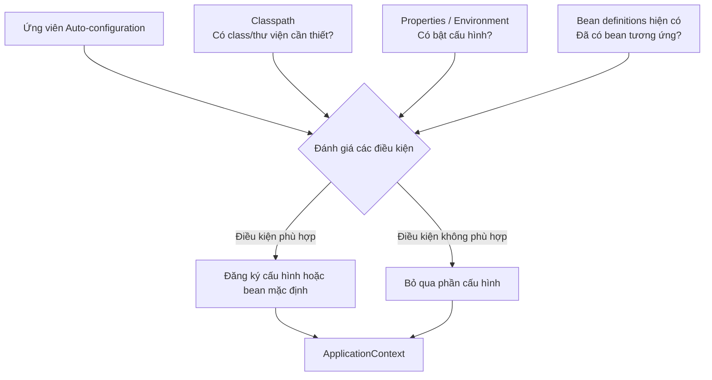
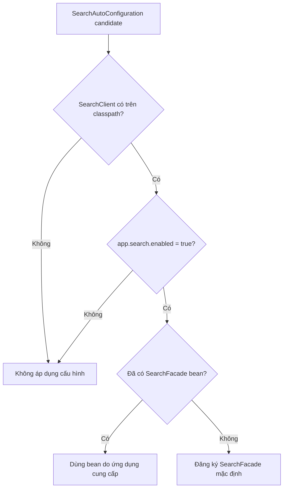
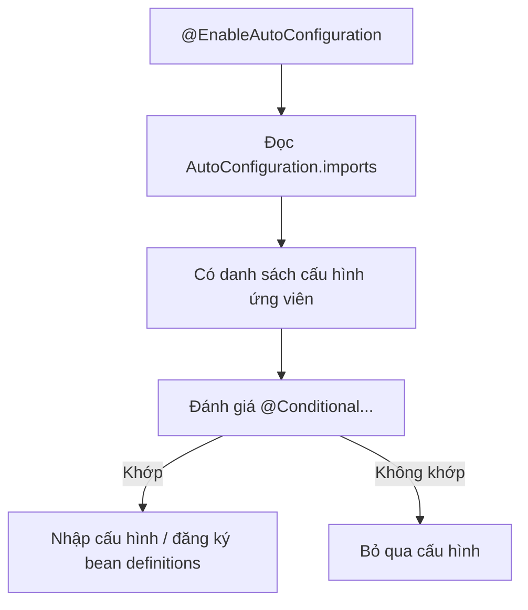
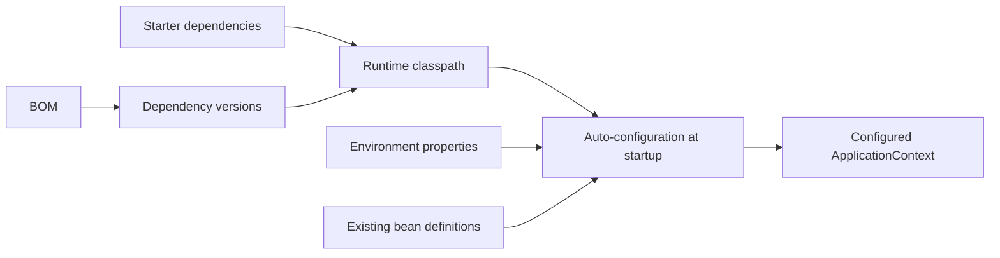

# Auto-configuration nhận đầu vào từ classpath, properties và bean hiện có

Spring Boot có thể tự cấu hình nhiều thành phần của ứng dụng khi bạn thêm một starter hoặc khai báo một vài thuộc tính. Chẳng hạn, khi ứng dụng có thư viện Spring MVC trên classpath, Boot có thể chuẩn bị hạ tầng web phù hợp; khi có JDBC driver và cấu hình datasource, Boot có thể tạo kết nối dữ liệu; khi ứng dụng đã tự cung cấp một bean, cấu hình mặc định tương ứng có thể nhường chỗ.

Những hành vi này không phải là một bộ mặc định bật vô điều kiện. **Auto-configuration là tập hợp các cấu hình có điều kiện**, được Spring Boot đưa vào quá trình xử lý và chỉ áp dụng khi các điều kiện phù hợp. Ba đầu vào quan trọng thường quyết định kết quả là:

1. **Classpath:** những thư viện và class nào có mặt trong ứng dụng.
2. **Properties:** những giá trị cấu hình đang có trong Spring `Environment`.
3. **Bean hiện có:** những bean definition phù hợp đã được đăng ký trong application context ở thời điểm điều kiện được đánh giá.

Bài học thuộc chương **Auto-configuration** của *Spring Boot Fundamentals*. Ta sẽ theo dõi cách ba đầu vào này ảnh hưởng tới quyết định cấu hình, viết một auto-configuration minh họa, xem cách cấu hình mặc định back off khi ứng dụng cung cấp bean riêng, và học cách đọc condition evaluation report để tìm lý do một cấu hình được áp dụng hoặc bị bỏ qua.

Ví dụ dùng Java 21 và Spring Boot 3.x. Những tên class cụ thể trong ví dụ là mã minh họa để giải thích cơ chế; các auto-configuration thực tế và điều kiện chi tiết có thể thay đổi giữa các phiên bản Boot.

## 1. Auto-configuration không phải là một phép bật mặc định duy nhất

Một ứng dụng Spring Boot thường có lớp main:

```java
package com.example.demo;

import org.springframework.boot.SpringApplication;
import org.springframework.boot.autoconfigure.SpringBootApplication;

@SpringBootApplication
public class DemoApplication {
    public static void main(String[] args) {
        SpringApplication.run(DemoApplication.class, args);
    }
}
```

`@SpringBootApplication` gộp ba khả năng quan trọng:

- `@SpringBootConfiguration` đánh dấu cấu hình gốc của ứng dụng.
- `@ComponentScan` tìm các component ứng dụng trong phạm vi package.
- `@EnableAutoConfiguration` bật cơ chế đưa các ứng viên auto-configuration của Boot vào quy trình xử lý.

Auto-configuration được kích hoạt qua `@EnableAutoConfiguration`, nhưng việc kích hoạt không có nghĩa mọi cấu hình trong Spring Boot đều được áp dụng. Boot sẽ xem xét các ứng viên, rồi các điều kiện quyết định lớp cấu hình hoặc method `@Bean` nào được sử dụng.

Ví dụ, ứng dụng không có thư viện web thì không cần cấu hình servlet web. Nếu ứng dụng có Spring MVC và đang chạy trong servlet web environment, các điều kiện liên quan có thể phù hợp để Boot cung cấp những bean hạ tầng web mặc định.

### 1.1. Bức tranh ba đầu vào



Một auto-configuration có thể kiểm tra nhiều điều kiện cùng lúc. Chẳng hạn:

- Một class thư viện phải có trong classpath.
- Một property phải có giá trị `true`.
- Ứng dụng phải là servlet web application.
- Chưa có bean do ứng dụng hoặc cấu hình khác cung cấp.

Chỉ khi các điều kiện liên quan đều thỏa mãn, phần cấu hình tương ứng mới được áp dụng.

## 2. Đầu vào thứ nhất: classpath

**Classpath** là tập class và thư viện mà ứng dụng có thể truy cập khi biên dịch hoặc chạy. Trong Spring Boot, dependency được khai báo trong Maven/Gradle sẽ ảnh hưởng tới runtime classpath. Auto-configuration có thể kiểm tra sự hiện diện của class hoặc thư viện để quyết định có nên cung cấp cấu hình hay không.

Ví dụ, Spring Boot có các điều kiện:

| Annotation | Điều kiện |
|---|---|
| `@ConditionalOnClass` | Một hoặc nhiều class cần thiết có mặt trên classpath. |
| `@ConditionalOnMissingClass` | Một hoặc nhiều class chỉ định không có trên classpath. |

### 2.1. Thêm starter làm thay đổi classpath

Một starter như `spring-boot-starter-web` là dependency tập hợp những thư viện phục vụ ứng dụng web. Khi thêm starter, dependency graph có thể bao gồm Spring MVC, Jackson và embedded servlet container theo bộ dependency của phiên bản Boot đang dùng.

Starter **đưa thư viện vào dependency graph**. Auto-configuration **kiểm tra những thư viện đó** rồi quyết định cấu hình nào phù hợp. Hai cơ chế hợp tác nhưng không phải cùng một việc.

Ví dụ:

```groovy
dependencies {
    implementation 'org.springframework.boot:spring-boot-starter-web'
}
```

Đây là phần dependency của Gradle project đã có plugin Spring Boot và cơ chế quản lý phiên bản thích hợp. Khi web class xuất hiện trên classpath, những cấu hình có `@ConditionalOnClass` yêu cầu class tương ứng có thể trở thành ứng viên phù hợp.

Nếu bỏ starter web khỏi project, các class web liên quan có thể không còn trên runtime classpath. Khi đó cấu hình phụ thuộc vào chúng thường không khớp điều kiện, và Boot không áp dụng phần cấu hình ấy.

### 2.2. Ví dụ một cấu hình có điều kiện theo classpath

Đây là ví dụ minh họa một thư viện tùy chọn:

```java
package com.example.demo.autoconfigure;

import com.example.optional.SearchClient;
import org.springframework.boot.autoconfigure.AutoConfiguration;
import org.springframework.boot.autoconfigure.condition.ConditionalOnClass;
import org.springframework.context.annotation.Bean;

@AutoConfiguration
@ConditionalOnClass(SearchClient.class)
public class SearchClientAutoConfiguration {

    @Bean
    SearchFacade searchFacade(SearchClient client) {
        return new SearchFacade(client);
    }
}
```

Ý nghĩa:

1. Boot xem xét `SearchClientAutoConfiguration` như một ứng viên auto-configuration đã được đăng ký.
2. `@ConditionalOnClass(SearchClient.class)` kiểm tra class `SearchClient` có thể được tìm thấy trên classpath hay không.
3. Nếu class có mặt và các điều kiện khác phù hợp, Spring xử lý cấu hình và method `@Bean`.
4. Nếu thư viện không có, cấu hình này không được áp dụng.

`SearchClient` và `SearchFacade` ở đây là kiểu minh họa; khi viết auto-configuration cho thư viện thật, cần khai báo dependency/optional dependency và cấu hình class-loading phù hợp để ứng dụng không có thư viện tùy chọn vẫn có thể khởi động.

### 2.3. Classpath không phải component scan

Hai cơ chế này dễ bị nhầm:

- **Component scan** tìm class component trong package được quét của ứng dụng.
- **Classpath condition** kiểm tra class có tồn tại trong các thư viện/classpath hay không.

Một class có thể có trên classpath nhưng không nằm trong package component scan. Ngược lại, một class nằm trong source package ứng dụng nhưng thiếu dependency cần thiết vẫn có thể không biên dịch được hoặc không thỏa điều kiện classpath của cấu hình.

Các auto-configuration của Boot được đăng ký qua cơ chế riêng, không cần quét toàn bộ package của thư viện như component scan ứng dụng.

## 3. Đầu vào thứ hai: properties trong Environment

Spring Boot nhận cấu hình từ nhiều nguồn và đưa chúng vào `Environment`. Ví dụ:

- `application.properties` hoặc `application.yml`.
- File cấu hình theo profile như `application-dev.yml`.
- Biến môi trường của hệ điều hành.
- Java system properties.
- Tham số dòng lệnh.
- Các nguồn property được thêm qua cơ chế cấu hình khác.

Auto-configuration có thể kiểm tra các giá trị này bằng `@ConditionalOnProperty` hoặc dùng chúng để bind vào object `@ConfigurationProperties`.

### 3.1. `@ConditionalOnProperty`

Annotation này cho phép bật/tắt một phần cấu hình theo property:

```java
@AutoConfiguration
@ConditionalOnProperty(
        prefix = "app.audit",
        name = "enabled",
        havingValue = "true",
        matchIfMissing = false
)
public class AuditAutoConfiguration {
    // Các bean audit chỉ được đăng ký khi điều kiện phù hợp.
}
```

Với cấu hình trên:

| Giá trị property | Kết quả |
|---|---|
| `app.audit.enabled=true` | Điều kiện khớp. |
| `app.audit.enabled=false` | Điều kiện không khớp. |
| Property không tồn tại | Không khớp vì `matchIfMissing=false`. |
| Property có giá trị khác `true` | Không khớp với `havingValue="true"`. |

Ví dụ `application.yml`:

```yaml
app:
  audit:
    enabled: true
```

Khi property có giá trị `true`, cấu hình audit đủ điều kiện theo điều kiện này. Điều đó vẫn không bảo đảm toàn bộ bean bên trong chắc chắn được tạo: các điều kiện khác trên class hoặc method cũng phải phù hợp.

### 3.2. `matchIfMissing` quyết định mặc định khi property vắng mặt

`matchIfMissing` đặc biệt quan trọng khi thiết kế thư viện:

- `matchIfMissing = false`: nếu không cấu hình property, phần cấu hình không được bật.
- `matchIfMissing = true`: property vắng mặt vẫn có thể được xem là phù hợp; giá trị mặc định là cho phép cấu hình áp dụng.

Ví dụ:

```java
@ConditionalOnProperty(
        prefix = "app.metrics",
        name = "enabled",
        havingValue = "true",
        matchIfMissing = true
)
```

Đây là lựa chọn “mặc định bật nếu không có property”. Hãy chọn dựa trên mục tiêu của tính năng: thư viện cần opt-in rõ ràng thường dùng mặc định tắt; một cấu hình mặc định hữu ích và an toàn có thể chọn mặc định bật.

### 3.3. Property condition khác configuration properties binding

Hai cơ chế thường được dùng cùng nhau nhưng có mục đích khác:

| Cơ chế | Câu hỏi nó trả lời |
|---|---|
| `@ConditionalOnProperty` | Có nên đăng ký phần cấu hình/bean này hay không? |
| `@ConfigurationProperties` | Những giá trị cấu hình nào cần bind vào object để bean sử dụng? |

Ví dụ một lớp property:

```java
package com.example.demo.audit;

import org.springframework.boot.context.properties.ConfigurationProperties;

@ConfigurationProperties(prefix = "app.audit")
public record AuditProperties(
        boolean enabled,
        String destination
) {
}
```

Auto-configuration có thể bật/tắt theo property rồi sử dụng object properties:

```java
@AutoConfiguration
@EnableConfigurationProperties(AuditProperties.class)
@ConditionalOnProperty(
        prefix = "app.audit",
        name = "enabled",
        havingValue = "true"
)
public class AuditAutoConfiguration {

    @Bean
    AuditPublisher auditPublisher(AuditProperties properties) {
        return new AuditPublisher(properties.destination());
    }
}
```

Ở đây condition quyết định cấu hình audit có hoạt động không; configuration properties cung cấp `destination` cho bean. Nếu không có `app.audit.enabled=true`, cấu hình bị bỏ qua theo điều kiện mặc định của annotation.

### 3.4. Nguồn property có thứ tự ưu tiên

Nếu cùng một property được đặt ở nhiều nguồn, Spring Boot áp dụng quy tắc property source precedence. Chẳng hạn, tham số dòng lệnh thường có thể ghi đè giá trị trong file cấu hình. Điều này có nghĩa cùng một binary có thể khởi động với những quyết định auto-configuration khác nhau tùy môi trường.

Ví dụ file:

```yaml
app:
  audit:
    enabled: false
```

Chạy:

```bash
./gradlew bootRun --args='--app.audit.enabled=true'
```

Giá trị command line có thể ghi đè property trong file, khiến condition nhìn thấy `true`. Với Windows PowerShell, có thể dùng:

```powershell
.\gradlew.bat bootRun --args="--app.audit.enabled=true"
```

Khi điều tra condition không khớp, hãy kiểm tra **giá trị hiệu lực trong Environment**, không chỉ nhìn một file `application.yml`.

## 4. Đầu vào thứ ba: bean hiện có trong ApplicationContext

Auto-configuration thường cần cung cấp default bean để ứng dụng chạy nhanh mà không cần cấu hình thủ công. Nhưng khi ứng dụng đã có bean của riêng mình, Boot thường nên nhường quyền kiểm soát cho ứng dụng.

Các condition quan trọng:

| Annotation | Ý nghĩa |
|---|---|
| `@ConditionalOnBean` | Chỉ áp dụng khi bean phù hợp đã tồn tại. |
| `@ConditionalOnMissingBean` | Chỉ áp dụng khi chưa có bean phù hợp. |
| `@ConditionalOnSingleCandidate` | Chỉ áp dụng khi có một candidate duy nhất có thể chọn theo quy tắc phù hợp. |

### 4.1. `@ConditionalOnMissingBean` và cơ chế back off

Ví dụ một thư viện muốn cung cấp formatter mặc định:

```java
package com.example.demo.greeting;

public interface GreetingFormatter {
    String format(String name);
}
```

Auto-configuration:

```java
package com.example.demo.autoconfigure;

import com.example.demo.greeting.GreetingFormatter;
import org.springframework.boot.autoconfigure.AutoConfiguration;
import org.springframework.boot.autoconfigure.condition.ConditionalOnMissingBean;
import org.springframework.context.annotation.Bean;

@AutoConfiguration
public class GreetingAutoConfiguration {

    @Bean
    @ConditionalOnMissingBean(GreetingFormatter.class)
    GreetingFormatter greetingFormatter() {
        return name -> "Hello, " + name + "!";
    }
}
```

Nếu ứng dụng chưa có bean kiểu `GreetingFormatter`, Boot cung cấp default. Nếu ứng dụng định nghĩa bean riêng:

```java
package com.example.demo.config;

import com.example.demo.greeting.GreetingFormatter;
import org.springframework.context.annotation.Bean;
import org.springframework.context.annotation.Configuration;

@Configuration(proxyBeanMethods = false)
public class GreetingConfiguration {

    @Bean
    GreetingFormatter vietnameseGreetingFormatter() {
        return name -> "Xin chào, " + name + "!";
    }
}
```

thì điều kiện `@ConditionalOnMissingBean(GreetingFormatter.class)` của default có thể không còn phù hợp. Bean do ứng dụng cung cấp được dùng, còn auto-configuration mặc định **back off**.

`@ConditionalOnMissingBean` không xóa bean hiện có và không thay đổi classpath. Nó chỉ quyết định bean mặc định của cấu hình đó có được đăng ký hay không.

### 4.2. `@ConditionalOnBean`: chỉ cấu hình khi dependency đã tồn tại

Ví dụ một integration chỉ hữu ích khi có bean `DataSource`:

```java
@AutoConfiguration
@ConditionalOnBean(javax.sql.DataSource.class)
public class DatabaseMetricsAutoConfiguration {

    @Bean
    DatabaseMetrics databaseMetrics(javax.sql.DataSource dataSource) {
        return new DatabaseMetrics(dataSource);
    }
}
```

Nếu context chưa có bean `DataSource` phù hợp, cấu hình này không được áp dụng. Khi một datasource được đăng ký từ cấu hình khác hoặc từ auto-configuration trước đó, condition có thể khớp và metrics bean được cung cấp.

Điều này hữu ích khi một cấu hình phụ thuộc vào hạ tầng được tạo ở nơi khác. Thay vì cố khởi tạo với dependency thiếu, auto-configuration có thể chờ điều kiện bean phù hợp.

### 4.3. `@ConditionalOnSingleCandidate`

Một số cấu hình cần đúng một candidate có thể chọn cho dependency. `@ConditionalOnSingleCandidate` hữu ích khi có nhiều bean cùng kiểu nhưng container có thể xác định một candidate duy nhất, chẳng hạn theo quy tắc primary phù hợp.

Ví dụ minh họa:

```java
@AutoConfiguration
@ConditionalOnSingleCandidate(javax.sql.DataSource.class)
public class JdbcClientAutoConfiguration {

    @Bean
    JdbcClientFacade jdbcClientFacade(javax.sql.DataSource dataSource) {
        return new JdbcClientFacade(dataSource);
    }
}
```

Nếu không có datasource hoặc có nhiều datasource không thể xác định candidate duy nhất, điều kiện không phù hợp. Cấu hình phụ thuộc vào một datasource đơn trị không nên tự chọn một cách tùy tiện.

## 5. Ba đầu vào phối hợp trong cùng một auto-configuration

Một auto-configuration thực tế có thể kiểm tra classpath, property và bean cùng lúc:

```java
@AutoConfiguration
@ConditionalOnClass(com.example.optional.SearchClient.class)
@ConditionalOnProperty(
        prefix = "app.search",
        name = "enabled",
        havingValue = "true"
)
public class SearchAutoConfiguration {

    @Bean
    @ConditionalOnMissingBean(SearchFacade.class)
    SearchFacade searchFacade(
            com.example.optional.SearchClient client) {
        return new SearchFacade(client);
    }
}
```

Quy tắc đọc:

1. Thư viện có class `SearchClient` phải có trên classpath.
2. Property `app.search.enabled` phải là `true`.
3. Nếu ứng dụng chưa có `SearchFacade`, method tạo default facade mới được dùng.
4. Nếu một điều kiện không khớp, phần cấu hình hoặc bean tương ứng bị bỏ qua.

Có thể biểu diễn:



Đây là mô hình phổ biến của auto-configuration: **đủ điều kiện môi trường, property bật tính năng, và chưa có customization của ứng dụng**.

## 6. Bean hiện có được đánh giá ở thời điểm nào?

Condition dựa trên bean không phải một truy vấn liên tục chạy mỗi khi ứng dụng gọi method. Spring đánh giá điều kiện trong quá trình xử lý cấu hình và đăng ký bean definitions.

Điều đó dẫn tới một quy tắc quan trọng khi viết auto-configuration: **thứ tự xử lý cấu hình có thể ảnh hưởng việc một condition nhìn thấy bean definition hay chưa**.

Ví dụ, nếu auto-configuration cần back off khi ứng dụng cung cấp bean `GreetingFormatter`, cấu hình ứng dụng cần được xử lý ở vị trí phù hợp để bean definition đó đã được đăng ký khi điều kiện missing-bean được đánh giá. Spring Boot có các quy tắc và cơ chế ordering cho auto-configuration để quản lý những quan hệ này.

### 6.1. Auto-configuration ordering

Một số annotation dùng để khai báo quan hệ thứ tự:

- `@AutoConfigureBefore`: cấu hình hiện tại cần được xử lý trước một auto-configuration khác.
- `@AutoConfigureAfter`: cấu hình hiện tại cần được xử lý sau một auto-configuration khác.
- `@AutoConfigureOrder`: chỉ định thứ tự tổng quát cho auto-configuration.

Ví dụ:

```java
@AutoConfiguration
@AutoConfigureAfter(DataSourceAutoConfiguration.class)
public class DatabaseExtensionAutoConfiguration {
    // ...
}
```

Ở đây, extension muốn xử lý sau cấu hình datasource. Không nên dùng ordering tùy tiện để ép mọi bean theo một thứ tự không cần thiết; hãy khai báo quan hệ khi cấu hình thực sự phụ thuộc vào một auto-configuration khác.

### 6.2. `@ConditionalOnMissingBean` phù hợp nhất ở auto-configuration

Annotation này thường được dùng trên method `@Bean` của auto-configuration để cung cấp default có thể tùy biến. Nếu đặt trong cấu hình người dùng được xử lý quá sớm hoặc không đúng thứ tự, condition có thể đánh giá dựa trên tập bean definitions chưa đầy đủ theo ý định.

Trong Spring Boot, cấu hình ứng dụng thông thường được xử lý trước các auto-configuration được import theo cơ chế Boot, giúp auto-configuration có cơ hội nhận biết bean do ứng dụng khai báo. Khi tự viết thư viện auto-configuration, hãy theo các pattern và ordering conventions của Boot thay vì tạo vòng phụ thuộc cấu hình khó dự đoán.

### 6.3. Condition không phải cơ chế cập nhật bean động

Nếu một bean được đăng ký sau khi một auto-configuration đã được xử lý, Spring không tự động chạy lại toàn bộ condition để thêm/xóa các bean definitions như một hệ thống reactive. Auto-configuration là quá trình cấu hình context trong startup. Thay đổi bean runtime bằng các thao tác đặc biệt không đồng nghĩa Boot tự đánh giá lại tất cả điều kiện.

## 7. Một auto-configuration được tìm thấy bằng cách nào?

Để các điều kiện có cơ hội được đánh giá, Boot trước hết cần biết auto-configuration class nào là ứng viên.

Trong Spring Boot 3.x, thư viện auto-configuration thường đăng ký class trong resource:

```text
META-INF/spring/org.springframework.boot.autoconfigure.AutoConfiguration.imports
```

Ví dụ nội dung resource:

```text
com.example.search.autoconfigure.SearchAutoConfiguration
com.example.audit.autoconfigure.AuditAutoConfiguration
```

Một lớp cấu hình có thể khai báo:

```java
@AutoConfiguration
public class SearchAutoConfiguration {
    // Conditional bean definitions.
}
```

`@EnableAutoConfiguration` của ứng dụng khiến Boot đọc và xử lý danh sách ứng viên phù hợp. Sau đó các điều kiện classpath, property, bean và những condition khác mới quyết định cấu hình có được áp dụng không.

**Đăng ký ứng viên và áp dụng cấu hình là hai bước khác nhau.**



Một class không nằm trong resource đăng ký phù hợp có thể không bao giờ trở thành ứng viên auto-configuration, dù file class của nó có trên classpath. Ngược lại, một class đã được đăng ký trong resource vẫn có thể bị bỏ qua vì điều kiện không thỏa mãn.

## 8. Starter và auto-configuration: quan hệ nhưng không đồng nhất

Một starter thường giúp người dùng thêm một nhóm dependency bằng một dòng khai báo. Một thư viện starter có thể kéo theo thư viện auto-configuration tương ứng, nhưng hai artifact vẫn có trách nhiệm riêng:

| Thành phần | Vai trò |
|---|---|
| Starter | Gom dependency để người dùng dễ chọn một nhóm chức năng. |
| Thư viện triển khai | Cung cấp class và chức năng thực tế, ví dụ client hoặc framework. |
| Auto-configuration module | Đăng ký các cấu hình ứng viên và cung cấp bean theo điều kiện. |

Một hệ sinh thái có thể đóng gói starter và auto-configuration cùng nhau hoặc tách chúng thành nhiều module. Khi debug, đừng chỉ hỏi “starter có trong build.gradle không?”; hãy xem cả runtime classpath và danh sách auto-configuration được đăng ký.

Ví dụ:

```groovy
dependencies {
    implementation 'org.springframework.boot:spring-boot-starter-data-jpa'
}
```

Starter này đưa các dependency cần thiết cho JPA vào ứng dụng. Boot sau đó có thể xem xét các auto-configuration về datasource, JPA repositories và Hibernate. Nhưng việc chúng thực sự được áp dụng còn phụ thuộc driver, property, bean hiện có, loại ứng dụng và các điều kiện khác.

## 9. Ví dụ thực hành: tạo default bean có thể được ứng dụng thay thế

Ta sẽ xây dựng một thư viện minh họa có default formatter. Mục tiêu là thấy rõ ba đầu vào:

- Classpath có module chứa auto-configuration và các kiểu cần thiết.
- Property quyết định bật/tắt tính năng.
- Bean do ứng dụng khai báo quyết định cấu hình mặc định có back off không.

### 9.1. Product contract

```java
package com.example.greeting;

public interface GreetingFormatter {
    String format(String name);
}
```

### 9.2. Properties

```java
package com.example.greeting.autoconfigure;

import org.springframework.boot.context.properties.ConfigurationProperties;

@ConfigurationProperties(prefix = "example.greeting")
public record GreetingProperties(String prefix) {
}
```

### 9.3. Auto-configuration

```java
package com.example.greeting.autoconfigure;

import com.example.greeting.GreetingFormatter;
import org.springframework.boot.autoconfigure.AutoConfiguration;
import org.springframework.boot.autoconfigure.condition.ConditionalOnClass;
import org.springframework.boot.autoconfigure.condition.ConditionalOnMissingBean;
import org.springframework.boot.autoconfigure.condition.ConditionalOnProperty;
import org.springframework.boot.context.properties.EnableConfigurationProperties;
import org.springframework.context.annotation.Bean;

@AutoConfiguration
@ConditionalOnClass(GreetingFormatter.class)
@ConditionalOnProperty(
        prefix = "example.greeting",
        name = "enabled",
        havingValue = "true",
        matchIfMissing = true
)
@EnableConfigurationProperties(GreetingProperties.class)
public class GreetingAutoConfiguration {

    @Bean
    @ConditionalOnMissingBean(GreetingFormatter.class)
    GreetingFormatter greetingFormatter(GreetingProperties properties) {
        String prefix = properties.prefix() == null
                ? "Hello"
                : properties.prefix();
        return name -> prefix + ", " + name + "!";
    }
}
```

Lớp trên có ba loại điều kiện:

1. `@ConditionalOnClass` yêu cầu product contract có trên classpath.
2. `@ConditionalOnProperty` bật tính năng nếu property không bị tắt; vì `matchIfMissing=true`, mặc định vắng mặt vẫn khớp.
3. `@ConditionalOnMissingBean` trên method chỉ tạo formatter mặc định khi ứng dụng chưa có formatter khác.

### 9.4. Đăng ký auto-configuration class

Trong module thư viện, tạo resource:

```text
src/main/resources/META-INF/spring/org.springframework.boot.autoconfigure.AutoConfiguration.imports
```

Nội dung:

```text
com.example.greeting.autoconfigure.GreetingAutoConfiguration
```

Nếu thiếu resource đăng ký, Boot có thể không biết class này là một auto-configuration candidate. Chỉ đặt `@AutoConfiguration` trên class không tự thay thế bước đăng ký ứng viên của thư viện.

### 9.5. Trường hợp không có bean riêng

Ứng dụng thêm thư viện vào runtime classpath và có thể cấu hình:

```yaml
example:
  greeting:
    enabled: true
    prefix: "Xin chào"
```

Không có bean `GreetingFormatter` nào khác, nên Boot cung cấp default. Khi gọi formatter với `Lan`, kết quả là:

```text
Xin chào, Lan!
```

### 9.6. Trường hợp ứng dụng tự cung cấp bean

Ứng dụng khai báo:

```java
@Configuration(proxyBeanMethods = false)
public class CustomGreetingConfiguration {

    @Bean
    GreetingFormatter customGreetingFormatter() {
        return name -> "Chào mừng " + name + " đến với hệ thống!";
    }
}
```

Khi cấu hình ứng dụng được đăng ký, condition missing-bean của default formatter không còn khớp. Bean tùy chỉnh được dùng, auto-configuration không tạo default formatter.

### 9.7. Trường hợp tắt bằng property

Nếu cấu hình:

```yaml
example:
  greeting:
    enabled: false
```

thì toàn bộ auto-configuration bị loại theo điều kiện property. Nếu một service khác vẫn bắt buộc yêu cầu `GreetingFormatter` và không có bean thay thế, context có thể thất bại vì thiếu dependency. Đây là kết quả phù hợp: bạn đã tắt chức năng nhưng vẫn để consumer yêu cầu nó.

## 10. Cách đọc condition evaluation report

Khi không hiểu vì sao một auto-configuration được áp dụng hoặc bị bỏ qua, đừng đoán dựa vào tên starter. Hãy xem **Condition Evaluation Report**.

### 10.1. Bật report bằng `--debug`

Với Gradle:

```bash
./gradlew bootRun --args='--debug'
```

Với Windows PowerShell:

```powershell
.\gradlew.bat bootRun --args="--debug"
```

Boot ghi báo cáo đánh giá condition trong log. Các nhóm thường gặp:

- **Positive matches:** cấu hình/điều kiện đã khớp.
- **Negative matches:** cấu hình không khớp, kèm lý do.
- **Exclusions:** cấu hình bị loại trừ.
- **Unconditional classes:** cấu hình không yêu cầu điều kiện đặc biệt trong report tương ứng.

Tên nhóm và nội dung cụ thể phụ thuộc phiên bản Boot.

### 10.2. Đọc một positive match

Ví dụ diễn giải:

```text
SomeAutoConfiguration matched:
   - @ConditionalOnClass found required class 'com.example.SomeClient'
```

Điều này cho biết điều kiện classpath khớp: class yêu cầu có mặt. Nó không nhất thiết chứng minh mọi method `@Bean` bên trong class đều được đăng ký; từng method vẫn có thể có condition riêng.

### 10.3. Đọc một negative match

Ví dụ:

```text
SomeAutoConfiguration did not match:
   - @ConditionalOnProperty (app.feature.enabled=true)
     found different value in property 'enabled'
```

Điều này cho biết property hiệu lực không đáp ứng điều kiện. Hãy xem nguồn cấu hình, profile đang bật và property precedence để tìm giá trị nào đang thắng.

Ví dụ khác:

```text
SomeAutoConfiguration did not match:
   - @ConditionalOnClass did not find required class
     'com.example.optional.Client'
```

Khi đó hãy xem dependency có thực sự nằm trên **runtime classpath** hay không; chỉ nhìn vào file build chưa chắc đủ nếu dependency có scope không phù hợp.

### 10.4. Đọc back off do bean đã tồn tại

Một method default có thể bị bỏ qua với lý do tương tự:

```text
@ConditionalOnMissingBean (types: GreetingFormatter)
found beans of type 'GreetingFormatter'
```

Đây thường là hành vi mong đợi khi ứng dụng đã cung cấp custom bean. Không phải mọi negative match đều là lỗi; nhiều cấu hình không phù hợp đơn giản vì ứng dụng không sử dụng tính năng tương ứng hoặc đã tùy chỉnh nó.

### 10.5. Positive class match không đồng nghĩa bean chắc chắn tồn tại

Một auto-configuration class có thể khớp điều kiện classpath, nhưng method bên trong có thể yêu cầu thêm property hoặc bean. Do đó cần đọc condition report ở đúng cấp:

- Cấp auto-configuration class.
- Cấp nested configuration.
- Cấp từng method `@Bean`.

Khi một bean mong đợi không xuất hiện, hãy tìm đúng method cung cấp bean đó và xem điều kiện gắn trực tiếp trên method.

## 11. Xem bean thực sự được đăng ký bằng Actuator

Condition report trả lời **vì sao điều kiện được đánh giá như vậy**. Muốn xem bean nào thực sự nằm trong context, có thể dùng Spring Boot Actuator trong môi trường phát triển.

Thêm dependency:

```groovy
dependencies {
    implementation 'org.springframework.boot:spring-boot-starter-actuator'
}
```

Expose endpoint cần thiết trong môi trường local:

```yaml
management:
  endpoints:
    web:
      exposure:
        include: health,conditions,beans
```

Gọi:

```bash
curl http://localhost:8080/actuator/conditions
curl http://localhost:8080/actuator/beans
```

- `/actuator/conditions` cho thông tin điều kiện auto-configuration.
- `/actuator/beans` liệt kê bean definitions/bean trong context theo cấu trúc Actuator cung cấp.

Kết hợp hai endpoint giúp trả lời hai câu hỏi riêng: **vì sao cấu hình được áp dụng hoặc bỏ qua?** và **bean nào thực sự được đăng ký?**

Không nên expose endpoint `conditions` hoặc `beans` công khai tùy tiện trên production vì chúng có thể tiết lộ thông tin cấu trúc nội bộ ứng dụng. Chỉ bật ở môi trường phát triển hoặc bảo vệ endpoint bằng cơ chế phù hợp.

## 12. Loại trừ auto-configuration khi cần

Đôi khi ứng dụng có dependency trên classpath nhưng không muốn Boot áp dụng một auto-configuration cụ thể. Có thể loại trừ bằng thuộc tính `exclude` của `@SpringBootApplication` hoặc property cấu hình của Boot.

Ví dụ trên lớp main:

```java
import org.springframework.boot.autoconfigure.SpringBootApplication;
import org.springframework.boot.autoconfigure.jdbc.DataSourceAutoConfiguration;

@SpringBootApplication(exclude = DataSourceAutoConfiguration.class)
public class DemoApplication {
    // ...
}
```

Hoặc trong YAML:

```yaml
spring:
  autoconfigure:
    exclude:
      - org.springframework.boot.autoconfigure.jdbc.DataSourceAutoConfiguration
```

Loại trừ là một quyết định cấu hình rõ ràng. Nếu các bean khác phụ thuộc vào datasource mà bạn vừa exclude, ứng dụng có thể không khởi động. Đừng dùng exclude chỉ để che lỗi; trước hết hãy xác định vì sao auto-configuration được kích hoạt và liệu nó có thực sự không phù hợp với ứng dụng.

## 13. Những điều kiện khác ngoài ba đầu vào chính

Classpath, properties và bean hiện có là ba nhóm điều kiện quan trọng, nhưng không phải toàn bộ hệ thống conditional configuration.

Một số annotation thường gặp:

| Annotation | Điều kiện |
|---|---|
| `@ConditionalOnWebApplication` | Ứng dụng thuộc loại web environment phù hợp. |
| `@ConditionalOnNotWebApplication` | Ứng dụng không thuộc loại web application được xét. |
| `@ConditionalOnResource` | Resource chỉ định có mặt. |
| `@ConditionalOnJava` | Phiên bản Java đáp ứng điều kiện. |
| `@ConditionalOnExpression` | SpEL expression cho kết quả phù hợp. |
| `@Profile` | Profile đang hoạt động phù hợp. |
| `@ConditionalOnWarDeployment` | Điều kiện liên quan kiểu triển khai WAR phù hợp. |

Những điều kiện này có thể kết hợp với classpath, property và bean conditions để tạo ra một cấu hình phù hợp với nhiều môi trường.

Không nên cố nhồi mọi quyết định vào một biểu thức điều kiện phức tạp. Những điều kiện tách bạch, có tên và có report dễ hiểu sẽ giúp người duy trì ứng dụng xác định nguyên nhân cấu hình được áp dụng hay bị bỏ qua.

## 14. Chẩn đoán: tại sao auto-configuration không hoạt động?

Khi một bean mặc định không xuất hiện, hãy lần lượt đặt câu hỏi:

### 14.1. Auto-configuration có được đăng ký làm ứng viên không?

Với auto-configuration do thư viện tự viết, kiểm tra resource `META-INF/spring/org.springframework.boot.autoconfigure.AutoConfiguration.imports` có chứa tên class hay không. Class có trên classpath nhưng thiếu resource đăng ký có thể không được Boot nhập vào danh sách ứng viên.

### 14.2. Dependency có mặt trên runtime classpath không?

Kiểm tra dependency graph của Maven/Gradle. Một dependency chỉ có ở compile/test scope nhưng không có khi chạy có thể làm condition classpath không khớp.

### 14.3. Property hiệu lực có đúng không?

Kiểm tra profile, biến môi trường, system property, tham số command line và property source precedence. Đừng chỉ đọc một file cấu hình rồi kết luận.

### 14.4. Ứng dụng đã tự cung cấp bean chưa?

Nếu default dùng `@ConditionalOnMissingBean`, bean do ứng dụng hoặc cấu hình khác cung cấp có thể khiến default back off. Đây có thể là hành vi thành công của customization.

### 14.5. Có điều kiện về loại ứng dụng hoặc resource không?

Một cấu hình web có thể không phù hợp với non-web context. Một cấu hình cần file resource có thể không khớp nếu resource không được đóng gói đúng.

### 14.6. Có exclusion hoặc cấu hình khác không?

Kiểm tra `spring.autoconfigure.exclude`, thuộc tính exclude trên annotation, profile và các condition khác. Đọc report để biết điều kiện cụ thể nào không đạt.

Một bảng chẩn đoán:

| Dấu hiệu | Nơi điều tra trước |
|---|---|
| Auto-configuration không xuất hiện trong report | Cơ chế đăng ký candidate, imports resource, exclusion. |
| Negative match báo thiếu class | Runtime classpath và dependency scope. |
| Negative match báo property khác giá trị | Environment, profile và property precedence. |
| Default bean back off | Bean definitions hiện có, component scan, cấu hình `@Bean`. |
| Class condition khớp nhưng bean không có | Condition trên method/nested config, dependency của bean, exception lúc tạo bean. |
| Cấu hình web không khớp | Loại application context, servlet/reactive dependency và web environment. |

## 15. Viết auto-configuration có thể tùy biến: các quy tắc thực hành

Khi thiết kế thư viện cung cấp auto-configuration cho ứng dụng khác, hãy giữ những nguyên tắc sau:

1. **Chỉ cung cấp default hữu ích.** Đừng tự động tạo bean nếu thư viện không có mặt hoặc chức năng không được bật.
2. **Dùng classpath condition.** Tránh yêu cầu class của thư viện tùy chọn khi thư viện đó không có trên classpath.
3. **Dùng property condition khi người dùng cần bật/tắt.** Chọn rõ mặc định bật hay tắt.
4. **Dùng missing-bean condition cho default có thể thay thế.** Người dùng có thể cung cấp bean riêng mà không cần loại trừ toàn bộ auto-configuration.
5. **Dùng bean condition khi cần hạ tầng có sẵn.** Ví dụ extension chỉ hoạt động khi có datasource hoặc client phù hợp.
6. **Cung cấp `@ConfigurationProperties` cho cấu hình có cấu trúc.** Đừng rải nhiều property string tùy tiện trong code.
7. **Đăng ký class theo cơ chế auto-configuration của phiên bản Boot mục tiêu.** Với Boot 3.x, kiểm tra resource `AutoConfiguration.imports`.
8. **Chú ý ordering.** Chỉ khai báo before/after khi có quan hệ phụ thuộc thực sự giữa các cấu hình.
9. **Giữ điều kiện dễ chẩn đoán.** Mỗi condition nên phản ánh một lý do rõ ràng.
10. **Kiểm thử cả match và non-match.** Kiểm tra thư viện có/không có, property bật/tắt và bean custom có/không.

### Một pattern cấu hình mặc định thường gặp

```java
@AutoConfiguration
@ConditionalOnClass(ExternalClient.class)
@EnableConfigurationProperties(ExternalClientProperties.class)
public class ExternalClientAutoConfiguration {

    @Bean
    @ConditionalOnProperty(
            prefix = "example.client",
            name = "enabled",
            havingValue = "true",
            matchIfMissing = true
    )
    @ConditionalOnMissingBean(ExternalClient.class)
    ExternalClient externalClient(ExternalClientProperties properties) {
        return new ExternalClient(properties.endpoint());
    }
}
```

Pattern này diễn đạt ba điều:

- Thư viện client cần thiết có mặt.
- Property cho phép bật tính năng.
- Ứng dụng chưa cung cấp `ExternalClient`.

Nếu ứng dụng tự cung cấp `ExternalClient`, auto-configuration sẽ nhường chỗ. Nếu property tắt, default không được đăng ký. Nếu thư viện không có, classpath condition không cho cấu hình áp dụng.

## 16. Kiểm thử các nhánh condition

Auto-configuration nên được kiểm thử trong nhiều trạng thái, thay vì chỉ chạy một lần với cấu hình mặc định.

Spring Boot cung cấp `ApplicationContextRunner` để kiểm tra một đoạn context nhỏ và tập trung. Ví dụ khung test:

```java
import static org.assertj.core.api.Assertions.assertThat;

import org.junit.jupiter.api.Test;
import org.springframework.boot.test.context.runner.ApplicationContextRunner;

class GreetingAutoConfigurationTest {

    private final ApplicationContextRunner contextRunner =
            new ApplicationContextRunner()
                    .withUserConfiguration(GreetingAutoConfiguration.class);

    @Test
    void createsDefaultFormatterWhenEnabledAndMissing() {
        contextRunner
                .withPropertyValues("example.greeting.enabled=true")
                .run(context -> {
                    assertThat(context).hasSingleBean(GreetingFormatter.class);
                    assertThat(context.getBean(GreetingFormatter.class)
                            .format("Lan"))
                            .isEqualTo("Hello, Lan!");
                });
    }

    @Test
    void backsOffWhenUserProvidesFormatter() {
        contextRunner
                .withPropertyValues("example.greeting.enabled=true")
                .withBean(
                        "customFormatter",
                        GreetingFormatter.class,
                        () -> name -> "Custom: " + name)
                .run(context -> {
                    assertThat(context).hasSingleBean(GreetingFormatter.class);
                    assertThat(context.getBean(GreetingFormatter.class)
                            .format("Lan"))
                            .isEqualTo("Custom: Lan");
                });
    }

    @Test
    void doesNotCreateFormatterWhenDisabled() {
        contextRunner
                .withPropertyValues("example.greeting.enabled=false")
                .run(context ->
                        assertThat(context)
                                .doesNotHaveBean(GreetingFormatter.class));
    }
}
```

Đây là ví dụ minh họa test cho auto-configuration; để chạy độc lập cần có các class `GreetingAutoConfiguration`, `GreetingFormatter`, properties và dependency test tương ứng trong project. `ApplicationContextRunner` cho phép thêm property, bean và cấu hình vào một context nhỏ, giúp xác nhận từng nhánh condition mà không cần khởi động toàn bộ ứng dụng.

Để kiểm thử classpath condition, Spring Boot Test còn có các tiện ích như `FilteredClassLoader` để mô phỏng class bị thiếu. Khi viết test thật, cần kiểm tra cả trường hợp class có mặt và trường hợp thư viện tùy chọn vắng mặt.

### Các trường hợp nên có test

| Classpath | Property | Bean custom | Kết quả mong muốn |
|---|---|---|---|
| Có | Bật | Không | Default bean được tạo. |
| Có | Bật | Có | Default back off, bean custom được dùng. |
| Có | Tắt | Không | Không có default bean. |
| Không có | Bật | Không | Auto-configuration không áp dụng. |
| Có | Property vắng mặt | Không | Kết quả theo `matchIfMissing`. |

## 17. Build time và runtime: đừng nhầm đầu vào auto-configuration

Classpath được tạo từ dependency graph trong quá trình build, nhưng auto-configuration đánh giá classpath khi ứng dụng chạy. BOM và starter có vai trò khác:

- **BOM** chọn phiên bản dependency lúc build.
- **Starter** đưa các dependency vào dependency graph.
- **Auto-configuration** dùng classpath runtime, properties và bean definitions để quyết định cấu hình.



Việc thêm starter có thể gián tiếp làm một auto-configuration đủ điều kiện vì classpath thay đổi. Việc đổi property có thể làm condition bật/tắt. Việc thêm bean tùy chỉnh có thể khiến default back off. Ba yếu tố này cùng quyết định kết quả cuối cùng.

## 18. Câu hỏi tự đánh giá

1. `@EnableAutoConfiguration` đưa những cấu hình nào vào quy trình xử lý, và tại sao không phải tất cả đều được áp dụng?
2. Starter ảnh hưởng classpath ra sao? Vì sao import BOM không tự thêm thư viện?
3. `@ConditionalOnClass` khác component scan ở điểm nào?
4. `@ConditionalOnProperty` đọc giá trị từ đâu và `matchIfMissing` quyết định điều gì?
5. `@ConfigurationProperties` khác property condition như thế nào?
6. `@ConditionalOnMissingBean` hỗ trợ cơ chế back off ra sao?
7. `@ConditionalOnBean` và `@ConditionalOnSingleCandidate` phù hợp với những tình huống nào?
8. Vì sao thứ tự xử lý auto-configuration có thể ảnh hưởng điều kiện dựa trên bean?
9. Trong Spring Boot 3.x, resource nào thường đăng ký auto-configuration class?
10. Positive match ở cấp class có bảo đảm mọi method `@Bean` đều chạy không?
11. Khi report báo missing class, cần kiểm tra dependency ở compile classpath hay runtime classpath?
12. Khi default bean back off vì đã có bean cùng kiểu, đó có nhất thiết là lỗi không?
13. Vì sao bật lazy initialization hoặc thay đổi bean sau startup không khiến mọi condition được đánh giá lại?
14. Làm sao kiểm tra lý do condition khớp và bean nào thực sự tồn tại?

### Mẫu giải thích hoàn chỉnh

> Spring Boot auto-configuration được bật bởi `@EnableAutoConfiguration`, nhưng mỗi cấu hình chỉ được áp dụng khi các điều kiện tương ứng thỏa mãn. Classpath cho biết thư viện và class nào có mặt; `@ConditionalOnClass` có thể dùng thông tin đó để bật cấu hình phù hợp. Properties trong Spring `Environment` điều khiển các tính năng qua `@ConditionalOnProperty` và cung cấp giá trị cho `@ConfigurationProperties`. Bean definitions đã đăng ký cho phép cấu hình phụ thuộc vào hạ tầng có sẵn qua `@ConditionalOnBean`, hoặc nhường chỗ cho bean do ứng dụng cung cấp qua `@ConditionalOnMissingBean`. Vì vậy, thêm starter có thể làm classpath condition khớp, bật property có thể cho phép tính năng, và khai báo bean riêng có thể khiến default back off. Condition Evaluation Report cho biết lý do match hoặc mismatch; Actuator beans hoặc `ApplicationContext` cho biết bean nào thực sự được đăng ký.

Khi có thể dự đoán auto-configuration sẽ làm gì sau khi thêm một dependency, đổi property hoặc đăng ký một bean tùy chỉnh, bạn đã hiểu được cách Spring Boot kết hợp **classpath, Environment và bean hiện có** để tạo ra cấu hình mặc định phù hợp với ứng dụng.
