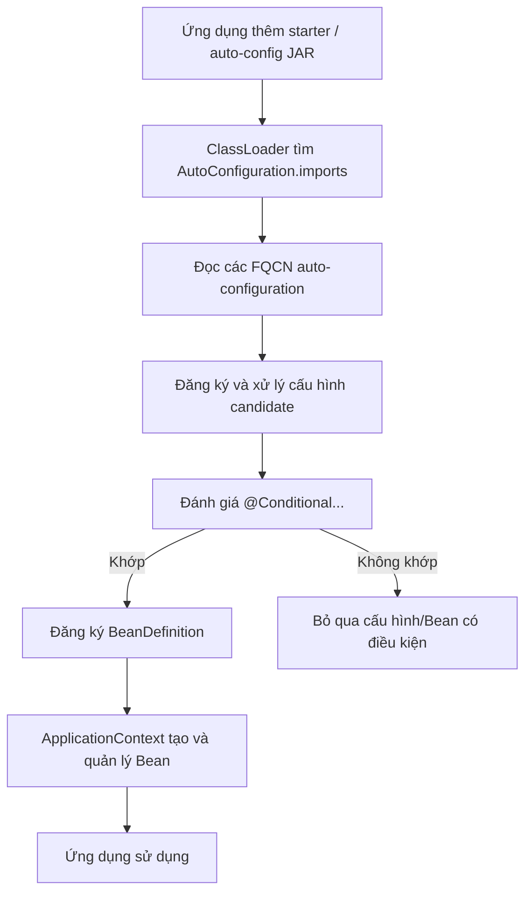

# AutoConfiguration.imports và cách đăng ký ở các dòng Spring Boot hiện đại

Một thư viện Spring Boot có thể cung cấp sẵn cấu hình để ứng dụng tự nhận được các Bean phù hợp khi thêm dependency vào classpath. Ví dụ, một thư viện tích hợp có thể tự tạo client, converter hoặc health indicator nếu thư viện nền tảng tồn tại và người dùng chưa tự khai báo Bean thay thế. Cơ chế này được gọi là **auto-configuration**.

Để Spring Boot tìm thấy một auto-configuration trong một thư viện, class cấu hình phải được **đăng ký vào danh sách auto-configuration candidates**. Ở các dòng Spring Boot hiện đại, cách đăng ký tiêu chuẩn là tạo resource:

```text
META-INF/spring/org.springframework.boot.autoconfigure.AutoConfiguration.imports
```

Mỗi dòng trong file liệt kê tên đầy đủ (fully qualified class name) của một class được đánh dấu `@AutoConfiguration`. Spring Boot đọc resource này từ các dependency trên classpath, kết hợp các candidate, rồi đánh giá điều kiện để quyết định cấu hình nào được áp dụng.

Đây là bước khác với component scanning. Một auto-configuration thường được phát hiện thông qua imports resource, sau đó các annotation như `@ConditionalOnClass`, `@ConditionalOnProperty` và `@ConditionalOnMissingBean` quyết định cấu hình/Bean nào thực sự được đăng ký.

## 1. Auto-configuration cần được đăng ký như thế nào?

Một class Java có `@AutoConfiguration` chưa tự động được Spring Boot phát hiện chỉ vì class đó tồn tại trong JAR. Thư viện cần công bố class này qua resource imports.

Ví dụ class:

```java
package com.acme.greeting.autoconfigure;

import org.springframework.boot.autoconfigure.AutoConfiguration;

@AutoConfiguration
public class GreetingAutoConfiguration {
    // Các @Bean và điều kiện của thư viện.
}
```

Resource đi kèm trong cùng artifact:

```text
src/main/resources/
└── META-INF/
    └── spring/
        └── org.springframework.boot.autoconfigure.AutoConfiguration.imports
```

Nội dung file:

```text
com.acme.greeting.autoconfigure.GreetingAutoConfiguration
```

Đường dẫn và tên file phải chính xác, bao gồm chữ hoa/thường. Nội dung là tên class đầy đủ có package, mỗi class một dòng. Khi build, resource này phải được đóng gói vào JAR tại đúng vị trí tương ứng:

```text
META-INF/spring/org.springframework.boot.autoconfigure.AutoConfiguration.imports
```

Nếu file nằm sai thư mục, sai tên hoặc class name không đúng, Boot sẽ không nạp candidate như mong đợi. Việc class có thể compile thành công không chứng minh resource đã được đóng gói đúng.

## 2. Spring Boot đọc imports resource ra sao?

Khi ứng dụng khởi động, cơ chế enable auto-configuration của Boot sử dụng class loader để tìm các resource có tên chuẩn trên classpath. Các resource cùng tên từ nhiều JAR có thể cùng đóng góp danh sách candidate.

Ví dụ một ứng dụng phụ thuộc vào:

```text
application.jar
├── spring-boot-autoconfigure.jar
├── acme-greeting-autoconfigure.jar
├── acme-metrics-autoconfigure.jar
└── acme-security-autoconfigure.jar
```

Mỗi thư viện auto-configuration có thể mang resource riêng:

```text
acme-greeting-autoconfigure.jar
└── META-INF/spring/
    └── org.springframework.boot.autoconfigure.AutoConfiguration.imports
        └── com.acme.greeting.autoconfigure.GreetingAutoConfiguration

acme-metrics-autoconfigure.jar
└── META-INF/spring/
    └── org.springframework.boot.autoconfigure.AutoConfiguration.imports
        └── com.acme.metrics.autoconfigure.MetricsAutoConfiguration
```

Spring Boot thu thập các candidate từ các resource phù hợp trên classpath. Vì thế một ứng dụng không cần biết trước mọi thư viện sẽ đóng góp auto-configuration nào; thư viện tự công bố danh sách class của mình.

### Vai trò của @EnableAutoConfiguration và @SpringBootApplication

Trong ứng dụng thông thường, bạn không phải tự gọi API đọc imports resource. Annotation `@SpringBootApplication` bao gồm khả năng bật auto-configuration:

```java
@SpringBootApplication
public class ShopApplication {
    public static void main(String[] args) {
        SpringApplication.run(ShopApplication.class, args);
    }
}
```

Về ý nghĩa, `@SpringBootApplication` kết hợp các chức năng chính:

- `@SpringBootConfiguration`: class cấu hình chính của ứng dụng.
- `@EnableAutoConfiguration`: yêu cầu Spring Boot áp dụng cơ chế auto-configuration.
- `@ComponentScan`: tìm component của ứng dụng trong package và các package con theo phạm vi scan.

Imports resource được sử dụng bởi cơ chế auto-configuration. Nó không phải file cấu hình mà từng ứng dụng phải tự viết để liệt kê tất cả thư viện đang dùng.

## 3. @AutoConfiguration: đánh dấu class auto-configuration

Ở Spring Boot hiện đại, class được công bố trong imports file thường dùng annotation `@AutoConfiguration`:

```java
import org.springframework.boot.autoconfigure.AutoConfiguration;

@AutoConfiguration
public class GreetingAutoConfiguration {
}
```

`@AutoConfiguration` được thiết kế riêng cho auto-configuration và về cơ bản mang semantics của cấu hình Spring với `proxyBeanMethods = false`. Điều này phù hợp với phong cách auto-configuration: các Bean nên nhận dependency qua tham số factory method hoặc injection, không dựa vào việc gọi trực tiếp method `@Bean` để lấy singleton.

Ví dụ:

```java
@AutoConfiguration
public class GreetingAutoConfiguration {

    @Bean
    GreetingFormatter greetingFormatter() {
        return new GreetingFormatter();
    }
}
```

Method `@Bean` vẫn đăng ký Bean bình thường. Điểm khác là auto-configuration không cần full configuration CGLIB interception để xử lý lời gọi giữa các factory method. Nếu Bean khác cần `GreetingFormatter`, hãy khai báo nó thành tham số:

```java
@Bean
GreetingService greetingService(GreetingFormatter formatter) {
    return new GreetingService(formatter);
}
```

Đây là dependency resolution của container và hoạt động tự nhiên với `proxyBeanMethods = false`.

### Không dùng @ComponentScan để thay thế imports file

Một lỗi thiết kế phổ biến là nghĩ rằng chỉ cần đặt class auto-configuration trong package được scan thì nó sẽ tự trở thành auto-configuration của thư viện.

Component scanning và auto-configuration registration có mục đích khác nhau:

| Cơ chế | Mục đích |
|---|---|
| `@ComponentScan` | Tìm component ứng dụng trong vùng package được quét |
| `@Import` | Import rõ ràng một cấu hình hoặc selector từ cấu hình khác |
| `AutoConfiguration.imports` | Công bố các auto-configuration candidate để Spring Boot tự đánh giá |

Một class cấu hình của thư viện có thể tình cờ được component scan tìm thấy, nhưng đó không phải cách phân phối auto-configuration tiêu chuẩn. Thư viện nên đăng ký class qua imports resource; đồng thời tránh đặt package auto-configuration vào vùng scan ứng dụng khiến cùng cấu hình bị phát hiện theo hai đường không cần thiết.

## 4. Auto-configuration phải có điều kiện

Đăng ký trong imports file chỉ làm class trở thành candidate. Nó **không có nghĩa tất cả Bean trong class sẽ luôn được tạo**. Auto-configuration tốt thường sử dụng các điều kiện để thích ứng với classpath và cấu hình ứng dụng.

Một số annotation phổ biến:

| Annotation | Điều kiện |
|---|---|
| `@ConditionalOnClass` | Class/thư viện cần thiết có trên classpath |
| `@ConditionalOnMissingClass` | Một class cụ thể không có trên classpath |
| `@ConditionalOnProperty` | Property tồn tại hoặc có giá trị phù hợp |
| `@ConditionalOnBean` | Có Bean phù hợp đã được đăng ký |
| `@ConditionalOnMissingBean` | Chưa có Bean phù hợp; thường dùng để cho phép ứng dụng override mặc định |
| `@ConditionalOnSingleCandidate` | Có một candidate duy nhất theo kiểu, hoặc nhiều candidate với một primary candidate phù hợp |
| `@ConditionalOnWebApplication` | Ứng dụng có loại web phù hợp |

Ví dụ một cấu hình thư viện:

```java
@AutoConfiguration
@ConditionalOnClass(GreetingClient.class)
@ConditionalOnProperty(
        prefix = "acme.greeting",
        name = "enabled",
        havingValue = "true",
        matchIfMissing = true
)
public class GreetingAutoConfiguration {

    @Bean
    @ConditionalOnMissingBean
    GreetingService greetingService(GreetingClient client) {
        return new GreetingService(client);
    }
}
```

Giả sử `GreetingClient` được cung cấp bởi một dependency mà thư viện auto-configuration yêu cầu. Ý nghĩa:

1. Chỉ xem xét cấu hình khi class `GreetingClient` có mặt.
2. Cấu hình chỉ hoạt động khi property `acme.greeting.enabled` là `true`; nếu property chưa khai báo, `matchIfMissing = true` cho phép bật mặc định.
3. Chỉ tạo Bean `GreetingService` nếu ứng dụng chưa cung cấp Bean tương ứng.
4. Nếu người dùng tự đăng ký Bean `GreetingService`, auto-configuration nhường chỗ.

Đây là triết lý quan trọng của Spring Boot: **tự động cung cấp mặc định hợp lý, nhưng để ứng dụng có thể thay thế bằng cấu hình của mình**.

### Cẩn thận với dependency tùy chọn trên classpath

Nếu class được kiểm tra là optional và không có trên classpath, hãy tránh để JVM phải nạp kiểu đó quá sớm qua method signature hoặc field của class auto-configuration chính. Spring đọc metadata annotation bằng cơ chế phù hợp, nhưng việc JVM nạp class và resolve các method signature có thể làm lộ kiểu không tồn tại.

Một mẫu an toàn hơn là cô lập phần phụ thuộc vào thư viện tùy chọn trong nested configuration:

```java
@AutoConfiguration
public class GreetingAutoConfiguration {

    @Configuration(proxyBeanMethods = false)
    @ConditionalOnClass(GreetingClient.class)
    static class GreetingClientConfiguration {

        @Bean
        @ConditionalOnMissingBean
        GreetingService greetingService(GreetingClient client) {
            return new GreetingService(client);
        }
    }
}
```

Ở đây class chính có thể được nạp mà không cần tham chiếu trực tiếp tới các API tùy chọn trong method signature của nó; nested configuration chỉ được xử lý khi điều kiện class phù hợp. Khi thiết kế thư viện có optional dependency, hãy tách cấu hình theo nhóm dependency thay vì gom mọi method vào một class lớn.

## 5. Thứ tự auto-configuration: before và after

Có trường hợp một auto-configuration phụ thuộc vào BeanDefinition do auto-configuration khác đóng góp. Khi đó, bạn có thể chỉ định thứ tự xử lý cấu hình.

Với `@AutoConfiguration`:

```java
@AutoConfiguration(after = DataSourceAutoConfiguration.class)
public class ReportingAutoConfiguration {
    // ...
}
```

Hoặc dùng tên class:

```java
@AutoConfiguration(
        afterName = "org.springframework.boot.autoconfigure.jdbc.DataSourceAutoConfiguration"
)
public class ReportingAutoConfiguration {
    // ...
}
```

Các thuộc tính thường dùng:

- `before` / `beforeName`: xếp auto-configuration này trước cấu hình được chỉ định.
- `after` / `afterName`: xếp cấu hình này sau cấu hình được chỉ định.

Ordering có ích khi các điều kiện phụ thuộc vào BeanDefinition từ một auto-configuration khác. Tuy nhiên, ordering **không phải** công cụ điều khiển thứ tự khởi tạo instance. Quan hệ phụ thuộc giữa Bean vẫn được container giải quyết theo dependency graph.

Ví dụ, nếu `ReportingAutoConfiguration` cần một `DataSource`, khai báo tham số method vẫn là cách biểu đạt dependency:

```java
@Bean
@ConditionalOnBean(DataSource.class)
ReportRepository reportRepository(DataSource dataSource) {
    return new JdbcReportRepository(dataSource);
}
```

Thứ tự auto-configuration giúp condition nhìn thấy definition cần thiết; tham số method giúp container inject instance khi tạo Bean.

### Đừng dùng ordering thay cho condition

Việc xếp một cấu hình sau cấu hình khác không đảm bảo Bean cần thiết chắc chắn tồn tại. Auto-configuration kia có thể bị exclude, condition của nó có thể không khớp hoặc dependency không có trên classpath. Vẫn cần condition phù hợp và xử lý trường hợp thiếu Bean đúng theo thiết kế.

## 6. Exclude một auto-configuration

Ứng dụng có thể loại một auto-configuration cụ thể nếu không muốn Boot áp dụng nó.

### Qua annotation

```java
@SpringBootApplication(
        exclude = {
                SomeAutoConfiguration.class
        }
)
public class ShopApplication {
}
```

Hoặc dùng tên class:

```java
@SpringBootApplication(
        excludeName = {
                "com.acme.SomeAutoConfiguration"
        }
)
public class ShopApplication {
}
```

### Qua property

```properties
spring.autoconfigure.exclude=com.acme.SomeAutoConfiguration
```

Exclude có thể hữu ích khi cấu hình tự động xung đột với kiến trúc ứng dụng hoặc bạn muốn tự cấu hình hoàn toàn một phần hạ tầng.

Không nên exclude một class chỉ để làm biến mất lỗi Bean mơ hồ mà chưa hiểu điều kiện của nó. Trước hết hãy đọc condition report và xác định Bean nào đang được tạo, từ dependency nào và vì sao.

## 7. AutoConfiguration.imports khác spring.factories thế nào?

Trước khi có imports file chuyên biệt, Spring Boot dùng resource:

```text
META-INF/spring.factories
```

Trong đó auto-configuration được đăng ký dưới key:

```properties
org.springframework.boot.autoconfigure.EnableAutoConfiguration=\
com.acme.greeting.autoconfigure.GreetingAutoConfiguration,\
com.acme.metrics.autoconfigure.MetricsAutoConfiguration
```

Từ Spring Boot 2.7, Boot giới thiệu resource `AutoConfiguration.imports` làm cơ chế đăng ký auto-configuration chuyên biệt. Đây là định dạng được dùng ở Spring Boot 3.x hiện đại. Khi phát triển thư viện nhắm tới Boot 3, hãy đăng ký auto-configuration trong imports file; không tiếp tục dựa vào key `EnableAutoConfiguration` trong `spring.factories`.

Điều đó không có nghĩa file `spring.factories` đã biến mất khỏi toàn bộ hệ sinh thái Spring. Nó vẫn có thể được dùng cho những extension point hoặc SPI khác theo phiên bản/framework tương ứng. Điều được thay đổi ở đây là **cách đăng ký auto-configuration candidates**.

### So sánh

| | Cơ chế cũ | Cơ chế hiện đại |
|---|---|---|
| Resource | `META-INF/spring.factories` | `META-INF/spring/org.springframework.boot.autoconfigure.AutoConfiguration.imports` |
| Định dạng | Properties: key → danh sách class | Một fully qualified class name trên mỗi dòng |
| Key auto-configuration | `org.springframework.boot.autoconfigure.EnableAutoConfiguration` | Không cần key; tên resource đã xác định loại candidate |
| Hướng dùng cho Boot 3 | Không dùng key cũ để đăng ký auto-configuration | Dùng imports file |
| Các SPI khác | Vẫn có thể dùng theo contract riêng | Không thay thế mọi mục đích của spring.factories |

### Ví dụ chuyển đổi

Định dạng cũ:

```properties
org.springframework.boot.autoconfigure.EnableAutoConfiguration=\
com.acme.greeting.autoconfigure.GreetingAutoConfiguration,\
com.acme.metrics.autoconfigure.MetricsAutoConfiguration
```

Định dạng mới:

```text
com.acme.greeting.autoconfigure.GreetingAutoConfiguration
com.acme.metrics.autoconfigure.MetricsAutoConfiguration
```

Không copy nguyên nội dung properties vào imports file. File mới không có key, dấu bằng hoặc dấu phẩy phân cách; mỗi dòng là một class name.

## 8. Starter và auto-configuration là hai artifact có vai trò khác nhau

Trong một thư viện Spring Boot được phân phối cho người dùng, thường có thể tách:

1. **Auto-configuration module:** chứa class cấu hình, condition và imports resource.
2. **Starter module:** dependency aggregator, kéo auto-configuration module và các thư viện cần thiết vào ứng dụng.

Ví dụ:

```text
acme-greeting/
├── acme-greeting-spring-boot-autoconfigure/
│   ├── src/main/java/
│   │   └── com/acme/greeting/autoconfigure/
│   │       └── GreetingAutoConfiguration.java
│   └── src/main/resources/
│       └── META-INF/spring/
│           └── org.springframework.boot.autoconfigure.AutoConfiguration.imports
│
└── acme-greeting-spring-boot-starter/
    └── dependencies:
        ├── acme-greeting-spring-boot-autoconfigure
        └── thư viện greeting client cần thiết
```

Khi ứng dụng thêm starter:

```groovy
dependencies {
    implementation 'com.acme:acme-greeting-spring-boot-starter:1.0.0'
}
```

Gradle kéo các dependency bắc cầu. Auto-configuration JAR xuất hiện trên classpath, resource imports được Boot tìm thấy, và các condition quyết định Bean nào được đăng ký.

Starter không nhất thiết phải chứa class auto-configuration hoặc resource imports. Nó chủ yếu giúp người dùng thêm một dependency duy nhất để nhận được tập dependency được lựa chọn sẵn. Auto-configuration module mới là nơi công bố class cấu hình tự động.

### Có bắt buộc tách hai module?

Không. Một thư viện nhỏ có thể để starter và auto-configuration trong cùng một artifact. Tách riêng có ích khi:

- Muốn người dùng dùng auto-configuration mà không kéo toàn bộ starter.
- Có nhiều starter dùng chung một auto-configuration module.
- Cần quản lý dependency optional rõ ràng.
- Muốn tách API/runtime implementation khỏi phần tích hợp Spring Boot.

Điều quan trọng là artifact có chứa auto-configuration class phải mang imports resource ở đúng vị trí và được đưa vào classpath.

## 9. Kiểm thử auto-configuration với ApplicationContextRunner

Đừng chỉ xác nhận class cấu hình compile được. Hãy kiểm tra rằng Boot có thể nạp cấu hình, condition khớp đúng và Bean mặc định nhường chỗ cho Bean của ứng dụng.

Spring Boot cung cấp `ApplicationContextRunner` cho các test nhỏ, cô lập.

Giả sử có:

```java
public interface GreetingClient {
    String greet(String name);
}

public class GreetingService {
    private final GreetingClient client;

    public GreetingService(GreetingClient client) {
        this.client = client;
    }

    public String greet(String name) {
        return client.greet(name);
    }
}
```

Auto-configuration:

```java
@AutoConfiguration
@ConditionalOnClass(GreetingClient.class)
@ConditionalOnProperty(
        prefix = "acme.greeting",
        name = "enabled",
        havingValue = "true",
        matchIfMissing = true
)
public class GreetingAutoConfiguration {

    @Bean
    @ConditionalOnMissingBean
    GreetingService greetingService(GreetingClient client) {
        return new GreetingService(client);
    }
}
```

Test có thể cung cấp client giả:

```java
import org.junit.jupiter.api.Test;
import org.springframework.boot.autoconfigure.AutoConfigurations;
import org.springframework.boot.test.context.runner.ApplicationContextRunner;

import static org.assertj.core.api.Assertions.assertThat;

class GreetingAutoConfigurationTest {

    private final ApplicationContextRunner runner =
            new ApplicationContextRunner()
                    .withConfiguration(AutoConfigurations.of(
                            GreetingAutoConfiguration.class))
                    .withBean(GreetingClient.class,
                            () -> name -> "Hello " + name);

    @Test
    void createsGreetingServiceWhenEnabled() {
        runner.withPropertyValues("acme.greeting.enabled=true")
                .run(context -> {
                    assertThat(context).hasSingleBean(GreetingService.class);
                    assertThat(context.getBean(GreetingService.class)
                            .greet("Lan")).isEqualTo("Hello Lan");
                });
    }

    @Test
    void backsOffWhenDisabled() {
        runner.withPropertyValues("acme.greeting.enabled=false")
                .run(context -> {
                    assertThat(context).doesNotHaveBean(GreetingService.class);
                });
    }
}
```

Ví dụ giả định `GreetingClient` có trên test classpath và ứng dụng đã khai báo các dependency test phù hợp như JUnit Jupiter, AssertJ và Spring Boot test. `ApplicationContextRunner` giúp kiểm tra condition của cấu hình mà không cần chạy toàn bộ ứng dụng web.

### Kiểm tra user-defined Bean override

Có thể bổ sung một test cấu hình Bean tùy chỉnh:

```java
@Configuration(proxyBeanMethods = false)
static class CustomGreetingConfiguration {
    @Bean
    GreetingService customGreetingService() {
        GreetingClient client = name -> "Welcome " + name;
        return new GreetingService(client);
    }
}
```

Rồi thêm cấu hình này vào runner:

```java
runner.withUserConfiguration(CustomGreetingConfiguration.class)
        .run(context -> {
            assertThat(context).hasSingleBean(GreetingService.class);
            assertThat(context.getBean(GreetingService.class)
                    .greet("Lan")).isEqualTo("Welcome Lan");
        });
```

Vì Bean mặc định có `@ConditionalOnMissingBean`, auto-configuration sẽ nhường khi ứng dụng đã cung cấp `GreetingService` phù hợp. Đây là một kiểm thử quan trọng cho starter: cấu hình mặc định không được cản trở quyền tùy chỉnh của người dùng.

## 10. Kiểm tra resource đã được đóng gói vào JAR

Một lỗi thường gặp là file imports tồn tại trong source tree nhưng không xuất hiện trong artifact phát hành.

Với Gradle, resource trong `src/main/resources` thường được copy bởi task `processResources` vào output resource và sau đó được đóng gói trong JAR.

Sau khi build thư viện, có thể kiểm tra:

```bash
jar tf build/libs/acme-greeting-spring-boot-autoconfigure-1.0.0.jar
```

Trong danh sách cần có:

```text
META-INF/spring/org.springframework.boot.autoconfigure.AutoConfiguration.imports
com/acme/greeting/autoconfigure/GreetingAutoConfiguration.class
```

Đường dẫn class có thể khác theo package thật. Nếu resource thiếu:

- Kiểm tra file nằm dưới `src/main/resources/META-INF/spring/`.
- Kiểm tra tên file chính xác.
- Kiểm tra task resource processing hoặc cấu hình exclude resource trong build.
- Kiểm tra artifact đang xem đúng module/version.

Với Maven, resource mặc định cũng được lấy từ `src/main/resources` và đóng vào JAR; nếu cấu hình resource filtering hoặc packaging tùy chỉnh, hãy xác nhận imports file không bị loại hoặc thay đổi ngoài ý muốn.

## 11. Chẩn đoán vì sao auto-configuration không được áp dụng

Khi ứng dụng không có Bean bạn mong đợi, hãy phân tích theo thứ tự:

1. **Artifact có trên runtime classpath không?** Dependency starter/auto-config module đã được thêm và resolve đúng chưa?
2. **Resource có trong JAR không?** Kiểm tra đúng đường dẫn `META-INF/spring/org.springframework.boot.autoconfigure.AutoConfiguration.imports`.
3. **Tên class có đúng không?** FQCN trong file phải khớp package và class đã compile.
4. **Ứng dụng có bật auto-configuration không?** Thường thông qua `@SpringBootApplication` hoặc `@EnableAutoConfiguration`.
5. **Class cấu hình có bị exclude không?** Kiểm tra exclude annotation và property `spring.autoconfigure.exclude`.
6. **Condition nào không khớp?** Kiểm tra classpath, property, Bean hiện có, loại ứng dụng và các điều kiện khác.
7. **Thứ tự cấu hình có phù hợp không?** Condition có đang đánh giá trước khi BeanDefinition phụ thuộc được đăng ký không?

### Condition Evaluation Report

Chạy ứng dụng với debug:

```bash
java -jar app.jar --debug
```

Hoặc bật:

```properties
debug=true
```

Spring Boot sẽ in báo cáo điều kiện auto-configuration, gồm các cấu hình khớp và không khớp. Tìm tên class auto-configuration để xem điều kiện cụ thể nào khiến nó bị bỏ qua.

Nếu dùng Actuator, endpoint `conditions` có thể cung cấp thông tin tương tự khi endpoint được cấu hình expose và bảo vệ phù hợp. Không nên mở endpoint chẩn đoán nội bộ công khai không kiểm soát.

## 12. Những nhầm lẫn thường gặp

**“Có annotation `@AutoConfiguration` là Boot tự tìm được class.”** Chưa đủ. Class phải được công bố qua imports resource (hoặc được import theo một cơ chế cấu hình khác có chủ đích).

**“Imports file thay thế component scanning.”** Không. Component scanning tìm component trong package; imports file công bố auto-configuration candidates của thư viện.

**“Mỗi ứng dụng cần tự liệt kê mọi auto-configuration.”** Không. Các thư viện công bố resource riêng, Boot thu thập candidate từ classpath.

**“Mọi class trong imports file chắc chắn tạo Bean.”** Không. Class trở thành candidate; các condition có thể khiến một phần hoặc toàn bộ cấu hình không được áp dụng.

**“File imports là file properties.”** Không. Nó là danh sách tên class, mỗi dòng một FQCN; không có key và dấu bằng như định dạng cũ.

**“Spring Boot 3 vẫn đăng ký auto-configuration bằng key EnableAutoConfiguration trong spring.factories.”** Đối với auto-configuration registration hiện đại, dùng `AutoConfiguration.imports`. `spring.factories` vẫn có thể tồn tại cho các extension point khác.

**“Thứ tự auto-configuration quyết định thứ tự tạo mọi Bean.”** Không. Ordering điều khiển thứ tự xử lý các class cấu hình; dependency graph và scope quyết định quá trình tạo Bean.

**“Starter và auto-configuration là cùng một thứ.”** Không. Starter tập hợp dependency; auto-configuration là mã cấu hình và imports resource để Boot tự áp dụng.

**“@ConditionalOnMissingBean làm mọi Bean cùng type biến mất.”** Không. Nó ngăn Bean mặc định tương ứng được đăng ký khi đã có Bean phù hợp; Bean do ứng dụng cung cấp vẫn tồn tại.

## 13. Quy trình tạo một auto-configuration library hiện đại

Khi phát triển thư viện tích hợp cho Spring Boot, có thể đi theo trình tự:

1. Tạo class cấu hình đánh dấu `@AutoConfiguration`.
2. Khai báo Bean bằng `@Bean`; truyền dependency qua tham số factory method.
3. Bọc cấu hình bằng condition phù hợp: classpath, property, Bean hiện có hoặc single candidate.
4. Dùng `@ConditionalOnMissingBean` cho Bean mặc định mà người dùng có thể override.
5. Tạo imports resource ở đúng thư mục và liệt kê FQCN của auto-configuration.
6. Nếu có nhiều auto-configuration phụ thuộc nhau, khai báo ordering rõ ràng.
7. Đóng gói resource vào JAR và xác nhận nó xuất hiện trong artifact.
8. Viết test bằng `ApplicationContextRunner` cho các nhánh condition và override.
9. Dùng Condition Evaluation Report khi kết quả runtime không như mong đợi.

### Ví dụ cấu trúc thư viện

```text
acme-greeting-autoconfigure/
├── src/main/java/
│   └── com/acme/greeting/autoconfigure/
│       ├── GreetingAutoConfiguration.java
│       ├── GreetingProperties.java
│       └── GreetingService.java
├── src/main/resources/
│   └── META-INF/spring/
│       └── org.springframework.boot.autoconfigure.AutoConfiguration.imports
└── src/test/java/
    └── com/acme/greeting/autoconfigure/
        └── GreetingAutoConfigurationTest.java
```

Nội dung imports:

```text
com.acme.greeting.autoconfigure.GreetingAutoConfiguration
```

Nếu thư viện có nhiều auto-configuration class, liệt kê mỗi class trên một dòng. Chỉ công bố những class thực sự là entry point cấu hình tự động; các helper configuration có thể được import nội bộ từ class chính hoặc tổ chức dưới dạng nested configuration khi cần cô lập dependency tùy chọn.

## 14. Mô hình ghi nhớ



Điểm cần nhớ:

- `AutoConfiguration.imports` là **cơ chế công bố** class auto-configuration cho Spring Boot.
- `@AutoConfiguration` đánh dấu class cấu hình tự động.
- `@Conditional...` quyết định cấu hình có áp dụng trong môi trường hiện tại hay không.
- `@Bean` khai báo các object mà container cần quản lý.
- Starter giúp đưa auto-configuration artifact và dependency cần thiết lên classpath.
- Test và condition report giúp xác nhận vì sao cấu hình được áp dụng hoặc bị bỏ qua.

Khi hiểu rõ vai trò của imports resource, bạn có thể xây dựng starter cho Spring Boot hiện đại: người dùng chỉ cần thêm dependency, Boot tự phát hiện cấu hình từ JAR, đánh giá các điều kiện và tạo những Bean mặc định phù hợp. Ứng dụng vẫn có quyền override hoặc exclude cấu hình khi kiến trúc của nó yêu cầu.
