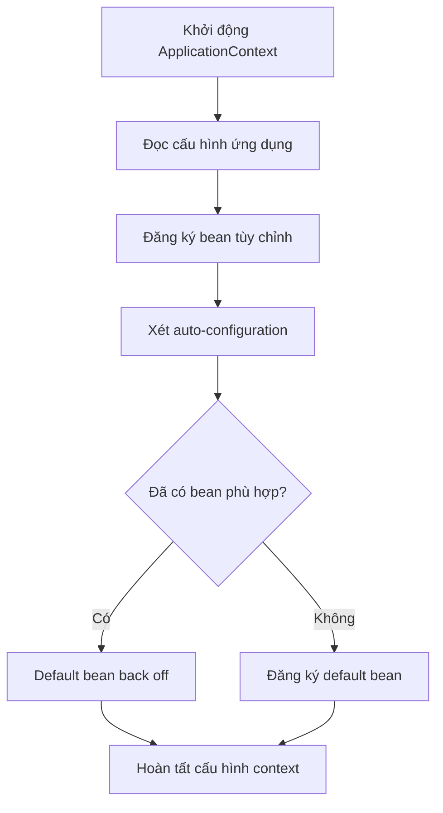

# Cơ chế nhường quyền (back-off) khi ứng dụng đã cung cấp bean phù hợp

> **Spring Boot Fundamentals · Auto-configuration**  
> Spring Boot cung cấp nhiều bean mặc định để ứng dụng có thể chạy với ít cấu hình. Nhưng khi ứng dụng muốn tự chọn implementation hoặc cấu hình riêng, auto-configuration nên **nhường quyền (back-off)**. Cơ chế phổ biến là `@ConditionalOnMissingBean`: chỉ tạo bean mặc định khi chưa có bean phù hợp trong ApplicationContext. Bài học này giải thích cách back-off hoạt động, điều kiện nào được xem là phù hợp, cách viết auto-configuration có thể tùy chỉnh và cách kiểm chứng bằng test.

## 1. Back-off là gì?

Giả sử một thư viện tích hợp muốn cung cấp dịch vụ gửi thông báo mặc định để ứng dụng có thể sử dụng ngay. Tuy nhiên, mỗi ứng dụng có thể muốn gửi thông báo qua email, SMS, message broker hoặc hệ thống nội bộ.

Nếu auto-configuration luôn đăng ký implementation mặc định, ứng dụng sẽ khó thay thế nó. Nếu framework cố ghi đè bean của ứng dụng, có thể gây xung đột tên bean hoặc làm mất cấu hình tùy chỉnh.

Spring Boot giải quyết vấn đề này bằng cách thiết kế auto-configuration theo hướng **cung cấp mặc định khi chưa có lựa chọn của ứng dụng**.

Ví dụ:

```java
@AutoConfiguration
public class NotificationAutoConfiguration {

    @Bean
    @ConditionalOnMissingBean(NotificationSender.class)
    NotificationSender notificationSender() {
        return new LoggingNotificationSender();
    }
}
```

Khi ApplicationContext chưa có bean nào phù hợp với `NotificationSender`, Spring Boot đăng ký `LoggingNotificationSender` làm bean mặc định.

Nếu ứng dụng đã cung cấp một bean `NotificationSender` phù hợp, điều kiện `@ConditionalOnMissingBean` không khớp và phương thức factory mặc định bị bỏ qua.

Đó là **back-off**: auto-configuration không tạo bean mặc định vì ứng dụng đã có lựa chọn đáp ứng cùng vai trò.

### 1.1. Back-off không phải thay thế bean đã tồn tại

Cần hiểu đúng hành vi:

- Auto-configuration kiểm tra xem bean phù hợp đã được đăng ký hay chưa.
- Nếu bean phù hợp đã có, bean mặc định không được đăng ký từ factory method có điều kiện.
- Bean của ứng dụng tiếp tục tồn tại và được sử dụng theo quy tắc dependency injection.
- Spring Boot không sửa object tùy chỉnh, không thay đổi implementation của nó và không tự động chuyển đổi cấu hình của bean đó.

Nói cách khác, auto-configuration **nhường chỗ trước khi tạo bean mặc định**, chứ không tạo default rồi thay thế object sau đó.

### 1.2. Vì sao đây là nguyên tắc quan trọng của Spring Boot?

Một auto-configuration tốt nên:

1. Làm cho trường hợp phổ biến hoạt động ngay sau khi thêm starter.
2. Cho phép ứng dụng cung cấp bean riêng khi cần tùy chỉnh.
3. Không tạo bean mặc định gây xung đột khi ứng dụng đã có implementation phù hợp.
4. Không buộc ứng dụng phải loại bỏ toàn bộ auto-configuration chỉ để thay một bean.
5. Giữ hành vi dễ dự đoán khi dependency hoặc property thay đổi.

Người dùng starter nhận được cấu hình mặc định thuận tiện, còn ứng dụng vẫn giữ quyền quyết định đối với những thành phần cần tùy chỉnh.

## 2. `@ConditionalOnMissingBean` hoạt động như thế nào?

`@ConditionalOnMissingBean` là annotation điều kiện của Spring Boot. Nó cho phép một cấu hình hoặc bean method chỉ được áp dụng khi chưa có bean phù hợp trong phạm vi tìm kiếm.

Ví dụ đơn giản:

```java
@Bean
@ConditionalOnMissingBean
GreetingService greetingService() {
    return new DefaultGreetingService();
}
```

Khi đặt trên một phương thức `@Bean`, nếu không chỉ định kiểu, Spring Boot suy ra kiểu cần kiểm tra từ kiểu trả về của phương thức.

Có thể khai báo kiểu rõ ràng:

```java
@Bean
@ConditionalOnMissingBean(GreetingService.class)
GreetingService greetingService() {
    return new DefaultGreetingService();
}
```

Trong ví dụ này, điều kiện hỏi: **đã có bean phù hợp với kiểu `GreetingService` chưa?**

Nếu chưa có, factory method được áp dụng. Nếu đã có, bean mặc định không được đăng ký.

### 2.1. Kiểm tra theo kiểu bean

Cách dùng phổ biến nhất là kiểm tra theo type:

```java
@ConditionalOnMissingBean(PaymentGateway.class)
```

Điều kiện có thể xem các bean có kiểu tương thích với `PaymentGateway`, bao gồm implementation có thể gán cho kiểu đó.

Ví dụ interface:

```java
public interface PaymentGateway {
    PaymentResult charge(PaymentRequest request);
}
```

Implementation mặc định:

```java
public class DefaultPaymentGateway implements PaymentGateway {
    @Override
    public PaymentResult charge(PaymentRequest request) {
        // Xử lý thanh toán mặc định.
        return PaymentResult.accepted();
    }
}
```

Ứng dụng có thể cung cấp implementation riêng:

```java
public class AcmePaymentGateway implements PaymentGateway {
    @Override
    public PaymentResult charge(PaymentRequest request) {
        // Gọi hệ thống thanh toán của ứng dụng.
        return PaymentResult.accepted();
    }
}
```

Vì `AcmePaymentGateway` triển khai `PaymentGateway`, nó phù hợp với điều kiện kiểm tra kiểu. Auto-configuration sẽ không cần đăng ký `DefaultPaymentGateway` nếu bean tùy chỉnh đã được nhận diện.

### 2.2. Kiểm tra theo tên bean

Có thể yêu cầu điều kiện dựa trên tên:

```java
@Bean
@ConditionalOnMissingBean(name = "partnerHttpClient")
HttpClient partnerHttpClient() {
    return HttpClient.newHttpClient();
}
```

Trong trường hợp này, điều kiện tập trung vào bean name `partnerHttpClient`. Nếu đã có bean mang tên đó trong phạm vi tìm kiếm, factory method mặc định không được áp dụng.

So sánh:

| Cách kiểm tra | Câu hỏi |
| --- | --- |
| `@ConditionalOnMissingBean(SomeType.class)` | Đã có bean phù hợp với kiểu này chưa? |
| `@ConditionalOnMissingBean(name = "someBean")` | Đã có bean mang tên này chưa? |
| `@ConditionalOnMissingBean(type = "com.example.SomeType")` | Đã có bean phù hợp với kiểu được chỉ định bằng tên class chưa? |
| `@ConditionalOnMissingBean(annotation = SomeAnnotation.class)` | Đã có bean mang annotation được chỉ định chưa? |

Thông thường, kiểm tra theo **type hoặc interface** diễn đạt rõ vai trò mà ứng dụng có thể thay thế. Kiểm tra theo tên hữu ích khi hợp đồng cấu hình được định nghĩa rõ bằng bean name.

### 2.3. Điều kiện mặc định trên method suy ra kiểu trả về

Ví dụ:

```java
@Bean
@ConditionalOnMissingBean
PaymentGateway paymentGateway() {
    return new DefaultPaymentGateway();
}
```

Vì không chỉ định type/name/annotation trong annotation, Spring Boot có thể dùng kiểu trả về `PaymentGateway` để xác định bean cần kiểm tra.

Đây là lý do nên khai báo kiểu trả về đủ cụ thể về **hợp đồng bean**. Nếu viết:

```java
@Bean
@ConditionalOnMissingBean
Object paymentGateway() {
    return new DefaultPaymentGateway();
}
```

thì thông tin kiểu tại thời điểm xử lý metadata chỉ là `Object`, không thể hiện rõ vai trò `PaymentGateway` mà auto-configuration muốn cung cấp. Điều kiện suy ra từ return type có thể không hoạt động như ý định.

Nên khai báo kiểu interface hoặc class thực tế mà consumer cần:

```java
@Bean
@ConditionalOnMissingBean(PaymentGateway.class)
PaymentGateway paymentGateway() {
    return new DefaultPaymentGateway();
}
```

Điều này giúp điều kiện dễ đọc, dễ kiểm tra và ít phụ thuộc vào việc suy luận kiểu.

## 3. Ví dụ đầy đủ: auto-configuration cung cấp bean mặc định

Giả sử chúng ta đang xây dựng một starter nội bộ cung cấp dịch vụ lời chào. Mục tiêu:

- Ứng dụng thêm starter sẽ có sẵn `GreetingService`.
- Nếu ứng dụng tự cung cấp `GreetingService`, bean mặc định sẽ nhường quyền.
- Consumer chỉ phụ thuộc interface, không phụ thuộc implementation cụ thể.

### 3.1. Định nghĩa hợp đồng

```java
package com.example.greeting;

public interface GreetingService {
    String greet(String name);
}
```

Implementation mặc định:

```java
package com.example.greeting;

public class DefaultGreetingService implements GreetingService {

    @Override
    public String greet(String name) {
        return "Hello, " + name + "!";
    }
}
```

### 3.2. Viết auto-configuration

```java
package com.example.greeting.autoconfigure;

import com.example.greeting.DefaultGreetingService;
import com.example.greeting.GreetingService;

import org.springframework.boot.autoconfigure.AutoConfiguration;
import org.springframework.boot.autoconfigure.condition.ConditionalOnMissingBean;
import org.springframework.context.annotation.Bean;

@AutoConfiguration
public class GreetingAutoConfiguration {

    @Bean
    @ConditionalOnMissingBean(GreetingService.class)
    GreetingService greetingService() {
        return new DefaultGreetingService();
    }
}
```

Auto-configuration này cung cấp một lựa chọn mặc định cho ứng dụng. Annotation `@ConditionalOnMissingBean` là điểm cho phép người dùng thay thế implementation mà không phải exclude toàn bộ `GreetingAutoConfiguration`.

### 3.3. Đăng ký auto-configuration trong starter

Với Spring Boot 3.x, auto-configuration thường được khai báo trong file:

```text
src/main/resources/META-INF/spring/
└── org.springframework.boot.autoconfigure.AutoConfiguration.imports
```

Nội dung file gồm fully qualified class name, mỗi dòng một class:

```text
com.example.greeting.autoconfigure.GreetingAutoConfiguration
```

Khi starter được đưa vào ứng dụng và auto-configuration được đăng ký đúng cách, Spring Boot có thể phát hiện và xét cấu hình này.

Lưu ý: file imports chỉ đăng ký lớp auto-configuration vào cơ chế import của Boot. Các điều kiện trên lớp và bean method vẫn quyết định cấu hình hoặc bean cụ thể có được áp dụng hay không.

### 3.4. Consumer chỉ phụ thuộc interface

```java
package com.example.application;

import com.example.greeting.GreetingService;
import org.springframework.stereotype.Service;

@Service
public class WelcomeService {

    private final GreetingService greetingService;

    public WelcomeService(GreetingService greetingService) {
        this.greetingService = greetingService;
    }

    public String welcome(String userName) {
        return greetingService.greet(userName);
    }
}
```

Khi ứng dụng không khai báo implementation riêng, Spring Boot cung cấp `DefaultGreetingService`. `WelcomeService` vẫn inject theo interface `GreetingService`.

Nếu ứng dụng cung cấp implementation riêng, consumer nhận implementation tùy chỉnh đó mà không cần sửa `WelcomeService`.

## 4. Ứng dụng cung cấp bean riêng để auto-configuration nhường quyền

Ứng dụng sử dụng starter có thể khai báo bean bằng `@Bean`:

```java
package com.example.application.config;

import com.example.greeting.GreetingService;
import org.springframework.context.annotation.Bean;
import org.springframework.context.annotation.Configuration;

@Configuration(proxyBeanMethods = false)
public class CustomGreetingConfiguration {

    @Bean
    GreetingService greetingService() {
        return new CustomGreetingService();
    }
}
```

Implementation tùy chỉnh:

```java
package com.example.application;

import com.example.greeting.GreetingService;

public class CustomGreetingService implements GreetingService {

    @Override
    public String greet(String name) {
        return "Welcome back, " + name + ".";
    }
}
```

Trong quá trình xử lý cấu hình thông thường của Spring Boot:

1. Spring nhận diện cấu hình của ứng dụng.
2. Bean `GreetingService` tùy chỉnh được đăng ký.
3. Spring Boot xét `GreetingAutoConfiguration`.
4. `@ConditionalOnMissingBean(GreetingService.class)` nhận thấy đã có bean phù hợp.
5. Phương thức `greetingService()` mặc định không được áp dụng.
6. `WelcomeService` được inject bean tùy chỉnh.

Ứng dụng đã thay đổi hành vi mặc định chỉ bằng cách cung cấp một bean đúng hợp đồng.

### 4.1. Có thể dùng `@Component` thay cho `@Bean` không?

Có. Nếu implementation do ứng dụng sở hữu, có thể đăng ký bằng component scan:

```java
@Component
public class CustomGreetingService implements GreetingService {

    @Override
    public String greet(String name) {
        return "Welcome, " + name + "!";
    }
}
```

Khi component được phát hiện và đăng ký trước lúc auto-configuration đánh giá điều kiện, bean đó cũng có thể khiến default bean back off.

Tuy nhiên, phải bảo đảm class nằm trong phạm vi component scan hoặc được đăng ký bằng cách phù hợp. Một class có `@Component` nhưng không được Spring phát hiện thì không thể khiến điều kiện thấy bean đó.

### 4.2. Custom bean cần đúng vai trò

Giả sử ứng dụng cung cấp:

```java
@Bean
CustomGreetingFormatter greetingFormatter() {
    return new CustomGreetingFormatter();
}
```

Nếu `CustomGreetingFormatter` không triển khai `GreetingService` và không được khai báo là bean name mà điều kiện đang kiểm tra, nó không làm `@ConditionalOnMissingBean(GreetingService.class)` back off.

Điều kiện kiểm tra **hợp đồng mà auto-configuration yêu cầu**, không phải bất kỳ bean nào có vẻ liên quan về tên hoặc chức năng.

## 5. Back-off theo interface giúp ứng dụng thay implementation

Thiết kế auto-configuration nên hướng tới abstraction mà consumer sử dụng.

Ví dụ:

```java
@Bean
@ConditionalOnMissingBean(Clock.class)
Clock applicationClock() {
    return Clock.systemUTC();
}
```

Nếu ứng dụng tự cung cấp một implementation phù hợp với `Clock`, bean mặc định sẽ nhường quyền.

Tương tự:

```java
@Bean
@ConditionalOnMissingBean(CacheManager.class)
CacheManager cacheManager() {
    return new ConcurrentMapCacheManager();
}
```

Ứng dụng có thể cung cấp cache manager riêng như Caffeine, Redis hoặc một giải pháp tùy chỉnh. Auto-configuration không nên buộc mọi ứng dụng dùng implementation mặc định.

### 5.1. Vì sao kiểm tra interface thường hữu ích?

Giả sử starter cung cấp:

```java
@Bean
@ConditionalOnMissingBean(PaymentGateway.class)
PaymentGateway paymentGateway() {
    return new DefaultPaymentGateway();
}
```

Ứng dụng có thể chọn bất kỳ class nào triển khai `PaymentGateway`:

- `StripePaymentGateway`.
- `AcmePaymentGateway`.
- `SandboxPaymentGateway`.
- `TestPaymentGateway`.

Auto-configuration không cần biết tên implementation. Nó chỉ quan tâm ứng dụng đã có bean đáp ứng contract chưa.

Đây là cách giảm coupling giữa starter và ứng dụng tiêu thụ starter.

### 5.2. Tránh điều kiện quá cụ thể vào implementation mặc định

Một thiết kế kém linh hoạt:

```java
@Bean
@ConditionalOnMissingBean(DefaultPaymentGateway.class)
DefaultPaymentGateway paymentGateway() {
    return new DefaultPaymentGateway();
}
```

Nếu ứng dụng cung cấp `AcmePaymentGateway implements PaymentGateway`, điều kiện kiểm tra `DefaultPaymentGateway` vẫn có thể không tìm thấy bean đó và tiếp tục tạo default. Kết quả có hai bean cùng vai trò `PaymentGateway`.

Nếu mục tiêu là cho phép ứng dụng thay bất kỳ implementation nào, nên kiểm tra interface hoặc abstraction consumer thực sự dùng:

```java
@Bean
@ConditionalOnMissingBean(PaymentGateway.class)
PaymentGateway paymentGateway() {
    return new DefaultPaymentGateway();
}
```

Chọn type condition dựa trên **contract mà ứng dụng có quyền thay thế**.

## 6. Back-off trên method và trên class

`@ConditionalOnMissingBean` có thể được đặt trên phương thức `@Bean` hoặc lớp cấu hình. Phạm vi ảnh hưởng khác nhau.

### 6.1. Method-level: chỉ default bean tương ứng nhường quyền

Ví dụ:

```java
@AutoConfiguration
public class SearchAutoConfiguration {

    @Bean
    @ConditionalOnMissingBean(SearchClient.class)
    SearchClient searchClient() {
        return new DefaultSearchClient();
    }

    @Bean
    SearchHealthIndicator searchHealthIndicator(SearchClient searchClient) {
        return new SearchHealthIndicator(searchClient);
    }

    @Bean
    SearchProperties searchProperties() {
        return new SearchProperties();
    }
}
```

Nếu ứng dụng cung cấp `SearchClient` tùy chỉnh:

- Bean mặc định `searchClient` không được tạo.
- `searchHealthIndicator` vẫn có thể được tạo và nhận client tùy chỉnh.
- `searchProperties` vẫn có thể được tạo.

Đây thường là cấu trúc phù hợp khi chỉ muốn cho phép thay một thành phần trong nhóm auto-configuration.

### 6.2. Class-level: cả nhóm cấu hình có thể nhường quyền

Ví dụ:

```java
@AutoConfiguration
@ConditionalOnMissingBean(SearchClient.class)
public class SearchAutoConfiguration {

    @Bean
    SearchClient searchClient() {
        return new DefaultSearchClient();
    }

    @Bean
    SearchHealthIndicator searchHealthIndicator(SearchClient searchClient) {
        return new SearchHealthIndicator(searchClient);
    }
}
```

Nếu bean `SearchClient` đã có, điều kiện trên lớp không khớp và toàn bộ lớp cấu hình bị bỏ qua. Khi đó cả `searchClient` mặc định lẫn `searchHealthIndicator` đều không được đăng ký từ lớp này.

Điều này chỉ phù hợp khi **toàn bộ nhóm bean** nên được bỏ qua nếu ứng dụng đã cung cấp `SearchClient`. Nếu ứng dụng vẫn cần health indicator mặc định cho client tùy chỉnh, đặt condition ở cấp method cho bean client sẽ phù hợp hơn.

### 6.3. Bảng chọn phạm vi

| Mục tiêu | Vị trí condition |
| --- | --- |
| Chỉ bỏ bean mặc định nếu ứng dụng đã có implementation | Trên method `@Bean` tạo bean mặc định |
| Bỏ cả nhóm cấu hình khi ứng dụng có thành phần thay thế | Trên lớp cấu hình |
| Một bean có điều kiện riêng, các bean khác vẫn cần | Trên method tương ứng |
| Cả nhóm phụ thuộc cùng một feature flag hoặc classpath | Trên lớp cấu hình |
| Có nhiều bean độc lập với các điều kiện khác nhau | Tách method condition hoặc cấu hình thành nhóm rõ ràng |

## 7. Thời điểm đánh giá: vì sao user bean thường được nhìn thấy trước auto-configuration?

`@ConditionalOnMissingBean` chỉ có thể quyết định dựa trên bean definitions mà container đã xử lý tại thời điểm condition được đánh giá. Nó không phải truy vấn động chạy lại liên tục sau mỗi lần đăng ký bean.

Spring Boot thiết kế quá trình khởi động để các cấu hình do ứng dụng cung cấp thường được xử lý trước auto-configuration. Nhờ đó, bean tùy chỉnh của ứng dụng có thể được nhìn thấy khi auto-configuration quyết định có tạo default hay không.

Luồng khái niệm:



Đây là lý do một bean trong `@Configuration` của ứng dụng thường có thể thay thế default bean do auto-configuration cung cấp.

### 7.1. Điều kiện bean chỉ thấy những definition đã được xử lý

Một điều kiện không thể dự đoán chắc chắn mọi bean sẽ được đăng ký trong tương lai. Nếu một auto-configuration khác cung cấp bean cần kiểm tra nhưng được xử lý sau, `@ConditionalOnMissingBean` có thể đánh giá trước khi bean đó xuất hiện.

Đây là vấn đề quan trọng khi viết **nhiều auto-configuration phụ thuộc lẫn nhau**.

### 7.2. Điều khiển thứ tự giữa các auto-configuration

Spring Boot cung cấp cơ chế sắp xếp auto-configuration, ví dụ:

```java
@AutoConfiguration(after = DataSourceAutoConfiguration.class)
public class JdbcMetricsAutoConfiguration {
    // ...
}
```

Hoặc:

```java
@AutoConfiguration(before = SomeOtherAutoConfiguration.class)
public class CustomAutoConfiguration {
    // ...
}
```

Các thuộc tính `before` và `after` điều khiển thứ tự tương đối giữa các auto-configuration. Chúng không thay đổi thứ tự của mọi bean trong ứng dụng và cũng không phải công cụ điều khiển tùy ý thứ tự khởi tạo singleton.

Khi điều kiện bean phụ thuộc vào bean do auto-configuration khác cung cấp, hãy xác định quan hệ ordering phù hợp. Không dựa vào thứ tự file hoặc thứ tự khai báo method để đoán condition sẽ nhìn thấy bean nào.

### 7.3. Không dùng `@ConditionalOnMissingBean` như cơ chế đăng ký động

Nếu một bean chỉ xuất hiện sau khi ứng dụng đã khởi động, condition không tự đánh giá lại để tạo default hoặc xóa bean cũ. Cơ chế này phục vụ quá trình xây dựng ApplicationContext.

Muốn thay đổi implementation lúc runtime, cần thiết kế một abstraction có thể định tuyến/đổi delegate hoặc cơ chế plugin riêng. Back-off không phải feature toggle động.

## 8. Bean phù hợp được xác định theo những tiêu chí nào?

`@ConditionalOnMissingBean` hỗ trợ nhiều cách chỉ định điều kiện. Những thuộc tính thường gặp:

| Thuộc tính | Ý nghĩa |
| --- | --- |
| `value` | Các kiểu bean cần kiểm tra |
| `type` | Tên class dạng chuỗi cần kiểm tra |
| `name` | Tên bean cần kiểm tra |
| `annotation` | Annotation mà bean cần có |
| `ignored` / `ignoredType` | Các kiểu được bỏ qua trong quá trình xét |
| `parameterizedContainer` | Container type có thể chứa kiểu cần xét, trong trường hợp phù hợp |
| `search` | Phạm vi tìm kiếm bean theo context hierarchy |

Ví dụ theo kiểu:

```java
@ConditionalOnMissingBean(value = {
        PaymentGateway.class,
        RefundGateway.class
})
```

Ví dụ theo tên:

```java
@ConditionalOnMissingBean(name = "applicationObjectMapper")
```

Ví dụ theo annotation:

```java
@ConditionalOnMissingBean(annotation = PrimaryDataSource.class)
```

Các ví dụ chỉ minh họa cách khai báo điều kiện. Cần chọn tiêu chí phù hợp với hợp đồng bean của starter.

### 8.1. Điều kiện nhiều kiểu thường mang ý nghĩa “thiếu các candidate được chỉ định”

Khi truyền nhiều type/name/annotation trong một điều kiện, hãy đọc tài liệu của annotation đúng phiên bản để hiểu chính xác semantics và cách kết hợp các thuộc tính. Đừng giả định danh sách luôn có nghĩa “thiếu bất kỳ một trong số này” theo cách diễn đạt tùy ý.

Nếu yêu cầu nghiệp vụ là “chỉ tạo default khi chưa có một trong hai interface X hoặc Y”, có thể tách điều kiện hoặc viết custom condition để biểu đạt logic thật rõ. Việc thiết kế condition nên ưu tiên tính dễ đọc và dễ test.

### 8.2. Phạm vi tìm kiếm trong context hierarchy

ApplicationContext có thể có parent và child. `@ConditionalOnMissingBean` hỗ trợ lựa chọn phạm vi tìm kiếm qua `search`.

Các chiến lược thường gặp:

- `SearchStrategy.ALL`: xét context hiện tại và các ancestor.
- `SearchStrategy.CURRENT`: chỉ xét context hiện tại.
- `SearchStrategy.PARENTS`: chỉ xét các ancestor.

Mặc định của annotation là tìm kiếm theo phạm vi `ALL`. Nếu ứng dụng có context hierarchy và muốn một child context cung cấp bean riêng ngay cả khi parent đã có bean cùng kiểu, cần hiểu và chọn search strategy phù hợp.

Đây là nhu cầu chuyên biệt. Với Spring Boot application thông thường chỉ có một context chính, thường không cần thay đổi mặc định.

## 9. Phân biệt back-off với `@Primary` và `@Qualifier`

Ba cơ chế này thường bị nhầm vì đều liên quan tới nhiều bean cùng kiểu, nhưng chúng giải quyết những vấn đề khác nhau.

### 9.1. `@ConditionalOnMissingBean` ngăn đăng ký default

```java
@Bean
@ConditionalOnMissingBean(PaymentGateway.class)
PaymentGateway defaultPaymentGateway() {
    return new DefaultPaymentGateway();
}
```

Nếu đã có bean `PaymentGateway` phù hợp, default method không được áp dụng. Kết quả thường chỉ có bean tùy chỉnh của ứng dụng.

### 9.2. `@Primary` chọn ứng viên ưu tiên

```java
@Bean
@Primary
PaymentGateway primaryPaymentGateway() {
    return new AcmePaymentGateway();
}
```

`@Primary` không tự ngăn các bean `PaymentGateway` khác được đăng ký. Nếu một bean mặc định được khai báo vô điều kiện, cả hai có thể cùng tồn tại; khi consumer inject theo type mà không có qualifier, Spring ưu tiên bean primary.

### 9.3. `@Qualifier` chọn bean theo vai trò

```java
@Bean
PaymentGateway paymentGateway(
        @Qualifier("acmePaymentGateway") PaymentGateway gateway) {
    return new PaymentGatewayFacade(gateway);
}
```

`@Qualifier` giúp chọn candidate tại điểm injection. Nó không tự khiến auto-configuration nhường quyền.

| Cơ chế | Giải quyết câu hỏi |
| --- | --- |
| `@ConditionalOnMissingBean` | Có nên đăng ký bean mặc định không? |
| `@Primary` | Nếu có nhiều candidate, bean nào là mặc định khi inject? |
| `@Qualifier` | Consumer cần đúng bean mang vai trò/qualifier nào? |

### 9.4. Vì sao chỉ thêm `@Primary` đôi khi không đủ?

Giả sử auto-configuration tạo:

```java
@Bean
PaymentGateway defaultPaymentGateway() {
    return new DefaultPaymentGateway();
}
```

Ứng dụng tạo:

```java
@Bean
@Primary
PaymentGateway customPaymentGateway() {
    return new AcmePaymentGateway();
}
```

Cả hai bean vẫn được đăng ký vì default method không có điều kiện back-off. `@Primary` chỉ giúp injection chọn custom bean. Các consumer inject theo collection hoặc lookup theo tên vẫn có thể nhìn thấy cả hai.

Nếu starter muốn default biến mất khi ứng dụng cung cấp implementation riêng, cần đặt `@ConditionalOnMissingBean(PaymentGateway.class)` trên default method.

## 10. Back-off khác với bean overriding theo tên

Một số người nghĩ Spring Boot “ghi đè” bean mặc định bằng bean của ứng dụng. Cơ chế back-off không dựa trên việc hai bean cùng tên rồi thay thế định nghĩa.

Ví dụ không có back-off:

```java
@Bean("paymentGateway")
PaymentGateway defaultPaymentGateway() {
    return new DefaultPaymentGateway();
}
```

Ứng dụng cũng khai báo một bean tên `paymentGateway`. Nếu cả hai định nghĩa cùng được đăng ký, có thể xảy ra xung đột bean name hoặc hành vi phụ thuộc cấu hình bean definition overriding.

Spring Boot hiện đại mặc định không khuyến khích bean definition overriding và thường tắt tính năng này. Không nên thiết kế starter dựa vào việc ứng dụng sẽ ghi đè bean theo tên.

Cách phù hợp:

```java
@Bean("paymentGateway")
@ConditionalOnMissingBean(PaymentGateway.class)
PaymentGateway defaultPaymentGateway() {
    return new DefaultPaymentGateway();
}
```

Khi ứng dụng có bean phù hợp, default definition không được đăng ký; không cần ghi đè cùng tên.

### 10.1. Bean name khác type condition

Nếu ứng dụng có bean:

```java
@Bean("customGateway")
PaymentGateway customGateway() {
    return new AcmePaymentGateway();
}
```

thì điều kiện theo `PaymentGateway.class` có thể nhận thấy bean tùy chỉnh dù tên bean khác `paymentGateway`. Đây là lý do kiểm tra theo abstraction thường linh hoạt hơn kiểm tra theo tên mặc định.

## 11. Back-off và các điều kiện khác trong auto-configuration

Một bean mặc định có thể chịu nhiều điều kiện cùng lúc:

```java
@Bean
@ConditionalOnClass(PaymentClient.class)
@ConditionalOnProperty(
        prefix = "payment",
        name = "enabled",
        havingValue = "true"
)
@ConditionalOnMissingBean(PaymentGateway.class)
PaymentGateway paymentGateway(PaymentClient client) {
    return new DefaultPaymentGateway(client);
}
```

Bean chỉ có thể được đăng ký khi:

1. Class thư viện `PaymentClient` có trên classpath.
2. Property `payment.enabled` có giá trị `true`.
3. Chưa có bean phù hợp với `PaymentGateway`.
4. Dependency `PaymentClient` được giải quyết thành công.
5. Không có condition khác ngăn cấu hình.

Nếu ứng dụng đã có custom gateway nhưng property `payment.enabled` là `false`, toàn bộ method vẫn bị bỏ qua. Điều đó không có nghĩa custom gateway bị xóa; nó chỉ có nghĩa auto-configuration mặc định không được áp dụng.

### 11.1. Class condition và method condition có phạm vi khác nhau

Có thể đặt `@ConditionalOnClass` ở cấp lớp để cả nhóm cấu hình chỉ tồn tại khi thư viện có mặt, còn `@ConditionalOnMissingBean` đặt trên một method để chỉ bean mặc định đó nhường quyền.

Ví dụ:

```java
@AutoConfiguration
@ConditionalOnClass(PaymentClient.class)
public class PaymentAutoConfiguration {

    @Bean
    @ConditionalOnMissingBean(PaymentGateway.class)
    PaymentGateway paymentGateway(PaymentClient client) {
        return new DefaultPaymentGateway(client);
    }

    @Bean
    PaymentHealthIndicator paymentHealthIndicator(
            PaymentClient client) {
        return new PaymentHealthIndicator(client);
    }
}
```

Nếu custom gateway có mặt, method tạo gateway mặc định nhường quyền; health indicator vẫn có thể được tạo. Tuy nhiên, health indicator ở ví dụ vẫn cần `PaymentClient`. Nếu điều kiện/bean dependency của client không thỏa, cần thêm condition phù hợp hoặc thiết kế lại dependency graph.

Không nên cho rằng việc một bean back off sẽ tự động làm mọi bean liên quan back off theo.

## 12. Lưu ý về thứ tự và việc ứng dụng tự cung cấp bean

Một trong những quy tắc quan trọng nhất khi viết auto-configuration là: **đặt điều kiện bean ở vị trí mà các bean do ứng dụng cung cấp đã được đăng ký trước khi điều kiện được đánh giá**.

Spring Boot thường xử lý user configuration trước auto-configuration, nên cách phổ biến sau hoạt động:

```java
@Configuration(proxyBeanMethods = false)
class ApplicationPaymentConfiguration {

    @Bean
    PaymentGateway paymentGateway() {
        return new AcmePaymentGateway();
    }
}
```

Auto-configuration có `@ConditionalOnMissingBean(PaymentGateway.class)` sau đó nhìn thấy bean này và nhường quyền.

### 12.1. Không phải mọi cấu hình bean đều có cùng thứ tự

Nếu một bean tùy chỉnh lại được cung cấp bởi một auto-configuration khác, thứ tự giữa hai auto-configuration có thể quyết định condition nhìn thấy bean hay chưa.

Ví dụ starter A cung cấp `PaymentGateway` tùy chỉnh; starter B cung cấp default `PaymentGateway`. Nếu B đánh giá `@ConditionalOnMissingBean` trước khi A đăng ký bean, B có thể tạo default. Khi đó cần xác định quan hệ ordering hoặc hợp nhất trách nhiệm cấu hình phù hợp.

Với Spring Boot 3.x, có thể dùng `@AutoConfiguration(before = ...)` hoặc `@AutoConfiguration(after = ...)` để khai báo quan hệ thứ tự giữa các auto-configuration.

### 12.2. Bean condition không nên được dùng như bộ điều phối giữa mọi module

Nếu nhiều module phụ thuộc vào sự xuất hiện của cùng một bean, hãy thiết kế rõ:

- Module nào sở hữu abstraction?
- Module nào cung cấp default?
- Module nào cung cấp implementation tùy chỉnh?
- Auto-configuration nào phải chạy trước/sau?
- Consumer nào cần điều kiện riêng nếu dependency có thể vắng mặt?

Nếu các module không có quan hệ ordering rõ ràng, condition có thể trở nên khó dự đoán và dễ tạo lỗi khi thêm starter mới.

## 13. Ví dụ kiểm thử back-off bằng `ApplicationContextRunner`

Spring Boot cung cấp `ApplicationContextRunner` để kiểm thử auto-configuration trong một context nhỏ, không cần khởi động toàn bộ web application.

### 13.1. Auto-configuration

```java
package com.example.greeting.autoconfigure;

import com.example.greeting.DefaultGreetingService;
import com.example.greeting.GreetingService;

import org.springframework.boot.autoconfigure.AutoConfiguration;
import org.springframework.boot.autoconfigure.condition.ConditionalOnMissingBean;
import org.springframework.context.annotation.Bean;

@AutoConfiguration
public class GreetingAutoConfiguration {

    @Bean
    @ConditionalOnMissingBean(GreetingService.class)
    GreetingService greetingService() {
        return new DefaultGreetingService();
    }
}
```

### 13.2. Cấu hình tùy chỉnh của ứng dụng

```java
package com.example.application;

import com.example.greeting.GreetingService;
import org.springframework.context.annotation.Bean;
import org.springframework.context.annotation.Configuration;

@Configuration(proxyBeanMethods = false)
public class CustomGreetingConfiguration {

    @Bean
    GreetingService customGreetingService() {
        return new CustomGreetingService();
    }
}
```

### 13.3. Test trường hợp không có bean tùy chỉnh

```java
package com.example.greeting.autoconfigure;

import static org.assertj.core.api.Assertions.assertThat;

import com.example.greeting.DefaultGreetingService;
import com.example.greeting.GreetingService;

import org.junit.jupiter.api.Test;
import org.springframework.boot.autoconfigure.AutoConfigurations;
import org.springframework.boot.test.context.runner.ApplicationContextRunner;

class GreetingAutoConfigurationTest {

    private final ApplicationContextRunner contextRunner =
            new ApplicationContextRunner()
                    .withConfiguration(
                            AutoConfigurations.of(GreetingAutoConfiguration.class));

    @Test
    void createsDefaultWhenApplicationHasNoGreetingService() {
        contextRunner.run(context -> {
            assertThat(context).hasSingleBean(GreetingService.class);
            assertThat(context.getBean(GreetingService.class))
                    .isInstanceOf(DefaultGreetingService.class);
        });
    }
}
```

Kết quả mong đợi: khi không có bean do ứng dụng cung cấp, default bean được đăng ký.

### 13.4. Test trường hợp ứng dụng có bean tùy chỉnh

```java
@Test
void backsOffWhenApplicationProvidesGreetingService() {
    contextRunner
            .withUserConfiguration(CustomGreetingConfiguration.class)
            .run(context -> {
                assertThat(context).hasSingleBean(GreetingService.class);
                assertThat(context.getBean(GreetingService.class))
                        .isInstanceOf(CustomGreetingService.class);
            });
}
```

Kết quả mong đợi: chỉ có một bean `GreetingService` và đó là implementation tùy chỉnh. Default factory method đã back off.

Các ví dụ giả định test source có đầy đủ import và implementation class tương ứng, đồng thời dependency `spring-boot-starter-test` hoặc các thư viện test Spring Boot cần thiết đã được thêm.

### 13.5. Test thêm các trường hợp khác

Có thể mở rộng test để xác nhận:

- Bean tùy chỉnh được cung cấp bằng `@Bean`.
- Bean tùy chỉnh được cung cấp bằng component scan.
- Bean khác kiểu không làm default back off.
- Bean cùng kiểu nhưng tên khác vẫn làm type condition back off.
- Default bean được tạo khi custom bean không được đăng ký.
- Property hoặc classpath condition bên ngoài có thể ngăn cả auto-configuration.

Test cả trường hợp có và không có custom bean giúp chứng minh starter vừa có default hữu ích vừa tôn trọng cấu hình ứng dụng.

## 14. Chẩn đoán vì sao default bean không được tạo

Nếu một bean mặc định không xuất hiện, có thể do nhiều nguyên nhân:

1. `@ConditionalOnMissingBean` thấy một bean phù hợp và chủ động back off.
2. Điều kiện khác trên lớp hoặc method không khớp.
3. Auto-configuration không được đăng ký/import.
4. Classpath thiếu thư viện cần thiết.
5. Property không bật tính năng.
6. Profile không active.
7. Bean condition phụ thuộc một bean chưa được đăng ký tại thời điểm đánh giá.
8. Factory method được chọn nhưng tạo bean thất bại do dependency/property/runtime exception.

### 14.1. Bật Condition Evaluation Report

Chạy ứng dụng với `--debug`:

```bash
java -jar application.jar --debug
```

Hoặc Maven:

```bash
./mvnw spring-boot:run -Dspring-boot.run.arguments=--debug
```

Hoặc Gradle:

```bash
./gradlew bootRun --args='--debug'
```

Spring Boot có thể in Condition Evaluation Report. Tìm tên auto-configuration hoặc bean method liên quan để xem điều kiện nào khớp, không khớp hoặc khiến cấu hình bị bỏ qua.

### 14.2. Phân biệt back-off với lỗi tạo bean

| Quan sát | Ý nghĩa |
| --- | --- |
| Default bean không có và report ghi missing-bean condition không khớp | Có bean phù hợp đã được nhận diện; back-off là hành vi dự kiến |
| Default bean không có và property condition không khớp | Tính năng không được bật theo cấu hình |
| Default bean không có và class condition không khớp | Thiếu class cần thiết trên classpath |
| Bean definition có nhưng context startup lỗi | Factory method hoặc dependency khởi tạo thất bại |
| Có hai bean cùng interface | Default không có back-off hoặc condition kiểm tra sai abstraction |
| Consumer báo thiếu bean | Không có custom bean và default cũng bị ngăn bởi condition khác, hoặc auto-configuration chưa được nạp |

Đừng vội thêm bean thứ hai khi chưa biết default bị bỏ qua vì lý do gì. Đọc condition report và dependency graph sẽ giúp xác định đúng nguyên nhân.

## 15. Những lỗi thiết kế back-off thường gặp

| Lỗi | Hệ quả | Cách cải thiện |
| --- | --- | --- |
| Không dùng `@ConditionalOnMissingBean` cho default bean | Bean mặc định xung đột với custom bean | Đặt điều kiện trên method tạo default |
| Kiểm tra implementation mặc định thay vì interface | Custom implementation khác class vẫn không làm default back off | Kiểm tra abstraction consumer sử dụng |
| Đặt condition ở cấp lớp trong khi chỉ một bean cần nhường quyền | Các bean phụ trợ khác cũng biến mất | Chuyển condition xuống method tương ứng |
| Dùng `@Primary` để thay back-off | Default và custom vẫn cùng tồn tại | Dùng `@ConditionalOnMissingBean` nếu muốn default không được tạo |
| Dựa vào bean overriding theo tên | Có thể gặp xung đột bean definition | Thiết kế condition để không đăng ký default khi custom bean tồn tại |
| Kiểu trả về factory method quá chung như `Object` | Điều kiện suy ra type không đủ cụ thể | Khai báo interface/class phù hợp hoặc chỉ định type tường minh |
| Condition bean chạy trước bean cần phát hiện | Default có thể được tạo ngoài dự kiến | Xem ordering giữa auto-configuration |
| Custom bean nằm ngoài component scan | Condition không nhìn thấy bean đó | Đưa cấu hình vào context bằng scan/import phù hợp |
| Cho rằng back-off tự tắt mọi bean phụ thuộc | Consumer hoặc health indicator vẫn được tạo nhưng thiếu dependency | Đặt condition phù hợp cho từng bean trong graph |
| Cho rằng condition tự đánh giá lại khi runtime | Bean không tự xuất hiện hoặc biến mất sau startup | Thiết kế cơ chế runtime riêng nếu cần thay đổi động |

### 15.1. Trả về implementation cụ thể hay interface?

Ví dụ:

```java
@Bean
@ConditionalOnMissingBean(GreetingService.class)
DefaultGreetingService greetingService() {
    return new DefaultGreetingService();
}
```

Cách này có thể hợp lệ nếu muốn expose implementation type. Nhưng consumer thường phụ thuộc `GreetingService`. Khai báo return type là interface:

```java
@Bean
@ConditionalOnMissingBean(GreetingService.class)
GreetingService greetingService() {
    return new DefaultGreetingService();
}
```

thường làm rõ contract mà starter cung cấp.

Điều quan trọng là type được condition xét phải phản ánh đúng vai trò bean mà ứng dụng có quyền thay thế. Nếu cần kiểm tra implementation cụ thể, hãy chỉ định rõ vì sao điều đó phù hợp.

### 15.2. Back-off không sửa lỗi bên trong custom bean

Nếu ứng dụng cung cấp `PaymentGateway` tùy chỉnh nhưng factory method của nó ném exception, auto-configuration vẫn có thể back off vì bean definition phù hợp đã được đăng ký. Spring không tự quay lại tạo default bean sau khi custom bean khởi tạo thất bại.

Đây là hành vi có chủ đích: custom bean thể hiện lựa chọn của ứng dụng. Nếu lựa chọn đó cấu hình sai, nên báo lỗi rõ ràng thay vì âm thầm chuyển sang implementation khác.

## 16. Thiết kế auto-configuration thân thiện với ứng dụng

Khi viết starter hoặc auto-configuration, hãy áp dụng những nguyên tắc sau:

1. **Cung cấp default có điều kiện.** Dùng `@ConditionalOnMissingBean` cho bean mà ứng dụng có thể thay thế.
2. **Kiểm tra abstraction phù hợp.** Ưu tiên interface/contract mà consumer sử dụng thay vì implementation nội bộ của starter.
3. **Đặt điều kiện ở phạm vi nhỏ nhất cần thiết.** Method-level thường phù hợp khi chỉ một bean cần back-off; class-level dùng khi cả nhóm cấu hình cùng phụ thuộc.
4. **Khai báo return type rõ ràng.** Đừng che mất type mà condition cần kiểm tra bằng kiểu quá tổng quát.
5. **Tôn trọng bean do ứng dụng cung cấp.** Để user configuration được xử lý trước auto-configuration theo cơ chế Boot.
6. **Kiểm soát thứ tự giữa các auto-configuration.** Dùng ordering khi một bean condition phụ thuộc cấu hình khác.
7. **Không dựa vào bean name collision.** Back-off theo type/name có chủ đích tốt hơn bean overriding.
8. **Không dùng condition như runtime switch.** Điều kiện chủ yếu quyết định cấu hình lúc context được xây dựng.
9. **Test cả default và custom path.** Kiểm tra khi không có bean, có bean tùy chỉnh, có property và thiếu class.
10. **Giữ dependency graph nhất quán.** Nếu một bean phụ thuộc vào bean có thể back off, hãy bảo đảm bean consumer cũng có condition/fallback phù hợp.

## 17. Bài thực hành: tạo starter có default bean và cho phép ứng dụng thay thế

### Bước 1 — Tạo interface

```java
package com.example.feature;

public interface FeatureFormatter {
    String format(String value);
}
```

### Bước 2 — Tạo implementation mặc định

```java
package com.example.feature;

public class DefaultFeatureFormatter implements FeatureFormatter {

    @Override
    public String format(String value) {
        return "[" + value + "]";
    }
}
```

### Bước 3 — Tạo auto-configuration

```java
@AutoConfiguration
public class FeatureAutoConfiguration {

    @Bean
    @ConditionalOnMissingBean(FeatureFormatter.class)
    FeatureFormatter featureFormatter() {
        return new DefaultFeatureFormatter();
    }
}
```

### Bước 4 — Đăng ký auto-configuration

Thêm class name của `FeatureAutoConfiguration` vào file `AutoConfiguration.imports` theo định dạng Spring Boot 3.x.

### Bước 5 — Chạy app khi không có custom bean

Inject `FeatureFormatter` vào một service và kiểm tra bean nhận được là `DefaultFeatureFormatter`.

### Bước 6 — Cung cấp implementation tùy chỉnh

Tạo `CustomFeatureFormatter implements FeatureFormatter` và đăng ký bằng `@Bean` trong cấu hình ứng dụng. Khởi động lại, xác nhận default bean không còn được đăng ký.

### Bước 7 — Thử các trường hợp sai

- Tạo một bean không triển khai `FeatureFormatter` và quan sát default vẫn được tạo.
- Đổi điều kiện sang kiểm tra `DefaultFeatureFormatter.class` rồi cung cấp custom implementation khác; quan sát vì sao default không back off như mong muốn.
- Đặt condition trên toàn bộ lớp cấu hình và quan sát các bean phụ trợ cũng biến mất.
- Thêm một auto-configuration khác cung cấp cùng interface và xem xét thứ tự đăng ký.

### Bước 8 — Viết test với `ApplicationContextRunner`

Tạo hai test: một test xác nhận default bean được tạo khi chưa có custom bean; test còn lại xác nhận custom bean được giữ và default bean back off.

### Câu hỏi tự kiểm tra

1. Back-off có nghĩa là Spring Boot thay thế bean đã tồn tại hay bỏ qua việc tạo default bean?
2. `@ConditionalOnMissingBean` kiểm tra điều gì?
3. Tại sao kiểm tra theo interface thường tốt hơn kiểm tra implementation mặc định?
4. Nếu ứng dụng cung cấp bean cùng interface nhưng khác tên, type condition có nhận ra không?
5. Tên phương thức `@Bean` có phải tiêu chí mặc định duy nhất để back-off không?
6. `@Primary` có ngăn default bean được đăng ký không?
7. Khi nào nên đặt `@ConditionalOnMissingBean` trên method và khi nào đặt trên class?
8. Tại sao user configuration thường được nhìn thấy trước auto-configuration?
9. Điều gì có thể xảy ra nếu bean condition phụ thuộc vào bean do auto-configuration chạy sau cung cấp?
10. `@AutoConfiguration(after = ...)` giải quyết loại vấn đề nào?
11. Vì sao factory method nên khai báo return type đủ cụ thể?
12. Nếu custom bean đã đăng ký nhưng factory method của nó khởi tạo thất bại, Spring có tự tạo default thay thế không?
13. `ApplicationContextRunner` giúp kiểm tra back-off như thế nào?
14. Làm sao phân biệt default bean back off với factory method tạo bean bị lỗi?

## 18. Bảng ghi nhớ

| Tình huống | Hành vi back-off mong muốn |
| --- | --- |
| Ứng dụng chưa có bean phù hợp | Auto-configuration tạo default bean |
| Ứng dụng cung cấp implementation cùng interface | Default bean nhường quyền |
| Ứng dụng cung cấp bean khác kiểu, không cùng contract | Default bean vẫn có thể được tạo |
| Chỉ đổi tên custom bean nhưng vẫn cùng type | Type-based condition vẫn có thể nhận ra custom bean |
| Dùng `@Primary` nhưng không có missing-bean condition | Nhiều bean có thể cùng tồn tại; primary chỉ ưu tiên injection |
| Condition đặt trên method | Chỉ bean method đó bị bỏ qua |
| Condition đặt trên class | Toàn bộ cấu hình bị bỏ qua khi điều kiện không đạt |
| Custom bean nằm ngoài context | Condition không thể thấy nó |
| Custom bean được đăng ký sau khi condition đã đánh giá | Back-off không tự đánh giá lại |
| Custom bean tồn tại nhưng khởi tạo thất bại | Context có thể lỗi; default không tự thay thế |
| Cần kiểm chứng hai nhánh | Dùng `ApplicationContextRunner` test default và custom |

**Điểm cốt lõi:** Spring Boot back-off bằng cách chỉ đăng ký bean mặc định khi chưa có bean phù hợp. `@ConditionalOnMissingBean` thể hiện hợp đồng này ngay tại cấu hình. Khi thiết kế auto-configuration, hãy kiểm tra đúng interface mà ứng dụng có thể thay thế, đặt condition đúng phạm vi, chú ý thời điểm đánh giá và thứ tự giữa các auto-configuration. Nhờ vậy, starter có thể cung cấp mặc định hữu ích mà vẫn tôn trọng bean do ứng dụng chủ động cấu hình.
