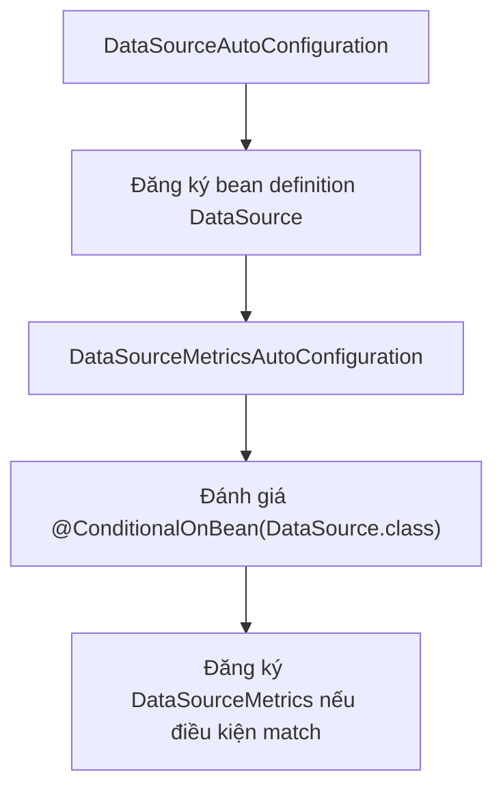
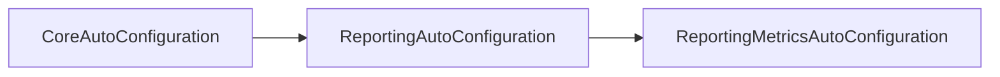

# @AutoConfigureBefore, @AutoConfigureAfter hoặc thuộc tính tương ứng

Trong Spring Boot, nhiều auto-configuration cùng tham gia xây dựng ApplicationContext. Một cấu hình có thể cần được xử lý sau cấu hình database để nhìn thấy bean DataSource; một cấu hình khác cần đứng trước cấu hình metrics để công bố metadata mà metrics sẽ sử dụng.

Spring Boot cung cấp các cơ chế khai báo thứ tự cho những cấu hình này:

- **`@AutoConfigureBefore`**: yêu cầu auto-configuration hiện tại được xử lý trước các auto-configuration được chỉ định.
- **`@AutoConfigureAfter`**: yêu cầu auto-configuration hiện tại được xử lý sau các auto-configuration được chỉ định.
- **`@AutoConfigureOrder`**: cung cấp thứ tự số cho auto-configuration.
- **`before`, `beforeName`, `after` và `afterName` của `@AutoConfiguration`**: cách khai báo thứ tự trực tiếp trên auto-configuration trong Spring Boot hiện đại.

Các cơ chế này điều khiển **thứ tự xử lý auto-configuration**. Chúng giúp các điều kiện như `@ConditionalOnBean` và `@ConditionalOnMissingBean` được đánh giá trong bối cảnh phù hợp. Chúng không buộc mọi bean được khởi tạo theo một thứ tự cố định.

## 1. Vì sao auto-configuration cần thứ tự?

Giả sử một thư viện cung cấp cấu hình metrics cho database. Cấu hình này chỉ nên đăng ký bean theo dõi connection pool nếu một cấu hình khác đã đăng ký bean `DataSource`.

```java
@AutoConfiguration
@ConditionalOnBean(DataSource.class)
public class DataSourceMetricsAutoConfiguration {

    @Bean
    public DataSourceMetrics dataSourceMetrics(DataSource dataSource) {
        return new DataSourceMetrics(dataSource);
    }
}
```

Điều kiện `@ConditionalOnBean(DataSource.class)` cần thấy bean phù hợp đã được đăng ký trong BeanFactory tại thời điểm điều kiện được đánh giá.

Nếu auto-configuration tạo `DataSource` chưa được xử lý, điều kiện metrics có thể không match. Vì vậy, cấu hình metrics cần được sắp xếp sau cấu hình cung cấp `DataSource`.



Không có thứ tự phù hợp, điều kiện có thể được đánh giá khi bean mà nó cần chưa được biết tới. Thứ tự auto-configuration giúp làm rõ quan hệ giữa các cấu hình.

### 1.1. Thứ tự cấu hình khác thứ tự tạo bean

| Khái niệm | Điều khiển điều gì? | Cơ chế thường gặp |
|---|---|---|
| Auto-configuration ordering | Cấu hình auto-configuration nào được xử lý trước/sau | `@AutoConfigureBefore`, `@AutoConfigureAfter`, thuộc tính của `@AutoConfiguration` |
| Bean creation ordering | Dependency nào cần được cung cấp trước khi tạo bean khác | Constructor dependency, factory method, dependency graph |
| Explicit bean initialization ordering | Bean cụ thể nào cần khởi tạo trước bean khác vì lý do rõ ràng | `@DependsOn` |
| Collection/component ordering | Phần tử trong danh sách hoặc một số thành phần có thứ tự | `@Order`, `Ordered` |

Ví dụ, nếu `OrderService` constructor inject `PaymentService`, Spring phải cung cấp `PaymentService` trước khi hoàn tất tạo `OrderService`. Không cần dùng `@AutoConfigureAfter` để giải quyết quan hệ đó.

Ngược lại, nếu một auto-configuration dùng `@ConditionalOnBean(PaymentGateway.class)` và `PaymentGateway` được một auto-configuration khác cung cấp, đây là vấn đề thứ tự xử lý cấu hình. `@AutoConfigureAfter` có thể diễn đạt quan hệ đó.

**Before/after sắp xếp cấu hình; dependency injection sắp xếp việc cung cấp bean theo quan hệ phụ thuộc.**

## 2. @AutoConfigureBefore là gì?

`@AutoConfigureBefore` đánh dấu một auto-configuration cần được xử lý trước một hoặc nhiều auto-configuration khác.

```java
@Configuration(proxyBeanMethods = false)
@AutoConfigureBefore(CacheAutoConfiguration.class)
public class CustomCacheInfrastructureAutoConfiguration {
}
```

Ý nghĩa: Spring Boot cần xếp `CustomCacheInfrastructureAutoConfiguration` trước `CacheAutoConfiguration` trong quá trình sắp xếp auto-configuration.

Có thể chỉ định nhiều class:

```java
@Configuration(proxyBeanMethods = false)
@AutoConfigureBefore({
        CacheAutoConfiguration.class,
        MetricsAutoConfiguration.class
})
public class SharedInfrastructureAutoConfiguration {
}
```

### 2.1. Khi nào dùng before?

Một trường hợp có thể gặp:

- Thư viện đăng ký bean hoặc metadata hỗ trợ.
- Một auto-configuration khác có thể dùng thông tin đó để quyết định cách cấu hình.
- Thư viện muốn thể hiện rõ cấu hình hỗ trợ phải được xử lý trước cấu hình phụ thuộc.

Tuy nhiên, hãy kiểm tra liệu quan hệ thực sự cần thiết hay không. Nếu chỉ cần bean dependency được Spring inject đúng lúc, không cần thêm before/after.

### 2.2. before không có nghĩa bean được tạo trước

```java
@AutoConfigureBefore(ReportingAutoConfiguration.class)
@Configuration(proxyBeanMethods = false)
public class ReportingDefaultsAutoConfiguration {

    @Bean
    public ReportClock reportClock() {
        return ReportClock.system();
    }
}
```

Điều này không bảo đảm instance `ReportClock` đã được khởi tạo trước khi mọi bean của `ReportingAutoConfiguration` được tạo. Nó chỉ sắp xếp **cấu hình** trong quá trình xử lý auto-configuration.

Nếu một bean trong reporting cần `ReportClock`, Spring sẽ dùng quan hệ dependency để cung cấp bean phù hợp. Không dùng before như một thay thế cho constructor injection hoặc `@DependsOn`.

## 3. @AutoConfigureAfter là gì?

`@AutoConfigureAfter` đánh dấu auto-configuration hiện tại cần được xử lý sau một hoặc nhiều auto-configuration khác.

```java
@Configuration(proxyBeanMethods = false)
@AutoConfigureAfter(DataSourceAutoConfiguration.class)
public class DatabaseMetricsAutoConfiguration {

    @Bean
    @ConditionalOnBean(DataSource.class)
    public DatabaseMetrics databaseMetrics(DataSource dataSource) {
        return new DatabaseMetrics(dataSource);
    }
}
```

Cấu hình metrics được xử lý sau `DataSourceAutoConfiguration`. Nhờ đó, điều kiện bean có cơ hội nhìn thấy bean definition `DataSource` do cấu hình trước cung cấp.

Có thể chỉ định nhiều auto-configuration:

```java
@Configuration(proxyBeanMethods = false)
@AutoConfigureAfter({
        DataSourceAutoConfiguration.class,
        HibernateJpaAutoConfiguration.class
})
public class ReportingMetricsAutoConfiguration {
}
```

### 3.1. Khi nào dùng after?

- Cấu hình phụ thuộc vào bean do auto-configuration khác cung cấp.
- Một điều kiện `@ConditionalOnBean` cần nhìn thấy bean definition đã được đăng ký từ cấu hình khác.
- Một cấu hình tích hợp chỉ có ý nghĩa sau khi hạ tầng tương ứng được thiết lập trong giai đoạn xử lý configuration.
- Một auto-configuration cần áp dụng sau cấu hình nền tảng, ví dụ cấu hình database hoặc web.

Không nên dùng after chỉ vì tên class nghe như “phần mở rộng” của một cấu hình khác. Hãy chỉ khai báo quan hệ khi có dependency về **quá trình xử lý cấu hình** thực sự.

### 3.2. after không khởi tạo dependency thủ công

Nếu `DatabaseMetricsAutoConfiguration` được xử lý sau `DataSourceAutoConfiguration`, điều đó không yêu cầu Spring gọi constructor của mọi bean DataSource trước khi parse cấu hình metrics.

Điều kiện có thể làm việc với bean definitions đã đăng ký mà instance chưa được khởi tạo. Sau đó, khi bean metrics thực sự được tạo, Spring giải quyết dependency `DataSource` theo cơ chế thông thường.

## 4. before và after là quan hệ tương đối

Hai annotation không phải chỉ số tuyệt đối. Chúng diễn đạt quan hệ tương đối giữa các auto-configuration.

Giả sử có ba cấu hình:

- `CoreAutoConfiguration` cung cấp hạ tầng nền.
- `ReportingAutoConfiguration` phụ thuộc hạ tầng đó.
- `ReportingMetricsAutoConfiguration` cần reporting được đăng ký trước.

```java
@AutoConfiguration
public class CoreAutoConfiguration {
    // ...
}

@AutoConfiguration(after = CoreAutoConfiguration.class)
public class ReportingAutoConfiguration {
    // ...
}

@AutoConfiguration(after = ReportingAutoConfiguration.class)
public class ReportingMetricsAutoConfiguration {
    // ...
}
```

Quan hệ tạo thành:



Kết quả mong muốn là `Core` trước `Reporting`, rồi `ReportingMetrics` sau `Reporting`. Không cần gán số thứ tự riêng cho từng class nếu các quan hệ before/after đã diễn đạt đủ ràng buộc.

### 4.1. Nhiều ràng buộc có thể cùng tồn tại

```java
@AutoConfiguration(after = {
        DataSourceAutoConfiguration.class,
        MetricsAutoConfiguration.class
})
public class DatabaseReportingAutoConfiguration {
}
```

Cấu hình reporting cần được xếp sau cả hai cấu hình được liệt kê. Khai báo này không chỉ định thứ tự tương đối giữa `DataSourceAutoConfiguration` và `MetricsAutoConfiguration`; nếu giữa hai class đó cũng có quan hệ bắt buộc, hãy khai báo quan hệ ở nơi phù hợp.

### 4.2. Tránh tạo chu trình thứ tự

Không nên khai báo các ràng buộc mâu thuẫn:

```java
@AutoConfigureBefore(B.class)
@Configuration
class A {
}

@AutoConfigureBefore(A.class)
@Configuration
class B {
}
```

Khai báo thứ nhất yêu cầu A trước B; khai báo thứ hai yêu cầu B trước A. Không tồn tại thứ tự tuyến tính thỏa mãn cả hai.

Một chu trình thứ tự có thể khiến quá trình sắp xếp auto-configuration thất bại. Hãy xây dựng quan hệ một chiều và loại bỏ constraint không cần thiết.

## 5. Thuộc tính before/after của @AutoConfiguration

Trong Spring Boot hiện đại, có thể khai báo quan hệ thứ tự trực tiếp trên `@AutoConfiguration`.

```java
@AutoConfiguration(after = DataSourceAutoConfiguration.class)
public class ReportingAutoConfiguration {
}
```

Đây là cách hiện đại để biểu diễn cấu hình auto-configuration. Thay vì thêm annotation `@AutoConfigureAfter` riêng, bạn dùng thuộc tính `after` của `@AutoConfiguration`.

### 5.1. Các thuộc tính tương ứng

| Thuộc tính | Ý nghĩa |
|---|---|
| `before` | Các auto-configuration class mà class hiện tại phải đứng trước |
| `beforeName` | Tên đầy đủ của các auto-configuration class cần đứng trước, dưới dạng chuỗi |
| `after` | Các auto-configuration class mà class hiện tại phải đứng sau |
| `afterName` | Tên đầy đủ của các auto-configuration class cần đứng sau, dưới dạng chuỗi |

Ví dụ:

```java
@AutoConfiguration(
        before = MetricsAutoConfiguration.class,
        after = DataSourceAutoConfiguration.class
)
public class ReportingAutoConfiguration {
}
```

Ý nghĩa:

- Reporting đứng sau cấu hình DataSource.
- Reporting đứng trước cấu hình Metrics.

Nếu muốn dùng tên class thay vì class literal:

```java
@AutoConfiguration(
        afterName = "org.springframework.boot.autoconfigure.jdbc.DataSourceAutoConfiguration",
        beforeName = "com.example.metrics.MetricsAutoConfiguration"
)
public class ReportingAutoConfiguration {
}
```

Các thuộc tính dạng tên hữu ích khi muốn tránh tham chiếu trực tiếp tới class của một module tùy chọn. Chúng cũng có thể giúp giảm coupling khi class cần sắp xếp không luôn có mặt trên classpath.

### 5.2. Dùng class literal hay tên chuỗi?

| Cách | Ví dụ | Khi phù hợp |
|---|---|---|
| Class literal | `after = DataSourceAutoConfiguration.class` | Dependency luôn có sẵn và muốn an toàn kiểu/IDE refactor |
| Tên class | `afterName = "..."` | Class có thể thuộc module tùy chọn, muốn tránh tham chiếu trực tiếp |
| Annotation riêng | `@AutoConfigureAfter(DataSourceAutoConfiguration.class)` | Code dùng phong cách auto-configuration với `@Configuration` ở các phiên bản phù hợp |

Không dùng chuỗi class name nếu class thực sự là dependency bắt buộc và có thể tham chiếu trực tiếp một cách an toàn. Chuỗi không được compiler kiểm tra; sai package hoặc sai tên chỉ được phát hiện khi xử lý cấu hình.

## 6. @AutoConfigureOrder: khi cần thứ tự số

`@AutoConfigureOrder` cho phép gán thứ tự số cho auto-configuration.

```java
import org.springframework.boot.autoconfigure.AutoConfigureOrder;
import org.springframework.core.Ordered;

@AutoConfigureOrder(Ordered.HIGHEST_PRECEDENCE)
@Configuration(proxyBeanMethods = false)
public class EarlyInfrastructureAutoConfiguration {
}
```

Hoặc:

```java
@AutoConfigureOrder(100)
@Configuration(proxyBeanMethods = false)
public class AdditionalIntegrationAutoConfiguration {
}
```

Quy tắc số tương tự cơ chế `Ordered` của Spring: **giá trị số thấp hơn có mức ưu tiên/thứ tự sớm hơn**, trong khi `Ordered.LOWEST_PRECEDENCE` là giá trị có ưu tiên thấp nhất, thường dùng làm mặc định cuối.

Dùng `@AutoConfigureOrder` khi muốn đặt vị trí tương đối theo một quy ước số. Nhưng nếu cấu hình A thực sự cần đứng trước B, khai báo quan hệ `before` hoặc `after` thường diễn đạt ý định tốt hơn.

### 6.1. Khi nào dùng order số?

Có thể cân nhắc khi:

- Nhiều auto-configuration độc lập cần một quy ước sắp xếp.
- Một thư viện muốn cung cấp thứ tự mặc định mà không phụ thuộc một class cụ thể.
- Không có quan hệ phụ thuộc trực tiếp giữa hai cấu hình để dùng before/after.

Không nên dùng order số thay cho dependency rõ ràng. Ví dụ, nếu cấu hình B cần bean từ A, việc đặt A có order 10 và B có order 20 không thay thế khai báo `@AutoConfigureAfter(A.class)` khi cần thể hiện quan hệ tương đối tường minh.

### 6.2. Có thể kết hợp order với before/after không?

Các cơ chế thứ tự có thể cùng tham gia sắp xếp auto-configuration. Hãy dùng chúng nhất quán:

- Before/after mô tả ràng buộc tương đối cần thiết.
- Order số cung cấp thứ tự ưu tiên bổ sung.
- Không tạo các ràng buộc mâu thuẫn.
- Không dựa vào một giá trị order để sửa dependency bean bị thiếu.

Nếu quan hệ before/after đã đủ, thường không cần thêm số order chỉ để “chắc chắn”.

## 7. Khác biệt giữa annotation riêng và thuộc tính @AutoConfiguration

Spring Boot có nhiều phong cách viết auto-configuration tùy phiên bản.

### 7.1. Phong cách dùng @Configuration và annotation riêng

```java
@Configuration(proxyBeanMethods = false)
@AutoConfigureAfter(DataSourceAutoConfiguration.class)
public class ReportingAutoConfiguration {
    // Các @Bean
}
```

Đây là cách biểu diễn thứ tự bằng annotation riêng. Nó thường gặp trong các codebase dùng phong cách cấu hình cũ hơn.

### 7.2. Phong cách dùng @AutoConfiguration

```java
@AutoConfiguration(after = DataSourceAutoConfiguration.class)
public class ReportingAutoConfiguration {
    // Các @Bean
}
```

`@AutoConfiguration` là annotation chuyên biệt cho auto-configuration của Spring Boot. Nó tích hợp vai trò configuration class và cung cấp các thuộc tính ordering như `before`, `after`, `beforeName`, `afterName`.

Với code mới trên phiên bản Spring Boot hỗ trợ annotation này, đây thường là cách rõ ràng.

### 7.3. Bảng so sánh

| Nhu cầu | Phong cách annotation riêng | Thuộc tính hiện đại |
|---|---|---|
| Xử lý sau cấu hình A | `@AutoConfigureAfter(A.class)` | `@AutoConfiguration(after = A.class)` |
| Xử lý trước cấu hình B | `@AutoConfigureBefore(B.class)` | `@AutoConfiguration(before = B.class)` |
| Sau class tùy chọn theo tên | `@AutoConfigureAfter(name = "...")` | `@AutoConfiguration(afterName = "...")` |
| Trước class tùy chọn theo tên | `@AutoConfigureBefore(name = "...")` | `@AutoConfiguration(beforeName = "...")` |
| Đặt thứ tự số | `@AutoConfigureOrder(100)` | Có thể tiếp tục dùng `@AutoConfigureOrder` trên auto-configuration |

Đừng trộn hai phong cách chỉ để khai báo cùng một quan hệ hai lần. Chọn cách phù hợp với dòng Spring Boot và quy ước của module.

## 8. Auto-configuration được tìm thấy ở đâu?

Khai báo before/after chỉ có tác dụng khi auto-configuration được đưa vào cơ chế xử lý auto-configuration của Spring Boot.

Trong Spring Boot hiện đại, thư viện thường công bố class trong file:

```text
META-INF/spring/org.springframework.boot.autoconfigure.AutoConfiguration.imports
```

Ví dụ nội dung:

```text
com.example.reporting.autoconfigure.ReportingAutoConfiguration
com.example.metrics.autoconfigure.DatabaseMetricsAutoConfiguration
```

File này liệt kê các auto-configuration class mà Boot có thể import. **Không nên dựa vào thứ tự dòng trong file này để thể hiện quan hệ trước/sau.** Hãy dùng annotation/thuộc tính ordering để mô tả quan hệ cần thiết.

### 8.1. Phong cách đăng ký cũ

Trong những phiên bản Spring Boot cũ, auto-configuration thường được đăng ký thông qua key `EnableAutoConfiguration` trong `META-INF/spring.factories`.

Ví dụ minh họa cách cũ:

```properties
org.springframework.boot.autoconfigure.EnableAutoConfiguration=\
com.example.reporting.autoconfigure.ReportingAutoConfiguration
```

Cơ chế đăng ký đã thay đổi theo các dòng Spring Boot. Khi viết thư viện, hãy theo hướng dẫn của đúng phiên bản đang hỗ trợ. Việc đăng ký class và việc sắp xếp class là hai trách nhiệm riêng:

- File imports hoặc cơ chế đăng ký cho Boot biết **auto-configuration nào tồn tại**.
- Before/after/order cho Boot biết **các auto-configuration đó cần được sắp xếp như thế nào**.

## 9. Tình huống thực tế: điều kiện @ConditionalOnBean

Giả sử một thư viện có hai auto-configuration:

1. `ClientAutoConfiguration` tạo bean `RemoteClient`.
2. `ClientMetricsAutoConfiguration` tạo bean metrics nếu có `RemoteClient`.

Cấu hình client:

```java
@AutoConfiguration
public class ClientAutoConfiguration {

    @Bean
    @ConditionalOnMissingBean
    public RemoteClient remoteClient() {
        return new RemoteClient();
    }
}
```

Cấu hình metrics:

```java
@AutoConfiguration(after = ClientAutoConfiguration.class)
public class ClientMetricsAutoConfiguration {

    @Bean
    @ConditionalOnBean(RemoteClient.class)
    public RemoteClientMetrics remoteClientMetrics(RemoteClient client) {
        return new RemoteClientMetrics(client);
    }
}
```

Quan hệ after giúp cấu hình metrics được xử lý sau cấu hình client. Khi điều kiện được đánh giá, bean definition cho `RemoteClient` có cơ hội được đăng ký trước đó.

### 9.1. Nếu không có after thì sao?

Nếu cấu hình metrics được xử lý khi `ClientAutoConfiguration` chưa được xử lý, `@ConditionalOnBean` có thể không tìm thấy `RemoteClient`. Bean metrics không được đăng ký.

Điều này không nhất thiết là lỗi startup. Nó có thể chỉ khiến tính năng metrics không xuất hiện. Đây là lý do condition evaluation report hữu ích khi debug auto-configuration.

### 9.2. Vì sao không dùng @DependsOn?

`@DependsOn` tác động tới quan hệ khởi tạo giữa các bean cụ thể. Nhưng ở ví dụ trên, bean metrics thậm chí có thể chưa được đăng ký vì condition không match. Một annotation trên bean không giải quyết được việc **cấu hình tạo bean đó chưa được xử lý đúng lúc**.

Dùng after để sắp xếp auto-configuration; dùng dependency injection hoặc `@DependsOn` cho quan hệ giữa các bean khi thực sự cần.

## 10. Tình huống thực tế: @ConditionalOnMissingBean và default bean

Giả sử thư viện cung cấp `PaymentGateway` mặc định. Ứng dụng có thể thay bằng implementation riêng.

Auto-configuration:

```java
@AutoConfiguration
public class PaymentAutoConfiguration {

    @Bean
    @ConditionalOnMissingBean(PaymentGateway.class)
    public PaymentGateway paymentGateway() {
        return new DefaultPaymentGateway();
    }
}
```

Ứng dụng:

```java
@Configuration(proxyBeanMethods = false)
public class CustomPaymentConfiguration {

    @Bean
    public PaymentGateway paymentGateway() {
        return new AcmePaymentGateway();
    }
}
```

Spring Boot tổ chức quá trình xử lý để cấu hình người dùng được xử lý trước auto-configuration. Vì vậy condition missing-bean có thể thấy bean tùy chỉnh và default auto-configuration **back off**.

Điều cần nhớ:

- Không dùng before/after để cố sắp xếp mọi cấu hình ứng dụng thông thường.
- Auto-configuration phải được thiết kế để tôn trọng bean do người dùng cung cấp.
- Condition chỉ nhìn thấy bean definitions đã được xử lý trước thời điểm nó chạy.
- Nếu một auto-configuration phụ thuộc bean do auto-configuration khác cung cấp, hãy khai báo after phù hợp.

## 11. before/after không điều khiển thứ tự component scan

Một hiểu lầm là gắn `@AutoConfigureAfter` lên một class `@Configuration` bất kỳ thì Spring sẽ luôn scan class đó sau một component cụ thể.

Annotation này dành cho **auto-configuration ordering**. Nó không phải cơ chế tổng quát để điều khiển thứ tự component scanning cho mọi configuration class của ứng dụng.

Tương tự, không nên dựa vào thứ tự file source, tên class, tên package hoặc thứ tự khai báo method để bảo đảm condition thấy một bean nào đó.

Nếu bạn đang viết cấu hình ứng dụng bình thường, hãy ưu tiên:

- Khai báo dependency trực tiếp qua constructor của `@Bean` method hoặc bean class.
- Dùng `@Import` khi cần nhập configuration một cách tường minh.
- Tách auto-configuration thành module/đơn vị phù hợp.
- Dùng before/after khi đang sắp xếp các auto-configuration thực sự.

## 12. Phân biệt với @Order và Ordered

Spring Framework có `@Order` và interface `Ordered`. Tên khá giống `@AutoConfigureOrder`, nhưng mục đích sử dụng không giống nhau.

### 12.1. @Order

`@Order` thường dùng để chỉ định thứ tự ưu tiên của các thành phần trong những ngữ cảnh hỗ trợ ordering, ví dụ phần tử được inject vào collection, một số component hoặc event listener.

```java
@Component
@Order(1)
public class FirstStartupListener
        implements ApplicationListener<ContextRefreshedEvent> {

    @Override
    public void onApplicationEvent(ContextRefreshedEvent event) {
        // ...
    }
}
```

Ví dụ này minh họa ordering của listener, không phải cách sắp xếp auto-configuration.

### 12.2. @AutoConfigureOrder

`@AutoConfigureOrder` dành cho thứ tự các auto-configuration class:

```java
@AutoConfigureOrder(100)
@Configuration(proxyBeanMethods = false)
public class OptionalFeatureAutoConfiguration {
}
```

### 12.3. Bảng phân biệt

| Annotation/interface | Đối tượng được sắp xếp | Mục đích |
|---|---|---|
| `@AutoConfigureBefore` | Auto-configuration classes | Ràng buộc class hiện tại trước class khác |
| `@AutoConfigureAfter` | Auto-configuration classes | Ràng buộc class hiện tại sau class khác |
| `@AutoConfigureOrder` | Auto-configuration classes | Thứ tự số cho auto-configuration |
| `@Order` | Các đối tượng trong ngữ cảnh hỗ trợ ordering | Ưu tiên trong collection/listener hoặc thành phần tương ứng |
| `Ordered` | Đối tượng triển khai interface | Cung cấp giá trị order bằng code |

Nếu mục tiêu là auto-configuration, hãy chọn đúng cơ chế của Spring Boot. Dùng `@Order` với kỳ vọng thay đổi thứ tự import auto-configuration có thể không đem lại kết quả bạn muốn.

## 13. Debug thứ tự auto-configuration

Khi một condition match sai hoặc một bean mặc định không back off, hãy quan sát Condition Evaluation Report trước khi thay đổi ordering một cách ngẫu nhiên.

### 13.1. Khởi động với --debug

```bash
java -jar app.jar --debug
```

Hoặc bật property:

```properties
debug=true
```

Spring Boot có thể in báo cáo điều kiện, gồm các auto-configuration match hoặc không match và lý do.

Tìm các mục liên quan đến:

- Class auto-configuration cần kiểm tra.
- `@ConditionalOnBean` hoặc `@ConditionalOnMissingBean`.
- Bean type/name mà condition tìm.
- Lý do condition không match.
- Các cấu hình nền mà cấu hình hiện tại dự kiến đứng trước hoặc sau.

### 13.2. Actuator conditions endpoint

Trong ứng dụng có Spring Boot Actuator, endpoint điều kiện có thể cung cấp thông tin về condition evaluation. Endpoint thường có id `conditions`; việc truy cập phụ thuộc dependency, exposure và security configuration.

Trong môi trường phát triển, log `--debug` là cách đơn giản để xem Condition Evaluation Report. Không nên expose endpoint quản trị nhạy cảm ra ngoài chỉ để debug.

### 13.3. Đừng đoán thứ tự từ log tạo bean

Log tạo bean phản ánh lifecycle instance và có thể bị ảnh hưởng bởi lazy initialization, dependency, runner và nhiều yếu tố khác. Nó không phải bằng chứng trực tiếp về thứ tự xử lý auto-configuration.

Muốn biết cấu hình nào match, xem condition report và metadata ordering. Muốn biết bean nào cần bean nào, xem dependency graph và bean definition.

## 14. Kiểm thử auto-configuration ordering

Spring Boot cung cấp `ApplicationContextRunner` để test auto-configuration trong context nhỏ.

Cấu hình cung cấp bean:

```java
@AutoConfiguration
public class MarkerAutoConfiguration {

    @Bean
    @ConditionalOnMissingBean
    public Marker marker() {
        return new Marker();
    }
}
```

Cấu hình phụ thuộc bean đó:

```java
@AutoConfiguration(after = MarkerAutoConfiguration.class)
public class MarkerConsumerAutoConfiguration {

    @Bean
    @ConditionalOnBean(Marker.class)
    public MarkerConsumer markerConsumer(Marker marker) {
        return new MarkerConsumer(marker);
    }
}
```

Kiểm thử:

```java
class AutoConfigurationOrderingTests {

    private final ApplicationContextRunner runner =
            new ApplicationContextRunner()
                    .withConfiguration(
                            AutoConfigurations.of(
                                    MarkerConsumerAutoConfiguration.class,
                                    MarkerAutoConfiguration.class
                            )
                    );

    @Test
    void consumerConfigurationSeesMarkerBean() {
        runner.run(context -> {
            assertThat(context).hasSingleBean(Marker.class);
            assertThat(context).hasSingleBean(MarkerConsumer.class);
        });
    }
}
```

Dù danh sách truyền vào runner đưa consumer trước marker, quan hệ ordering trong auto-configuration cho phép Boot sắp xếp theo metadata before/after. Test cần dependency `spring-boot-test` và các class test `Marker`, `MarkerConsumer` tương ứng.

Đây là test nhỏ để kiểm tra **hành vi đăng ký bean có điều kiện**. Trong dự án thực, cũng nên test trường hợp bean đã được user cung cấp để xác nhận default auto-configuration back off.

### 14.1. Test trường hợp user cung cấp bean riêng

```java
@Configuration(proxyBeanMethods = false)
class UserMarkerConfiguration {

    @Bean
    Marker customMarker() {
        return new Marker("custom");
    }
}
```

Có thể thêm cấu hình này vào runner:

```java
runner.withUserConfiguration(UserMarkerConfiguration.class)
        .run(context -> {
            assertThat(context).hasSingleBean(Marker.class);
            assertThat(context).hasBean("customMarker");
        });
```

Mục tiêu là xác nhận auto-configuration tôn trọng bean người dùng, thay vì chỉ chứng minh thứ tự khi mọi bean đều do thư viện cung cấp.

## 15. Những lỗi thiết kế ordering thường gặp

### 15.1. Dùng after với class không phải auto-configuration

`@AutoConfigureAfter` được thiết kế cho auto-configuration classes. Nếu class đích chỉ là một component/configuration thông thường được scan, annotation không phải công cụ tổng quát để bảo đảm thứ tự xử lý class đó.

Hãy kiểm tra class đích thực sự thuộc cơ chế auto-configuration hay không.

### 15.2. Dùng before/after để giải quyết constructor dependency

Nếu `AService` cần `BService`, constructor injection đã thể hiện quan hệ dependency. Dùng `@AutoConfigureBefore` không giải quyết vòng constructor hoặc thiếu bean; hãy sửa graph dependency.

### 15.3. Dựa vào thứ tự dòng trong AutoConfiguration.imports

File imports liệt kê auto-configuration cần được phát hiện. Không nên xem thứ tự dòng là hợp đồng ordering. Khai báo before/after hoặc order tương ứng.

### 15.4. Dùng @AutoConfigureOrder cho một dependency bắt buộc

Nếu `ReportingAutoConfiguration` cần bean do `DataSourceAutoConfiguration` cung cấp, khai báo `after` mô tả quan hệ trực tiếp rõ hơn một con số order chung.

### 15.5. Tạo quan hệ before/after hai chiều

A trước B và B trước A là chu trình ordering. Hãy xem lại cấu trúc module và chỉ giữ những quan hệ thật sự cần thiết.

### 15.6. Khai báo quá nhiều ràng buộc

Một auto-configuration có nhiều before/after không cần thiết sẽ làm đồ thị ordering khó hiểu, dễ phát sinh constraint xung đột và làm việc bảo trì khó hơn.

Chỉ khai báo những quan hệ cần để condition hoặc cấu hình hoạt động đúng.

## 16. Quy trình chọn cơ chế ordering

Khi viết một auto-configuration mới, hãy đặt các câu hỏi theo thứ tự:

1. **Cấu hình có thực sự cần chạy trước/sau một auto-configuration khác không?** Nếu không, không thêm ordering.
2. **Cần đứng trước hay sau?** Nếu cấu hình hiện tại cần bean do cấu hình kia cung cấp, thường dùng after.
3. **Class đích có luôn tồn tại trên classpath không?** Nếu có, dùng class literal; nếu là tích hợp tùy chọn, cân nhắc tên class.
4. **Có cần thứ tự số chung không?** Chỉ dùng `@AutoConfigureOrder` khi before/after không diễn đạt đúng nhu cầu.
5. **Có ràng buộc nào mâu thuẫn không?** Vẽ đồ thị để kiểm tra chu trình.
6. **Condition có match như dự kiến không?** Dùng Condition Evaluation Report hoặc ApplicationContextRunner.
7. **Đây là ordering cấu hình hay dependency tạo bean?** Chọn đúng cơ chế tương ứng.

Bảng quyết định nhanh:

| Nhu cầu | Cơ chế |
|---|---|
| Auto-configuration A phải chạy trước B | `@AutoConfigureBefore(B.class)` hoặc `before = B.class` |
| Auto-configuration A phải chạy sau B | `@AutoConfigureAfter(B.class)` hoặc `after = B.class` |
| Đích là class tùy chọn không muốn tham chiếu trực tiếp | `name` hoặc `beforeName`/`afterName` |
| Cần sắp xếp số giữa các auto-configuration | `@AutoConfigureOrder` |
| Bean A cần bean B khi tạo | Constructor injection / bean method dependency |
| Bean A cần được khởi tạo sau bean B vì side effect cụ thể | Cân nhắc `@DependsOn` |
| Các listener/collection cần thứ tự | `@Order` hoặc `Ordered` |

## 17. Bài tập tự kiểm tra

### Câu 1. Reporting cần DataSource

`ReportingAutoConfiguration` có `@ConditionalOnBean(DataSource.class)`. Bean `DataSource` do `DataSourceAutoConfiguration` đăng ký.

Nên khai báo ordering nào?

**Đáp án:** Đặt reporting sau data source bằng `@AutoConfigureAfter(DataSourceAutoConfiguration.class)` hoặc `@AutoConfiguration(after = DataSourceAutoConfiguration.class)`.

### Câu 2. Cấu hình hiện tại cần chạy trước Metrics

Một auto-configuration đăng ký metadata mà Metrics auto-configuration sử dụng trong giai đoạn xử lý configuration.

Nên dùng gì?

**Đáp án:** `@AutoConfigureBefore(MetricsAutoConfiguration.class)` hoặc thuộc tính `before` tương ứng trên `@AutoConfiguration`, nếu cả hai đều là auto-configuration phù hợp.

### Câu 3. Có phải after làm bean của cấu hình trước được tạo trước?

**Đáp án:** Không. after điều khiển thứ tự xử lý auto-configuration, không bảo đảm thứ tự tạo instance bean.

### Câu 4. `@Order(1)` có thay thế `@AutoConfigureOrder(1)` không?

**Đáp án:** Không. Hai annotation phục vụ những ngữ cảnh ordering khác nhau. Dùng `@AutoConfigureOrder` cho auto-configuration.

### Câu 5. Hai auto-configuration yêu cầu A trước B và B trước A. Điều gì sai?

**Đáp án:** Có chu trình ràng buộc ordering, không có thứ tự tuyến tính thỏa mãn cả hai. Cần loại bỏ hoặc thiết kế lại quan hệ.

### Câu 6. Vì sao không nên dựa vào thứ tự dòng trong file AutoConfiguration.imports?

**Đáp án:** File này công bố danh sách auto-configuration; quan hệ thứ tự nên được mô tả bằng metadata ordering được Spring Boot hỗ trợ.

### Câu 7. Bean definition đã tồn tại nhưng instance lazy chưa được tạo. after có thể giúp condition nhìn thấy bean không?

**Đáp án:** Ordering có thể giúp cấu hình đăng ký bean definition trước khi condition khác được đánh giá. Condition không cần instance đã khởi tạo hoàn chỉnh; bean definitions và type metadata mới là trọng tâm.

## 18. Ghi nhớ

- `@AutoConfigureBefore` và `@AutoConfigureAfter` mô tả thứ tự tương đối giữa các auto-configuration classes.
- `@AutoConfiguration` hiện đại có các thuộc tính `before`, `beforeName`, `after` và `afterName` để khai báo cùng ý định.
- `@AutoConfigureOrder` cung cấp thứ tự số; giá trị thấp hơn có mức ưu tiên sớm hơn theo quy ước `Ordered`.
- Ordering quan trọng khi auto-configuration dùng `@ConditionalOnBean` hoặc `@ConditionalOnMissingBean` dựa trên bean definitions do cấu hình khác cung cấp.
- Các annotation này sắp xếp **xử lý cấu hình**, không sắp xếp trực tiếp việc tạo mọi bean.
- `@DependsOn` dành cho quan hệ khởi tạo giữa bean; `@Order`/`Ordered` phục vụ những ngữ cảnh ordering khác.
- File `AutoConfiguration.imports` công bố auto-configuration; đừng dùng thứ tự dòng trong file làm hợp đồng before/after.
- Chỉ khai báo ràng buộc thật sự cần thiết, tránh tạo chu trình và kiểm chứng bằng Condition Evaluation Report hoặc `ApplicationContextRunner`.

Khi viết auto-configuration, hãy tự hỏi: **“Cấu hình này cần được xử lý sau hoặc trước cấu hình nào, và lý do là condition cần thấy bean definition hay một dependency bean thực sự?”** Phân biệt được hai trường hợp sẽ giúp bạn chọn đúng giữa before/after, order số và dependency injection.
