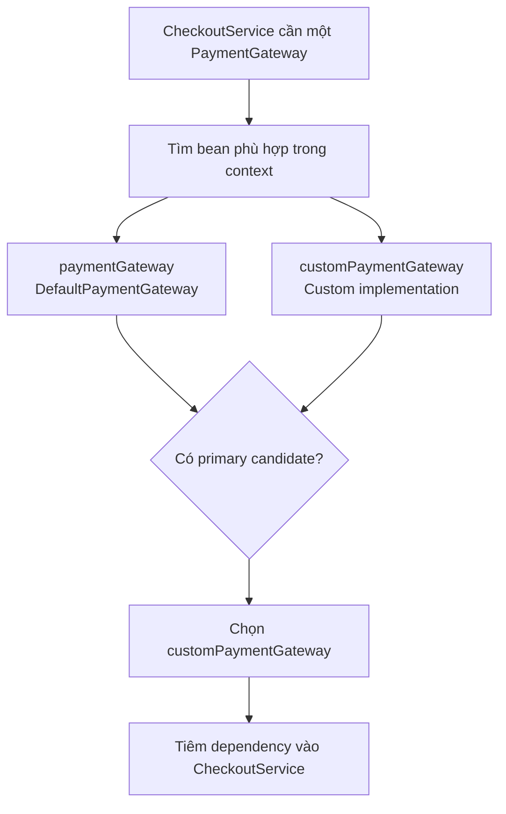
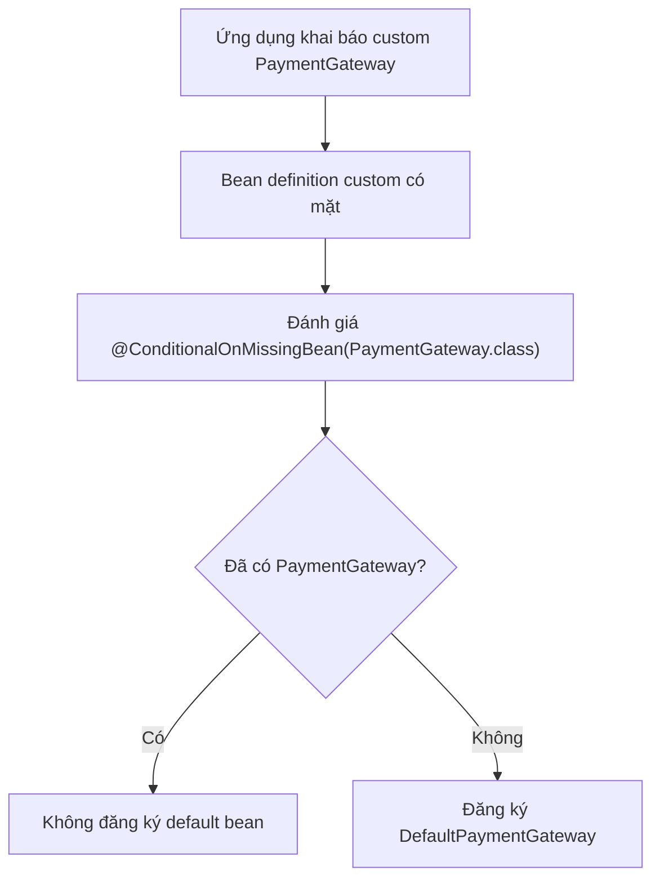

# Giới hạn của @Primary khi muốn ngăn một auto-configuration tạo bean

Khi một ứng dụng Spring Boot có nhiều bean cùng kiểu, `@Primary` giúp Spring chọn một bean làm ứng viên mặc định cho những dependency đơn trị. Điều này hữu ích khi ứng dụng có nhiều implementation của cùng một interface. Tuy nhiên, có một giới hạn rất quan trọng: **`@Primary` chỉ ảnh hưởng đến việc chọn bean khi resolve dependency; nó không ngăn Spring đăng ký hoặc tạo một bean khác từ auto-configuration**.

Giả sử thư viện cung cấp một `PaymentGateway` mặc định thông qua auto-configuration. Ứng dụng muốn dùng implementation riêng nên đánh dấu bean của mình bằng `@Primary`. Khi đó service có thể nhận implementation của ứng dụng, nhưng auto-configuration vẫn có thể tạo bean mặc định. Hai bean vẫn tồn tại trong context; nếu bean mặc định mở kết nối, khởi tạo client hoặc giữ tài nguyên, công việc đó vẫn có thể xảy ra. Nếu cả hai cùng được đánh dấu primary, việc inject đơn trị thậm chí vẫn có thể bị mơ hồ.

Bài học thuộc chương **Tùy biến Spring Boot** của *Spring Boot Fundamentals*. Ta sẽ phân biệt hai giai đoạn **đăng ký bean** và **chọn bean**, tái hiện giới hạn của `@Primary`, rồi sử dụng đúng công cụ để khiến auto-configuration back off: `@ConditionalOnMissingBean` trong auto-configuration, property switch, exclusion và các điểm mở rộng do thư viện cung cấp.

Ví dụ sử dụng Java 21 và Spring Boot 3.x. Các class auto-configuration và payment gateway trong bài là ví dụ minh họa, không phải cấu hình có sẵn của Spring Boot.

## 1. Hai câu hỏi khác nhau: bean nào được tạo và bean nào được chọn?

Đây là khác biệt cốt lõi của bài:

- **Đăng ký/tạo bean:** Spring có đưa bean definition vào container và tạo instance hay không?
- **Chọn bean:** Khi một constructor, field, setter hoặc method cần một dependency, Spring chọn candidate nào trong số các bean đã đăng ký?

`@Primary` thuộc câu hỏi thứ hai. Nó không phải một điều kiện đăng ký bean.

| Cơ chế | Thời điểm/việc nó tác động | Câu hỏi được giải quyết |
|---|---|---|
| `@ConditionalOnMissingBean` | Khi Spring đánh giá cấu hình/bean definition | Có nên đăng ký bean mặc định này không? |
| `@ConditionalOnProperty` | Khi đánh giá điều kiện theo Environment | Tính năng này có được bật theo cấu hình không? |
| Exclude auto-configuration | Khi chọn danh sách auto-configuration được nhập | Cấu hình tự động nào không được tham gia? |
| `@Primary` | Khi container resolve dependency phù hợp | Nếu cần một bean, candidate nào được ưu tiên? |
| `@Qualifier` | Tại injection point khi resolve dependency | Consumer cụ thể này cần candidate nào? |

Ví dụ ngắn:

```java
@Bean
@Primary
PaymentGateway customPaymentGateway() {
    return new CustomPaymentGateway();
}
```

Đoạn code trên đăng ký một bean và đánh dấu nó primary. Nó **không gửi tín hiệu yêu cầu Boot bỏ qua mọi auto-configuration có thể tạo `PaymentGateway`**. Muốn auto-configuration không tạo default, phải có một điều kiện hoặc cơ chế loại trừ phù hợp ở phía đăng ký cấu hình.

## 2. Ví dụ: thư viện cung cấp PaymentGateway mặc định

Tạo interface dùng chung:

```java
package com.example.payment;

public interface PaymentGateway {
    String charge(long amount);
}
```

Implementation mặc định do thư viện cung cấp:

```java
package com.example.payment.autoconfigure;

import com.example.payment.PaymentGateway;

public class DefaultPaymentGateway implements PaymentGateway {

    public DefaultPaymentGateway() {
        System.out.println("Creating default payment gateway");
    }

    @Override
    public String charge(long amount) {
        return "DEFAULT:" + amount;
    }
}
```

Giả sử auto-configuration của thư viện khai báo:

```java
package com.example.payment.autoconfigure;

import com.example.payment.PaymentGateway;
import org.springframework.boot.autoconfigure.AutoConfiguration;
import org.springframework.context.annotation.Bean;

@AutoConfiguration
public class PaymentAutoConfiguration {

    @Bean
    PaymentGateway paymentGateway() {
        return new DefaultPaymentGateway();
    }
}
```

Trong ví dụ này, method `paymentGateway()` không có condition. Nếu auto-configuration được đăng ký và được áp dụng, method cung cấp bean mặc định.

Ứng dụng muốn dùng implementation riêng:

```java
package com.example.demo.config;

import com.example.payment.PaymentGateway;
import org.springframework.context.annotation.Bean;
import org.springframework.context.annotation.Configuration;
import org.springframework.context.annotation.Primary;

@Configuration(proxyBeanMethods = false)
public class CustomPaymentConfiguration {

    @Bean
    @Primary
    PaymentGateway customPaymentGateway() {
        return amount -> "CUSTOM:" + amount;
    }
}
```

Giờ application context có thể có **hai bean cùng kiểu `PaymentGateway`**:

| Bean name | Implementation | Primary? |
|---|---|---|
| `paymentGateway` | `DefaultPaymentGateway` | Không |
| `customPaymentGateway` | Lambda do ứng dụng cung cấp | Có |

Service chỉ yêu cầu một gateway:

```java
package com.example.demo.service;

import com.example.payment.PaymentGateway;
import org.springframework.stereotype.Service;

@Service
public class CheckoutService {

    private final PaymentGateway gateway;

    public CheckoutService(PaymentGateway gateway) {
        this.gateway = gateway;
    }

    public String checkout(long amount) {
        return gateway.charge(amount);
    }
}
```

Vì custom bean là primary, `CheckoutService` có thể nhận bean tùy chỉnh và trả về `CUSTOM:100`. Nhưng điều đó **không chứng minh bean mặc định không được tạo**. Constructor của `DefaultPaymentGateway` vẫn có thể đã chạy và log:

```text
Creating default payment gateway
```

Đây là giới hạn cần nhận ra: ứng dụng có thể đang dùng đúng bean nhưng vẫn trả chi phí khởi tạo của bean không cần thiết.

## 3. @Primary làm gì trong ví dụ trên?

`@Primary` được xét khi Spring cần resolve một dependency đơn trị. Trong ví dụ, hai bean đều có thể gán cho tham số constructor kiểu `PaymentGateway`:



Container vẫn giữ cả hai bean. `@Primary` không:

- Xóa bean mặc định.
- Hủy bean definition của auto-configuration.
- Ngăn method `@Bean` của auto-configuration được xử lý.
- Ngăn constructor của implementation mặc định chạy.
- Ngăn tài nguyên của bean mặc định được khởi tạo.
- Tự động loại trừ auto-configuration class.
- Tự thay đổi điều kiện `@ConditionalOnMissingBean`.

### 3.1. Nếu ứng dụng chỉ muốn consumer dùng implementation riêng

Nếu bean mặc định nhẹ, không gây side effect và việc giữ cả hai bean là chủ ý, `@Primary` có thể là đủ. Nhưng nếu mục tiêu là **ngăn default bean được đăng ký/tạo**, `@Primary` không đáp ứng yêu cầu.

### 3.2. Nếu bean mặc định cũng là primary

Nếu auto-configuration đánh dấu default bean bằng `@Primary` và ứng dụng cũng đánh dấu custom bean là primary, hai candidate primary cùng kiểu có thể khiến dependency đơn trị vẫn mơ hồ. `@Primary` không tạo ra thứ tự ưu tiên giữa nhiều bean primary.

Khi đó cần dùng qualifier để chọn cụ thể, hoặc tốt hơn là cấu hình auto-configuration để default back off khi có custom bean.

## 4. Cách đúng cho auto-configuration: @ConditionalOnMissingBean

Nếu bạn là tác giả của thư viện auto-configuration, pattern thông dụng là chỉ cung cấp default khi ứng dụng chưa có bean thay thế:

```java
package com.example.payment.autoconfigure;

import com.example.payment.PaymentGateway;
import org.springframework.boot.autoconfigure.AutoConfiguration;
import org.springframework.boot.autoconfigure.condition.ConditionalOnMissingBean;
import org.springframework.context.annotation.Bean;

@AutoConfiguration
public class PaymentAutoConfiguration {

    @Bean
    @ConditionalOnMissingBean(PaymentGateway.class)
    PaymentGateway paymentGateway() {
        return new DefaultPaymentGateway();
    }
}
```

Khi ứng dụng cung cấp một bean có kiểu tương thích với `PaymentGateway` và bean definition đó đã có mặt khi condition được đánh giá, method mặc định không được dùng. Đây gọi là **back off**: auto-configuration nhường chỗ cho customization của ứng dụng.

`@ConditionalOnMissingBean` đặt trên method `@Bean` là cách phổ biến để cung cấp default có thể thay thế. Trong ứng dụng sử dụng thư viện này:

```java
@Configuration(proxyBeanMethods = false)
public class CustomPaymentConfiguration {

    @Bean
    PaymentGateway customPaymentGateway() {
        return amount -> "CUSTOM:" + amount;
    }
}
```

Kết quả mong muốn:

1. Spring đăng ký bean definition `customPaymentGateway` của ứng dụng.
2. Khi xử lý `PaymentAutoConfiguration`, condition tìm bean phù hợp kiểu `PaymentGateway`.
3. Vì đã có bean custom, condition không khớp.
4. Method `paymentGateway()` mặc định bị bỏ qua.
5. Chỉ bean custom được cung cấp từ hai cấu hình này.



Đây mới là cơ chế phù hợp để ngăn default bean được tạo. **Điểm quyết định là condition trên bean definition, không phải annotation primary trên bean custom.**

## 5. Vì sao condition phải được đặt trong auto-configuration?

`@ConditionalOnMissingBean` thường được dùng trong auto-configuration vì Boot có quy tắc xử lý cấu hình ứng dụng trước các auto-configuration được import. Nhờ vậy, bean definition do người dùng khai báo thường có thể được nhìn thấy khi auto-configuration quyết định có cung cấp default hay không.

Ví dụ, cấu hình ứng dụng:

```java
@Configuration(proxyBeanMethods = false)
public class CustomPaymentConfiguration {

    @Bean
    PaymentGateway customPaymentGateway() {
        return amount -> "CUSTOM:" + amount;
    }
}
```

được xử lý như cấu hình của ứng dụng. Sau đó auto-configuration cung cấp default với condition missing-bean có thể nhận biết customization.

### 5.1. Thứ tự cấu hình có ý nghĩa

Condition dựa trên bean đánh giá tập bean definitions đã được đăng ký tại thời điểm xử lý. Nếu bạn tự đặt `@ConditionalOnMissingBean` vào một cấu hình người dùng được xử lý trước khi bean definition cần xét xuất hiện, kết quả có thể không như mong muốn.

Vì vậy, khi viết thư viện, hãy dùng pattern auto-configuration của Spring Boot thay vì đặt default condition rải rác trong component scan của ứng dụng. Cấu hình mặc định nên được cung cấp ở lớp auto-configuration, nơi ordering conventions của Boot được thiết kế để hỗ trợ customization.

### 5.2. @AutoConfigureBefore và @AutoConfigureAfter không phải cách thay thế tùy tiện

Các annotation ordering như `@AutoConfigureBefore` và `@AutoConfigureAfter` dùng để khai báo quan hệ thứ tự giữa những auto-configuration. Chúng hữu ích khi một auto-configuration cần phụ thuộc vào bean definitions hoặc cấu hình từ auto-configuration khác.

Không nên dùng chúng để ép một default bean luôn thắng hoặc luôn thua bean của ứng dụng. Với bean do người dùng cung cấp, hãy tuân theo pattern auto-configuration chuẩn và dùng `@ConditionalOnMissingBean`.

## 6. Kiểu được kiểm tra trong @ConditionalOnMissingBean phải phù hợp

Condition chỉ có thể back off nếu nó kiểm tra đúng loại bean mà ứng dụng dự định thay thế.

Ví dụ:

```java
@Bean
@ConditionalOnMissingBean(PaymentGateway.class)
PaymentGateway paymentGateway() {
    return new DefaultPaymentGateway();
}
```

Condition kiểm tra các bean có thể gán cho `PaymentGateway`. Nếu ứng dụng cung cấp một implementation:

```java
@Bean
PaymentGateway customPaymentGateway() {
    return new CustomPaymentGateway();
}
```

thì bean custom đáp ứng kiểu điều kiện.

Nhưng giả sử auto-configuration viết:

```java
@Bean
@ConditionalOnMissingBean(DefaultPaymentGateway.class)
PaymentGateway paymentGateway() {
    return new DefaultPaymentGateway();
}
```

Ứng dụng cung cấp `CustomPaymentGateway implements PaymentGateway` không có nghĩa đã có bean kiểu `DefaultPaymentGateway`. Condition kiểm tra class cụ thể của default, nên vẫn có thể khớp và tạo thêm default.

Đây là lỗi thiết kế condition thường gặp: **kiểm tra implementation cụ thể trong khi ý định customization được biểu đạt bằng interface**.

Nếu mục tiêu là cho phép ứng dụng thay thế bất kỳ implementation nào của contract, hãy đặt condition trên contract:

`@ConditionalOnMissingBean(PaymentGateway.class)`

### 6.1. Khai báo kiểu trả về của method @Bean cũng quan trọng

Spring có thể dùng metadata và kiểu trả về của method `@Bean` để dự đoán kiểu bean trước khi tạo instance. Khi viết auto-configuration, hãy khai báo kiểu trả về đủ cụ thể và đúng contract mà consumer sử dụng.

Ví dụ:

```java
@Bean
@ConditionalOnMissingBean(PaymentGateway.class)
PaymentGateway paymentGateway() {
    return new DefaultPaymentGateway();
}
```

Kiểu trả về là `PaymentGateway`, khớp với contract. Nếu khai báo kiểu trả về quá tổng quát như `Object`, việc dự đoán type và đánh giá condition theo kiểu có thể khó khăn hơn hoặc không cho kết quả mong muốn trong một số trường hợp.

### 6.2. Các thuộc tính khác của @ConditionalOnMissingBean

Ngoài `value`/`type`, annotation còn hỗ trợ các cách giới hạn việc kiểm tra như:

- `name`: xét tên bean cụ thể.
- `annotation`: xét annotation trên bean.
- `ignored` và `ignoredType`: loại các kiểu nhất định khỏi phép kiểm tra.
- `search`: chọn phạm vi context hierarchy cần xét.

Chỉ sử dụng những thuộc tính này khi có yêu cầu rõ ràng. Với một default implementation có thể thay thế, kiểm tra contract interface thường là cách dễ hiểu nhất.

## 7. Nếu auto-configuration bên thứ ba không dùng @ConditionalOnMissingBean thì sao?

Bạn có thể không sở hữu source code của thư viện. Auto-configuration của thư viện có thể đăng ký bean vô điều kiện:

```java
@AutoConfiguration
public class VendorPaymentAutoConfiguration {

    @Bean
    PaymentGateway vendorPaymentGateway() {
        return new VendorPaymentGateway();
    }
}
```

Trong trường hợp này, thêm `@Primary` vào bean custom chỉ giúp Spring ưu tiên custom khi inject một `PaymentGateway`. Default của vendor vẫn có thể được đăng ký và tạo.

Hãy tìm một trong các điểm mở rộng mà thư viện hỗ trợ:

1. Property để tắt tính năng hoặc bean mặc định.
2. Cấu hình exclusion để loại auto-configuration.
3. Một customization interface hoặc `Customizer<T>`.
4. Cấu hình bean thay thế được tài liệu của thư viện hỗ trợ.
5. Phiên bản thư viện mới có điều kiện missing-bean hoặc cơ chế back off phù hợp.

Nếu thư viện không cung cấp điểm mở rộng nào, `@Primary` không thể biến auto-configuration vô điều kiện thành conditional. Khi ấy cần cân nhắc exclude cấu hình, thay đổi cách tích hợp hoặc chọn phiên bản/thư viện khác có extension point phù hợp.

## 8. Cách một: dùng property switch nếu thư viện hỗ trợ

Nhiều auto-configuration cung cấp property để bật/tắt tính năng. Ví dụ thư viện có:

```java
@AutoConfiguration
@ConditionalOnProperty(
        prefix = "vendor.payment",
        name = "enabled",
        havingValue = "true",
        matchIfMissing = true
)
public class VendorPaymentAutoConfiguration {

    @Bean
    PaymentGateway vendorPaymentGateway() {
        return new VendorPaymentGateway();
    }
}
```

Ứng dụng có thể tắt:

```yaml
vendor:
  payment:
    enabled: false
```

Khi property hiệu lực là `false`, auto-configuration không áp dụng theo điều kiện này. Đây là cách tốt khi thư viện thiết kế property như một extension point được hỗ trợ chính thức.

**Không thể tự tạo property tùy ý ở ứng dụng rồi kỳ vọng một thư viện không kiểm tra property đó sẽ tự dừng.** Property chỉ có tác dụng nếu auto-configuration thực sự sử dụng nó, hoặc nếu bạn tự viết một cấu hình điều khiển phù hợp.

Nếu auto-configuration có property prefix, hãy đọc tài liệu hoặc condition report để biết tên property, giá trị mặc định và cách tắt chính xác. Đừng đoán property dựa trên tên bean.

## 9. Cách hai: loại trừ auto-configuration

Nếu bạn không muốn một auto-configuration tham gia, Spring Boot cho phép loại trừ nó.

### 9.1. Dùng thuộc tính exclude trên @SpringBootApplication

Ví dụ:

```java
import org.springframework.boot.autoconfigure.SpringBootApplication;
import com.vendor.payment.autoconfigure.VendorPaymentAutoConfiguration;

@SpringBootApplication(exclude = VendorPaymentAutoConfiguration.class)
public class DemoApplication {
    public static void main(String[] args) {
        SpringApplication.run(DemoApplication.class, args);
    }
}
```

Khi class đó là auto-configuration candidate được Boot nhập, exclusion khiến nó không được áp dụng. Các bean do chính auto-configuration ấy cung cấp sẽ không được đăng ký từ cấu hình đó.

### 9.2. Dùng property spring.autoconfigure.exclude

Có thể cấu hình trong `application.yml`:

```yaml
spring:
  autoconfigure:
    exclude:
      - com.vendor.payment.autoconfigure.VendorPaymentAutoConfiguration
```

Hoặc truyền qua tham số dòng lệnh:

```bash
./gradlew bootRun --args='--spring.autoconfigure.exclude=com.vendor.payment.autoconfigure.VendorPaymentAutoConfiguration'
```

Trên Windows PowerShell:

```powershell
.\gradlew.bat bootRun --args="--spring.autoconfigure.exclude=com.vendor.payment.autoconfigure.VendorPaymentAutoConfiguration"
```

Exclusion là lựa chọn ở mức cấu hình auto-configuration. Nó hữu ích khi bạn muốn tắt cả nhóm cấu hình do class đó cung cấp, không chỉ một bean riêng lẻ.

### 9.3. Exclude có tác động rộng hơn missing-bean condition

| Cách | Phạm vi |
|---|---|
| `@ConditionalOnMissingBean(PaymentGateway.class)` | Chỉ bỏ qua bean mặc định tương ứng khi đã có bean contract. Các bean khác trong cùng auto-configuration vẫn có thể được tạo. |
| Property switch trên auto-configuration class | Có thể tắt toàn bộ cấu hình class hoặc một phần được đặt condition. |
| Exclude auto-configuration class | Loại cấu hình đó khỏi quá trình auto-configuration. Những bean chỉ do class ấy cung cấp sẽ không được tạo. |

Nếu chỉ muốn thay gateway nhưng vẫn cần những bean khác như health indicator, metrics hoặc properties từ cùng thư viện, exclude cả class có thể quá rộng. Hãy xem cấu trúc auto-configuration và chọn phạm vi nhỏ nhất đáp ứng yêu cầu.

## 10. Cách ba: dùng customization point thay vì thay bean

Một thư viện được thiết kế tốt có thể cung cấp bean mặc định nhưng cho phép người dùng tùy biến qua một interface hoặc customizer. Ví dụ:

```java
public class PaymentClientProperties {
    private String merchantId;
    private int timeoutMillis = 3000;

    public String getMerchantId() {
        return merchantId;
    }

    public void setMerchantId(String merchantId) {
        this.merchantId = merchantId;
    }

    public int getTimeoutMillis() {
        return timeoutMillis;
    }

    public void setTimeoutMillis(int timeoutMillis) {
        this.timeoutMillis = timeoutMillis;
    }
}
```

Một pattern khác là:

```java
@FunctionalInterface
public interface PaymentClientCustomizer {
    void customize(PaymentClientBuilder builder);
}
```

Auto-configuration dùng customizer khi tạo bean:

```java
@Bean
@ConditionalOnMissingBean(PaymentClient.class)
PaymentClient paymentClient(
        ObjectProvider<PaymentClientCustomizer> customizers) {

    PaymentClientBuilder builder = PaymentClientBuilder.create();
    customizers.orderedStream().forEach(customizer ->
            customizer.customize(builder));
    return builder.build();
}
```

Ứng dụng đăng ký customizer:

```java
@Bean
PaymentClientCustomizer paymentClientCustomizer() {
    return builder -> builder.timeoutMillis(5000);
}
```

Trong ví dụ, ứng dụng giữ lại quá trình tạo client mặc định nhưng tùy chỉnh tham số. Không cần tạo bean client thứ hai và không cần dùng `@Primary`. Đây là một lựa chọn tốt nếu mục tiêu là thay đổi hành vi của default, không phải thay toàn bộ implementation.

`ObjectProvider<PaymentClientCustomizer>` cho phép auto-configuration lấy không hoặc nhiều customizer, đồng thời `orderedStream()` tôn trọng ordering nếu các customizer khai báo thứ tự phù hợp.

## 11. Nếu muốn giữ cả hai bean nhưng consumer cụ thể dùng bean riêng

Có trường hợp ứng dụng chấp nhận default bean vẫn tồn tại, nhưng muốn một consumer cụ thể dùng implementation riêng. Khi đó `@Primary` hoặc `@Qualifier` là công cụ đúng.

Ví dụ:

```java
@Bean
@Primary
PaymentGateway customPaymentGateway() {
    return amount -> "CUSTOM:" + amount;
}
```

Các consumer chỉ yêu cầu `PaymentGateway` sẽ ưu tiên custom bean, còn consumer muốn default có thể chỉ định:

```java
public AuditService(
        @Qualifier("paymentGateway")
        PaymentGateway defaultGateway) {
    this.defaultGateway = defaultGateway;
}
```

Điều này hợp lý nếu cả hai gateway thực sự cần cùng tồn tại. Tuy nhiên, nếu default bean mở socket, tạo thread pool hoặc giữ tài nguyên không cần thiết, việc giữ nó chỉ để một consumer khác có thể chọn là một quyết định kiến trúc cần cân nhắc.

**`@Qualifier` và `@Primary` điều khiển việc tiêm dependency; chúng không ngăn bean definition được đăng ký.**

## 12. Đừng nhầm @Primary với bean overriding

Bean overriding là một cơ chế khác: một bean definition có cùng tên có thể thay thế definition đã đăng ký trước đó nếu container cho phép. Spring Boot thường không bật bean definition overriding theo mặc định trong ứng dụng mới; hành vi và cấu hình có thể tùy phiên bản.

Không nên dùng trùng bean name để thay thế auto-configuration khi đã có các extension point rõ ràng.

Ví dụ nếu cả hai cấu hình cùng khai báo tên:

```java
@Bean
PaymentGateway paymentGateway() {
    return new DefaultPaymentGateway();
}
```

và:

```java
@Bean
PaymentGateway paymentGateway() {
    return new CustomPaymentGateway();
}
```

thì đây là xung đột tên bean definition, không phải vấn đề chọn primary. Khi overriding bị tắt, ứng dụng có thể báo lỗi bean definition conflict. Khi bật overriding, một definition có thể thay thế definition khác theo quy tắc đăng ký; điều đó không đồng nghĩa `@Primary` đã ngăn auto-configuration.

Để cung cấp custom bean có thể thay thế default, cách thiết kế tốt hơn là auto-configuration dùng `@ConditionalOnMissingBean` theo contract.

## 13. Cách kiểm tra xem default bean có thực sự được tạo không

Đừng chỉ nhìn kết quả của service rồi kết luận auto-configuration đã back off. Hãy truy vấn context:

```java
Map<String, PaymentGateway> gateways =
        applicationContext.getBeansOfType(PaymentGateway.class);

gateways.forEach((name, gateway) ->
        System.out.println(name + " -> "
                + gateway.getClass().getSimpleName()));
```

Nếu kết quả có cả `paymentGateway` và `customPaymentGateway`, default vẫn tồn tại dù consumer đơn trị đang dùng primary.

Bạn cũng có thể kiểm tra bean theo tên:

```java
boolean defaultExists =
        applicationContext.containsBean("paymentGateway");

boolean customExists =
        applicationContext.containsBean("customPaymentGateway");
```

Nếu auto-configuration đã back off, bean mặc định được cung cấp bởi method `paymentGateway()` sẽ không tồn tại. Tên bean cụ thể phụ thuộc tên method hoặc tên được khai báo tường minh.

### 13.1. Xem condition report

Chạy ứng dụng với `--debug` để xem Condition Evaluation Report:

```bash
./gradlew bootRun --args='--debug'
```

Khi dùng Windows PowerShell:

```powershell
.\gradlew.bat bootRun --args="--debug"
```

Tìm auto-configuration và method default bean trong report:

- Nếu `@ConditionalOnMissingBean` khớp theo hướng missing bean, default có thể được đăng ký.
- Nếu report cho biết đã tìm thấy bean phù hợp, method default back off.
- Nếu cấu hình bị loại bởi property hoặc exclusion, đọc lý do tương ứng.

Condition report giúp hiểu quyết định cấu hình; truy vấn `ApplicationContext` giúp xác nhận bean thực tế đã đăng ký.

### 13.2. Actuator conditions và beans

Trong môi trường local, có thể thêm Spring Boot Actuator và expose endpoint phù hợp:

```yaml
management:
  endpoints:
    web:
      exposure:
        include: health,conditions,beans
```

Sau đó xem:

```text
GET /actuator/conditions
GET /actuator/beans
```

`/actuator/conditions` cho biết lý do condition match/mismatch; `/actuator/beans` giúp quan sát bean definitions trong context. Chỉ expose endpoint nhạy cảm trong môi trường được kiểm soát và có bảo vệ phù hợp.

## 14. Kiểm thử giới hạn của @Primary bằng ApplicationContextRunner

`ApplicationContextRunner` giúp kiểm tra một đoạn Spring context nhỏ mà không phải khởi động toàn bộ ứng dụng. Ta có thể mô phỏng hai trường hợp: auto-configuration vô điều kiện và auto-configuration có `@ConditionalOnMissingBean`.

### 14.1. Auto-configuration không có missing-bean condition

Ví dụ:

```java
@AutoConfiguration
public class UnconditionalPaymentAutoConfiguration {

    @Bean
    PaymentGateway defaultPaymentGateway() {
        return amount -> "DEFAULT:" + amount;
    }
}
```

Test:

```java
import static org.assertj.core.api.Assertions.assertThat;

import org.junit.jupiter.api.Test;
import org.springframework.boot.test.context.runner.ApplicationContextRunner;
import org.springframework.boot.autoconfigure.AutoConfigurations;
import org.springframework.context.annotation.Bean;
import org.springframework.context.annotation.Configuration;
import org.springframework.context.annotation.Primary;

class PrimaryDoesNotPreventRegistrationTest {

    private final ApplicationContextRunner runner =
            new ApplicationContextRunner()
                    .withConfiguration(
                            AutoConfigurations.of(
                                    UnconditionalPaymentAutoConfiguration.class))
                    .withUserConfiguration(CustomPaymentConfiguration.class);

    @Test
    void primarySelectsCustomButDefaultStillExists() {
        runner.run(context -> {
            assertThat(context).hasBean("defaultPaymentGateway");
            assertThat(context).hasBean("customPaymentGateway");

            CheckoutService service = context.getBean(CheckoutService.class);
            assertThat(service.checkout(100)).isEqualTo("CUSTOM:100");
            assertThat(context.getBeansOfType(PaymentGateway.class))
                    .hasSize(2);
        });
    }

    @Configuration(proxyBeanMethods = false)
    static class CustomPaymentConfiguration {
        @Bean
        @Primary
        PaymentGateway customPaymentGateway() {
            return amount -> "CUSTOM:" + amount;
        }

        @Bean
        CheckoutService checkoutService(PaymentGateway gateway) {
            return new CheckoutService(gateway);
        }
    }
}
```

Test này chứng minh hai điều cùng lúc:

1. `@Primary` giúp `CheckoutService` nhận custom bean.
2. Default bean vẫn được đăng ký bởi auto-configuration không có condition.

Các class `PaymentGateway`, `CheckoutService` và auto-configuration phải nằm trong test source/main source phù hợp. Đây là ví dụ kiểm thử cơ chế, không phải một test file hoàn chỉnh có thể biên dịch nếu thiếu những kiểu đó.

### 14.2. Auto-configuration có missing-bean condition

Đổi auto-configuration thành:

```java
@AutoConfiguration
public class ConditionalPaymentAutoConfiguration {

    @Bean
    @ConditionalOnMissingBean(PaymentGateway.class)
    PaymentGateway defaultPaymentGateway() {
        return amount -> "DEFAULT:" + amount;
    }
}
```

Test kỳ vọng:

```java
class ConditionalPaymentAutoConfigurationTest {

    private final ApplicationContextRunner runner =
            new ApplicationContextRunner()
                    .withConfiguration(
                            AutoConfigurations.of(
                                    ConditionalPaymentAutoConfiguration.class))
                    .withUserConfiguration(CustomPaymentConfiguration.class);

    @Test
    void customBeanMakesAutoConfigurationBackOff() {
        runner.run(context -> {
            assertThat(context).hasBean("customPaymentGateway");
            assertThat(context).doesNotHaveBean("defaultPaymentGateway");
            assertThat(context.getBeansOfType(PaymentGateway.class))
                    .hasSize(1);
        });
    }
}
```

Test thứ hai chứng minh cơ chế đúng để ngăn default: condition kiểm tra bean theo contract và không đăng ký default khi custom bean đã tồn tại.

### 14.3. Vì sao test này không chỉ kiểm tra @Primary?

Nếu chỉ assert service trả về `CUSTOM:100`, test không phân biệt được hai tình huống:

- Chỉ custom bean tồn tại và được chọn.
- Cả default lẫn custom tồn tại, nhưng custom được chọn vì primary.

Muốn xác nhận auto-configuration đã back off, phải kiểm tra **default bean không tồn tại** hoặc số lượng bean contract phù hợp. Đây là sự khác nhau giữa kiểm tra dependency resolution và kiểm tra bean registration.

## 15. Một số tình huống thực tế và cách chọn giải pháp

| Tình huống | Cách phù hợp | Vì sao |
|---|---|---|
| Bạn viết auto-configuration và muốn default có thể được thay thế | `@ConditionalOnMissingBean` theo interface/contract | Default chỉ được đăng ký khi ứng dụng chưa có bean phù hợp. |
| Thư viện có property bật/tắt được tài liệu hóa | Dùng property switch chính thức | Đây là extension point được thư viện hỗ trợ. |
| Không muốn cả auto-configuration class tham gia | Exclude class | Loại toàn bộ cấu hình đó khỏi danh sách áp dụng. |
| Cần thay đổi một tham số của default client | `@ConfigurationProperties` hoặc customizer | Giữ default lifecycle nhưng tùy biến hành vi. |
| Cả default và custom cần cùng tồn tại, consumer cần default | `@Qualifier` tại consumer | Chọn rõ implementation cho use case cụ thể. |
| Custom bean nên là lựa chọn mặc định, chấp nhận default vẫn tồn tại | `@Primary` | Giải quyết candidate selection, không ngăn đăng ký. |
| Cần toàn bộ implementation | Inject `List<T>` hoặc `Map<String,T>` | Mọi candidate vẫn được đưa vào collection. |

## 16. Những nhận định sai thường gặp

| Nhận định | Cách hiểu chính xác |
|---|---|
| “Đánh dấu custom bean `@Primary` thì Boot không tạo default.” | Primary chỉ ưu tiên bean khi resolve dependency đơn trị. |
| “`@Primary` và `@ConditionalOnMissingBean` giống nhau.” | Một cái chọn candidate, một cái quyết định có đăng ký default hay không. |
| “Bean default không được dùng thì chắc chắn không được tạo.” | Không; bean có thể vẫn được đăng ký và khởi tạo dù consumer dùng bean khác. |
| “`@Qualifier` ngăn auto-configuration.” | Qualifier chỉ giới hạn candidate tại điểm tiêm. |
| “Thêm property bất kỳ là có thể tắt thư viện.” | Property chỉ có tác dụng nếu auto-configuration kiểm tra nó. |
| “Exclude một bean name tương đương exclude auto-configuration.” | Exclude auto-configuration loại cấu hình; tên bean là phạm vi khác. |
| “Condition missing-bean nào cũng kiểm tra đúng interface.” | Cần đọc type/name/annotation mà condition thực sự kiểm tra. |
| “Hai bean primary thì Spring chọn bean khai báo trước.” | Nhiều primary candidate phù hợp vẫn có thể gây ambiguity. |
| “Nếu service trả về kết quả custom thì default đã back off.” | Chưa chắc; phải kiểm tra context có còn default bean hay không. |
| “Bean overriding là một cách dùng @Primary.” | Overriding liên quan tên bean definition, không phải candidate priority. |

## 17. Quy trình chẩn đoán khi custom bean không ngăn được default

Khi ứng dụng đã khai báo custom bean nhưng vẫn thấy default bean xuất hiện, hãy làm theo thứ tự:

1. **Xác định auto-configuration class nào cung cấp default.** Đọc report hoặc dependency source để tìm method `@Bean`.
2. **Xem method có condition gì không.** Có `@ConditionalOnMissingBean`, property condition hay không?
3. **Kiểm tra condition target.** Nó kiểm tra interface, implementation, tên bean hay annotation?
4. **Kiểm tra bean definition custom.** Bean có thực sự được đăng ký và kiểu trả về có phù hợp không?
5. **Kiểm tra ordering.** Auto-configuration có được xử lý theo quy tắc phù hợp để nhìn thấy user bean không?
6. **Phân biệt default tồn tại với default được inject.** Dùng `getBeansOfType` hoặc Actuator beans.
7. **Chọn cách can thiệp đúng.** Missing-bean condition, property switch, exclusion, customizer, qualifier hay primary tùy mục tiêu.
8. **Viết context test.** Assert cả bean nào tồn tại lẫn consumer nhận bean nào.

```mermaid
flowchart TD
    A["Custom bean đã khai báo nhưng default vẫn xuất hiện"] --> B["Tìm auto-configuration tạo default"]
    B --> C{"Có @ConditionalOnMissingBean?"}
    C -->|Có| D["Kiểm tra type/name/annotation và thời điểm đánh giá"]
    C -->|Không| E["Tìm property switch, customizer hoặc exclusion"]
    D --> F{"Custom bean có khớp condition?"}
    F -->|Không| G["Sửa contract/bean definition theo extension point"]
    F -->|Có| H["Kiểm tra ordering và condition report"]
    E --> I["Chọn property hoặc exclude phù hợp"]
    G --> J["Kiểm tra ApplicationContext"]
    H --> J
    I --> J
```



## 18. Bài thực hành tổng hợp

Tạo interface `PaymentGateway` và hai implementation default/custom như mục 2. Đăng ký default bằng một auto-configuration class. Thực hiện từng biến thể:

**Bước A — Không condition.** Giữ auto-configuration tạo default vô điều kiện. Thêm custom bean có `@Primary`. Xác nhận service dùng custom nhưng context có cả hai bean.

**Bước B — Chỉ thêm `@Qualifier`.** Bỏ primary, đặt qualifier tại constructor của consumer. Quan sát consumer chọn đúng bean, nhưng số bean trong context không thay đổi.

**Bước C — Thêm `@ConditionalOnMissingBean`.** Đặt condition trên method default, kiểm tra custom bean khiến default back off.

**Bước D — Thay type condition.** Tạm đổi condition từ `PaymentGateway.class` sang `DefaultPaymentGateway.class`. Cung cấp custom implementation khác class và quan sát vì sao default vẫn được đăng ký.

**Bước E — Dùng property switch.** Thêm `@ConditionalOnProperty` vào auto-configuration, tắt property và xác nhận cấu hình không áp dụng.

**Bước F — Exclude auto-configuration.** Loại class auto-configuration khỏi ứng dụng. Quan sát những bean khác chỉ do class đó cung cấp cũng không còn.

**Bước G — So sánh kết quả.** Với từng biến thể, ghi ba thông tin: số bean `PaymentGateway` trong context, bean mà `CheckoutService` nhận, và constructor nào của implementation đã được gọi.

Mục tiêu là tách được ba trạng thái: **cấu hình có được áp dụng không, bean có được tạo không, và bean nào được consumer chọn**.

## 19. Câu hỏi tự đánh giá

1. `@Primary` giải quyết giai đoạn nào của dependency injection?
2. Vì sao custom bean primary không ngăn method `@Bean` vô điều kiện trong auto-configuration được xử lý?
3. `@ConditionalOnMissingBean(PaymentGateway.class)` thay đổi kết quả đăng ký default như thế nào?
4. Vì sao condition nên kiểm tra interface contract thay vì implementation cụ thể khi thư viện cho phép thay thế implementation?
5. Tại sao ordering của auto-configuration có thể ảnh hưởng kết quả missing-bean condition?
6. Nếu thư viện không hỗ trợ missing-bean condition, những cách nào có thể tắt auto-configuration?
7. Khi nào property switch phù hợp hơn exclusion?
8. Vì sao `@Qualifier` cũng không ngăn bean mặc định được tạo?
9. Bean overriding khác primary selection như thế nào?
10. Muốn chứng minh default đã back off, vì sao cần kiểm tra số bean trong context chứ không chỉ kiểm tra output của service?

### Mẫu giải thích hoàn chỉnh

> `@Primary` chỉ đánh dấu một bean là ứng viên ưu tiên khi Spring cần resolve một dependency đơn trị. Nó không phải điều kiện đăng ký bean và không ngăn auto-configuration tạo default. Nếu auto-configuration khai báo bean vô điều kiện, custom bean primary có thể khiến consumer nhận implementation của ứng dụng trong khi default vẫn tồn tại và được khởi tạo. Để default back off khi có customization, auto-configuration nên đặt `@ConditionalOnMissingBean` trên method `@Bean` và kiểm tra đúng interface/contract. Nếu thư viện bên thứ ba không có condition này, hãy tìm property switch, customization point hoặc loại trừ auto-configuration bằng exclusion. `@Qualifier` cũng chỉ chọn bean ở injection point; nó không ngăn bean khác được đăng ký. Vì vậy cần kiểm tra cả bean definitions trong context và kết quả resolve dependency.

Khi có thể phân biệt **đăng ký bean**, **khởi tạo bean** và **chọn bean**, bạn sẽ biết vì sao `@Primary` không thể thay thế `@ConditionalOnMissingBean` trong việc tùy biến auto-configuration của Spring Boot.
