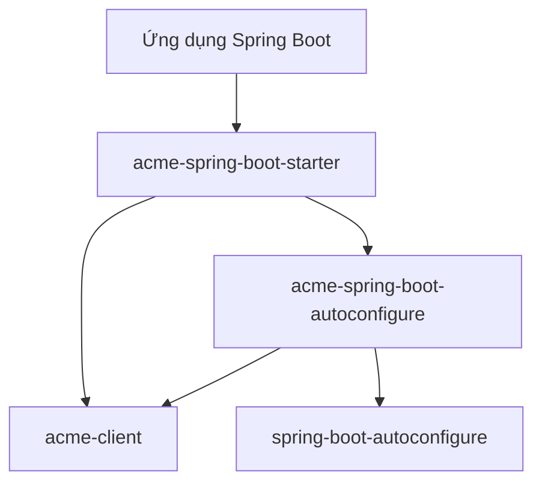
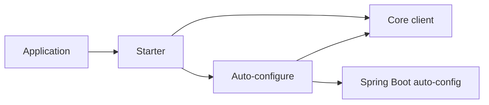

# Tách module auto-configuration khỏi starter gom dependency

> **Spring Boot Fundamentals · Tùy biến Spring Boot**  
> Khi phát triển một thư viện tích hợp Spring Boot, nên phân chia rõ module chứa mã auto-configuration và module starter dùng để gom dependency. Module auto-configuration định nghĩa bean mặc định, điều kiện và cách bind property. Module starter chủ yếu khai báo các dependency mà ứng dụng thường cần để sử dụng tính năng.

## 1. Vì sao nên tách?

Giả sử nhóm phát triển một thư viện tích hợp hệ thống đối tác. Ứng dụng cần client mặc định, có thể thay implementation, bật/tắt tính năng bằng property và chỉ kéo những thư viện cần thiết.

Cấu trúc phổ biến có hai module:

1. **acme-spring-boot-autoconfigure**: chứa mã cấu hình tự động, property, condition và metadata đăng ký auto-configuration.
2. **acme-spring-boot-starter**: gom module auto-configuration cùng những dependency mà người dùng thường cần.

Nếu thư viện có logic độc lập với Spring, có thể tách thêm **acme-client** chứa API/client thuần Java.



Starter là module aggregation: nó mô tả những artifact nào nên được đưa vào cùng nhau. Auto-configuration là module implementation: nó chứa code tích hợp với Spring.

### 1.1. Trách nhiệm

| Module | Trách nhiệm | Java code? |
| --- | --- | --- |
| autoconfigure | Auto-configuration, conditions, bean mặc định và properties | Có |
| starter | Dependency aggregation cho ứng dụng | Thường không |
| core client | API và logic tích hợp độc lập với Spring | Có |

Starter thông thường không cần class main, controller hoặc executable JAR. Không áp dụng repackage như một ứng dụng server; starter là artifact thư viện để ứng dụng khác khai báo dependency.

Tách module hữu ích khi có nhiều integration tùy chọn, nhiều starter dùng chung cấu hình, hoặc consumer cần tự chọn dependency. Với thư viện nhỏ, một module duy nhất vẫn có thể đủ.

## 2. Hướng phụ thuộc



Quy tắc thường dùng:

- Ứng dụng phụ thuộc starter.
- Starter phụ thuộc auto-configuration và thư viện cần thiết.
- Auto-configuration phụ thuộc core API.
- Core library không phụ thuộc starter.
- Core nên tránh phụ thuộc Spring Boot nếu cần tái sử dụng độc lập.

Không tạo vòng starter → autoconfigure → starter. Auto-configuration không nên cần starter để hoạt động. Starter tiêu thụ auto-configuration, không phải module mà code cấu hình gọi ngược lại.

## 3. Module core

Ví dụ client thuần Java:

```java
package com.acme.client;

import java.net.URI;

public class PartnerClient {

    private final URI endpoint;
    private final String apiKey;

    public PartnerClient(URI endpoint, String apiKey) {
        this.endpoint = endpoint;
        this.apiKey = apiKey;
    }

    public PartnerResponse fetch(String resourceId) {
        return new PartnerResponse(resourceId, "loaded");
    }
}
```

PartnerClient không cần biết ApplicationContext, @Bean hay @Configuration. Nó có thể được dùng từ ứng dụng Java thuần hoặc một môi trường khác. Module core dễ test bằng unit test và không bị coupling vào Spring.

## 4. Module auto-configuration cho Spring Boot 3.x

### 4.1. Typed properties

```java
package com.acme.spring;

import java.net.URI;
import java.time.Duration;
import org.springframework.boot.context.properties.ConfigurationProperties;

@ConfigurationProperties(prefix = "acme.partner")
public class PartnerProperties {

    private URI endpoint;
    private String apiKey;
    private Duration connectTimeout = Duration.ofSeconds(3);

    public URI getEndpoint() {
        return endpoint;
    }

    public void setEndpoint(URI endpoint) {
        this.endpoint = endpoint;
    }

    public String getApiKey() {
        return apiKey;
    }

    public void setApiKey(String apiKey) {
        this.apiKey = apiKey;
    }

    public Duration getConnectTimeout() {
        return connectTimeout;
    }

    public void setConnectTimeout(Duration connectTimeout) {
        this.connectTimeout = connectTimeout;
    }
}
```

Lớp này biểu diễn cấu hình tích hợp. Spring Boot bind property từ application.yml, environment variable hoặc nguồn cấu hình ngoài. Trong sản phẩm thực tế, cần validation cho endpoint và credential khi tính năng được bật; không commit API key thật.

### 4.2. Auto-configuration class

```java
package com.acme.spring;

import com.acme.client.PartnerClient;
import org.springframework.boot.autoconfigure.AutoConfiguration;
import org.springframework.boot.autoconfigure.condition.ConditionalOnClass;
import org.springframework.boot.autoconfigure.condition.ConditionalOnMissingBean;
import org.springframework.boot.autoconfigure.condition.ConditionalOnProperty;
import org.springframework.boot.context.properties.EnableConfigurationProperties;
import org.springframework.context.annotation.Bean;

@AutoConfiguration
@ConditionalOnClass(PartnerClient.class)
@ConditionalOnProperty(
        prefix = "acme.partner",
        name = "enabled",
        havingValue = "true"
)
@EnableConfigurationProperties(PartnerProperties.class)
public class PartnerAutoConfiguration {

    @Bean
    @ConditionalOnMissingBean
    PartnerClient partnerClient(PartnerProperties properties) {
        return new PartnerClient(
                properties.getEndpoint(),
                properties.getApiKey()
        );
    }
}
```

Cấu hình diễn đạt:

1. PartnerClient phải có trên classpath.
2. Property acme.partner.enabled phải là true.
3. Spring đăng ký PartnerProperties.
4. Nếu ứng dụng chưa có bean PartnerClient phù hợp, auto-configuration tạo client mặc định.
5. Nếu ứng dụng đã cung cấp client riêng, factory method mặc định back off.

Ví dụ giả định constructor client nhận endpoint và API key. Thực tế cần validate giá trị và truyền timeout/cấu hình HTTP theo API thật của thư viện.

### 4.3. Đăng ký metadata

Với Spring Boot 3.x, tạo file:

```text
src/main/resources/META-INF/spring/
└── org.springframework.boot.autoconfigure.AutoConfiguration.imports
```

Nội dung:

```text
com.acme.spring.PartnerAutoConfiguration
```

Mỗi auto-configuration class được liệt kê trên một dòng. Spring Boot dùng metadata này để phát hiện và import cấu hình. Chỉ tạo class @AutoConfiguration trong JAR là chưa đủ nếu không đăng ký nó.

Spring Boot 2.x dùng cơ chế lịch sử qua META-INF/spring.factories cho auto-configuration. Với Boot 3.x, dùng AutoConfiguration.imports theo convention của phiên bản mục tiêu.

### 4.4. Configuration processor

Maven dependency trong module auto-configuration:

```xml
<dependency>
    <groupId>org.springframework.boot</groupId>
    <artifactId>spring-boot-configuration-processor</artifactId>
    <optional>true</optional>
</dependency>
```

Processor tạo metadata cho IDE gợi ý các @ConfigurationProperties. Đây không phải dependency runtime mà ứng dụng cần để chạy client. Với Gradle, khai báo ở annotationProcessor.

## 5. Starter gom dependency

Module acme-spring-boot-starter thường không chứa code Java. POM tối giản:

```xml
<project>
    <modelVersion>4.0.0</modelVersion>
    <groupId>com.acme</groupId>
    <artifactId>acme-spring-boot-starter</artifactId>
    <version>1.0.0</version>
    <packaging>jar</packaging>

    <dependencies>
        <dependency>
            <groupId>com.acme</groupId>
            <artifactId>acme-spring-boot-autoconfigure</artifactId>
            <version>${project.version}</version>
        </dependency>
        <dependency>
            <groupId>com.acme</groupId>
            <artifactId>acme-client</artifactId>
            <version>${project.version}</version>
        </dependency>
    </dependencies>
</project>
```

Trong ứng dụng, chỉ cần khai báo starter:

```xml
<dependency>
    <groupId>com.acme</groupId>
    <artifactId>acme-spring-boot-starter</artifactId>
    <version>1.0.0</version>
</dependency>
```

Maven resolve starter, auto-configuration và core client theo dependency graph. Starter có thể gom thêm SDK HTTP/JSON hoặc dependency runtime khác, nhưng chỉ nên thêm những gì tính năng công bố thực sự cần.

Không cần tạo class @Configuration trong starter chỉ để import PartnerAutoConfiguration. File AutoConfiguration.imports đã nằm trong JAR của module auto-configuration và đi vào classpath qua dependency.

## 6. Dependency tùy chọn

Tách module giúp kiểm soát thư viện tùy chọn. Giả sử auto-configuration hỗ trợ SDK vendor nhưng không phải consumer nào cũng dùng.

### 6.1. Maven optional

Trong module auto-configuration:

```xml
<dependency>
    <groupId>com.vendor</groupId>
    <artifactId>vendor-http-sdk</artifactId>
    <version>2.4.0</version>
    <optional>true</optional>
</dependency>
```

Dependency optional vẫn có sẵn khi biên dịch và test chính module. Nhưng Maven không tự truyền dependency này sang consumer như dependency bắc cầu thông thường.

Starter có thể khai báo SDK như dependency thông thường:

```xml
<dependency>
    <groupId>com.vendor</groupId>
    <artifactId>vendor-http-sdk</artifactId>
    <version>2.4.0</version>
</dependency>
```

Như vậy người dùng starter nhận SDK ở runtime; người dùng chỉ phụ thuộc auto-configuration có thể tự chọn SDK cần thiết. optional=true là đặc tính dependency graph, không tự bật/tắt bean. Spring condition vẫn cần để bỏ qua cấu hình khi SDK không có.

### 6.2. Gradle compileOnly và dependency của starter

Ví dụ:

```groovy
// acme-spring-boot-autoconfigure/build.gradle
plugins {
    id 'java-library'
}

dependencies {
    implementation 'org.springframework.boot:spring-boot-autoconfigure'
    compileOnly 'com.vendor:vendor-http-sdk:2.4.0'
    testRuntimeOnly 'com.vendor:vendor-http-sdk:2.4.0'
    annotationProcessor 'org.springframework.boot:spring-boot-configuration-processor'
    testImplementation 'org.springframework.boot:spring-boot-starter-test'
}
```

Starter thêm SDK ở runtime:

```groovy
// acme-spring-boot-starter/build.gradle
plugins {
    id 'java-library'
}

dependencies {
    api project(':acme-spring-boot-autoconfigure')
    runtimeOnly 'com.vendor:vendor-http-sdk:2.4.0'
}
```

Ví dụ giả định kiểu SDK không phải một phần API compile-time mà ứng dụng cần trực tiếp sử dụng. Nếu public API của auto-configuration làm lộ kiểu SDK trong chữ ký method, cần xem xét api, compileOnlyApi hoặc thiết kế lại public surface. Nếu consumer cần SDK trên compile classpath, chọn implementation/api thay cho runtimeOnly theo contract.

### 6.3. Bảo vệ integration optional bằng class condition

```java
@AutoConfiguration
public class VendorAutoConfiguration {

    @Configuration(proxyBeanMethods = false)
    @ConditionalOnClass(name = "com.vendor.http.VendorClient")
    static class VendorClientConfiguration {

        @Bean
        @ConditionalOnMissingBean
        VendorAdapter vendorAdapter(VendorProperties properties) {
            return new VendorAdapter(properties.endpoint());
        }
    }
}
```

Tách nested configuration và đặt @ConditionalOnClass ở lớp bảo vệ phần phụ thuộc SDK giúp Spring xét điều kiện trước khi xử lý cấu hình sử dụng API optional.

Không nên chỉ gắn condition lên một method nhưng để chữ ký/kiểu trả về tham chiếu trực tiếp class có thể vắng mặt rồi giả định mọi trường hợp đều an toàn khi JVM xử lý metadata.

Để integration tùy chọn hoạt động, cần SDK runtime, metadata auto-configuration, classpath condition, property/bean condition, cấu hình hợp lệ và dependency factory method có thể resolve.

## 7. Nhiều starter dùng chung auto-configuration

Khi thư viện có nhiều nhóm tính năng, có thể tạo:

```text
acme-integration/
├── acme-client/
├── acme-spring-boot-autoconfigure/
├── acme-spring-boot-starter/
├── acme-spring-boot-starter-web/
└── acme-spring-boot-starter-messaging/
```

Ví dụ starter nền tảng gom client và cấu hình cốt lõi; starter web thêm adapter HTTP; starter messaging thêm message broker và cấu hình consumer/producer.

Các starter có thể cùng phụ thuộc một artifact auto-configuration nếu bean và điều kiện dùng chung. Nếu các integration có dependency hoặc lifecycle rất khác nhau, tách auto-configuration module riêng có thể giảm coupling.

Tránh kéo tất cả integration vào starter mặc định nếu ứng dụng chỉ cần một phần. Dependency thừa làm tăng thời gian build, kích thước runtime image, khả năng xung đột version và số cấu hình cần đánh giá.

## 8. Quản lý version và BOM

Khi phát hành nhiều artifact, version nên nhất quán:

| Artifact | Version ví dụ |
| --- | --- |
| acme-client | 1.2.0 |
| acme-spring-boot-autoconfigure | 1.2.0 |
| acme-spring-boot-starter | 1.2.0 |

Starter 1.2.0 nên phụ thuộc vào auto-configuration và core library cùng release, trừ khi có version policy khác được tài liệu hóa.

Parent POM có thể quản lý version và module:

```xml
<project>
    <modelVersion>4.0.0</modelVersion>
    <groupId>com.acme</groupId>
    <artifactId>acme-integration</artifactId>
    <version>1.2.0</version>
    <packaging>pom</packaging>

    <modules>
        <module>acme-client</module>
        <module>acme-spring-boot-autoconfigure</module>
        <module>acme-spring-boot-starter</module>
    </modules>

    <properties>
        <java.version>17</java.version>
        <spring-boot.version>3.4.0</spring-boot.version>
    </properties>

    <dependencyManagement>
        <dependencies>
            <dependency>
                <groupId>org.springframework.boot</groupId>
                <artifactId>spring-boot-dependencies</artifactId>
                <version>${spring-boot.version}</version>
                <type>pom</type>
                <scope>import</scope>
            </dependency>
        </dependencies>
    </dependencyManagement>
</project>
```

Version Spring Boot chỉ là ví dụ. Dự án cần chọn version tương thích với Java và dependency đang dùng.

Có thể phát hành BOM riêng nếu muốn consumer quản lý version của nhiều artifact Acme đồng bộ. BOM và starter có nhiệm vụ khác nhau: BOM quản lý version, starter gom dependency, auto-configuration chứa code cấu hình, core chứa logic tích hợp.

## 9. Maven POM cho từng module

### 9.1. Core module

```xml
<project>
    <modelVersion>4.0.0</modelVersion>
    <parent>
        <groupId>com.acme</groupId>
        <artifactId>acme-integration</artifactId>
        <version>1.2.0</version>
        <relativePath>../pom.xml</relativePath>
    </parent>
    <artifactId>acme-client</artifactId>
    <dependencies>
        <!-- Chỉ dependency thực sự cần cho client lõi. -->
    </dependencies>
</project>
```

Module này không cần spring-boot-autoconfigure nếu muốn giữ core độc lập với Spring.

### 9.2. Auto-configuration module

```xml
<project>
    <modelVersion>4.0.0</modelVersion>
    <parent>
        <groupId>com.acme</groupId>
        <artifactId>acme-integration</artifactId>
        <version>1.2.0</version>
        <relativePath>../pom.xml</relativePath>
    </parent>
    <artifactId>acme-spring-boot-autoconfigure</artifactId>

    <dependencies>
        <dependency>
            <groupId>com.acme</groupId>
            <artifactId>acme-client</artifactId>
            <version>${project.version}</version>
            <optional>true</optional>
        </dependency>
        <dependency>
            <groupId>org.springframework.boot</groupId>
            <artifactId>spring-boot-autoconfigure</artifactId>
        </dependency>
        <dependency>
            <groupId>org.springframework.boot</groupId>
            <artifactId>spring-boot-configuration-processor</artifactId>
            <optional>true</optional>
        </dependency>
        <dependency>
            <groupId>org.springframework.boot</groupId>
            <artifactId>spring-boot-starter-test</artifactId>
            <scope>test</scope>
        </dependency>
    </dependencies>
</project>
```

acme-client được đánh dấu optional trong ví dụ để consumer phụ thuộc trực tiếp vào auto-configuration có thể tự quyết định có kéo client hay không. Starter sẽ khai báo client như dependency thông thường. Tùy contract, core có thể không cần optional nếu mọi consumer đều phải có nó.

### 9.3. Starter module

```xml
<project>
    <modelVersion>4.0.0</modelVersion>
    <parent>
        <groupId>com.acme</groupId>
        <artifactId>acme-integration</artifactId>
        <version>1.2.0</version>
        <relativePath>../pom.xml</relativePath>
    </parent>
    <artifactId>acme-spring-boot-starter</artifactId>

    <dependencies>
        <dependency>
            <groupId>com.acme</groupId>
            <artifactId>acme-spring-boot-autoconfigure</artifactId>
            <version>${project.version}</version>
        </dependency>
        <dependency>
            <groupId>com.acme</groupId>
            <artifactId>acme-client</artifactId>
            <version>${project.version}</version>
        </dependency>
    </dependencies>
</project>
```

Starter không cần Java source. Maven resolve auto-configuration, core và các dependency bắc cầu khi ứng dụng khai báo starter.

### 9.4. Xem dependency tree

```bash
./mvnw -pl acme-spring-boot-starter -am dependency:tree
```

Có thể xem riêng runtime dependency:

```bash
./mvnw -pl acme-spring-boot-starter dependency:tree -Dscope=runtime
```

Từ cây dependency, xác định SDK nào được kéo trực tiếp hoặc bắc cầu. Không chỉ nhìn POM của starter để suy luận toàn bộ runtime graph.

## 10. Gradle multi-project

Cấu trúc:

```text
acme-integration/
├── settings.gradle
├── build.gradle
├── acme-client/build.gradle
├── acme-spring-boot-autoconfigure/build.gradle
└── acme-spring-boot-starter/build.gradle
```

settings.gradle:

```groovy
rootProject.name = 'acme-integration'

include 'acme-client'
include 'acme-spring-boot-autoconfigure'
include 'acme-spring-boot-starter'
```

Auto-configuration:

```groovy
// acme-spring-boot-autoconfigure/build.gradle
plugins {
    id 'java-library'
}

dependencies {
    implementation 'org.springframework.boot:spring-boot-autoconfigure'
    api project(':acme-client')
    annotationProcessor 'org.springframework.boot:spring-boot-configuration-processor'
    testImplementation 'org.springframework.boot:spring-boot-starter-test'
}

tasks.named('test') {
    useJUnitPlatform()
}
```

api project(':acme-client') phù hợp nếu public API của auto-configuration làm lộ kiểu từ core và consumer cần kiểu đó trên compile classpath. Nếu core chỉ được dùng nội bộ, có thể chọn implementation. Với integration optional, cân nhắc compileOnly và bảo đảm starter cung cấp dependency runtime.

Starter:

```groovy
// acme-spring-boot-starter/build.gradle
plugins {
    id 'java-library'
}

dependencies {
    api project(':acme-spring-boot-autoconfigure')
    api project(':acme-client')
}
```

Starter dùng api nếu muốn consumer nhận dependency trên compile classpath. Nếu chỉ cần runtime và không expose kiểu ra public API, implementation hoặc runtimeOnly có thể phù hợp hơn. Quyết định dựa trên contract, không sao chép cấu hình máy móc.

Core:

```groovy
// acme-client/build.gradle
plugins {
    id 'java-library'
}

dependencies {
    // Dependency thuần Java cần thiết cho client.
}
```

Xem dependency runtime của starter:

```bash
./gradlew :acme-spring-boot-starter:dependencies --configuration runtimeClasspath
```

Xem dependency compile:

```bash
./gradlew :acme-spring-boot-starter:dependencies --configuration compileClasspath
```

Nếu dependency có ở runtime nhưng không có ở compile classpath, điều đó có thể đúng nếu consumer không cần tham chiếu kiểu đó trong source. Nếu code ứng dụng cần import kiểu SDK, dependency phải có trên compile classpath.

## 11. Properties, điều kiện và bean tùy chỉnh

application.yml:

```yaml
acme:
  partner:
    enabled: true
    endpoint: https://partner.example
    api-key: ${ACME_PARTNER_API_KEY}
    connect-timeout: 3s
```

Auto-configuration có thể dùng @ConditionalOnClass để kiểm tra SDK, @ConditionalOnProperty để bật tính năng và @ConditionalOnMissingBean để cung cấp default.

Ứng dụng có thể cung cấp bean riêng:

```java
@Configuration(proxyBeanMethods = false)
class CustomPartnerConfiguration {

    @Bean
    PartnerClient partnerClient() {
        return new PartnerClient(
                URI.create("https://internal-proxy.example"),
                readApiKeyFromSecretStore()
        );
    }
}
```

Khi custom bean phù hợp được đăng ký trước lúc auto-configuration đánh giá condition, bean mặc định nhường quyền. Không cần sửa starter để thay implementation.

Một số tính năng nên bật mặc định khi dependency có mặt; một số tính năng cần opt-in. Hãy xác định chính sách matchIfMissing và havingValue có chủ đích. Với tích hợp tạo kết nối mạng hoặc thực hiện thao tác có tác động bên ngoài, opt-in rõ ràng thường dễ vận hành hơn.

## 12. Dùng auto-configuration trực tiếp mà không cần starter

Có hai con đường tiêu thụ:

**Cách thuận tiện:** phụ thuộc starter để nhận cấu hình và bộ dependency mặc định.

**Cách kiểm soát:** phụ thuộc trực tiếp auto-configuration, sau đó tự khai báo acme-client, SDK HTTP và các thư viện runtime theo nhu cầu.

Cách thứ hai hữu ích khi chỉ muốn một phần integration, muốn dùng version SDK khác, đã có BOM quản lý dependency hoặc cần kiểm soát classpath chặt chẽ.

Nếu auto-configuration khai báo dependency optional, consumer trực tiếp phải thêm dependency runtime cần thiết. Nếu thiếu SDK, classpath condition có thể không khớp và bean không được tạo.

| Cách dùng | Dependency cần khai báo |
| --- | --- |
| Cấu hình mặc định, nhanh | acme-spring-boot-starter |
| Tự chọn dependency | acme-spring-boot-autoconfigure cùng thư viện runtime cần thiết |
| Dùng client thuần, không Spring | acme-client |

Tài liệu starter cần nói rõ hai con đường này để consumer không nhầm việc thiếu SDK runtime với lỗi phát hiện auto-configuration.

## 13. Kiểm thử

### 13.1. Test auto-configuration bằng ApplicationContextRunner

```java
class PartnerAutoConfigurationTests {

    private final ApplicationContextRunner contextRunner =
            new ApplicationContextRunner()
                    .withConfiguration(
                            AutoConfigurations.of(
                                    PartnerAutoConfiguration.class));

    @Test
    void createsClientWhenEnabled() {
        contextRunner
                .withPropertyValues(
                        "acme.partner.enabled=true",
                        "acme.partner.endpoint=https://partner.example",
                        "acme.partner.api-key=test-key"
                )
                .run(context -> {
                    assertThat(context)
                            .hasSingleBean(PartnerClient.class);
                });
    }

    @Test
    void doesNotCreateClientWhenDisabled() {
        contextRunner
                .withPropertyValues("acme.partner.enabled=false")
                .run(context -> {
                    assertThat(context)
                            .doesNotHaveBean(PartnerClient.class);
                });
    }
}
```

Test tập trung vào condition và bean wiring, không cần khởi động HTTP server hoặc kết nối hệ thống đối tác thật.

### 13.2. Test back-off khi ứng dụng cung cấp bean riêng

```java
@Test
void backsOffWhenApplicationProvidesCustomClient() {
    PartnerClient customClient =
            new PartnerClient(
                    URI.create("https://custom.example"),
                    "custom-key");

    contextRunner
            .withPropertyValues(
                    "acme.partner.enabled=true",
                    "acme.partner.endpoint=https://partner.example",
                    "acme.partner.api-key=default-key"
            )
            .withBean(
                    PartnerClient.class,
                    () -> customClient)
            .run(context -> {
                assertThat(context)
                        .hasSingleBean(PartnerClient.class);

                assertThat(context.getBean(PartnerClient.class))
                        .isSameAs(customClient);
            });
}
```

Khi bean tùy chỉnh đã có, default bean method không tạo thêm client thứ hai. Consumer nhận đúng instance ứng dụng cung cấp.

### 13.3. Test classpath condition

Nếu auto-configuration phụ thuộc SDK optional, test cả hai trường hợp:

- SDK có mặt: cấu hình tương ứng có thể được áp dụng.
- SDK không có: cấu hình phụ thuộc SDK được bỏ qua an toàn.

Có thể dùng classloader/filtering phù hợp hoặc test module riêng có/không có dependency. Không chỉ test trường hợp SDK có mặt rồi suy luận nhánh optional chắc chắn hoạt động.

### 13.4. Test starter bằng sample application

Auto-configuration test chứng minh logic cấu hình. Cần thêm smoke test hoặc sample app tiêu thụ starter để xác nhận:

- Starter kéo đúng auto-configuration artifact.
- File AutoConfiguration.imports nằm trong JAR được resolve.
- SDK runtime có mặt.
- Ứng dụng khởi động và bean được đăng ký.
- Custom bean khiến default back off.

Test này phát hiện lỗi mà unit test trong module auto-configuration không thấy, chẳng hạn starter quên khai báo dependency SDK hoặc metadata không được đóng gói.

Starter không có logic Java thì không cần tạo class giả chỉ để có source. Có thể kiểm tra dependency graph, đóng gói và dùng sample consumer.

## 14. Kiểm tra artifact và phát hành

Sau khi build module auto-configuration, kiểm tra nội dung JAR:

```bash
jar tf acme-spring-boot-autoconfigure-1.2.0.jar
```

Tìm resource:

```text
META-INF/spring/org.springframework.boot.autoconfigure.AutoConfiguration.imports
```

Có thể trích nội dung resource để xác nhận class name đã được đóng gói. Đường dẫn sai hoặc file bị bỏ qua trong build sẽ khiến Boot không tìm thấy auto-configuration.

Starter POM sau khi publish phải chứa dependency tới auto-configuration, core library/SDK mà starter có trách nhiệm cung cấp và các dependency cần thiết khác. Kiểm tra POM thực tế đã publish, không chỉ POM trong source.

Một project multi-module thường build các artifact riêng:

- acme-client-1.2.0.jar
- acme-spring-boot-autoconfigure-1.2.0.jar
- acme-spring-boot-starter-1.2.0.jar

Build Maven:

```bash
./mvnw clean verify
```

Hoặc chỉ build starter cùng module phụ thuộc:

```bash
./mvnw -pl acme-spring-boot-starter -am clean verify
```

Gradle:

```bash
./gradlew clean build
```

Publish Maven:

```bash
./mvnw deploy
```

Với Gradle, dùng publishing configuration phù hợp cho từng project. Đảm bảo starter không được publish trước khi auto-configuration/core version tương ứng có thể resolve từ repository consumer.

Công bố rõ Java tối thiểu, Spring Boot version hỗ trợ, SDK vendor version, properties, default behavior và starter dành cho nhóm tính năng nào. Nếu hỗ trợ nhiều dòng Boot, cần build matrix và test tương ứng.

## 15. Những lỗi kiến trúc thường gặp

| Lỗi | Hậu quả | Hướng xử lý |
| --- | --- | --- |
| Đặt Java auto-configuration trong starter aggregator | Starter vừa gom dependency vừa sở hữu logic, khó tái sử dụng | Chuyển code cấu hình sang module autoconfigure |
| Auto-configuration phụ thuộc ngược starter | Tạo dependency cycle hoặc kéo nhầm artifact | Giữ hướng starter → autoconfigure |
| Starter không khai báo SDK runtime cần thiết | App thêm starter nhưng condition classpath không khớp hoặc bean không tạo | Thêm dependency cần thiết vào starter |
| Auto-configuration kéo tất cả SDK không optional | App chỉ cần một integration vẫn nhận nhiều dependency | Đánh dấu optional đúng nơi và tách starter chuyên biệt |
| Không có AutoConfiguration.imports | Boot không phát hiện cấu hình | Đóng gói metadata đúng đường dẫn |
| Dùng spring.factories như cơ chế đăng ký mới cho Boot 3 | Metadata không theo convention hiện tại | Dùng AutoConfiguration.imports cho Boot 3.x |
| Return type/annotation tham chiếu class optional không an toàn | Có thể phát sinh lỗi class loading khi thư viện vắng mặt | Tách nested configuration và bảo vệ ở cấp lớp |
| Starter kéo dependency không quản lý version | Dễ xung đột version trong consumer | Dùng BOM/parent dependency management |
| Gắn Spring Boot dependency vào core không cần thiết | Client thuần bị coupling vào framework | Tách core khỏi Spring integration |
| Dùng bean overriding để thay default | Xung đột tên hoặc behavior khó đoán | Dùng @ConditionalOnMissingBean theo contract |
| Chỉ test auto-configuration, không test starter | Không phát hiện thiếu dependency hoặc metadata | Thêm sample consumer/smoke test |
| Starter chứa main() hoặc repackage executable JAR | Artifact sai vai trò | Giữ starter là dependency aggregation module |
| Nhiều starter chứa cấu hình trùng lặp | Có thể đăng ký bean lặp hoặc condition khó quản lý | Dùng chung auto-configuration hoặc tách rõ tính năng |
| Không phân biệt api, implementation, compileOnly, runtimeOnly | Consumer thiếu kiểu trên compile/runtime classpath | Chọn configuration theo contract API và runtime |

### 15.1. Không đặt condition ở starter

Starter thường không chứa code Java để đánh giá condition. Các annotation @ConditionalOnClass, @ConditionalOnProperty và @ConditionalOnMissingBean thuộc module auto-configuration.

Starter quyết định dependency nào được kéo vào; auto-configuration quyết định bean nào được đăng ký khi dependency/property/bean condition phù hợp. Hai tầng phối hợp nhưng không thay thế nhau.

### 15.2. Không dùng starter để sửa version tùy tiện của ứng dụng

Nếu starter kéo version xung đột với BOM của consumer, có thể gây NoSuchMethodError, ClassNotFoundException hoặc lỗi runtime khó truy vết. Quản lý version bằng parent/BOM và kiểm thử với platform version được hỗ trợ.

### 15.3. Không để auto-configuration tạo kết nối bên ngoài quá sớm

Nếu constructor client mở kết nối mạng hoặc gọi API remote, startup sẽ phụ thuộc dịch vụ bên ngoài và có thể thất bại khi dịch vụ tạm thời không sẵn sàng.

Ưu tiên tạo client mà không thực hiện I/O không cần thiết trong constructor. Kết nối hoặc health check nên có lifecycle và timeout phù hợp. Auto-configuration chủ yếu wiring dependency, không nên biến startup thành chuỗi thao tác mạng không kiểm soát.

## 16. Bài thực hành: tách một module tích hợp đang bị gộp

Giả sử project hiện tại có một module starter chứa PartnerClient, PartnerAutoConfiguration, properties và mọi dependency. Hãy tách thành các module riêng.

### Bước 1 — Xác định phần lõi

Chuyển API/client và logic giao tiếp không cần Spring sang acme-client. Giữ constructor và API rõ ràng, không thêm annotation Spring vào core chỉ để module khác dễ đăng ký bean.

### Bước 2 — Tạo module auto-configuration

Tạo acme-spring-boot-autoconfigure, chuyển PartnerAutoConfiguration, PartnerProperties, nested configuration cho integration optional và file AutoConfiguration.imports.

Đăng ký dependency Spring Boot phù hợp và core library theo dependency graph dự định.

### Bước 3 — Tạo starter aggregator

Giữ acme-spring-boot-starter chủ yếu chứa build descriptor. Khai báo dependency tới auto-configuration và core/client SDK cần thiết cho trường hợp phổ biến.

### Bước 4 — Kiểm tra dependency direction

Xác nhận core không phụ thuộc starter; auto-configuration không phụ thuộc starter; starter phụ thuộc auto-configuration; ứng dụng phụ thuộc starter; không có dependency cycle.

### Bước 5 — Kiểm tra optional integration

Chọn một SDK tùy chọn. Đảm bảo auto-configuration có class condition phù hợp, starter kéo SDK nếu tính năng nằm trong bộ mặc định, còn ứng dụng chỉ dùng auto-configuration có thể tự chọn dependency.

### Bước 6 — Test back-off

Viết test xác nhận default bean xuất hiện khi không có custom bean, default back off khi custom bean có mặt, property tắt không tạo cấu hình và SDK optional vắng mặt thì nhánh phụ thuộc SDK được bỏ qua an toàn.

### Bước 7 — Kiểm tra artifact

Build JAR, kiểm tra AutoConfiguration.imports, POM đã publish và dependency graph từ sample app chỉ khai báo starter.

### Bước 8 — Tài liệu hóa consumer path

Viết hướng dẫn cài đặt theo hai cách: dùng starter để có cấu hình và dependency mặc định; dùng auto-configuration trực tiếp khi muốn tự quản lý dependency. Nêu rõ Java/Spring Boot version tương thích, property, default bean và cách cung cấp bean tùy chỉnh.

### Câu hỏi tự kiểm tra

1. Vì sao nên tách module chứa auto-configuration khỏi module starter gom dependency?
2. Module auto-configuration chịu trách nhiệm những gì?
3. Starter aggregator thường có cần Java source hay main() không?
4. Dependency graph hợp lý giữa application, starter, auto-configuration và core library là gì?
5. Vì sao core library nên tránh phụ thuộc Spring Boot nếu cần tái sử dụng độc lập?
6. Maven optional=true ảnh hưởng thế nào tới dependency của consumer?
7. Trong Gradle, khi nào cân nhắc compileOnly, api, implementation và runtimeOnly?
8. Spring Boot 3.x phát hiện auto-configuration qua file nào?
9. Vì sao @ConditionalOnClass quan trọng khi module có integration tùy chọn?
10. @ConditionalOnMissingBean cho phép ứng dụng thay default bean ra sao?
11. Vì sao chỉ test auto-configuration chưa đủ để xác nhận starter gom dependency đúng?
12. BOM khác starter ở trách nhiệm nào?
13. Vì sao không nên dùng bean overriding để thay default bean?
14. Khi nào một thư viện không cần tách thành nhiều module?
15. Nếu starter kéo quá nhiều SDK, kiến trúc có thể được cải thiện thế nào?

## 17. Bảng ghi nhớ nhanh

| Artifact | Nội dung chính | Consumer dùng khi |
| --- | --- | --- |
| acme-client | API và logic tích hợp thuần Java | Cần client mà không cần Spring Boot |
| acme-spring-boot-autoconfigure | Auto-configuration, conditions, properties, imports metadata | Muốn dùng cấu hình Spring nhưng tự chọn dependency |
| acme-spring-boot-starter | Dependency aggregation | Muốn cài nhanh bộ tích hợp mặc định |
| acme-integration-bom (nếu có) | Version alignment cho nhiều artifact | Muốn quản lý version đồng bộ |

Tách auto-configuration khỏi starter tạo ra một ranh giới rõ ràng: **module auto-configuration quyết định Spring tạo bean như thế nào; module starter quyết định ứng dụng nhận những dependency nào khi cài tính năng**. Khi cần, core library được tách thêm để logic tích hợp không phụ thuộc Spring. Cấu trúc này giúp starter gọn, dependency tùy chọn có thể kiểm soát, auto-configuration dễ test và ứng dụng vẫn có quyền thay bean mặc định theo nhu cầu.
