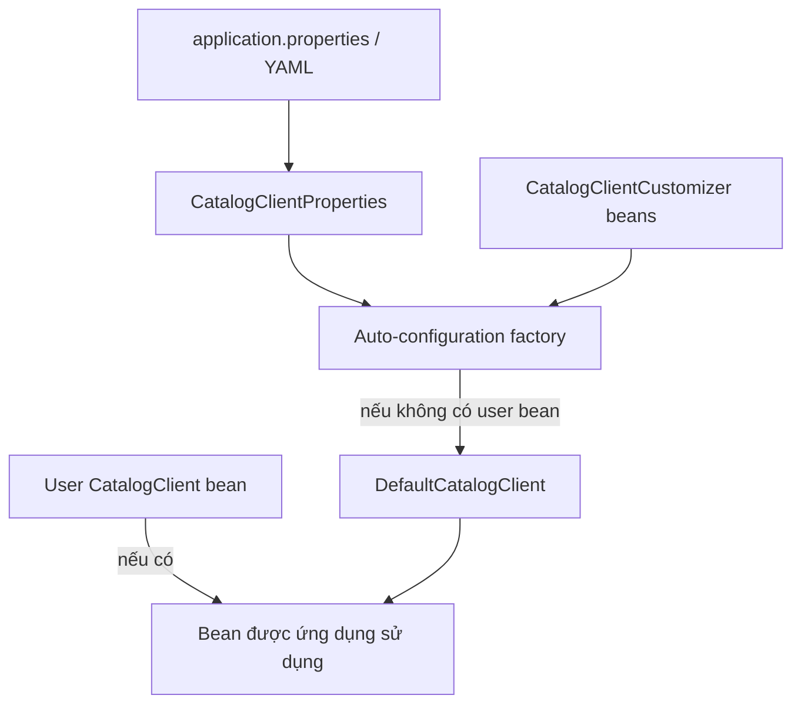
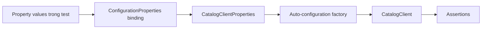

# Kiểm chứng cấu hình người dùng luôn có đường tùy chỉnh dự kiến

Spring Boot auto-configuration giúp ứng dụng chạy được với cấu hình mặc định. Nhưng một thư viện hoặc starter tốt phải cho ứng dụng **thay thế, điều chỉnh hoặc tắt** những mặc định đó theo các extension point đã công bố.

Ví dụ, starter cung cấp một HTTP client mặc định. Ứng dụng sử dụng starter có thể cần:

- Đổi base URL hoặc timeout bằng application properties.
- Cung cấp implementation client riêng.
- Đăng ký customizer để thêm header, interceptor hoặc cách xử lý lỗi.
- Tắt tích hợp khi tính năng không được sử dụng.
- Giữ nguyên các bean mặc định khác khi chỉ thay một thành phần.

Những khả năng đó tạo thành **customization contract** — hợp đồng tùy chỉnh mà thư viện hứa với ứng dụng sử dụng nó. Việc cấu hình “có thể tùy chỉnh trên lý thuyết” chưa đủ; cần kiểm chứng bằng test rằng mỗi đường tùy chỉnh thực sự được áp dụng và default configuration nhường chỗ đúng lúc.

Bài này tập trung vào cách thiết kế và kiểm thử hợp đồng đó bằng Spring Boot, đặc biệt với `@ConfigurationProperties`, `@ConditionalOnMissingBean`, customizer interface, `ApplicationContextRunner` và các phép kiểm tra context.

## 1. “Có đường tùy chỉnh” nghĩa là gì?

Một cấu hình có thể được xem là có đường tùy chỉnh khi ứng dụng biết rõ **điểm nào có thể thay đổi**, **cách cung cấp thay đổi** và **hành vi nào sẽ xảy ra sau khi thay đổi**.

Ví dụ một thư viện cung cấp `CatalogClient`. Hợp đồng có thể gồm ba cấp:

| Cấp tùy chỉnh | Cách ứng dụng sử dụng | Ví dụ |
|---|---|---|
| Property | Đặt giá trị trong application configuration | Đổi base URL, timeout |
| Bean | Đăng ký bean của abstraction được công bố | Cung cấp `CatalogClient` riêng |
| Customizer | Đăng ký callback mở rộng cấu hình mặc định | Thêm header, interceptor, retry policy |

Ngoài ra còn có đường điều khiển tính năng:

| Cấp điều khiển | Cách sử dụng | Kết quả mong đợi |
|---|---|---|
| Property bật/tắt | `app.catalog.enabled=false` | Tích hợp không được đăng ký |
| Exclude auto-configuration | Loại cấu hình khỏi quá trình import | Starter không tạo các bean thuộc cấu hình bị exclude |
| Conditional capability | Chỉ bật khi có dependency cần thiết | Không có bean hạ tầng thì tích hợp tương ứng không hoạt động |

Một customization contract tốt phải nói rõ:

1. **Điểm mở rộng:** ứng dụng có thể thay đổi phần nào?
2. **Cách cấu hình:** property, bean, customizer hay exclusion?
3. **Phạm vi:** thay một bean hay tắt cả nhóm bean?
4. **Ưu tiên:** khi có cả default và custom bean, bean nào được dùng?
5. **Kết quả quan sát được:** giá trị hoặc hành vi nào chứng minh tùy chỉnh có hiệu lực?
6. **Trường hợp không hợp lệ:** context có fail fast với thông báo rõ ràng hay không?

Đây là những điều cần kiểm chứng bằng test, không chỉ mô tả trong README.

## 2. Thiết kế auto-configuration có thể tùy chỉnh

Giả sử starter cung cấp một client đọc dữ liệu catalog. Thiết kế có ba thành phần:

- `CatalogClientProperties`: cấu hình bằng properties.
- `CatalogClientCustomizer`: extension point để chỉnh builder.
- `CatalogClient`: abstraction mà ứng dụng có thể tự cung cấp.

Mô hình:



Nếu người dùng cung cấp bean riêng, auto-configuration phải back off. Nếu không có bean riêng, factory tạo client mặc định từ properties và customizers.

### 2.1. Khai báo properties

```java
package com.example.catalog.autoconfigure;

import java.net.URI;
import java.time.Duration;

import org.springframework.boot.context.properties.ConfigurationProperties;

@ConfigurationProperties(prefix = "app.catalog")
public class CatalogClientProperties {

    private boolean enabled = true;
    private URI baseUri = URI.create("https://catalog.example.test");
    private Duration timeout = Duration.ofSeconds(3);

    public boolean isEnabled() {
        return enabled;
    }

    public void setEnabled(boolean enabled) {
        this.enabled = enabled;
    }

    public URI getBaseUri() {
        return baseUri;
    }

    public void setBaseUri(URI baseUri) {
        this.baseUri = baseUri;
    }

    public Duration getTimeout() {
        return timeout;
    }

    public void setTimeout(Duration timeout) {
        this.timeout = timeout;
    }
}
```

Các giá trị mặc định là một phần hợp đồng. Ứng dụng có thể chạy mà không khai báo property, nhưng vẫn có thể thay đổi chúng:

```yaml
app:
  catalog:
    enabled: true
    base-uri: https://catalog.internal.example
    timeout: 5s
```

Dùng kiểu dữ liệu phù hợp như `URI` và `Duration` giúp Spring Boot chuyển đổi giá trị cấu hình. Với dự án thực, có thể thêm validation như `@Validated`, `@NotNull`, `@Positive` hoặc các constraint phù hợp.

### 2.2. Công bố customizer extension point

Thay vì yêu cầu ứng dụng kế thừa implementation nội bộ, starter có thể công bố một interface nhỏ:

```java
package com.example.catalog.autoconfigure;

public interface CatalogClientCustomizer {

    void customize(CatalogClientBuilder builder);
}
```

Builder cung cấp các điểm chỉnh sửa được hỗ trợ:

```java
package com.example.catalog.autoconfigure;

import java.net.URI;
import java.time.Duration;
import java.util.LinkedHashMap;
import java.util.Map;

public class CatalogClientBuilder {

    private URI baseUri;
    private Duration timeout;
    private final Map<String, String> defaultHeaders =
            new LinkedHashMap<>();

    public CatalogClientBuilder(URI baseUri, Duration timeout) {
        this.baseUri = baseUri;
        this.timeout = timeout;
    }

    public CatalogClientBuilder baseUri(URI baseUri) {
        this.baseUri = baseUri;
        return this;
    }

    public CatalogClientBuilder timeout(Duration timeout) {
        this.timeout = timeout;
        return this;
    }

    public CatalogClientBuilder defaultHeader(String name, String value) {
        this.defaultHeaders.put(name, value);
        return this;
    }

    public CatalogClient build() {
        return new CatalogClient(baseUri, timeout, defaultHeaders);
    }
}
```

Ứng dụng có thể đăng ký customizer:

```java
@Configuration(proxyBeanMethods = false)
public class CatalogClientCustomization {

    @Bean
    CatalogClientCustomizer tenantHeaderCustomizer() {
        return builder ->
                builder.defaultHeader("X-Tenant", "north-region");
    }
}
```

Customizer không phải bean client thứ hai. Nó là callback mà factory mặc định dùng trong quá trình xây dựng client.

### 2.3. Tạo abstraction và implementation mặc định

```java
package com.example.catalog.autoconfigure;

import java.net.URI;
import java.time.Duration;
import java.util.Map;

public interface CatalogClient {

    URI baseUri();

    Duration timeout();

    Map<String, String> defaultHeaders();
}
```

Implementation:

```java
package com.example.catalog.autoconfigure;

import java.net.URI;
import java.time.Duration;
import java.util.Map;

public class DefaultCatalogClient implements CatalogClient {

    private final URI baseUri;
    private final Duration timeout;
    private final Map<String, String> defaultHeaders;

    public DefaultCatalogClient(
            URI baseUri,
            Duration timeout,
            Map<String, String> defaultHeaders
    ) {
        this.baseUri = baseUri;
        this.timeout = timeout;
        this.defaultHeaders = Map.copyOf(defaultHeaders);
    }

    @Override
    public URI baseUri() {
        return baseUri;
    }

    @Override
    public Duration timeout() {
        return timeout;
    }

    @Override
    public Map<String, String> defaultHeaders() {
        return defaultHeaders;
    }
}
```

Implementation thực tế có thể bọc HTTP library, connection pool và retry policy. Ví dụ trên tập trung vào các giá trị có thể quan sát trong test.

## 3. Dùng @ConditionalOnMissingBean để ứng dụng thay default

Auto-configuration tạo client mặc định nếu ứng dụng chưa cung cấp bean `CatalogClient`:

```java
package com.example.catalog.autoconfigure;

import org.springframework.boot.autoconfigure.AutoConfiguration;
import org.springframework.boot.autoconfigure.condition.ConditionalOnMissingBean;
import org.springframework.boot.autoconfigure.condition.ConditionalOnProperty;
import org.springframework.boot.context.properties.EnableConfigurationProperties;
import org.springframework.context.annotation.Bean;

@AutoConfiguration
@ConditionalOnProperty(
        prefix = "app.catalog",
        name = "enabled",
        havingValue = "true",
        matchIfMissing = true
)
@EnableConfigurationProperties(CatalogClientProperties.class)
public class CatalogClientAutoConfiguration {

    @Bean
    @ConditionalOnMissingBean(CatalogClient.class)
    public CatalogClient catalogClient(
            CatalogClientProperties properties,
            org.springframework.beans.factory.ObjectProvider<CatalogClientCustomizer>
                    customizers
    ) {
        CatalogClientBuilder builder = new CatalogClientBuilder(
                properties.getBaseUri(),
                properties.getTimeout()
        );

        customizers.orderedStream()
                .forEach(customizer -> customizer.customize(builder));

        return builder.build();
    }
}
```

Cấu hình có ba hành vi:

- Khi `app.catalog.enabled` không được đặt, tính năng bật theo mặc định vì `matchIfMissing = true`.
- Khi tính năng được bật, default bean chỉ được đăng ký nếu chưa có `CatalogClient` phù hợp.
- Khi tạo default client, Spring cung cấp properties và tất cả customizer phù hợp theo thứ tự.

Ứng dụng có thể thay default bằng bean riêng:

```java
@Configuration(proxyBeanMethods = false)
public class MyCatalogConfiguration {

    @Bean
    public CatalogClient catalogClient() {
        return new MyCatalogClient();
    }
}
```

Nếu bean tùy chỉnh đã được đăng ký trước khi auto-configuration đánh giá `@ConditionalOnMissingBean`, factory mặc định sẽ back off.

**Điều quan trọng:** điều kiện cần kiểm tra đúng abstraction công khai. Nếu auto-configuration tạo `CatalogClient` mà điều kiện lại kiểm tra một class nội bộ khác, ứng dụng cung cấp implementation hợp lệ có thể không được nhận diện là lựa chọn thay thế.

## 4. Phân biệt các đường tùy chỉnh

Không phải mọi thay đổi đều nên được xử lý bằng cách tạo bean mới.

### 4.1. Properties: thay đổi giá trị cấu hình

Dùng properties khi người dùng cần thay các giá trị có tính cấu hình như URL, timeout, giới hạn, tên queue hoặc chế độ hoạt động.

```yaml
app:
  catalog:
    base-uri: https://catalog.internal.example
    timeout: 8s
```

Đường tùy chỉnh này nên được kiểm chứng bằng cách xác nhận bean thực tế nhận đúng giá trị đã bind.

### 4.2. Custom bean: thay đổi implementation

Dùng custom bean khi ứng dụng muốn thay toàn bộ implementation của abstraction:

```java
@Bean
CatalogClient catalogClient() {
    return new MyCatalogClient();
}
```

Đường tùy chỉnh này cần được kiểm chứng bằng identity hoặc behavior của bean. Test cũng nên xác nhận default bean không được đăng ký thêm.

### 4.3. Customizer: thay đổi một phần implementation mặc định

Dùng customizer khi thư viện muốn giữ factory và implementation mặc định, nhưng cho ứng dụng một số hook có kiểm soát.

```java
@Bean
CatalogClientCustomizer authenticationHeader() {
    return builder ->
            builder.defaultHeader("Authorization", "Bearer test-token");
}
```

Đường tùy chỉnh này cần được kiểm chứng bằng việc client cuối cùng chứa thay đổi từ customizer.

### 4.4. Property bật/tắt hoặc loại auto-configuration

Dùng property khi ứng dụng muốn bật/tắt một feature có điều kiện:

```yaml
app:
  catalog:
    enabled: false
```

Dùng exclusion khi ứng dụng muốn loại bỏ hẳn auto-configuration:

```java
@SpringBootApplication(
        exclude = CatalogClientAutoConfiguration.class
)
public class Application {
}
```

Hai lựa chọn có phạm vi khác nhau. Property là một phần hợp đồng tính năng do thư viện công bố; exclusion là thao tác ở cấp Spring Boot để bỏ cấu hình auto-configuration tương ứng.

## 5. Vì sao phải kiểm chứng bằng test?

Nếu chỉ đọc code, bạn có thể thấy `@ConditionalOnMissingBean` và kết luận ứng dụng luôn thay được default. Nhưng có nhiều lỗi chỉ xuất hiện khi context thực sự được xây dựng:

- Bean người dùng không nằm trong component scan hoặc không được import.
- Bean tùy chỉnh không thỏa kiểu mà condition đang kiểm tra.
- Kiểu trả về của `@Bean` quá tổng quát khiến metadata không đủ rõ.
- Auto-configuration được xử lý sai thứ tự.
- Property prefix hoặc tên field không khớp.
- Condition class-level vô tình tắt cả những bean mà ứng dụng vẫn cần.
- Customizer được đăng ký nhưng factory không nhận hoặc không gọi nó.
- Có hai bean cùng kiểu nên injection bị ambiguous.
- Test chỉ kiểm tra context khởi động mà không kiểm tra bean cuối cùng có đúng hành vi mong đợi.

Vì vậy, test cần xác nhận **kết quả cấu hình**, không chỉ xác nhận không có exception.

Một bộ kiểm chứng tốt thường có cả tình huống thành công và tình huống phủ định:

| Trường hợp | Điều cần xác nhận |
|---|---|
| Không có tùy chỉnh | Default bean được tạo |
| Có property tùy chỉnh | Giá trị property được bind và dùng |
| Có customizer | Thay đổi được áp dụng vào default client |
| Có custom bean | Default bean back off, custom bean được sử dụng |
| Tính năng bị tắt | Bean thuộc feature không được đăng ký |
| Thiếu dependency tùy chọn | Auto-configuration không kích hoạt ngoài ý muốn |
| Có nhiều customizer | Thứ tự và kết quả kết hợp đúng hợp đồng |

## 6. ApplicationContextRunner: công cụ kiểm thử auto-configuration

`ApplicationContextRunner` là công cụ trong Spring Boot Test dùng để tạo một ApplicationContext nhỏ cho test. Nó cho phép thêm auto-configuration, user configuration, bean và property values theo từng kịch bản.

Lợi ích:

- Test nhanh hơn khởi động toàn bộ ứng dụng.
- Mỗi test có context độc lập.
- Có thể kiểm soát chính xác bean và property đầu vào.
- Có thể kiểm tra bean tồn tại, không tồn tại, số lượng và giá trị.
- Có thể kiểm tra lý do condition match hoặc không match qua context startup failure/report khi cần.

Import thường dùng:

```java
import org.springframework.boot.autoconfigure.AutoConfigurations;
import org.springframework.boot.test.context.runner.ApplicationContextRunner;
```

Tạo runner:

```java
class CatalogClientAutoConfigurationTests {

    private final ApplicationContextRunner contextRunner =
            new ApplicationContextRunner()
                    .withConfiguration(
                            AutoConfigurations.of(
                                    CatalogClientAutoConfiguration.class
                            )
                    );
}
```

Trong ví dụ, `AutoConfigurations.of(...)` đưa auto-configuration vào context thử nghiệm. Mỗi test gọi `run(...)` để nhận một context đã được xây dựng theo cấu hình riêng của test đó.

## 7. Kiểm thử default configuration

Trường hợp đầu tiên: ứng dụng không khai báo custom bean, không đặt property tùy chỉnh.

```java
@Test
void createsDefaultClientWhenUserDoesNotCustomizeIt() {
    contextRunner.run(context -> {
        assertThat(context).hasSingleBean(CatalogClient.class);

        CatalogClient client = context.getBean(CatalogClient.class);

        assertThat(client).isInstanceOf(DefaultCatalogClient.class);
        assertThat(client.baseUri())
                .isEqualTo(URI.create("https://catalog.example.test"));
        assertThat(client.timeout()).isEqualTo(Duration.ofSeconds(3));
    });
}
```

Test này xác nhận:

- Auto-configuration đã được áp dụng.
- Có đúng một bean cho abstraction công khai.
- Implementation mặc định được chọn.
- Giá trị mặc định trong properties thực sự đi vào client.

Chỉ kiểm tra `context` không có lỗi là chưa đủ. Một context có thể khởi động thành công nhưng không đăng ký bean mà tính năng cần.

## 8. Kiểm thử người dùng thay default bean

Đây là test quan trọng nhất để chứng minh ứng dụng có thể thay implementation.

Cấu hình người dùng:

```java
@Configuration(proxyBeanMethods = false)
static class UserCatalogConfiguration {

    @Bean
    CatalogClient customCatalogClient() {
        return new MyCatalogClient();
    }
}
```

Test:

```java
@Test
void backsOffWhenUserProvidesCatalogClient() {
    contextRunner
            .withUserConfiguration(UserCatalogConfiguration.class)
            .run(context -> {
                assertThat(context).hasSingleBean(CatalogClient.class);
                assertThat(context).hasBean("customCatalogClient");
                assertThat(context).doesNotHaveBean("catalogClient");

                assertThat(context.getBean(CatalogClient.class))
                        .isInstanceOf(MyCatalogClient.class);
            });
}
```

Test này chứng minh hợp đồng:

1. User configuration được đưa vào context.
2. Auto-configuration nhận diện bean `CatalogClient` đã có.
3. Bean method mặc định `catalogClient` back off.
4. Chỉ còn một bean phù hợp với abstraction.
5. Bean được sử dụng là implementation do người dùng cung cấp.

Nếu test thấy hai bean `CatalogClient`, hãy xem lại condition và thứ tự xử lý auto-configuration.

### 8.1. Vì sao dùng hasSingleBean?

`hasSingleBean(CatalogClient.class)` kiểm tra có đúng một bean phù hợp với kiểu. Nó phát hiện trường hợp default và custom bean cùng tồn tại.

Nếu chỉ dùng:

```java
assertThat(context).hasBean("customCatalogClient");
```

test có thể vẫn pass dù default bean cũng tồn tại. Đó không phải hành vi back off mà ứng dụng mong đợi.

Hãy kết hợp kiểm tra **sự hiện diện của custom bean**, **sự vắng mặt của default bean** và **số lượng bean theo kiểu**.

## 9. Kiểm thử tùy chỉnh bằng properties

Dùng `withPropertyValues` để cung cấp giá trị cho context test:

```java
@Test
void bindsUserPropertiesIntoDefaultClient() {
    contextRunner
            .withPropertyValues(
                    "app.catalog.base-uri=https://catalog.test.internal",
                    "app.catalog.timeout=7s"
            )
            .run(context -> {
                assertThat(context).hasSingleBean(CatalogClient.class);

                CatalogClient client = context.getBean(CatalogClient.class);

                assertThat(client.baseUri())
                        .isEqualTo(URI.create("https://catalog.test.internal"));
                assertThat(client.timeout()).isEqualTo(Duration.ofSeconds(7));
            });
}
```

Test này xác nhận cả quá trình:



Nếu property không có hiệu lực, hãy kiểm tra:

- Prefix `app.catalog` có đúng không?
- Tên property có đúng quy tắc relaxed binding không?
- Properties class đã được đăng ký bằng `@EnableConfigurationProperties` hoặc cơ chế scan phù hợp chưa?
- Factory có thực sự đọc giá trị properties không?
- Test có đang vô tình cung cấp custom bean khiến default factory back off không?

Không nên chỉ kiểm tra getter trên properties bean. Mục tiêu cuối cùng là xác nhận **bean ứng dụng sử dụng** phản ánh cấu hình đã bind.

## 10. Kiểm thử customizer extension point

Đăng ký customizer trong user configuration:

```java
@Configuration(proxyBeanMethods = false)
static class CustomizerConfiguration {

    @Bean
    CatalogClientCustomizer tenantHeaderCustomizer() {
        return builder ->
                builder.defaultHeader("X-Tenant", "north-region");
    }
}
```

Test:

```java
@Test
void appliesUserCustomizerToDefaultClient() {
    contextRunner
            .withUserConfiguration(CustomizerConfiguration.class)
            .run(context -> {
                assertThat(context).hasSingleBean(CatalogClient.class);

                CatalogClient client = context.getBean(CatalogClient.class);

                assertThat(client.defaultHeaders())
                        .containsEntry("X-Tenant", "north-region");
            });
}
```

Test xác nhận customizer đã được:

1. Đăng ký như một bean.
2. Tìm thấy qua `ObjectProvider`.
3. Gọi trong quá trình tạo default client.
4. Phản ánh lên object cuối cùng.

Một lỗi phổ biến là customizer bean tồn tại nhưng auto-configuration không gọi nó. Test chỉ dùng `hasBean(CatalogClientCustomizer.class)` sẽ không phát hiện lỗi đó; cần assert vào kết quả của client.

### 10.1. Kiểm thử thứ tự customizer

Nếu hợp đồng cho phép nhiều customizer, cần xác định thứ tự có ý nghĩa hay không.

Trong auto-configuration ví dụ, `orderedStream()` lấy customizer theo cơ chế ordering của Spring. Có thể đăng ký:

```java
@Bean
@Order(10)
CatalogClientCustomizer firstCustomizer() {
    return builder -> builder.defaultHeader("X-Mode", "first");
}

@Bean
@Order(20)
CatalogClientCustomizer secondCustomizer() {
    return builder -> builder.defaultHeader("X-Mode", "second");
}
```

Vì builder dùng map và thao tác sau ghi đè giá trị cùng key, kết quả cuối cùng là `second`. Nếu thứ tự là một phần public contract, hãy viết test để khóa hành vi này.

Không nên phụ thuộc vào thứ tự đăng ký ngẫu nhiên của bean. Hãy dùng `Ordered`/`@Order` hoặc một cơ chế ordering rõ ràng khi thứ tự thực sự quan trọng.

### 10.2. Customizer có áp dụng cho user-defined bean không?

Trong thiết kế ví dụ, customizer được gọi bên trong factory tạo **default client**. Nếu người dùng cung cấp `CatalogClient` riêng, factory mặc định back off nên customizer không tự động chạy trên custom bean.

Đây là một quyết định hợp đồng cần nói rõ:

- Customizer chỉ sửa default implementation; hoặc
- Thư viện cung cấp một pipeline khác để áp dụng customizer cho cả client do người dùng cung cấp.

Đừng để người dùng phải đoán. Test cần xác nhận đúng phạm vi đã công bố.

## 11. Kiểm thử property bật/tắt tính năng

Auto-configuration dùng:

```java
@ConditionalOnProperty(
        prefix = "app.catalog",
        name = "enabled",
        havingValue = "true",
        matchIfMissing = true
)
```

Khi property là false, bean client không nên được đăng ký:

```java
@Test
void doesNotCreateClientWhenFeatureIsDisabled() {
    contextRunner
            .withPropertyValues("app.catalog.enabled=false")
            .run(context -> {
                assertThat(context).doesNotHaveBean(CatalogClient.class);
                assertThat(context).doesNotHaveBean("catalogClient");
            });
}
```

Cần kiểm tra đúng phạm vi: nếu auto-configuration class-level bị tắt, các bean method bên trong cấu hình đó cũng không được đăng ký. Nếu có bean khác ở configuration khác cũng mang kiểu `CatalogClient`, test phải phân biệt nguồn bean và ý nghĩa mong muốn.

### 11.1. Test default khi property bị bỏ trống

Vì `matchIfMissing = true`, có thể viết:

```java
@Test
void enablesFeatureWhenPropertyIsMissing() {
    contextRunner.run(context -> {
        assertThat(context).hasSingleBean(CatalogClient.class);
    });
}
```

Đây là một test quan trọng. Nếu chỉ test property true và false, bạn có thể bỏ sót hành vi mặc định khi người dùng không khai báo gì.

### 11.2. Phân biệt false với giá trị không hợp lệ

Nếu property nhận giá trị không hợp lệ, behavior phụ thuộc loại condition và cơ chế binding. Hãy quyết định rõ:

- Giá trị khác `true` có làm condition không match không?
- Property được bind vào boolean có gây lỗi conversion không?
- Có cần validation để startup fail fast không?

Không nên để một giá trị sai chính tả âm thầm làm feature tắt nếu điều đó khiến ứng dụng chạy trong trạng thái ngoài dự kiến.

## 12. Kiểm thử khi thiếu dependency tùy chọn

Auto-configuration thường chỉ bật khi class hoặc bean cần thiết có mặt.

Ví dụ:

```java
@AutoConfiguration
@ConditionalOnClass(CatalogTransport.class)
@ConditionalOnProperty(
        prefix = "app.catalog",
        name = "enabled",
        havingValue = "true",
        matchIfMissing = true
)
public class CatalogClientAutoConfiguration {
    // ...
}
```

Nếu transport library là dependency tùy chọn, có thể dùng `FilteredClassLoader` trong test để giả lập class không có trên classpath:

```java
@Test
void backsOffWhenOptionalTransportIsMissing() {
    contextRunner
            .withClassLoader(
                    new FilteredClassLoader(CatalogTransport.class)
            )
            .run(context -> {
                assertThat(context).doesNotHaveBean(CatalogClient.class);
            });
}
```

Test này hữu ích cho starter có tích hợp tùy chọn. Nó kiểm tra thư viện không làm ứng dụng thất bại chỉ vì một dependency không được cài đặt.

Khi dùng `@ConditionalOnClass`, cần đặt các tham chiếu tới class tùy chọn ở vị trí phù hợp để JVM không load class đó trước khi condition có cơ hội loại cấu hình. Với auto-configuration phức tạp, có thể tách cấu hình phụ thuộc thư viện tùy chọn thành nested configuration hoặc class riêng.

## 13. Kiểm thử cấu hình user có được đưa vào context hay không

Một test override có thể thất bại vì cấu hình người dùng chưa được import, chứ không phải vì `@ConditionalOnMissingBean` sai.

Với `ApplicationContextRunner`, hãy thêm user configuration rõ ràng:

```java
contextRunner
        .withUserConfiguration(UserCatalogConfiguration.class)
        .run(context -> {
            // Assertions
        });
```

Với integration test của ứng dụng thực, có thể dùng `@SpringBootTest` và `@TestConfiguration`:

```java
@SpringBootTest
@Import(CustomCatalogTestConfiguration.class)
class CatalogApplicationCustomizationTests {

    @Autowired
    CatalogClient catalogClient;

    @Test
    void applicationUsesCustomCatalogClient() {
        assertThat(catalogClient)
                .isInstanceOf(MyCatalogClient.class);
    }

    @TestConfiguration(proxyBeanMethods = false)
    static class CustomCatalogTestConfiguration {

        @Bean
        CatalogClient customCatalogClient() {
            return new MyCatalogClient();
        }
    }
}
```

`@TestConfiguration` giúp thêm bean cho test context. `@Import` làm việc đưa cấu hình vào test trở nên tường minh. Nếu chỉ dựa vào component scan, hãy chắc chắn package của cấu hình thực sự nằm trong phạm vi scan.

### 13.1. Khi nào dùng ApplicationContextRunner, khi nào dùng @SpringBootTest?

| Công cụ | Phạm vi | Dùng khi |
|---|---|---|
| `ApplicationContextRunner` | Auto-configuration nhỏ, có kiểm soát | Kiểm tra condition, default bean, custom bean, properties |
| `WebApplicationContextRunner` | Web application context | Kiểm tra cấu hình phụ thuộc web context |
| `ReactiveWebApplicationContextRunner` | Reactive web context | Kiểm tra auto-configuration reactive |
| `@SpringBootTest` | Toàn bộ hoặc phần lớn application context | Kiểm chứng cấu hình người dùng trong ứng dụng thực, wiring tích hợp |

Bắt đầu với context runner để kiểm tra hợp đồng của starter. Sau đó dùng một số integration test để xác nhận ứng dụng thực sự import cấu hình và sử dụng bean đúng như mong đợi.

## 14. Kiểm chứng rằng default bean thật sự back off

Một test mạnh nên kiểm tra đồng thời ba điều:

```java
@Test
void userBeanReplacesDefaultBean() {
    contextRunner
            .withUserConfiguration(UserCatalogConfiguration.class)
            .run(context -> {
                assertThat(context).hasSingleBean(CatalogClient.class);
                assertThat(context).hasBean("customCatalogClient");
                assertThat(context).doesNotHaveBean("catalogClient");

                CatalogClient client = context.getBean(CatalogClient.class);
                assertThat(client).isInstanceOf(MyCatalogClient.class);
            });
}
```

Không nên chỉ assert bean tùy chỉnh tồn tại. Nếu default bean cũng còn, ứng dụng có thể gặp:

- `NoUniqueBeanDefinitionException` khi inject theo kiểu.
- Bean được chọn ngoài ý muốn do `@Primary`.
- Hành vi khác nhau giữa lookup theo tên và injection theo kiểu.
- Tài nguyên được tạo dư thừa dù custom implementation không sử dụng.

### 14.1. @Primary không thay thế back-off

Ví dụ, ứng dụng có:

```java
@Bean
@Primary
CatalogClient customCatalogClient() {
    return new MyCatalogClient();
}
```

Nếu default bean vẫn được đăng ký, `@Primary` chỉ giúp một số injection theo kiểu chọn bean ưu tiên. Nó **không xóa default bean** và không chứng minh auto-configuration đã tôn trọng extension point.

Nếu hợp đồng nói user bean thay thế default, test phải xác nhận chỉ có một bean phù hợp, không chỉ xác nhận injection tình cờ chọn được bean mong muốn.

### 14.2. Không dùng bean definition overriding để thay thế default

`spring.main.allow-bean-definition-overriding` liên quan đến việc cho phép bean definition cùng tên bị ghi đè trong những tình huống cụ thể. Đây không phải cơ chế extension point tốt cho starter.

Một auto-configuration có thể cung cấp default qua `@ConditionalOnMissingBean`. Cách đó cho phép user bean được nhận diện và default tự back off, không cần dựa vào ghi đè tên bean.

Nếu phải bật overriding mới tùy chỉnh được starter, hãy xem lại thiết kế auto-configuration.

## 15. Kiểm chứng kiểu trả về và abstraction

Bean conditions dựa vào metadata bean có thể nhận diện ở thời điểm đánh giá. Vì vậy, kiểu trả về của `@Bean` method là một phần của customization contract.

Ví dụ nên dùng:

```java
@Bean
CatalogClient catalogClient() {
    return new MyCatalogClient();
}
```

Thay vì:

```java
@Bean
Object catalogClient() {
    return new MyCatalogClient();
}
```

Nếu auto-configuration kiểm tra `CatalogClient.class`, method trả về `Object` có thể khiến metadata không thể hiện rõ bean đáp ứng abstraction nào khi condition được đánh giá.

Tương tự, ứng dụng nên cung cấp bean theo abstraction mà starter công bố:

```java
@Bean
CatalogClient catalogClient() {
    return new MyCatalogClient();
}
```

Nếu ứng dụng chỉ đăng ký một class không liên quan đến kiểu condition kiểm tra, auto-configuration không có lý do để coi đó là bean thay thế.

**Quy tắc:** condition theo abstraction công khai; user bean công bố đúng abstraction đó; test xác nhận điều kiện nhận diện được bean.

## 16. Thứ tự auto-configuration và khả năng tùy chỉnh

Bean do ứng dụng cung cấp phải được biết tới trước khi missing-bean condition của auto-configuration đánh giá.

Trong Spring Boot, auto-configuration được tổ chức để lùi lại khi user configuration đã cung cấp bean. Với auto-configuration phụ thuộc vào auto-configuration khác, có thể dùng ordering như `@AutoConfiguration(after = ...)` hoặc các annotation tương ứng.

Ví dụ:

```java
@AutoConfiguration(after = DataSourceAutoConfiguration.class)
public class JdbcCatalogAutoConfiguration {

    @Bean
    @ConditionalOnBean(DataSource.class)
    @ConditionalOnMissingBean(CatalogRepository.class)
    CatalogRepository catalogRepository(DataSource dataSource) {
        return new JdbcCatalogRepository(dataSource);
    }
}
```

Khi test customization không hoạt động, hãy xem:

- User configuration có được đưa vào context không?
- Auto-configuration có được import đúng cách không?
- Condition được đánh giá sau khi bean tùy chỉnh đã được đăng ký chưa?
- Kiểu trả về của user bean có công bố abstraction đúng không?
- Có condition khác loại cấu hình trước khi missing-bean được đánh giá không?

Đừng thêm `@AutoConfigureAfter` một cách ngẫu nhiên. Chỉ dùng ordering khi có quan hệ thực sự giữa các auto-configuration. Với user configuration thông thường, hãy dùng cơ chế đăng ký và thứ tự được Spring Boot hỗ trợ thay vì phụ thuộc vào thứ tự component scan.

## 17. Đọc Condition Evaluation Report khi test thất bại

Khi một default bean xuất hiện ngoài dự kiến hoặc custom bean không được nhận diện, Condition Evaluation Report giúp giải thích điều kiện nào match.

Có thể bật debug:

```bash
java -jar app.jar --debug
```

Hoặc:

```properties
debug=true
```

Tìm các mục liên quan đến:

- Auto-configuration cần kiểm tra.
- `@ConditionalOnMissingBean` hoặc `@ConditionalOnBean`.
- Kiểu hoặc tên bean được tìm.
- Lý do condition match/không match.
- Các điều kiện classpath/property khác có thể loại cấu hình.

Trong Actuator, endpoint `conditions` có thể cung cấp condition report nếu dependency, exposure và security đã được cấu hình.

Khi dùng `ApplicationContextRunner`, có thể xem lỗi startup và context state ngay trong callback test. Nếu context thất bại, hãy kiểm tra `context.getStartupFailure()` để đọc nguyên nhân gốc, thay vì chỉ assert bean rồi nhận một thông báo tổng quát.

## 18. Một bộ test mẫu cho customization contract

Một lớp test cho starter có thể được tổ chức theo các nhóm:

```java
class CatalogClientAutoConfigurationTests {

    private final ApplicationContextRunner runner =
            new ApplicationContextRunner()
                    .withConfiguration(
                            AutoConfigurations.of(
                                    CatalogClientAutoConfiguration.class
                            )
                    );

    @Test
    void createsDefaultClient() {
        runner.run(context -> {
            assertThat(context).hasSingleBean(CatalogClient.class);
            assertThat(context.getBean(CatalogClient.class))
                    .isInstanceOf(DefaultCatalogClient.class);
        });
    }

    @Test
    void bindsProperties() {
        runner.withPropertyValues(
                "app.catalog.base-uri=https://catalog.test",
                "app.catalog.timeout=6s"
        ).run(context -> {
            CatalogClient client = context.getBean(CatalogClient.class);
            assertThat(client.baseUri())
                    .isEqualTo(URI.create("https://catalog.test"));
            assertThat(client.timeout()).isEqualTo(Duration.ofSeconds(6));
        });
    }

    @Test
    void appliesCustomizer() {
        runner.withUserConfiguration(CustomizerConfiguration.class)
                .run(context -> {
                    CatalogClient client = context.getBean(CatalogClient.class);
                    assertThat(client.defaultHeaders())
                            .containsEntry("X-Tenant", "north-region");
                });
    }

    @Test
    void backsOffForUserBean() {
        runner.withUserConfiguration(UserCatalogConfiguration.class)
                .run(context -> {
                    assertThat(context).hasSingleBean(CatalogClient.class);
                    assertThat(context).hasBean("customCatalogClient");
                    assertThat(context).doesNotHaveBean("catalogClient");
                    assertThat(context.getBean(CatalogClient.class))
                            .isInstanceOf(MyCatalogClient.class);
                });
    }

    @Test
    void disablesFeatureWhenPropertyIsFalse() {
        runner.withPropertyValues("app.catalog.enabled=false")
                .run(context -> {
                    assertThat(context).doesNotHaveBean(CatalogClient.class);
                });
    }
}
```

Đây là skeleton để tổ chức test. Các nested configuration, implementation và imports cần được định nghĩa trong project. Một test có thể cần thêm bean dependency nếu auto-configuration có các dependency bắt buộc ngoài ví dụ.

### 18.1. Kiểm tra cả context startup failure

Không phải mọi customization đều có kết quả là một bean thành công. Nếu property sai định dạng hoặc cấu hình bắt buộc thiếu, contract có thể yêu cầu startup thất bại rõ ràng.

Ví dụ:

```java
@Test
void failsFastForInvalidRequiredConfiguration() {
    runner.withPropertyValues("app.catalog.base-uri=not-a-valid-uri")
            .run(context -> {
                assertThat(context).hasFailed();
                assertThat(context.getStartupFailure()).isNotNull();
            });
}
```

Test này chỉ hợp lệ nếu properties binding/validation thực sự được thiết kế để từ chối giá trị đó. Nếu ứng dụng chấp nhận URI tương đối hoặc có converter tùy chỉnh, hãy chọn input không hợp lệ theo contract thực tế.

Không viết test mong startup fail chỉ vì một giá trị có vẻ lạ; hãy xác định validation rule trước.

## 19. Các lỗi thường gặp khi kiểm chứng đường tùy chỉnh

| Hiện tượng | Nguyên nhân cần kiểm tra | Cách kiểm chứng |
|---|---|---|
| User bean tồn tại nhưng default vẫn xuất hiện | Condition kiểm tra sai kiểu/tên hoặc thứ tự xử lý không phù hợp | Assert số bean theo kiểu, xem condition report |
| Default không xuất hiện dù user chưa cung cấp bean | Condition khác không match, dependency thiếu hoặc feature bị tắt | Test từng condition độc lập |
| Property có giá trị nhưng client không thay đổi | Binding chưa bật hoặc factory không dùng properties | Assert giá trị trên bean cuối cùng |
| Customizer bean có nhưng không ảnh hưởng client | Factory không nhận hoặc không gọi customizer | Assert kết quả sau customization |
| Custom bean không được tìm thấy | Configuration không được import/scan hoặc type không phù hợp | Dùng withUserConfiguration và assert bean |
| Injection chọn nhầm bean | Có nhiều candidate; dùng @Primary/qualifier ngoài ý muốn | hasSingleBean và kiểm tra implementation |
| Test pass nhưng ứng dụng thật không tùy chỉnh được | Context runner không mô phỏng cách app import cấu hình | Bổ sung integration test @SpringBootTest |
| Tính năng vẫn tồn tại khi property false | Property condition đặt sai phạm vi hoặc bean được tạo từ cấu hình khác | Assert toàn bộ bean thuộc feature và xác định nguồn |
| Class optional không có nhưng context fail | Tham chiếu class quá sớm hoặc condition classpath đặt sai vị trí | FilteredClassLoader test |

## 20. Checklist thiết kế customization contract

Trước khi phát hành starter hoặc auto-configuration, hãy ghi rõ và kiểm thử:

### Properties

- Prefix và tên property được công bố.
- Giá trị mặc định.
- Kiểu dữ liệu và conversion.
- Validation rule.
- Hành vi khi property bị thiếu, sai hoặc bị tắt.

### Custom bean

- Abstraction nào có thể thay thế.
- Condition kiểm tra đúng abstraction đó.
- User configuration được xử lý trước auto-configuration.
- Default bean back off khi custom bean tồn tại.
- Không có bean trùng ngoài dự kiến.

### Customizer

- Interface/callback được công bố.
- Thời điểm callback được gọi.
- Thứ tự khi có nhiều customizer.
- Phạm vi áp dụng: chỉ default bean hay cả user bean.
- Hành vi khi không có customizer.

### Kiểm thử

- Default path.
- Property path.
- Custom bean path.
- Customizer path.
- Feature disabled path.
- Optional dependency missing path nếu có.
- Startup failure cho cấu hình không hợp lệ.
- Integration test trong context gần với ứng dụng thực.

Checklist này là hợp đồng kỹ thuật để thiết kế và viết test. STEP 5 có thể thực hiện QA sâu hơn đối với nội dung và implementation của bài học.

## 21. Bài tập tự kiểm tra

### Câu 1. Default bean có được thay thế không?

Auto-configuration đăng ký `PaymentGateway` với `@ConditionalOnMissingBean(PaymentGateway.class)`. Ứng dụng khai báo một bean `AcmePaymentGateway implements PaymentGateway`.

**Câu hỏi:** Test cần xác nhận điều gì?

**Đáp án:** Có đúng một bean `PaymentGateway`, bean tùy chỉnh được sử dụng và default bean không được đăng ký.

### Câu 2. Vì sao assert hasBean(customBean) là chưa đủ?

**Đáp án:** Vì default bean vẫn có thể cùng tồn tại. Cần kiểm tra số bean theo abstraction và sự vắng mặt của bean mặc định.

### Câu 3. Khi nào nên dùng property thay vì custom bean?

**Đáp án:** Khi chỉ cần thay giá trị cấu hình như URL, timeout hoặc feature flag. Nếu cần thay implementation, cung cấp bean theo abstraction là phù hợp hơn.

### Câu 4. Customizer có giống custom bean không?

**Đáp án:** Không. Customizer điều chỉnh cách factory xây dựng implementation mặc định; custom bean thay thế implementation đó. Phạm vi áp dụng phải được công bố và test.

### Câu 5. Vì sao không nên dùng @Primary để chứng minh default back off?

**Đáp án:** @Primary chỉ ưu tiên một candidate trong autowiring. Nó không loại bỏ default bean và không chứng minh customization contract hoạt động đúng.

### Câu 6. Một property được bind vào properties object nhưng client vẫn dùng giá trị cũ. Cần kiểm tra gì?

**Đáp án:** Factory có đọc properties đó và truyền giá trị vào client không; test nên assert trên bean cuối cùng thay vì chỉ assert properties bean.

### Câu 7. Khi nào cần @SpringBootTest bên cạnh ApplicationContextRunner?

**Đáp án:** Khi cần kiểm chứng cách ứng dụng thực import configuration, component scan, profile và các tích hợp đầy đủ. ApplicationContextRunner phù hợp với test auto-configuration cô lập.

## 22. Ghi nhớ

- Một starter tốt phải công bố **đường tùy chỉnh rõ ràng** qua properties, custom bean, customizer hoặc feature toggle.
- `@ConditionalOnMissingBean` giúp default auto-configuration back off khi ứng dụng cung cấp bean phù hợp.
- Condition cần kiểm tra đúng abstraction; kiểu trả về của `@Bean` nên công bố kiểu đủ cụ thể.
- Properties chỉ có ý nghĩa nếu được bind và factory thực sự dùng giá trị đó.
- Customizer chỉ có ý nghĩa nếu factory gọi nó và kết quả xuất hiện trên bean cuối cùng.
- `ApplicationContextRunner` là công cụ phù hợp để kiểm tra default, custom bean, properties, customizer và các điều kiện.
- Test thay thế bean phải xác nhận **custom bean được dùng, default bean vắng mặt và số candidate đúng**.
- `@Primary` và bean definition overriding không thay thế cơ chế back-off.
- Bổ sung `@SpringBootTest` khi cần xác nhận cấu hình trong context gần với ứng dụng thực.
- Đừng chỉ kiểm tra context khởi động thành công; hãy kiểm tra chính xác hành vi mà người dùng được hứa có thể tùy chỉnh.

Khi phát triển một auto-configuration, hãy tự hỏi: **“Ứng dụng muốn thay đổi phần nào, phải khai báo ở đâu, và test nào chứng minh Spring thực sự dùng lựa chọn đó?”** Nếu mỗi đường tùy chỉnh đều có một test xác nhận kết quả, hợp đồng của starter sẽ dễ hiểu và đáng tin cậy hơn.
