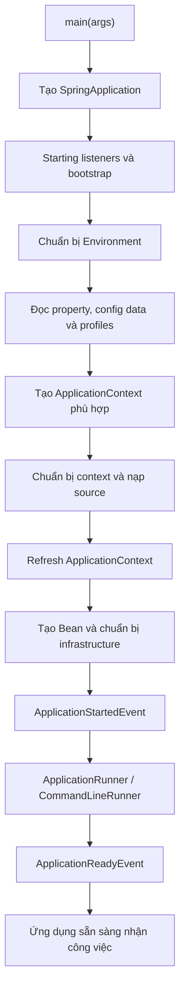
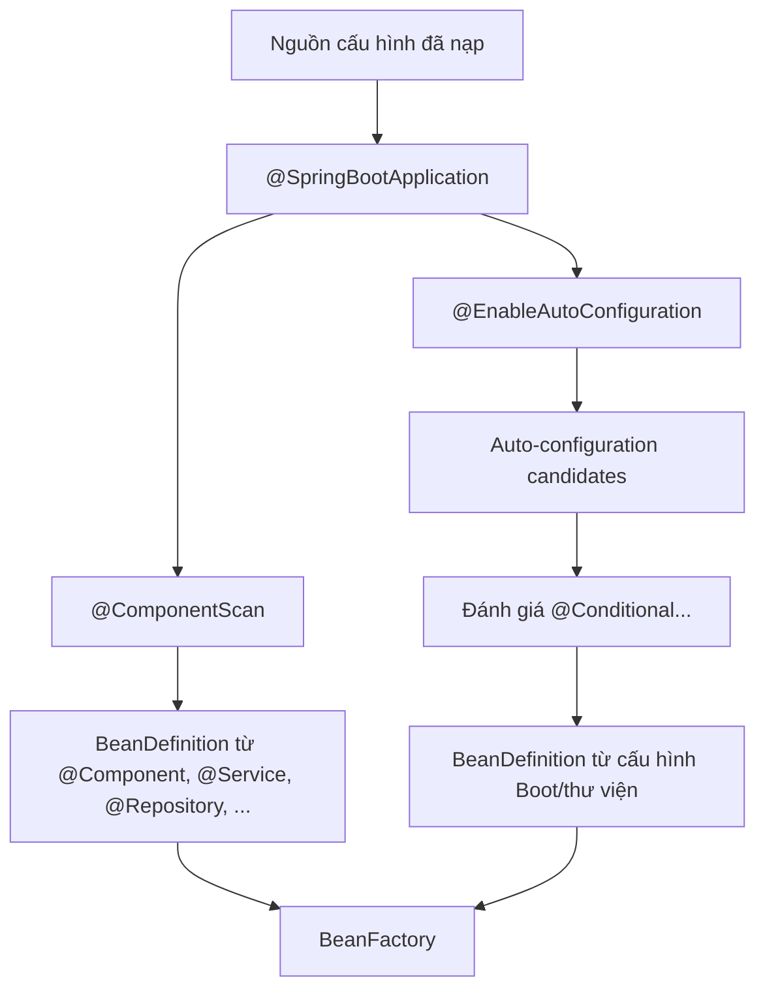

# SpringApplication.run và các giai đoạn khởi động tổng quát

Trong một ứng dụng Spring Boot, dòng lệnh quen thuộc nhất thường là:

```java
@SpringBootApplication
public class ShopApplication {
    public static void main(String[] args) {
        SpringApplication.run(ShopApplication.class, args);
    }
}
```

Một lời gọi ngắn này khởi động cả một chuỗi công việc: chuẩn bị cấu hình môi trường, chọn loại ApplicationContext, nạp các nguồn cấu hình, xử lý component scan và auto-configuration, tạo Bean, chuẩn bị web server nếu là ứng dụng web, chạy các startup runner và phát sự kiện báo ứng dụng đã sẵn sàng.

Hiểu luồng `SpringApplication.run(...)` giúp bạn biết **điều gì xảy ra trước và sau khi Bean được tạo**, đặt logic khởi động đúng thời điểm, đọc log startup và xác định nguyên nhân khi ứng dụng không lên được.

## 1. SpringApplication là gì?

`SpringApplication` là lớp trung tâm mà Spring Boot dùng để khởi chạy một ứng dụng Spring. Nó điều phối việc tạo và refresh ApplicationContext, chuẩn bị Environment, phát các application event và gọi những callback startup.

Cách dùng phổ biến nhất là static shortcut:

```java
public static void main(String[] args) {
    SpringApplication.run(ShopApplication.class, args);
}
```

Static method này tạo một đối tượng `SpringApplication` với source được cung cấp, sau đó gọi `run(args)`.

Bạn cũng có thể tạo đối tượng `SpringApplication` riêng khi muốn tùy chỉnh hành vi:

```java
public static void main(String[] args) {
    SpringApplication application =
            new SpringApplication(ShopApplication.class);

    application.setBannerMode(Banner.Mode.CONSOLE);
    application.setLogStartupInfo(true);

    application.run(args);
}
```

`ShopApplication.class` là một nguồn cấu hình chính. Tùy ứng dụng, nguồn đó có thể là class có `@SpringBootApplication`, `@Configuration` hoặc nguồn cấu hình khác phù hợp.

### run trả về gì?

`SpringApplication.run(...)` trả về một `ConfigurableApplicationContext`:

```java
ConfigurableApplicationContext context =
        SpringApplication.run(ShopApplication.class, args);
```

Context là container đang quản lý Bean và lifecycle của ứng dụng. Trong ứng dụng thông thường, bạn để context chạy cùng tiến trình. Với ứng dụng non-web, nếu không có thread/tác vụ nền giữ tiến trình sống, chương trình có thể kết thúc sau khi công việc startup hoàn tất.

Không cần tự gọi `context.refresh()` sau `SpringApplication.run(...)`: Boot đã thực hiện refresh trong quá trình `run`. Gọi refresh lại tùy tiện có thể gây lỗi hoặc tạo hành vi ngoài mong muốn.

## 2. Bức tranh tổng quát của quá trình khởi động

Có thể chia startup thành các giai đoạn lớn:



Đây là mô hình học tập, không phải danh sách mọi lời gọi nội bộ. Trong từng giai đoạn có nhiều extension point và event. Thứ tự chi tiết của web server, Bean lifecycle và listener có thể khác theo loại ApplicationContext và cấu hình ứng dụng.

Một điểm quan trọng: **context refresh hoàn tất trước khi Spring Boot gọi các runner**. Vì vậy `ApplicationRunner` và `CommandLineRunner` phù hợp với công việc cần các Bean của ứng dụng đã được khởi tạo.

## 3. Giai đoạn 1 — Tạo SpringApplication và xác định loại ứng dụng

Khi static `SpringApplication.run(...)` được gọi, Boot tạo `SpringApplication` từ source class và chuẩn bị các thành phần điều phối.

Trong giai đoạn xây dựng `SpringApplication`, Boot có thể:

- Xác định loại ứng dụng dựa trên classpath: Servlet web, Reactive web hoặc non-web.
- Tìm các initializer và listener được cấu hình.
- Chuẩn bị nguồn cấu hình ban đầu.
- Thiết lập các thuộc tính mặc định của ứng dụng.

### Ba loại ứng dụng phổ biến

| Loại | Đặc điểm | Ví dụ |
|---|---|---|
| Servlet web | Dùng servlet-based web stack, thường với Spring MVC và embedded Servlet server | REST API với `spring-boot-starter-web` |
| Reactive web | Dùng reactive web stack, thường với Spring WebFlux và reactive server | API dùng `spring-boot-starter-webflux` |
| Non-web | Không khởi tạo web server | Batch job, command-line worker |

Việc xác định loại web chịu ảnh hưởng của dependency có trên classpath và cấu hình `WebApplicationType`. Nếu cần, bạn có thể đặt tường minh:

```java
SpringApplication application =
        new SpringApplication(ShopApplication.class);
application.setWebApplicationType(WebApplicationType.NONE);
application.run(args);
```

Không nên thêm đồng thời nhiều web stack rồi trông chờ Boot luôn đoán đúng ý định kiến trúc. Nếu ứng dụng cần loại cụ thể, cấu hình rõ ràng giúp hành vi dễ hiểu hơn.

## 4. Giai đoạn 2 — Bắt đầu startup và chuẩn bị bootstrap

Khi `run` bắt đầu, Spring Boot khởi tạo bộ đo thời gian startup và chuẩn bị các thành phần phục vụ quá trình khởi động. Các `SpringApplicationRunListener` được thông báo rằng startup bắt đầu.

Một event quan trọng ở thời điểm sớm là `ApplicationStartingEvent`. Event này được phát rất sớm, trước khi Environment và ApplicationContext chính được chuẩn bị đầy đủ. Listener xử lý event này không nên giả định đã có thể lấy Bean nghiệp vụ từ context.

### ApplicationArguments

Boot chuyển các đối số dòng lệnh thành một đối tượng `ApplicationArguments`:

```java
ApplicationArguments arguments =
        new DefaultApplicationArguments(args);
```

Ví dụ chạy:

```bash
java -jar shop.jar --spring.profiles.active=dev --server.port=8085 import
```

Bạn có thể đọc:

- Option arguments: `--spring.profiles.active=dev`, `--server.port=8085`.
- Non-option arguments: `import`.

`ApplicationArguments` được Spring Boot cung cấp cho `ApplicationRunner`. Còn `CommandLineRunner` nhận trực tiếp mảng `String[]` ban đầu.

## 5. Giai đoạn 3 — Chuẩn bị Environment và nạp cấu hình

`Environment` là nơi Spring quản lý các property sources và active profiles. Trước khi tạo context, Spring Boot chuẩn bị Environment để các thành phần cấu hình có thể đọc được giá trị cần thiết.

Những việc quan trọng trong giai đoạn này:

1. Tạo hoặc sử dụng Environment phù hợp với loại ứng dụng.
2. Thêm property sources mặc định và property từ command line.
3. Nạp cấu hình từ các nguồn config data như `application.properties` hoặc `application.yml`.
4. Xác định active/default profiles.
5. Cho phép listener quan sát Environment đã được chuẩn bị.

Event tiêu biểu: `ApplicationEnvironmentPreparedEvent`. Event này được phát khi Environment đã được chuẩn bị. Đây là giai đoạn sớm hơn việc tạo và refresh ApplicationContext chính.

### Config Data: application.properties và application.yml

Ví dụ `src/main/resources/application.yml`:

```yaml
server:
  port: 8085

spring:
  application:
    name: shop-service
  profiles:
    active: dev

logging:
  level:
    com.example.shop: INFO
```

Boot đọc các nguồn cấu hình theo cơ chế Config Data. Cấu hình có thể đến từ:

- `application.properties` hoặc `application.yml`.
- File cấu hình theo profile như `application-dev.yml`.
- Biến môi trường.
- System properties của JVM.
- Đối số dòng lệnh.
- Các nguồn được import hoặc cấu hình bổ sung.

Ví dụ có thể ghi đè cổng bằng command line:

```bash
java -jar shop.jar --server.port=9090
```

Không nên ghi nhớ một thứ tự ưu tiên đơn giản áp dụng cho mọi nguồn trong mọi tình huống. Spring Boot có quy tắc property source precedence; các nguồn bên ngoài như command-line arguments thường có thể ghi đè giá trị trong file cấu hình, nhưng cần xem đúng phiên bản và nguồn cụ thể khi điều tra một property.

### Profiles được chọn trước khi tạo Bean

Ví dụ:

```properties
spring.profiles.active=dev
```

hoặc:

```bash
java -jar shop.jar --spring.profiles.active=prod
```

Profile ảnh hưởng đến cấu hình và Bean có điều kiện như:

```java
@Configuration
@Profile("dev")
public class DevelopmentConfiguration {
    @Bean
    DemoDataLoader demoDataLoader() {
        return new DemoDataLoader();
    }
}
```

Vì Environment được chuẩn bị trước khi context refresh và Bean được tạo, Spring có thể đánh giá `@Profile` trong quá trình xử lý cấu hình.

## 6. Giai đoạn 4 — Tạo ApplicationContext phù hợp

Sau khi Environment được chuẩn bị, Boot tạo ApplicationContext tương ứng với loại ứng dụng.

Ví dụ:

- Servlet web application thường dùng context dành cho Servlet web.
- Reactive web application dùng context phù hợp với reactive web.
- Non-web application dùng context không có web server.

Thông thường, bạn không cần tự tạo context bằng tay. `SpringApplication` chọn context dựa trên web application type và cấu hình liên quan.

Context là IoC container của ứng dụng. Nó quản lý BeanDefinition, Bean instance, dependency injection, event multicaster, lifecycle processor và những thành phần infrastructure khác.

### ApplicationContextInitializedEvent

Trong quá trình chuẩn bị context, Boot áp dụng các `ApplicationContextInitializer` đã đăng ký và phát event tương ứng: `ApplicationContextInitializedEvent`.

Initializer nhận một context có thể cấu hình và có thể thay đổi một số thiết lập trước khi refresh. Nó không phải nơi mặc định để chạy nghiệp vụ cần mọi Bean đã sẵn sàng.

Ví dụ một initializer:

```java
public class CustomContextInitializer
        implements ApplicationContextInitializer<ConfigurableApplicationContext> {

    @Override
    public void initialize(ConfigurableApplicationContext context) {
        // Điều chỉnh cấu hình context trước khi refresh.
    }
}
```

Bạn có thể đăng ký initializer qua cấu hình SpringApplication hoặc cơ chế registration phù hợp. Hãy giữ initializer nhỏ và tránh gọi `getBean(...)` sớm, vì context chưa hoàn tất quá trình refresh.

## 7. Giai đoạn 5 — Chuẩn bị context và nạp các nguồn cấu hình

Sau khi tạo context, Boot chuẩn bị context trước khi refresh:

- Gắn Environment vào context.
- Áp dụng các thiết lập như BeanNameGenerator hoặc ApplicationStartup nếu được cấu hình.
- Gọi các ApplicationContextInitializer.
- Đăng ký một số đối tượng bootstrap cần thiết.
- Nạp các source class đã truyền vào `SpringApplication`.
- Thông báo cho listener rằng context đã được chuẩn bị/nạp source.

Event quan trọng ở cuối giai đoạn chuẩn bị context là `ApplicationPreparedEvent`. Event này được phát sau khi context đã được chuẩn bị và các source đã được nạp, nhưng trước khi refresh hoàn tất. Không nên hiểu rằng toàn bộ Bean singleton đã sẵn sàng ở thời điểm này.

### @SpringBootApplication đóng vai trò gì?

Class main thường được đánh dấu:

```java
@SpringBootApplication
public class ShopApplication {
}
```

Annotation này kết hợp:

- `@SpringBootConfiguration`: đánh dấu nguồn cấu hình chính.
- `@EnableAutoConfiguration`: bật cơ chế auto-configuration.
- `@ComponentScan`: tìm component trong package gốc và các package con theo mặc định.

Trong refresh, Spring xử lý các cấu hình này để phát hiện Bean của ứng dụng và các auto-configuration được công bố trên classpath.

### Component scan và auto-configuration

Hai nguồn này đóng góp BeanDefinition:



Các class trên classpath chưa chắc tự trở thành Bean. Chúng cần được component scan, import, đăng ký qua `@Bean`, auto-configuration hoặc một cơ chế đăng ký khác.

## 8. Giai đoạn 6 — Refresh ApplicationContext

`refresh()` là một mốc trung tâm trong lifecycle của Spring container. Đây là lúc context xử lý các BeanDefinition, đăng ký post-processor, chuẩn bị infrastructure và tạo các singleton eager thông thường.

Ở mức khái quát, `AbstractApplicationContext.refresh()` đi qua các bước:

1. Chuẩn bị context cho refresh.
2. Tạo/lấy BeanFactory.
3. Chuẩn bị BeanFactory và các dependency cơ bản.
4. Gọi BeanFactoryPostProcessor.
5. Đăng ký BeanPostProcessor.
6. Khởi tạo message source và application event multicaster.
7. Thực hiện bước `onRefresh()` dành cho loại context.
8. Đăng ký application listeners.
9. Hoàn tất khởi tạo các singleton không lazy.
10. Hoàn tất refresh, gọi lifecycle processor và phát `ContextRefreshedEvent`.

Các bước trên giúp hiểu thứ tự tổng quát. Framework có thể thêm các bước nội bộ và một số Bean được tạo sớm hơn do là infrastructure hoặc được yêu cầu bởi post-processor.

### BeanFactoryPostProcessor xử lý BeanDefinition

BeanFactoryPostProcessor có thể thay đổi metadata của BeanDefinition trước khi các Bean nghiệp vụ thông thường được khởi tạo. Ví dụ, xử lý placeholder hoặc điều chỉnh định nghĩa Bean.

Một processor tiêu biểu là `ConfigurationClassPostProcessor`, xử lý các class cấu hình, component scan, `@Import`, `@Bean` và nhiều cấu trúc annotation liên quan.

### BeanPostProcessor xử lý Bean instance

Sau khi các định nghĩa đã được xử lý, Spring đăng ký BeanPostProcessor. Chúng tham gia vào lifecycle của từng Bean instance, ví dụ xử lý annotation, callback và tạo proxy.

Phân biệt:

| Thành phần | Xử lý | Thời điểm |
|---|---|---|
| BeanFactoryPostProcessor | BeanDefinition/metadata | Trước khi tạo các Bean thông thường |
| BeanPostProcessor | Bean instance | Trong quá trình khởi tạo từng Bean |

### Tạo singleton eager

Trong giai đoạn hoàn tất BeanFactory initialization, Spring thường tạo các singleton không lazy. Với từng Bean, container:

- Tạo object bằng constructor hoặc factory method.
- Phân giải và inject dependency.
- Gọi các callback Aware thích hợp.
- Chạy initialization callbacks như `@PostConstruct`, `afterPropertiesSet()` và custom init method.
- Áp dụng BeanPostProcessor, có thể tạo proxy.

Khi các bước cần thiết hoàn tất, Bean được công bố cho consumer.

Bean `@Lazy` có thể chưa được tạo cho tới khi có yêu cầu. Bean prototype được tạo theo từng lần container được yêu cầu. Do đó không phải mọi BeanDefinition đều tương ứng với một instance đã tồn tại ngay khi refresh kết thúc.

## 9. Web server được chuẩn bị trong quá trình refresh

Với ứng dụng Servlet web, context phù hợp sẽ chuẩn bị embedded web server trong lifecycle refresh. Server thường được tạo và khởi động như một phần của quá trình refresh, thông qua infrastructure của `ServletWebServerApplicationContext`.

Với ứng dụng Reactive web, context và server infrastructure tương ứng với reactive stack.

Điều này giải thích vì sao một số lỗi cổng, cấu hình servlet hoặc web server xuất hiện trong lúc startup trước khi ứng dụng báo ready.

Ví dụ cấu hình:

```properties
server.port=8085
```

Nếu cổng không thể bind hoặc web server không khởi tạo được, context refresh có thể thất bại và `SpringApplication.run(...)` không trả về context hoạt động bình thường.

Ứng dụng non-web không khởi tạo web server; nó vẫn có thể tạo context, Bean và chạy runner.

## 10. Các application event quan trọng trong startup

Spring Boot phát nhiều event để listener quan sát tiến trình. Một chuỗi thường gặp trong Boot hiện đại:

| Event | Thời điểm tổng quát |
|---|---|
| `ApplicationStartingEvent` | Startup bắt đầu, trước khi Environment/context chính sẵn sàng |
| `ApplicationEnvironmentPreparedEvent` | Environment đã được chuẩn bị |
| `ApplicationContextInitializedEvent` | Context đã được tạo và initializer đã được áp dụng |
| `ApplicationPreparedEvent` | Context đã chuẩn bị/nạp source, trước refresh |
| `ContextRefreshedEvent` | ApplicationContext hoàn tất refresh |
| `ApplicationStartedEvent` | Context đã refresh, trước khi gọi runner |
| `ApplicationReadyEvent` | Runner đã chạy xong, ứng dụng sắp được xem là ready |
| `ApplicationFailedEvent` | Startup thất bại ở một giai đoạn nào đó |

Tên và chi tiết event thuộc API của phiên bản Spring Boot cụ thể. Khi viết listener cần hỗ trợ nhiều phiên bản, hãy kiểm tra API tương ứng với phiên bản Boot mà ứng dụng/library nhắm tới.

### ApplicationStartedEvent khác ApplicationReadyEvent

Đây là hai event dễ nhầm:

- `ApplicationStartedEvent`: context đã refresh xong; Spring Boot phát event trước khi gọi `ApplicationRunner` và `CommandLineRunner`.
- `ApplicationReadyEvent`: các runner đã hoàn thành; ứng dụng đã đi qua những công việc startup mà Boot quản lý và sẵn sàng nhận traffic/công việc theo trạng thái readiness.

Vì vậy nếu cần chạy công việc startup sau khi Bean đã được tạo, runner là một điểm phù hợp. Nếu cần quan sát thời điểm ứng dụng hoàn tất runner, listener `ApplicationReadyEvent` phù hợp hơn.

## 11. Giai đoạn 7 — Gọi ApplicationRunner và CommandLineRunner

Sau khi context refresh và event `ApplicationStartedEvent` được phát, Spring Boot gọi các Bean implement:

- `ApplicationRunner`
- `CommandLineRunner`

Đây là callback dành cho công việc cần chạy một lần khi ứng dụng khởi động.

### ApplicationRunner

`ApplicationRunner` nhận `ApplicationArguments`, thuận tiện khi cần đọc option và non-option arguments:

```java
@Component
public class StartupReport implements ApplicationRunner {

    @Override
    public void run(ApplicationArguments args) {
        System.out.println("Option names: " + args.getOptionNames());
        System.out.println("Non-option args: " + args.getNonOptionArgs());
    }
}
```

Ví dụ chạy:

```bash
java -jar shop.jar --mode=import --dry-run file-a.csv
```

Runner có thể đọc `mode`, `dry-run` và non-option argument `file-a.csv`.

### CommandLineRunner

`CommandLineRunner` nhận nguyên mảng đối số:

```java
@Component
public class ImportStartupTask implements CommandLineRunner {

    @Override
    public void run(String... args) {
        System.out.println("Argument count: " + args.length);
    }
}
```

### Dùng @Bean thay vì component

Bạn cũng có thể khai báo runner bằng factory method:

```java
@Configuration(proxyBeanMethods = false)
public class StartupConfiguration {

    @Bean
    ApplicationRunner loadReferenceData(ReferenceDataService service) {
        return args -> service.loadIfRequired();
    }
}
```

Tham số `ReferenceDataService service` được container inject như một dependency bình thường. Đây là cách thể hiện rõ runner cần service nào.

### Điều khiển thứ tự runner

Nếu có nhiều runner, có thể dùng `Ordered` hoặc `@Order`:

```java
@Component
@Order(10)
public class FirstStartupTask implements ApplicationRunner {
    @Override
    public void run(ApplicationArguments args) {
        // Chạy trước runner có order lớn hơn.
    }
}

@Component
@Order(20)
public class SecondStartupTask implements ApplicationRunner {
    @Override
    public void run(ApplicationArguments args) {
        // Chạy sau FirstStartupTask.
    }
}
```

Giá trị order nhỏ hơn được ưu tiên trước theo quy tắc ordering của Spring. Khi runner phụ thuộc runner khác, hãy cân nhắc gom công việc có thứ tự vào một service điều phối thay vì tạo nhiều runner liên kết ngầm.

### Runner có thể làm startup thất bại

Nếu một runner ném exception không được xử lý, quá trình `SpringApplication.run(...)` có thể thất bại và Boot phát `ApplicationFailedEvent`. Vì vậy:

- Chỉ đặt công việc thực sự cần hoàn tất trước readiness vào runner.
- Xử lý lỗi có chủ đích; đừng nuốt exception một cách mù quáng.
- Tránh chạy tác vụ rất dài trong runner nếu ứng dụng cần sẵn sàng phục vụ sớm.
- Với công việc nền dài hạn, cân nhắc cơ chế job/queue/background worker và lifecycle riêng.

## 12. Giai đoạn 8 — ApplicationReadyEvent và trạng thái readiness

Sau khi các runner hoàn tất, Spring Boot phát `ApplicationReadyEvent`.

Event này cho biết ứng dụng đã hoàn tất giai đoạn startup do Boot điều phối. Sau đó trạng thái readiness có thể chuyển sang `ACCEPTING_TRAFFIC`.

Boot cũng có availability state, trong đó:

- **Liveness:** ứng dụng còn sống và không nên bị hệ thống điều phối khởi động lại chỉ vì một dependency tạm thời không khỏe.
- **Readiness:** ứng dụng đã sẵn sàng nhận traffic hay chưa.

Trong chuỗi startup thông thường, sau `ApplicationStartedEvent`, Boot chuyển liveness sang trạng thái phù hợp; sau khi runner hoàn tất và `ApplicationReadyEvent` được phát, readiness chuyển sang trạng thái chấp nhận traffic.

Nếu triển khai trên nền tảng có health probe, trạng thái readiness có thể được dùng để quyết định khi nào đưa instance vào load balancer. Một ứng dụng đã mở cổng nhưng runner vẫn đang import dữ liệu chưa chắc đã nên nhận request nghiệp vụ.

### ApplicationReadyEvent listener

Ví dụ:

```java
@Component
public class ReadyLogger {

    @EventListener
    public void onReady(ApplicationReadyEvent event) {
        System.out.println("Shop application is ready");
    }
}
```

Listener này chạy sau runner. Nó phù hợp cho log hoặc một số hành động nhẹ khi ứng dụng đã sẵn sàng. Không nên đặt công việc nặng hoặc không có retry strategy vào listener nếu nó có thể làm startup kéo dài hoặc thất bại ngoài dự kiến.

## 13. Nếu startup thất bại thì chuyện gì xảy ra?

Startup có thể thất bại ở nhiều giai đoạn:

| Giai đoạn | Ví dụ lỗi |
|---|---|
| Chuẩn bị Environment | Property sai định dạng, config data không đọc được |
| Tạo/chuẩn bị context | Context initializer ném exception |
| Xử lý cấu hình | Thiếu class, cấu hình không hợp lệ, condition hoặc import sai |
| Tạo Bean | Thiếu dependency, nhiều Bean mơ hồ, constructor/init callback lỗi |
| Khởi tạo web server | Cổng đã được sử dụng, server configuration lỗi |
| Chạy runner | Tác vụ startup ném exception |

Khi thất bại, Boot xử lý lỗi, đóng context nếu context đã được tạo phù hợp, thông báo listener qua `ApplicationFailedEvent` và ném exception ra caller. Trong `main`, exception không được xử lý có thể khiến tiến trình kết thúc với lỗi.

### Cách đọc stack trace

Đừng chỉ nhìn exception ngoài cùng như `ApplicationContextException` hoặc `BeanCreationException`. Hãy lần theo chuỗi `Caused by` để tìm nguyên nhân gốc:

- `NoSuchBeanDefinitionException`: thiếu Bean phù hợp.
- `NoUniqueBeanDefinitionException`: nhiều Bean cùng kiểu, chưa xác định được ứng viên.
- `BeanCreationException`: tạo Bean hoặc callback khởi tạo thất bại; xem nguyên nhân lồng bên trong.
- `PortInUseException` hoặc lỗi bind tương tự: cổng web server không khả dụng.
- `ConfigDataLocationNotFoundException`: nguồn cấu hình được import/đề cập không tồn tại hoặc không thể đọc theo cấu hình.

### Debug condition report

Nếu nghi ngờ auto-configuration không được áp dụng, bật debug:

```bash
java -jar shop.jar --debug
```

Hoặc đặt:

```properties
debug=true
```

Condition Evaluation Report giúp biết cấu hình nào khớp hoặc không khớp và điều kiện nào dẫn đến kết quả đó.

## 14. Tùy chỉnh quá trình startup

Spring Boot cung cấp nhiều extension point. Mỗi loại phù hợp với một thời điểm khác nhau.

| Cơ chế | Thời điểm | Công dụng phù hợp |
|---|---|---|
| `ApplicationListener` | Khi event tương ứng được phát | Quan sát event startup/context |
| `ApplicationContextInitializer` | Sau khi context tạo, trước refresh | Điều chỉnh context trước khi Bean khởi tạo |
| `BeanFactoryPostProcessor` | Trong refresh, trước Bean thông thường | Điều chỉnh BeanDefinition |
| `BeanPostProcessor` | Trong lifecycle từng Bean | Xử lý instance, tạo wrapper/proxy |
| `ApplicationRunner` | Sau refresh, trước ready | Công việc startup cần Bean sẵn sàng |
| `CommandLineRunner` | Sau refresh, trước ready | Công việc startup cần raw args |
| `@EventListener(ApplicationReadyEvent.class)` | Sau runner | Hành động nhẹ khi ứng dụng đã ready |

Không nên chọn extension point chỉ vì nó có thể chạy code. Hãy chọn theo trạng thái mà code cần:

- Cần chỉnh property/context trước khi Bean được tạo? Xem initializer hoặc cấu hình Environment phù hợp.
- Cần thay đổi BeanDefinition? Xem BeanFactoryPostProcessor.
- Cần xử lý từng object sau khi tạo? Xem BeanPostProcessor.
- Cần dùng service/repository đã được inject? Dùng runner.
- Cần biết ứng dụng đã ready? Dùng `ApplicationReadyEvent`.

### ApplicationListener ví dụ

```java
@Component
public class StartupEventLogger {

    @EventListener
    public void onStarted(ApplicationStartedEvent event) {
        System.out.println("Context refreshed; runners are next");
    }

    @EventListener
    public void onReady(ApplicationReadyEvent event) {
        System.out.println("Runners completed; application is ready");
    }
}
```

Lưu ý các listener dạng component cần được đăng ký trong context nên không thể quan sát những event xảy ra trước khi context được tạo. Với event rất sớm như `ApplicationStartingEvent`, có thể cần đăng ký listener ở cấp `SpringApplication` hoặc qua cơ chế listener registration tương ứng.

## 15. Ví dụ tổng hợp: quan sát startup theo thời gian

Ta tạo ứng dụng đơn giản để thấy thứ tự của constructor, `@PostConstruct`, runner và ready event.

**Main class**

```java
@SpringBootApplication
public class StartupDemoApplication {
    public static void main(String[] args) {
        SpringApplication.run(StartupDemoApplication.class, args);
    }
}
```

**Bean có lifecycle callback**

```java
@Component
public class StartupProbe {

    public StartupProbe() {
        System.out.println("1. StartupProbe constructor");
    }

    @PostConstruct
    void initialize() {
        System.out.println("2. StartupProbe @PostConstruct");
    }
}
```

**Runner**

```java
@Component
public class StartupTask implements ApplicationRunner {

    @Override
    public void run(ApplicationArguments args) {
        System.out.println("3. ApplicationRunner");
    }
}
```

**Ready event listener**

```java
@Component
public class StartupReadyListener {

    @EventListener
    public void onReady(ApplicationReadyEvent event) {
        System.out.println("4. ApplicationReadyEvent");
    }
}
```

Với Bean eager singleton thông thường, log minh họa có thứ tự:

```text
1. StartupProbe constructor
2. StartupProbe @PostConstruct
3. ApplicationRunner
4. ApplicationReadyEvent
```

Đây là thứ tự tương đối của các điểm quan sát trong ví dụ, không phải log đầy đủ của mọi Bean trong ứng dụng. Nhiều Bean khác có thể được tạo xen kẽ; Bean lazy có thể chưa được tạo; thứ tự giữa các Bean không có quan hệ phụ thuộc không nên được coi là cố định.

## 16. Những nhầm lẫn thường gặp về SpringApplication.run

**“Gọi run là Bean được tạo ngay lập tức theo thứ tự file.”** Không. Spring xử lý BeanDefinition, dependency graph, scope và lifecycle; thứ tự không đơn giản theo thứ tự class hoặc method trong source.

**“ApplicationPreparedEvent nghĩa là tất cả Bean đã sẵn sàng.”** Không. Event này xảy ra trước refresh. Các Bean thông thường được khởi tạo trong quá trình refresh.

**“ApplicationStartedEvent và ApplicationReadyEvent giống nhau.”** Không. `ApplicationStartedEvent` được phát sau refresh nhưng trước runner; `ApplicationReadyEvent` được phát sau runner.

**“@PostConstruct là nơi phù hợp để chạy mọi tác vụ startup.”** Không. Nó thuộc lifecycle của một Bean cụ thể và không bảo đảm mọi Bean khác đã được tạo. Công việc cần context đã refresh thường phù hợp hơn với runner.

**“ApplicationRunner chạy trước khi Bean được inject.”** Không. Runner là một Bean và được gọi sau khi context refresh; dependency của nó được container phân giải như các Bean khác.

**“Chỉ ứng dụng web mới cần ApplicationContext.”** Không. Non-web app vẫn dùng Spring container và có thể chạy runner, scheduling hoặc các service nền.

**“Context refresh xong thì ứng dụng chắc chắn đã nhận traffic.”** Không. Runner còn có thể phải hoàn thành trước khi Boot báo ready; readiness cũng có thể chịu ảnh hưởng của health/lifecycle integration.

**“Thứ tự auto-configuration quyết định thứ tự Bean instance được tạo.”** Không. Ordering chủ yếu điều khiển xử lý các class cấu hình; dependency graph và scope mới quyết định việc tạo instance.

## 17. Chẩn đoán startup theo giai đoạn

Khi ứng dụng không khởi động, hãy xác định log dừng ở đâu:

| Dấu hiệu | Nên kiểm tra |
|---|---|
| Chưa thấy Environment được chuẩn bị | Listener, bootstrap, config data, profile và property source |
| Báo không tìm thấy config file/import | Đường dẫn Config Data, tên file, profile và resource đóng gói |
| Context tạo nhưng refresh thất bại | BeanDefinition, component scan, auto-configuration, dependency và lifecycle callback |
| Báo lỗi port/server | `server.port`, loại web application, embedded server và process đang giữ cổng |
| Đã thấy ApplicationStartedEvent nhưng chưa ready | ApplicationRunner/CommandLineRunner và tác vụ startup |
| Ready rồi nhưng health không tốt | Health indicators, kết nối hệ thống ngoài và readiness configuration |

Khi cần biết một event đã được phát, có thể viết listener nhỏ ghi log timestamp. Khi cần biết một Bean nào khởi tạo lỗi, hãy đọc stack trace gốc và xem dependency graph. Khi cần biết auto-configuration bị bỏ qua, dùng condition report.

## 18. Thực hành: phân biệt các mốc startup

Với một project Spring Boot nhỏ, hãy thử:

1. Thêm log trong constructor của một `@Component`.
2. Thêm log trong `@PostConstruct` của cùng Bean.
3. Thêm một `ApplicationRunner` và log khi runner chạy.
4. Thêm listener cho `ApplicationStartedEvent` và `ApplicationReadyEvent`.
5. Chạy ứng dụng non-web, sau đó thử ứng dụng web với `spring-boot-starter-web`.
6. Đặt `@Lazy` lên một Bean và quan sát thời điểm constructor được gọi.
7. Thêm một runner ném exception để quan sát startup failure và event thất bại.
8. Thay `server.port` qua file cấu hình và command line để thấy Environment nhận giá trị nào.

Các thử nghiệm này giúp tách biệt bốn mốc dễ bị gộp chung:

- BeanDefinition đã được đăng ký.
- Bean instance đã được tạo và initialization hoàn tất.
- ApplicationContext đã refresh.
- Ứng dụng đã chạy xong runner và báo ready.

## 19. Mô hình ghi nhớ cuối cùng

```text
SpringApplication.run(...)
    |
    +-- Starting events / bootstrap
    |
    +-- Prepare Environment
    |      +-- command line / system / config data
    |      +-- profiles / property sources
    |
    +-- Create ApplicationContext
    |
    +-- Prepare context and load sources
    |      +-- initializers
    |      +-- @SpringBootApplication
    |      +-- component scan / auto-configuration candidates
    |
    +-- Refresh context
    |      +-- BeanFactoryPostProcessor
    |      +-- BeanPostProcessor registration
    |      +-- Bean creation / dependency injection
    |      +-- initialization callbacks / proxies
    |      +-- web infrastructure where applicable
    |
    +-- ApplicationStartedEvent
    |
    +-- ApplicationRunner / CommandLineRunner
    |
    +-- ApplicationReadyEvent
           |
           +-- Application is ready
```

`SpringApplication.run(...)` điều phối toàn bộ quá trình từ lúc nhận `main(args)` đến khi ứng dụng hoàn tất startup. Environment và profile được chuẩn bị trước khi Bean được tạo; ApplicationContext được nạp cấu hình rồi refresh; trong refresh, Spring xử lý BeanDefinition, dependency injection và lifecycle; sau đó Boot gọi runner và phát event báo ready.

Khi biết mỗi giai đoạn chịu trách nhiệm điều gì, bạn sẽ chọn đúng nơi để cấu hình, khởi tạo dữ liệu, lắng nghe event và xử lý lỗi. Điều đó giúp ứng dụng Spring Boot dễ khởi động, dễ chẩn đoán và tránh đặt công việc vào một thời điểm mà container chưa sẵn sàng.
