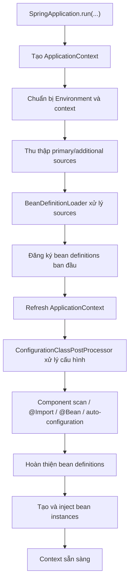
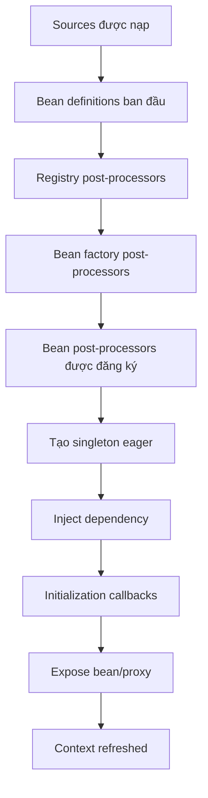

# Đăng ký nguồn cấu hình và nạp bean definition

Khi gọi `SpringApplication.run(...)`, Spring Boot cần biết bắt đầu xây dựng application context từ đâu. Ứng dụng có thể cung cấp một class khởi động, thêm các class cấu hình khác hoặc đưa một nhóm module vào quá trình cấu hình. Spring Boot dùng những nguồn này để đăng ký **bean definitions**. Sau đó, Spring xử lý metadata cấu hình, giải quyết dependency và tạo bean instances theo vòng đời của application context.

Trong chương **SpringApplication** của *Spring Boot Fundamentals*, bài học này giải thích cách đăng ký nguồn cấu hình, vai trò của primary source, cách Spring Boot nạp bean definitions và sự khác nhau giữa đăng ký một nguồn với tạo một bean instance.

Đây là nền tảng để hiểu vì sao một class có thể nằm trên classpath nhưng chưa được xử lý như cấu hình, vì sao thêm một source có thể làm nhiều bean được đăng ký, và vì sao `SpringApplication.run(...)` không chỉ đơn giản là gọi hàm `main`.

## 1. Bắt đầu từ SpringApplication.run(...)

Một ứng dụng Spring Boot thường có class khởi động:

```java
package com.example.shop;

import org.springframework.boot.SpringApplication;
import org.springframework.boot.autoconfigure.SpringBootApplication;

@SpringBootApplication
public class ShopApplication {

    public static void main(String[] args) {
        SpringApplication.run(ShopApplication.class, args);
    }
}
```

Lời gọi `SpringApplication.run(ShopApplication.class, args)` truyền `ShopApplication.class` vào Spring Boot như **nguồn cấu hình chính** (primary source). Spring Boot dùng nguồn đó để bắt đầu xây dựng application context.

`@SpringBootApplication` là annotation tổng hợp, kết hợp các vai trò chính:

- `@SpringBootConfiguration`: đánh dấu class là nguồn cấu hình Spring Boot.
- `@EnableAutoConfiguration`: bật cơ chế auto-configuration.
- `@ComponentScan`: tìm component trong phạm vi scan mặc định hoặc phạm vi được cấu hình.

Vì vậy, class khởi động thường là điểm bắt đầu để Spring phát hiện cấu hình của ứng dụng. Tuy nhiên, class này không phải toàn bộ nguồn cấu hình của context: các class được import, các component được scan, auto-configuration và những nguồn được đăng ký thêm cũng có thể đóng góp bean definitions.

## 2. Nguồn cấu hình (source) là gì?

Trong ngữ cảnh SpringApplication, **source** là đầu vào mà Spring Boot dùng để tìm hoặc đăng ký bean definitions. Source không đồng nghĩa với bean instance và cũng không nhất thiết là một bean cụ thể.

Các loại source mà cơ chế nạp cấu hình có thể xử lý gồm:

- **Java class:** class cấu hình, component hoặc class được đăng ký trực tiếp.
- **Package:** package cần scan để tìm component candidates.
- **Resource:** tài nguyên cấu hình, ví dụ XML.
- **Tên hoặc đường dẫn dạng chuỗi:** được loader diễn giải theo quy tắc tương ứng.

Với ứng dụng Spring Boot hiện đại, Java configuration và component scanning là cách phổ biến. XML hoặc các dạng source khác vẫn có thể được sử dụng trong hệ thống tích hợp hoặc ứng dụng chuyển đổi từ cấu hình cũ.

### 2.1. Source không phải dependency trong Maven/Gradle

Hãy phân biệt hai việc:

1. **Dependency của build:** đưa thư viện hoặc module vào compile/runtime classpath.
2. **Source của SpringApplication:** cho Spring biết nguồn nào cần được xử lý để đăng ký bean definitions.

Ví dụ, thêm module `pricing-core` vào Gradle làm cho class `PricingConfiguration` có mặt trên classpath. Nhưng nếu class đó không được scan, import hoặc đăng ký như source, nó chưa chắc đã tham gia application context.

Có class trên classpath là điều kiện để JVM nạp class; có bean definition trong context là một bước đăng ký riêng.

### 2.2. Một source có thể dẫn tới nhiều bean definitions

Một class cấu hình có thể chứa nhiều phương thức `@Bean`, import cấu hình khác hoặc bật component scan. Khi source được xử lý, nó có thể dẫn tới một tập bean definitions chứ không chỉ một definition.

Ví dụ:

```java
@Configuration(proxyBeanMethods = false)
public class CommerceConfiguration {

    @Bean
    CurrencyService currencyService() {
        return new CurrencyService();
    }

    @Bean
    TaxService taxService() {
        return new TaxService();
    }
}
```

Khi `CommerceConfiguration` được xử lý như configuration source, Spring đăng ký các definition tương ứng với `currencyService` và `taxService`. Instance thường được tạo ở giai đoạn tiếp theo theo scope và dependency.

## 3. Primary source và additional source

**Primary source** là nguồn chính được truyền vào khi tạo `SpringApplication`. Trong ứng dụng tiêu chuẩn, đó thường là class có `@SpringBootApplication`.

Ví dụ:

```java
public static void main(String[] args) {
    SpringApplication.run(ShopApplication.class, args);
}
```

Ngoài primary source, ứng dụng có thể đăng ký thêm nguồn cấu hình bằng constructor varargs:

```java
public static void main(String[] args) {
    SpringApplication application = new SpringApplication(
            ShopApplication.class,
            CommerceConfiguration.class,
            AuditConfiguration.class
    );
    application.run(args);
}
```

Các class được truyền vào constructor là các primary sources của lần khởi động đó. Spring Boot nạp chúng trong cùng application context. Mỗi class cần có metadata hoặc cách đăng ký phù hợp với mục đích sử dụng.

Một cách khác là khai báo cấu hình bổ sung ngay trong primary source:

```java
@SpringBootApplication
@Import({
        CommerceConfiguration.class,
        AuditConfiguration.class
})
public class ShopApplication {
}
```

Hai cách có điểm kích hoạt khác nhau:

- **Bổ sung primary source:** đưa thêm class vào tập nguồn mà SpringApplication nạp.
- **`@Import`:** một configuration source chỉ định những class cấu hình/thành phần cần được xử lý trong quá trình phân tích configuration.

Trong ứng dụng lớn, nên chọn một cách tổ chức nhất quán. Đừng vừa đưa cùng một cấu hình vào primary sources, vừa import lại nó nếu không có lý do.

### 3.1. Dùng SpringApplicationBuilder

Khi cần cấu hình cách khởi động hoặc tổ chức nhiều context, Spring Boot cung cấp `SpringApplicationBuilder`.

Ví dụ:

```java
new SpringApplicationBuilder(ShopApplication.class)
        .sources(CommerceConfiguration.class, AuditConfiguration.class)
        .run(args);
```

Builder giúp ghép các source và cấu hình startup theo một API fluent. Trong ứng dụng thông thường chỉ có một context, không cần dùng builder nếu `SpringApplication.run(...)` đã đáp ứng nhu cầu.

## 4. Đăng ký source khác với đăng ký bean

Đây là điểm dễ nhầm nhất của bài học. Một class được truyền làm source có thể được đăng ký như một bean definition, nhưng việc class đó được xử lý như configuration source còn phụ thuộc metadata và annotation của nó.

Ví dụ class cấu hình:

```java
@Configuration
public class GreetingConfiguration {

    @Bean
    GreetingService greetingService() {
        return new GreetingService();
    }
}
```

Khi `GreetingConfiguration.class` được nạp như source, Spring đăng ký class cấu hình và trong giai đoạn xử lý configuration, phát hiện phương thức `@Bean` để đăng ký thêm `GreetingService`.

Một class component thông thường cũng có thể được đăng ký trực tiếp:

```java
public class GreetingService {

    public String greet() {
        return "Hello Spring";
    }
}
```

Nếu truyền `GreetingService.class` làm source class cho SpringApplication, loader có thể đăng ký class đó như một bean definition trực tiếp. Tuy nhiên, class này không vì thế mà trở thành configuration class: nó không tự cung cấp các `@Bean` method khác, không tự bật component scan và không tự import module.

Trong ứng dụng thông thường, hãy thể hiện ý định rõ:

- Dùng `@Service`/`@Component` để component scan đăng ký class.
- Dùng `@Configuration` và `@Bean` để khai báo cách tạo object.
- Dùng `@Import` hoặc primary sources để đưa configuration vào context.

### 4.1. Bốn tầng cần phân biệt

| Tầng | Câu hỏi | Ví dụ |
| --- | --- | --- |
| Classpath | JVM có thể tìm thấy class không? | Dependency chứa `GreetingService` đã có |
| Source | Spring Boot được yêu cầu xử lý nguồn nào? | `ShopApplication.class` |
| Bean definition | Container đã có metadata đăng ký bean chưa? | Definition `greetingService` |
| Bean instance | Object cụ thể đã được tạo chưa? | Một `GreetingService` singleton |

Không nên suy ra tầng sau chỉ từ tầng trước. Có class trên classpath không có nghĩa đã được đăng ký; có source không có nghĩa mọi class liên quan đều thành bean; có bean definition cũng không có nghĩa instance đã được tạo ngay.

## 5. Spring Boot nạp bean definitions như thế nào?

Trong quá trình chuẩn bị context, Spring Boot sử dụng cơ chế loader để đọc các source được cung cấp và đăng ký bean definitions vào registry/bean factory phù hợp.

Ở mức khái quát:



Sơ đồ mô tả luồng chính, không phải danh sách mọi bước nội bộ. Thứ tự thực tế còn có các bước environment post-processing, context initializers, listeners, registry post-processors, bean factory post-processors và bean post-processors.

### 5.1. BeanDefinitionLoader

Trong Spring Boot, `BeanDefinitionLoader` là thành phần hạ tầng dùng để đăng ký bean definitions từ các source được cung cấp cho SpringApplication. Nó phối hợp các reader/scanner phù hợp với loại source.

Ở mức khái niệm, loader có thể xử lý những nguồn như:

- **Class Java:** đăng ký bean definition dựa trên annotation metadata.
- **Package:** scan package để tìm component.
- **Resource:** đọc định nghĩa bean từ tài nguyên như XML.
- **Chuỗi:** diễn giải tên hoặc đường dẫn theo quy tắc loader.

Ứng dụng thường không cần tự tạo `BeanDefinitionLoader`. `SpringApplication` sử dụng nó trong quy trình khởi động. Đây là chi tiết hạ tầng nội bộ; code ứng dụng nên dùng các API cấu hình công khai.

### 5.2. AnnotatedBeanDefinitionReader

Với Java class, Spring có thể dùng `AnnotatedBeanDefinitionReader` để đăng ký bean definition dựa trên annotation và metadata của class.

Ví dụ Spring Framework thuần:

```java
AnnotationConfigApplicationContext context =
        new AnnotationConfigApplicationContext();

context.register(ShopConfiguration.class);
context.refresh();
```

Đây là ví dụ minh họa đăng ký configuration class bằng annotation metadata. Trong Spring Boot, việc đăng ký nguồn thường được SpringApplication điều phối.

### 5.3. ClassPathBeanDefinitionScanner

Component scanning sử dụng scanner để tìm các class phù hợp trong package. Các stereotype phổ biến gồm:

- `@Component`
- `@Service`
- `@Repository`
- `@Controller`
- `@RestController`

`@SpringBootApplication` bật component scan theo package của class ứng dụng và các package con theo cấu hình mặc định. Scanner tìm component candidates rồi đăng ký bean definitions cho các class phù hợp.

Component scanning là một cơ chế đăng ký bean definitions; nó không phải toàn bộ quá trình nạp source.

### 5.4. XmlBeanDefinitionReader

Trong ứng dụng có cấu hình XML, Spring có thể sử dụng reader để nạp bean definitions từ resource XML. Ví dụ:

```xml
<beans xmlns="http://www.springframework.org/schema/beans"
       xmlns:xsi="http://www.w3.org/2001/XMLSchema-instance"
       xsi:schemaLocation="
           http://www.springframework.org/schema/beans
           https://www.springframework.org/schema/beans/spring-beans.xsd">

    <bean id="legacyGreetingService"
          class="com.example.legacy.LegacyGreetingService"/>
</beans>
```

Trong Java configuration có thể import resource:

```java
@Configuration
@ImportResource("classpath:legacy-beans.xml")
class LegacyIntegrationConfiguration {
}
```

XML không phải cách cấu hình ưu tiên cho ứng dụng Spring Boot mới, nhưng vẫn hữu ích khi tích hợp hệ thống cũ hoặc thư viện đã cung cấp sẵn XML bean definitions.

## 6. Nguồn chính được đăng ký trước, configuration được phân tích sau

Một class có `@SpringBootApplication` là nguồn ban đầu. Khi Spring refresh context, các infrastructure bean factory post-processors tiếp tục phân tích configuration metadata.

Một thành phần quan trọng là `ConfigurationClassPostProcessor`. Nó xử lý các cấu trúc Java configuration như:

- `@Configuration`.
- `@ComponentScan`.
- `@Import`.
- `@ImportResource`.
- Các phương thức `@Bean`.
- Các điều kiện và metadata cấu hình liên quan.

Ví dụ:

```java
@SpringBootApplication
@Import(PricingConfiguration.class)
class ShopApplication {
}
```

Khi configuration class được xử lý, Spring phát hiện `PricingConfiguration` và các bean definitions do nó khai báo. Nếu configuration đó tiếp tục import class khác hoặc bật component scan, các definitions bổ sung cũng có thể được đăng ký.

Điều này giải thích vì sao một source có thể mở rộng thành một mạng lưới cấu hình. Nguồn ban đầu là điểm vào; các annotation cấu hình quyết định những nguồn và định nghĩa tiếp theo.

## 7. Ví dụ hoàn chỉnh: thêm configuration source cho một module

Giả sử project có cấu trúc:

```text
src/main/java/
├── com/example/shop/
│   └── ShopApplication.java
└── com/example/shared/pricing/
    ├── PricingConfiguration.java
    └── TaxCalculator.java
```

Package `com.example.shared.pricing` nằm ngoài package con của `com.example.shop`, vì vậy component scan mặc định từ `ShopApplication` không tự quét package này.

### 7.1. Tạo service trong module pricing

```java
package com.example.shared.pricing;

import java.math.BigDecimal;

public class TaxCalculator {

    private final BigDecimal rate;

    public TaxCalculator(BigDecimal rate) {
        this.rate = rate;
    }

    public BigDecimal calculate(BigDecimal amount) {
        return amount.multiply(rate);
    }
}
```

### 7.2. Tạo configuration source

```java
package com.example.shared.pricing;

import java.math.BigDecimal;
import org.springframework.context.annotation.Bean;
import org.springframework.context.annotation.Configuration;

@Configuration(proxyBeanMethods = false)
public class PricingConfiguration {

    @Bean
    public TaxCalculator taxCalculator() {
        return new TaxCalculator(new BigDecimal("0.08"));
    }
}
```

### 7.3. Đăng ký source bằng @Import

```java
package com.example.shop;

import com.example.shared.pricing.PricingConfiguration;
import com.example.shared.pricing.TaxCalculator;
import java.math.BigDecimal;
import org.springframework.boot.CommandLineRunner;
import org.springframework.boot.SpringApplication;
import org.springframework.boot.autoconfigure.SpringBootApplication;
import org.springframework.context.annotation.Bean;
import org.springframework.context.annotation.Import;

@SpringBootApplication
@Import(PricingConfiguration.class)
public class ShopApplication {

    public static void main(String[] args) {
        SpringApplication.run(ShopApplication.class, args);
    }

    @Bean
    CommandLineRunner demo(TaxCalculator calculator) {
        return args -> System.out.println(
                calculator.calculate(new BigDecimal("100000"))
        );
    }
}
```

Khi ứng dụng khởi động, Spring xử lý `ShopApplication`, theo `@Import` để xử lý `PricingConfiguration`, đăng ký bean definition cho `taxCalculator`, rồi cung cấp bean cho tham số `CommandLineRunner`.

Kết quả phép tính với số liệu ví dụ là `8000.00` nếu đầu vào `BigDecimal` có scale hai chữ số. Ví dụ chỉ minh họa cơ chế đăng ký và DI, không phải quy tắc tính thuế thực tế.

### 7.4. Nếu không import PricingConfiguration?

Nếu package pricing nằm ngoài phạm vi scan mặc định và không có cơ chế đăng ký khác, `PricingConfiguration` không được xử lý. Khi đó, `TaxCalculator` không có bean definition để Spring inject vào `demo(...)`, và context có thể thất bại khi khởi tạo do thiếu dependency.

Đây là ví dụ điển hình cho việc **có class trên classpath chưa đủ để có bean trong context**.

## 8. Nạp nhiều primary sources bằng SpringApplication

Khi một ứng dụng cần nhiều configuration class làm nguồn đầu vào, có thể truyền nhiều class vào constructor của `SpringApplication`:

```java
public static void main(String[] args) {
    SpringApplication application = new SpringApplication(
            ShopApplication.class,
            PricingConfiguration.class,
            AuditConfiguration.class
    );
    application.run(args);
}
```

Đây là cách đưa nhiều class vào tập primary sources của lần khởi động. Cần nhớ rằng source class được đăng ký theo metadata của nó; một class cấu hình có thể mở rộng context qua `@Bean`, `@Import` hoặc component scan.

### 8.1. Khi nào nên dùng nhiều primary sources?

Có thể phù hợp khi:

- Ứng dụng được ghép từ một số module cấu hình độc lập.
- Một launcher muốn chọn cấu hình theo loại ứng dụng.
- Test hoặc tool cần khởi tạo context từ một tập source cụ thể.
- Cấu hình được tổ chức thành các nhóm mà người khởi động chủ động kết hợp.

Trong ứng dụng thông thường, `@Import` trên configuration chính thường thể hiện quan hệ cấu hình dễ đọc hơn việc đưa quá nhiều class vào `main`.

### 8.2. Không nên biến main thành nơi wiring toàn bộ ứng dụng

Nếu `main` liệt kê hàng chục class cấu hình, việc tổ chức module có thể đã thiếu điểm tập trung. Có thể gom các cấu hình liên quan vào một class cấu hình cấp cao:

```java
@Configuration(proxyBeanMethods = false)
@Import({
        PricingConfiguration.class,
        AuditConfiguration.class,
        NotificationConfiguration.class
})
class CommerceModuleConfiguration {
}
```

Ứng dụng chỉ cần import `CommerceModuleConfiguration`. Cách này tạo ranh giới module dễ hiểu và giảm độ phức tạp của launcher.

## 9. Nạp source dạng package hoặc resource

Spring Boot có cơ chế loader cho nhiều loại source, nhưng trong ứng dụng hiện đại, phần lớn code sử dụng class cấu hình. Những loại source khác chủ yếu hữu ích trong tích hợp hoặc ứng dụng chuyên biệt.

### 9.1. Package scanning

Nếu muốn component scan một package cụ thể, cách khai báo tường minh thường là:

```java
@Configuration
@ComponentScan(basePackages = "com.example.shared")
class SharedComponentsConfiguration {
}
```

Sau đó đưa configuration vào context qua component scan hiện có hoặc `@Import`.

Một cách khác là dùng `scanBasePackages` trên `@SpringBootApplication`:

```java
@SpringBootApplication(
        scanBasePackages = {
                "com.example.shop",
                "com.example.shared"
        }
)
public class ShopApplication {
}
```

Hai cách đều có thể mở rộng phạm vi component scanning. Hãy chọn cách thể hiện rõ quyền sở hữu cấu hình:

- `scanBasePackages` phù hợp khi các package thuộc vùng component scan chung của ứng dụng.
- Một configuration riêng với `@ComponentScan` phù hợp khi muốn đóng gói ranh giới scan thành một module có thể import.
- `@Import` một configuration class phù hợp khi chỉ cần chọn một cấu hình cụ thể.

### 9.2. XML resource

Nếu cần tích hợp XML, có thể dùng `@ImportResource`:

```java
@Configuration
@ImportResource("classpath:legacy-context.xml")
class LegacyConfiguration {
}
```

Spring đọc resource và đăng ký các bean definitions được mô tả trong XML. Đường dẫn phải đúng với resource có trong runtime artifact.

### 9.3. Class source và package source không có cùng ý nghĩa

Đưa một configuration class vào tập source yêu cầu Spring xử lý class đó. Đưa một package vào cơ chế scan yêu cầu Spring tìm các component candidates trong package. Đưa một resource XML yêu cầu reader đọc định nghĩa từ resource.

| Source | Hành vi chính |
| --- | --- |
| Configuration class | Phân tích metadata cấu hình, `@Bean`, `@Import`... |
| Component package | Tìm class phù hợp theo component scan filters |
| XML resource | Đọc bean definitions trong XML |
| Class Java thông thường | Có thể được đăng ký như bean source; không tự bật component scan hoặc cung cấp cấu hình bổ sung |

## 10. Nguồn cấu hình và auto-configuration

Auto-configuration của Spring Boot cũng đóng góp bean definitions, nhưng nó có cơ chế phát hiện riêng. Ứng dụng thường không cần liệt kê từng auto-configuration class trong primary sources.

`@SpringBootApplication` bao gồm `@EnableAutoConfiguration`. Annotation này kích hoạt cơ chế auto-configuration của Spring Boot. Các auto-configuration class được phát hiện theo metadata của phiên bản Boot đang dùng, sau đó được đánh giá bằng các điều kiện như:

- Class có mặt trên classpath.
- Property có giá trị phù hợp.
- Bean cần thiết đã tồn tại hoặc chưa tồn tại.
- Ứng dụng có loại web phù hợp.

Ví dụ một auto-configuration có thể cung cấp bean mặc định:

```java
@AutoConfiguration
@ConditionalOnClass(SomeClient.class)
@ConditionalOnMissingBean(SomeService.class)
class SomeServiceAutoConfiguration {

    @Bean
    SomeService someService(SomeClient client) {
        return new DefaultSomeService(client);
    }
}
```

Đây là ví dụ minh họa cấu hình thư viện. Trong một starter Spring Boot hiện đại, auto-configuration class thường được đăng ký trong metadata:

```text
META-INF/spring/org.springframework.boot.autoconfigure.AutoConfiguration.imports
```

File này liệt kê tên đầy đủ của auto-configuration class, mỗi class trên một dòng. Spring Boot dùng danh sách này để phát hiện auto-configuration; condition quyết định cấu hình nào được áp dụng.

### 10.1. Primary source không đồng nghĩa auto-configuration source

Primary source là nguồn do ứng dụng truyền vào khi tạo `SpringApplication`. Auto-configuration là cơ chế Spring Boot bổ sung cấu hình theo metadata và điều kiện.

Hai nguồn này phối hợp:

1. Ứng dụng đưa class khởi động vào SpringApplication.
2. `@EnableAutoConfiguration` kích hoạt cơ chế tìm auto-configuration.
3. Boot phát hiện các cấu hình tự động phù hợp.
4. Condition quyết định cấu hình nào được áp dụng.
5. Các bean definitions được đăng ký trước khi container tạo các bean thông thường.

### 10.2. Bean tùy chỉnh có thể khiến auto-configuration back off

Một auto-configuration thường dùng `@ConditionalOnMissingBean` để tránh tạo bean mặc định khi ứng dụng đã có bean tương ứng. Vì vậy, việc ứng dụng cung cấp một source bổ sung có thể làm thay đổi kết quả auto-configuration.

Đây là hành vi mở rộng có chủ đích: Boot cung cấp mặc định, ứng dụng có quyền tùy biến.

## 11. Source registration không phải component scanning

Hai khái niệm có quan hệ nhưng khác nhau:

- **Source registration** đưa một nguồn đầu vào vào quy trình xây dựng context.
- **Component scanning** tìm component candidates trong package và đăng ký bean definitions cho các class phù hợp.

Ví dụ:

```java
@SpringBootApplication
public class ShopApplication {
}
```

Class này là primary source. Vì có `@ComponentScan` thông qua `@SpringBootApplication`, Spring còn scan package của nó và các package con theo cấu hình mặc định.

Nếu thêm:

```java
@Import(PricingConfiguration.class)
```

thì Spring xử lý thêm configuration class đó. Việc import một configuration class không đồng nghĩa quét toàn bộ package chứa nó. Nếu configuration class có `@ComponentScan`, nó có thể mở rộng scan theo khai báo riêng.

### 11.1. Vì sao package đặt class khởi động quan trọng?

Ví dụ:

```text
com.example.shop
  ShopApplication
  service/
  repository/
  web/

com.example.shared
  pricing/
  audit/
```

Nếu `ShopApplication` ở `com.example.shop`, component scan mặc định không tự quét `com.example.shared`. Đây là lý do nhiều ứng dụng đặt class khởi động ở package gốc chung, hoặc cấu hình scan/import rõ ràng.

Một cấu trúc thường dễ quản lý:

```text
com.example
  ShopApplication
  shop/
    service/
    repository/
    web/
  shared/
    pricing/
    audit/
```

Khi class khởi động ở `com.example`, scan mặc định có thể bao phủ các package con phù hợp. Tuy nhiên, đừng đặt class khởi động quá cao nếu điều đó khiến Spring quét cả những package không thuộc ứng dụng.

## 12. Đăng ký nguồn cấu hình bằng Java API của Spring Framework

Spring Framework cho phép tạo context và đăng ký configuration class bằng API trực tiếp. Điều này hữu ích trong unit test, công cụ hoặc ứng dụng không cần Spring Boot launcher.

Ví dụ:

```java
import org.springframework.context.annotation.AnnotationConfigApplicationContext;

public class PlainSpringLauncher {

    public static void main(String[] args) {
        AnnotationConfigApplicationContext context =
                new AnnotationConfigApplicationContext();
        try {
            context.register(CommerceConfiguration.class);
            context.register(AuditConfiguration.class);
            context.refresh();

            CommerceService service =
                    context.getBean(CommerceService.class);
            service.execute();
        } finally {
            context.close();
        }
    }
}
```

Trong ví dụ:

- `register(...)` đăng ký các configuration sources.
- `refresh()` kích hoạt quá trình xử lý cấu hình và tạo các bean cần thiết.
- `getBean(...)` lấy instance từ context sau khi refresh.
- `close()` đóng context và kích hoạt các callback hủy phù hợp.

API này giúp nhìn rõ các giai đoạn, nhưng ứng dụng Spring Boot thường để `SpringApplication` điều phối environment, listeners, initializers, auto-configuration và lifecycle.

## 13. Refresh context và thời điểm tạo bean instances

Khi source được nạp, bean definitions có thể đã tồn tại nhưng instance chưa được tạo. Trong quá trình `refresh()`:

1. Container chuẩn bị bean factory và registry.
2. Các `BeanDefinitionRegistryPostProcessor` có thể bổ sung definitions.
3. Các `BeanFactoryPostProcessor` có thể điều chỉnh metadata.
4. Spring đăng ký các `BeanPostProcessor`.
5. Các singleton không lazy được khởi tạo, dependency được giải quyết và lifecycle callbacks được gọi.
6. Context hoàn tất refresh và phát sự kiện phù hợp.

Sơ đồ:



Đây là sơ đồ khái quát; một số dependency được tạo sớm trong các giai đoạn hạ tầng và lazy/prototype bean có thời điểm tạo khác. Mục tiêu là phân biệt rõ **nạp definition** với **khởi tạo instance**.

### 13.1. Singleton eager và lazy

Bean singleton mặc định thường được tạo trong quá trình refresh nếu không được đánh dấu lazy và không bị trì hoãn bởi cơ chế khác. Bean lazy được tạo khi cần.

```java
@Bean
@Lazy
ReportArchive reportArchive() {
    return new ReportArchive();
}
```

Definition vẫn được đăng ký khi configuration được xử lý. `@Lazy` thay đổi thời điểm tạo instance, không có nghĩa Spring không biết bean tồn tại.

### 13.2. Prototype

Bean prototype cũng có definition trong registry, nhưng container tạo instance mới mỗi lần bean được resolve. Việc đăng ký definition không tạo một instance duy nhất để dùng mãi.

Do đó, cần phân biệt:

- Bean definition được đăng ký trong context.
- Bean instance được tạo theo scope và thời điểm yêu cầu.

## 14. Các lỗi thường gặp khi đăng ký source

### 14.1. Class có trên classpath nhưng bean không tồn tại

Nguyên nhân có thể:

- Class không được component scan.
- Configuration class chưa được import hoặc đăng ký.
- Class không có annotation/metadata khiến nó trở thành bean.
- Auto-configuration không được phát hiện.
- Condition không khớp.

Hướng xử lý:

1. Xác định nguồn nào có trách nhiệm đăng ký bean.
2. Kiểm tra classpath.
3. Kiểm tra package scan và source registration.
4. Kiểm tra `@Import`, `@Bean` và auto-configuration metadata.
5. Kiểm tra profile/condition.

### 14.2. Component scan không tìm thấy class

Thường do class nằm ngoài package gốc của `@SpringBootApplication` hoặc filter không cho phép class đó.

Giải pháp:

- Đặt class khởi động ở package gốc hợp lý.
- Khai báo `scanBasePackages` hoặc `@ComponentScan` nếu cần.
- Import một configuration class nếu chỉ muốn kích hoạt module cụ thể.

Không nên mở rộng scan toàn bộ package của một dependency lớn nếu chỉ cần một bean.

### 14.3. Configuration class không được xử lý

Một class có `@Configuration` nhưng không được scan, import hoặc đăng ký làm source thì vẫn có thể không tham gia context.

Hãy xác nhận class đó thật sự nằm trong đường đi cấu hình của application context hiện tại.

### 14.4. Thiếu dependency trong runtime

Nếu source tham chiếu class từ module khác nhưng dependency không có trong runtime artifact, ứng dụng có thể không biên dịch hoặc không khởi động. Kiểm tra cấu hình Maven/Gradle và dependency scope.

### 14.5. Hai source đăng ký bean trùng tên

Nếu hai configuration cùng đăng ký một bean name, context có thể thất bại do bean definition overriding bị tắt hoặc có thể thay thế definition nếu registry cho phép. Hãy kiểm tra ownership và tên bean thay vì bật overriding một cách tùy tiện.

### 14.6. Truyền class Java thông thường làm primary source

Class Java thông thường có thể được đăng ký như một bean source, nhưng không tự trở thành configuration class. Nếu cần các `@Bean` method, component scan hoặc import khác, hãy khai báo metadata cấu hình phù hợp.

## 15. Quan sát bean definitions trong application context

Sau khi context được tạo, có thể dùng các API của bean factory để xem definitions đã đăng ký.

Ví dụ:

```java
@Bean
CommandLineRunner inspectDefinitions(
        ConfigurableApplicationContext context
) {
    return args -> {
        ConfigurableListableBeanFactory beanFactory =
                context.getBeanFactory();

        for (String name : beanFactory.getBeanDefinitionNames()) {
            BeanDefinition definition =
                    beanFactory.getBeanDefinition(name);
            System.out.println(
                    name + " -> " + definition.getBeanClassName()
            );
        }
    };
}
```

Đây là ví dụ chẩn đoán trong môi trường phát triển. Một số definition được tạo từ factory method có thể không có bean class name theo cách đơn giản như class-based definition; khi đó cần xem thêm metadata của factory bean/method.

### 15.1. Đếm bean definitions

Có thể dùng:

```java
int count = context.getBeanFactory().getBeanDefinitionCount();
```

Số lượng thay đổi theo dependency, auto-configuration, framework infrastructure và cấu hình của ứng dụng. Không nên viết test phụ thuộc vào một con số tuyệt đối nếu không có lý do; thêm một starter có thể làm số bean definitions tăng đáng kể.

### 15.2. Tìm bean theo type

```java
Map<String, TaxCalculator> calculators =
        context.getBeansOfType(TaxCalculator.class);
```

API này cho biết những bean instance phù hợp theo type sau khi context đã sẵn sàng. Nó khác với việc đếm definitions hoặc kiểm tra source class.

### 15.3. Debug component scan và auto-configuration

Khi không rõ bean đến từ đâu:

- Bật log debug phù hợp cho component scanning.
- Dùng `--debug` để xem condition evaluation report của Spring Boot.
- Kiểm tra tên bean và definition metadata.
- Đối chiếu dependency tree để hiểu module nào cung cấp class.

Các công cụ này trả lời các câu hỏi khác nhau: component scan tìm thấy class nào, condition nào khớp, bean definition nào tồn tại và thư viện nào có mặt.

## 16. Kiểm thử source registration

Có thể kiểm thử rằng một configuration source thực sự cung cấp bean cần thiết.

### 16.1. Kiểm thử với @SpringBootTest

```java
import static org.assertj.core.api.Assertions.assertThat;

import com.example.shared.pricing.TaxCalculator;
import org.junit.jupiter.api.Test;
import org.springframework.beans.factory.annotation.Autowired;
import org.springframework.boot.test.context.SpringBootTest;

@SpringBootTest
class ShopApplicationTest {

    @Autowired
    private TaxCalculator taxCalculator;

    @Test
    void pricingSourceProvidesTaxCalculator() {
        assertThat(taxCalculator).isNotNull();
    }
}
```

Test này nạp application context của ứng dụng. Nếu `PricingConfiguration` được import đúng, `TaxCalculator` có thể được inject. Nếu thiếu source registration, context có thể thất bại trước khi test method chạy.

### 16.2. Kiểm thử bằng ApplicationContextRunner

Với configuration nhỏ hoặc auto-configuration, có thể dùng `ApplicationContextRunner`:

```java
new ApplicationContextRunner()
        .withUserConfiguration(PricingConfiguration.class)
        .run(context -> {
            assertThat(context).hasSingleBean(TaxCalculator.class);
        });
```

Đây là cách kiểm tra một configuration source độc lập mà không cần khởi chạy toàn bộ ứng dụng.

### 16.3. Kiểm thử component scan

Nếu muốn xác nhận component được tìm qua scan, hãy tạo test configuration với phạm vi scan phù hợp và xác nhận bean có mặt. Cần tránh để test vô tình import bean trực tiếp rồi kết luận component scan đã hoạt động; mỗi test nên cô lập đúng cơ chế mà nó muốn kiểm tra.

## 17. Cấu hình source theo môi trường

Một ứng dụng có thể cần source khác nhau ở dev và production. Có thể dùng profile:

```java
@Configuration
@Profile("dev")
class DevToolsConfiguration {

    @Bean
    DemoDataLoader demoDataLoader() {
        return new DemoDataLoader();
    }
}
```

```java
@Configuration
@Profile("prod")
class ProductionIntegrationConfiguration {

    @Bean
    ExternalClient externalClient() {
        return createProductionClient();
    }
}
```

Nếu hai cấu hình được import hoặc scan, `@Profile` quyết định cấu hình nào phù hợp với profile đang active.

Profile không thay thế source registration:

- Configuration phải được đưa vào quá trình xử lý.
- Profile phải khớp để cấu hình được áp dụng.
- Bean definition phải được đăng ký trước khi instance được tạo.

Nếu cấu hình không được phát hiện, việc bật profile cũng không tự làm class xuất hiện.

## 18. Những hiểu lầm thường gặp

| Hiểu lầm | Cách hiểu chính xác |
| --- | --- |
| “Truyền class vào `SpringApplication.run` là class đó chắc chắn thành configuration.” | Source được xử lý theo metadata và loại source; class Java thông thường không tự cung cấp các cấu hình khác. |
| “Có dependency trong Gradle là bean tự xuất hiện.” | Dependency chỉ đưa class vào classpath; cần scan, import, `@Bean` hoặc cơ chế đăng ký khác. |
| “Primary source là nguồn cấu hình duy nhất.” | Các import, component scan và auto-configuration có thể đóng góp thêm definitions. |
| “Nạp bean definition là tạo instance ngay.” | Definition là metadata; instance được tạo theo scope và thời điểm container cần. |
| “`@Import` quét toàn bộ package của class được import.” | `@Import` đưa class được chỉ định vào xử lý; scan chỉ xảy ra nếu có cấu hình scan tương ứng. |
| “Component scanning và source registration là một.” | Source registration cung cấp đầu vào; component scan là một cơ chế tìm component candidates. |
| “Mọi bean đều được tạo khi `run` bắt đầu.” | Singleton eager thường được tạo khi refresh; lazy/prototype và một số bean khác có thời điểm riêng. |
| “Auto-configuration là một class phải truyền vào `run`.” | Boot phát hiện auto-configuration qua metadata và cơ chế enablement. |
| “Bean name và source name là một.” | Source là đầu vào cấu hình; bean name là định danh definition trong registry. |

## 19. Quy trình điều tra khi bean không được nạp

Khi một dependency không thể inject, hãy đi theo các bước:

1. **Xác định bean cần có:** ghi lại type và bean name nếu có yêu cầu theo tên.
2. **Xác định nguồn đăng ký:** component scan, `@Bean`, `@Import`, XML hay auto-configuration.
3. **Kiểm tra classpath:** module chứa class đã có trong runtime chưa?
4. **Kiểm tra source:** class cấu hình có được đưa vào primary/additional sources hoặc được import/scan không?
5. **Kiểm tra điều kiện:** profile, property và condition có cho phép đăng ký không?
6. **Kiểm tra registry:** bean definition có xuất hiện sau khi xử lý cấu hình không?
7. **Kiểm tra khởi tạo:** nếu definition tồn tại nhưng instance không tạo được, đọc stack trace và dependency graph.

Mẫu ghi nhận:

```text
Expected bean type/name:
Expected source:
Classpath present:
Source discovered:
Configuration condition:
Bean definition registered:
Instance creation result:
Root cause:
Verification:
```

Quy trình này tách lỗi source discovery khỏi lỗi condition, đăng ký definition và khởi tạo instance. Nhờ đó, ta không phải sửa component scan khi nguyên nhân thực tế là thiếu dependency, hoặc bật property khi configuration chưa từng được import.

## 20. Bài tập thực hành

### Bài tập 1 – Nhận diện primary source

Tạo class `ShopApplication` có `@SpringBootApplication`, sau đó gọi:

```java
SpringApplication.run(ShopApplication.class, args);
```

Hãy giải thích class nào là primary source, các package nào được component scan mặc định và vì sao một class trong package sibling có thể chưa được phát hiện.

### Bài tập 2 – Thêm configuration source

Tạo `PricingConfiguration` nằm ngoài package scan mặc định. Thử hai cách:

- Import bằng `@Import(PricingConfiguration.class)`.
- Đưa class vào tập primary sources của `SpringApplication`.

Xác nhận bean `TaxCalculator` xuất hiện trong context ở cả hai cách.

### Bài tập 3 – Phân biệt source và bean instance

Tạo configuration có một bean singleton lazy. Sau khi context refresh:

- Kiểm tra bean definition đã tồn tại.
- Xác định thời điểm instance được tạo.
- So sánh với bean singleton eager.

Giải thích vì sao đăng ký definition không đồng nghĩa khởi tạo object ngay.

### Bài tập 4 – Component scan hay import?

Tạo package `com.example.shared` có hai nhóm component nhưng ứng dụng chỉ cần một configuration. So sánh mở rộng `scanBasePackages` với import configuration cụ thể. Chọn cách phù hợp và giải thích phạm vi bean được phát hiện.

### Bài tập 5 – Tích hợp XML

Tạo một file XML khai báo `LegacyGreetingService`, sau đó import bằng `@ImportResource`. Xác nhận bean được lấy qua `ApplicationContext`. Phân biệt XML resource với Java configuration source.

### Bài tập 6 – Kiểm tra auto-configuration

Thêm một starter phù hợp và bật `--debug`. Tìm một auto-configuration liên quan trong condition evaluation report. Giải thích nguồn auto-configuration được phát hiện thế nào và điều kiện nào quyết định bean được đăng ký.

### Bài tập 7 – Điều tra bean bị thiếu

Tạo một service inject `TaxCalculator`, nhưng bỏ `@Import` của `PricingConfiguration`. Đọc lỗi startup, sau đó khôi phục import. Ghi lại chuỗi nguyên nhân từ source discovery tới bean definition và dependency injection.

## 21. Những điều cần nhớ

Spring Boot dùng **source** để xác định đầu vào xây dựng application context. Class truyền vào `SpringApplication.run(...)` thường là primary source, còn các cấu hình khác có thể được bổ sung qua primary sources, `@Import`, component scanning, XML resource hoặc auto-configuration.

Hãy phân biệt rõ:

- **Classpath:** class có sẵn để JVM nạp.
- **Source:** nguồn được Spring yêu cầu xử lý.
- **Bean definition:** metadata mô tả cách container quản lý bean.
- **Bean instance:** object Java cụ thể được tạo theo scope và dependency.

`SpringApplication` điều phối việc tạo context, chuẩn bị environment, nạp sources và refresh context. `BeanDefinitionLoader` cùng các reader/scanner đăng ký definitions ban đầu; `ConfigurationClassPostProcessor` tiếp tục xử lý `@Configuration`, `@ComponentScan`, `@Import`, `@Bean` và các cấu hình liên quan. Sau khi definitions được hoàn thiện, container mới tiến hành tạo và inject các bean instances theo lifecycle.

Khi một bean không xuất hiện, hãy kiểm tra lần lượt **classpath → source discovery → configuration processing → condition → bean definition → instance creation**. Phân biệt đúng từng giai đoạn giúp tổ chức `SpringApplication` rõ ràng, xử lý module cấu hình dễ dàng và chẩn đoán lỗi khởi động chính xác hơn.
