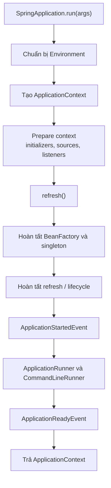
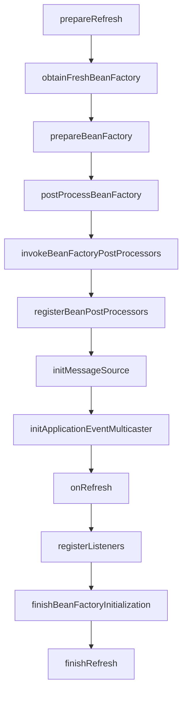
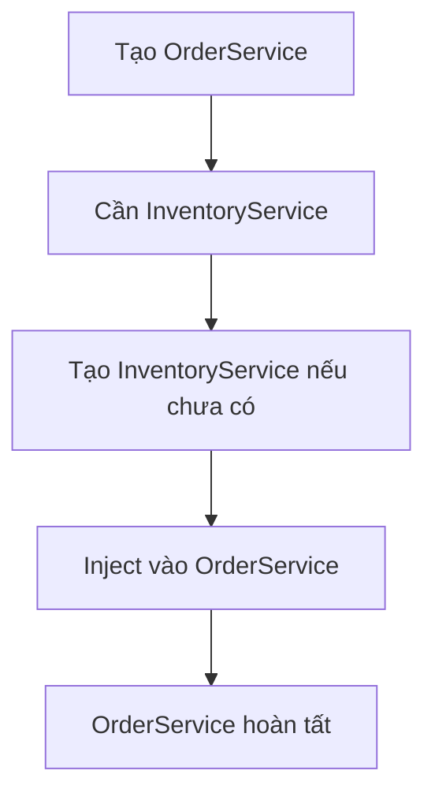

# Refresh context và hoàn tất hạ tầng container

Khi gọi `SpringApplication.run(...)`, Spring Boot không chỉ tạo một object application context rồi trả về ngay. Ứng dụng phải đi qua một chuỗi bước để nạp cấu hình, đăng ký bean definitions, chuẩn bị IoC container, tạo các singleton cần thiết, kết nối dependency, khởi động những thành phần có lifecycle và phát các sự kiện báo trạng thái. Phần trung tâm của chuỗi này là **refresh application context**.

Hiểu quá trình refresh giúp bạn trả lời những câu hỏi thường gặp:

- Vì sao một bean có thể đã được quét thấy nhưng constructor chỉ chạy ở giai đoạn sau?
- Khi nào Spring xử lý `@Configuration`, `@ComponentScan` và các method `@Bean`?
- `BeanFactoryPostProcessor` khác `BeanPostProcessor` như thế nào?
- Vì sao lỗi thiếu dependency thường xuất hiện trước khi ứng dụng báo startup thành công?
- Khi nào web server embedded được tạo và bắt đầu nhận request?
- `ApplicationRunner` chạy trước hay sau `ApplicationReadyEvent`?
- Nếu refresh thất bại, container và các bean đã tạo được xử lý ra sao?

Bài học thuộc chương **SpringApplication** của *Spring Boot Fundamentals*. Ta sẽ đi từ lời gọi `SpringApplication.run` đến quy trình `AbstractApplicationContext.refresh`, sau đó theo dõi thời điểm container hoàn tất hạ tầng và ứng dụng chuyển sang trạng thái sẵn sàng.

Ví dụ sử dụng Java 21 và Spring Boot 3.x. Một số chi tiết nội bộ có thể thay đổi giữa các phiên bản Spring Framework/Spring Boot; các bước dưới đây mô tả luồng phổ biến của ứng dụng Spring Boot hiện đại.

## 1. ApplicationContext là gì và tại sao phải refresh?

`ApplicationContext` là abstraction container cấp cao của Spring. Nó mở rộng `BeanFactory` và bổ sung các khả năng như:

- Quản lý và cung cấp bean.
- Dependency injection.
- Phát và nhận application events.
- Truy cập resource.
- Hỗ trợ message source và quốc tế hóa.
- Tích hợp lifecycle của các bean.

Khi một `ApplicationContext` được tạo, container chưa nhất thiết đã hoàn thành việc đăng ký và khởi tạo toàn bộ bean. Context cần **refresh** để xử lý cấu hình, hoàn tất bean factory và chuyển sang trạng thái hoạt động.

Trong Spring Framework, phương thức trung tâm là:

```java
public void refresh() throws BeansException, IllegalStateException
```

Phương thức này được định nghĩa trong `AbstractApplicationContext`. Các implementation cụ thể có thể bổ sung hành vi riêng thông qua những hook như `onRefresh()` hoặc `finishRefresh()`.

### 1.1. Refresh không đồng nghĩa tạo mới mọi object trong ứng dụng

Refresh tập trung vào container và bean definitions mà container quản lý. Nó không:

- Tạo lại mọi object Java do ứng dụng tự khởi tạo bằng `new` ngoài Spring.
- Tự chạy mọi method nghiệp vụ của service.
- Tự thực thi mọi job hoặc scheduled task ngay lập tức.
- Bảo đảm mọi dịch vụ bên ngoài đều khỏe mạnh chỉ vì context đã refresh.

Một context đã refresh nghĩa là quy trình khởi tạo container đã hoàn tất theo những điều kiện của nó. Trạng thái sẵn sàng phục vụ nghiệp vụ còn liên quan đến runner, web server, readiness, external dependency và cấu hình vận hành.

## 2. Nhìn toàn bộ luồng SpringApplication.run

Lớp main thường có dạng:

```java
package com.example.demo;

import org.springframework.boot.SpringApplication;
import org.springframework.boot.autoconfigure.SpringBootApplication;

@SpringBootApplication
public class DemoApplication {

    public static void main(String[] args) {
        SpringApplication.run(DemoApplication.class, args);
    }
}
```

`SpringApplication.run` là bộ điều phối quá trình khởi động của Spring Boot. Ở mức khái quát, luồng phổ biến gồm:

1. Khởi tạo bootstrap context và thông báo bắt đầu.
2. Chuẩn bị `Environment` từ property sources, profile và tham số dòng lệnh.
3. Tạo đúng loại `ApplicationContext` dựa trên loại ứng dụng.
4. Chuẩn bị context, áp dụng initializer và nạp các nguồn cấu hình.
5. Gọi `refresh()` để hoàn tất container.
6. Thực hiện các bước sau refresh, ghi nhận startup và phát sự kiện ứng dụng đã started.
7. Gọi các `ApplicationRunner` và `CommandLineRunner`.
8. Phát sự kiện `ApplicationReadyEvent` rồi trả context về cho caller.



Sơ đồ là góc nhìn tổng thể; một số event/listener và bước xử lý phụ được lược bớt để dễ theo dõi. Phần tiếp theo đi sâu vào giai đoạn refresh.

## 3. Trước refresh: Spring Boot chuẩn bị context như thế nào?

Trước khi gọi `refresh()`, Boot đã thực hiện một số công việc quan trọng. Không nên gộp tất cả vào bên trong `AbstractApplicationContext.refresh()`.

### 3.1. Chuẩn bị Environment

`Environment` đại diện cho môi trường cấu hình của ứng dụng. Nó tập hợp property sources và active profiles để những thành phần khác có thể đọc giá trị cấu hình.

Ví dụ:

```yaml
spring:
  profiles:
    active: dev

app:
  greeting:
    prefix: "Xin chào"
```

Tham số dòng lệnh cũng có thể ghi đè cấu hình:

```bash
./gradlew bootRun --args='--app.greeting.prefix=Hello'
```

Khi context được chuẩn bị, nó nhận Environment phù hợp. Các bean và condition được xử lý sau đó có thể sử dụng giá trị đã được nạp.

### 3.2. Chọn loại ApplicationContext

Spring Boot chọn context phù hợp với kiểu ứng dụng và classpath:

- Ứng dụng không web thường dùng một context dạng generic.
- Ứng dụng servlet web dùng context hỗ trợ embedded servlet web server.
- Ứng dụng reactive web dùng context phù hợp với reactive web server.

Việc chọn loại context quan trọng vì context web có thể tạo và khởi động web server trong những hook riêng. Không phải mọi ứng dụng đều có Tomcat hoặc HTTP server.

### 3.3. ApplicationContextInitializer

`ApplicationContextInitializer<C>` cho phép tùy chỉnh context sau khi được tạo nhưng trước khi refresh.

Ví dụ:

```java
import org.springframework.context.ApplicationContextInitializer;
import org.springframework.context.ConfigurableApplicationContext;

public class DemoContextInitializer
        implements ApplicationContextInitializer<ConfigurableApplicationContext> {

    @Override
    public void initialize(ConfigurableApplicationContext context) {
        context.getEnvironment()
                .getSystemProperties()
                .put("app.initializer.applied", "true");
    }
}
```

Đây là ví dụ minh họa initializer thay đổi Environment. Trong dự án thật, hãy chọn property source hoặc API phù hợp với mục tiêu cấu hình; không nên ghi đè system properties toàn cục nếu chỉ cần thêm cấu hình riêng cho context.

Initializer có thể được đăng ký theo cách cấu hình Spring Boot, chẳng hạn thông qua `SpringApplication.addInitializers(...)`:

```java
SpringApplication application =
        new SpringApplication(DemoApplication.class);
application.addInitializers(new DemoContextInitializer());
application.run(args);
```

Initializer chạy trước refresh nên có thể tùy chỉnh context trước khi bean definitions được khởi tạo.

### 3.4. Nạp nguồn cấu hình

Boot nạp các nguồn cấu hình được truyền cho `SpringApplication`. Với ứng dụng thông thường, nguồn đó là class main có `@SpringBootApplication`. Quá trình xử lý configuration class sẽ tiếp tục trong refresh thông qua các post-processor.

Điểm cần phân biệt:

- **Prepare context:** gắn Environment, áp dụng initializer, chuẩn bị context và nạp sources.
- **Refresh context:** xử lý bean factory, configuration metadata, post-processors, singleton và lifecycle.

## 4. AbstractApplicationContext.refresh có những bước nào?

`AbstractApplicationContext.refresh()` là trung tâm của quá trình hoàn tất container. Có thể tóm tắt chuỗi bước phổ biến như sau:

```java
public void refresh() {
    // Pseudocode: mô tả luồng, không phải source đầy đủ.
    prepareRefresh();
    ConfigurableListableBeanFactory beanFactory = obtainFreshBeanFactory();
    prepareBeanFactory(beanFactory);
    postProcessBeanFactory(beanFactory);
    invokeBeanFactoryPostProcessors(beanFactory);
    registerBeanPostProcessors(beanFactory);
    initMessageSource();
    initApplicationEventMulticaster();
    onRefresh();
    registerListeners();
    finishBeanFactoryInitialization(beanFactory);
    finishRefresh();
}
```

Đoạn trên là **pseudocode rút gọn** để học thứ tự. Source thực tế có xử lý đồng bộ, startup steps, exception handling, shutdown hook và các chi tiết khác.



Hãy nhớ thứ tự này theo từng trách nhiệm. Không cần học thuộc tên method mà không hiểu nó chuẩn bị phần nào của container.

## 5. Bước 1 — prepareRefresh(): chuẩn bị trạng thái context

`prepareRefresh()` chuẩn bị context trước khi BeanFactory được làm mới. Những việc quan trọng gồm:

- Ghi nhận thời điểm bắt đầu refresh.
- Đặt trạng thái context là active và đánh dấu refresh đang diễn ra.
- Khởi tạo hoặc kiểm tra các property sources cần thiết của context.
- Xác thực required properties nếu context có khai báo.
- Chuẩn bị cơ chế đồng bộ và trạng thái nội bộ cho lần refresh.

Ở giai đoạn này, Spring chưa đi qua toàn bộ bean creation. Nó đang chuẩn bị context để quy trình refresh tiếp tục an toàn.

### Required properties

Trong một số cấu hình, ứng dụng có thể khai báo property bắt buộc cần tồn tại. Nếu property không được cung cấp, context có thể thất bại ngay trong giai đoạn chuẩn bị thay vì đợi một bean đọc property đó.

Ví dụ khái niệm:

```java
context.getEnvironment().setRequiredProperties("app.region");
```

Khi refresh xác thực required properties, thiếu `app.region` sẽ khiến cấu hình không đạt yêu cầu.

## 6. Bước 2 — obtainFreshBeanFactory(): lấy BeanFactory của context

ApplicationContext sử dụng một `BeanFactory` để quản lý bean definitions và singleton instances. `obtainFreshBeanFactory()` lấy hoặc làm mới factory nội bộ phù hợp với implementation context.

Với các context thông dụng, factory thường là một implementation dựa trên `DefaultListableBeanFactory`. Đây là nơi lưu bean definitions, đăng ký bean và hỗ trợ resolve dependency.

### Bean definition là gì?

Bean definition là metadata mô tả cách container tạo và quản lý bean, ví dụ:

- Bean class hoặc factory method.
- Scope như singleton hoặc prototype.
- Constructor arguments và property values.
- Lazy initialization.
- Dependency và các thông tin liên quan.
- Init method hoặc destroy method.

Ví dụ cấu hình:

```java
@Configuration(proxyBeanMethods = false)
public class ServiceConfiguration {

    @Bean
    GreetingService greetingService(GreetingFormatter formatter) {
        return new GreetingService(formatter);
    }
}
```

Khi configuration được xử lý, Spring đăng ký bean definition cho `greetingService`. Bean definition mô tả factory method và dependency cần thiết; instance `GreetingService` sẽ được tạo ở giai đoạn thích hợp.

**Đăng ký bean definition không đồng nghĩa constructor hoặc factory method đã chạy.**

## 7. Bước 3 — prepareBeanFactory(): chuẩn bị hạ tầng cơ bản

`prepareBeanFactory(beanFactory)` thiết lập những khả năng nền tảng để BeanFactory có thể hoạt động trong ApplicationContext.

Một số việc tiêu biểu:

- Đặt class loader phù hợp.
- Đăng ký expression resolver để hỗ trợ SpEL.
- Đăng ký property editor hoặc conversion infrastructure cơ bản.
- Thiết lập các dependency có thể resolve trực tiếp như `BeanFactory`, `ResourceLoader`, `ApplicationEventPublisher` và `ApplicationContext`.
- Đăng ký một số bean post-processor nội bộ như listener detector.
- Thiết lập các aware interface không nên được autowire theo cách thông thường.

Nhờ đó, bean có thể nhận các dependency hạ tầng của Spring và sử dụng những khả năng như resource loading hoặc event publishing.

Ví dụ một bean nhận ApplicationContext:

```java
@Component
public class ContextAwareService {

    private final ApplicationContext context;

    public ContextAwareService(ApplicationContext context) {
        this.context = context;
    }

    public String applicationName() {
        return context.getApplicationName();
    }
}
```

Spring biết cách cung cấp `ApplicationContext` cho dependency này vì đó là một resolvable dependency của container. Bạn không cần tự khai báo `@Bean ApplicationContext` trong cấu hình ứng dụng thông thường.

### `Environment` và property injection

Environment cũng là hạ tầng của context. Một bean có thể nhận `Environment` hoặc một object `@ConfigurationProperties` để đọc cấu hình:

```java
@Component
public class RegionService {
    private final Environment environment;

    public RegionService(Environment environment) {
        this.environment = environment;
    }

    public String region() {
        return environment.getProperty("app.region", "local");
    }
}
```

Bean chỉ có thể được tạo sau khi cấu hình context và dependency phù hợp đã được chuẩn bị.

## 8. Bước 4 — postProcessBeanFactory(): hook cho context cụ thể

`postProcessBeanFactory(beanFactory)` là một extension point để subclass của `AbstractApplicationContext` tùy chỉnh BeanFactory sau khi nó được chuẩn bị cơ bản.

Các context cụ thể có thể bổ sung những xử lý cần thiết cho loại môi trường của chúng. Ví dụ context web có thể chuẩn bị các scope hoặc infrastructure liên quan tới web.

Trong ứng dụng thông thường, bạn ít khi override method này trực tiếp. Khi viết extension framework hoặc context implementation riêng, cần hiểu rõ thứ tự vì bean factory post-processing ở những bước sau sẽ dựa trên trạng thái đã được chuẩn bị.

## 9. Bước 5 — invokeBeanFactoryPostProcessors(): xử lý bean definitions

Đây là một trong những giai đoạn quan trọng nhất của refresh.

`BeanFactoryPostProcessor` cho phép thay đổi **bean definitions và metadata của BeanFactory** trước khi các bean ứng dụng thông thường được khởi tạo. Một loại chuyên biệt là `BeanDefinitionRegistryPostProcessor`, có thể đăng ký thêm bean definitions.

Ví dụ, `ConfigurationClassPostProcessor` là một post-processor quan trọng. Nó xử lý configuration classes và những annotation như:

- `@Configuration`.
- `@ComponentScan`.
- `@Import`.
- `@ImportResource`.
- `@Bean`.
- Các cấu hình điều kiện được hỗ trợ trong môi trường tương ứng.

Nhờ giai đoạn này, Spring có thể phân tích cấu hình Java, tìm component và đăng ký bean definitions trước khi pre-instantiate singleton.

### 9.1. Component scan diễn ra ở đâu?

Khi `@SpringBootApplication` được xử lý như configuration class, `@ComponentScan` được xử lý trong quá trình configuration class parsing, thông qua các post-processor của BeanFactory. Spring tìm component phù hợp trong phạm vi package rồi đăng ký bean definitions.

Ví dụ:

```java
package com.example.demo;

@SpringBootApplication
public class DemoApplication {
}
```

```java
package com.example.demo.service;

@Service
public class OrderService {
}
```

Bean definition cho `OrderService` được đăng ký khi configuration class được xử lý. Instance của `OrderService` thường được tạo ở giai đoạn pre-instantiate singleton sau đó, nếu bean không lazy và scope là singleton.

### 9.2. Auto-configuration cũng được xử lý trong giai đoạn cấu hình

`@EnableAutoConfiguration` đưa các auto-configuration candidates của Boot vào quá trình xử lý. Các cấu hình có điều kiện được đánh giá dựa trên classpath, Environment, bean definitions và những điều kiện khác.

Nếu điều kiện khớp, bean definitions tương ứng được đăng ký. Nếu không, phần cấu hình bị bỏ qua.

Điều đó giải thích tại sao thêm starter có thể làm xuất hiện những bean hạ tầng: dependency thay đổi classpath, khiến một số auto-configuration đủ điều kiện trong quá trình xử lý configuration classes.

### 9.3. BeanFactoryPostProcessor không phải BeanPostProcessor

Hai interface này có tên gần giống nhưng tác động ở hai giai đoạn khác nhau:

| Interface | Đối tượng được xử lý | Thời điểm chính |
|---|---|---|
| `BeanFactoryPostProcessor` | Bean definitions và metadata của BeanFactory | Trước khi bean ứng dụng thông thường được khởi tạo. |
| `BeanPostProcessor` | Bean instances | Trong quá trình tạo và khởi tạo từng bean. |

Ví dụ:

- `ConfigurationClassPostProcessor` xử lý configuration metadata và đăng ký bean definitions.
- `AutowiredAnnotationBeanPostProcessor` xử lý injection annotation như `@Autowired` trên bean instances.
- `CommonAnnotationBeanPostProcessor` hỗ trợ một số annotation lifecycle/injection như `@PostConstruct` và `@Resource` trong môi trường phù hợp.

Đừng nhầm rằng `@Autowired` được xử lý bởi `BeanFactoryPostProcessor`. Nó chủ yếu được xử lý trong lifecycle của bean instance bởi BeanPostProcessor.

## 10. Bước 6 — registerBeanPostProcessors(): chuẩn bị bộ xử lý bean instance

`BeanPostProcessor` cho phép Spring can thiệp vào bean trước và sau initialization. Một số processor có thể:

- Thực hiện dependency injection.
- Xử lý annotation lifecycle.
- Tạo proxy cho AOP.
- Phát hiện listener.
- Áp dụng những tích hợp framework khác.

Ví dụ, khi một service có `@Autowired` field hoặc constructor, cơ chế injection liên quan đến các processor phù hợp. Khi một bean được áp dụng AOP, post-processor có thể bọc target bằng proxy để thực hiện transaction, security hoặc advice.

### 10.1. Vì sao phải đăng ký BeanPostProcessor trước khi tạo phần lớn bean?

BeanPostProcessor cần có mặt để xử lý các bean được tạo sau đó. Nếu đăng ký quá muộn, những bean đã được tạo trước đó có thể không trải qua đầy đủ chuỗi xử lý của processor.

Spring đăng ký các BeanPostProcessor trong một giai đoạn riêng của refresh, trước khi pre-instantiate phần lớn singleton ứng dụng.

### 10.2. Một ví dụ về lifecycle callback

```java
import jakarta.annotation.PostConstruct;
import org.springframework.stereotype.Component;

@Component
public class CacheWarmup {

    @PostConstruct
    void initialize() {
        System.out.println("CacheWarmup initialized");
    }
}
```

Khi bean được tạo và các dependency được populate, callback `@PostConstruct` được xử lý trong giai đoạn initialization nhờ cơ chế post-processing. Với eager singleton, log thường xuất hiện trong lúc context refresh; với lazy bean, log có thể chỉ xuất hiện khi bean được tạo lần đầu.

### 10.3. AOP proxy có thể xuất hiện trong quá trình post-processing

Ví dụ một service:

```java
@Service
public class TransferService {

    @Transactional
    public void transfer() {
        // ...
    }
}
```

Khi transaction infrastructure được cấu hình, Spring có thể tạo proxy để áp dụng transaction advice. Bean mà consumer nhận được có thể là proxy thay vì target object thuần. Đây là một ví dụ cho thấy post-processing có thể thay đổi object mà container công bố.

## 11. Bước 7 — initMessageSource(): chuẩn bị message source

ApplicationContext có abstraction `MessageSource` để hỗ trợ message resolution và quốc tế hóa.

Nếu ứng dụng khai báo một bean có tên quy ước `messageSource`, context có thể sử dụng bean đó. Nếu không, context có thể thiết lập một message source mặc định hoặc delegate theo cơ chế của implementation.

Ví dụ:

```java
import org.springframework.context.MessageSource;
import org.springframework.context.annotation.Bean;
import org.springframework.context.annotation.Configuration;
import org.springframework.context.support.ReloadableResourceBundleMessageSource;

@Configuration(proxyBeanMethods = false)
public class MessageConfiguration {

    @Bean
    MessageSource messageSource() {
        var source = new ReloadableResourceBundleMessageSource();
        source.setBasename("classpath:messages");
        source.setDefaultEncoding("UTF-8");
        return source;
    }
}
```

Với file resource tương ứng, ứng dụng có thể tra thông điệp theo key và locale. Đây là một phần hạ tầng application context, không phải bean nghiệp vụ bắt buộc của mọi ứng dụng.

## 12. Bước 8 — initApplicationEventMulticaster(): chuẩn bị event system

Spring có hệ thống application events. Bean có thể publish event và listener có thể nhận event phù hợp.

ApplicationContext cần một `ApplicationEventMulticaster` để phân phối các event trong context. Nếu người dùng không khai báo bean theo tên quy ước `applicationEventMulticaster`, context tạo một multicaster mặc định.

Ví dụ listener:

```java
import org.springframework.context.event.EventListener;
import org.springframework.stereotype.Component;
import org.springframework.context.event.ContextRefreshedEvent;

@Component
public class ContextReadyListener {

    @EventListener
    public void onContextRefreshed(ContextRefreshedEvent event) {
        System.out.println("ApplicationContext refreshed");
    }
}
```

`ContextRefreshedEvent` được phát trong quá trình hoàn tất refresh. Listener cần được đăng ký trước khi event được phát để có thể nhận event đó.

### Event của Spring Framework và event của Spring Boot

Không nên nhầm các event:

| Event | Ý nghĩa |
|---|---|
| `ContextRefreshedEvent` | ApplicationContext đã hoàn tất refresh. |
| `ApplicationStartedEvent` | Spring Boot đã hoàn tất refresh và các bước sau refresh trước khi gọi runners. |
| `ApplicationReadyEvent` | Spring Boot đã chạy xong runners và ứng dụng được xem là sẵn sàng. |
| `ApplicationFailedEvent` | Quá trình chạy ứng dụng thất bại. |

Các event Boot có thời điểm phát riêng trong orchestration của `SpringApplication.run`; không phải tất cả đều được phát bên trong `AbstractApplicationContext.refresh()`.

## 13. Bước 9 — onRefresh(): hook dành cho context cụ thể

`onRefresh()` là hook để implementation context thực hiện công việc riêng trong quá trình refresh.

Một ví dụ quan trọng là context web:

- `ServletWebServerApplicationContext` quản lý hạ tầng embedded servlet web server.
- `ReactiveWebServerApplicationContext` quản lý hạ tầng reactive web server.

Trong servlet context, web server được tạo trong quá trình refresh và được khởi động trong các bước hoàn tất refresh của context web. Nhờ vậy, web server có thể sử dụng các bean và hạ tầng cần thiết đã được chuẩn bị.

Một ứng dụng non-web không có bước khởi động embedded HTTP server này.

### Tạo web server và server sẵn sàng nhận request là hai mốc gần nhau nhưng khác nhau

Context web phải:

1. Chuẩn bị web server và web infrastructure.
2. Hoàn tất bean initialization cần thiết.
3. Khởi động server theo lifecycle của context.
4. Công bố event web server initialized phù hợp.

Đừng suy luận rằng chỉ cần tạo context là HTTP port đã nhận request. Thời điểm server bắt đầu hoạt động thuộc phần lifecycle của web context và web server implementation.

## 14. Bước 10 — registerListeners(): đăng ký application listeners

Sau khi event multicaster sẵn sàng và context đã thực hiện hook refresh, Spring đăng ký các listener đã được cấu hình.

Listener có thể được đăng ký qua:

- Bean triển khai `ApplicationListener<E>`.
- Annotation `@EventListener` trên method của bean.
- Listener được thêm vào context theo API.
- Listener được Boot hoặc framework tích hợp đăng ký.

Ví dụ listener dùng interface:

```java
import org.springframework.context.ApplicationListener;
import org.springframework.context.event.ContextRefreshedEvent;
import org.springframework.stereotype.Component;

@Component
public class RefreshAuditListener
        implements ApplicationListener<ContextRefreshedEvent> {

    @Override
    public void onApplicationEvent(ContextRefreshedEvent event) {
        System.out.println("Refresh completed for "
                + event.getApplicationContext().getDisplayName());
    }
}
```

Listener nhận event phù hợp khi multicaster phát event. Nếu listener bean cần được tạo, nó cũng phải tuân theo lifecycle của container.

## 15. Bước 11 — finishBeanFactoryInitialization(): hoàn tất BeanFactory

Đây là giai đoạn quan trọng để container sẵn sàng cung cấp các bean ứng dụng. Trong luồng phổ biến, Spring:

- Hoàn tất một số cấu hình infrastructure như conversion service.
- Đăng ký embedded value resolver nếu cần.
- Khởi tạo một số bean đặc biệt như `LoadTimeWeaverAware` khi có.
- Đóng băng configuration metadata khi phù hợp.
- Gọi `preInstantiateSingletons()` để tạo các singleton eager còn lại.

### 15.1. preInstantiateSingletons()

Đối với singleton bean thông thường không lazy, Spring tạo instance trong giai đoạn này. Đây là lúc:

- Constructor được gọi.
- Constructor dependencies được resolve.
- Field/setter injection được xử lý.
- Bean initialization callbacks được gọi.
- BeanPostProcessor có thể wrap bean thành proxy.

Ví dụ:

```java
@Component
public class InventoryService {

    public InventoryService() {
        System.out.println("InventoryService constructor");
    }
}
```

Nếu `InventoryService` là singleton eager, constructor thường chạy trong quá trình pre-instantiate singleton của refresh.

### 15.2. Dependency được resolve theo đồ thị

Giả sử:

```java
@Service
public class OrderService {
    private final InventoryService inventoryService;

    public OrderService(InventoryService inventoryService) {
        this.inventoryService = inventoryService;
    }
}
```

Khi tạo `OrderService`, Spring phải cung cấp `InventoryService`. Nếu inventory chưa được tạo, container tạo dependency đó theo quy tắc scope/lazy phù hợp. Vì vậy thứ tự constructor thực tế có thể không giống thứ tự khai báo class hoặc thứ tự file.



### 15.3. Eager singleton giúp phát hiện lỗi sớm

Nếu một dependency bắt buộc không tồn tại hoặc constructor ném exception, việc tạo eager singleton thất bại trong startup. Ứng dụng có thể không hoàn tất refresh và không phát `ApplicationReadyEvent`.

Đây là chủ đích của eager initialization: nhiều lỗi cấu hình được phát hiện trước khi ứng dụng báo sẵn sàng.

### 15.4. Lazy bean có thể chưa được tạo

Bean được đánh dấu `@Lazy` có thể không được pre-instantiate. Tuy nhiên, nếu một eager singleton cần nó làm constructor dependency, Spring vẫn có thể tạo bean lazy để giải quyết dependency. Nếu lazy được đặt ở injection point, Spring có thể dùng proxy để trì hoãn việc resolve target.

Vì vậy, sau refresh không thể kết luận mọi bean definition đều đã có instance. Bean definition có thể tồn tại trong context dù instance chưa được tạo.

### 15.5. FactoryBean và product

Nếu bean definition đại diện cho một `FactoryBean<T>`, container còn phải xem xét product theo hợp đồng factory. Factory instance và product instance là hai đối tượng khác nhau. Với một số factory đặc biệt như `SmartFactoryBean`, container có thêm thông tin về việc product có nên được khởi tạo eager hay không.

Đừng giả định tất cả FactoryBean product đều được tạo cùng một cách với singleton bean thông thường; hãy xem `getObjectType()`, `isSingleton()` và semantics của factory cụ thể.

## 16. Bước 12 — finishRefresh(): hoàn tất lifecycle và phát ContextRefreshedEvent

Sau khi BeanFactory initialization hoàn tất, `finishRefresh()` thực hiện các bước cuối của context refresh. Trong luồng phổ biến:

- Khởi tạo `LifecycleProcessor` nếu cần.
- Gọi lifecycle processor để bắt đầu các bean có lifecycle phù hợp.
- Phát `ContextRefreshedEvent`.
- Thực hiện những công việc hoàn tất refresh khác của context.

### 16.1. LifecycleProcessor và SmartLifecycle

Một bean triển khai `Lifecycle` hoặc `SmartLifecycle` có thể tham gia start/stop lifecycle của context.

Ví dụ:

```java
import org.springframework.context.SmartLifecycle;
import org.springframework.stereotype.Component;

@Component
public class MessageConsumerLifecycle implements SmartLifecycle {

    private volatile boolean running;

    @Override
    public void start() {
        running = true;
        System.out.println("Message consumer started");
    }

    @Override
    public void stop() {
        running = false;
        System.out.println("Message consumer stopped");
    }

    @Override
    public boolean isRunning() {
        return running;
    }
}
```

Đây là ví dụ tối giản để minh họa callback. Trong consumer thật, `start()` có thể đăng ký listener hoặc bắt đầu nhận message, còn `stop()` nên dừng nhận message và giải phóng tài nguyên theo cách an toàn.

`SmartLifecycle` còn có thể điều khiển phase và auto-startup. Container dùng lifecycle processor để khởi động/dừng các component theo quy tắc phù hợp.

### 16.2. ContextRefreshedEvent

Khi context đã hoàn tất refresh, Spring phát `ContextRefreshedEvent`. Đây là event của Spring Framework, báo rằng context đã được khởi tạo hoặc refresh xong.

Nếu có context hierarchy, event có thể được phát cho từng context. Listener nên kiểm tra `event.getApplicationContext()` nếu chỉ quan tâm một context cụ thể.

**ContextRefreshedEvent không đồng nghĩa ApplicationReadyEvent.** Boot còn có các bước sau refresh, bao gồm chạy runners.

## 17. Sau refresh: Spring Boot chạy runners và báo ready

Khi `refresh()` trả về thành công, `SpringApplication.run` tiếp tục các bước orchestration sau refresh.

Một trong những bước quan trọng là gọi:

- `ApplicationRunner`.
- `CommandLineRunner`.

Hai interface cho phép chạy logic khởi động sau khi context đã refresh:

```java
import org.springframework.boot.ApplicationArguments;
import org.springframework.boot.ApplicationRunner;
import org.springframework.stereotype.Component;

@Component
public class StartupDataLoader implements ApplicationRunner {

    @Override
    public void run(ApplicationArguments args) {
        System.out.println("Load startup data");
    }
}
```

Hoặc:

```java
import org.springframework.boot.CommandLineRunner;
import org.springframework.stereotype.Component;

@Component
public class StartupDiagnostics implements CommandLineRunner {

    @Override
    public void run(String... args) {
        System.out.println("Startup arguments: " + args.length);
    }
}
```

Nếu có nhiều runner, có thể sử dụng `Ordered` hoặc `@Order` để điều khiển thứ tự gọi trong phạm vi runner.

### 17.1. Thứ tự các event chính

Một chuỗi event quan trọng trong ứng dụng Spring Boot hiện đại:

| Event/bước | Thời điểm khái quát |
|---|---|
| `ApplicationStartingEvent` | Rất sớm, khi SpringApplication bắt đầu. |
| `ApplicationEnvironmentPreparedEvent` | Environment đã được chuẩn bị. |
| `ApplicationContextInitializedEvent` | Context đã được tạo và initializer đã được áp dụng. |
| `ApplicationPreparedEvent` | Context được chuẩn bị trước khi refresh. |
| `ContextRefreshedEvent` | Bên trong quá trình hoàn tất refresh của ApplicationContext. |
| `ApplicationStartedEvent` | Sau khi context refresh và các bước sau refresh ban đầu hoàn tất, trước runners. |
| `ApplicationRunner` / `CommandLineRunner` | Sau ApplicationStartedEvent, trước ApplicationReadyEvent. |
| `ApplicationReadyEvent` | Sau khi runners hoàn tất, ứng dụng được xem là ready. |

Tên và chi tiết một số event phụ thuộc phiên bản Boot, nhưng phân biệt cốt lõi vẫn là:

**ContextRefreshedEvent → ApplicationStartedEvent → runners → ApplicationReadyEvent.**

### 17.2. Runner thất bại thì sao?

Nếu một runner ném exception, quá trình `SpringApplication.run` có thể thất bại. `ApplicationReadyEvent` sẽ không được phát như một lần startup thành công. Boot xử lý lỗi thông qua failure handling và đóng context theo quy trình tương ứng.

Vì vậy runner nên thực hiện công việc khởi động có chủ đích, có timeout và chính sách lỗi rõ ràng. Không nên đặt một tác vụ dài vô hạn vào runner nếu ứng dụng cần báo ready và phục vụ traffic.

## 18. Embedded web server tham gia vào quá trình refresh thế nào?

Với ứng dụng servlet web, Boot sử dụng một context như `ServletWebServerApplicationContext`. Context này tích hợp việc tạo và khởi động embedded web server vào lifecycle.

Ví dụ dependency:

```groovy
dependencies {
    implementation 'org.springframework.boot:spring-boot-starter-web'
}
```

Nếu classpath và cấu hình phù hợp, Boot có thể cấu hình embedded server như Tomcat. Luồng tổng quát:

1. Boot chọn servlet web application context.
2. Trong refresh, context chuẩn bị web server và web infrastructure.
3. Các bean và hạ tầng context được hoàn tất.
4. Context web khởi động server trong giai đoạn finish refresh.
5. Sau refresh, Boot tiếp tục event và runner.
6. Ứng dụng hoàn tất startup và phát ready event.

Server thường đã được khởi động trước khi các runner được gọi trong luồng servlet web phổ biến. Vì vậy runner có thể chạy sau khi server đã được tạo/khởi động, nhưng ứng dụng vẫn chưa phát `ApplicationReadyEvent` cho đến khi runners hoàn tất.

### Web server initialized event

Spring Boot phát event riêng khi embedded web server được khởi tạo, ví dụ `ServletWebServerInitializedEvent` cho servlet server. Event này có thể được dùng để lấy thông tin server/port thực tế, đặc biệt khi cấu hình port ngẫu nhiên.

Không nên nhầm event web server initialized với `ApplicationReadyEvent`: một event nói server đã khởi tạo; event kia báo toàn bộ quá trình startup của Boot đã đi qua runners.

## 19. Nếu refresh thất bại thì container xử lý thế nào?

Refresh có thể thất bại ở nhiều giai đoạn:

- Configuration class không thể xử lý.
- BeanFactoryPostProcessor ném exception.
- BeanPostProcessor không khởi tạo được.
- Constructor dependency không resolve được.
- Bean eager ném exception trong constructor hoặc init callback.
- Lifecycle component không thể start.
- Web server không thể khởi động.

Spring/Boot sẽ xử lý lỗi và không coi ứng dụng là startup thành công. Với refresh thất bại, context không trở thành context hoạt động bình thường. Những singleton đã tạo trong quá trình đó có thể được hủy theo cleanup của container; Boot cũng đóng context trong failure handling.

### 19.1. Đọc exception từ ngoài vào trong

Log thường có lớp exception bọc ngoài, ví dụ:

```text
Application run failed
  -> BeanCreationException
      -> UnsatisfiedDependencyException
          -> NoSuchBeanDefinitionException
```

Đừng dừng ở dòng `Application run failed`. Hãy lần theo chuỗi `Caused by` để tìm nguyên nhân gốc:

- Bean nào đang được tạo?
- Dependency nào không resolve được?
- Property nào thiếu?
- Constructor/init callback nào ném lỗi?
- Auto-configuration condition nào không khớp?

### 19.2. Một ví dụ lỗi thiếu bean

```text
Parameter 0 of constructor in CheckoutService
required a bean of type 'PaymentGateway' that could not be found.
```

Đây là lỗi xảy ra khi container tạo `CheckoutService` và resolve constructor dependency. Hãy kiểm tra component scan, auto-configuration, bean condition, profile và kiểu bean thực tế.

### 19.3. Một ví dụ lỗi constructor

```java
@Component
public class ExternalClient {
    public ExternalClient() {
        throw new IllegalStateException("Invalid endpoint");
    }
}
```

Nếu bean là eager singleton, lỗi thường xuất hiện trong refresh. Nếu bean lazy và không bị dependency eager yêu cầu, lỗi có thể chỉ xuất hiện khi bean được yêu cầu lần đầu.

## 20. Context đóng và shutdown lifecycle

Một ApplicationContext không chỉ có quá trình startup; nó còn có lifecycle shutdown.

Khi context đóng:

- LifecycleProcessor dừng các bean `Lifecycle`/`SmartLifecycle` theo quy tắc phù hợp.
- Bean có destroy method hoặc callback như `@PreDestroy` có thể được xử lý.
- Singleton resources được hủy theo thứ tự dependency/lifecycle phù hợp.
- Context chuyển sang trạng thái inactive/closed.

Ví dụ:

```java
import jakarta.annotation.PreDestroy;
import org.springframework.stereotype.Component;

@Component
public class ConnectionManager {

    @PreDestroy
    void close() {
        System.out.println("Release connection resources");
    }
}
```

Trong ứng dụng Boot, shutdown hook thường được đăng ký để đóng context khi JVM kết thúc bình thường. Nếu ứng dụng tự quản lý context, bạn cũng có thể gọi `context.close()` hoặc dùng try-with-resources với context phù hợp.

### 20.1. Thứ tự shutdown cũng quan trọng

Nếu một bean consumer cần một resource khác để dừng an toàn, hãy thiết kế lifecycle sao cho consumer ngừng hoạt động trước khi resource bị hủy. `SmartLifecycle` phase và dependency relationships có thể tham gia quyết định thứ tự start/stop.

Không nên chỉ dựa vào thứ tự constructor được gọi để suy luận thứ tự hủy bean.

## 21. Một ứng dụng nhỏ để quan sát toàn bộ mốc startup

Ta có thể tạo vài component để in log và so sánh thời điểm.

### 21.1. Bean eager và callback

```java
package com.example.demo.lifecycle;

import jakarta.annotation.PostConstruct;
import jakarta.annotation.PreDestroy;
import org.springframework.stereotype.Component;

@Component
public class StartupProbe {

    public StartupProbe() {
        System.out.println("1. StartupProbe constructor");
    }

    @PostConstruct
    void initialize() {
        System.out.println("2. StartupProbe PostConstruct");
    }

    @PreDestroy
    void destroy() {
        System.out.println("7. StartupProbe PreDestroy");
    }
}
```

### 21.2. Listener cho ContextRefreshedEvent

```java
package com.example.demo.lifecycle;

import org.springframework.context.event.ContextRefreshedEvent;
import org.springframework.context.event.EventListener;
import org.springframework.stereotype.Component;

@Component
public class RefreshProbe {

    @EventListener
    public void onRefresh(ContextRefreshedEvent event) {
        System.out.println("3. ContextRefreshedEvent");
    }
}
```

### 21.3. Listener cho ApplicationStartedEvent và ApplicationReadyEvent

```java
package com.example.demo.lifecycle;

import org.springframework.boot.context.event.ApplicationStartedEvent;
import org.springframework.boot.context.event.ApplicationReadyEvent;
import org.springframework.context.event.EventListener;
import org.springframework.stereotype.Component;

@Component
public class BootEventProbe {

    @EventListener
    public void onStarted(ApplicationStartedEvent event) {
        System.out.println("4. ApplicationStartedEvent");
    }

    @EventListener
    public void onReady(ApplicationReadyEvent event) {
        System.out.println("6. ApplicationReadyEvent");
    }
}
```

### 21.4. Runner

```java
package com.example.demo.lifecycle;

import org.springframework.boot.ApplicationArguments;
import org.springframework.boot.ApplicationRunner;
import org.springframework.stereotype.Component;

@Component
public class StartupProbeRunner implements ApplicationRunner {

    @Override
    public void run(ApplicationArguments args) {
        System.out.println("5. ApplicationRunner");
    }
}
```

Thứ tự log minh họa:

```text
1. StartupProbe constructor
2. StartupProbe PostConstruct
3. ContextRefreshedEvent
4. ApplicationStartedEvent
5. ApplicationRunner
6. ApplicationReadyEvent
```

Khi JVM/context đóng bình thường, callback `PreDestroy` có thể xuất hiện:

```text
7. StartupProbe PreDestroy
```

Thứ tự log chính xác giữa các bean có thể khác nhau do dependency graph, thứ tự bean creation, listener order và lifecycle phase. Bài thực hành chỉ minh họa các mốc lớn; không nên dựa vào thứ tự giữa những bean không có quan hệ phụ thuộc hoặc ordering được khai báo.

## 22. Kiểm tra trạng thái context trong test

Với Spring Boot Test, `@SpringBootTest` có thể khởi động application context để kiểm tra bean wiring:

```java
package com.example.demo;

import static org.assertj.core.api.Assertions.assertThat;

import org.junit.jupiter.api.Test;
import org.springframework.beans.factory.annotation.Autowired;
import org.springframework.boot.test.context.SpringBootTest;
import org.springframework.context.ApplicationContext;

@SpringBootTest
class ApplicationContextRefreshTest {

    @Autowired
    ApplicationContext context;

    @Test
    void contextHasRefreshedAndProvidesService() {
        assertThat(context.isActive()).isTrue();
        assertThat(context.getBean(InventoryService.class)).isNotNull();
    }
}
```

Test này xác nhận context được tạo thành công và bean có thể truy cập. Nó không chứng minh mọi lazy bean đã được khởi tạo, vì lazy bean có thể vẫn chưa có instance.

### 22.1. Test event sau refresh

Bạn có thể dùng listener hoặc test utility để ghi nhận event. Một cách đơn giản là đăng ký listener trong test configuration:

```java
@TestConfiguration
static class EventTestConfiguration {

    @Bean
    RefreshRecorder refreshRecorder() {
        return new RefreshRecorder();
    }
}
```

`RefreshRecorder` có thể triển khai `ApplicationListener<ContextRefreshedEvent>` và lưu cờ đã nhận event. Tuy nhiên, khi dùng test context cache, cần hiểu context có thể được tái sử dụng giữa các test; đừng giả định mỗi method test đều khởi động một context mới.

### 22.2. Dùng ApplicationContextRunner cho auto-configuration nhỏ

Nếu chỉ muốn kiểm tra một cấu hình hoặc condition, `ApplicationContextRunner` thường nhẹ hơn `@SpringBootTest`:

```java
new ApplicationContextRunner()
        .withUserConfiguration(MyAutoConfiguration.class)
        .run(context -> {
            assertThat(context).hasSingleBean(MyService.class);
        });
```

Nó tạo context nhỏ, giúp kiểm tra kết quả refresh và bean definitions của cấu hình đang quan tâm.

## 23. Những khái niệm cần phân biệt khi đọc log startup

| Khái niệm | Ý nghĩa |
|---|---|
| Bean definition registered | Metadata bean đã được đăng ký trong factory. |
| Bean instance created | Constructor hoặc factory method đã tạo object. |
| Bean initialized | Dependency và initialization callback phù hợp đã được xử lý. |
| Bean post-processed | Bean đã đi qua các BeanPostProcessor, có thể được wrap/proxy. |
| Context refreshed | Quy trình refresh của ApplicationContext đã hoàn tất. |
| Application started | Boot đã đi qua refresh và phát started event. |
| Application ready | Runners đã hoàn tất và Boot phát ready event. |

Một log “Found candidate component” không chứng minh constructor đã chạy. Một log constructor không chứng minh bean đã đi qua toàn bộ post-processing. Một event ContextRefreshedEvent không đồng nghĩa runners đã hoàn tất. Những mốc này cần được phân biệt khi debug.

## 24. Chẩn đoán các lỗi thường gặp trong quá trình refresh

### 24.1. Không tìm thấy bean

Thông báo dạng `NoSuchBeanDefinitionException` hoặc `UnsatisfiedDependencyException`:

- Kiểm tra package component scan.
- Kiểm tra điều kiện auto-configuration.
- Kiểm tra profile và property.
- Kiểm tra bean có bị exclude hoặc condition back off không.
- Kiểm tra kiểu dependency và qualifier.

### 24.2. Bean tạo được nhưng init thất bại

Nếu stack trace có `BeanCreationException` và nguyên nhân sâu hơn nằm trong constructor hoặc `@PostConstruct`:

- Kiểm tra cấu hình được inject.
- Kiểm tra thao tác khởi tạo có phụ thuộc mạng/file/database không.
- Kiểm tra timeout và retry policy.
- Cân nhắc eager hay lazy theo yêu cầu sẵn sàng.

### 24.3. BeanPostProcessor hoặc proxy lỗi

Nếu lỗi xuất hiện khi đăng ký post-processor hoặc tạo proxy:

- Kiểm tra dependency AOP/transaction/security.
- Kiểm tra kiểu bean và phương thức có thể proxy.
- Kiểm tra thứ tự đăng ký processor nếu có cấu hình custom.
- Kiểm tra classpath và phiên bản dependency.

### 24.4. Web server không khởi động

Kiểm tra:

- Port đã bị process khác sử dụng chưa?
- Servlet/reactive web dependencies có phù hợp không?
- Web server customizer có lỗi không?
- SSL hoặc connector properties có hợp lệ không?
- Bean cần thiết cho web infrastructure có tạo thành công không?

### 24.5. Context refresh thành công nhưng runner thất bại

Nếu lỗi xảy ra sau `ApplicationStartedEvent`:

- Kiểm tra `ApplicationRunner` và `CommandLineRunner`.
- Kiểm tra dữ liệu khởi tạo và external call.
- Xác định runner có đang thực hiện tác vụ quá dài hoặc thiếu timeout không.
- Nhớ rằng `ApplicationReadyEvent` sẽ không được phát nếu runner thất bại.

## 25. Bài thực hành tổng hợp

Tạo một Spring Boot application nhỏ và thực hiện:

**Bước A — Quan sát constructor.** Tạo một `@Component` eager có log trong constructor và `@PostConstruct`. Chạy ứng dụng và xác định chúng xuất hiện trong giai đoạn nào.

**Bước B — Quan sát component scan.** Tạo một service trong package con của main class. Xác nhận bean definition được đăng ký và instance được tạo trong refresh.

**Bước C — Quan sát BeanFactoryPostProcessor.** Viết một `BeanFactoryPostProcessor` đơn giản chỉ log khi được gọi. So sánh thời điểm của nó với constructor bean nghiệp vụ.

**Bước D — Quan sát BeanPostProcessor.** Viết một `BeanPostProcessor` đơn giản log tên bean ở before/after initialization. Chỉ dùng để quan sát, tránh tạo dependency phức tạp trong processor.

**Bước E — Thử lazy bean.** Đánh dấu một singleton bằng `@Lazy` và không inject nó vào bean eager. Xác nhận context refresh không tạo instance cho đến khi gọi `getBean`.

**Bước F — Thử dependency eager.** Inject lazy bean vào constructor của eager service. Quan sát dependency có thể bị tạo sớm để hoàn tất service.

**Bước G — Theo dõi event.** Đăng ký listener cho `ContextRefreshedEvent`, `ApplicationStartedEvent` và `ApplicationReadyEvent`. Đặt một `ApplicationRunner` để quan sát thứ tự.

**Bước H — Thử runner thất bại.** Cho runner ném exception trong môi trường test. Quan sát quá trình startup thất bại và không phát ready event.

**Bước I — Thử web context.** Thêm web starter, chạy ứng dụng với port ngẫu nhiên và quan sát event web server initialized. So sánh với ứng dụng non-web.

**Bước J — Thử shutdown.** Đóng context hoặc dừng JVM bình thường; quan sát `SmartLifecycle.stop()` và `@PreDestroy`.

Sau mỗi bước, ghi lại ba mốc: **bean definition được đăng ký khi nào, instance được tạo khi nào, và ứng dụng phát event trạng thái nào**.

## 26. Câu hỏi tự đánh giá

1. Vì sao ApplicationContext cần được refresh sau khi tạo?
2. `SpringApplication.run` chuẩn bị Environment và context trước refresh như thế nào?
3. `prepareBeanFactory` thiết lập những hạ tầng cơ bản nào?
4. `BeanFactoryPostProcessor` khác `BeanPostProcessor` về đối tượng và thời điểm xử lý ra sao?
5. `ConfigurationClassPostProcessor` có vai trò gì với `@Configuration`, `@ComponentScan` và `@Bean`?
6. Khi nào constructor của eager singleton thường được gọi?
7. Vì sao bean definition tồn tại không có nghĩa instance đã được tạo?
8. `finishRefresh` liên quan thế nào đến lifecycle processor và `ContextRefreshedEvent`?
9. `ContextRefreshedEvent` khác `ApplicationStartedEvent` và `ApplicationReadyEvent` như thế nào?
10. Vì sao `ApplicationRunner` chạy sau refresh nhưng trước ready event?
11. Embedded servlet web server tham gia quá trình refresh và finish refresh ra sao?
12. Nếu runner ném exception, ứng dụng có phát `ApplicationReadyEvent` không?
13. Lazy bean có thể được tạo trong refresh vì dependency eager như thế nào?
14. Khi refresh thất bại, tại sao cần đọc chuỗi `Caused by` thay vì chỉ nhìn `Application run failed`?
15. Khi context đóng, `LifecycleProcessor` và destroy callbacks có trách nhiệm gì?

### Mẫu giải thích hoàn chỉnh

> `SpringApplication.run` chuẩn bị Environment, tạo ApplicationContext, áp dụng initializer và nạp các nguồn cấu hình trước khi gọi refresh. Trong `AbstractApplicationContext.refresh`, Spring chuẩn bị trạng thái context và BeanFactory, xử lý BeanFactoryPostProcessor để phân tích configuration class và đăng ký bean definitions, đăng ký BeanPostProcessor để xử lý bean instances, chuẩn bị message source và event multicaster, rồi hoàn tất BeanFactory. Ở giai đoạn pre-instantiate singleton, các singleton eager được tạo, dependency được resolve, callback khởi tạo và post-processing được thực hiện. Sau đó context hoàn tất lifecycle và phát `ContextRefreshedEvent`. Spring Boot tiếp tục phát `ApplicationStartedEvent`, gọi `ApplicationRunner`/`CommandLineRunner`, rồi phát `ApplicationReadyEvent` nếu runners hoàn tất. Với web context, embedded server được tích hợp vào lifecycle refresh. Nếu refresh hoặc runner thất bại, Boot xử lý startup failure và không xem ứng dụng là ready.

Khi bạn có thể phân biệt **chuẩn bị context**, **refresh BeanFactory**, **tạo và post-process bean**, **hoàn tất lifecycle** và **Boot báo ready**, bạn đã hiểu được vì sao Spring Boot cần nhiều giai đoạn để đưa container từ cấu hình ban đầu sang một ứng dụng có thể hoạt động.
