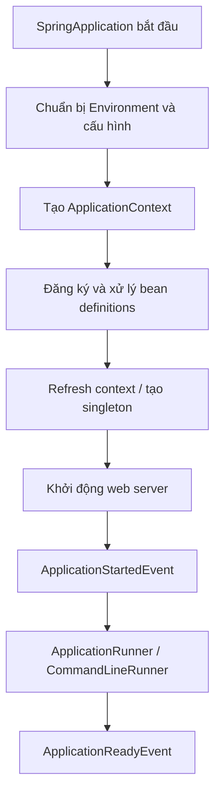
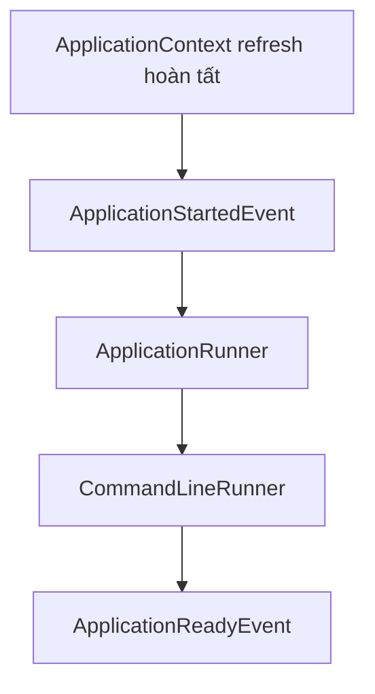
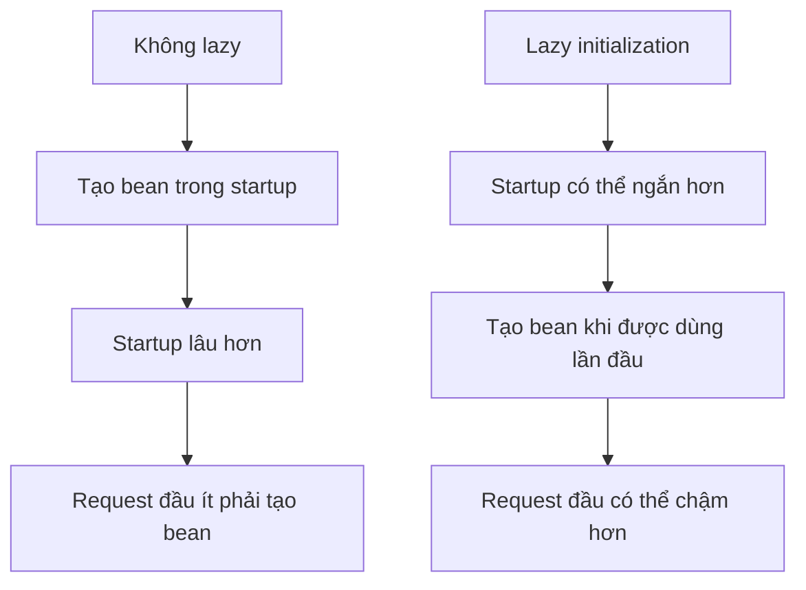

# ApplicationStartup và quan sát thời gian các bước khởi động

Một ứng dụng Spring Boot có thể mất vài giây hoặc lâu hơn để khởi động. Thời gian đó thường bao gồm nhiều công việc: chuẩn bị Environment, đọc cấu hình, quét component, đăng ký bean definition, tạo singleton, thiết lập web server, chạy callback và thực hiện các tác vụ startup do ứng dụng tự viết.

Khi chỉ nhìn dòng log “Started ... in ... seconds”, bạn biết tổng thời gian khởi động nhưng chưa biết **bước nào đang chiếm thời gian**. Spring Framework cung cấp API **ApplicationStartup** để ghi nhận các bước khởi động có instrument. Spring Boot bổ sung **BufferingApplicationStartup**, endpoint Actuator và các công cụ quan sát khác để giúp phân tích.

Bài này giải thích cách đo và đọc thời gian startup theo từng bước, cách phân biệt mốc tạo context với mốc ứng dụng sẵn sàng, cách thêm dấu đo cho công việc riêng và cách dùng dữ liệu để tìm nút thắt.

## 1. Tổng thời gian khởi động chưa cho biết nguyên nhân

Giả sử log ứng dụng cho thấy:

```text
Started ShopApplication in 8.742 seconds
```

Con số này hữu ích để biết ứng dụng đã khởi động mất bao lâu trong lần chạy đó. Nhưng nó không trả lời:

- Spring mất bao lâu để xử lý configuration?
- Component scanning có đang quét quá nhiều package?
- Tạo một bean cụ thể có chậm vì kết nối từ xa?
- Hibernate mất bao lâu để xây dựng metadata?
- `ApplicationRunner` đang nạp dữ liệu mất bao lâu?
- Web server đã sẵn sàng trước hay sau tác vụ startup?
- Thời gian tăng do code ứng dụng, classpath, JVM hay môi trường triển khai?

Muốn trả lời, cần quan sát các mốc nhỏ hơn.

Ví dụ một lần khởi động có thể được chia thành:



Sơ đồ chỉ thể hiện các giai đoạn lớn. Trong thực tế, nhiều bước con được lồng nhau, thứ tự cụ thể phụ thuộc loại ứng dụng và cấu hình.

**Mục tiêu của startup observation** là xác định bước nào tốn thời gian, bước đó thuộc framework hay ứng dụng, và có thể tối ưu ở đâu.

## 2. ApplicationStartup là gì?

`ApplicationStartup` là abstraction của Spring Framework để ghi nhận những **startup step** trong quá trình khởi động container.

Các thành phần chính:

- `ApplicationStartup`: API tạo một startup step.
- `StartupStep`: đại diện cho một công việc có điểm bắt đầu và kết thúc.
- `StartupStep.Tag`: metadata giúp nhận diện step, chẳng hạn tên bean hoặc loại tác vụ.
- `BufferingApplicationStartup`: implementation lưu các step vào bộ đệm để có thể đọc lại.
- `FlightRecorderApplicationStartup`: implementation phát sự kiện startup để quan sát qua Java Flight Recorder (JFR).

Một step có tên, ID, quan hệ cha/con và các tag. Thời gian step được tính từ lúc bắt đầu tới khi gọi `end()`.

Ví dụ khái niệm:

```text
StartupStep
  name: spring.beans.instantiate
  id: 42
  parentId: 17
  tags:
    beanName = catalogService
  start:  ...
  end:    ...
  duration: ...
```

Tên step cụ thể và tag được ghi nhận tùy phiên bản Spring Framework/Spring Boot và thành phần instrument. Không nên coi danh sách tên step nội bộ là API nghiệp vụ ổn định cho mọi phiên bản.

### 2.1. ApplicationStartup không phải profiler tổng quát

`ApplicationStartup` chỉ ghi nhận những đoạn code có sử dụng cơ chế startup instrumentation. Nó không tự động đo từng dòng Java, mọi method call hay mọi truy vấn database trong toàn bộ ứng dụng.

Nó giúp trả lời câu hỏi **“các startup step được instrument mất bao lâu?”**. Nếu một step dài, bạn có thể dùng log, metrics, JFR hoặc profiler để tìm sâu hơn bên trong step đó.

## 3. Cấu hình BufferingApplicationStartup

`BufferingApplicationStartup` lưu các startup step trong bộ đệm. Đây là cách thuận tiện để quan sát timeline sau khi ứng dụng khởi động.

Ví dụ trong class main:

```java
package com.example.shop;

import org.springframework.boot.SpringApplication;
import org.springframework.boot.autoconfigure.SpringBootApplication;
import org.springframework.boot.context.metrics.buffering.BufferingApplicationStartup;

@SpringBootApplication
public class ShopApplication {

    public static void main(String[] args) {
        SpringApplication application =
                new SpringApplication(ShopApplication.class);

        application.setApplicationStartup(
                new BufferingApplicationStartup(2048)
        );

        application.run(args);
    }
}
```

Giải thích:

- Tạo `SpringApplication` như thông thường.
- Tạo `BufferingApplicationStartup` với capacity là `2048`.
- Gắn implementation này vào SpringApplication trước khi gọi `run`.
- Spring sử dụng startup recorder đã cấu hình trong quá trình tạo context.

Capacity là giới hạn lưu trữ step trong buffer. Chọn dung lượng đủ cho số step mà ứng dụng cần quan sát; nếu ứng dụng có nhiều bean và auto-configuration, số step có thể tăng đáng kể.

### 3.1. Vì sao phải cấu hình trước run?

Startup recorder cần được gắn trước khi Spring bắt đầu thực hiện các bước cần đo. Nếu đợi đến khi context đã refresh xong mới cấu hình, bạn không thể thu lại những step đã diễn ra trước đó.

Hãy cấu hình ngay khi tạo `SpringApplication`:

```java
SpringApplication application =
        new SpringApplication(ShopApplication.class);

application.setApplicationStartup(
        new BufferingApplicationStartup(2048)
);

application.run(args);
```

Không đợi tới `ApplicationReadyEvent` mới tạo recorder nếu mục tiêu là quan sát toàn bộ startup.

### 3.2. Dùng SpringApplicationBuilder

Nếu ứng dụng dùng builder, có thể cấu hình startup recorder trong chuỗi builder tương ứng:

```java
new SpringApplicationBuilder(ShopApplication.class)
        .applicationStartup(new BufferingApplicationStartup(2048))
        .run(args);
```

Tên method và khả năng builder có thể phụ thuộc phiên bản Spring Boot. Với codebase cụ thể, dùng API được hỗ trợ bởi phiên bản đang dùng.

## 4. Startup step gồm những thông tin nào?

Một `StartupStep` cung cấp các thông tin cơ bản:

| Thành phần | Ý nghĩa |
|---|---|
| `name` | Tên công việc được instrument |
| `id` | ID nhận diện step |
| `parentId` | ID của step cha nếu step nằm bên trong một step khác |
| `tags` | Metadata dạng key/value để giải thích step |
| `startTime` | Thời điểm bắt đầu trong timeline |
| `duration` | Khoảng thời gian step chạy |

Quan hệ cha/con giúp bạn hiểu cấu trúc:

```text
spring.context.refresh
  ├── spring.beans.instantiate
  │     ├── create bean: dataSource
  │     └── create bean: catalogService
  ├── initialize message infrastructure
  └── start embedded web server
```

Đây là sơ đồ minh họa, không phải cam kết về tên step hoặc cây chính xác ở mọi phiên bản.

### 4.1. ID và parent ID giúp đọc step lồng nhau

Giả sử step A bắt đầu, trong lúc chạy nó tạo step B, rồi B kết thúc trước khi A kết thúc. B có thể được ghi nhận là step con của A.

Khi phân tích, không nên cộng thời lượng của tất cả step một cách máy móc. Nếu step cha bao gồm thời gian chạy step con, tổng các duration có thể đếm trùng thời gian.

Hãy dùng quan hệ cha/con để xác định step nào là phần bao ngoài và step nào là công việc chi tiết.

### 4.2. Tag giúp biết step đang làm việc gì

Tên step có thể khá tổng quát. Tag bổ sung thông tin, ví dụ:

```text
name: spring.beans.instantiate
tags:
  beanName: entityManagerFactory
```

Tag giúp lọc và nhóm step theo bean hoặc loại tác vụ. Những tag có sẵn phụ thuộc code instrument; bạn cũng có thể thêm tag trong custom startup step của ứng dụng.

## 5. Đọc timeline sau khi khởi động

`BufferingApplicationStartup` cung cấp timeline đã ghi nhận thông qua `getBufferedTimeline()`.

Ví dụ:

```java
import org.springframework.boot.context.metrics.buffering.BufferingApplicationStartup;
import org.springframework.boot.context.metrics.buffering.StartupTimeline;
import org.springframework.core.metrics.StartupStep;

BufferingApplicationStartup startup =
        new BufferingApplicationStartup(2048);

SpringApplication application =
        new SpringApplication(ShopApplication.class);

application.setApplicationStartup(startup);

ConfigurableApplicationContext context = application.run(args);

StartupTimeline timeline = startup.getBufferedTimeline();

for (StartupTimeline.TimelineEvent event : timeline.getEvents()) {
    StartupStep step = event.getStartupStep();

    System.out.printf(
            "%s | id=%d | parent=%s | duration=%s%n",
            step.getName(),
            step.getId(),
            step.getParentId(),
            event.getDuration()
    );
}
```

Ví dụ đầu ra minh họa:

```text
spring.context.prepare   | id=1  | parent=null | duration=PT0.08S
spring.beans.instantiate | id=8  | parent=3    | duration=PT0.31S
spring.context.refresh   | id=3  | parent=1    | duration=PT2.10S
```

Các con số và tên trong đầu ra chỉ là ví dụ. Hãy đọc dữ liệu thực tế của ứng dụng và phiên bản đang chạy.

### 5.1. Đọc tag của step

Có thể duyệt tag để in thêm metadata:

```java
for (StartupTimeline.TimelineEvent event : timeline.getEvents()) {
    StartupStep step = event.getStartupStep();

    System.out.println("Step: " + step.getName());

    for (StartupStep.Tag tag : step.getTags()) {
        System.out.println(tag.getKey() + " = " + tag.getValue());
    }
}
```

Tag có thể cho biết bean name, loại resource hoặc thông tin khác tùy step. Không giả định mọi step đều có cùng bộ tag.

### 5.2. Giữ lại timeline khi cần so sánh

Nếu muốn so sánh nhiều lần khởi động, hãy xuất dữ liệu ra file hoặc hệ thống quan sát bên ngoài theo cách phù hợp. Cần lưu kèm:

- Phiên bản ứng dụng.
- Phiên bản Java và Spring Boot.
- Profile và các property quan trọng.
- Môi trường chạy, CPU/memory và cách triển khai.
- Trạng thái cache/classloader nếu có ảnh hưởng.
- Thời điểm đo và loại lần chạy (cold start hay warm start).

Nếu chỉ giữ con số duration mà không lưu bối cảnh, rất khó xác định hai lần đo có thể so sánh trực tiếp hay không.

## 6. Quan sát bằng Actuator startup endpoint

Spring Boot Actuator có endpoint `startup` để hiển thị startup timeline khi ứng dụng dùng `BufferingApplicationStartup`.

Trước hết, thêm Actuator dependency phù hợp với phiên bản dự án. Với Gradle:

```groovy
dependencies {
    implementation("org.springframework.boot:spring-boot-starter-actuator")
}
```

Cấu hình recorder khi bootstrap:

```java
SpringApplication application =
        new SpringApplication(ShopApplication.class);

application.setApplicationStartup(
        new BufferingApplicationStartup(2048)
);

application.run(args);
```

Sau đó expose endpoint qua cấu hình management:

```yaml
management:
  endpoints:
    web:
      exposure:
        include: health,info,startup
```

Trong môi trường mà Actuator dùng HTTP management endpoint mặc định, có thể truy cập:

```text
http://localhost:8080/actuator/startup
```

Đường dẫn thực tế phụ thuộc `management.endpoints.web.base-path`, management port và cấu hình bảo mật.

### 6.1. Endpoint cung cấp điều gì?

Endpoint startup biểu diễn những step đã được ghi lại, bao gồm thông tin nhận diện, tag và thời gian trong timeline. Cấu trúc JSON chi tiết phụ thuộc phiên bản Spring Boot.

Khi xem kết quả, hãy tập trung vào:

- Những step có duration dài.
- Step nào là cha của step dài.
- Bean hoặc thành phần được nêu trong tag.
- Những step xuất hiện lặp lại nhiều lần.
- Giai đoạn nào chiếm phần lớn startup timeline.

Không nên phụ thuộc vào một JSON field nội bộ nếu đang viết tooling dùng lâu dài mà chưa kiểm tra API của phiên bản Spring Boot mục tiêu.

### 6.2. Bảo vệ endpoint

Startup report có thể tiết lộ tên bean, class, package và cấu trúc nội bộ ứng dụng. Vì vậy:

- Chỉ expose endpoint khi thực sự cần.
- Bảo vệ bằng security configuration phù hợp.
- Ưu tiên sử dụng trong môi trường phát triển, kiểm thử hoặc môi trường quản trị có kiểm soát.
- Không mở endpoint quản trị ra Internet công khai chỉ để tiện xem startup.

### 6.3. Khi endpoint không xuất hiện

Kiểm tra lần lượt:

1. Đã thêm Spring Boot Actuator chưa?
2. Đã cấu hình `BufferingApplicationStartup` trước `run()` chưa?
3. Endpoint `startup` có được bật và expose không?
4. Management port hoặc base path có khác mặc định không?
5. Security có chặn request không?
6. Phiên bản Spring Boot có hỗ trợ startup endpoint theo cách đang cấu hình không?

Nếu chỉ cần chẩn đoán trong local, có thể đọc timeline trực tiếp từ `BufferingApplicationStartup` thay vì expose HTTP endpoint.

## 7. Dùng Java Flight Recorder để quan sát sâu hơn

`FlightRecorderApplicationStartup` là một implementation khác của `ApplicationStartup`, tích hợp với Java Flight Recorder (JFR).

Ví dụ:

```java
import org.springframework.boot.SpringApplication;
import org.springframework.core.metrics.jfr.FlightRecorderApplicationStartup;

SpringApplication application =
        new SpringApplication(ShopApplication.class);

application.setApplicationStartup(
        new FlightRecorderApplicationStartup()
);

application.run(args);
```

JFR có thể ghi startup step thành event để xem trong công cụ phân tích recording tương thích, chẳng hạn Java Mission Control.

### 7.1. Buffering và JFR khác nhau thế nào?

| Cơ chế | Cách lưu/quan sát | Phù hợp khi |
|---|---|---|
| `BufferingApplicationStartup` | Giữ step trong bộ đệm của ứng dụng | Muốn xem timeline qua code hoặc Actuator |
| `FlightRecorderApplicationStartup` | Phát event cho Java Flight Recorder | Muốn kết hợp startup step với dữ liệu JVM/JFR |
| Log thời gian thủ công | Ghi mốc và duration do ứng dụng tự đo | Muốn đo một workflow cụ thể |
| Micrometer startup metrics | Ghi các mốc tổng quát vào metrics registry | Muốn theo dõi startup giữa nhiều lần triển khai |

JFR có thể giúp đặt startup step cạnh dữ liệu CPU, allocation, thread, class loading và hoạt động JVM khác. Nó hữu ích khi một step dài nhưng timeline không cho biết nguyên nhân bên trong step đó.

### 7.2. JFR không thay thế việc đọc startup step

JFR cung cấp dữ liệu rộng hơn, nhưng bạn vẫn cần hiểu event nào liên quan tới Spring startup. Nếu chỉ nhìn recording mà không biết giai đoạn nào đang được phân tích, bạn có thể tập trung vào một event không phải nguyên nhân chính.

Hãy bắt đầu bằng timeline startup, xác định vùng tốn thời gian, rồi dùng JFR để tìm sâu hơn nếu cần.

## 8. Tự instrument công việc startup của ứng dụng

Spring và Spring Boot instrument nhiều bước nội bộ, nhưng công việc do ứng dụng tự viết có thể không xuất hiện như một step chi tiết. Ví dụ:

- Nạp cache sản phẩm.
- Đọc metadata tenant.
- Kiểm tra kết nối tới dịch vụ ngoài.
- Nạp rule hoặc dictionary.
- Warm up một index.
- Chạy migration hoặc tác vụ chuẩn bị dữ liệu.

Bạn có thể tạo startup step riêng thông qua `ApplicationStartup`.

```java
import org.springframework.core.metrics.ApplicationStartup;
import org.springframework.core.metrics.StartupStep;

public class CatalogWarmup {

    public void warmUp(ApplicationStartup applicationStartup) {
        StartupStep step =
                applicationStartup.start("app.catalog.warmup");

        step.tag("catalog", "products");

        try {
            loadInitialCatalog();
        } finally {
            step.end();
        }
    }

    private void loadInitialCatalog() {
        // Công việc chuẩn bị catalog
    }
}
```

Ví dụ minh họa API ghi nhận step:

1. Gọi `start(...)` để mở step.
2. Thêm tag giúp nhận diện.
3. Thực hiện công việc cần đo.
4. Gọi `end()` trong `finally` để step được đóng kể cả khi có exception.

`ApplicationStartup` là recorder được cấu hình ở bootstrap. Nếu muốn instrument component riêng, hãy truyền recorder vào đúng thành phần theo kiến trúc ứng dụng đang dùng; đừng giả định nó luôn tự động xuất hiện như một bean injectable trong mọi phiên bản.

### 8.1. Dùng tên step có quy ước

Tên step nên:

- Có namespace riêng, ví dụ `app.catalog.warmup`.
- Mô tả công việc, không gắn với tên method quá ngắn.
- Ổn định giữa các phiên bản nếu bạn muốn so sánh timeline.
- Không chứa dữ liệu cá nhân, token, mật khẩu hoặc thông tin nhạy cảm.

Tag nên là metadata ngắn gọn như `catalog=products`, `phase=warmup` hoặc `source=local`. Không đưa secret hay nội dung payload vào startup report.

### 8.2. Luôn đóng step trong finally

Không nên:

```java
StartupStep step = startup.start("app.catalog.warmup");
loadInitialCatalog();
step.end();
```

Nếu `loadInitialCatalog()` ném exception, `end()` không được gọi. Step có thể không được ghi nhận đúng như mong đợi.

Nên dùng:

```java
StartupStep step = startup.start("app.catalog.warmup");
try {
    loadInitialCatalog();
} finally {
    step.end();
}
```

Nếu công việc cần đánh dấu thành công/thất bại, hãy ghi trạng thái qua logging hoặc metric riêng. StartupStep chủ yếu biểu diễn khoảng thời gian và metadata của một đoạn công việc.

## 9. Phân biệt ApplicationStartup với các lifecycle event

Startup step cho quan sát chi tiết. Application event đánh dấu những mốc lớn trong vòng đời `SpringApplication`.

Một số event quan trọng:

| Event | Mốc khái quát |
|---|---|
| `ApplicationStartingEvent` | SpringApplication bắt đầu chạy, trước khi Environment và ApplicationContext được chuẩn bị đầy đủ |
| `ApplicationEnvironmentPreparedEvent` | Environment đã được chuẩn bị |
| `ApplicationContextInitializedEvent` | ApplicationContext đã được khởi tạo, trước giai đoạn load bean definitions |
| `ApplicationPreparedEvent` | Context đã được chuẩn bị và bean definitions đã được load, trước refresh |
| `ApplicationStartedEvent` | Context đã refresh, trước khi gọi ApplicationRunner và CommandLineRunner |
| `ApplicationReadyEvent` | Các runner đã hoàn tất; ứng dụng đạt mốc ready |
| `ApplicationFailedEvent` | Quá trình startup thất bại |

Tên và chi tiết lifecycle có thể bổ sung theo phiên bản Boot. Bảng trên giúp phân biệt các mốc thường gặp, không thay thế tài liệu API của phiên bản dự án.

### 9.1. Vì sao ApplicationStartedEvent chưa phải ApplicationReadyEvent?

Sau khi context refresh, Spring Boot phát `ApplicationStartedEvent`. Sau đó ứng dụng còn gọi:

- `ApplicationRunner`
- `CommandLineRunner`

Khi các runner hoàn tất, Boot phát `ApplicationReadyEvent`.

Vì vậy, nếu runner thực hiện tác vụ nặng, khoảng thời gian từ started tới ready có thể đáng kể.



Đây là lý do tổng thời gian “context đã refresh” và “ứng dụng đã sẵn sàng” cần được phân biệt.

### 9.2. Listener cho mốc startup

Có thể đăng ký listener sớm thông qua `SpringApplication.addListeners(...)`:

```java
import org.springframework.boot.SpringApplication;
import org.springframework.boot.context.event.ApplicationReadyEvent;
import org.springframework.boot.context.event.ApplicationStartedEvent;
import org.springframework.context.ApplicationEvent;
import org.springframework.context.ApplicationListener;

public class StartupMilestoneListener
        implements ApplicationListener<ApplicationEvent> {

    private final long startedAt = System.nanoTime();

    @Override
    public void onApplicationEvent(ApplicationEvent event) {
        if (event instanceof ApplicationStartedEvent) {
            logElapsed("context-refreshed");
        }

        if (event instanceof ApplicationReadyEvent) {
            logElapsed("application-ready");
        }
    }

    private void logElapsed(String milestone) {
        long elapsedNanos = System.nanoTime() - startedAt;
        double elapsedSeconds = elapsedNanos / 1_000_000_000.0;

        System.out.printf(
                "%s reached after %.3f seconds%n",
                milestone,
                elapsedSeconds
        );
    }
}
```

Đăng ký listener trước khi chạy:

```java
SpringApplication application =
        new SpringApplication(ShopApplication.class);

application.addListeners(new StartupMilestoneListener());

application.run(args);
```

Listener được tạo trước `run()`, vì vậy mốc đo bắt đầu gần thời điểm bootstrap. Với phép đo production cần chuẩn hóa hơn, hãy dùng cùng một điểm bắt đầu và cùng một clock source trong mọi lần so sánh.

### 9.3. Listener được đăng ký trong context có thể bỏ lỡ event sớm

Nếu một listener chỉ được đăng ký như bean sau khi context đã bắt đầu được xây dựng, nó có thể không nhận được các event phát ra trước khi bean listener tồn tại.

Với event rất sớm như `ApplicationStartingEvent`, hãy đăng ký listener trực tiếp trên `SpringApplication` trước khi gọi `run()`. Với event muộn hơn, listener bean hoặc `@EventListener` có thể phù hợp tùy thời điểm đăng ký.

## 10. Phân biệt startup metrics với startup timeline

Spring Boot Actuator/Micrometer có thể cung cấp các startup metric tổng quát như:

- `application.started.time`
- `application.ready.time`

Hai metric này giúp quan sát mốc startup ở mức ứng dụng:

| Metric | Ý nghĩa khái quát |
|---|---|
| `application.started.time` | Thời gian từ lúc bắt đầu startup đến khi ApplicationContext đã refresh |
| `application.ready.time` | Thời gian từ lúc bắt đầu startup đến khi ứng dụng phát mốc ready |

Khả năng xuất metric và backend lưu trữ phụ thuộc Actuator, Micrometer registry và cấu hình của ứng dụng.

### 10.1. Khi nào dùng metric?

Metrics phù hợp để:

- Theo dõi thời gian startup qua nhiều lần deploy.
- So sánh giữa các phiên bản.
- Phát hiện startup đột nhiên tăng.
- Xem khác biệt giữa context refresh và ứng dụng ready.
- Thiết lập dashboard hoặc cảnh báo theo ngưỡng phù hợp.

### 10.2. Khi nào dùng timeline?

Timeline phù hợp để trả lời:

- Step cụ thể nào đang chậm?
- Bean hoặc auto-configuration nào liên quan?
- Có nhiều step con lặp lại không?
- Startup bị chậm ở refresh, bean instantiation hay giai đoạn khác?

Metrics cho biết **mức tổng thể**; timeline giúp tìm **vùng công việc cụ thể**. Hai cách bổ sung cho nhau.

## 11. Đo thời gian thủ công khi cần một phép đo nhỏ

Không phải mọi công việc đều cần ApplicationStartup. Nếu chỉ cần đo một đoạn code hoặc startup task do ứng dụng quản lý, có thể dùng `System.nanoTime()`.

Ví dụ:

```java
long start = System.nanoTime();

try {
    catalogLoader.load();
} finally {
    long elapsed = System.nanoTime() - start;

    System.out.printf(
            "Catalog load took %.2f ms%n",
            elapsed / 1_000_000.0
    );
}
```

Dùng `System.nanoTime()` để đo elapsed time vì nó phù hợp cho khoảng thời gian. Không lấy hiệu hai giá trị `System.currentTimeMillis()` để làm phép đo hiệu năng chính xác khi có thể dùng monotonic clock.

Spring cũng có `StopWatch` cho những đoạn đo tuần tự:

```java
import org.springframework.util.StopWatch;

StopWatch stopWatch = new StopWatch("catalog-startup");

stopWatch.start("load-products");
catalogLoader.loadProducts();
stopWatch.stop();

stopWatch.start("warm-cache");
catalogLoader.warmCache();
stopWatch.stop();

System.out.println(stopWatch.prettyPrint());
```

`StopWatch` tiện để so sánh các task trong một đoạn code, nhưng không tự tạo startup step trong ApplicationStartup timeline. Hãy chọn công cụ theo câu hỏi cần trả lời.

## 12. Cách đọc số liệu để tìm nút thắt

Khi mở startup timeline, đừng chỉ sắp xếp tất cả step theo duration rồi sửa step dài nhất ngay. Hãy đọc theo các bước:

### Bước 1. Xác định tổng thời gian và mốc ready

So sánh:

- Thời gian từ bắt đầu tới `ApplicationStartedEvent`.
- Thời gian từ bắt đầu tới `ApplicationReadyEvent`.
- Các metric tổng thể nếu có.

Nếu khoảng cách giữa started và ready lớn, xem xét runner hoặc listener chạy sau context refresh.

### Bước 2. Tìm step dài ở cấp cha

Nếu `spring.context.refresh` chiếm thời gian lớn, mở rộng các step con để xem phần nào bên trong refresh đang tốn thời gian.

Không cộng duration của cha và con như các phần độc lập nếu thời gian con đã nằm trong thời gian cha.

### Bước 3. Tìm bean hoặc thành phần liên quan

Đọc tag để nhận diện bean. Một bean có thể chậm vì:

- Constructor thực hiện công việc quá nặng.
- `@PostConstruct` hoặc init method gọi dịch vụ từ xa.
- Factory method tải dữ liệu.
- ORM xây dựng metadata hoặc kiểm tra schema.
- Một bean phụ thuộc nhiều bean khác và kích hoạt cả chuỗi khởi tạo.

### Bước 4. Xác định phần thời gian do I/O hay CPU

Startup step cho biết khoảng thời gian, nhưng không nhất thiết cho biết thread đang chờ network, disk hay chạy CPU.

Nếu nghi I/O, xem log kết nối, timeout và trace của client. Nếu nghi CPU hoặc class loading, dùng JFR/profiler.

### Bước 5. Thay đổi một yếu tố rồi đo lại

Ví dụ:

- Giảm phạm vi component scan.
- Chuyển tác vụ nặng khỏi constructor.
- Tránh gọi endpoint từ xa trong init callback nếu không bắt buộc.
- Dùng lazy initialization có chủ đích.
- Tối ưu cấu hình ORM hoặc migration.
- Loại bỏ auto-configuration không sử dụng.

Sau thay đổi, đo lại trong điều kiện tương đương để xác nhận kết quả.

## 13. Những nguyên nhân startup chậm thường gặp

| Dấu hiệu | Nguyên nhân có thể | Hướng điều tra |
|---|---|---|
| Context refresh kéo dài | Nhiều bean, post-processor hoặc configuration phức tạp | Xem step bean instantiation và condition report |
| Một bean có duration lớn | Constructor/init callback làm nhiều việc | Đọc tag, log và đo riêng đoạn code |
| Chậm ở ORM | Entity scanning, metadata, schema validation hoặc migration | Xem log ORM và database |
| Chậm trước khi context refresh | Environment, classpath scanning, configuration loading | Xem startup step và log bootstrap |
| Chậm giữa started và ready | Runner hoặc listener làm việc nặng | Đo riêng ApplicationRunner/CommandLineRunner |
| Chỉ chậm ở môi trường triển khai | Network, DNS, secret/config service, CPU/memory hoặc storage | So sánh môi trường và dùng JFR/metrics |
| Lần đầu chậm, lần sau nhanh | Cache hệ điều hành, JIT, image/class loading hoặc kết nối được tái sử dụng | Phân biệt cold start và warm start |

Đây là các giả thuyết để điều tra, không phải kết luận chỉ dựa trên tên step. Cần kết hợp timeline với log, metrics và môi trường thực tế.

## 14. Lazy initialization ảnh hưởng số đo ra sao?

Spring Boot hỗ trợ lazy initialization để trì hoãn tạo một số bean đến khi chúng được yêu cầu.

Ví dụ cấu hình:

```properties
spring.main.lazy-initialization=true
```

Lazy initialization có thể làm thời gian startup giảm vì ít bean được tạo trong quá trình khởi động. Tuy nhiên, chi phí tạo bean không biến mất; nó được chuyển sang lần đầu tiên bean được sử dụng.



Vì vậy, không nên chỉ tối ưu metric startup mà bỏ qua latency của request đầu tiên. Trong ứng dụng có yêu cầu readiness nghiêm ngặt, hãy xác định những bean nào bắt buộc phải sẵn sàng trước khi nhận traffic.

Nếu bật lazy, hãy test cả:

- Thời gian startup.
- Latency request đầu tiên.
- Hành vi khi bean khởi tạo thất bại.
- Readiness của ứng dụng.
- Các dependency quan trọng có bị trì hoãn ngoài ý muốn không.

## 15. Startup callback có thể làm thời gian tăng

Các callback như `@PostConstruct`, `InitializingBean.afterPropertiesSet()` và `@Bean(initMethod = "...")` chạy trong quá trình initialization của bean.

Nếu callback thực hiện công việc nặng, step khởi tạo bean có thể kéo dài.

Ví dụ, constructor không nên làm quá nhiều việc:

```java
@Service
public class CatalogService {

    public CatalogService(RemoteCatalogClient client) {
        // Không nên tải toàn bộ catalog từ xa ở đây
        // nếu việc đó không bắt buộc để tạo object.
    }
}
```

Hãy quyết định rõ công việc nào phải hoàn tất trước khi bean được dùng và công việc nào có thể chạy ở giai đoạn startup khác hoặc nền.

Tuy nhiên, chuyển tác vụ sang `ApplicationRunner` không tự động làm startup “nhanh hơn” theo nghĩa ứng dụng ready sớm hơn. Runner chạy trước `ApplicationReadyEvent`; nếu runner nặng, thời gian tới ready vẫn tăng.

Nếu tác vụ có thể chạy nền sau khi readiness được công bố, cần thiết kế trạng thái readiness và hành vi request trong lúc dữ liệu chưa sẵn sàng. Không nên đánh dấu ứng dụng ready khi một capability bắt buộc vẫn chưa hoạt động.

## 16. Phân biệt startup time với readiness và liveness

Ba khái niệm này trả lời những câu hỏi khác nhau:

- **Startup time:** ứng dụng mất bao lâu để đi qua các bước khởi động.
- **Readiness:** ứng dụng đã sẵn sàng nhận traffic hay chưa.
- **Liveness:** tiến trình có còn hoạt động và cần được giữ lại hay cần khởi động lại.

Một ứng dụng có thể đã tạo xong context nhưng chưa sẵn sàng vì runner đang nạp dữ liệu bắt buộc. Ngược lại, một ứng dụng có thể ready nhưng một tích hợp tùy chọn chưa được bật.

Không nên dùng thời gian startup làm thay thế health check. Hãy dùng health/readiness indicator để thể hiện trạng thái hoạt động, còn ApplicationStartup và metrics để đo thời gian.

## 17. So sánh cold start và warm start

Khi đo startup, cần phân biệt:

- **Cold start:** tiến trình JVM mới, cache và JIT chưa được làm nóng; có thể chịu chi phí class loading và khởi tạo lần đầu.
- **Warm start:** môi trường đã có một số cache hoặc trạng thái hệ điều hành/JVM khác với cold start; các lần đo có thể nhanh hơn.

Một lần chạy duy nhất không đủ để kết luận thay đổi đã cải thiện startup.

Quy trình đo nên:

1. Chạy nhiều lần trong điều kiện tương đương.
2. Ghi lại cold/warm nếu có thể phân biệt.
3. Dùng cùng phiên bản Java, cấu hình, profile và dữ liệu.
4. So sánh median hoặc percentile thay vì chỉ lấy lần nhanh nhất.
5. Ghi nhận cả startup ready time và latency request đầu.
6. Không so sánh số đo local với production nếu môi trường khác biệt đáng kể mà không ghi chú.

Nếu chạy trong container, giới hạn CPU/memory, image size, filesystem và network có thể ảnh hưởng rõ rệt đến kết quả.

## 18. Giảm overhead và bảo vệ dữ liệu startup

Startup instrumentation có chi phí. Buffering lưu thêm metadata; JFR ghi event; log thủ công có thể tạo nhiều output.

Khi bật quan sát:

- Chọn buffer capacity vừa đủ cho mục tiêu.
- Chỉ bật mức chi tiết cần thiết trong môi trường phù hợp.
- Không ghi secret, token, URL có credential hoặc dữ liệu cá nhân vào tag.
- Tắt hoặc giới hạn endpoint sau khi điều tra nếu không cần duy trì.
- Tránh log một dòng cho mọi step nếu ứng dụng có số lượng step lớn.
- Đảm bảo dữ liệu startup report được bảo vệ như metadata nội bộ của ứng dụng.

Không nên tối ưu bằng cách tắt instrumentation trước khi đã thu được dữ liệu đủ để hiểu vấn đề. Sau khi điều tra, có thể chuyển sang metrics tổng quát cho giám sát thường xuyên và bật timeline chi tiết khi cần.

## 19. Ví dụ thực hành: ghi startup timeline và so sánh mốc ready

### 19.1. Cấu hình ứng dụng

```java
package com.example.shop;

import org.springframework.boot.SpringApplication;
import org.springframework.boot.autoconfigure.SpringBootApplication;
import org.springframework.boot.context.metrics.buffering.BufferingApplicationStartup;

@SpringBootApplication
public class ShopApplication {

    public static void main(String[] args) {
        SpringApplication application =
                new SpringApplication(ShopApplication.class);

        application.setApplicationStartup(
                new BufferingApplicationStartup(4096)
        );

        application.addListeners(new StartupMilestoneListener());

        application.run(args);
    }
}
```

### 19.2. Ghi mốc started và ready

```java
package com.example.shop;

import org.springframework.boot.context.event.ApplicationReadyEvent;
import org.springframework.boot.context.event.ApplicationStartedEvent;
import org.springframework.context.ApplicationEvent;
import org.springframework.context.ApplicationListener;

public class StartupMilestoneListener
        implements ApplicationListener<ApplicationEvent> {

    private final long startNanos = System.nanoTime();

    @Override
    public void onApplicationEvent(ApplicationEvent event) {
        if (event instanceof ApplicationStartedEvent) {
            printElapsed("context-refreshed");
        } else if (event instanceof ApplicationReadyEvent) {
            printElapsed("application-ready");
        }
    }

    private void printElapsed(String name) {
        double seconds =
                (System.nanoTime() - startNanos) / 1_000_000_000.0;

        System.out.printf("%s: %.3f seconds%n", name, seconds);
    }
}
```

### 19.3. Expose startup endpoint trong môi trường phát triển

```yaml
management:
  endpoints:
    web:
      exposure:
        include: health,info,startup
```

Khởi động ứng dụng rồi xem `/actuator/startup` trên management endpoint đã cấu hình.

### 19.4. Diễn giải kết quả

Giả sử:

```text
context-refreshed: 4.200 seconds
application-ready: 7.800 seconds
```

Khoảng chênh gần 3.6 giây xảy ra sau context refresh và trước ready. Hãy kiểm tra các `ApplicationRunner`, `CommandLineRunner` và listener liên quan trước khi tối ưu bean creation.

Nếu timeline cho thấy một bean initialization mất 2.5 giây trong refresh, hãy xem bean đó thực hiện công việc gì. Có thể nó đang gọi API từ xa hoặc nạp dữ liệu trong init callback.

Hai ví dụ này cho thấy cách kết hợp **mốc lifecycle tổng quát** và **startup step chi tiết** để khoanh vùng.

## 20. Những hiểu lầm thường gặp

| Nhận định | Đúng hay sai? | Giải thích |
|---|---|---|
| `ApplicationStartup` đo mọi method trong ứng dụng | **Sai** | Nó ghi nhận những startup step được instrument |
| `BufferingApplicationStartup` tự động tạo dashboard | **Sai** | Nó lưu timeline; có thể đọc qua API hoặc endpoint hỗ trợ |
| Chỉ cần thêm Actuator là có startup timeline | **Sai** | Cần cấu hình recorder phù hợp, thường là BufferingApplicationStartup |
| `ApplicationStartedEvent` có nghĩa ứng dụng đã ready | **Sai** | Runner còn được thực hiện trước `ApplicationReadyEvent` |
| Step cha và step con có duration độc lập để cộng lại | **Sai** | Thời gian con có thể nằm trong thời gian cha |
| `@Lazy` làm chi phí tạo bean biến mất | **Sai** | Nó trì hoãn chi phí tới lần đầu bean được yêu cầu |
| `@PostConstruct` chạy sau khi toàn bộ context đã sẵn sàng | **Sai** | Nó chạy trong initialization của bean |
| Startup endpoint là health check | **Sai** | Nó hiển thị startup steps, không xác nhận dependency đang khỏe |
| JFR chỉ đo Spring bean | **Sai** | JFR cung cấp nhiều loại sự kiện JVM; startup recorder bổ sung event liên quan |
| Một lần đo đủ để kết luận tối ưu | **Sai** | Cần đo lặp lại trong điều kiện có thể so sánh |
| Giảm thời gian tới context refresh luôn giảm thời gian tới ready | **Sai** | Runner và công việc sau refresh vẫn có thể chiếm thời gian |
| Mọi bean đều phải được eager initialize | **Sai** | Lazy initialization có thể phù hợp, nhưng cần xem xét latency lần đầu và readiness |

## 21. Bài tập tự kiểm tra

### Câu 1. Vì sao log “Started in 8 seconds” chưa đủ để tìm nguyên nhân?

**Đáp án:** Nó chỉ cho biết thời gian tổng thể. Cần startup timeline, metrics hoặc profiler để xác định step nào chiếm thời gian.

### Câu 2. Dùng implementation nào để giữ startup step trong bộ đệm?

**Đáp án:** `BufferingApplicationStartup`.

### Câu 3. Phải cấu hình recorder vào thời điểm nào?

**Đáp án:** Trước khi gọi `SpringApplication.run(...)`, để các bước khởi động từ đầu được ghi nhận.

### Câu 4. `ApplicationStartedEvent` khác `ApplicationReadyEvent` ở đâu?

**Đáp án:** Started được phát sau khi context refresh, trước runners; Ready được phát sau khi các runner hoàn tất.

### Câu 5. Một step cha có duration 3 giây và step con có duration 2 giây. Có thể kết luận tổng thời gian là 5 giây không?

**Đáp án:** Không. Thời gian của step con có thể nằm trong step cha; cộng trực tiếp có thể đếm trùng.

### Câu 6. Nếu endpoint startup không xuất hiện, cần kiểm tra gì?

**Đáp án:** Actuator dependency, BufferingApplicationStartup, endpoint exposure, management base path/port, security và khả năng hỗ trợ của phiên bản.

### Câu 7. Vì sao `spring.main.lazy-initialization=true` có thể làm startup metric thấp hơn nhưng request đầu chậm hơn?

**Đáp án:** Chi phí tạo bean được chuyển từ startup sang lần đầu bean được yêu cầu.

### Câu 8. Khi custom startup step có exception, nên đóng step ở đâu?

**Đáp án:** Trong khối `finally` để `end()` luôn được gọi.

### Câu 9. Khi một step dài nhưng không biết nó chờ I/O hay chạy CPU, nên dùng gì?

**Đáp án:** Kết hợp log/metrics của dependency với JFR hoặc profiler để xác định hoạt động bên trong step.

## 22. Ghi nhớ

- `ApplicationStartup` là API của Spring Framework để ghi nhận startup step có instrument.
- `StartupStep` chứa tên, ID, quan hệ cha/con và tag; thời lượng được xác định giữa `start()` và `end()`.
- `BufferingApplicationStartup` lưu timeline để đọc qua API hoặc Actuator startup endpoint.
- `FlightRecorderApplicationStartup` kết hợp startup step với Java Flight Recorder để điều tra sâu hơn.
- Recorder phải được cấu hình trước `SpringApplication.run(...)`.
- `ApplicationStartedEvent` đánh dấu context refresh xong; `ApplicationReadyEvent` xuất hiện sau khi runner hoàn tất.
- `application.started.time` và `application.ready.time` giúp quan sát mốc tổng thể; timeline giúp tìm step chi tiết.
- Custom startup step nên có tên và tag rõ ràng, đóng trong `finally`, không chứa dữ liệu nhạy cảm.
- Lazy initialization chuyển chi phí tạo bean sang lần đầu sử dụng; cần đo cả startup và latency request đầu.
- Muốn tối ưu đúng, hãy đo trong điều kiện có thể so sánh, tìm step gây chậm, xác định CPU/I/O và đo lại sau thay đổi.

Khi ứng dụng khởi động chậm, hãy tự hỏi: **“Thời gian tăng nằm trước context refresh, bên trong một startup step, hay sau khi context đã refresh nhưng trước ApplicationReadyEvent?”** Xác định đúng giai đoạn sẽ giúp bạn chọn đúng dữ liệu và công cụ để tìm nguyên nhân.
