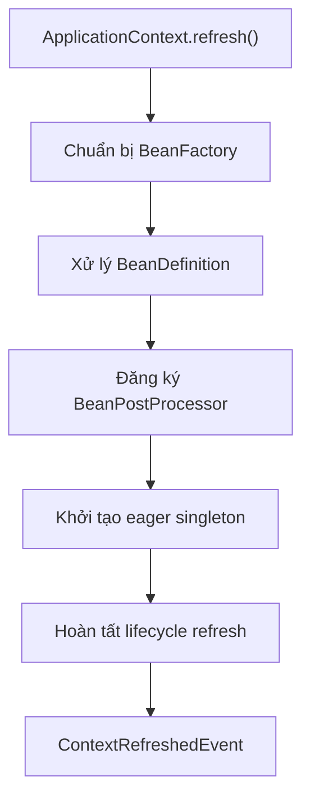
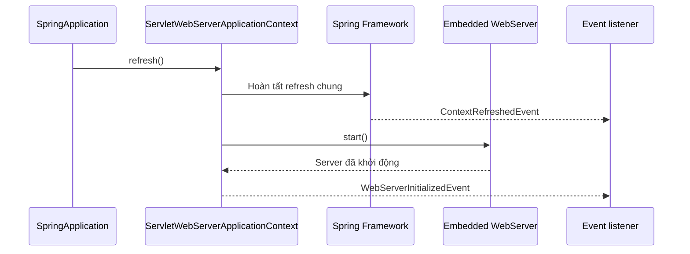
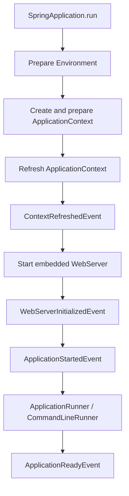
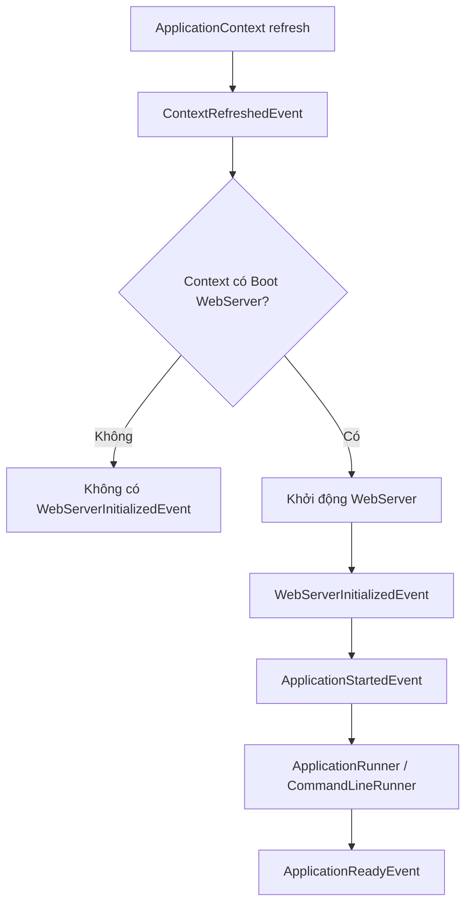

# ContextRefreshedEvent, WebServerInitializedEvent và phạm vi phát sinh

Trong quá trình Spring Boot khởi động, nhiều event được phát để báo cho listener biết một mốc trong lifecycle đã xảy ra. Hai event thường gặp khi tìm hiểu thời điểm container và web server sẵn sàng là:

- `ContextRefreshedEvent`: Spring Framework phát khi một `ApplicationContext` hoàn tất quá trình refresh.
- `WebServerInitializedEvent`: Spring Boot phát khi một `WebServer` đã được khởi tạo và khởi động trong web application context.

Hai event này không báo cùng một việc. Một context có thể đã refresh nhưng embedded web server chưa được khởi động. Một ứng dụng cũng có thể có nhiều context hoặc nhiều web server, nên listener có thể nhận nhiều event cùng loại trong một lần chạy.

Hiểu đúng **phạm vi phát sinh** giúp bạn tránh chạy lặp tác vụ, đọc đúng context nguồn của event, lấy đúng port và chọn đúng callback cho công việc startup.

## 1. Hai event báo hai mốc khác nhau

`ContextRefreshedEvent` thuộc Spring Framework:

```java
import org.springframework.context.event.ContextRefreshedEvent;
```

Nó cho biết một `ApplicationContext` đã hoàn tất refresh. Trong giai đoạn refresh, Spring đã xử lý BeanDefinition, đăng ký các post-processor, khởi tạo những singleton eager thông thường và hoàn tất các bước lifecycle của context.

`WebServerInitializedEvent` thuộc Spring Boot:

```java
import org.springframework.boot.web.context.WebServerInitializedEvent;
```

Event này mang theo `WebServer` và web application context tương ứng. Listener có thể lấy port thực tế từ:

```java
event.getWebServer().getPort()
```

Điểm phân biệt:

| Event | Báo điều gì? | Có bảo đảm web server đã chạy? |
|---|---|---|
| `ContextRefreshedEvent` | Một ApplicationContext đã refresh xong | Không |
| `WebServerInitializedEvent` | WebServer của context đã được khởi động/khởi tạo | Có, với web server được Boot quản lý và phát event |
| `ApplicationStartedEvent` | Context đã refresh, trước các runner | Với web app thông thường, server initialization đã diễn ra trong quá trình refresh |
| `ApplicationReadyEvent` | Các runner đã hoàn tất, ứng dụng đạt mốc ready của Boot | Thường có với web app, nhưng còn phụ thuộc health/readiness và cấu hình vận hành |

`ContextRefreshedEvent` là event cấp **Spring context**. `WebServerInitializedEvent` là event cấp **Spring Boot web server**. Không nên dùng chúng thay thế nhau.

## 2. ContextRefreshedEvent được phát khi nào?

`ApplicationContext` có lifecycle riêng. Khi context được refresh thành công, Spring phát `ContextRefreshedEvent` để báo rằng context đã hoàn tất quá trình chuẩn bị.

Với một context thông thường, refresh gồm những việc lớn:

1. Chuẩn bị context và BeanFactory.
2. Xử lý BeanFactoryPostProcessor và BeanDefinition.
3. Đăng ký BeanPostProcessor.
4. Chuẩn bị infrastructure như message source và event multicaster.
5. Tạo các singleton không lazy và inject dependency.
6. Hoàn tất refresh, khởi động các SmartLifecycle phù hợp và phát event.

Sơ đồ khái quát:



Event này không có nghĩa mọi công việc startup của toàn bộ ứng dụng đã xong. Nó báo mốc refresh của **context phát event**. Những công việc do `ApplicationRunner` hoặc `CommandLineRunner` thực hiện vẫn diễn ra sau đó.

### Một context có thể refresh nhiều lần

`ContextRefreshedEvent` có thể được phát mỗi lần một context hoàn tất refresh. Trong ứng dụng thông thường, Spring Boot refresh context chính một lần trong startup. Nhưng các test, ứng dụng có nhiều context, hoặc code quản lý context riêng có thể tạo ra nhiều lần refresh và nhiều event.

Do đó, listener không nên giả định rằng “một process chỉ nhận đúng một `ContextRefreshedEvent`”. Nếu listener làm side effect như đăng ký lịch, nạp dữ liệu, gửi thông báo hoặc tạo tài nguyên bên ngoài, cần xem xét tính idempotent và phạm vi context.

## 3. WebServerInitializedEvent được phát khi nào?

Spring Boot cung cấp abstraction `WebServer` cho embedded server. Với ứng dụng Servlet, context thường là `ServletWebServerApplicationContext`; với ứng dụng Reactive, context tương ứng là reactive web server application context.

Trong luồng khởi động web server thông thường, context hoàn tất phần refresh chung, sau đó web application context khởi động server và phát `WebServerInitializedEvent` (thông qua event subclass phù hợp).

Sơ đồ đơn giản cho một ứng dụng Servlet:



Vì vậy, trong web server context nhúng thông thường của Boot, `ContextRefreshedEvent` thường được phát trước `WebServerInitializedEvent`. Ở thời điểm nhận `ContextRefreshedEvent`, đừng mặc định port đã được bind hoặc server đã nhận kết nối.

Khi nhận `WebServerInitializedEvent`, bạn có thể lấy:

- `event.getWebServer()`: WebServer mà Boot vừa khởi tạo.
- `event.getWebServer().getPort()`: port thực tế server đang dùng.
- `event.getApplicationContext()`: web application context sở hữu server đó.

### Port cấu hình 0

Một ứng dụng có thể yêu cầu hệ điều hành chọn port trống:

```properties
server.port=0
```

Khi đó không thể lấy port thực tế chỉ bằng cách đọc property `server.port`, vì giá trị cấu hình là `0`. Sau khi server bind thành công, event cung cấp port đã được cấp:

```java
@EventListener
public void onWebServerInitialized(WebServerInitializedEvent event) {
    int actualPort = event.getWebServer().getPort();
    System.out.println("Server port: " + actualPort);
}
```

Đây là một lý do thực tế để lắng nghe event này trong integration test hoặc môi trường cần công bố địa chỉ server động.

## 4. WebServerInitializedEvent có những subtype nào?

Spring Boot có các event cụ thể cho từng web stack:

| Event class | Web stack | Package |
|---|---|---|
| `ServletWebServerInitializedEvent` | Servlet / Spring MVC | `org.springframework.boot.web.servlet.context` |
| `ReactiveWebServerInitializedEvent` | Reactive / Spring WebFlux | `org.springframework.boot.web.reactive.context` |

Cả hai đều là subtype của `WebServerInitializedEvent`. Nếu listener quan tâm tới port bất kể web stack, có thể nhận kiểu cha:

```java
@EventListener
public void onWebServerInitialized(WebServerInitializedEvent event) {
    int port = event.getWebServer().getPort();
    // Xử lý thông tin chung của WebServer.
}
```

Nếu cần xử lý riêng API Servlet hoặc Reactive, nhận subtype cụ thể:

```java
@EventListener
public void onServletServerInitialized(
        ServletWebServerInitializedEvent event) {
    // Xử lý thông tin riêng của Servlet web server.
}
```

Không nên ép mọi event thành Servlet event trong ứng dụng có thể chạy trên nhiều web stack. Chọn kiểu listener theo mức abstraction mà logic thực sự cần.

## 5. Phạm vi phát sinh của ContextRefreshedEvent

Phạm vi quan trọng nhất của `ContextRefreshedEvent` là **một ApplicationContext cụ thể**. Event mang theo context phát nó thông qua `getApplicationContext()`.

Trong ứng dụng đơn giản:

```text
JVM process
└── ApplicationContext chính
    ├── Bean definitions
    ├── Bean instances
    └── ContextRefreshedEvent
```

Thông thường bạn thấy một event từ context chính khi ứng dụng khởi động. Nhưng ứng dụng Spring có thể có context hierarchy:

```text
Parent ApplicationContext
    ├── Bean dùng chung
    └── Child Web ApplicationContext
        ├── Bean web
        └── ContextRefreshedEvent của child
```

Parent và child là hai context khác nhau. Mỗi context có lifecycle và có thể phát event refresh riêng.

### Event từ child có thể được chuyển lên parent

Trong cơ chế publish event mặc định của `ApplicationContext`, event được phát trong context hiện tại và có thể được chuyển tiếp lên context cha. Vì thế một listener đăng ký trong parent có thể nhận event có nguồn là child context.

Điều này có một hệ quả quan trọng:

- Listener nằm trong parent không có nghĩa event nó nhận luôn đến từ parent.
- Hãy kiểm tra `event.getApplicationContext()` để biết chính xác context phát event.
- Event của parent không tự động được phát xuống child theo chiều ngược lại.

Ví dụ lọc event theo context:

```java
@Component
public class ContextRefreshLogger {
    private final ApplicationContext ownContext;

    public ContextRefreshLogger(ApplicationContext ownContext) {
        this.ownContext = ownContext;
    }

    @EventListener
    public void onContextRefreshed(ContextRefreshedEvent event) {
        if (event.getApplicationContext() != ownContext) {
            return;
        }

        System.out.println(
                "This context refreshed: " + ownContext.getId());
    }
}
```

So sánh bằng identity giúp listener chỉ xử lý event do đúng context đang chứa listener phát ra. Nếu bạn muốn theo dõi cả context con, bỏ điều kiện lọc và ghi lại `event.getApplicationContext().getId()` để phân biệt.

### Không đồng nhất context với package hoặc Bean

Một context có thể quản lý Bean ở nhiều package; một package có thể được dùng làm nguồn cấu hình cho nhiều context. Event được phát theo **instance của ApplicationContext**, không phải theo package, class cấu hình hay từng Bean.

## 6. Phạm vi phát sinh của WebServerInitializedEvent

`WebServerInitializedEvent` được phát gắn với một web server và web application context quản lý nó. Vì vậy số event phụ thuộc vào số server context được khởi tạo, không đơn giản bằng một event cho toàn JVM.

Các tình huống:

- Một ứng dụng Servlet đơn giản với một embedded server: thường có một `ServletWebServerInitializedEvent`.
- Một ứng dụng Reactive đơn giản với một embedded server: thường có một `ReactiveWebServerInitializedEvent`.
- Ứng dụng có management server/context riêng: có thể có thêm event cho management web server.
- Ứng dụng có context hierarchy hoặc nhiều web application context: listener có thể thấy event từ nhiều context.
- Ứng dụng non-web: không có Boot `WebServer` để khởi động, nên không có `WebServerInitializedEvent` tương ứng.

### Management port riêng

Trong một số cấu hình Actuator, management endpoint có thể dùng port riêng:

```properties
server.port=8080
management.server.port=9090
```

Khi management server được tạo trong context riêng, có thể xuất hiện thêm event server initialization. Không nên giả định mọi event đều chỉ ra cổng phục vụ REST API chính.

Hãy đọc context đi kèm event và port:

```java
@EventListener
public void onWebServerInitialized(WebServerInitializedEvent event) {
    String contextId = event.getApplicationContext().getId();
    int port = event.getWebServer().getPort();

    System.out.println(
            "Context " + contextId + " uses port " + port);
}
```

Nếu ứng dụng có nhiều server, bạn có thể cần phân loại theo context hoặc metadata của web server thay vì lấy event đầu tiên rồi coi đó là port chính.

### Không có event trong ứng dụng non-web

Một ứng dụng batch hoặc command-line có thể tạo ApplicationContext bình thường và phát `ContextRefreshedEvent`, nhưng không tạo embedded web server. Do đó không có `WebServerInitializedEvent`.

Đây là điểm phân biệt hữu ích khi viết thư viện dùng chung cho cả web và non-web application: không yêu cầu event server như một điều kiện bắt buộc của lifecycle chung.

## 7. Ví dụ listener quan sát cả hai event

Ví dụ sau dùng Spring Boot Servlet hoặc Reactive web application. Nó ghi nhận context và port mà event báo:

```java
package com.example.startup;

import org.slf4j.Logger;
import org.slf4j.LoggerFactory;
import org.springframework.boot.web.context.WebServerInitializedEvent;
import org.springframework.context.ApplicationContext;
import org.springframework.context.event.ContextRefreshedEvent;
import org.springframework.context.event.EventListener;
import org.springframework.stereotype.Component;

@Component
public class StartupEventObserver {
    private static final Logger log =
            LoggerFactory.getLogger(StartupEventObserver.class);

    private final ApplicationContext ownContext;

    public StartupEventObserver(ApplicationContext ownContext) {
        this.ownContext = ownContext;
    }

    @EventListener
    public void onContextRefreshed(ContextRefreshedEvent event) {
        ApplicationContext source = event.getApplicationContext();

        log.info("Context refreshed: id={}, displayName={}",
                source.getId(), source.getDisplayName());
    }

    @EventListener
    public void onWebServerInitialized(WebServerInitializedEvent event) {
        ApplicationContext source = event.getApplicationContext();

        log.info("Web server initialized: context={}, port={}",
                source.getId(), event.getWebServer().getPort());
    }
}
```

Trong ví dụ này `ownContext` được inject để minh họa cách nhận diện context sở hữu listener. Nếu mục tiêu là chỉ xử lý event từ chính context đó, có thể thêm điều kiện:

```java
if (event.getApplicationContext() != ownContext) {
    return;
}
```

Nếu muốn ghi log mọi context trong hierarchy, giữ listener không lọc và luôn in context ID. Trong một hệ thống có management context riêng, cách ghi log này giúp nhận ra tại sao có nhiều port event.

Ví dụ giả định logger đã có trên classpath thông qua logging mặc định của Spring Boot. Không cần tự gọi `getBean(...)` trong listener; Spring inject context và đăng ký listener như các Bean khác.

## 8. Thứ tự với ApplicationStartedEvent, runner và ApplicationReadyEvent

Hai event đang học là một phần của chuỗi startup rộng hơn. Với một Spring Boot embedded web application thông thường, có thể hình dung:



Trong web server application context của Boot, `ContextRefreshedEvent` thường được phát trong phần refresh chung trước khi context khởi động embedded server và phát `WebServerInitializedEvent`. Khi `refreshContext(...)` hoàn tất, `SpringApplication` mới phát `ApplicationStartedEvent`, rồi chạy các runner. Sau runner là `ApplicationReadyEvent`.

Đây là thứ tự tổng quát cho một web server context nhúng, không phải cam kết rằng mọi context trong một hệ thống phức tạp chỉ phát đúng một lần hoặc mọi listener đều nhận event theo cùng một thứ tự toàn cục.

### Chọn event theo nhu cầu

| Nhu cầu | Cơ chế nên xem xét | Lý do |
|---|---|---|
| Biết một context đã refresh | `ContextRefreshedEvent` | Event ở cấp Spring context |
| Lấy port thực tế sau khi server bind | `WebServerInitializedEvent` | Event mang WebServer |
| Chạy công việc startup cần Bean đã sẵn sàng, trước readiness | `ApplicationRunner` / `CommandLineRunner` | Boot gọi sau refresh |
| Biết runner đã hoàn tất và ứng dụng đạt mốc ready | `ApplicationReadyEvent` | Event cấp ứng dụng sau runner |
| Quan sát startup thất bại | `ApplicationFailedEvent` | Boot thông báo lỗi trong quá trình run |

`ContextRefreshedEvent` không thay thế runner. `WebServerInitializedEvent` không thay thế `ApplicationReadyEvent`: server có thể đã start trong khi runner vẫn đang chạy.

## 9. Dùng ContextRefreshedEvent có thể gây chạy lặp

Ví dụ một listener khởi tạo lịch định kỳ:

```java
@EventListener
public void onContextRefreshed(ContextRefreshedEvent event) {
    scheduler.scheduleAtFixedRate(this::runJob, Duration.ofMinutes(1));
}
```

Đoạn code trên có rủi ro nếu listener nhận nhiều refresh event hoặc event từ nhiều context. Mỗi lần gọi có thể đăng ký thêm một lịch, khiến cùng công việc chạy lặp.

Nếu thực sự cần dùng event này, hãy:

- Xác định rõ context nào được phép kích hoạt công việc.
- Làm thao tác có tính idempotent.
- Có cơ chế chống đăng ký trùng.
- Quản lý và hủy tài nguyên theo lifecycle của context.
- Cân nhắc runner hoặc lifecycle component nếu công việc chỉ cần chạy một lần sau khi context khởi động.

Ví dụ lọc context:

```java
@EventListener
public void onContextRefreshed(ContextRefreshedEvent event) {
    if (event.getApplicationContext() != ownContext) {
        return;
    }

    initializeOnce();
}
```

Lọc context giải quyết việc nhận event từ context khác, nhưng không tự bảo đảm `initializeOnce()` chỉ chạy một lần nếu chính context được refresh lại. Tính idempotent vẫn quan trọng.

## 10. Dùng WebServerInitializedEvent để lấy port động

Một tình huống thực tế là integration test chạy server trên port ngẫu nhiên. Cấu hình:

```properties
server.port=0
```

Listener nhận port:

```java
@Component
public class BoundPortHolder {
    private volatile int port = -1;

    @EventListener
    public void onWebServerInitialized(WebServerInitializedEvent event) {
        this.port = event.getWebServer().getPort();
    }

    public int getPort() {
        return port;
    }
}
```

`volatile` giúp việc đọc/ghi giá trị giữa các thread có visibility phù hợp trong ví dụ đơn giản. Trong ứng dụng thực tế, Spring Boot test thường đã cung cấp cơ chế lấy local server port phù hợp; listener này chủ yếu để minh họa event.

Không nên dùng một biến static toàn cục để lưu port nếu ứng dụng có thể tạo nhiều context/server. Static state dễ bị ghi đè bởi event của context khác và gây test phụ thuộc lẫn nhau.

## 11. Event listener được gọi trong thread nào?

Mặc định, Spring `ApplicationEventMulticaster` thường dispatch event đồng bộ trên thread phát event nếu không cấu hình executor khác. Điều này có nghĩa:

- Listener `ContextRefreshedEvent` có thể chạy ngay trong luồng refresh context.
- Listener `WebServerInitializedEvent` có thể chạy trong luồng startup đang publish event.
- Listener chậm có thể kéo dài thời gian khởi động.
- Exception không được xử lý trong listener có thể ảnh hưởng đến luồng publish/startup, tùy cấu hình multicaster và error handler.

Không nên thực hiện tác vụ network hoặc xử lý dữ liệu dài trong listener nếu nó không thực sự cần nằm trong luồng phát event. Nếu listener chỉ ghi log, cập nhật metadata nhỏ hoặc lưu port, xử lý đồng bộ thường phù hợp.

Nếu chuyển event listener sang executor bất đồng bộ, cần lưu ý rằng event handler có thể chạy sau khi giai đoạn startup tiếp tục. Khi đó không được giả định công việc listener đã hoàn tất trước `ApplicationReadyEvent`, trừ khi bạn tự thiết kế cơ chế đồng bộ rõ ràng.

## 12. ContextRefreshedEvent có phải ứng dụng đã sẵn sàng?

Không. Event này chỉ nói rằng context nguồn đã refresh.

Ví dụ, với web server context:

1. Spring tạo các Bean eager và hoàn tất phần refresh chung.
2. `ContextRefreshedEvent` được phát.
3. Boot khởi động embedded server và phát `WebServerInitializedEvent`.
4. `SpringApplication` phát `ApplicationStartedEvent`.
5. Runner thực hiện các công việc startup.
6. Boot phát `ApplicationReadyEvent`.

Nếu runner phải nạp cache, đồng bộ dữ liệu hoặc kiểm tra một dependency bắt buộc, ứng dụng có thể chưa nên nhận traffic cho tới khi runner hoàn tất và readiness được cập nhật.

Do đó:

- Dùng `ContextRefreshedEvent` để quan sát mốc refresh của context.
- Dùng `WebServerInitializedEvent` để biết server đã khởi động và port thực tế.
- Dùng `ApplicationRunner` cho công việc startup cần hoàn tất trước ready.
- Dùng `ApplicationReadyEvent` để quan sát mốc ứng dụng ready sau runner.

## 13. Ví dụ test với port ngẫu nhiên

Trong Spring Boot integration test, bạn có thể chạy web server trên port ngẫu nhiên:

```java
@SpringBootTest(webEnvironment = SpringBootTest.WebEnvironment.RANDOM_PORT)
class WebServerEventTest {
    // Spring Boot khởi động web server với port được hệ điều hành cấp.
}
```

Trong nhiều test, có thể dùng `@LocalServerPort` để inject port thực tế:

```java
@SpringBootTest(webEnvironment = SpringBootTest.WebEnvironment.RANDOM_PORT)
class HttpIntegrationTest {

    @LocalServerPort
    int port;

    @Test
    void serverHasAnAssignedPort() {
        assertThat(port).isPositive();
    }
}
```

Đây là cách test thuận tiện khi chỉ cần gọi HTTP endpoint. Nếu mục tiêu của bài test là kiểm tra event listener của riêng bạn, hãy quan sát listener được gọi và context/port được truyền trong event; không cần tự quản lý toàn bộ lifecycle server.

Với `WebServerInitializedEvent`, hãy nhớ server event chỉ tồn tại khi test tạo web application context có server. Một `ApplicationContextRunner` non-web không phát event này.

## 14. Những lỗi và hiểu nhầm thường gặp

| Hiện tượng | Nguyên nhân có thể | Cách xử lý |
|---|---|---|
| Lấy port trong `ContextRefreshedEvent` nhưng chưa có giá trị | Context refresh xong trước khi embedded server được start | Dùng `WebServerInitializedEvent` |
| Listener chạy nhiều lần | Nhiều context hoặc context refresh nhiều lần | Ghi context ID, lọc context và làm side effect idempotent |
| Có hai port được log | Nhiều web server context, ví dụ application và management | Xem context ID và phân loại server |
| Không thấy `WebServerInitializedEvent` | Ứng dụng non-web hoặc không có Boot WebServer | Kiểm tra `WebApplicationType` và web stack |
| Ứng dụng chưa ready dù đã có server event | Runner còn đang chạy hoặc startup chưa hoàn tất | Dùng `ApplicationReadyEvent`/readiness để theo dõi |
| Parent listener nhận event child | Event được chuyển tiếp lên parent context | Kiểm tra `event.getApplicationContext()` |
| Startup bị kéo dài bởi listener | Listener chạy đồng bộ và làm việc nặng | Rút gọn xử lý hoặc thiết kế công việc bất đồng bộ có kiểm soát |

## 15. Quy trình điều tra khi nhận nhiều event

Khi log cho thấy nhiều `ContextRefreshedEvent` hoặc `WebServerInitializedEvent`, hãy ghi lại các thông tin:

1. Loại event thực tế và class subtype.
2. `event.getApplicationContext().getId()`.
3. `event.getApplicationContext().getDisplayName()`.
4. Context cha nếu có.
5. Port từ `event.getWebServer().getPort()` đối với web server event.
6. Thời điểm event được phát.

Ví dụ log:

```java
@EventListener
public void logWebServer(WebServerInitializedEvent event) {
    var context = event.getApplicationContext();
    log.info("WebServer event: contextId={}, parentId={}, port={}, eventType={}",
            context.getId(),
            context.getParent() != null ? context.getParent().getId() : "none",
            event.getWebServer().getPort(),
            event.getClass().getSimpleName());
}
```

Các thông tin này giúp phân biệt:

- Một context refresh lại.
- Parent và child context cùng phát event.
- Application server và management server.
- Servlet server và Reactive server.
- Một listener được đăng ký ở parent nhận event do child phát.

Đừng suy ra số context chỉ từ số lần callback. Hãy đọc context identity đi kèm event.

## 16. Mô hình ghi nhớ



Hãy nhớ ba phạm vi:

- **Context scope:** `ContextRefreshedEvent` gắn với từng ApplicationContext refresh thành công.
- **Web server scope:** `WebServerInitializedEvent` gắn với từng Boot WebServer được khởi động trong web application context.
- **Application readiness:** `ApplicationReadyEvent` báo mốc ứng dụng hoàn tất runner, rộng hơn việc một context refresh hoặc một server start.

Khi viết listener, luôn xem event mang theo context nào và chỉ thực hiện side effect trong đúng phạm vi cần thiết. Nếu cần biết context đã refresh, dùng `ContextRefreshedEvent`; nếu cần port thực tế của server, dùng `WebServerInitializedEvent`; nếu cần đợi toàn bộ startup runner hoàn tất, dùng `ApplicationReadyEvent`. Chọn đúng event giúp startup rõ ràng, tránh xử lý lặp và không nhầm một server đã mở cổng với toàn bộ ứng dụng đã sẵn sàng.
