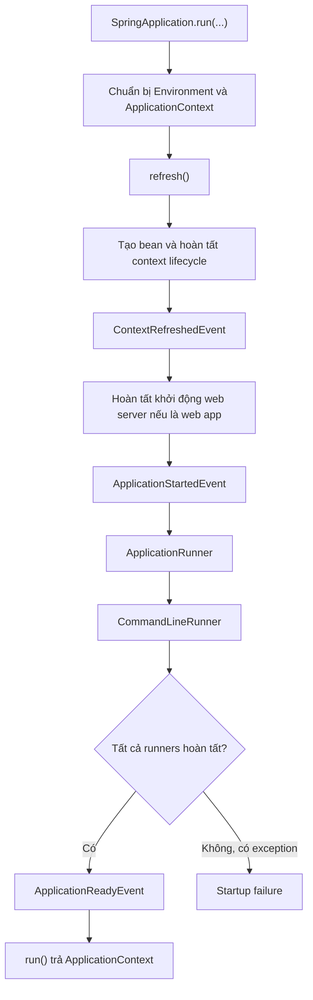

# ApplicationStartedEvent khác thời điểm ApplicationReadyEvent

Spring Boot phát nhiều application event trong quá trình khởi động. Hai event thường dễ nhầm là `ApplicationStartedEvent` và `ApplicationReadyEvent` vì cả hai đều xuất hiện sau khi `ApplicationContext` đã refresh. Tuy nhiên, chúng đánh dấu **hai mốc khác nhau trong startup lifecycle**:

- `ApplicationStartedEvent` được phát sau khi context refresh hoàn tất, **trước khi** Spring Boot gọi `ApplicationRunner` và `CommandLineRunner`.
- `ApplicationReadyEvent` được phát **sau khi tất cả runner hoàn tất**, khi Spring Boot xem ứng dụng đã sẵn sàng để phục vụ.

Khác biệt này rất quan trọng khi bạn cần chạy tác vụ lúc startup, ghi nhận trạng thái ứng dụng, kiểm tra readiness hoặc quyết định thời điểm bắt đầu nhận traffic. Nếu một tác vụ bắt buộc phải hoàn thành trước khi ứng dụng được xem là ready, bạn cần hiểu runner và ready event nằm ở đâu trong thứ tự.

Bài học thuộc chương **Sự kiện và runner** của *Spring Boot Fundamentals*. Ta sẽ theo dõi timeline của `SpringApplication.run`, phân biệt hai event với `ContextRefreshedEvent`, sử dụng `ApplicationListener` và `@EventListener`, rồi kiểm thử thứ tự phát event và runner bằng một ứng dụng nhỏ.

Ví dụ dùng Java 21 và Spring Boot 3.x. Một số event phụ và chi tiết nội bộ có thể thay đổi theo phiên bản, nhưng quan hệ chính giữa hai event và runner được mô tả dưới đây là luồng startup phổ biến của Spring Boot hiện đại.

## 1. Hai event đánh dấu hai mốc startup khác nhau

### `ApplicationStartedEvent`

Spring Boot phát `ApplicationStartedEvent` sau khi application context đã được refresh thành công và các bước refresh chính đã hoàn tất. Tại thời điểm này:

- Bean definitions đã được xử lý.
- Các singleton eager cần thiết đã được tạo và khởi tạo.
- Các lifecycle component được start theo quy trình refresh.
- Với ứng dụng web, embedded web server đã đi qua giai đoạn khởi động của web context.
- Spring Boot **chưa gọi** `ApplicationRunner` và `CommandLineRunner`.

Vì vậy, `ApplicationStartedEvent` thích hợp khi bạn muốn biết context đã khởi động xong và ứng dụng đã đi qua giai đoạn refresh, nhưng vẫn cần thực hiện các startup runner tiếp theo.

### `ApplicationReadyEvent`

Spring Boot phát `ApplicationReadyEvent` sau khi các runner đã được gọi và hoàn tất thành công. Tại thời điểm này:

- Context đã refresh.
- Những `ApplicationRunner` và `CommandLineRunner` trong startup sequence đã chạy xong.
- Các tác vụ khởi động đồng bộ được đặt trong runner đã hoàn tất.
- Boot phát tín hiệu rằng ứng dụng đã sẵn sàng để phục vụ theo lifecycle của nó.

Nếu runner ném exception và startup thất bại, ứng dụng không đi đến mốc ready thành công thông thường; `ApplicationReadyEvent` sẽ không được phát như một lần khởi động thành công.

### So sánh trực tiếp

| Tiêu chí | `ApplicationStartedEvent` | `ApplicationReadyEvent` |
|---|---|---|
| Thời điểm | Sau context refresh | Sau khi runner hoàn tất |
| Bean initialization | Đã hoàn tất theo quy trình refresh | Đã hoàn tất |
| Runner | Chưa được gọi | Đã chạy xong |
| Ý nghĩa | Ứng dụng đã started | Ứng dụng đã ready |
| Dùng khi | Cần biết context đã refresh | Cần biết startup runner đã hoàn thành |
| Nếu runner thất bại | Event này có thể đã được phát trước đó | Không có ready event thành công |

Điểm ghi nhớ: **Started là sau refresh, Ready là sau runners.**

## 2. Vị trí của hai event trong SpringApplication.run

Lớp main thường gọi:

```java
package com.example.demo;

import org.springframework.boot.SpringApplication;
import org.springframework.boot.autoconfigure.SpringBootApplication;

@SpringBootApplication
public class DemoApplication {

    public static void main(String[] args) {
        SpringApplication.run(DemoApplication.class, args);
    }
}
```

Trong luồng startup thông thường của Spring Boot, thứ tự quan trọng được rút gọn như sau:

1. SpringApplication bắt đầu khởi động và chuẩn bị Environment.
2. Boot tạo và chuẩn bị ApplicationContext.
3. Boot gọi refresh context.
4. Context hoàn tất refresh và phát `ContextRefreshedEvent`.
5. Với web context, embedded web server được khởi động theo lifecycle của context.
6. Boot phát `ApplicationStartedEvent`.
7. Boot gọi `ApplicationRunner` và `CommandLineRunner`.
8. Nếu runners hoàn tất, Boot phát `ApplicationReadyEvent`.
9. `SpringApplication.run` hoàn tất và trả ApplicationContext về cho caller.



Sơ đồ tập trung vào các mốc chính để phân biệt Started và Ready. Thứ tự giữa các runner phụ thuộc cơ chế ordering; hai interface runner có thể được Boot sắp xếp trong cùng startup sequence.

### 2.1. `ContextRefreshedEvent` xảy ra trước `ApplicationStartedEvent`

`ContextRefreshedEvent` là event của Spring Framework, được phát khi một ApplicationContext hoàn tất refresh. Nó không phải event riêng của Spring Boot.

`ApplicationStartedEvent` là event của Spring Boot, được phát sau khi `SpringApplication` đã hoàn tất refresh context và các bước sau refresh tương ứng.

Do đó, nếu bạn cần biết riêng về container refresh, hãy cân nhắc `ContextRefreshedEvent`. Nếu bạn cần mốc startup của Spring Boot ngay trước runners, dùng `ApplicationStartedEvent`.

### 2.2. Web server initialized event là một mốc khác

Ứng dụng servlet web có thể phát `ServletWebServerInitializedEvent` khi embedded servlet web server đã được khởi tạo. Ứng dụng reactive web có event tương ứng cho reactive web server.

Đây là event liên quan web server, không thay thế Started hoặc Ready:

- `ServletWebServerInitializedEvent`: web server đã được khởi tạo.
- `ApplicationStartedEvent`: context đã refresh và Boot chuẩn bị bước gọi runners.
- `ApplicationReadyEvent`: runners đã hoàn tất và Boot báo ứng dụng ready.

## 3. Tại sao Spring Boot cần cả Started và Ready?

Context refresh và startup runner phục vụ những mục tiêu khác nhau.

Trong lúc refresh, Spring tập trung hoàn tất hạ tầng container:

- Đọc và xử lý configuration.
- Đăng ký bean definitions.
- Tạo eager singleton và inject dependency.
- Áp dụng BeanPostProcessor.
- Khởi tạo các thành phần lifecycle.
- Khởi động hạ tầng web phù hợp.

Sau refresh, ứng dụng có thể vẫn cần thực hiện các công việc khởi động ở tầng ứng dụng, chẳng hạn:

- Nạp dữ liệu tham chiếu vào cache.
- Kiểm tra hoặc chuẩn bị dữ liệu nghiệp vụ.
- Đăng ký thông tin với một dịch vụ điều phối.
- Tạo chỉ mục hoặc nạp metadata.
- Kiểm tra cấu hình nghiệp vụ cần thiết.

Spring Boot cung cấp runner để thực hiện công việc này. `ApplicationStartedEvent` được phát trước runner để listener biết context đã refresh; `ApplicationReadyEvent` được phát sau runner để báo startup sequence đã hoàn tất.

### 3.1. Một ví dụ về startup data

Giả sử ứng dụng cần nạp danh sách quốc gia vào cache trước khi báo ready:

```java
package com.example.demo.startup;

import org.springframework.boot.ApplicationArguments;
import org.springframework.boot.ApplicationRunner;
import org.springframework.stereotype.Component;

@Component
public class ReferenceDataLoader implements ApplicationRunner {

    private final ReferenceDataService referenceDataService;

    public ReferenceDataLoader(ReferenceDataService referenceDataService) {
        this.referenceDataService = referenceDataService;
    }

    @Override
    public void run(ApplicationArguments args) {
        referenceDataService.loadCountries();
    }
}
```

Trong ví dụ này, `ReferenceDataLoader` được gọi sau `ApplicationStartedEvent` và trước `ApplicationReadyEvent`. Nếu `loadCountries()` hoàn tất bình thường, Boot tiếp tục tới ready event.

Nếu thao tác nạp dữ liệu ném exception, startup có thể thất bại và ready event không được phát. Điều này phù hợp nếu cache dữ liệu quốc gia là điều kiện bắt buộc để ứng dụng phục vụ request.

## 4. ApplicationRunner và CommandLineRunner nằm giữa hai event

Hai interface runner của Spring Boot:

```java
public interface ApplicationRunner {
    void run(ApplicationArguments args) throws Exception;
}
```

và:

```java
public interface CommandLineRunner {
    void run(String... args) throws Exception;
}
```

Chúng được gọi sau khi context refresh và trước `ApplicationReadyEvent`.

### 4.1. Khác nhau ở đối số

| Interface | Tham số | Khi phù hợp |
|---|---|---|
| `ApplicationRunner` | `ApplicationArguments` | Cần truy cập tham số đã được phân tích thành option và non-option arguments. |
| `CommandLineRunner` | `String... args` | Muốn nhận trực tiếp các chuỗi tham số dòng lệnh. |

Ví dụ:

```java
@Component
public class ApplicationArgumentReporter implements ApplicationRunner {

    @Override
    public void run(ApplicationArguments args) {
        System.out.println("Option names: " + args.getOptionNames());
        System.out.println("Non-option args: " + args.getNonOptionArgs());
    }
}
```

Nếu chạy:

```bash
./gradlew bootRun --args='--app.mode=demo input-a input-b'
```

`ApplicationRunner` có thể đọc option `app.mode` và danh sách non-option arguments qua `ApplicationArguments`. `CommandLineRunner` nhận các chuỗi đối số thô theo API của nó.

### 4.2. Ordering của runners

Nếu có nhiều runner, Spring Boot hỗ trợ ordering qua `Ordered` hoặc `@Order`:

```java
@Component
@Order(10)
public class CacheLoader implements ApplicationRunner {

    @Override
    public void run(ApplicationArguments args) {
        System.out.println("Load cache");
    }
}
```

```java
@Component
@Order(20)
public class StartupVerifier implements ApplicationRunner {

    @Override
    public void run(ApplicationArguments args) {
        System.out.println("Verify startup data");
    }
}
```

Giá trị order thấp hơn thường được chạy trước. Hãy dùng ordering khi các runner có quan hệ thực sự, ví dụ cache phải được nạp trước khi kiểm tra dữ liệu. Nếu có thể, ưu tiên gom các bước phụ thuộc chặt vào cùng một startup service để thứ tự không bị rải rác ở nhiều nơi.

### 4.3. Cả hai loại runner cùng tham gia startup sequence

Boot gọi các bean triển khai `ApplicationRunner` và `CommandLineRunner`. Không nên dựa vào thứ tự khai báo class hoặc thứ tự component scan để dự đoán runner nào chạy trước. Hãy khai báo `@Order`/`Ordered` khi thứ tự có ý nghĩa.

Các runner được gọi đồng bộ trong startup sequence thông thường. Khi method `run` trả về, Boot mới tiếp tục đến runner tiếp theo và cuối cùng phát ready event.

## 5. Đăng ký listener cho ApplicationStartedEvent

Có hai cách phổ biến để lắng nghe event trong một ứng dụng Spring.

### 5.1. Dùng `@EventListener`

Một bean có thể khai báo method nhận event:

```java
package com.example.demo.events;

import org.springframework.boot.context.event.ApplicationStartedEvent;
import org.springframework.context.event.EventListener;
import org.springframework.stereotype.Component;

@Component
public class StartedEventListener {

    @EventListener
    public void onApplicationStarted(ApplicationStartedEvent event) {
        System.out.println("Context refreshed; runners are next.");
        System.out.println("Application: "
                + event.getApplicationContext().getDisplayName());
    }
}
```

Bean listener này được tạo và đăng ký trong context. Khi Boot phát `ApplicationStartedEvent`, method được gọi.

Đây là nơi phù hợp cho thao tác cần biết context đã refresh nhưng không nên được xem là bước hoàn tất readiness, vì runner chưa chạy xong.

### 5.2. Triển khai `ApplicationListener<E>`

Bạn cũng có thể tạo một listener class:

```java
package com.example.demo.events;

import org.springframework.boot.context.event.ApplicationStartedEvent;
import org.springframework.context.ApplicationListener;
import org.springframework.stereotype.Component;

@Component
public class StartedApplicationListener
        implements ApplicationListener<ApplicationStartedEvent> {

    @Override
    public void onApplicationEvent(ApplicationStartedEvent event) {
        System.out.println("Application started event received");
    }
}
```

Hai cách đều lắng nghe event. `@EventListener` thuận tiện cho method trong bean hiện có; `ApplicationListener<E>` phù hợp khi muốn một class có trách nhiệm listener rõ ràng hoặc cần đăng ký theo API.

## 6. Đăng ký listener cho ApplicationReadyEvent

Listener cho ready event có thể viết tương tự:

```java
package com.example.demo.events;

import org.springframework.boot.context.event.ApplicationReadyEvent;
import org.springframework.context.event.EventListener;
import org.springframework.stereotype.Component;

@Component
public class ReadyEventListener {

    @EventListener
    public void onApplicationReady(ApplicationReadyEvent event) {
        System.out.println("All startup runners have completed.");
    }
}
```

Đến thời điểm method này được gọi, những runner đồng bộ trong startup sequence đã hoàn tất. Vì vậy listener có thể dùng để ghi nhận mốc ready, phát metric hoặc thông báo trạng thái khởi động hoàn tất cho một thành phần quan sát.

Tuy nhiên, không nên đặt công việc khởi tạo bắt buộc trong ready listener nếu công việc đó cần hoàn tất **trước** khi ứng dụng được xem là ready. Khi listener chạy, Boot đã phát ready event; hãy đặt công việc bắt buộc vào runner để nó nằm trước mốc này.

### 6.1. Một listener nhận cả hai event

Nếu muốn quan sát timeline trong một class:

```java
package com.example.demo.events;

import org.springframework.boot.context.event.ApplicationReadyEvent;
import org.springframework.boot.context.event.ApplicationStartedEvent;
import org.springframework.context.event.EventListener;
import org.springframework.stereotype.Component;

@Component
public class StartupTimelineListener {

    @EventListener
    public void onStarted(ApplicationStartedEvent event) {
        System.out.println("1. ApplicationStartedEvent");
    }

    @EventListener
    public void onReady(ApplicationReadyEvent event) {
        System.out.println("3. ApplicationReadyEvent");
    }
}
```

Một runner có thể ghi mốc ở giữa:

```java
@Component
public class TimelineRunner implements ApplicationRunner {

    @Override
    public void run(ApplicationArguments args) {
        System.out.println("2. ApplicationRunner");
    }
}
```

Kết quả khái quát:

```text
1. ApplicationStartedEvent
2. ApplicationRunner
3. ApplicationReadyEvent
```

Thứ tự này minh họa một runner. Nếu có nhiều runner, tất cả runner cần hoàn tất trước ready event.

## 7. Availability state: Liveness và Readiness

Spring Boot còn cung cấp application availability để diễn đạt trạng thái sống và khả năng nhận traffic. Hai khái niệm này liên quan tới startup event nhưng không đồng nhất với chúng.

### Liveness

Liveness trả lời câu hỏi: **process/application có còn hoạt động hay đã rơi vào trạng thái cần khởi động lại?**

Spring Boot có thể chuyển liveness state sang `CORRECT` sau `ApplicationStartedEvent`. Đây là tín hiệu ứng dụng đã qua giai đoạn context refresh.

### Readiness

Readiness trả lời câu hỏi: **ứng dụng đã sẵn sàng nhận request/traffic chưa?**

Trong startup lifecycle, readiness thường bắt đầu ở trạng thái không chấp nhận traffic và được chuyển sang `ACCEPTING_TRAFFIC` sau khi startup runners hoàn tất và `ApplicationReadyEvent` được phát.

| Mốc | Ý nghĩa thường dùng |
|---|---|
| Context refresh hoàn tất | Container và bean infrastructure đã refresh. |
| `ApplicationStartedEvent` | Boot báo started; runners chưa hoàn tất. |
| Liveness `CORRECT` | Ứng dụng đã qua giai đoạn startup nền tảng. |
| `ApplicationReadyEvent` | Runner đã hoàn tất; Boot báo ready. |
| Readiness `ACCEPTING_TRAFFIC` | Ứng dụng có thể được đưa vào nhận traffic theo availability state. |

### 7.1. Đọc availability state

Một bean có thể nhận `ApplicationAvailability`:

```java
package com.example.demo.health;

import org.springframework.boot.availability.ApplicationAvailability;
import org.springframework.boot.availability.ReadinessState;
import org.springframework.stereotype.Component;

@Component
public class ReadinessReporter {

    private final ApplicationAvailability availability;

    public ReadinessReporter(ApplicationAvailability availability) {
        this.availability = availability;
    }

    public ReadinessState currentReadiness() {
        return availability.getReadinessState();
    }
}
```

Bạn cũng có thể lắng nghe availability change event:

```java
import org.springframework.boot.availability.AvailabilityChangeEvent;
import org.springframework.boot.availability.ReadinessState;
import org.springframework.context.event.EventListener;
import org.springframework.stereotype.Component;

@Component
public class ReadinessStateListener {

    @EventListener
    public void onReadinessChanged(
            AvailabilityChangeEvent<ReadinessState> event) {
        System.out.println("Readiness: " + event.getState());
    }
}
```

Các state event giúp hệ thống quan sát hoặc orchestration biết khi nào instance có thể nhận traffic. Trong môi trường có Kubernetes hoặc load balancer, readiness probe có thể sử dụng health/availability endpoint phù hợp để quyết định có gửi traffic tới instance hay không.

### 7.2. ApplicationReadyEvent không thay thế health check

Ready event là mốc lifecycle của Spring Boot. Nó không tự chứng minh mọi hệ thống phụ thuộc đều khỏe mạnh trong suốt thời gian chạy. Ví dụ:

- Database có thể mất kết nối ngay sau ready.
- Message broker có thể ngừng hoạt động.
- Dịch vụ bên ngoài có thể gặp sự cố.
- Một background task được khởi chạy bất đồng bộ có thể chưa hoàn tất.

Readiness/health indicator cần phản ánh những dependency thực sự cần thiết để phục vụ traffic. Nếu một chức năng tùy chọn không sẵn sàng, không nhất thiết phải đánh dấu cả ứng dụng unready; quyết định phụ thuộc vào yêu cầu nghiệp vụ và kiến trúc.

## 8. Runner đồng bộ và công việc bất đồng bộ

Một điểm dễ hiểu sai: Boot chờ method runner trả về, nhưng không tự chờ mọi công việc mà runner đã khởi chạy ở background.

Ví dụ:

```java
@Component
public class BackgroundWarmupRunner implements ApplicationRunner {

    private final Executor executor;

    public BackgroundWarmupRunner(Executor executor) {
        this.executor = executor;
    }

    @Override
    public void run(ApplicationArguments args) {
        executor.execute(this::warmup);
    }

    private void warmup() {
        // Tác vụ chạy ở background.
    }
}
```

Runner gọi `executor.execute` rồi trả về ngay. Boot có thể tiếp tục và phát `ApplicationReadyEvent` trong khi `warmup()` vẫn đang chạy.

Do đó:

- Nếu warmup bắt buộc trước khi nhận traffic, runner cần chờ tác vụ hoàn tất, ví dụ dùng future và chờ kết quả với timeout.
- Nếu warmup là công việc tùy chọn chạy nền, hãy quản lý trạng thái riêng và không giả định ready event chờ nó.
- Nếu ứng dụng cần readiness phụ thuộc vào background job, hãy cập nhật availability state hoặc health indicator theo một quy tắc rõ ràng.

Ví dụ runner chờ một tác vụ:

```java
@Component
public class RequiredWarmupRunner implements ApplicationRunner {

    private final WarmupService warmupService;

    public RequiredWarmupRunner(WarmupService warmupService) {
        this.warmupService = warmupService;
    }

    @Override
    public void run(ApplicationArguments args) throws Exception {
        warmupService.prepare().get(30, TimeUnit.SECONDS);
    }
}
```

Ví dụ giả định `prepare()` trả về `Future<?>` hoặc kiểu tương thích. Cần chọn timeout và xử lý lỗi phù hợp. Không nên chờ vô hạn vì điều đó có thể khiến ứng dụng không bao giờ đạt ready.

### 8.1. @Async trên event listener

Nếu listener được đánh dấu `@Async` và async execution được bật, method listener có thể chạy trên thread khác. Việc phát event không đồng nghĩa Boot đợi công việc async bên trong listener hoàn tất.

Ví dụ:

```java
@Async
@EventListener
public void onReady(ApplicationReadyEvent event) {
    sendStartupNotification();
}
```

Ready event vẫn được phát ở mốc Boot quy định; notification có thể tiếp tục sau đó. Nếu notification là điều kiện bắt buộc cho readiness, không nên chuyển nó thành một tác vụ async fire-and-forget.

## 9. Chọn event hay runner cho công việc startup?

Runner và event listener phục vụ hai mục tiêu khác nhau.

| Nhu cầu | Cách thường phù hợp |
|---|---|
| Thực hiện tác vụ đồng bộ cần hoàn tất trước ready | `ApplicationRunner` hoặc `CommandLineRunner` |
| Nhận biết context đã refresh nhưng runner chưa chạy | `ApplicationStartedEvent` |
| Ghi nhận startup sequence đã hoàn tất | `ApplicationReadyEvent` |
| Phản ứng khi ApplicationContext refresh | `ContextRefreshedEvent` |
| Phản ứng khi web server được khởi tạo | `ServletWebServerInitializedEvent` hoặc event tương ứng |
| Theo dõi liveness/readiness state | `AvailabilityChangeEvent` và `ApplicationAvailability` |

### 9.1. Dùng runner khi cần điều khiển startup

Nếu ứng dụng cần:

- Kiểm tra dữ liệu bắt buộc.
- Nạp cache bắt buộc.
- Chạy migration hoặc chuẩn bị dữ liệu theo quy trình đã thiết kế.
- Dừng startup nếu bước chuẩn bị thất bại.

thì runner thường là lựa chọn rõ ràng vì Boot chờ method `run` trả về trước khi phát ready event.

### 9.2. Dùng Started event khi cần quan sát mốc refresh

Listener cho `ApplicationStartedEvent` thích hợp cho:

- Ghi log hoặc metric về mốc context refresh.
- Ghi nhận startup phase.
- Kích hoạt một công việc không phải điều kiện để runner hoàn tất.
- Quan sát context đã sẵn sàng để các runner tiếp tục.

Nếu tác vụ cần hoàn tất trước ready, hãy cân nhắc runner thay vì listener ở mốc Started.

### 9.3. Dùng Ready event khi cần thông báo startup đã xong

Listener cho `ApplicationReadyEvent` thích hợp cho:

- Ghi nhận metric startup completed.
- Gửi thông báo vận hành sau startup.
- Bắt đầu tác vụ hậu startup không cần chặn readiness.
- Tích hợp với thành phần quan sát trạng thái ứng dụng.

Không dùng ready listener để thực hiện một bước mà ứng dụng phải hoàn tất trước khi được coi là ready, vì event này đã đánh dấu mốc sau runners.

## 10. Event listener có chạy đồng bộ không?

Trong cấu hình mặc định, application event multicaster thường gọi listener đồng bộ trên thread phát event. Vì vậy một listener chạy lâu có thể kéo dài chính bước phát event và ảnh hưởng startup.

Ví dụ:

```java
@EventListener
public void onReady(ApplicationReadyEvent event) {
    performLongRunningTask();
}
```

Nếu method này mất vài phút, việc xử lý event có thể kéo dài trước khi luồng publish event tiếp tục. Ready event đã được phát, nhưng quá trình `SpringApplication.run` có thể chưa trả về cho caller cho đến khi listener đồng bộ hoàn tất.

Nếu dùng async listener, method có thể chạy tách thread và publisher không chờ công việc hoàn tất. Hãy lựa chọn có chủ đích:

- Listener ngắn, ghi metric hoặc cập nhật trạng thái: có thể chạy đồng bộ.
- Tác vụ dài, tùy chọn: cân nhắc async và quản lý lỗi.
- Tác vụ bắt buộc trước ready: dùng runner đồng bộ hoặc cơ chế điều phối có chờ hoàn tất.

### 10.1. Ordering giữa các listener

Nếu nhiều listener cùng nhận một event, có thể dùng `@Order` hoặc `Ordered` để xác định thứ tự gọi trong cơ chế listener hỗ trợ ordering.

Ví dụ:

```java
@Component
public class FirstReadyListener {

    @Order(10)
    @EventListener
    public void onReady(ApplicationReadyEvent event) {
        System.out.println("First listener");
    }
}
```

Trong code thực tế, đặt `@Order` trên method hoặc bean theo đúng vị trí hỗ trợ của annotation và cơ chế event listener. Ordering của listener chỉ điều khiển thứ tự listener cùng xử lý event; nó không thay đổi vị trí của `ApplicationReadyEvent` trong startup lifecycle.

## 11. Nếu runner thất bại thì hai event có quan hệ thế nào?

Hãy xét thứ tự:

```text
Context refresh
ApplicationStartedEvent
ApplicationRunner
CommandLineRunner
ApplicationReadyEvent
```

Nếu một runner ném exception:

1. `ApplicationStartedEvent` đã có thể được phát vì nó xảy ra trước runners.
2. Runner thất bại và exception được đưa vào startup failure handling.
3. Các bước startup tiếp theo không hoàn tất theo đường thành công thông thường.
4. `ApplicationReadyEvent` không được phát như một lần startup thành công.
5. Spring Boot xử lý lỗi và đóng context theo quy trình failure tương ứng.

Điều này giúp phân biệt “context đã refresh” với “ứng dụng đã sẵn sàng”. Một ứng dụng có thể đã phát Started nhưng không bao giờ đạt Ready.

### 11.1. Ví dụ runner thất bại

```java
@Component
public class RequiredConfigurationCheck implements ApplicationRunner {

    @Override
    public void run(ApplicationArguments args) {
        if (!configurationIsValid()) {
            throw new IllegalStateException(
                    "Required startup configuration is invalid");
        }
    }

    private boolean configurationIsValid() {
        return false; // Chỉ để minh họa lỗi startup.
    }
}
```

Trong ví dụ này, context có thể đã refresh và `ApplicationStartedEvent` đã được phát. Nhưng runner ném exception nên Boot không tiếp tục đến ready event thành công.

### 11.2. ApplicationFailedEvent

Khi startup thất bại, Spring Boot có thể phát `ApplicationFailedEvent` qua failure handling. Event này giúp ghi nhận lỗi khởi động và context liên quan nếu có.

Ví dụ:

```java
import org.springframework.boot.context.event.ApplicationFailedEvent;
import org.springframework.context.event.EventListener;
import org.springframework.stereotype.Component;

@Component
public class StartupFailureListener {

    @EventListener
    public void onFailure(ApplicationFailedEvent event) {
        System.err.println("Application startup failed: "
                + event.getException().getMessage());
    }
}
```

Lưu ý: listener dạng bean trong context có thể không phù hợp để nhận mọi failure event rất sớm, vì context có thể chưa được tạo hoặc chưa hoàn tất đăng ký listener. Với event cần quan sát từ đầu quá trình startup, có thể đăng ký listener trực tiếp với `SpringApplication` trước khi gọi `run`.

## 12. Listener bean và listener đăng ký trực tiếp trên SpringApplication

Không phải mọi Spring Boot event đều có thể được nhận bởi một bean `@Component`.

Những event rất sớm như `ApplicationStartingEvent` được phát trước khi application context sẵn sàng để tạo bean listener. Vì vậy listener dạng component không thể nhận các event trước thời điểm nó tồn tại và được đăng ký.

Bạn có thể đăng ký listener sớm:

```java
import org.springframework.boot.SpringApplication;
import org.springframework.boot.context.event.ApplicationStartedEvent;
import org.springframework.context.ApplicationListener;

public class DemoApplication {

    public static void main(String[] args) {
        SpringApplication application =
                new SpringApplication(DemoConfiguration.class);

        application.addListeners(
                (ApplicationListener<ApplicationStartedEvent>) event ->
                        System.out.println("Application started"));

        application.run(args);
    }
}
```

Với `ApplicationStartedEvent` và `ApplicationReadyEvent`, context đã tồn tại, nên bean listener thông thường trong context có thể nhận chúng. Nhưng nếu cần quan sát toàn bộ chuỗi event từ trước khi context được tạo, đăng ký listener trên `SpringApplication` là cách phù hợp hơn.

### 12.1. Phân biệt listener đăng ký trước và listener được tạo trong context

| Cách đăng ký | Thời điểm sẵn sàng | Phù hợp |
|---|---|---|
| `application.addListeners(...)` | Trước `run` | Event từ giai đoạn rất sớm, quan sát toàn startup |
| Bean `ApplicationListener<E>` | Khi bean listener được tạo/đăng ký trong context | Event ở giai đoạn context đã tồn tại |
| Method `@EventListener` | Khi bean và listener method được đăng ký | Event trong lifecycle ứng dụng thông thường |

## 13. Kiểm tra thứ tự bằng một ví dụ có thể chạy

Ta tạo một ứng dụng nhỏ không web để dễ nhìn timeline.

### 13.1. Shared timeline

```java
package com.example.demo.startup;

import java.util.List;
import java.util.concurrent.CopyOnWriteArrayList;

public class StartupTimeline {

    private final List<String> steps = new CopyOnWriteArrayList<>();

    public void add(String step) {
        steps.add(step);
        System.out.println(step);
    }

    public List<String> steps() {
        return List.copyOf(steps);
    }
}
```

### 13.2. Configuration và runner

```java
package com.example.demo.startup;

import org.springframework.boot.ApplicationRunner;
import org.springframework.boot.autoconfigure.SpringBootApplication;
import org.springframework.context.annotation.Bean;
import org.springframework.context.annotation.Configuration;

@Configuration(proxyBeanMethods = false)
public class StartupProbeConfiguration {

    @Bean
    StartupTimeline startupTimeline() {
        return new StartupTimeline();
    }

    @Bean
    ApplicationRunner startupRunner(StartupTimeline timeline) {
        return args -> timeline.add("runner");
    }
}
```

Nếu dùng cấu hình này trong một ứng dụng thực tế, hãy đặt nó trong package được scan hoặc import từ cấu hình main.

### 13.3. Listener cho Started và Ready

```java
package com.example.demo.startup;

import org.springframework.boot.context.event.ApplicationReadyEvent;
import org.springframework.boot.context.event.ApplicationStartedEvent;
import org.springframework.context.event.EventListener;
import org.springframework.stereotype.Component;

@Component
public class StartupEventRecorder {

    private final StartupTimeline timeline;

    public StartupEventRecorder(StartupTimeline timeline) {
        this.timeline = timeline;
    }

    @EventListener
    public void onStarted(ApplicationStartedEvent event) {
        timeline.add("started");
    }

    @EventListener
    public void onReady(ApplicationReadyEvent event) {
        timeline.add("ready");
    }
}
```

Khi các thành phần này được đăng ký cùng một ứng dụng, timeline khái quát sẽ là:

```text
started
runner
ready
```

Nếu có thêm nhiều runner, chúng sẽ xuất hiện giữa started và ready theo ordering đã cấu hình.

## 14. Kiểm thử bằng SpringApplication và event listener

Để kiểm tra quan hệ thứ tự, có thể tạo một `SpringApplication` riêng trong test và đăng ký listener trước khi gọi `run`. Ví dụ dưới đây dùng timeline dùng chung để ghi lại mốc Started, runner và Ready:

```java
package com.example.demo.startup;

import static org.assertj.core.api.Assertions.assertThat;

import java.util.List;
import org.junit.jupiter.api.Test;
import org.springframework.boot.ApplicationRunner;
import org.springframework.boot.SpringApplication;
import org.springframework.boot.WebApplicationType;
import org.springframework.boot.autoconfigure.SpringBootApplication;
import org.springframework.boot.context.event.ApplicationReadyEvent;
import org.springframework.boot.context.event.ApplicationStartedEvent;
import org.springframework.context.ApplicationListener;
import org.springframework.context.ConfigurableApplicationContext;
import org.springframework.context.annotation.Bean;

class StartupEventOrderTest {

    @SpringBootApplication
    static class TestApplication {

        @Bean
        StartupTimeline timeline() {
            return new StartupTimeline();
        }

        @Bean
        ApplicationRunner runner(StartupTimeline timeline) {
            return args -> timeline.add("runner");
        }
    }

    @Test
    void startedIsBeforeRunnerAndReadyIsAfterRunner() {
        SpringApplication application =
                new SpringApplication(TestApplication.class);
        application.setWebApplicationType(WebApplicationType.NONE);

        application.addListeners(
                (ApplicationListener<ApplicationStartedEvent>) event ->
                        event.getApplicationContext()
                                .getBean(StartupTimeline.class)
                                .add("started"));

        application.addListeners(
                (ApplicationListener<ApplicationReadyEvent>) event ->
                        event.getApplicationContext()
                                .getBean(StartupTimeline.class)
                                .add("ready"));

        try (ConfigurableApplicationContext context =
                     application.run()) {
            List<String> steps =
                    context.getBean(StartupTimeline.class).steps();

            assertThat(steps).containsExactly(
                    "started",
                    "runner",
                    "ready");
        }
    }
}
```

Test này khởi chạy một Spring Boot application context không web để tập trung vào startup sequence. Listener được đăng ký trực tiếp trên `SpringApplication` trước `run`, còn runner được đăng ký như bean trong context.

Trong một project thật, các class `StartupTimeline` và test configuration cần nằm ở source set phù hợp. Nếu ứng dụng có thêm runner hoặc listener khác, kết quả sẽ có thêm mốc; hãy cô lập cấu hình test để assertion không bị ảnh hưởng bởi thành phần ngoài phạm vi.

### 14.1. Test runner thất bại

Có thể tạo một runner test ném exception và listener đánh dấu xem ready event đã xuất hiện chưa. Kỳ vọng là:

- Started event đã được ghi nhận trước runner.
- Runner ném exception.
- Ready event không được ghi nhận.
- `SpringApplication.run` ném lỗi startup về caller.

Khi kiểm thử lỗi, nên dùng một context riêng và bắt exception tại test boundary. Không nên dùng static state dùng chung giữa các test song song vì có thể gây nhiễu thứ tự event.

## 15. Những lỗi thường gặp khi sử dụng hai event

### 15.1. Dùng Started event để đánh dấu ứng dụng đã nhận traffic

`ApplicationStartedEvent` được phát trước runners. Nếu runner nạp dữ liệu bắt buộc hoặc kiểm tra cấu hình, ứng dụng chưa hoàn tất startup sequence. Không nên dùng Started như một tín hiệu tương đương Ready.

### 15.2. Đưa tác vụ bắt buộc vào Ready listener

Ready event được phát sau runner. Nếu listener bắt đầu một tác vụ cần hoàn tất trước khi ứng dụng nhận traffic, mốc ready đã được phát trước khi tác vụ đó hoàn thành. Hãy chuyển tác vụ bắt buộc vào runner hoặc một cơ chế startup có chờ hoàn tất.

### 15.3. Khởi chạy async rồi giả định Boot chờ

Nếu runner hoặc listener gửi công việc sang executor rồi trả về, Boot không tự chờ background task. Cần chờ future hoặc quản lý readiness riêng nếu công việc đó là bắt buộc.

### 15.4. Nhầm ContextRefreshedEvent với ApplicationReadyEvent

ContextRefreshedEvent chỉ nói context đã refresh. Boot vẫn còn runners và các bước sau refresh. Ready event chỉ xuất hiện sau runners.

### 15.5. Cho rằng event listener bean nhận được mọi startup event

Listener bean chưa thể nhận event được phát trước khi context và bean listener tồn tại. Với event rất sớm, đăng ký listener trước trên `SpringApplication`.

### 15.6. Dùng thứ tự khai báo bean để đoán thứ tự runner

Hãy dùng `@Order` hoặc `Ordered` nếu thứ tự có ý nghĩa. Không dựa vào tên class, vị trí file hay thứ tự component scan.

### 15.7. Không xử lý lỗi startup trong listener/runner

Nếu runner hoặc listener đồng bộ ném exception, startup có thể thất bại. Với tác vụ tùy chọn, cân nhắc xử lý exception và ghi nhận trạng thái phù hợp; với tác vụ bắt buộc, để startup fail có thể là lựa chọn đúng hơn việc báo ready khi ứng dụng chưa đủ điều kiện.

## 16. Chọn đúng nơi cho từng loại công việc

| Công việc | Nơi nên cân nhắc | Lý do |
|---|---|---|
| Ghi nhận context đã refresh | Listener `ApplicationStartedEvent` | Event xảy ra sau refresh và trước runners. |
| Nạp dữ liệu bắt buộc trước khi phục vụ | `ApplicationRunner` | Boot chờ runner hoàn tất trước Ready. |
| Kiểm tra cấu hình nghiệp vụ bắt buộc | Runner | Có thể fail startup nếu điều kiện không đạt. |
| Gửi metric “startup runner completed” | Listener `ApplicationReadyEvent` | Mốc này xảy ra sau runners. |
| Gửi thông báo hậu startup không bắt buộc | Ready listener hoặc async task được quản lý | Không cần chặn bước chuẩn bị bắt buộc. |
| Theo dõi trạng thái nhận traffic | Availability state/readiness health | Phản ánh readiness thay vì chỉ một event. |
| Phản ứng với context refresh trong ứng dụng Spring thuần | `ContextRefreshedEvent` | Không phụ thuộc riêng vào Spring Boot event. |
| Phản ứng khi embedded server được khởi tạo | Web server initialized event | Gắn với lifecycle của web server. |

Một cách tổ chức dễ hiểu là giữ các bước bắt buộc trong runner và dùng event listener cho quan sát/trạng thái. Khi tác vụ có thể chạy sau ready, quản lý nó như background work riêng với logging, timeout và trạng thái rõ ràng.

## 17. Bài thực hành tổng hợp

Tạo một ứng dụng Spring Boot không web để quan sát event, runner và readiness.

**Bước A — Đăng ký Started listener.** Tạo bean dùng `@EventListener` để ghi `started` khi nhận `ApplicationStartedEvent`.

**Bước B — Tạo runner.** Tạo `ApplicationRunner` ghi `runner` khi method `run` được gọi.

**Bước C — Đăng ký Ready listener.** Tạo bean ghi `ready` khi nhận `ApplicationReadyEvent`.

**Bước D — Quan sát timeline.** Chạy ứng dụng và xác nhận thứ tự khái quát `started → runner → ready`.

**Bước E — Thêm runner thứ hai.** Dùng `@Order` để đặt thứ tự hai runner. Xác nhận cả hai runner đều nằm giữa Started và Ready.

**Bước F — Làm runner thất bại.** Cho một runner ném exception. Xác nhận Started đã xuất hiện nhưng Ready không xuất hiện như một lần startup thành công.

**Bước G — Thử tác vụ async.** Cho runner gửi tác vụ vào executor rồi trả về ngay. Quan sát Ready có thể xuất hiện trước khi tác vụ background hoàn tất.

**Bước H — Đọc readiness state.** Inject `ApplicationAvailability` và ghi lại `ReadinessState` trong các giai đoạn startup.

**Bước I — Thử ứng dụng web.** Thêm web starter và quan sát web server initialized event so với Started, runner và Ready.

**Bước J — So sánh ContextRefreshedEvent.** Đăng ký listener cho event này và đặt mốc riêng trong timeline. Xác nhận nó xảy ra trước ApplicationStartedEvent trong luồng startup thông thường.

Sau mỗi bước, hãy ghi rõ event nào đã xảy ra, runner nào đã hoàn tất và ứng dụng đã đủ điều kiện nhận traffic hay chưa.

## 18. Câu hỏi tự đánh giá

1. `ApplicationStartedEvent` được phát trước hay sau `ApplicationRunner`?
2. `ApplicationReadyEvent` được phát ở thời điểm nào?
3. Vì sao hai event đều xuất hiện sau context refresh nhưng không có cùng ý nghĩa?
4. `ContextRefreshedEvent` khác `ApplicationStartedEvent` như thế nào?
5. Nếu một runner ném exception, Started và Ready có thể xuất hiện ra sao?
6. Vì sao tác vụ bắt buộc trước readiness nên đặt trong runner?
7. Nếu runner khởi chạy background task rồi trả về ngay, Boot có chờ task hoàn tất không?
8. `ApplicationRunner` khác `CommandLineRunner` ở tham số đầu vào nào?
9. `@Order` ảnh hưởng thứ tự runner và listener ra sao?
10. `ApplicationReadyEvent` có đồng nghĩa mọi external dependency sẽ khỏe mạnh mãi mãi không?
11. Liveness khác readiness như thế nào?
12. Vì sao một bean listener không thể nhận mọi event được phát trước khi context tồn tại?
13. Khi nào nên đăng ký listener trực tiếp trên `SpringApplication`?
14. Vì sao không nên dùng Ready listener để thực hiện một tác vụ cần hoàn tất trước ready?

### Mẫu giải thích hoàn chỉnh

> `ApplicationStartedEvent` được Spring Boot phát sau khi ApplicationContext refresh hoàn tất và trước khi gọi `ApplicationRunner` hoặc `CommandLineRunner`. Nó đánh dấu ứng dụng đã started ở mức container, nhưng startup runner vẫn chưa hoàn thành. Boot gọi các runner theo ordering phù hợp; nếu tất cả hoàn tất thành công, nó mới phát `ApplicationReadyEvent` để báo ứng dụng ready. Vì vậy Started phù hợp để quan sát mốc refresh, còn Ready phù hợp để ghi nhận startup sequence đã hoàn tất. Nếu runner thất bại, Started có thể đã được phát nhưng Ready không xuất hiện như một lần startup thành công. Các tác vụ bắt buộc trước khi nhận traffic nên chạy trong runner; background task được khởi chạy bất đồng bộ không tự động được Boot chờ. Availability state và readiness health cung cấp tín hiệu vận hành bổ sung để hệ thống điều phối quyết định có gửi traffic tới instance hay không.

Khi có thể xác định chính xác **context refresh đã xong ở đâu, runner bắt đầu và kết thúc lúc nào, và Boot phát Ready sau mốc nào**, bạn đã hiểu được khác biệt giữa `ApplicationStartedEvent` và `ApplicationReadyEvent` trong startup lifecycle.
