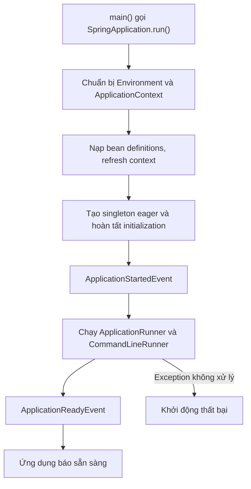
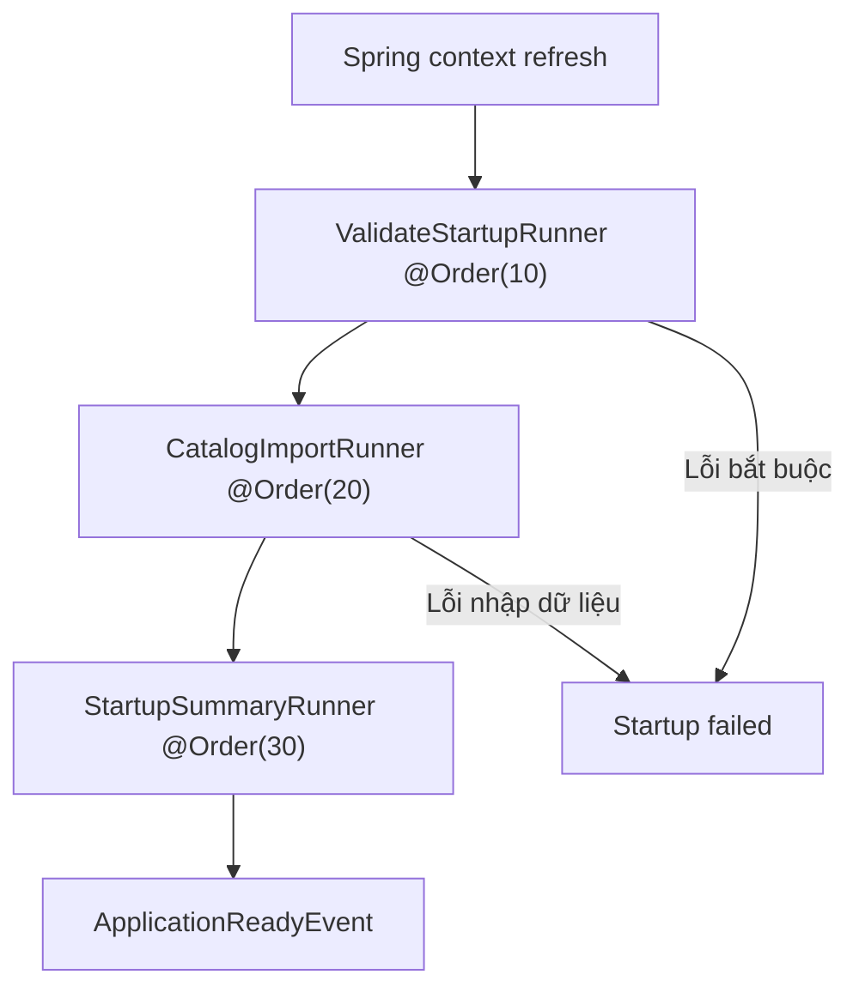

# ApplicationRunner với ApplicationArguments

Một ứng dụng Spring Boot không chỉ cần tạo các bean và mở web server. Trong nhiều hệ thống, sau khi application context khởi tạo xong, ứng dụng còn phải kiểm tra cấu hình, tải dữ liệu ban đầu, đồng bộ metadata, in thông tin chẩn đoán hoặc thực hiện một tác vụ được truyền từ dòng lệnh. Spring Boot cung cấp **`ApplicationRunner`** để chạy loại công việc này trong quy trình khởi động.

`ApplicationRunner` là một functional interface có phương thức `run(ApplicationArguments args)`. Spring Boot tự phát hiện các bean triển khai interface đó và gọi chúng **một lần trong mỗi lần khởi động ứng dụng thành công đến giai đoạn chạy runner**. Đối tượng `ApplicationArguments` giúp đọc tham số dòng lệnh dưới dạng có cấu trúc: option có tên, giá trị option và tham số không mang tên.

Trong chương **Sự kiện và runner** của *Spring Boot Fundamentals*, chúng ta sẽ tìm hiểu thời điểm runner chạy, cách viết và đăng ký runner, cách phân tích đối số, thứ tự chạy nhiều runner, cách xử lý lỗi startup, sự khác nhau với `CommandLineRunner` và các callback vòng đời khác, cùng các tình huống thực tế thường gặp.

## 1. ApplicationRunner giải quyết bài toán gì?

Xét ứng dụng quản lý sản phẩm. Khi khởi động, ứng dụng có thể cần thực hiện một bước chuẩn bị:

- Kiểm tra xem thư mục nhập dữ liệu có tồn tại hay không.
- Đọc một cờ `--import.enabled=true` để quyết định có nhập dữ liệu mẫu.
- Chọn tập dữ liệu bằng `--dataset=catalog-2026.csv`.
- Tải các tham số cấu hình cần thiết cho một công việc.
- In kết quả kiểm tra để người vận hành biết ứng dụng đã chuẩn bị đến đâu.

Nếu đặt mọi việc trực tiếp trong `main`, lúc đó application context có thể chưa sẵn sàng để cung cấp các service đã được Spring quản lý. Nếu đặt trong constructor hoặc `@PostConstruct` của một bean, việc chuẩn bị có thể chạy quá sớm, trước khi một số phần của context được hoàn tất.

`ApplicationRunner` cung cấp một điểm thực thi rõ ràng **sau khi context đã được refresh**, nên có thể inject service, repository, configuration properties và các bean khác để thực hiện công việc khởi động.

Ví dụ đầu tiên:

```java
package com.example.catalog.startup;

import org.springframework.boot.ApplicationArguments;
import org.springframework.boot.ApplicationRunner;
import org.springframework.stereotype.Component;

@Component
public class StartupMessageRunner implements ApplicationRunner {

    @Override
    public void run(ApplicationArguments args) {
        System.out.println("Application context is initialized.");
    }
}
```

Khi Spring Boot khởi động và tìm thấy `StartupMessageRunner` trong component scan, nó đăng ký class thành bean. Sau khi context được refresh, Spring Boot gọi `run(...)`. Người viết ứng dụng không cần tự gọi method này từ `main`.

## 2. Hợp đồng của ApplicationRunner

Interface nằm trong package:

```java
org.springframework.boot.ApplicationRunner
```

Về bản chất, hợp đồng như sau:

```java
@FunctionalInterface
public interface ApplicationRunner {

    void run(ApplicationArguments args) throws Exception;
}
```

Có ba đặc điểm chính.

**Thứ nhất, runner nhận `ApplicationArguments`.** Thay vì xử lý trực tiếp mảng `String[]`, ta có API để phân biệt option với tham số vị trí.

**Thứ hai, runner có thể ném `Exception`.** Nếu một lỗi không được xử lý thoát ra khỏi `run(...)`, Spring Boot coi đó là lỗi trong quá trình khởi động; quá trình `SpringApplication.run(...)` không hoàn tất bình thường.

**Thứ ba, runner là bean được container quản lý.** Nó có thể được tạo và inject dependency như những bean Spring khác. Interface không tự đăng ký bean nếu class không được scan hoặc không được khai báo trong một configuration.

### 2.1. Functional interface

Vì chỉ có một abstract method, `ApplicationRunner` có thể được triển khai bằng lambda:

```java
@Configuration(proxyBeanMethods = false)
class StartupRunnerConfiguration {

    @Bean
    ApplicationRunner welcomeRunner() {
        return args -> System.out.println("Ready to initialize tasks.");
    }
}
```

Lambda phù hợp với bước chuẩn bị rất ngắn. Khi logic dài, có nhiều nhánh hoặc cần test độc lập, class riêng thường dễ đọc và bảo trì hơn.

## 3. Runner chạy vào lúc nào trong quá trình khởi động?

Trình tự chính của Spring Boot có thể hình dung như sau:



Sơ đồ rút gọn những bước chính liên quan tới runner. Trong thực tế còn có listener, context initializer, bean factory post-processor, web server lifecycle, availability events và nhiều bước khác.

Với tiến trình khởi động thông thường, thứ tự quan trọng là:

1. Spring Boot tạo và refresh `ApplicationContext`.
2. Bean definitions được xử lý và các singleton eager được khởi tạo.
3. `ApplicationStartedEvent` được phát sau khi context được refresh, trước khi runner chạy.
4. Spring Boot gọi các bean `ApplicationRunner` và `CommandLineRunner`.
5. Nếu tất cả runner hoàn thành, Spring Boot phát `ApplicationReadyEvent`.
6. Sau đó trạng thái readiness của ứng dụng có thể được cập nhật để báo đã sẵn sàng nhận lưu lượng theo cơ chế availability.

### 3.1. “Sau khi context refresh” có nghĩa gì?

Lúc runner được gọi, dependency injection và những initialization callback thông thường của các bean cần thiết đã diễn ra. Runner có thể sử dụng một service Spring đã được inject:

```java
@Component
public class ProductWarmupRunner implements ApplicationRunner {

    private final ProductCacheService cacheService;

    public ProductWarmupRunner(ProductCacheService cacheService) {
        this.cacheService = cacheService;
    }

    @Override
    public void run(ApplicationArguments args) {
        cacheService.preloadFrequentlyUsedProducts();
    }
}
```

Không cần gọi `getBean(...)` thủ công. Spring cung cấp `ProductCacheService` qua constructor, sau đó Boot gọi runner.

### 3.2. Runner chạy trước ApplicationReadyEvent

Điểm này quan trọng nếu một tác vụ phải hoàn tất **trước khi ứng dụng được coi là ready**. Ví dụ, runner tải một bảng tra cứu thiết yếu. Nếu quá trình tải thất bại và exception được ném ra, ứng dụng không hoàn tất startup bình thường.

Với ứng dụng web, web server có thể đã được khởi tạo và socket có thể đã mở trước khi runner hoàn thành. Vì vậy, không nên coi `ApplicationRunner` là cơ chế tuyệt đối ngăn mọi HTTP request xuất hiện trước bước chuẩn bị. Trong môi trường triển khai có readiness probe, hãy phối hợp trạng thái readiness và routing của nền tảng.

### 3.3. Runner chạy một lần khi startup, không chạy mỗi request

Nếu runner là bean singleton, `run(...)` không được gọi lại tự động cho mỗi HTTP request. Nó không phải controller, scheduled task hoặc listener nhận sự kiện lặp lại.

Nếu tạo thêm một application context bằng một lần `SpringApplication.run(...)` khác, context đó sẽ có quy trình khởi động riêng và các runner tương ứng có thể được gọi trong lần khởi động mới.

## 4. Cách đăng ký ApplicationRunner

Có hai cách thường gặp.

### 4.1. Tạo class @Component

```java
package com.example.catalog.startup;

import org.springframework.boot.ApplicationArguments;
import org.springframework.boot.ApplicationRunner;
import org.springframework.stereotype.Component;

@Component
public class CatalogCheckRunner implements ApplicationRunner {

    private final CatalogService catalogService;

    public CatalogCheckRunner(CatalogService catalogService) {
        this.catalogService = catalogService;
    }

    @Override
    public void run(ApplicationArguments args) {
        catalogService.verifyCatalogIntegrity();
    }
}
```

Class phải nằm trong phạm vi component scan hoặc được đăng ký bằng một cơ chế Spring phù hợp.

### 4.2. Khai báo @Bean

```java
@Configuration(proxyBeanMethods = false)
class CatalogStartupConfiguration {

    @Bean
    ApplicationRunner catalogCheckRunner(CatalogService catalogService) {
        return args -> catalogService.verifyCatalogIntegrity();
    }
}
```

Cách này phù hợp khi việc đăng ký runner thuộc trách nhiệm của một module configuration. Nó cũng tiện khi chỉ cần một lambda ngắn.

### 4.3. Chỉ implement interface chưa đủ

Đoạn code:

```java
public class DetachedRunner implements ApplicationRunner {
    @Override
    public void run(ApplicationArguments args) {
        System.out.println("This code is not registered as a bean.");
    }
}
```

không được Boot tự tìm nếu class không được đăng ký thành bean. Tương tự, nếu lập trình viên tự tạo `new DetachedRunner()` ngoài container, Spring Boot không tự coi object đó là runner cần gọi.

Spring Boot phát hiện **runner beans trong application context**, không duyệt mọi class trên classpath để tìm interface.

## 5. ApplicationArguments là gì?

`ApplicationArguments` là abstraction mô tả đối số dòng lệnh đã được Spring Boot phân tích. Nó giúp truy cập cả mảng raw arguments và các nhóm argument có cấu trúc.

Các API thường dùng:

| API | Dữ liệu nhận được |
| --- | --- |
| `getSourceArgs()` | Mảng `String[]` ban đầu được truyền vào |
| `getOptionNames()` | Tập tên của những option được cung cấp |
| `containsOption(String name)` | Kiểm tra option có xuất hiện không |
| `getOptionValues(String name)` | Danh sách giá trị của một option, hoặc `null` nếu không có option |
| `getNonOptionArgs()` | Danh sách tham số không ở dạng option |

Ví dụ gọi ứng dụng:

```bash
java -jar catalog-service.jar --mode=import --dataset=products.csv --verbose region-a
```

Spring Boot có thể phân tích:

```text
Raw source args:
  --mode=import
  --dataset=products.csv
  --verbose
  region-a

Option names:
  mode
  dataset
  verbose

Non-option args:
  region-a
```

`mode` và `dataset` có giá trị được gắn bằng dấu `=`. `verbose` là option không mang giá trị. `region-a` là tham số không ở dạng option.

### 5.1. getSourceArgs()

```java
@Override
public void run(ApplicationArguments args) {
    String[] source = args.getSourceArgs();
    System.out.println(Arrays.toString(source));
}
```

`getSourceArgs()` trả về các argument ban đầu. Nó hữu ích khi cần giữ thứ tự chính xác hoặc kết hợp với một parser khác.

Không nên in raw arguments vào log production nếu chúng có thể chứa mật khẩu, token hoặc thông tin nhạy cảm.

### 5.2. getOptionNames()

```java
Set<String> optionNames = args.getOptionNames();
```

Kết quả là tập tên option, không gồm tiền tố `--` và không gồm giá trị. Không nên phụ thuộc vào thứ tự duyệt tập tên này nếu cần output ổn định; có thể sắp xếp trước khi hiển thị.

### 5.3. containsOption()

```java
boolean verbose = args.containsOption("verbose");
```

Method trả về `true` khi option xuất hiện. Đây là cách phù hợp để đọc một flag có dạng `--verbose`.

Lưu ý: `containsOption("verbose")` không đồng nghĩa đọc giá trị boolean của `--verbose=false`. Trong trường hợp đó, option vẫn xuất hiện; nếu muốn hỗ trợ giá trị true/false, cần đọc `getOptionValues(...)` và parse.

### 5.4. getOptionValues()

```java
List<String> values = args.getOptionValues("mode");
```

Khi chạy với `--mode=import`, danh sách có một phần tử `import`. Nếu option không xuất hiện, phương thức trả `null`. Nếu option xuất hiện không kèm giá trị, Spring Boot trả về danh sách rỗng.

Phân biệt ba trạng thái:

| Dòng lệnh | `containsOption("mode")` | `getOptionValues("mode")` |
| --- | --- | --- |
| Không có `mode` | `false` | `null` |
| `--mode` | `true` | Danh sách rỗng |
| `--mode=import` | `true` | Danh sách gồm `"import"` |

Khi xử lý option bắt buộc có giá trị, không chỉ kiểm tra `containsOption`. Hãy xác minh danh sách giá trị có đúng số lượng và giá trị được hỗ trợ.

### 5.5. getNonOptionArgs()

```java
List<String> positionalArgs = args.getNonOptionArgs();
```

Với dòng lệnh:

```bash
java -jar catalog-service.jar --mode=import region-a products.csv
```

`getNonOptionArgs()` chứa `region-a` và `products.csv`. Những argument này không dùng cú pháp `--name=value` nên được xem là tham số vị trí.

## 6. Cú pháp option: dùng --name=value

Parser của `ApplicationArguments` chủ yếu nhận diện cú pháp option dài:

```text
--option
--option=value
```

Ví dụ:

```bash
java -jar app.jar --output=report.csv --limit=50
```

`output` có giá trị `report.csv`; `limit` có giá trị chuỗi `50`.

Điểm dễ nhầm:

```bash
java -jar app.jar --output report.csv
```

Cú pháp này **không tương đương** `--output=report.csv` trong `ApplicationArguments`. Parser có thể xem `--output` là option không có giá trị, còn `report.csv` là non-option argument. Vì vậy, khi thiết kế một giao diện dòng lệnh dựa trên `ApplicationArguments`, hãy hướng dẫn người dùng viết giá trị bằng `=`.

### 6.1. Tham số có dấu cách

Giá trị chứa dấu cách cần được shell quote đúng:

```bash
java -jar app.jar --label="Catalog Import November"
```

Sau khi shell xử lý quote, JVM nhận một argument kiểu `--label=Catalog Import November`. `ApplicationArguments` đọc giá trị tương ứng dưới dạng một chuỗi.

Quy tắc quote khác nhau giữa Bash, PowerShell và các shell khác; cần kiểm tra khi viết script triển khai đa nền tảng.

### 6.2. Option được cung cấp nhiều lần

Ví dụ:

```bash
java -jar app.jar --tag=core --tag=urgent --tag=nightly
```

Khi đó:

```java
List<String> tags = args.getOptionValues("tag");
```

trả danh sách gồm các giá trị `core`, `urgent` và `nightly`.

Không nên mặc định rằng mọi option chỉ có một giá trị. Với option bắt buộc đơn trị, cần kiểm tra số lượng để tránh việc lấy phần tử đầu hoặc cuối một cách vô tình.

### 6.3. Các option tên ngắn

`ApplicationArguments` không phải một thư viện CLI parser đầy đủ hỗ trợ mọi cú pháp kiểu `-v`, `-o file` hoặc subcommand. Một tham số như `-v` không được xử lý giống option dài `--verbose`.

Nếu ứng dụng cần positional grammar phức tạp, help text, subcommands, shell completion hoặc type conversion tự động, có thể cân nhắc một CLI framework chuyên biệt. `ApplicationArguments` phù hợp với nhu cầu đọc option đơn giản trong lifecycle Spring Boot.

## 7. Ví dụ hoàn chỉnh: kiểm tra và nhập catalog khi startup

Giả sử ứng dụng có service nhập dữ liệu:

```java
package com.example.catalog;

import java.nio.file.Path;
import org.springframework.stereotype.Service;

@Service
public class CatalogImportService {

    public void importFrom(Path source, boolean dryRun) {
        if (dryRun) {
            System.out.println("Preview import from: " + source);
            return;
        }

        System.out.println("Importing catalog from: " + source);
        // Đọc, kiểm tra và lưu dữ liệu thật bằng các dependency phù hợp.
    }
}
```

Một runner đọc tham số:

```java
package com.example.catalog.startup;

import com.example.catalog.CatalogImportService;
import java.nio.file.Path;
import java.util.List;
import org.springframework.boot.ApplicationArguments;
import org.springframework.boot.ApplicationRunner;
import org.springframework.stereotype.Component;

@Component
public class CatalogImportRunner implements ApplicationRunner {

    private final CatalogImportService importService;

    public CatalogImportRunner(CatalogImportService importService) {
        this.importService = importService;
    }

    @Override
    public void run(ApplicationArguments args) {
        if (!args.containsOption("import")) {
            return;
        }

        String fileName = requiredSingleValue(args, "file");
        boolean dryRun = args.containsOption("dry-run");

        importService.importFrom(Path.of(fileName), dryRun);
    }

    private String requiredSingleValue(
            ApplicationArguments args,
            String name
    ) {
        List<String> values = args.getOptionValues(name);

        if (values == null || values.size() != 1
                || values.get(0).isBlank()) {
            throw new IllegalArgumentException(
                    "Expected exactly one value for --" + name
            );
        }

        return values.get(0);
    }
}
```

Khởi động để import:

```bash
java -jar catalog-service.jar --import --file=./data/products.csv
```

Khởi động để xem trước:

```bash
java -jar catalog-service.jar --import --file=./data/products.csv --dry-run
```

Nếu không có `--import`, runner kết thúc mà không nhập dữ liệu. Nếu có `--import` nhưng không có `--file=...`, runner ném `IllegalArgumentException` để startup không tiếp tục âm thầm với dữ liệu thiếu.

### 7.1. Vì sao dùng constructor injection?

`CatalogImportRunner` phụ thuộc vào `CatalogImportService` qua constructor. Điều đó làm dependency rõ ràng và giúp test runner bằng một service giả hoặc mock. Không cần inject toàn bộ `ApplicationContext` chỉ để tìm service lúc chạy.

### 7.2. Vì sao kiểm tra đúng một giá trị?

Nếu chạy:

```bash
java -jar app.jar --import --file=a.csv --file=b.csv
```

`getOptionValues("file")` có thể chứa hai giá trị. Nếu nghiệp vụ yêu cầu đúng một file, runner nên báo lỗi rõ ràng thay vì chọn ngẫu nhiên một giá trị. Nếu muốn hỗ trợ nhiều file, hãy thiết kế API nhận danh sách và xác định thứ tự xử lý.

### 7.3. Vì sao cần dry-run?

Với tác vụ có thể thay đổi dữ liệu, `--dry-run` giúp kiểm tra tham số và xem hành vi dự kiến trước khi ghi. Trong hệ thống thật, chế độ dry-run cần được thực hiện nhất quán ở tầng service, không chỉ in một dòng log rồi vẫn thực hiện thao tác ghi ở nơi khác.

### 7.4. Khi nào không nên dùng kiểu startup import này?

Nếu import rất lớn, có thể mất hàng giờ hoặc cần retry độc lập, việc gắn toàn bộ công việc vào startup của web service sẽ làm chậm readiness và ảnh hưởng khả năng vận hành. Khi ấy có thể dùng một ứng dụng batch/CLI riêng, scheduler hoặc job worker có cơ chế điều phối riêng. `ApplicationRunner` vẫn có thể là entry point cho **ứng dụng CLI chuyên xử lý một job**, nhưng không phải công cụ thay thế hệ thống batch.

## 8. ApplicationArguments và Spring Environment

Có hai nhu cầu đọc thông tin khác nhau:

1. Đọc tham số gốc mà người dùng truyền vào tiến trình.
2. Đọc cấu hình ứng dụng đã được tổng hợp từ nhiều property sources.

`ApplicationArguments` giải quyết nhu cầu đầu tiên. `Environment` và `@ConfigurationProperties` phù hợp hơn với nhu cầu thứ hai.

Ví dụ:

```bash
java -jar app.jar --server.port=9090 --job.mode=import
```

Trong cấu hình Spring Boot thông thường, command-line properties được thêm vào `Environment` và có độ ưu tiên cao so với nhiều property sources khác. Vì vậy, `server.port` có thể ảnh hưởng cổng web server ngay trong quá trình startup.

Trong runner:

```java
@Component
class ArgumentsAndEnvironmentRunner implements ApplicationRunner {

    private final Environment environment;

    ArgumentsAndEnvironmentRunner(Environment environment) {
        this.environment = environment;
    }

    @Override
    public void run(ApplicationArguments args) {
        System.out.println(
                "CLI option present: " + args.containsOption("job.mode")
        );
        System.out.println(
                "Resolved mode: " + environment.getProperty("job.mode")
        );
    }
}
```

Hai phép đọc có thể cho kết quả khác nhau. `containsOption("job.mode")` chỉ kiểm tra CLI argument. `Environment.getProperty("job.mode")` đọc giá trị sau khi Spring tổng hợp các property sources, bao gồm file cấu hình, environment variables và command-line properties theo thứ tự ưu tiên.

### 8.1. Tắt command-line properties trong Environment

Spring Boot có tùy chọn không thêm command-line arguments vào property sources của `Environment`:

```java
SpringApplication application =
        new SpringApplication(ShopApplication.class);
application.setAddCommandLineProperties(false);
application.run(args);
```

Điều này thay đổi cách command-line properties tham gia resolve cấu hình của `Environment`. Tuy nhiên, runner vẫn nhận `ApplicationArguments` được tạo từ arguments ban đầu.

Không nên nhầm “không đưa CLI vào Environment” với “runner không nhận CLI arguments”.

### 8.2. Khi nào dùng @ConfigurationProperties?

Nếu cấu hình có nhiều trường, ví dụ timeout, batch size, endpoint và retry policy, nên gom vào một cấu trúc có type rõ:

```java
@ConfigurationProperties(prefix = "catalog.import")
public record CatalogImportProperties(
        int batchSize,
        boolean validateOnly
) {
}
```

Sau khi bật cơ chế đăng ký configuration properties phù hợp, service có thể inject `CatalogImportProperties`. Runner chỉ nên dùng `ApplicationArguments` cho các thao tác thật sự thuộc về điều khiển invocation, như `--import`, `--dry-run` hoặc một positional input.

Không nên copy mọi giá trị từ `Environment` sang `ApplicationArguments` hoặc ngược lại nếu không có mục đích. Hai abstraction có trách nhiệm khác nhau.

## 9. ApplicationRunner và CommandLineRunner

Spring Boot cung cấp cả hai interface:

```java
public interface ApplicationRunner {
    void run(ApplicationArguments args) throws Exception;
}
```

```java
public interface CommandLineRunner {
    void run(String... args) throws Exception;
}
```

Điểm khác biệt chính nằm ở kiểu tham số:

| Tiêu chí | `ApplicationRunner` | `CommandLineRunner` |
| --- | --- | --- |
| Tham số `run` | `ApplicationArguments` | `String...` |
| Đọc option có tên | Có API sẵn | Tự phân tích chuỗi |
| Đọc raw arguments | `getSourceArgs()` | Nhận trực tiếp |
| Đọc positional arguments | `getNonOptionArgs()` | Tự phân biệt |
| Thời điểm chạy | Sau refresh, trước ready | Cùng giai đoạn |
| Ordering | `@Order`/`Ordered` | `@Order`/`Ordered` |
| Đăng ký | Bean trong context | Bean trong context |
| Có thể ném Exception | Có | Có |

Nếu cần phân tích `--name=value`, `ApplicationRunner` thường thuận tiện hơn. Nếu chỉ cần mảng tham số nguyên gốc hoặc chạy tác vụ không quan tâm cú pháp, `CommandLineRunner` có thể ngắn gọn hơn.

### 9.1. Hai loại runner chạy trong cùng một giai đoạn

Spring Boot thu thập các bean `ApplicationRunner` và `CommandLineRunner` rồi sắp xếp để thực thi. Chúng không được chia thành hai giai đoạn cứng kiểu “tất cả ApplicationRunner trước, tất cả CommandLineRunner sau”.

Thứ tự giữa chúng phụ thuộc ordering của từng bean. Nếu cần thứ tự xác định, hãy khai báo rõ.

### 9.2. Không nên implement cả hai interface trên cùng một bean

Một class có thể implement cả hai interface về mặt Java, nhưng Spring Boot có thể gọi cả hai callback của bean đó trong giai đoạn chạy runner. Điều này dễ khiến công việc được thực hiện hai lần.

Hãy chọn một interface phù hợp với yêu cầu. Nếu cần cả xử lý raw arguments và option parsing, `ApplicationRunner` đã có `getSourceArgs()` nên thường đủ.

## 10. Thứ tự chạy nhiều runner

Một ứng dụng có thể có nhiều tác vụ startup:

- Kiểm tra cấu hình bắt buộc.
- Tải dữ liệu tham chiếu.
- Khởi tạo cache.
- In thông tin hoàn tất chuẩn bị.

Nếu chúng phụ thuộc lẫn nhau, thứ tự chạy phải được xác định tường minh. Spring hỗ trợ `@Order` hoặc interface `Ordered`.

### 10.1. Dùng @Order

```java
@Component
@Order(10)
public class ConfigurationValidationRunner
        implements ApplicationRunner {

    @Override
    public void run(ApplicationArguments args) {
        System.out.println("1. Validate configuration");
    }
}
```

```java
@Component
@Order(20)
public class ReferenceDataRunner
        implements ApplicationRunner {

    @Override
    public void run(ApplicationArguments args) {
        System.out.println("2. Load reference data");
    }
}
```

```java
@Component
@Order(30)
public class StartupSummaryRunner
        implements ApplicationRunner {

    @Override
    public void run(ApplicationArguments args) {
        System.out.println("3. Startup tasks completed");
    }
}
```

Giá trị order nhỏ hơn có độ ưu tiên trước giá trị lớn hơn. Nếu các bean có cùng order hoặc không có ordering rõ, không nên phụ thuộc vào thứ tự quét class hay thứ tự khai báo file.

### 10.2. Dùng Ordered

```java
@Component
public class ConfigurableStartupRunner
        implements ApplicationRunner, Ordered {

    @Override
    public int getOrder() {
        return 50;
    }

    @Override
    public void run(ApplicationArguments args) {
        System.out.println("Runs at order 50");
    }
}
```

`Ordered` phù hợp nếu class muốn chủ động cung cấp thứ tự bằng method. Với thứ tự tĩnh, `@Order` thường ngắn gọn.

### 10.3. Runner có chạy song song không?

Trong quá trình startup thông thường, Spring Boot gọi các runner tuần tự theo thứ tự đã sắp xếp. Một runner có thể chủ động tạo tác vụ bất đồng bộ, nhưng lúc ấy code ứng dụng phải tự quản lý completion và lỗi. Nếu method `run` chỉ submit một task rồi trả về ngay, Boot có thể tiếp tục các runner khác và phát `ApplicationReadyEvent` trước khi task đó hoàn thành.

Nếu một công việc bắt buộc hoàn tất trước readiness, runner cần đợi kết quả theo cách phù hợp hoặc sử dụng cơ chế startup khác có hợp đồng hoàn tất rõ ràng.

## 11. Lỗi trong ApplicationRunner ảnh hưởng startup thế nào?

Ví dụ:

```java
@Component
public class RequiredConfigRunner implements ApplicationRunner {

    @Override
    public void run(ApplicationArguments args) {
        if (!args.containsOption("tenant")) {
            throw new IllegalStateException(
                    "Missing required startup option: --tenant=..."
            );
        }
    }
}
```

Khi exception thoát khỏi `run(...)`, Spring Boot xem lần khởi động không hoàn tất bình thường. `SpringApplication.run(...)` sẽ xử lý luồng thất bại và phát `ApplicationFailedEvent` theo cơ chế startup; `ApplicationReadyEvent` không được phát như một lần startup thành công.

### 11.1. Phân biệt lỗi bắt buộc và lỗi tùy chọn

Một số công việc cần fail-fast:

- Thiếu cấu hình bảo mật bắt buộc.
- Không thể nạp dữ liệu tham chiếu thiết yếu.
- Không thể xác minh một điều kiện khiến ứng dụng không an toàn nếu tiếp tục.

Một số công việc có thể xử lý lỗi rồi vẫn cho ứng dụng khởi động:

- Không thể cập nhật một cache không thiết yếu.
- Không lấy được thông tin hiển thị phụ.
- Không tạo được một báo cáo chỉ phục vụ chẩn đoán.

Đừng bắt mọi exception rồi chỉ log để ứng dụng tiếp tục nếu chức năng không thể hoạt động chính xác. Ngược lại, không nên làm cả web service thất bại vì một thao tác không thiết yếu.

### 11.2. Có thể khai báo throws Exception

```java
@Override
public void run(ApplicationArguments args) throws Exception {
    externalSystem.verifyConnection();
}
```

Hợp đồng cho phép checked exception. Nhưng nên bổ sung thông điệp có ngữ cảnh để người vận hành hiểu bước startup nào thất bại.

### 11.3. Startup transaction và tác dụng phụ

Nếu runner ghi dữ liệu, gửi message hoặc gọi API bên ngoài, một lỗi giữa chừng có thể để lại tác dụng phụ dù ứng dụng không khởi động thành công. Đây là lý do cần thiết kế:

- **Idempotency:** chạy lại không tạo dữ liệu trùng hoặc gửi tác vụ hai lần ngoài ý muốn.
- **Transaction boundary:** nhóm thao tác database có thể cần transaction phù hợp.
- **Retry có kiểm soát:** phân biệt lỗi tạm thời và lỗi cấu hình.
- **Timeout:** không giữ startup chờ vô hạn.
- **Thông tin lỗi rõ ràng:** log bước nào thất bại và cách xử lý.

Spring Boot gọi runner trong startup, nhưng không tự tạo transaction bao trùm toàn bộ method `run(...)`. Nếu cần transaction, hãy đặt logic vào một Spring service được quản lý và áp dụng `@Transactional` ở ranh giới thích hợp.

## 12. ApplicationRunner và các callback vòng đời khác

Có nhiều cách chạy code trong startup, nhưng chúng diễn ra ở những thời điểm khác nhau.

| Cơ chế | Thời điểm điển hình | Mục đích |
| --- | --- | --- |
| Constructor | Khi tạo bean instance | Khởi tạo trạng thái và nhận dependency |
| `@PostConstruct` | Sau inject, trong initialization của từng bean | Hoàn thiện trạng thái nội bộ bean |
| `InitializingBean.afterPropertiesSet()` | Trong initialization của từng bean | Callback khởi tạo phụ thuộc Spring |
| `ContextRefreshedEvent` | Khi một context hoàn tất refresh | Phản ứng với sự kiện refresh context |
| `ApplicationStartedEvent` | Sau refresh và trước runners | Quan sát thời điểm context đã khởi tạo |
| `ApplicationRunner` | Sau started event, trước ready event | Công việc startup dùng arguments |
| `CommandLineRunner` | Cùng giai đoạn runner | Công việc startup dùng raw arguments |
| `ApplicationReadyEvent` | Sau khi runners đã hoàn tất | Thực hiện logic khi ứng dụng đã ready |

### 12.1. So với @PostConstruct

`@PostConstruct` thuộc vòng đời của **một bean cụ thể**:

```java
@Component
class LookupCache {

    @PostConstruct
    void initialize() {
        // Hoàn tất trạng thái nội bộ của chính bean này.
    }
}
```

Nó có thể chạy khi context vẫn đang khởi tạo các bean khác. Nếu tác vụ cần nhiều bean phối hợp và cần biết arguments của tiến trình, `ApplicationRunner` thường phù hợp hơn.

### 12.2. So với ApplicationStartedEvent

`ApplicationStartedEvent` được phát khi context đã refresh nhưng **trước** các runner. Listener của event này phù hợp nếu cần quan sát thời điểm khởi động hoặc thực hiện một thao tác theo sự kiện trước runner.

Nếu tác vụ cần option từ command line, `ApplicationRunner` cung cấp API trực tiếp và dễ test.

### 12.3. So với ApplicationReadyEvent

`ApplicationReadyEvent` được phát sau khi Spring Boot hoàn tất các runner. Vì thế, listener của event này phù hợp cho thao tác cần biết startup đã hoàn thành.

Nếu một bước bắt buộc phải xong **trước** khi ứng dụng được báo ready, nên thực hiện ở runner thay vì chờ `ApplicationReadyEvent`.

### 12.4. So với ApplicationContextInitializer

`ApplicationContextInitializer` can thiệp vào context **trước khi refresh**. Nó phù hợp với cấu hình hạ tầng ban đầu. Nó không tương đương runner, vốn dùng các bean đã được khởi tạo sau refresh.

Nếu muốn thay đổi bean definitions hoặc environment trước khi container tạo các service, hãy chọn extension point ở giai đoạn sớm. Nếu muốn sử dụng các service đã sẵn sàng để làm công việc startup, runner phù hợp hơn.

## 13. ApplicationRunner trong ứng dụng web

Trong web service, runner thường được dùng cho những công việc ngắn:

- Kiểm tra tài nguyên bắt buộc.
- Làm nóng cache nhỏ và quan trọng.
- Xác nhận schema metadata.
- Tải cấu hình cần thiết trước readiness.

Tuy nhiên, code trong runner có thể làm thời gian startup tăng đáng kể. Nếu một runner mất hai phút, ứng dụng có thể chưa phát `ApplicationReadyEvent` trong khoảng thời gian đó.

### 13.1. Readiness và startup probe

Kubernetes hoặc nền tảng triển khai có thể sử dụng readiness probe để quyết định khi nào route traffic vào instance. Spring Boot có cơ chế application availability và Actuator health probes trong các cấu hình phù hợp.

Vì runner chạy trước ready event, công việc đồng bộ trong runner có thể trì hoãn thời điểm ứng dụng được đánh dấu ready. Nhưng socket web server có thể đã mở trước runner; do đó cần cấu hình readiness probe và routing đúng cách, thay vì chỉ dựa vào thứ tự trong mã Java.

### 13.2. Không thực hiện thao tác dữ liệu lớn trên mọi replica

Nếu triển khai năm replica, mỗi replica có application context và quy trình startup riêng. Runner không phải “chỉ chạy một lần cho toàn cluster”. Một logic import hoặc migration đặt trong runner có thể chạy ở cả năm instance.

Đối với công việc toàn hệ thống như database migration lớn, tạo dữ liệu dùng chung hoặc gửi thông báo hàng loạt, cần cân nhắc cơ chế khóa, leader election, migration tool hoặc job độc lập. Không nên giả định runner chỉ có một người thực thi.

### 13.3. Runner khởi động lại khi deploy/restart

Mỗi lần tiến trình hoặc application context được khởi động lại, runner có thể thực hiện lại. Vì vậy, dữ liệu được tạo trong runner cần an toàn khi chạy lại:

```java
public void ensureDefaultCategories() {
    if (!repository.existsByCode("GENERAL")) {
        repository.save(new Category("GENERAL", "General"));
    }
}
```

Đoạn minh họa này chỉ phù hợp trong môi trường đơn giản. Trong hệ thống nhiều replica, thao tác kiểm tra rồi ghi có race condition; nên có unique constraint và cơ chế ghi idempotent/transaction phù hợp.

## 14. ApplicationRunner trong ứng dụng CLI hoặc batch

Một ứng dụng Spring Boot không bắt buộc là web service. Ta có thể dùng Spring Boot để xây một command-line tool có dependency injection, cấu hình và logging.

Ví dụ:

```java
@SpringBootApplication
public class ImportCliApplication {

    public static void main(String[] args) {
        SpringApplication application =
                new SpringApplication(ImportCliApplication.class);
        application.setWebApplicationType(WebApplicationType.NONE);
        application.run(args);
    }
}
```

Sau đó tạo một `ApplicationRunner` để đọc `--input=...` và xử lý job. Với `WebApplicationType.NONE`, ứng dụng không tự khởi tạo servlet/reactive web server.

### 14.1. Runner không tự quyết định exit code

Nếu ứng dụng chỉ thực hiện một tác vụ rồi kết thúc, cần thiết kế lifecycle và mã thoát tiến trình phù hợp. Spring Boot có `SpringApplication.exit(context)` cùng cơ chế `ExitCodeGenerator` cho những tình huống cần kiểm soát exit code.

Ví dụ launcher CLI:

```java
public static void main(String[] args) {
    ConfigurableApplicationContext context =
            SpringApplication.run(ImportCliApplication.class, args);

    int exitCode = SpringApplication.exit(context);
    System.exit(exitCode);
}
```

Ví dụ này minh họa hướng điều phối tiến trình sau khi `run(...)` trở về thành công. Với lỗi startup ném exception, dòng sau `run(...)` có thể không được thực thi; nếu cần quy tắc exit code cụ thể cho cả trường hợp thất bại, phải xử lý ở tầng launcher/error handling tương ứng.

Không nên gọi `System.exit(...)` tùy tiện bên trong một runner của web service vì nó kết thúc cả tiến trình.

### 14.2. Thời gian xử lý batch

Nếu runner làm việc lâu, hệ thống giám sát có thể coi startup chậm hoặc timeout. Với batch/CLI, đây có thể là hành vi chủ đích, nhưng cần cấu hình timeout của job orchestrator đúng với thời lượng công việc.

Với web service, nên tách công việc batch kéo dài khỏi startup để không giữ ứng dụng ở trạng thái chưa ready trong thời gian dài.

## 15. Validate đối số một cách nhất quán

`ApplicationArguments` giúp lấy argument, nhưng nó không tự kiểm tra toàn bộ quy tắc nghiệp vụ. Người viết runner cần xác định:

- Option nào bắt buộc.
- Option nào được phép thiếu.
- Option nào chỉ mang cờ.
- Option nào có thể nhận nhiều giá trị.
- Giá trị nào hợp lệ.
- Quan hệ giữa các option.
- Cần làm gì khi nhận option không được hỗ trợ.

Ví dụ helper cho option bắt buộc đơn trị:

```java
static String requireOne(
        ApplicationArguments args,
        String option
) {
    List<String> values = args.getOptionValues(option);
    if (values == null || values.size() != 1
            || values.get(0).isBlank()) {
        throw new IllegalArgumentException(
                "Missing or invalid --" + option + "=<value>"
        );
    }
    return values.get(0);
}
```

Helper đọc số nguyên:

```java
static int requirePositiveInt(
        ApplicationArguments args,
        String option
) {
    String value = requireOne(args, option);
    try {
        int parsed = Integer.parseInt(value);
        if (parsed <= 0) {
            throw new IllegalArgumentException(
                    "--" + option + " must be positive"
            );
        }
        return parsed;
    } catch (NumberFormatException ex) {
        throw new IllegalArgumentException(
                "--" + option + " must be an integer", ex
        );
    }
}
```

Khi chạy:

```bash
java -jar app.jar --batch-size=200
```

`getOptionValues("batch-size")` trả chuỗi `"200"`. Code tự convert sang `int`.

### 15.1. Không suy luận flag boolean bằng containsOption khi có =false

Nếu CLI cho phép `--dry-run=false`, `containsOption("dry-run")` vẫn trả true. Hai thiết kế hợp lệ:

- Chỉ hỗ trợ `--dry-run` như một flag hiện diện. Không nhận `--dry-run=false`.
- Hỗ trợ `--dry-run=true` và `--dry-run=false`, đọc giá trị rồi parse boolean rõ ràng.

Hãy chọn một cú pháp và ghi trong help/documentation; không trộn hai nghĩa một cách vô tình.

### 15.2. Không log bí mật từ getSourceArgs

Nếu người dùng chạy:

```bash
java -jar app.jar --api-key=some-secret-value
```

in `Arrays.toString(args.getSourceArgs())` sẽ làm lộ giá trị nhạy cảm vào log. Với secret, nên dùng nguồn quản lý bí mật và cấu hình phù hợp thay vì truyền trực tiếp qua arguments nếu có thể. Khi cần chẩn đoán, chỉ log tên option hoặc dữ liệu đã được che.

## 16. Unit test ApplicationRunner

Vì `run` nhận một interface `ApplicationArguments`, có thể test logic parse arguments mà không cần chạy toàn bộ Spring Boot.

Spring Boot cung cấp implementation `DefaultApplicationArguments`:

```java
import org.junit.jupiter.api.Test;
import org.springframework.boot.ApplicationArguments;
import org.springframework.boot.DefaultApplicationArguments;

import static org.junit.jupiter.api.Assertions.*;

class ApplicationArgumentsTest {

    @Test
    void separatesOptionsAndPositionalArguments() {
        ApplicationArguments args =
                new DefaultApplicationArguments(
                        "--mode=import",
                        "--tag=core",
                        "--tag=urgent",
                        "--dry-run",
                        "region-a"
                );

        assertTrue(args.containsOption("mode"));
        assertEquals(List.of("import"), args.getOptionValues("mode"));
        assertEquals(
                List.of("core", "urgent"),
                args.getOptionValues("tag")
        );
        assertTrue(args.containsOption("dry-run"));
        assertEquals(List.of(), args.getOptionValues("dry-run"));
        assertEquals(List.of("region-a"), args.getNonOptionArgs());
        assertNull(args.getOptionValues("missing"));
    }
}
```

Test này chỉ minh họa cách sử dụng `DefaultApplicationArguments`; cần import `java.util.List` và dependency JUnit phù hợp.

### 16.1. Test runner với service giả

Ví dụ runner chỉ gọi service khi có `--import`. Có thể truyền một fake service để ghi nhận lời gọi:

```java
@Test
void importsFileWhenFlagIsPresent() throws Exception {
    RecordingCatalogImportService service =
            new RecordingCatalogImportService();
    CatalogImportRunner runner = new CatalogImportRunner(service);

    runner.run(new DefaultApplicationArguments(
            "--import",
            "--file=./data/products.csv",
            "--dry-run"
    ));

    assertEquals(Path.of("./data/products.csv"), service.lastPath());
    assertTrue(service.lastDryRun());
}
```

Đoạn trên giả định `RecordingCatalogImportService` là fake có API ghi nhận lời gọi và kiểu tương thích với dependency của `CatalogImportRunner`. Trong project thật, dùng interface service hoặc mock phù hợp để tạo test cô lập.

### 16.2. Test thiếu option bắt buộc

```java
@Test
void rejectsImportWithoutFile() {
    CatalogImportRunner runner = new CatalogImportRunner(importService);

    assertThrows(
            IllegalArgumentException.class,
            () -> runner.run(new DefaultApplicationArguments("--import"))
    );
}
```

Test này xác nhận input không hợp lệ được báo rõ, không khởi chạy import với giá trị `null`.

### 16.3. Integration test với ApplicationContext

Nếu cần kiểm tra runner được Spring đăng ký và inject dependency đúng, có thể dùng integration test có khởi tạo context. Tuy nhiên, hãy cẩn thận: `@SpringBootTest` có thể làm runner thực sự chạy trong quá trình test startup.

Nếu runner có tác dụng phụ (ghi DB, gọi API, import file), cần thiết kế điều kiện kích hoạt hoặc fake dependency để test không thực hiện thao tác ngoài ý muốn. Trong nhiều trường hợp, unit test class runner và integration test logic service riêng biệt đủ để bảo đảm hành vi quan trọng.

## 17. Điều kiện bật/tắt ApplicationRunner

Không phải runner nào cũng nên chạy ở mọi môi trường. Có thể dùng condition:

```java
@Component
@ConditionalOnProperty(
        prefix = "catalog.startup",
        name = "warmup-enabled",
        havingValue = "true"
)
class CatalogWarmupRunner implements ApplicationRunner {

    private final CatalogCache cache;

    CatalogWarmupRunner(CatalogCache cache) {
        this.cache = cache;
    }

    @Override
    public void run(ApplicationArguments args) {
        cache.warmup();
    }
}
```

Khi property không thỏa, bean runner có thể không được đăng ký. Đây là cách loại hẳn runner khỏi tập được Spring Boot gọi.

Một cách khác là luôn đăng ký runner nhưng kiểm tra một CLI flag trong `run`:

```java
if (!args.containsOption("warmup")) {
    return;
}
cache.warmup();
```

Hai cách có ý nghĩa khác nhau:

- **Condition trên bean:** quyết định runner có tồn tại trong context hay không.
- **Điều kiện trong method:** runner tồn tại, nhưng có thể bỏ qua tác vụ khi chạy.

Nếu một tính năng thuộc cấu hình triển khai, `@ConditionalOnProperty` hoặc `@Profile` có thể diễn đạt tốt. Nếu người vận hành chủ động chọn tác vụ từng lần chạy, `ApplicationArguments` phù hợp hơn.

### 17.1. Dùng @Profile

```java
@Component
@Profile("dev")
class DemoDataRunner implements ApplicationRunner {
    @Override
    public void run(ApplicationArguments args) {
        // Tải dữ liệu mẫu dành cho môi trường phát triển.
    }
}
```

Trong production, bean này không được đăng ký nếu profile `dev` không active. Dùng profile giúp tránh chạy nhầm logic thử nghiệm, nhưng vẫn nên thiết kế thao tác dữ liệu có kiểm tra và an toàn khi chạy lại.

## 18. Các lỗi thường gặp khi dùng ApplicationRunner

| Triệu chứng | Nguyên nhân có thể | Hướng xử lý |
| --- | --- | --- |
| Method `run` không được gọi | Class chưa thành bean, nằm ngoài component scan hoặc bị condition loại | Kiểm tra `@Component`, `@Bean`, `@Import` và profile |
| Runner không nhận option | Cú pháp sai, ví dụ `--file data.csv` | Dùng `--file=data.csv` và kiểm tra arguments thực tế |
| `getOptionValues` trả `null` | Option không được cung cấp | Phân biệt thiếu option với option không có giá trị |
| `getOptionValues` trả danh sách rỗng | Option được cung cấp dưới dạng flag không có giá trị | Dùng `containsOption` hoặc yêu cầu `--name=value` |
| Runner chạy hai lần trong một lần startup | Hai bean runner cùng logic, hoặc một bean implement cả hai runner interface | Kiểm tra các bean và callback đã đăng ký |
| Runner chạy lại sau deploy | Mỗi instance khởi động lại đều gọi runner | Thiết kế idempotency, không giả định chạy một lần toàn cluster |
| Ứng dụng chưa ready | Runner còn chạy hoặc lỗi startup | Kiểm tra log, thời gian và exception từ runner |
| Thứ tự tác vụ sai | Không có ordering hoặc dùng cùng order | Dùng `@Order`/`Ordered` rõ ràng |
| Không tìm thấy bean dependency | Service chưa đăng ký hoặc condition không khớp | Kiểm tra component scan, config và auto-configuration |
| Test vô tình import dữ liệu thật | Spring test context khởi động runner có tác dụng phụ | Dùng test profile, điều kiện bật, fake service hoặc unit test |

### 18.1. Phân biệt runner không chạy và runner chạy nhưng bỏ qua

Nếu runner không log gì, có thể có hai nguyên nhân khác nhau:

1. Bean runner chưa được đăng ký nên Spring Boot không gọi nó.
2. Bean đã được gọi, nhưng logic trong `run` trả về ngay vì thiếu CLI flag.

Để điều tra, trước tiên xác nhận bean tồn tại trong context, sau đó kiểm tra arguments và nhánh điều kiện bên trong method.

### 18.2. Phân biệt lỗi startup với lỗi business logic

Một exception từ runner khiến startup không hoàn tất bình thường. Nếu lỗi xảy ra trong một task bất đồng bộ được runner submit rồi trả về, lỗi đó có thể xuất hiện sau `ApplicationReadyEvent` và không làm SpringApplication fail theo cùng cơ chế.

Nếu kết quả task là điều kiện để ứng dụng ready, phải gắn việc hoàn tất task với runner hoặc readiness lifecycle theo cách rõ ràng.

## 19. Thực hành: runner có thứ tự và arguments

Giả sử ứng dụng nhập dữ liệu theo các bước:



Runner thứ nhất xác thực cấu hình:

```java
@Component
@Order(10)
class ValidateStartupRunner implements ApplicationRunner {

    @Override
    public void run(ApplicationArguments args) {
        if (args.containsOption("import")
                && !args.containsOption("file")) {
            throw new IllegalArgumentException(
                    "--file=<path> is required with --import"
            );
        }
    }
}
```

Runner thứ hai nhập dữ liệu:

```java
@Component
@Order(20)
class CatalogImportRunner implements ApplicationRunner {

    private final CatalogImportService service;

    CatalogImportRunner(CatalogImportService service) {
        this.service = service;
    }

    @Override
    public void run(ApplicationArguments args) {
        if (!args.containsOption("import")) {
            return;
        }

        List<String> files = args.getOptionValues("file");
        if (files == null || files.size() != 1) {
            throw new IllegalArgumentException(
                    "Expected exactly one --file=<path>"
            );
        }

        service.importFrom(
                Path.of(files.get(0)),
                args.containsOption("dry-run")
        );
    }
}
```

Runner cuối cùng ghi thông tin:

```java
@Component
@Order(30)
class StartupSummaryRunner implements ApplicationRunner {

    @Override
    public void run(ApplicationArguments args) {
        System.out.println("Startup runners completed.");
    }
}
```

Nếu runner nhập dữ liệu ném exception, runner tiếp theo sẽ không được gọi trong chuỗi thực thi thông thường và startup thất bại. Điều này làm thứ tự có ý nghĩa thực tế, nhưng code nghiệp vụ vẫn nên phân chia theo service để test và tái sử dụng.

### 19.1. Khi nào cần một runner thay vì ba runner?

Nếu các bước là một workflow chặt chẽ, thuộc cùng một công việc và phải transaction/retry như một đơn vị, có thể phù hợp hơn khi dùng **một runner** gọi một orchestration service:

```java
@Component
class CatalogStartupRunner implements ApplicationRunner {

    private final CatalogStartupWorkflow workflow;

    CatalogStartupRunner(CatalogStartupWorkflow workflow) {
        this.workflow = workflow;
    }

    @Override
    public void run(ApplicationArguments args) {
        workflow.validate(args);
        workflow.importIfRequested(args);
        workflow.report();
    }
}
```

Cách này thể hiện thứ tự nghiệp vụ bằng lời gọi method, thay vì phân tán vào metadata ordering của nhiều bean. Dùng nhiều runner khi chúng là những trách nhiệm startup tương đối độc lập và chỉ cần một quan hệ thứ tự đơn giản.

## 20. Bài tập thực hành

### Bài tập 1 – Runner đơn giản

Tạo một class `HelloRunner` implement `ApplicationRunner` và đăng ký bằng `@Component`. Trong `run`, in một thông báo.

Khởi động ứng dụng và quan sát thông báo xuất hiện sau khi context được refresh. Giải thích vì sao không cần tự gọi `run` từ `main`.

### Bài tập 2 – Phân tích option và positional arguments

Chạy với:

```bash
java -jar app.jar --mode=import --tag=alpha --tag=beta --dry-run region-a
```

Sử dụng `ApplicationArguments` để in:

- Tên các option.
- Danh sách giá trị của `mode`.
- Danh sách giá trị của `tag`.
- `containsOption("dry-run")`.
- Các non-option arguments.

Giải thích sự khác nhau giữa `getSourceArgs` và `getNonOptionArgs`.

### Bài tập 3 – Xử lý option thiếu giá trị

Viết runner yêu cầu đúng một giá trị cho `--file=...`. Thử các trường hợp:

1. Không có option `file`.
2. Chỉ có `--file`.
3. Có `--file=a.csv`.
4. Có `--file=a.csv --file=b.csv`.

Với mỗi trường hợp, dự đoán `getOptionValues("file")` rồi xác định runner nên tiếp tục hay báo lỗi.

### Bài tập 4 – So sánh ApplicationRunner và CommandLineRunner

Tạo hai runner cùng in arguments, một sử dụng `ApplicationArguments` và một nhận `String... args`. Chạy với option có giá trị và positional arguments. So sánh lượng code cần viết để phân biệt chúng.

### Bài tập 5 – Thứ tự thực thi

Tạo ba `ApplicationRunner` với thứ tự `@Order(30)`, `@Order(10)` và `@Order(20)`. Quan sát trình tự chạy. Thêm một `CommandLineRunner` có `@Order(15)` và dự đoán vị trí của nó trong cùng chuỗi startup.

### Bài tập 6 – Startup failure

Viết runner kiểm tra một option bắt buộc. Nếu option bị thiếu, ném `IllegalArgumentException`. Quan sát quá trình khởi động thất bại và xác nhận `ApplicationReadyEvent` không được phát như một lần startup thành công.

### Bài tập 7 – Test không cần khởi chạy toàn bộ ứng dụng

Khởi tạo `DefaultApplicationArguments` bằng một mảng tham số mẫu. Viết unit test xác nhận `containsOption`, `getOptionValues` và `getNonOptionArgs`. Sau đó gọi trực tiếp `run(...)` của runner với một fake service và xác minh đúng method nghiệp vụ được gọi.

### Bài tập 8 – Chọn runner hay batch job

Một web application cần nhập một triệu bản ghi mỗi lần deploy. Hãy phân tích tác động tới thời gian startup, nhiều replica, retry và tính idempotent. Đề xuất khi nào nên chuyển việc nhập dữ liệu sang một batch job riêng.

## 21. Những điểm cần nhớ

`ApplicationRunner` là extension point của Spring Boot dành cho công việc **sau khi application context được refresh và trước `ApplicationReadyEvent`**. Spring Boot tìm các runner beans trong context và gọi `run(ApplicationArguments args)` trong giai đoạn startup.

Những nguyên tắc chính:

- **Runner phải là Spring bean.** Implement interface thôi chưa đủ; cần `@Component`, `@Bean` hoặc cơ chế đăng ký tương ứng.
- **`ApplicationArguments` cung cấp parser cơ bản.** Dùng `getOptionNames`, `containsOption`, `getOptionValues`, `getNonOptionArgs` và `getSourceArgs` để đọc CLI arguments.
- **Giá trị option dùng cú pháp `--name=value`.** Option không có giá trị và option không xuất hiện là hai trạng thái khác nhau.
- **`ApplicationRunner` và `CommandLineRunner` chạy cùng giai đoạn.** Khác biệt chính là kiểu arguments nhận vào.
- **Dùng `@Order` hoặc `Ordered` khi cần thứ tự.** Không dựa vào thứ tự component scan.
- **Exception thoát khỏi runner làm startup thất bại.** Chỉ ném lỗi cho những điều kiện thực sự không cho phép ứng dụng hoạt động đúng.
- **Mỗi instance ứng dụng có runner riêng.** Restart và nhiều replica có thể khiến cùng một công việc chạy nhiều lần; cần idempotency và kiểm soát tác dụng phụ.
- **Runner đồng bộ có thể kéo dài startup.** Với tác vụ lớn, cân nhắc batch job, scheduler hoặc cơ chế xử lý độc lập.

Khi cần một việc thực hiện lúc khởi động, hãy hỏi **công việc đó cần bean đã được khởi tạo chưa, có cần đối số dòng lệnh không, có bắt buộc hoàn tất trước readiness không, và có an toàn nếu chạy lại không?** Nếu câu trả lời phù hợp với giai đoạn sau refresh, `ApplicationRunner` cùng `ApplicationArguments` là cách rõ ràng để tổ chức logic startup trong Spring Boot.
