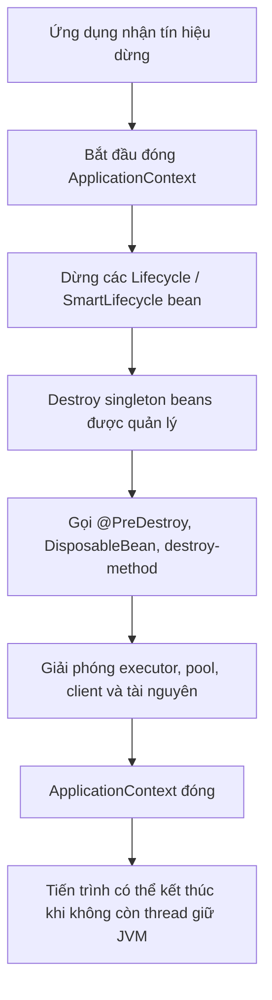
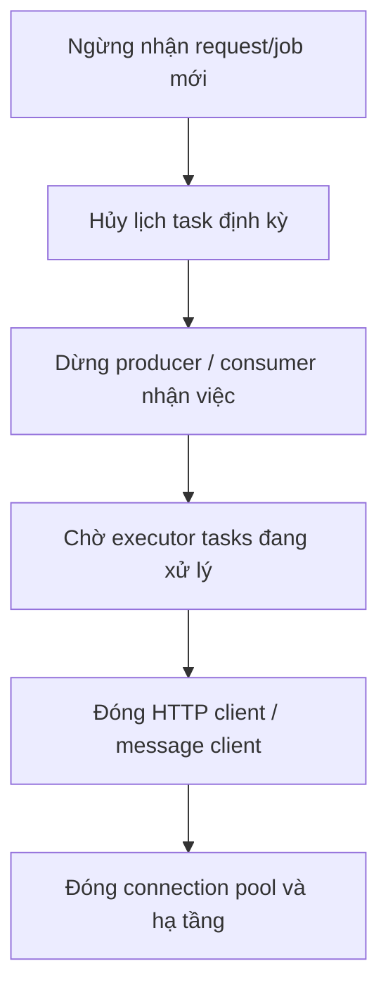

# Dọn executor, scheduler, connection và tài nguyên tự tạo

Một ứng dụng Spring Boot có thể khởi động thành công, phục vụ request bình thường nhưng vẫn gặp vấn đề khi dừng: tiến trình không thoát, thread còn chạy, connection pool không được đóng hoặc một tác vụ định kỳ tiếp tục gọi dịch vụ bên ngoài trong lúc application context đang bị hủy.

Những vấn đề này thường xuất hiện khi ứng dụng tự tạo tài nguyên có vòng đời dài, ví dụ `ExecutorService`, `ScheduledExecutorService`, HTTP client, JDBC connection, socket, file watcher hoặc một thành phần background polling. Tài nguyên có thể được tạo bằng `new` trong code, nhưng Spring chỉ quản lý việc đóng nếu tài nguyên đó được đăng ký và có lifecycle callback phù hợp.

Bài học này trình bày cách xác định **ai sở hữu tài nguyên**, khi nào cần dừng nhận việc mới, cách chờ tác vụ đang chạy, cách giải phóng connection, cách khai báo callback hủy bean và cách quan sát quá trình shutdown trong Spring Boot.

## 1. Vì sao shutdown cũng là một phần của thiết kế?

Trong một ứng dụng chạy lâu dài, không chỉ constructor và phương thức xử lý request mới quan trọng. Mỗi tài nguyên được mở ra đều cần có chiến lược kết thúc:

- Executor tạo worker thread để chạy tác vụ bất đồng bộ.
- Scheduler tạo thread và lên lịch công việc định kỳ.
- Connection pool giữ kết nối đến database hoặc hệ thống bên ngoài.
- HTTP client có thể giữ connection pool và event-loop riêng.
- File watcher, socket, stream hoặc consumer có thể giữ file descriptor và thread nền.
- Một tác vụ tự tạo có thể đang ghi dữ liệu, phát message hoặc xử lý transaction.

Nếu không đóng đúng cách, các hậu quả có thể gồm:

1. JVM không thoát do thread non-daemon còn sống.
2. Triển khai bị ép kết thúc khi hết thời gian graceful shutdown.
3. Tác vụ đang chạy bị cắt ngang, dữ liệu hoặc trạng thái xử lý không nhất quán.
4. Connection và file descriptor tồn tại lâu hơn cần thiết.
5. Test tạo nhiều application context bị rò rỉ thread hoặc tài nguyên.
6. Tác vụ vẫn nhận việc mới sau khi ứng dụng đã bắt đầu dừng.

**Nguyên tắc:** mọi tài nguyên có phương thức `close()`, `shutdown()`, `stop()` hoặc `dispose()` đều cần có một chủ sở hữu và một đường kết thúc có thể dự đoán.

## 2. Spring Boot dừng ứng dụng như thế nào?

Khi `ApplicationContext` được đóng bình thường, Spring tiến hành dừng các thành phần có lifecycle được quản lý rồi thực hiện các destruction callback phù hợp cho bean.

Một luồng khái quát:



Sơ đồ nêu trình tự tổng quát, không biểu diễn toàn bộ callback nội bộ hoặc thứ tự giữa mọi bean. Spring còn xét dependency và phase của lifecycle bean.

### 2.1. Đóng context khác với kết thúc tiến trình đột ngột

Một số tình huống:

| Tình huống | Cơ hội cleanup |
|---|---|
| Gọi `context.close()` | Spring chạy quy trình đóng context |
| Dừng bằng SIGTERM khi shutdown hook hoạt động | JVM có cơ hội gọi shutdown hook và đóng context |
| Dừng ứng dụng từ IDE bằng cơ chế graceful | Có thể chạy cleanup, tùy cơ chế dừng |
| SIGKILL hoặc tiến trình bị kill cưỡng bức | Không thể trông chờ Java shutdown hook |
| JVM crash, máy mất điện | Không thể bảo đảm callback được gọi |
| Test tạo rồi đóng context | Callback destroy của bean được quản lý có thể chạy |

Spring Boot thông thường đăng ký shutdown hook để đóng context khi JVM kết thúc hợp lệ. Không nên dùng cleanup callback làm cơ chế duy nhất bảo đảm một thao tác nghiệp vụ không được mất khi mất điện hoặc kill cưỡng bức.

Các nghiệp vụ cần durability nên dùng transaction, cơ chế retry, message acknowledgement, idempotency hoặc lưu trạng thái bền vững phù hợp.

### 2.2. Dừng nhận việc mới trước khi dọn tài nguyên

Trật tự tư duy hữu ích:

```text
Dừng nhận việc mới
        ↓
Hủy các lịch chạy tiếp theo
        ↓
Cho công việc đang chạy hoàn tất trong giới hạn thời gian
        ↓
Hủy/interrupt phần còn lại khi cần
        ↓
Đóng connection, client, pool và tài nguyên phụ trợ
        ↓
Ghi nhận kết quả shutdown
```

Nếu bạn đóng database pool trước khi task đang chạy hoàn tất, task có thể nhận lỗi do database connection không còn khả dụng. Vì vậy, thứ tự dừng phải phản ánh quan hệ phụ thuộc của ứng dụng.

## 3. Xác định chủ sở hữu của từng tài nguyên

Không phải tài nguyên nào cũng cần được đóng thủ công. Điều quan trọng là phân biệt:

- **Tài nguyên do Spring quản lý:** bean có destruction callback hoặc được framework/starter quản lý.
- **Tài nguyên tự tạo:** được tạo trong method, constructor hoặc một helper mà Spring không trực tiếp biết lifecycle.
- **Tài nguyên mượn tạm:** như JDBC `Connection` lấy từ pool, phải trả về đúng lúc nhưng không được tự đóng cả pool.

Bảng định hướng:

| Tài nguyên | Ai thường sở hữu? | Cách kết thúc thường gặp |
|---|---|---|
| `ThreadPoolTaskExecutor` được đăng ký làm Spring bean | Spring context | Lifecycle/destroy callback của executor |
| `ThreadPoolTaskScheduler` được đăng ký làm Spring bean | Spring context | Dừng lịch và shutdown theo lifecycle |
| `ExecutorService` tạo bằng `Executors.newFixedThreadPool(...)` trong một service | Service tạo ra nó | `shutdown()`, `awaitTermination()`, có thể `shutdownNow()` |
| `ScheduledExecutorService` tự tạo | Thành phần tạo scheduler | `ScheduledFuture.cancel(...)` và shutdown scheduler |
| `DataSource` pool do Boot auto-configure | Spring context/pool bean | Pool được đóng khi bean bị destroy |
| JDBC `Connection` mượn từ pool | Code đang dùng connection hoặc Spring transaction infrastructure | Trả connection bằng `close()`/API release phù hợp |
| Client thư viện có `close()` hoặc `dispose()` | Thành phần tạo hoặc bean quản lý client | Gọi API đóng do thư viện công bố |
| `InputStream`/`OutputStream` mở trong một method | Method mở stream | `try-with-resources` |
| Executor/client dùng chung do thư viện bên ngoài cấp | Chủ sở hữu được công bố của tài nguyên đó | Bên dùng không tự đóng nếu không sở hữu |

**Không đóng tài nguyên của người khác.** Một service inject `DataSource` do Spring Boot tạo không nên tự gọi `dataSource.close()` chỉ vì service đó không còn công việc. Việc đóng pool ảnh hưởng tất cả thành phần đang dùng chung.

Ngược lại, nếu service tự gọi `Executors.newSingleThreadExecutor()`, Spring không thể tự suy ra cần dừng executor đó nếu service không khai báo cleanup.

## 4. ExecutorService: dừng, chờ và xử lý công việc còn lại

`ExecutorService` là abstraction của Java để thực thi task bằng worker thread. Một số cách tạo:

```java
ExecutorService executor = Executors.newFixedThreadPool(4);
ExecutorService single = Executors.newSingleThreadExecutor();
ScheduledExecutorService scheduler =
        Executors.newScheduledThreadPool(2);
```

Nếu các executor này được tạo trực tiếp trong code, bạn cần thiết kế cách đóng.

### 4.1. shutdown() làm gì?

```java
executor.shutdown();
```

`shutdown()` bắt đầu shutdown theo hướng có trật tự:

- Ngừng nhận task mới.
- Những task đã submit vẫn được xử lý theo chính sách executor.
- Lời gọi `shutdown()` thường trả về ngay, không chờ tất cả worker kết thúc.

Vì vậy, chỉ gọi `shutdown()` chưa chứng minh executor đã dừng hoàn toàn.

### 4.2. awaitTermination() làm gì?

```java
boolean finished =
        executor.awaitTermination(10, TimeUnit.SECONDS);
```

Phương thức chờ tối đa thời gian được chỉ định sau khi executor bắt đầu shutdown. Nó trả về:

- `true` khi executor đã terminated.
- `false` nếu hết thời gian mà executor chưa terminated.

Phương thức có thể ném `InterruptedException` khi thread đang chờ bị interrupt.

### 4.3. shutdownNow() làm gì?

```java
List<Runnable> notStarted = executor.shutdownNow();
```

`shutdownNow()` cố dừng các task đang chạy, thường bằng cách interrupt worker thread; đồng thời trả về danh sách task trong queue chưa bắt đầu thực thi.

**Nó không bảo đảm hủy được mọi task đang chạy.** Nếu task bỏ qua interrupt hoặc bị kẹt ở một API không phản hồi interruption, task có thể vẫn chạy.

Vì vậy, shutdown đáng tin cậy cần cả hai phía:

1. Executor có chiến lược đóng.
2. Code của task xử lý cancellation/interruption đúng cách.

### 4.4. Mẫu đóng executor có timeout

```java
import java.util.List;
import java.util.concurrent.ExecutorService;
import java.util.concurrent.TimeUnit;

public final class ExecutorShutdown {

    private ExecutorShutdown() {
    }

    public static void stop(ExecutorService executor) {
        executor.shutdown();

        try {
            if (!executor.awaitTermination(10, TimeUnit.SECONDS)) {
                List<Runnable> pending = executor.shutdownNow();

                System.out.println(
                        "Tasks not started: " + pending.size()
                );

                if (!executor.awaitTermination(5, TimeUnit.SECONDS)) {
                    System.err.println(
                            "Executor did not terminate in time"
                    );
                }
            }
        } catch (InterruptedException ex) {
            executor.shutdownNow();
            Thread.currentThread().interrupt();
        }
    }
}
```

Điểm đáng chú ý:

- Có giới hạn thời gian chờ.
- Thử shutdown có trật tự trước.
- Khi hết hạn, yêu cầu hủy mạnh hơn.
- Không nuốt interrupt của thread gọi shutdown.
- Ghi nhận khi executor không kết thúc.

Thời gian 10 và 5 giây chỉ là ví dụ. Budget shutdown thực tế phụ thuộc thời gian xử lý task và giới hạn của môi trường triển khai.

## 5. Executor tự tạo trong một Spring service

Ví dụ một service tự mở thread pool:

```java
import java.util.concurrent.ExecutorService;
import java.util.concurrent.Executors;

import jakarta.annotation.PreDestroy;
import org.springframework.stereotype.Service;

@Service
public class InvoiceBackgroundService {

    private final ExecutorService executor =
            Executors.newFixedThreadPool(3);

    public void submitInvoiceJob(Runnable job) {
        executor.submit(job);
    }

    @PreDestroy
    public void shutdown() {
        ExecutorShutdown.stop(executor);
    }
}
```

Spring quản lý bean `InvoiceBackgroundService` nên khi bean bị destroy bình thường, phương thức có `@PreDestroy` được gọi. Service chịu trách nhiệm dừng executor mà chính nó tạo ra.

Nhưng cần lưu ý:

- Một lời gọi `submitInvoiceJob` mới có thể gặp `RejectedExecutionException` sau khi executor bắt đầu shutdown.
- Task dài có thể khiến destroy callback chờ hết timeout.
- Nếu service tạo nhiều executor, phải đóng tất cả.
- Nếu executor được chia sẻ cho các bean khác, cần một owner riêng và quy định rõ ai được phép đóng.
- Nếu tạo executor trực tiếp trong một method request, tốt hơn dùng executor dùng chung hoặc đóng theo phạm vi method; không tạo pool mới cho từng request mà quên hủy.

### 5.1. Không nên phụ thuộc chỉ vào daemon thread

Đặt worker thread là daemon có thể khiến JVM thoát dù worker còn chạy. Nhưng daemon thread không thay thế shutdown:

- Task có thể bị cắt ngang đột ngột.
- Dữ liệu chưa flush có thể mất.
- Connection hoặc resource không được giải phóng theo logic ứng dụng.
- Bạn không quan sát được task đã hoàn tất hay chưa.

Hãy sử dụng lifecycle và cancellation có chủ đích, kể cả khi thread là daemon.

## 6. Ưu tiên ThreadPoolTaskExecutor khi tích hợp với Spring

Trong ứng dụng Spring, `ThreadPoolTaskExecutor` thường thuận tiện hơn một `ExecutorService` không gắn vào bean lifecycle. Nó là executor của Spring, có các API quản lý pool và cơ chế shutdown khi bean được quản lý bởi context.

Ví dụ cấu hình:

```java
import org.springframework.context.annotation.Bean;
import org.springframework.context.annotation.Configuration;
import org.springframework.scheduling.concurrent.ThreadPoolTaskExecutor;

@Configuration(proxyBeanMethods = false)
public class BackgroundExecutorConfiguration {

    @Bean(name = "backgroundExecutor")
    public ThreadPoolTaskExecutor backgroundExecutor() {
        ThreadPoolTaskExecutor executor =
                new ThreadPoolTaskExecutor();

        executor.setCorePoolSize(4);
        executor.setMaxPoolSize(8);
        executor.setQueueCapacity(100);
        executor.setThreadNamePrefix("background-");
        executor.setWaitForTasksToCompleteOnShutdown(true);
        executor.setAwaitTerminationSeconds(20);

        return executor;
    }
}
```

Spring khởi tạo executor bean trong lifecycle của context và xử lý việc shutdown thông qua các cơ chế của `ExecutorConfigurationSupport`, thay vì bạn tự tạo pool rồi bỏ quên nó.

Ví dụ dùng trong service có `@Async`:

```java
import org.springframework.scheduling.annotation.Async;
import org.springframework.stereotype.Service;

@Service
public class ReceiptService {

    @Async("backgroundExecutor")
    public void generateReceipt(Long orderId) {
        // Tạo biên nhận cho đơn hàng
    }
}
```

Để `@Async` hoạt động, ứng dụng phải bật async processing phù hợp, ví dụ `@EnableAsync`. Cần lưu ý lời gọi nội bộ cùng một instance không tự đi qua Spring AOP proxy theo cách một lời gọi từ bean khác.

### 6.1. Các tùy chọn shutdown quan trọng

| Tùy chọn | Mục đích |
|---|---|
| `setWaitForTasksToCompleteOnShutdown(true)` | Cho phép các task đã nhận tiếp tục theo chính sách executor khi shutdown |
| `setAwaitTerminationSeconds(n)` | Chờ executor kết thúc tối đa n giây trong quy trình shutdown |
| `setThreadNamePrefix(...)` | Giúp nhận diện thread trong log và thread dump |
| `setQueueCapacity(...)` | Giới hạn/định hình queue, ảnh hưởng lượng công việc còn tồn khi dừng |
| `setCorePoolSize(...)`, `setMaxPoolSize(...)` | Điều chỉnh năng lực thực thi và mức song song |

Không nên suy luận rằng đặt `waitForTasksToCompleteOnShutdown=true` là đủ để mọi task hoàn tất. Task có thể chạy quá lâu, budget chờ có giới hạn, hoặc container bị ép kết thúc trước đó.

### 6.2. Chọn chính sách hủy hay chờ theo nghiệp vụ

Một số công việc nên cố hoàn tất:

- Hoàn tất ghi trạng thái trong một thao tác ngắn.
- Flush buffer còn ít dữ liệu.
- Xử lý event đã nhận mà chưa có cơ chế retry bền vững.

Một số công việc có thể hủy:

- Warm-up cache.
- Polling telemetry.
- Tác vụ kiểm tra định kỳ không quan trọng.
- Tính toán có thể chạy lại mà không ảnh hưởng tính nhất quán.

Nếu công việc phải được bảo đảm qua restart/crash, đừng chỉ trông vào việc chờ executor. Hãy đưa công việc vào queue bền vững, database hoặc một hệ thống job có retry.

## 7. Scheduler: hủy lịch và dừng thread chạy nền

Scheduler khác executor thông thường ở chỗ nó còn giữ **lịch chạy trong tương lai**. Một tác vụ định kỳ có thể tiếp tục được kích hoạt cho đến khi lịch hoặc scheduler bị hủy.

Hai loại thường gặp:

- `ScheduledExecutorService` của Java.
- `ThreadPoolTaskScheduler` và cơ chế `@Scheduled` của Spring.

### 7.1. ScheduledExecutorService tự tạo

Ví dụ:

```java
ScheduledExecutorService scheduler =
        Executors.newScheduledThreadPool(1);

ScheduledFuture<?> scheduledTask =
        scheduler.scheduleAtFixedRate(
                this::refreshCache,
                0,
                30,
                TimeUnit.SECONDS
        );
```

Khi ứng dụng dừng, cần xét cả hai đối tượng:

```java
scheduledTask.cancel(true);
ExecutorShutdown.stop(scheduler);
```

`cancel(true)` yêu cầu hủy lần chạy tiếp theo và có thể interrupt một lần chạy hiện tại. Sau đó shutdown scheduler để dừng việc thực thi. Lệnh cancel không có nghĩa task chắc chắn đã hoàn tất hoặc rollback mọi side effect.

Nếu một component sở hữu nhiều lịch, hãy giữ reference `ScheduledFuture<?>` cho từng lịch cần hủy riêng. Nếu chỉ gọi shutdown pool, cần hiểu rõ chính sách executor áp dụng với periodic task và delayed task đang nằm trong queue.

### 7.2. ThreadPoolTaskScheduler là Spring bean

Ví dụ:

```java
import org.springframework.context.annotation.Bean;
import org.springframework.context.annotation.Configuration;
import org.springframework.scheduling.concurrent.ThreadPoolTaskScheduler;

@Configuration(proxyBeanMethods = false)
public class SchedulingConfiguration {

    @Bean
    public ThreadPoolTaskScheduler taskScheduler() {
        ThreadPoolTaskScheduler scheduler =
                new ThreadPoolTaskScheduler();

        scheduler.setPoolSize(3);
        scheduler.setThreadNamePrefix("scheduled-");
        scheduler.setWaitForTasksToCompleteOnShutdown(false);
        scheduler.setAwaitTerminationSeconds(15);

        return scheduler;
    }
}
```

Khi scheduler là bean được Spring quản lý, container có cơ chế lifecycle và destruction cho nó. Với tác vụ định kỳ, thường nên dừng lịch mới và cho phép/cố hủy công việc còn chạy theo yêu cầu nghiệp vụ.

Cần hiểu nghĩa của các flag với phiên bản Spring Framework đang dùng; cách scheduler xử lý delayed và periodic task khi shutdown có thể phụ thuộc policy của underlying `ScheduledThreadPoolExecutor`.

### 7.3. @Scheduled không cần tự tạo một thread trong method

Với `@EnableScheduling` và `@Scheduled`:

```java
import org.springframework.scheduling.annotation.Scheduled;
import org.springframework.stereotype.Component;

@Component
public class CacheRefreshJob {

    @Scheduled(fixedDelayString = "PT30S")
    public void refresh() {
        // Tác vụ làm mới cache
    }
}
```

Spring quản lý việc đăng ký lịch chạy. Bạn không cần mở một `ScheduledExecutorService` riêng bên trong method này.

Khi context được đóng, cơ chế scheduling do Spring quản lý sẽ thực hiện cleanup phù hợp. Tuy nhiên, nếu method đang chạy có blocking I/O lâu hoặc không đáp ứng interrupt, quá trình kết thúc vẫn có thể bị kéo dài.

### 7.4. Hủy lịch chưa đủ nếu task không phản hồi interruption

Một job có thể gọi HTTP client với read timeout rất lớn hoặc chờ `BlockingQueue.take()`. Khi dừng, cần:

- Đặt timeout cho I/O.
- Xử lý `InterruptedException`.
- Không nuốt interrupt rồi tiếp tục vòng lặp vô hạn.
- Có cờ dừng hoặc trạng thái cancellation nếu task chạy vòng lặp.
- Cân nhắc idempotency cho task có thể bị chạy lại sau restart.

Scheduler quản lý thời điểm chạy; logic trong task quyết định task có dừng hợp tác hay không.

## 8. JDBC Connection và DataSource: phân biệt mượn connection với đóng pool

Một lỗi thiết kế phổ biến là nhầm `Connection` lấy từ pool với chính `DataSource`/pool.

### 8.1. Connection lấy từ DataSource phải được trả đúng lúc

Ví dụ JDBC thuần:

```java
import java.sql.Connection;
import java.sql.PreparedStatement;
import java.sql.ResultSet;
import java.sql.SQLException;
import javax.sql.DataSource;

public long countOrders(DataSource dataSource) throws SQLException {
    String sql = "SELECT COUNT(*) FROM orders";

    try (Connection connection = dataSource.getConnection();
         PreparedStatement statement =
                 connection.prepareStatement(sql);
         ResultSet rows = statement.executeQuery()) {

        rows.next();
        return rows.getLong(1);
    }
}
```

Ở một connection pool thông thường, gọi `connection.close()` qua try-with-resources **trả connection về pool** thay vì đóng vật lý kết nối ngay lập tức. Đây là cách kết thúc quyền sử dụng tạm thời connection.

Nếu quên close connection, pool có thể hết connection để cấp cho request khác, dù application context vẫn hoạt động.

### 8.2. Spring JDBC nên dùng JdbcTemplate

Trong ứng dụng Spring dùng transaction manager, `JdbcTemplate` giúp quản lý việc lấy/trả connection theo hạ tầng Spring.

```java
import org.springframework.jdbc.core.JdbcTemplate;
import org.springframework.stereotype.Repository;

@Repository
public class OrderStatisticsRepository {

    private final JdbcTemplate jdbcTemplate;

    public OrderStatisticsRepository(JdbcTemplate jdbcTemplate) {
        this.jdbcTemplate = jdbcTemplate;
    }

    public Long countOrders() {
        return jdbcTemplate.queryForObject(
                "SELECT COUNT(*) FROM orders",
                Long.class
        );
    }
}
```

Điều này giảm nguy cơ quên close hoặc xử lý sai connection trong transaction.

Nếu tự lấy connection trong code sử dụng transaction Spring, cần hiểu `DataSourceUtils` và cơ chế binding connection vào transaction. Dùng raw `dataSource.getConnection()` tùy tiện có thể tạo connection không tham gia transaction như bạn dự kiến.

### 8.3. Không đóng DataSource pool ở mỗi lần dùng

Ví dụ **không nên**:

```java
@Service
public class ReportService {

    private final HikariDataSource dataSource;

    public ReportService(HikariDataSource dataSource) {
        this.dataSource = dataSource;
    }

    public void executeReport() {
        // ...
        dataSource.close(); // Không đóng pool dùng chung tại đây
    }
}
```

Pool là tài nguyên dùng chung của ứng dụng. Nó thường được Spring quản lý và đóng khi bean bị destroy trong quá trình shutdown context.

Nếu chính bạn khai báo `HikariDataSource`:

```java
@Bean(destroyMethod = "close")
public HikariDataSource reportingDataSource() {
    HikariConfig config = new HikariConfig();
    config.setJdbcUrl("jdbc:postgresql://localhost:5432/reporting");
    config.setUsername("app");
    config.setPassword("configured-outside-code");

    return new HikariDataSource(config);
}
```

Spring có thể gọi `close()` của bean khi context đóng. Trong ứng dụng thực, không hard-code password; bind từ cấu hình/secret manager phù hợp.

Spring cũng có cơ chế suy luận một số destroy method phổ biến của bean được khai báo qua `@Bean`. Dù vậy, khi một tài nguyên có hợp đồng đóng cụ thể và quan trọng, `destroyMethod = "close"` giúp người bảo trì nhìn thấy rõ ý định.

## 9. HTTP client, message consumer, socket và resource tự tạo

Các thư viện tích hợp có API đóng khác nhau:

- Một client có thể triển khai `AutoCloseable`.
- Một pool có thể dùng `close()` hoặc `shutdown()`.
- Một reactive client/resource có thể dùng `dispose()`.
- Message consumer có thể cần dừng poll loop, commit/ack phù hợp rồi đóng.
- Socket, file watcher hoặc stream có thể giữ OS handle cho tới khi `close()` được gọi.

Không nên áp dụng `close()` một cách máy móc cho mọi đối tượng. Hãy đọc contract lifecycle của thư viện đang dùng.

### 9.1. Đưa tài nguyên vào Spring bean lifecycle

Ví dụ một class thư viện có `open()` và `close()`:

```java
@Configuration(proxyBeanMethods = false)
public class ExternalClientConfiguration {

    @Bean(initMethod = "open", destroyMethod = "close")
    public ExternalClient externalClient() {
        return new ExternalClient();
    }
}
```

Spring gọi `open()` trong initialization và `close()` trong destruction lifecycle của bean.

Đây là cách thích hợp khi bạn không muốn class thư viện phụ thuộc trực tiếp vào Spring annotation.

### 9.2. Không đóng client dùng chung từ từng service

Nếu ba service inject cùng một client singleton, không service nào nên đóng client khi hoàn tất một request. Context hoặc một bean owner chịu trách nhiệm đóng.

```text
OrderService ----\
PaymentService ---+--> SharedHttpClient (Spring-managed)
ReportService ----/
                          |
                          v
                    context shutdown
                          |
                          v
                   close SharedHttpClient
```

Nếu client được mượn từ framework hoặc từ nơi khác, hãy xác định xem có cần close ở bên sử dụng hay không. Ownership phải được công bố rõ ràng.

### 9.3. Tài nguyên theo request hoặc theo method

Với tài nguyên ngắn hạn như file stream, cách dễ hiểu nhất là đóng ngay ở phạm vi sử dụng:

```java
try (InputStream input = Files.newInputStream(filePath)) {
    // Đọc file
}
```

Không trì hoãn việc đóng stream ngắn hạn tới `@PreDestroy` của một singleton service. Làm vậy có thể giữ file descriptor suốt vòng đời ứng dụng.

## 10. @PreDestroy: cleanup của bean do Spring quản lý

`@PreDestroy` (thuộc `jakarta.annotation` trong các dòng Spring Boot hiện đại) đánh dấu method cần được gọi trước khi bean bị destroy theo lifecycle phù hợp.

```java
import jakarta.annotation.PreDestroy;
import org.springframework.stereotype.Component;

@Component
public class LocalBufferManager {

    private final ExecutorService executor =
            Executors.newSingleThreadExecutor();

    @PreDestroy
    public void onShutdown() {
        ExecutorShutdown.stop(executor);
    }
}
```

Ưu điểm:

- Cleanup nằm gần code sở hữu tài nguyên.
- Không cần cấu hình tên method ở nơi khác.
- Khi context đóng bình thường, Spring gọi callback cho bean thuộc phạm vi được quản lý.

Nhưng có giới hạn:

- Callback không chạy nếu JVM bị kill cưỡng bức.
- Nếu tự tạo object bằng `new` ngoài Spring, annotation không tự có hiệu lực.
- Với prototype bean, Spring không quản lý destruction lifecycle đầy đủ như singleton.
- Callback có thể bị gián đoạn nếu nền tảng hết thời gian dừng.

### 10.1. Callback nên gọn, idempotent và có timeout

Một bean có thể bị yêu cầu cleanup nhiều lần do shutdown logic riêng, test hoặc cơ chế đóng từ nhiều phía. Vì vậy, callback nên chịu được lời gọi lặp.

Ví dụ dùng `AtomicBoolean`:

```java
private final AtomicBoolean closed = new AtomicBoolean();

@PreDestroy
public void close() {
    if (!closed.compareAndSet(false, true)) {
        return;
    }

    ExecutorShutdown.stop(executor);
}
```

Nếu callback chứa blocking I/O, cần timeout rõ ràng. Một phương thức `@PreDestroy` kẹt vô hạn có thể giữ quá trình đóng ứng dụng và khiến nền tảng phải ép dừng.

## 11. @Bean(destroyMethod = "...") và DisposableBean

Nếu class không muốn import Spring annotation, cấu hình lifecycle ở `@Bean` method thường phù hợp:

```java
@Configuration(proxyBeanMethods = false)
public class ResourceConfiguration {

    @Bean(destroyMethod = "shutdown")
    public ExecutorService exportExecutor() {
        return Executors.newFixedThreadPool(2);
    }
}
```

Khi context đóng, Spring gọi method `shutdown()`. Tuy nhiên, phương thức này không chờ tất cả task kết thúc; nếu cần timeout và theo dõi termination, hãy dùng bean wrapper sở hữu executor và có method cleanup đầy đủ.

### 11.1. Bean wrapper có hành vi dừng rõ ràng

```java
public class ExportEngine implements AutoCloseable {

    private final ExecutorService executor =
            Executors.newFixedThreadPool(2);

    public void submit(Runnable task) {
        executor.submit(task);
    }

    @Override
    public void close() {
        ExecutorShutdown.stop(executor);
    }
}
```

Đăng ký:

```java
@Bean(destroyMethod = "close")
public ExportEngine exportEngine() {
    return new ExportEngine();
}
```

Wrapper biểu đạt rõ: `ExportEngine` sở hữu executor và chịu trách nhiệm kết thúc tất cả tài nguyên bên trong.

### 11.2. DisposableBean

Spring còn có interface:

```java
public interface DisposableBean {
    void destroy() throws Exception;
}
```

Ví dụ:

```java
@Component
public class LegacyConsumer implements DisposableBean {

    @Override
    public void destroy() {
        // Dừng consumer, giải phóng tài nguyên
    }
}
```

`DisposableBean` phù hợp khi class chấp nhận phụ thuộc Spring API. Với POJO hoặc thư viện ngoài, `@PreDestroy` hay `@Bean(destroyMethod = "...")` thường linh hoạt hơn.

### 11.3. Tránh gọi cleanup hai lần từ nhiều cơ chế

Một bean có thể có nhiều destruction callback. Nếu chúng cùng đóng một resource không idempotent, bạn có thể gặp exception do đóng lặp.

Ví dụ, nếu một class có `@PreDestroy close()` và `@Bean(destroyMethod = "close")`, hãy hiểu cách framework nhận diện callback trùng trước khi cấu hình cả hai. Thực tế nên chọn một con đường cleanup rõ ràng cho mỗi tài nguyên và làm close idempotent khi có thể.

## 12. SmartLifecycle: khi cần phối hợp thứ tự dừng

Có trường hợp chỉ dùng `@PreDestroy` là quá muộn hoặc không đủ. Ví dụ:

- Một poller cần dừng nhận thêm message trước khi executor bị đóng.
- Một worker cần thông báo ngừng nhận job, rồi đợi job đang chạy.
- Một module có nhiều giai đoạn stop, phải phối hợp với dependency khác.
- Một integration cần khởi động/dừng theo thứ tự phase với các lifecycle bean.

`SmartLifecycle` của Spring cho phép một bean tham gia quá trình start/stop có quản lý, bao gồm phase và callback báo dừng hoàn tất.

Ví dụ:

```java
import java.util.concurrent.atomic.AtomicBoolean;
import org.springframework.context.SmartLifecycle;

public class MessagePoller implements SmartLifecycle {

    private final AtomicBoolean running =
            new AtomicBoolean(false);

    @Override
    public void start() {
        running.set(true);
        // Bắt đầu poll/nhận message
    }

    @Override
    public void stop() {
        running.set(false);
        // Dừng poll; với tài nguyên async, chờ theo thiết kế
    }

    @Override
    public void stop(Runnable callback) {
        try {
            stop();
        } finally {
            callback.run();
        }
    }

    @Override
    public boolean isRunning() {
        return running.get();
    }

    @Override
    public int getPhase() {
        return 100;
    }
}
```

Code trên minh họa bean có thể tham gia stop callback. Với một component dừng bất đồng bộ, chỉ gọi `callback.run()` **sau khi việc dừng thực sự hoàn tất**, kể cả trong trường hợp lỗi theo contract; nếu gọi sớm, container có thể tiếp tục đóng dependency khi worker vẫn đang sử dụng chúng.

### 12.1. Phase điều khiển thứ tự thế nào?

Với `SmartLifecycle`, phase thấp thường được start trước và stop sau; phase cao thường start sau và stop trước. Các quan hệ dependency được Spring quản lý cũng ảnh hưởng thứ tự thực tế.

Ví dụ giả định:

```text
Start:
  ConnectionInfrastructure (phase 0)
      ↓
  MessagePoller (phase 100)

Stop:
  MessagePoller (phase 100)
      ↓
  ConnectionInfrastructure (phase 0)
```

Nhờ đó, poller có cơ hội dừng sử dụng connection trước khi infrastructure bị đóng.

Đừng tự chọn số phase tùy tiện mà không xét lifecycle của các framework integration đang dùng. Hãy kiểm tra phase của thành phần liên quan và chỉ override khi có yêu cầu về thứ tự thực sự.

### 12.2. @PreDestroy và SmartLifecycle bổ sung cho nhau

Có thể dùng:

- `SmartLifecycle.stop()` để **dừng luồng nhận việc** và chờ hoạt động kết thúc.
- `@PreDestroy` hoặc destroy method để **giải phóng resource còn lại**.

Nên tránh để hai callback tranh nhau đóng cùng executor/pool. Phân chia trách nhiệm rõ ràng: stop hoạt động trước, close tài nguyên sau.

## 13. Graceful shutdown của web server

Spring Boot hỗ trợ graceful shutdown cho embedded web server tương thích. Cấu hình thường dùng:

```yaml
server:
  shutdown: graceful

spring:
  lifecycle:
    timeout-per-shutdown-phase: 30s
```

Ý nghĩa tổng quát:

- Web server bắt đầu ngừng phục vụ request mới theo cơ chế của server tương ứng.
- Các request đang thực thi có một khoảng thời gian để hoàn tất.
- Spring tiếp tục quy trình dừng lifecycle và destroy bean theo phase/callback.
- `spring.lifecycle.timeout-per-shutdown-phase` giới hạn thời gian chờ cho **mỗi shutdown phase** phù hợp, không phải một đồng hồ duy nhất bảo đảm tổng shutdown tối đa 30 giây.

Vì thế, cần tính cả thời gian graceful HTTP, executor shutdown, bean destroy và hành vi của platform.

### 13.1. Graceful HTTP không tự giải quyết background job

Một request HTTP đã hoàn tất không có nghĩa:

- `@Async` task do request submit cũng đã xong.
- Scheduler không còn task đang chạy.
- Consumer message đã ngừng nhận message.
- File watcher và custom thread pool đã bị đóng.
- Connection pool không còn người dùng.

Graceful web server chỉ giải quyết một phần shutdown. Mọi thành phần nền vẫn cần lifecycle phù hợp.

### 13.2. Môi trường orchestration có giới hạn thời gian

Ví dụ với container platform, tiến trình có thể nhận SIGTERM rồi sau đó bị kill nếu không kết thúc trong thời gian cho phép.

Do đó:

- Thiết kế task có timeout và hỗ trợ cancellation.
- Ngừng nhận việc mới sớm.
- Đặt budget dừng phù hợp với giới hạn platform.
- Ghi log khi quá thời gian.
- Dùng cơ chế durable để xử lý công việc không được phép mất.

Không coi graceful shutdown như một bảo đảm rằng mọi job dài nhiều phút đều được hoàn thành trước khi container bị thay thế.

## 14. Thứ tự dọn tài nguyên phụ thuộc nhau

Giả sử một hệ thống có:

- HTTP server nhận request.
- Executor xử lý background task.
- Scheduler kích hoạt task định kỳ.
- `RemoteClient` gọi API ngoài.
- `DataSource` phục vụ database.

Một thứ tự mục tiêu hợp lý:



Điều này là định hướng thiết kế, không phải thứ tự Spring luôn tự áp dụng cho mọi ứng dụng. Để hiện thực hóa, hãy thể hiện dependency giữa các bean và dùng lifecycle phase/callback phù hợp.

### 14.1. Quan hệ phụ thuộc giúp Spring biết thứ tự destroy

Ví dụ:

```java
@Service
public class DataExportService {

    private final ExportClient exportClient;

    public DataExportService(ExportClient exportClient) {
        this.exportClient = exportClient;
    }
}
```

`DataExportService` phụ thuộc `ExportClient`. Khi destroy singleton, Spring có thể sử dụng quan hệ phụ thuộc để xử lý bean phụ thuộc trước bean được phụ thuộc. Tuy nhiên, thread do service tạo vẫn có thể chạy ngoài luồng destroy callback; cần chủ động ngừng chúng trước khi client bị đóng.

### 14.2. @DependsOn không thay cho shutdown logic

`@DependsOn` có thể khai báo thứ tự khởi tạo/destroy giữa bean cụ thể, nhưng nó không làm một worker thread đang chạy tự dừng hoặc chờ task hoàn tất.

Chỉ thêm `@DependsOn` không giải quyết được resource leak. Bạn vẫn cần cancel, shutdown, await và close.

## 15. Interruption và cancellation phải được xử lý bên trong task

Lệnh `shutdownNow()` hoặc `Future.cancel(true)` chỉ là yêu cầu. Task phải hợp tác để dừng.

Ví dụ task có thể bị interrupt:

```java
public void runPollingLoop() {
    try {
        while (!Thread.currentThread().isInterrupted()) {
            pollOnce();
            Thread.sleep(1000);
        }
    } catch (InterruptedException ex) {
        Thread.currentThread().interrupt();
    } finally {
        releaseTaskLocalResources();
    }
}
```

Ở đây, `Thread.sleep` ném `InterruptedException` khi bị interrupt. Trong catch, khôi phục interrupt flag để tầng gọi có thể nhận biết trạng thái thread.

Đối với blocking API không phản hồi interruption, cần timeout riêng hoặc API cancel/close của thư viện đó.

### 15.1. Không nuốt interruption

Ví dụ không tốt:

```java
while (true) {
    try {
        pollOnce();
        Thread.sleep(1000);
    } catch (InterruptedException ex) {
        // Bỏ qua rồi tiếp tục vòng lặp
    }
}
```

Task có thể chạy mãi mặc dù executor đã được yêu cầu shutdown. Nếu việc dừng là yêu cầu hợp lệ, hãy thoát vòng lặp và khôi phục flag khi phù hợp.

### 15.2. Side effect cần idempotency

Một task có thể bị dừng sau khi đã gửi request nhưng trước khi ghi trạng thái thành công. Sau restart, cùng task có thể chạy lại.

Với thao tác có side effect như thanh toán, gửi email hoặc cập nhật trạng thái, cần thiết kế idempotency key, transaction hoặc cơ chế xác nhận hoàn tất phù hợp. Cleanup thread không tự giải quyết vấn đề xử lý trùng hoặc mất dữ liệu.

## 16. Ví dụ hoàn chỉnh: Bean sở hữu một scheduler tự tạo

Giả sử một module tự quản lý scheduler vì cần hành vi riêng. Nó tạo một `ScheduledExecutorService` và phải đóng khi context dừng.

### 16.1. Class sở hữu scheduler

```java
package com.example.monitoring;

import java.util.concurrent.Executors;
import java.util.concurrent.ScheduledExecutorService;
import java.util.concurrent.ScheduledFuture;
import java.util.concurrent.TimeUnit;
import java.util.concurrent.atomic.AtomicBoolean;

public class MetricsPoller implements AutoCloseable {

    private final ScheduledExecutorService scheduler =
            Executors.newSingleThreadScheduledExecutor();

    private final AtomicBoolean closed =
            new AtomicBoolean(false);

    private ScheduledFuture<?> scheduledTask;

    public synchronized void start() {
        if (closed.get()) {
            throw new IllegalStateException("Poller is closed");
        }

        if (scheduledTask != null) {
            return;
        }

        scheduledTask = scheduler.scheduleWithFixedDelay(
                this::pollOnce,
                0,
                10,
                TimeUnit.SECONDS
        );
    }

    private void pollOnce() {
        if (closed.get()) {
            return;
        }

        System.out.println("Collecting metrics...");
    }

    @Override
    public synchronized void close() {
        if (!closed.compareAndSet(false, true)) {
            return;
        }

        if (scheduledTask != null) {
            scheduledTask.cancel(true);
        }

        ExecutorShutdown.stop(scheduler);
    }
}
```

Giải thích:

- Component tự tạo scheduler nên tự sở hữu và đóng.
- `start()` không đăng ký hai lịch khi được gọi lặp.
- `close()` dùng `AtomicBoolean` để tránh thực hiện cleanup nhiều lần.
- Lịch được cancel trước khi executor shutdown.
- Shutdown có giới hạn thời gian qua helper `ExecutorShutdown` đã trình bày.
- Đây là ví dụ tối giản; task thực tế cần timeout, logging và xử lý lỗi theo yêu cầu.

### 16.2. Đăng ký bean và callback

```java
package com.example.monitoring;

import org.springframework.context.annotation.Bean;
import org.springframework.context.annotation.Configuration;

@Configuration(proxyBeanMethods = false)
public class MetricsPollerConfiguration {

    @Bean(initMethod = "start", destroyMethod = "close")
    public MetricsPoller metricsPoller() {
        return new MetricsPoller();
    }
}
```

Khi Spring tạo bean, callback `start()` đăng ký task. Khi context đóng bình thường, callback `close()` hủy lịch và dừng executor.

Như vậy, code thư viện không cần import Spring annotation; lifecycle nằm trong cấu hình.

### 16.3. Khi nào nên chọn Spring TaskScheduler thay thế?

Nếu không cần API scheduler riêng hoặc custom ownership, `ThreadPoolTaskScheduler` làm bean Spring thường đơn giản hơn. Nó tận dụng lifecycle framework và tích hợp với `@Scheduled`/`TaskScheduler`.

Dùng scheduler tự tạo chỉ khi có yêu cầu cụ thể; khi đó ownership phải rõ ràng như ví dụ trên.

## 17. Kiểm chứng cleanup khi ApplicationContext đóng

Một cách kiểm chứng cơ bản là tạo context test, lấy resource bean, đóng context và xác nhận callback được gọi.

Ví dụ class resource:

```java
public class TestResource implements AutoCloseable {

    private boolean closed;

    public boolean isClosed() {
        return closed;
    }

    @Override
    public void close() {
        closed = true;
    }
}
```

Cấu hình:

```java
@Configuration(proxyBeanMethods = false)
public class TestResourceConfiguration {

    @Bean(destroyMethod = "close")
    public TestResource testResource() {
        return new TestResource();
    }
}
```

Test minh họa:

```java
@Test
void closesManagedResourceWhenContextCloses() {
    AnnotationConfigApplicationContext context =
            new AnnotationConfigApplicationContext(
                    TestResourceConfiguration.class
            );

    TestResource resource = context.getBean(TestResource.class);

    assertThat(resource.isClosed()).isFalse();

    context.close();

    assertThat(resource.isClosed()).isTrue();
}
```

Đây là test lifecycle có ý nghĩa vì nó xác nhận hành vi khi context đóng, không chỉ xác nhận một method `close()` hoạt động khi gọi trực tiếp.

### 17.1. Kiểm chứng executor termination

Đối với executor, có thể kiểm tra sau khi context đóng:

- Executor đã chuyển sang trạng thái shutdown?
- `isTerminated()` có trở thành true trong thời gian chờ hữu hạn?
- Các task còn chạy có bị interrupt hoặc hoàn tất theo hợp đồng?
- Có thread mới nào tiếp tục được tạo hoặc giữ tiến trình không?

Không viết test dựa vào `Thread.sleep(1000)` rồi giả định mọi máy sẽ có cùng timing. Dùng `CountDownLatch`, `Future` và timeout có giới hạn khi cần đồng bộ.

### 17.2. Không chỉ test đường happy path

Các tình huống hữu ích:

- Đóng context khi không có task đang chạy.
- Đóng khi một task gần hoàn tất.
- Đóng khi task đang block nhưng hỗ trợ interrupt.
- Đóng khi scheduler có delayed task chưa đến lịch.
- Đóng lại resource lần thứ hai.
- Context tạo bean thất bại một phần: tài nguyên nào đã tạo thành công và ai phải đóng?

Một constructor mở resource rồi ném exception trước khi bean được Spring quản lý hoàn chỉnh có thể cần cleanup ngay trong factory/constructor failure path; không nên giả định destroy callback sẽ luôn chạy cho bean chưa được tạo thành công.

## 18. Quan sát shutdown bằng log và metrics

Khi shutdown chậm, cần dữ liệu tương tự khi phân tích startup.

Một shutdown log tốt thường cho biết:

- Thời điểm bắt đầu từ chối việc mới.
- Bao nhiêu task đang chạy và bao nhiêu task còn trong queue.
- Scheduler đã hủy bao nhiêu lịch.
- Executor mất bao lâu để terminated.
- Client/pool nào đã đóng.
- Thành phần nào hết timeout.
- Khi nào context đóng hoàn tất.

Ví dụ log minh họa:

```text
Shutdown requested
Scheduler: cancelled 3 recurring tasks
Background executor: active=2 queued=5
Background executor: terminated after 1.8s
HTTP client: closed
DataSource pool: closed
ApplicationContext closed
```

Không ghi secret, JDBC password hoặc nội dung payload nhạy cảm vào log.

### 18.1. Thread dump khi JVM không thoát

Nếu ứng dụng đã nhận yêu cầu dừng nhưng JVM vẫn chạy, kiểm tra thread dump để tìm thread non-daemon còn sống.

Trong môi trường có JDK tools, có thể dùng:

```bash
jcmd <pid> Thread.print
```

Hãy tìm các thread mang prefix bạn đặt cho executor, scheduler hoặc client. Một thread còn chờ queue hay socket có thể cho biết thành phần chưa shutdown hoặc task đang kẹt.

`ThreadPoolTaskExecutor.setThreadNamePrefix(...)` và `ThreadPoolTaskScheduler.setThreadNamePrefix(...)` giúp điều tra nhanh hơn.

### 18.2. Connection pool metrics

Nếu dùng HikariCP và Micrometer/Actuator, các metric pool (nếu đã bật/cấu hình) có thể giúp xem số connection active, idle và pending. Điều quan trọng khi shutdown là tránh đóng pool trong lúc vẫn còn task cần dùng connection.

Số connection active không tự nói toàn bộ nguyên nhân. Kết hợp log task, transaction và thời điểm pool close để tìm tương quan.

## 19. Các lỗi shutdown thường gặp

| Hiện tượng | Nguyên nhân có thể | Hướng xử lý |
|---|---|---|
| JVM không thoát | Executor tự tạo còn non-daemon thread | Bổ sung owner và cleanup, kiểm tra thread dump |
| Scheduler vẫn chạy sau khi service ngừng phục vụ | Lịch tự tạo chưa cancel | Giữ ScheduledFuture, cancel rồi shutdown scheduler |
| Task bị lỗi khi dừng | Pool/client đóng trước khi task hoàn tất | Điều chỉnh stop order và timeout |
| Shutdown mất quá lâu | Task block I/O hoặc ignore interruption | Bổ sung timeout, cancel và trạng thái dừng |
| Hết connection pool trong runtime | Quên close connection mượn từ pool | Try-with-resources hoặc JdbcTemplate |
| Ứng dụng khác bean bị lỗi database | Một service tự đóng DataSource dùng chung | Chuyển trách nhiệm close về owner/context |
| Test suite treo sau khi chạy | Executor/scheduler của test context chưa đóng | Dùng bean lifecycle hoặc đóng context rõ ràng |
| Cleanup chạy hai lần gây exception | Nhiều callback cùng đóng resource không idempotent | Chọn owner/callback rõ ràng, làm close idempotent |
| Context close nhưng tài nguyên chưa được giải phóng | Resource không phải Spring bean hoặc không có destroy callback | Đăng ký bean và lifecycle hoặc cleanup từ owner |
| Graceful HTTP xong nhưng deploy vẫn treo | Background task chưa dừng | Kiểm tra async executor, scheduler, consumer |
| Resource leak khi startup fail | Constructor/factory mở resource rồi ném lỗi | Dọn ngay trong error path trước khi trả bean |
| SIGKILL làm mất job | Không có cơ hội cleanup | Dùng durable queue, transaction, retry/idempotency |

## 20. Quy trình thiết kế shutdown cho một module

Khi thêm một tài nguyên có vòng đời dài, có thể thực hiện theo trình tự:

### Bước 1. Xác định owner

Ai tạo resource? Bean nào có quyền đóng? Resource có được chia sẻ không?

Nếu không biết câu trả lời, thiết kế ownership chưa rõ ràng.

### Bước 2. Xác định cách dừng nhận công việc

Module có thể có HTTP endpoint, scheduler, queue consumer hoặc public method nhận task. Khi shutdown bắt đầu, không nên tiếp tục nhận vô hạn công việc mới.

### Bước 3. Xác định công việc cần drain hay cancel

Với mỗi loại task, quyết định:

- Cho hoàn tất?
- Cần timeout bao lâu?
- Có thể hủy an toàn?
- Nếu bị hủy, công việc có thể chạy lại không?
- Có cần ghi lại trạng thái để resume không?

### Bước 4. Chọn callback Spring phù hợp

| Tình huống | Lựa chọn |
|---|---|
| Component tự tạo một executor | `@PreDestroy` hoặc close method của owner |
| POJO/library client đăng ký bằng `@Bean` | `destroyMethod = "close"`/`"shutdown"` phù hợp |
| Worker cần stop theo phase | `SmartLifecycle` |
| Spring-managed ThreadPoolTaskExecutor | Cấu hình shutdown policy và để context quản lý |
| Spring-managed ThreadPoolTaskScheduler | Cấu hình scheduling/shutdown policy phù hợp |
| Connection ngắn hạn từ pool | Đóng/trả trong phạm vi sử dụng |
| Pool dùng chung | Để pool bean owner/context đóng |

### Bước 5. Đặt timeout và xử lý interruption

Không chờ vô hạn nếu platform có shutdown deadline. Không dùng `shutdownNow()` với kỳ vọng nó hủy cưỡng bức được mọi I/O.

### Bước 6. Kiểm chứng ở context thực

Đóng ApplicationContext khi còn task thử nghiệm và quan sát kết quả. Đừng chỉ gọi close method trong unit test rồi kết luận wiring destruction đã hoạt động.

### Bước 7. Quan sát trên môi trường triển khai

Ghi log các phase và thời lượng shutdown. So sánh budget của ứng dụng với thời gian platform cho phép.

## 21. Những hiểu lầm thường gặp

| Nhận định | Đúng hay sai? | Giải thích |
|---|---|---|
| Spring tự đóng mọi ExecutorService được tạo bằng new | **Sai** | Spring phải biết owner/lifecycle hoặc bean có callback phù hợp |
| shutdown() chờ mọi task hoàn tất rồi mới trả về | **Sai** | Cần awaitTermination nếu muốn chờ |
| shutdownNow() chắc chắn giết được mọi thread | **Sai** | Nó chủ yếu cố interrupt task, cần task hợp tác |
| Đặt worker thread daemon là đủ để cleanup | **Sai** | JVM có thể thoát nhưng task/resource vẫn chưa được dọn hợp lệ |
| @PreDestroy chạy cả khi dùng kill -9 | **Sai** | Kill cưỡng bức không bảo đảm Java cleanup |
| Cứ inject DataSource thì service phải close DataSource khi xong | **Sai** | Service thường chỉ đóng/trả Connection; pool do owner quản lý |
| Đóng JDBC Connection từ pool luôn đóng socket vật lý | **Sai** | Thường là trả connection về pool |
| @Scheduled tự mở một pool mới cho mỗi method | **Sai** | Scheduling được container phối hợp qua scheduler |
| Graceful HTTP bảo đảm mọi @Async task đã xong | **Sai** | Async worker cần lifecycle riêng |
| @DependsOn tự hủy worker thread | **Sai** | Nó không thay thế shutdown/cancellation |
| @Bean(destroyMethod="shutdown") luôn đợi task kết thúc | **Sai** | Phụ thuộc implementation của method được gọi |
| Dời job sang ApplicationRunner làm ứng dụng ready sớm hơn | **Sai** | Runner thực thi trước mốc ApplicationReadyEvent |
| Một job phải chạy đúng một lần thì chỉ cần graceful shutdown | **Sai** | Cần cơ chế bền vững và idempotency khi có restart/crash |

## 22. Bài tập tự kiểm tra

### Câu 1. Executor tự tạo

Một `@Service` khai báo:

```java
private final ExecutorService executor =
        Executors.newFixedThreadPool(4);
```

**Câu hỏi:** Khi context đóng, Spring có chắc chắn tự gọi `executor.shutdown()` không?

**Đáp án:** Không. Executor là field tự tạo và không có bean lifecycle riêng. Service cần callback cleanup, hoặc executor được đưa thành bean có lifecycle do Spring quản lý.

### Câu 2. shutdown() và awaitTermination()

**Câu hỏi:** Vì sao gọi `shutdown()` rồi lập tức đóng database pool có thể gây lỗi?

**Đáp án:** `shutdown()` không chờ task hoàn tất. Task đang chạy vẫn có thể cần database. Cần cơ chế drain/await phù hợp trước khi đóng hạ tầng mà task phụ thuộc.

### Câu 3. ScheduledFuture

**Câu hỏi:** Một scheduler tự tạo đăng ký job định kỳ. Vì sao nên giữ `ScheduledFuture<?>`?

**Đáp án:** Để có thể cancel một lịch cụ thể khi dừng, trước khi shutdown scheduler. Điều này đặc biệt hữu ích khi component sở hữu nhiều lịch.

### Câu 4. Connection pool

**Câu hỏi:** Trong mỗi request, code lấy một `Connection` từ HikariCP. Nên gọi `connection.close()` hay `dataSource.close()` sau khi xử lý?

**Đáp án:** Trả `Connection` về pool trong phạm vi sử dụng (ví dụ try-with-resources). Không đóng DataSource dùng chung sau từng request.

### Câu 5. @PreDestroy và SIGKILL

**Câu hỏi:** Một service có `@PreDestroy` ghi nốt dữ liệu vào database. Cơ chế này có bảo đảm dữ liệu được ghi khi container bị kill cưỡng bức không?

**Đáp án:** Không. Cần cơ chế lưu trữ bền vững, transaction/retry/idempotency phù hợp; shutdown callback chỉ là cleanup best effort khi quy trình dừng có cơ hội chạy.

### Câu 6. SmartLifecycle

**Câu hỏi:** Một consumer phải dừng nhận message trước khi connection factory bị đóng. Có thể dùng gì để phối hợp thứ tự?

**Đáp án:** Dùng bean dependency cùng `SmartLifecycle` phase/stop callback phù hợp, hoặc lifecycle integration do framework cung cấp. Chỉ đóng connection trong `@PreDestroy` mà không dừng consumer trước có thể gây lỗi.

### Câu 7. Interruption

**Câu hỏi:** `shutdownNow()` đã được gọi nhưng thread vẫn chạy trong vòng lặp. Cần kiểm tra gì?

**Đáp án:** Task có kiểm tra interrupt flag không, có nuốt `InterruptedException` không, blocking I/O có timeout/cancellation không, và có cờ dừng phù hợp không.

### Câu 8. Kiểm thử resource cleanup

**Câu hỏi:** Vì sao test gọi trực tiếp `resource.close()` chưa chứng minh Spring sẽ tự dọn resource?

**Đáp án:** Vì nó không kiểm tra wiring lifecycle. Cần đóng `ApplicationContext` và xác nhận bean destroy callback thực sự được gọi.

## 23. Ghi nhớ

- **Mỗi resource có vòng đời dài cần một owner và đường shutdown rõ ràng.**
- `ExecutorService.shutdown()` ngừng nhận task mới; `awaitTermination()` dùng để chờ; `shutdownNow()` chỉ cố hủy task bằng interruption.
- Scheduler tự tạo cần cancel lịch định kỳ và đóng executor bên dưới.
- `ThreadPoolTaskExecutor` và `ThreadPoolTaskScheduler` nên được tạo thành bean có lifecycle của Spring khi phù hợp.
- `@PreDestroy`, `DisposableBean` và `@Bean(destroyMethod = "...")` là các cách gắn cleanup với bean destruction.
- `SmartLifecycle` hữu ích khi cần dừng theo phase và phối hợp consumer/producer trước khi đóng hạ tầng.
- JDBC `Connection` là tài nguyên mượn từ pool, cần trả đúng lúc; `DataSource` pool dùng chung thường do Spring context quản lý.
- Graceful shutdown của web server không thay thế shutdown của background task, scheduler và client.
- Task phải hợp tác với interruption, có timeout và cơ chế xử lý lại khi có thể bị dừng giữa chừng.
- Kiểm chứng bằng cách đóng ApplicationContext, quan sát termination, thread dump, log shutdown và trạng thái tài nguyên.

Khi thêm một executor, scheduler hoặc connection manager, hãy tự hỏi: **“Ai tạo nó, ai còn đang sử dụng nó khi ứng dụng dừng, thứ tự nào cho phép hoàn tất công việc, và ai gọi close cuối cùng?”** Một shutdown đáng tin cậy bắt đầu từ câu trả lời rõ ràng cho bốn câu hỏi đó.
