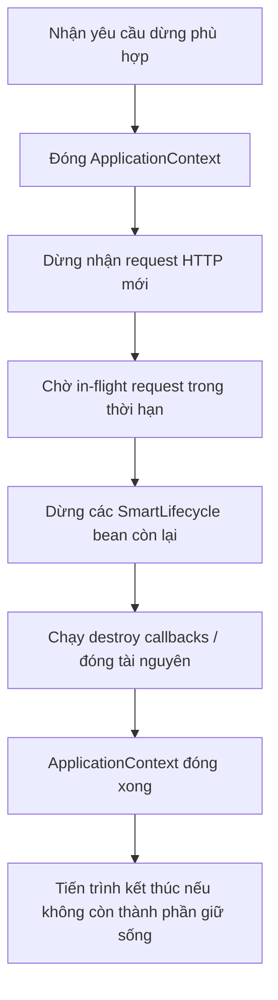
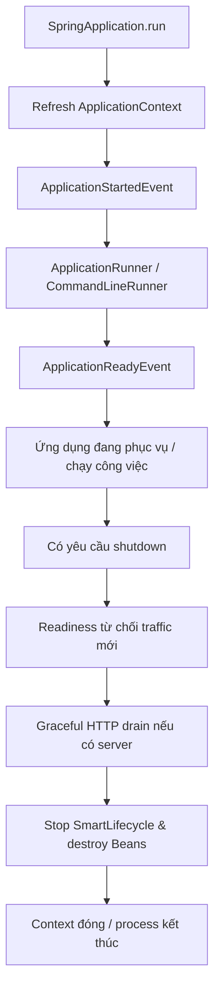

# Giới hạn của graceful shutdown theo loại ứng dụng

Khi một phiên bản Spring Boot được dừng để triển khai bản mới, khởi động lại hoặc thu hồi tài nguyên, điều quan trọng không chỉ là **tiến trình có thoát được hay không**. Ta còn muốn các request đang xử lý có cơ hội hoàn thành, không nhận thêm công việc mới khi sắp dừng, và giảm nguy cơ bỏ dở giao dịch hoặc làm mất dữ liệu.

Đó là mục đích của **graceful shutdown** (dừng có thời gian chờ). Với embedded web server được Spring Boot hỗ trợ, quá trình dừng có thể ngừng nhận request mới và cho request đang xử lý một khoảng thời gian để hoàn tất trước khi đóng hẳn server.

Tuy nhiên, graceful shutdown **không bảo đảm mọi công việc trong JVM đều hoàn thành**. Hiệu lực thực tế phụ thuộc vào loại ứng dụng, web server, dạng kết nối, công việc nền, cách chạy tiến trình và giới hạn thời gian của nền tảng triển khai.

Bài học này phân biệt các tình huống đó để bạn hiểu khi nào cấu hình `server.shutdown` giúp ích, khi nào nó không có tác dụng và cần phối hợp thêm cơ chế nào để ứng dụng dừng an toàn.

## 1. Dừng có thời gian chờ khác dừng ngay lập tức

Giả sử một REST API đang xử lý ba request khi hệ thống gửi tín hiệu dừng:

```text
Trước khi dừng:
  Request A: xử lý gần xong
  Request B: đang truy vấn database
  Request C: chuẩn bị bắt đầu

Khi graceful shutdown bắt đầu:
  - Server ngừng nhận request mới theo cơ chế của nó
  - A và B có cơ hội hoàn tất
  - C chỉ được xử lý nếu thực sự đã được server tiếp nhận trước mốc dừng
  - Hết thời gian chờ, server và context tiếp tục đóng
```

Nếu dừng ngay, các kết nối đang xử lý có thể bị ngắt sớm. Nếu dừng graceful, khả năng hoàn tất request tốt hơn, nhưng vẫn có giới hạn: request có thể treo vô hạn, thời hạn chờ có thể hết, hoặc môi trường chạy có thể buộc tiến trình kết thúc trước khi Spring hoàn thành lifecycle.

Đừng hiểu chữ “graceful” là “chờ mãi cho đến khi tất cả xong”. Nó có nghĩa hệ thống **cố gắng dừng có trật tự trong một khoảng thời gian và theo những thành phần được quản lý**.

## 2. Spring Boot hỗ trợ graceful shutdown ở đâu?

Spring Boot thực hiện graceful shutdown cho **embedded web server** trong quá trình đóng `ApplicationContext`. Đây là điểm mấu chốt để phân biệt các kiểu ứng dụng:

| Kiểu ứng dụng/triển khai | `server.shutdown` có điều khiển web server do Boot quản lý? | Giới hạn chính |
|---|---|---|
| Spring MVC / Servlet với embedded Tomcat hoặc Jetty | Có | Chủ yếu xử lý HTTP request và kết nối do embedded server quản lý |
| Spring WebFlux với embedded Reactor Netty, hoặc web server hỗ trợ tương ứng | Có | Request reactive có thể có stream dài, subscription và cancellation riêng |
| Servlet/Reactive dùng Undertow trên các dòng Boot còn hỗ trợ | Có theo tài liệu của dòng tương ứng | Cách từ chối request mới khác Tomcat/Jetty/Netty |
| Ứng dụng non-web (CLI, batch, worker không mở HTTP) | Không có embedded HTTP server để điều khiển | Cần lifecycle riêng cho job, queue consumer, scheduler, executor |
| WAR chạy trong servlet container bên ngoài | Không trực tiếp kiểm soát việc dừng container bên ngoài | Server chủ và hệ thống triển khai quyết định connector/lifecycle |
| Ứng dụng có thêm gRPC server, socket server hoặc consumer độc lập | Chỉ tác động đến HTTP server do Boot quản lý | Những endpoint/consumer riêng cần cơ chế drain và stop riêng |

Một ứng dụng có thể thuộc nhiều nhóm công việc cùng lúc. Chẳng hạn REST API vừa nhận HTTP, vừa chạy `@Scheduled` và vừa consume Kafka. Cơ chế graceful shutdown của embedded HTTP server chỉ là **một phần** của việc dừng ứng dụng đó.

### Phân biệt các dòng Spring Boot

Hành vi mặc định và tập web server được hỗ trợ thay đổi theo phiên bản:

- **Spring Boot 3.5:** tài liệu chính thức mô tả graceful shutdown được bật mặc định và liệt kê Jetty, Reactor Netty, Tomcat và Undertow.
- **Spring Boot 4.0:** tài liệu chính thức mô tả graceful shutdown được bật mặc định và liệt kê Jetty, Reactor Netty, Tomcat; Undertow không còn nằm trong danh sách này.
- **Các dòng cũ hơn, ví dụ Boot 3.3 và Boot 2.x:** tài liệu hướng dẫn bật tính năng bằng `server.shutdown=graceful`. Không nên lấy mặc định của Boot 3.5/4.0 rồi áp dụng ngược cho mọi phiên bản.

Vì vậy trước khi cấu hình production, hãy xác nhận **phiên bản Boot thực tế, loại server thực tế và tài liệu của đúng dòng đó**. Không nên giả định mọi ứng dụng Boot đều có cùng default.

## 3. Cấu hình graceful shutdown và thời gian chờ

Trong dự án muốn thể hiện ý định dừng graceful một cách tường minh, có thể đặt:

```properties
server.shutdown=graceful
spring.lifecycle.timeout-per-shutdown-phase=25s
```

Hoặc YAML:

```yaml
server:
  shutdown: graceful
spring:
  lifecycle:
    timeout-per-shutdown-phase: 25s
```

Ý nghĩa:

- `server.shutdown=graceful` yêu cầu dùng graceful shutdown cho embedded web server có hỗ trợ. Với phiên bản đã bật mặc định, dòng này giúp ý định dễ đọc hơn.
- `spring.lifecycle.timeout-per-shutdown-phase` đặt thời gian tối đa cho **mỗi pha dừng `SmartLifecycle`**. Embedded web server graceful shutdown tham gia một pha ở đầu quá trình dừng.
- Khi hết thời hạn pha, Spring tiếp tục tiến trình đóng; không có bảo đảm mọi request chưa xong sẽ hoàn tất.

Để yêu cầu dừng ngay trong các dòng hỗ trợ thuộc tính này:

```properties
server.shutdown=immediate
```

**Điểm dễ nhầm:** `timeout-per-shutdown-phase=25s` không phải “toàn bộ JVM chắc chắn thoát trong 25 giây”. Context có thể có nhiều pha, callback hủy, executor chờ tác vụ, kết nối tới hệ thống ngoài và thời gian dọn dẹp khác. Hạn dừng của Docker/Kubernetes/systemd lại là một tầng riêng.

## 4. Graceful shutdown xảy ra ở đâu trong lifecycle?

Với embedded web app thông thường, Spring Boot đóng `ApplicationContext` và điều phối dừng qua `SmartLifecycle`. Web server graceful shutdown được thực hiện ở giai đoạn sớm của quá trình dừng để các Bean khác vẫn còn khả dụng trong lúc xử lý những request đang chạy.



Sơ đồ cho thấy nguyên tắc; thứ tự chi tiết phụ thuộc scope, phase, dependency giữa Bean và implementation của server. Có những callback/thành phần dừng khác vẫn tham gia khi context đang đóng.

Tại sao không đóng datasource ngay khi nhận tín hiệu dừng? Vì một request in-flight có thể vẫn cần transaction hoặc query database. Dừng HTTP intake trước giúp giảm số công việc mới; trì hoãn việc hủy dependency giúp công việc hiện có có cơ hội hoàn thành.

Tuy nhiên, `@PreDestroy` và `DisposableBean.destroy()` không tự trở thành “chờ cho mọi request xong”. Chúng là callback cleanup của từng Bean. Nếu Bean sở hữu background worker hoặc queue consumer, phải thiết kế stop/drain phù hợp.

## 5. Khác biệt giữa các embedded HTTP server

Tất cả server được Boot hỗ trợ đều có mục tiêu chung là hạn chế request mới trong thời gian chờ, nhưng **cách từ chối** có thể khác nhau:

| Web server | Hành vi dừng nhận request mới theo tài liệu Boot | Điều cần hiểu ở client |
|---|---|---|
| Tomcat | Ngừng tiếp nhận ở tầng mạng | Kết nối mới có thể bị từ chối hoặc thất bại |
| Jetty | Ngừng tiếp nhận ở tầng mạng | Client/load balancer phải xử lý retry/chuyển instance |
| Reactor Netty | Ngừng tiếp nhận ở tầng mạng | Kết nối HTTP/stream đang mở có thể cần xử lý riêng |
| Undertow (trên Boot 3.5 và dòng hỗ trợ) | Có thể tiếp nhận kết nối mới nhưng trả HTTP 503 | Client thấy phản hồi “Service Unavailable” thay vì nhất thiết lỗi kết nối |

Khác biệt này giải thích vì sao cùng bật graceful shutdown nhưng test client lại thấy lỗi khác nhau. **Không nên kiểm thử bằng kỳ vọng mọi server trả đúng mã 503**, hoặc mọi server đều chủ động đóng socket tại cùng một thời điểm.

Kết nối keep-alive, HTTP/2, connection pool và proxy/load balancer còn ảnh hưởng cách request bị từ chối hoặc tái sử dụng kết nối. Hãy kiểm chứng theo server và protocol thực tế.

## 6. Servlet MVC: request HTTP ngắn thường được hỗ trợ tốt

Một REST endpoint trả lời trong vài giây là tình huống dễ hiểu nhất:

```java
@RestController
@RequestMapping("/reports")
public class ReportController {
    private final ReportService reportService;

    public ReportController(ReportService reportService) {
        this.reportService = reportService;
    }

    @PostMapping
    public ResponseEntity<String> create(@RequestBody ReportInput input) {
        String id = reportService.create(input);
        return ResponseEntity.ok(id);
    }
}
```

Ví dụ giả định `ReportInput` và `ReportService` đã được khai báo; controller dùng synchronous request processing.

Nếu request đã được server nhận trước khi graceful shutdown bắt đầu, container có thể tiếp tục cho nó xử lý và trả kết quả trong thời gian chờ. Các request mới được xử lý theo cơ chế từ chối của server.

**Giới hạn của tình huống này:**

- Request đang gọi database hoặc API khác quá lâu có thể vượt grace period.
- Nếu transaction chỉ commit sau thời hạn hoặc tiến trình bị kill, request không có bảo đảm thành công.
- Proxy phía trước có timeout ngắn hơn, nên client có thể ngắt trước dù server vẫn đang xử lý.
- Client có thể gửi lại request sau lỗi mạng; endpoint ghi dữ liệu nên có chiến lược idempotency phù hợp.

Graceful shutdown làm giảm số request bị bỏ dở nhưng không thay thế transaction, timeout, retry policy và idempotency.

### MVC async request

Trong Spring MVC, endpoint có thể trả `Callable<T>`, `DeferredResult<T>` hoặc dùng xử lý async. HTTP connector và executor cùng tham gia vòng đời request. Khi dừng:

- Web server phải quản lý request đã được tiếp nhận.
- Task executor phải còn phục vụ phần công việc cần thiết trong thời gian phù hợp.
- Timeout của MVC async request phải được cân nhắc riêng.

Nếu executor bị dừng quá sớm hoặc công việc async nằm trong một executor tự tạo mà Spring không quản lý, graceful HTTP server **không đảm bảo** toàn bộ công việc async đó hoàn tất.

## 7. WebFlux và luồng reactive dài

Spring WebFlux có thể chạy trên Reactor Netty hoặc embedded server hỗ trợ khác. Với request phản hồi hữu hạn, graceful shutdown cũng cố gắng cho request đang xử lý hoàn tất trong thời gian chờ.

Nhưng ứng dụng reactive có nhiều dạng workload:

```java
@RestController
public class PriceController {

    @GetMapping("/prices")
    public Mono<Price> currentPrice() {
        return priceService.fetchCurrentPrice();
    }
}
```

Ví dụ giả định `Price` và `priceService` đã được định nghĩa. `Mono<Price>` thường hoàn thành sau khi phát tối đa một giá trị, phù hợp với mô hình request có điểm kết thúc.

Trong khi đó, một stream có thể kéo dài:

```java
@GetMapping(value = "/prices/live", produces = MediaType.TEXT_EVENT_STREAM_VALUE)
public Flux<Price> livePrices() {
    return priceService.updates();
}
```

Nếu nguồn `updates()` liên tục phát dữ liệu, request này **không có điểm hoàn thành tự nhiên** trong grace period. Server không thể giữ vô hạn mọi kết nối SSE chỉ để dừng graceful. Tới hạn dừng, kết nối có thể bị đóng hoặc subscription bị hủy tùy stack/protocol.

Cần chuẩn bị cho:

- Cancellation và giải phóng tài nguyên trong reactive pipeline.
- Client SSE reconnect, có thể kèm event ID để tiếp tục từ mốc đã nhận.
- Timeout/circuit breaker cho tác vụ backend.
- Side effect phải xử lý retry trùng nếu client reconnect và gửi lại thao tác.

**Không được suy luận** rằng một `Flux` luôn hoàn thành chỉ vì server đang trong graceful shutdown. Đường đi shutdown của HTTP server và lifecycle nguồn phát dữ liệu cần được thiết kế thống nhất.

## 8. WebSocket, SSE, streaming và request chạy lâu

Đây là nhóm dễ gây hiểu nhầm nhất khi triển khai:

| Kết nối/công việc | Có điểm hoàn thành hữu hạn? | Giới hạn khi shutdown |
|---|---|---|
| REST request nhanh | Thường có | Có thể chờ trong grace period |
| REST request chạy nhiều phút | Có nhưng chậm | Có thể bị cắt khi hết hạn |
| SSE stream | Thường không | Không thể đợi vô hạn; cần reconnect và resume |
| WebSocket session | Có thể duy trì rất lâu | Cần protocol/application logic đóng session và client reconnect |
| HTTP/2 với nhiều stream | Nhiều request trên một connection | Draining cụ thể phụ thuộc server/protocol |
| Download/upload file lớn | Có nhưng phụ thuộc kích thước/tốc độ | Có thể vượt grace period và bị ngắt giữa chừng |

### WebSocket

WebSocket là kết nối dài sau HTTP upgrade. Không nên giả định cơ chế dừng request HTTP thông thường sẽ đảm bảo mọi WebSocket session hoàn tất một “công việc” nghiệp vụ.

Một ứng dụng real-time nên có chiến lược:

1. Ngừng tạo session mới khi instance chuẩn bị dừng.
2. Thông báo cho client hoặc đóng WebSocket có chủ đích khi có thể.
3. Hoàn tất/đánh dấu các message chưa xử lý và quyết định có cần đưa vào durable queue không.
4. Cho client reconnect sang instance khác và đồng bộ trạng thái.

Close frame, heartbeat, session timeout và cơ chế reconnect cần được xét theo WebSocket server/library cụ thể. Graceful shutdown **không tự tạo giao thức resume** cho client.

### Streaming response và upload lớn

Nếu server dừng sau 25 giây mà response streaming cần 3 phút, request có thể bị đóng. Với download, client cần hỗ trợ resume/range nếu nghiệp vụ yêu cầu. Với upload hoặc giao dịch lớn, cần thiết kế nhận lại an toàn và xử lý dữ liệu chưa hoàn chỉnh.

Grace period nên được chọn theo mức độ chấp nhận gián đoạn và phân phối thời gian request thực tế, không chỉ theo thời gian trung bình. Dù chọn dài, vẫn cần chấp nhận tình huống external force kill.

## 9. Ứng dụng non-web: server.shutdown không xử lý job

Một ứng dụng Spring Boot có thể hoàn toàn không có HTTP server:

```java
public static void main(String[] args) {
    SpringApplication application =
            new SpringApplication(BatchApplication.class);
    application.setWebApplicationType(WebApplicationType.NONE);
    application.run(args);
}
```

Trong trường hợp này, cấu hình:

```properties
server.shutdown=graceful
```

không có embedded HTTP server để áp dụng. Ứng dụng vẫn có thể đóng `ApplicationContext` và chạy các `SmartLifecycle` stop callback, `@PreDestroy` hoặc destroy method. Nhưng điều đó **không tự biết** một job đang ở bước nào, message nào đã được xác nhận hoặc transaction nào cần hoàn tất.

Ví dụ một batch import đang đọc file:

```text
Đọc record → validate → ghi database → cập nhật checkpoint
                                     ^
                              tín hiệu dừng tại đây
```

Nếu tiến trình bị kill trước checkpoint, lần chạy sau cần biết đã xử lý tới đâu. Graceful stop của web server không giải quyết điều này. Ứng dụng batch nên có:

- Checkpoint/trạng thái tiến độ có thể phục hồi.
- Transaction boundary rõ ràng.
- Cơ chế ngừng nhận công việc mới.
- Cho công việc hiện tại hoàn tất hoặc rollback an toàn.
- Khả năng retry/idempotency nếu bị dừng ở bất kỳ điểm nào.

Nếu dùng Spring Batch, cần tận dụng cơ chế job repository, step execution và restartability theo thiết kế cụ thể. Chỉ đặt `server.shutdown=graceful` không biến batch job thành restartable.

## 10. Message consumer: Kafka, RabbitMQ, JMS

Một service có thể vừa expose HTTP API vừa consume message liên tục:

```java
@KafkaListener(topics = "orders")
public void handle(OrderEvent event) {
    orderProcessor.process(event);
}
```

Ví dụ này giả định ứng dụng có Spring Kafka và các class liên quan. Consumer chịu lifecycle của listener container/messaging library, **không phải** HTTP request mà web server đang drain.

Để dừng an toàn, hệ thống messaging thường cần:

1. Ngừng poll hoặc ngừng nhận delivery mới.
2. Để message đang xử lý hoàn tất trong khoảng thời gian phù hợp.
3. Commit offset hoặc acknowledge chỉ sau khi side effect đã an toàn theo mô hình xử lý.
4. Bàn giao phần việc chưa xử lý cho consumer khác hoặc lần chạy sau.
5. Xử lý duplicate delivery bằng idempotency/deduplication khi hệ thống là at-least-once.

Thứ tự đóng listener container, transaction manager, datasource và executor phải phù hợp. Nếu nguồn dữ liệu bị đóng trước khi consumer hoàn thành message, graceful web shutdown không giúp tránh lỗi.

Spring Kafka/Rabbit/JMS cung cấp lifecycle, ack và stop timeout riêng. Cần đọc tài liệu đúng integration đang dùng để cấu hình; `spring.lifecycle.timeout-per-shutdown-phase` không thay thế mọi timeout của broker consumer.

### At-least-once không có nghĩa exactly-once

Nếu message xử lý xong nhưng tiến trình chết trước khi ack/commit, broker có thể giao lại message. Đây là hệ quả thường gặp của hệ thống phân tán, kể cả khi có graceful shutdown. Đừng coi việc dừng graceful là bảo đảm “không xử lý trùng”; hãy làm thao tác nghiệp vụ có thể xử lý retry.

## 11. @Scheduled và @Async: phụ thuộc vào executor/scheduler

Ví dụ ứng dụng có lịch chạy định kỳ:

```java
@Scheduled(fixedDelayString = "PT1M")
public void reconcile() {
    reconciliationService.runOnce();
}
```

Và một method chạy bất đồng bộ:

```java
@Async
public CompletableFuture<Void> sendEmailAsync() {
    mailService.sendPending();
    return CompletableFuture.completedFuture(null);
}
```

Những tác vụ này chạy qua scheduler/executor. Khi đóng context, cách chúng dừng phụ thuộc vào loại executor, lifecycle và cấu hình shutdown riêng. Web server ngừng nhận request mới **không đồng nghĩa** tất cả tác vụ đã đưa vào executor được chờ hoàn tất.

Với executor/scheduler **do Spring Boot tự cấu hình**, một số thuộc tính liên quan là:

```properties
spring.task.execution.shutdown.await-termination=true
spring.task.execution.shutdown.await-termination-period=20s
spring.task.scheduling.shutdown.await-termination=true
spring.task.scheduling.shutdown.await-termination-period=20s
```

Ý nghĩa chung: yêu cầu executor/scheduler tương ứng chờ các task còn lại trong một thời hạn được cấu hình. Tác dụng cụ thể phụ thuộc phiên bản Boot, loại executor (thread pool/virtual-thread executor), việc bạn có tự định nghĩa Bean executor hay không và trạng thái task.

**Nếu bạn tự tạo `Executors.newFixedThreadPool(...)` rồi giữ trong field static mà không đăng ký cleanup**, Spring không tự sở hữu lifecycle của nó. Bạn phải tự dừng executor và xử lý pending task.

Đừng chỉ tăng timeout. Hãy phân biệt task:

- Task ngắn, hoàn tất nhanh: thường có thể chờ.
- Task dài nhưng có checkpoint: nên cho phép dừng có kiểm soát rồi resume.
- Task chạy vô hạn (polling loop): phải có stop flag/cancellation.
- Task bị block ở network I/O: cần timeout và phản hồi interruption phù hợp.

## 12. SmartLifecycle và callback dừng cho công việc riêng

Để một component thực hiện công việc nền tham gia lifecycle có trật tự của Spring, có thể dùng `SmartLifecycle`.

Interface này có các method như `start()`, `stop()`, `isRunning()`, `getPhase()` và phiên bản `stop(Runnable callback)`. Khi context đóng, lifecycle processor điều phối stop theo phase và gọi callback để biết component đã dừng.

Ý tưởng:

```java
@Component
public class QueueConsumerLifecycle implements SmartLifecycle {
    private volatile boolean running;

    @Override
    public void start() {
        running = true;
        // Khởi chạy consumer do component sở hữu.
    }

    @Override
    public void stop(Runnable callback) {
        running = false;
        // Yêu cầu consumer ngừng nhận message mới;
        // chỉ gọi callback khi việc dừng đã hoàn tất.
        stopConsumerAsync(callback);
    }

    @Override
    public void stop() {
        running = false;
        // Cơ chế dừng đồng bộ hoặc fallback của component.
    }

    @Override
    public boolean isRunning() {
        return running;
    }
}
```

Đoạn mã **minh họa hợp đồng lifecycle**, chưa chạy độc lập: `stopConsumerAsync` là phương thức do ứng dụng cần triển khai và phải bảo đảm callback được gọi đúng lúc, kể cả khi stop gặp lỗi. Trong triển khai thật cũng cần quản lý thread, race giữa start/stop, exception và tính idempotent.

Khi viết `SmartLifecycle`:

- Chỉ đánh dấu đã dừng sau khi tài nguyên cần thiết thực sự ngừng.
- Nếu stop async, gọi callback sau khi dừng xong; không để callback bị bỏ quên vô hạn.
- Chọn phase có chủ đích và cân nhắc quan hệ dependency giữa các Bean.
- Đảm bảo các service mà consumer cần chưa bị hủy trước khi drain hoàn tất.

Không nên viết `SmartLifecycle` thay thế framework messaging listener container đã có lifecycle tốt. Hãy ưu tiên dùng cơ chế stop/drain của thư viện, chỉ viết custom lifecycle khi bạn thực sự sở hữu tài nguyên riêng.

## 13. @PreDestroy hữu ích nhưng không phải cơ chế drain hoàn chỉnh

Một Bean có thể đóng tài nguyên ở cuối lifecycle:

```java
@Component
public class FileWriterResource {
    private final BufferedWriter writer;

    public FileWriterResource() throws IOException {
        writer = Files.newBufferedWriter(
                Path.of("output.log"),
                StandardOpenOption.CREATE,
                StandardOpenOption.APPEND);
    }

    public synchronized void writeLine(String value) throws IOException {
        writer.write(value);
        writer.newLine();
    }

    @PreDestroy
    public synchronized void close() throws IOException {
        writer.flush();
        writer.close();
    }
}
```

Ví dụ giả định các import Java và Jakarta annotation phù hợp được thêm vào source. Nó cho thấy cleanup tài nguyên đang do Bean sở hữu.

Nhưng `@PreDestroy` không tự dừng các producer đang tiếp tục ghi vào writer từ thread khác. Nếu còn task chạy sau lúc file bị đóng, chúng sẽ lỗi. Cần **ngừng nguồn công việc trước**, chờ hoặc bàn giao công việc đang xử lý, rồi mới đóng tài nguyên.

Đó là sự khác nhau giữa *drain* (để công việc đang chạy kết thúc có kiểm soát) và *cleanup* (đóng tài nguyên).

## 14. Grace period của Spring khác deadline của nền tảng chạy

Một ví dụ triển khai container:

```text
Orchestrator quyết định dừng instance
  ↓
Đánh dấu không sẵn sàng / gỡ khỏi luồng nhận traffic
  ↓
Gửi tín hiệu dừng phù hợp tới process
  ↓
Spring đóng context và chờ graceful shutdown
  ↓
Chạy callback dừng/đóng tài nguyên
  ↓
Process thoát

Nếu quá hạn cho phép:
  Nền tảng có thể buộc kill process
```

Trên Linux/container, tín hiệu dừng thường là `SIGTERM`, sau một khoảng thời gian sẽ có `SIGKILL` nếu tiến trình vẫn chưa thoát. Trên Kubernetes, `terminationGracePeriodSeconds` giới hạn thời gian dừng của pod theo lifecycle của Kubernetes; thời gian này còn phải tính cả các hook như `preStop` và thời gian tiến trình cleanup.

Ví dụ minh họa:

```yaml
# application.yml
server:
  shutdown: graceful
spring:
  lifecycle:
    timeout-per-shutdown-phase: 25s
```

```yaml
# Trích một Pod spec minh họa
spec:
  terminationGracePeriodSeconds: 50
```

Hai giá trị trên **không phải công thức cố định để bảo đảm dừng thành công**. Nếu application có nhiều lifecycle phase, cleanup lâu, hook tốn thời gian hoặc hệ thống bên ngoài phản hồi chậm, thời gian tổng có thể vượt ngân sách. Nền tảng có thể kill process trước khi Spring hoàn tất.

### Container PID 1 và tín hiệu

Một lỗi triển khai phổ biến là chạy Java qua shell script mà không chuyển tiếp tín hiệu đúng cách. Ví dụ entrypoint dùng `exec java -jar app.jar` giúp process Java nhận tín hiệu của container trực tiếp trong một số môi trường.

Không nên mặc định lệnh “Stop” của IDE hoặc thao tác kill cưỡng bức sẽ đi qua shutdown hook. Tài liệu Boot cũng lưu ý rằng IDE có thể dừng ngay thay vì graceful nếu không gửi tín hiệu thích hợp.

Trong Windows hoặc môi trường phát triển, cơ chế dừng process khác Linux. Khi thử nghiệm, hãy dùng cách dừng hỗ trợ shutdown hook và quan sát log context close thay vì suy luận chỉ từ việc cửa sổ console biến mất.

## 15. Readiness và ngừng chuyển traffic

Graceful shutdown ở embedded server là một lớp bảo vệ cuối. Trong hệ thống nhiều instance, cần phối hợp với load balancer hoặc Kubernetes để **không tiếp tục gửi request mới** tới instance đang dừng.

Spring Boot Actuator có thể công bố trạng thái:

- `LivenessState`: ứng dụng còn khả năng hoạt động về mặt tiến trình/lifecycle.
- `ReadinessState`: ứng dụng đã sẵn sàng nhận công việc mới hay chưa.

Trong quá trình graceful shutdown, Spring Boot có thể chuyển readiness sang `REFUSING_TRAFFIC`. Tuy nhiên, readiness probe qua HTTP có thể không truy cập được sau khi server đã ngừng nhận request. Vì thế proxy/orchestrator không nhất thiết nhìn thấy một phản hồi probe cuối cùng.

Với Kubernetes, cần xét:

- Readiness probe và cơ chế cập nhật danh sách endpoint.
- Thời gian propagation tới load balancer/ingress.
- Connection keep-alive đã tồn tại.
- `preStop` hook nếu cần thời gian để hệ thống ngừng gửi traffic.
- Thời hạn dừng toàn pod và sidecar nếu có.

Nếu Actuator nằm trên management port riêng, health probe thành công trên management server cũng chưa chứng minh server chính đang nhận request đúng cách. Với một số thiết lập, nên đưa readiness/liveness path lên cùng cổng chính theo tài liệu Boot.

**Readiness không hoàn tất request giúp bạn; graceful server không thông báo ngay cho mọi proxy bên ngoài.** Hai cơ chế bổ sung cho nhau và đều phải được thiết kế trong chiến lược triển khai.

## 16. Giao dịch, dữ liệu và retry vẫn cần thiết

Một request xử lý xong trong graceful period chưa chắc toàn bộ công việc liên quan đã hoàn tất nếu ứng dụng đã trả HTTP response trước khi:

- Gửi message vào broker.
- Ghi event vào outbox.
- Chạy task `@Async`.
- Gọi dịch vụ bên ngoài không đồng bộ.
- Flush dữ liệu từ buffer tự quản lý.

Ví dụ:

```java
@PostMapping("/payments")
public ResponseEntity<Void> pay(@RequestBody PaymentCommand command) {
    paymentService.accept(command);
    emailService.sendAsync(command.email());
    return ResponseEntity.accepted().build();
}
```

HTTP request có thể hoàn tất rất nhanh; nhưng tác vụ gửi email được chạy sau đó. Graceful shutdown của web server chỉ nhìn thấy phần HTTP request, không tự chờ task email nếu executor/lifecycle không được cấu hình tương ứng.

Với nghiệp vụ quan trọng, cân nhắc dùng durable queue hoặc transactional outbox để bảo đảm công việc được ghi nhận trước khi response trả về. Tránh đặt toàn bộ độ tin cậy vào khả năng process còn sống đủ lâu sau response.

Các khái niệm cần kết hợp:

- **Timeout:** giới hạn thời gian chờ cho một thao tác.
- **Transaction:** gom các thay đổi nhất quán trong một phạm vi.
- **Retry:** thử lại sau lỗi tạm thời.
- **Idempotency:** xử lý request/message lặp mà không tạo kết quả sai.
- **Checkpoint:** phục hồi tác vụ dài sau khi dừng.
- **Graceful shutdown:** giảm gián đoạn trong khoảng thời gian dừng được cho phép.

Chúng bổ sung cho nhau; không cơ chế nào thay thế tất cả cơ chế khác.

## 17. Khi chạy dưới servlet container bên ngoài

Nếu ứng dụng Spring Boot được đóng gói thành WAR và triển khai vào một servlet container bên ngoài, ví dụ một Tomcat instance do bộ phận vận hành quản lý, cấu hình `server.shutdown` của embedded Boot server không trực tiếp quyết định cách container bên ngoài dừng listener/connector.

Trong mô hình đó:

- Nền tảng vận hành quyết định thời điểm và cách dừng Tomcat/Jetty bên ngoài.
- Ứng dụng Spring có thể nhận context close và cleanup Bean khi container đóng deployment, nhưng điều này tùy vào lifecycle của container.
- Thời gian cho in-flight request, session, connector và các web app khác do server ngoài quản lý.
- Không nên tin rằng chỉ đặt `server.shutdown=graceful` trong WAR sẽ bảo đảm graceful stop của toàn servlet container.

Hãy đọc cấu hình shutdown của server chủ và cách triển khai/redeploy WAR. Khi nhiều ứng dụng cùng chạy trên một container, việc dừng một ứng dụng khác với dừng cả server.

## 18. Phân biệt SpringApplication.run hoàn tất và shutdown

Một ứng dụng vừa khởi động vừa đóng context theo những mốc khác nhau:



`ApplicationReadyEvent` đánh dấu kết thúc quá trình startup, không bảo đảm app sẽ luôn khỏe mạnh sau đó. Khi shutdown bắt đầu, readiness và lifecycle chuyển trạng thái theo hướng dừng.

Một ứng dụng non-web vẫn có thể nhận `ApplicationReadyEvent` khi startup hoàn tất dù không có HTTP server, và vẫn có thể chạy công việc nền sau đó. Ngược lại, graceful HTTP shutdown vẫn có thể được kích hoạt trong một web app trước khi tiến trình thực sự kết thúc.

## 19. Bảng giới hạn theo loại ứng dụng

| Loại ứng dụng | Graceful web shutdown bảo vệ phần nào? | Việc ứng dụng còn phải tự thiết kế |
|---|---|---|
| MVC REST CRUD | In-flight HTTP requests thông thường | Transaction, request timeout, retry, idempotency |
| MVC async / DeferredResult | HTTP connector và phần request được server quản lý | Executor, completion/cancellation, async timeout |
| WebFlux API hữu hạn | In-flight HTTP exchange | Reactor pipeline cleanup, downstream timeout |
| SSE / streaming | Khả năng chờ stream trong thời hạn | Reconnect, resume, kết thúc luồng |
| WebSocket | Một số hành vi kết nối tùy server | Close protocol, session state, reconnect |
| Batch/CLI | Không có HTTP server để drain | Checkpoint, restartability, stop control |
| Kafka/Rabbit/JMS worker | Không kiểm soát broker consumer | Stop polling, ack/offset, retry, dedupe |
| `@Scheduled` / `@Async` | Không tự quản lý toàn bộ task | Executor shutdown và task cancellation |
| External WAR | Không điều khiển host servlet container | Cấu hình stop/redeploy của container |
| Ứng dụng đa giao thức | Chỉ embedded HTTP server của Boot | Lifecycle cho gRPC, socket, consumers khác |

**Câu hỏi kiểm tra thiết kế:** Thành phần nào đang nhận công việc mới? Thành phần nào biết công việc nào chưa xong? Thành phần nào giữ dữ liệu đủ bền để phục hồi nếu bị kill? Trả lời được ba câu đó quan trọng hơn chỉ việc tăng thời gian chờ.

## 20. Cách thử nghiệm dừng an toàn

Bạn có thể dựng một thử nghiệm thủ công với một endpoint có thời gian xử lý hữu hạn và một endpoint streaming:

1. Cấu hình `server.shutdown=graceful` và một grace period dễ quan sát, ví dụ 25 giây.
2. Gửi một HTTP request hoàn tất sau 5 giây, đồng thời chuẩn bị một request mới.
3. Gửi tín hiệu dừng cho Java theo cơ chế mà môi trường hỗ trợ, để Spring shutdown hook chạy.
4. Quan sát request đang xử lý có trả kết quả trong thời hạn hay không.
5. Quan sát request mới bị từ chối như thế nào ở web server đang dùng.
6. Thử một request lâu hơn thời gian chờ và xem hành vi thực tế.
7. Thử SSE/WebSocket và quan sát kết nối bị đóng, client reconnect ra sao.
8. Nếu có message consumer hoặc task async, ghi log riêng tiến trình dừng và việc xử lý còn dở.

Đừng dùng một lần thử thành công để kết luận sẽ không bao giờ mất dữ liệu. Kiểm chứng nhiều trường hợp: request treo, database chậm, message xử lý dang dở, SIGTERM, forced kill và restart dưới orchestration thực tế.

### Một endpoint chậm minh họa

```java
@RestController
class DemoShutdownController {

    @GetMapping("/demo/slow")
    String slow() throws InterruptedException {
        Thread.sleep(5_000);
        return "completed";
    }
}
```

Đây là endpoint **chỉ để học và quan sát**, không phải mẫu xử lý request production. Dùng `Thread.sleep` làm thread request bị chiếm chỗ; khi xây ứng dụng thật nên dùng API I/O có timeout và cách xử lý phù hợp với MVC hay WebFlux.

Khi thử nghiệm, so sánh các mốc thời gian trong log: nhận signal, bắt đầu graceful server shutdown, kết thúc in-flight request, đóng context và tiến trình thoát. Cách này giúp phân biệt timeout của HTTP server với timeout của executor, broker hoặc nền tảng triển khai.

## 21. Các hiểu nhầm cần tránh

**“Bật graceful shutdown là mọi việc trong ứng dụng đều kết thúc an toàn.”** Không. Embedded web server chỉ kiểm soát phạm vi request/kết nối của nó. Job, queue consumer và executor có lifecycle riêng.

**“Đặt `server.shutdown=graceful` là đủ cho ứng dụng batch.”** Không. Non-web app không có HTTP server để áp dụng thuộc tính này.

**“Grace period 25 giây bảo đảm JVM thoát trong 25 giây.”** Không. `spring.lifecycle.timeout-per-shutdown-phase` áp dụng theo lifecycle phase; tổng thời gian dừng còn nhiều thành phần khác.

**“Mọi server đều trả HTTP 503 cho request mới.”** Không. Hành vi từ chối phụ thuộc server và phiên bản; Tomcat, Jetty, Reactor Netty thường ngừng nhận ở tầng mạng, còn Undertow trên dòng hỗ trợ có thể trả 503.

**“Request HTTP đã xong thì mọi công việc liên quan cũng xong.”** Không. `@Async`, event xử lý nền hoặc message gửi sau response có thể còn tiếp tục.

**“SSE hoặc WebSocket có thể được chờ đến khi tự kết thúc.”** Không phải luôn vậy. Nhiều kết nối có thể sống vô thời hạn và cần giao thức đóng/reconnect có chủ đích.

**“Dừng tiến trình từ IDE luôn giống SIGTERM.”** Không. Một số môi trường phát triển có thể kill process ngay mà không đi qua shutdown hook như dự kiến.

**“Kubernetes sẽ chờ mãi cho Spring dừng graceful.”** Không. Orchestrator có hạn dừng và có thể buộc kill.

**“Không còn request mới thì không còn công việc mới.”** Không, nếu ứng dụng còn scheduler, broker consumer, gRPC server hoặc tác vụ nội bộ.

## 22. Quy trình chọn giải pháp phù hợp

Khi thêm graceful shutdown vào ứng dụng, đi qua các câu hỏi:

1. **Ứng dụng thuộc loại nào?** Servlet web, Reactive web, non-web, external WAR hay nhiều giao thức?
2. **Server/Boot version nào?** Tomcat, Jetty, Reactor Netty, Undertow (nếu phiên bản còn hỗ trợ), và graceful shutdown có bật mặc định không?
3. **Luồng công việc có kết thúc hữu hạn không?** REST ngắn, request dài, SSE, WebSocket, batch hoặc consumer?
4. **Ai nhận công việc mới?** HTTP server, Kafka/Rabbit, scheduler, thread pool, socket riêng?
5. **Ai chờ và ai đóng tài nguyên?** SmartLifecycle, messaging listener container, executor, destroy callback?
6. **Nếu bị buộc kill thì phục hồi thế nào?** Transaction, checkpoint, offset, durable queue, idempotency?
7. **Nền tảng cho bao nhiêu thời gian?** Grace period, preStop hook, termination deadline, propagation của load balancer?
8. **Đã thử trường hợp dừng thật chưa?** Trong local và môi trường triển khai, với request dài, lỗi downstream và restart?

Đây là cách suy luận theo **phạm vi trách nhiệm**: cơ chế của server xử lý HTTP; cơ chế của Spring quản lý lifecycle các Bean; cơ chế của thư viện xử lý consumer/executor; cơ chế của nền tảng quyết định khi nào process phải kết thúc.

## 23. Tài liệu tham khảo theo phiên bản

- [Spring Boot 3.5 — Graceful Shutdown](https://docs.spring.io/spring-boot/3.5/reference/web/graceful-shutdown.html): mô tả default, các embedded server và khác biệt khi từ chối request mới.
- [Spring Boot 4.0 — Graceful Shutdown](https://docs.spring.io/spring-boot/4.0/reference/web/graceful-shutdown.html): tài liệu cho dòng 4.0, liệt kê Tomcat, Jetty và Reactor Netty.
- [Spring Boot — Task Execution and Scheduling](https://docs.spring.io/spring-boot/reference/features/task-execution-and-scheduling.html): cấu hình task executor và scheduler.
- [Spring Boot — Actuator Endpoints / Kubernetes Probes](https://docs.spring.io/spring-boot/reference/actuator/endpoints.html): readiness, liveness và trạng thái trong quá trình shutdown.
- [Spring Framework — Task Execution and Scheduling](https://docs.spring.io/spring-framework/reference/integration/scheduling.html): lifecycle và executor/scheduler trong Spring.

Graceful shutdown hoạt động hiệu quả nhất khi ứng dụng có **ranh giới công việc rõ ràng**: ngừng nhận thêm công việc, cho phần đang chạy có cơ hội hoàn tất trong thời hạn, rồi đóng tài nguyên theo thứ tự phù hợp. Với embedded Servlet hoặc Reactive HTTP server, Spring Boot hỗ trợ phần ngừng nhận request và chờ in-flight exchange. Với batch, messaging, `@Async`, `@Scheduled`, WebSocket và streaming dài, bạn phải thiết kế thêm lifecycle, cancellation, retry và khả năng phục hồi. Hệ thống chỉ thật sự có chiến lược dừng an toàn khi cả ứng dụng lẫn nền tảng triển khai cùng tôn trọng những giới hạn đó.
