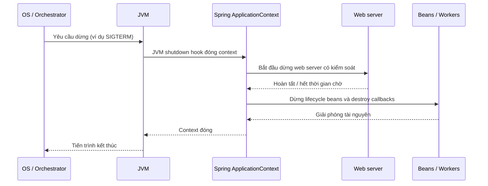

# Phân biệt dừng có kiểm soát với tiến trình bị kết thúc cưỡng bức

Một ứng dụng Spring Boot có thể hoạt động bình thường trong nhiều ngày, nhưng sớm hay muộn nó cũng cần dừng: triển khai phiên bản mới, thay đổi cấu hình, mở rộng hoặc thu hẹp số replica, bảo trì máy chủ, hay tắt một công cụ chạy một lần. Không phải mọi cách kết thúc tiến trình đều tạo ra cùng một kết quả.

**Dừng có kiểm soát (graceful shutdown)** là quá trình ứng dụng nhận được yêu cầu dừng và có cơ hội **ngừng nhận công việc mới, hoàn tất hoặc xử lý an toàn công việc đang thực hiện, giải phóng tài nguyên và kết thúc vòng đời Spring context**. Ngược lại, **kết thúc cưỡng bức (forced termination)** xảy ra khi hệ điều hành, nền tảng triển khai hoặc một cơ chế khác dừng tiến trình mà ứng dụng không có cơ hội thực hiện đầy đủ chuỗi cleanup.

Trong chương **Trạng thái và dừng** của *Spring Boot Fundamentals*, chúng ta sẽ phân biệt hai tình huống này ở ba tầng: tiến trình hệ điều hành/JVM, vòng đời Spring ApplicationContext và vòng đời request hoặc công việc nghiệp vụ. Bài học cũng giới thiệu cấu hình graceful shutdown của web server, xử lý tín hiệu dừng, sự kiện và callback của Spring, các rủi ro liên quan tới dữ liệu, cách vận hành trong Docker/Kubernetes và cách kiểm chứng hành vi dừng.

## 1. Vì sao cách dừng ứng dụng lại quan trọng?

Hãy tưởng tượng một ứng dụng xử lý đơn hàng:

1. Client gửi yêu cầu đặt hàng.
2. Service kiểm tra tồn kho.
3. Service ghi đơn hàng vào database.
4. Service gửi sự kiện sang message broker.
5. Service trả response cho client.

Nếu tiến trình bị chấm dứt ở giữa bước 3 và bước 4, đơn hàng có thể đã được ghi nhưng sự kiện chưa được gửi. Nếu client không nhận response, nó có thể gửi lại yêu cầu; hệ thống phải tránh tạo đơn trùng. Nếu worker vừa nhận một message mà chưa xác nhận đã xử lý, broker có thể gửi lại message đó.

Graceful shutdown giúp **giảm nguy cơ bị ngắt giữa chừng** bằng cách tạo một khoảng thời gian cho ứng dụng ngừng tiếp nhận và xử lý nốt công việc. Nhưng nó không thay thế thiết kế giao dịch, tính idempotent hoặc cơ chế phục hồi: ứng dụng vẫn có thể gặp crash, mất điện, hết thời gian được phép dừng hoặc bị chấm dứt cưỡng bức.

Một thiết kế vận hành tốt cần cả hai:

- **Hành vi dừng êm:** cố gắng hoàn tất công việc trong khoảng thời gian được cấp.
- **Khả năng chịu dừng đột ngột:** dữ liệu vẫn nhất quán và tác vụ có thể được chạy lại hoặc phục hồi an toàn khi không kịp cleanup.

## 2. Ba khái niệm: yêu cầu dừng, graceful shutdown và forced termination

Trước hết cần tách ba khái niệm thường bị trộn lẫn.

### 2.1. Yêu cầu dừng

Một công cụ vận hành yêu cầu ứng dụng kết thúc. Trên hệ thống Unix-like, yêu cầu này có thể được gửi bằng `SIGTERM`. Khi chạy ứng dụng trong terminal, `Ctrl+C` thường gửi `SIGINT`. Trong Java, việc gọi `System.exit(...)` cũng khởi động quá trình kết thúc JVM thông thường.

Một yêu cầu dừng **chưa bảo đảm ứng dụng sẽ dừng êm**. Nó chỉ cung cấp cơ hội để tiến trình thực hiện logic shutdown nếu JVM vẫn có thể chạy và nhận được yêu cầu.

### 2.2. Graceful shutdown

Đây là hành vi ở cấp ứng dụng và framework:

- Chuyển trạng thái sang chuẩn bị dừng.
- Ngăn hoặc hạn chế công việc mới.
- Cho phép công việc đang thực hiện kết thúc trong giới hạn thời gian.
- Dừng các thành phần nền theo thứ tự thích hợp.
- Gọi callback hủy và đóng tài nguyên.
- Kết thúc context, rồi tiến trình thoát.

Graceful shutdown thường có **thời hạn**. Không thể giữ tiến trình chờ vô tận một request bị treo hoặc một worker không phản hồi.

### 2.3. Forced termination

Ở trường hợp cưỡng bức, tiến trình bị chấm dứt trước khi có thể hoàn tất các bước trên. Ví dụ điển hình trên Linux là `SIGKILL`:

```bash
kill -KILL <pid>
```

`SIGKILL` không thể bị ứng dụng bắt hoặc trì hoãn để chạy shutdown hook. Một số tình huống khác cũng không cho phép cleanup tin cậy: máy bị mất điện, JVM bị crash nghiêm trọng, runtime gọi `Runtime.halt(...)` hoặc container bị cưỡng bức dừng.

### 2.4. Bảng so sánh

| Khía cạnh | Dừng có kiểm soát | Kết thúc cưỡng bức |
| --- | --- | --- |
| JVM còn thời gian chạy cleanup? | Thường có | Không có hoặc không đủ |
| Spring context được đóng bình thường? | Có thể, nếu shutdown tiến hành đầy đủ | Không thể bảo đảm |
| `@PreDestroy` / destroy callbacks | Có cơ hội được gọi | Không thể trông đợi |
| Request đang xử lý | Có thể được chờ hoàn tất trong thời hạn | Có thể bị ngắt đột ngột |
| Worker và message consumer | Có thể dừng nhận việc, hoàn tất/nhả việc | Có thể bị cắt giữa chừng |
| Tài nguyên kết nối | Có cơ hội đóng đúng giao thức | OS thường thu hồi tài nguyên tiến trình, nhưng logic cleanup ứng dụng không chạy |
| Rủi ro dữ liệu | Giảm rủi ro, không loại bỏ hoàn toàn | Cao hơn nếu không có giao dịch và phục hồi |
| Khả năng bảo đảm | Phụ thuộc timeout và hệ thống bên ngoài | Không có bảo đảm callback ứng dụng chạy |

**Điều quan trọng:** ứng dụng không thể tự bảo đảm graceful shutdown khi môi trường quyết định kết thúc tiến trình ngay lập tức.

## 3. Tín hiệu dừng ở tầng hệ điều hành

Trên Linux và các hệ Unix-like, một số tín hiệu thường gặp:

| Tín hiệu | Ý nghĩa thông dụng | Cơ hội dừng êm |
| --- | --- | --- |
| `SIGTERM` | Yêu cầu tiến trình kết thúc | Thường có; JVM có thể chạy shutdown hooks |
| `SIGINT` | Ngắt tiến trình, thường từ `Ctrl+C` | Thường có trong ứng dụng chạy bình thường |
| `SIGKILL` | Kernel kết thúc tiến trình ngay | Không; không thể bắt hoặc bỏ qua |
| `SIGQUIT` | Tùy hệ thống/runtime; trên JVM thường liên quan tới chẩn đoán | Không nên coi là tín hiệu graceful shutdown mặc định |

Ví dụ:

```bash
# Yêu cầu kết thúc có kiểm soát:
kill -TERM 12345

# Cưỡng bức chấm dứt tiến trình:
kill -KILL 12345
```

`12345` chỉ là PID minh họa. Không chạy các lệnh này trên tiến trình quan trọng nếu chưa xác định đúng PID và đã có kế hoạch vận hành.

### 3.1. SIGTERM không có nghĩa chắc chắn sẽ dừng êm

`SIGTERM` cho tiến trình cơ hội xử lý shutdown. Nhưng nếu ứng dụng bị treo, deadlock, không có shutdown hook phù hợp hoặc bị giới hạn thời gian, việc dừng có thể không hoàn thành. Nền tảng vận hành có thể tiếp tục gửi `SIGKILL` khi hết grace period.

Vì vậy, khi nói “gửi SIGTERM để graceful shutdown”, cần hiểu là **yêu cầu dừng theo hướng có kiểm soát**, chứ không phải một bảo đảm tuyệt đối.

### 3.2. Windows không dùng cùng mô hình POSIX

Trên Windows, các thao tác như dừng tiến trình trong Task Manager hoặc `Stop-Process` không có nghĩa tương đương chính xác với gửi `SIGTERM` cho tiến trình Linux. Một số cách dừng có thể kết thúc tiến trình mà không cho ứng dụng đủ cơ hội chạy callback.

Nếu cần kiểm tra vòng đời Spring trên Windows, có thể dùng cách đóng context có chủ đích trong ứng dụng hoặc điều khiển quá trình dừng từ công cụ chạy Java phù hợp. Không nên lấy hành vi của nút “Stop” trong IDE làm bằng chứng rằng mọi môi trường triển khai sẽ gọi graceful shutdown.

## 4. Từ tín hiệu dừng tới vòng đời Spring Boot

Spring Boot chạy trên JVM và quản lý `ApplicationContext`. Trong quá trình khởi động thông thường, Boot đăng ký JVM shutdown hook để đóng context khi JVM được kết thúc theo cách cho phép shutdown hooks chạy.

Luồng khái quát:



Sơ đồ minh họa các trách nhiệm chính, không phải cam kết thứ tự chính xác của mọi callback nội bộ. Spring quản lý nhiều pha dừng qua lifecycle processor, và thứ tự giữa các thành phần còn phụ thuộc phase, dependency và kiểu bean.

### 4.1. Context đóng khác tiến trình kết thúc

`ApplicationContext.close()` yêu cầu đóng Spring context. Nhưng **đóng context không luôn đồng nghĩa kết thúc JVM**. Nếu tiến trình còn thread non-daemon không được dừng hoặc còn mã chạy bên ngoài context, JVM có thể tiếp tục tồn tại.

Ngược lại, hệ điều hành có thể kết thúc JVM mà không chạy được `ApplicationContext.close()`. Vì thế, trạng thái của tiến trình và trạng thái của Spring context là hai khía cạnh liên quan nhưng khác nhau.

### 4.2. Shutdown hook không chạy trong mọi tình huống

JVM shutdown hooks thường được chạy khi JVM kết thúc bình thường bằng `System.exit(...)` hoặc nhận tín hiệu kết thúc mà JVM có thể xử lý. Chúng **không được bảo đảm chạy** khi:

- Tiến trình nhận `SIGKILL`.
- OS hoặc máy chủ dừng đột ngột.
- JVM bị crash.
- Code gọi `Runtime.getRuntime().halt(...)`.
- Nền tảng cắt tiến trình trước khi hooks hoàn tất.

Không thiết kế tính đúng đắn dữ liệu dựa trên giả định “`@PreDestroy` chắc chắn được chạy”.

## 5. Cấu hình graceful shutdown cho web server trong Spring Boot

Spring Boot hỗ trợ graceful shutdown đối với các embedded web server được hỗ trợ. Cấu hình tiêu biểu:

```properties
server.shutdown=graceful
spring.lifecycle.timeout-per-shutdown-phase=30s
```

Hoặc YAML:

```yaml
server:
  shutdown: graceful

spring:
  lifecycle:
    timeout-per-shutdown-phase: 30s
```

### 5.1. server.shutdown=graceful

Thuộc tính `server.shutdown` yêu cầu Spring Boot sử dụng cơ chế dừng web server có kiểm soát thay vì cơ chế dừng ngay theo chế độ còn lại. Hành vi cụ thể đối với kết nối mới và request đang xử lý phụ thuộc implementation web server.

Các server nhúng phổ biến như Tomcat, Jetty, Reactor Netty và Undertow có cách thực hiện khác nhau ở tầng network. Không nên giả định mọi server đều phản hồi request mới bằng cùng một HTTP status code khi đang shutdown.

### 5.2. spring.lifecycle.timeout-per-shutdown-phase

Thuộc tính `spring.lifecycle.timeout-per-shutdown-phase` quy định khoảng thời gian chờ cho mỗi pha dừng được Spring lifecycle processor quản lý. Với graceful shutdown của web server, đây là giới hạn quan trọng để chờ công việc đang xử lý hoàn thành.

Ví dụ:

```properties
spring.lifecycle.timeout-per-shutdown-phase=45s
```

Giá trị trên biểu diễn thời gian tối đa cho **mỗi shutdown phase** tương ứng, không phải bảo đảm rằng toàn bộ tiến trình sẽ kết thúc chính xác sau 45 giây. Nếu có nhiều pha, callbacks khác hoặc thành phần ngoài Spring, tổng thời gian có thể khác. Đồng thời, môi trường triển khai có thể có timeout ngắn hơn.

### 5.3. Đừng giả định graceful shutdown luôn bật

Các phiên bản và kiểu ứng dụng có thể có mặc định hoặc hỗ trợ khác nhau. Nếu hệ thống có yêu cầu shutdown rõ ràng, nên **khai báo tường minh** `server.shutdown=graceful`, đặt timeout phù hợp và kiểm thử trên đúng phiên bản Spring Boot cùng web server thực tế.

### 5.4. Trường hợp không có web server

Một ứng dụng `WebApplicationType.NONE` không có embedded HTTP server để drain request. Khi đó, `server.shutdown=graceful` không thể tự làm cho một batch worker hoặc message consumer dừng an toàn.

Các thành phần nền phải tự thực hiện logic stop, hoàn tất công việc và cleanup thông qua lifecycle bean hoặc cơ chế điều phối của chính chúng.

## 6. “Ngừng nhận việc mới” và “hoàn tất việc cũ” là hai bước riêng

Một hệ thống có thể quản lý nhiều loại công việc:

- HTTP request.
- Message từ Kafka/RabbitMQ.
- Scheduled jobs.
- Tác vụ `@Async` hoặc thread pool.
- WebSocket/streaming connection.
- Batch jobs chạy lâu.

Graceful shutdown phải trả lời hai câu hỏi:

**Một: làm sao không nhận thêm việc mới?**

Ứng dụng cần ngừng route hoặc nhận công việc mới, ví dụ readiness chuyển sang không sẵn sàng, HTTP server bắt đầu graceful stop, consumer ngừng poll/nhận message hoặc scheduler ngừng kích hoạt job.

**Hai: làm sao xử lý phần việc còn tồn tại?**

Ứng dụng cần đợi tác vụ hoàn tất trong thời hạn, bảo đảm transaction hợp lệ, xác nhận hoặc trả lại message theo protocol, đóng stream và giải phóng tài nguyên.

Một ứng dụng chỉ “ngừng nhận việc mới” nhưng đóng DB ngay lập tức vẫn có thể làm những request đang thực thi thất bại. Ngược lại, nếu chỉ đợi công việc cũ nhưng tiếp tục nhận công việc mới, số lượng công việc đang chờ có thể không bao giờ về 0.

## 7. Lifecycle callbacks khi đóng Spring context

Spring cung cấp nhiều cơ chế để bean tham gia quá trình dừng.

### 7.1. @PreDestroy

Với một singleton bean Spring:

```java
package com.example.catalog.infrastructure;

import jakarta.annotation.PreDestroy;
import org.springframework.stereotype.Component;

@Component
public class CatalogResourceHolder {

    private boolean open = true;

    public void useResource() {
        if (!open) {
            throw new IllegalStateException("Resource already closed");
        }
        // Thực hiện công việc với tài nguyên do bean sở hữu.
    }

    @PreDestroy
    public void closeResource() {
        open = false;
        System.out.println("CatalogResourceHolder: cleanup invoked");
    }
}
```

Khi context đóng theo vòng đời bình thường, Spring có cơ hội gọi method được đánh dấu `@PreDestroy`. Đây là nơi phù hợp để giải phóng **tài nguyên do bean sở hữu**, chẳng hạn đóng client, stream hoặc object có API close tương ứng.

Những giới hạn cần nhớ:

- `@PreDestroy` không được bảo đảm chạy khi tiến trình bị kết thúc cưỡng bức.
- Callback không nên thực hiện công việc không có giới hạn thời gian.
- Nếu một prototype bean được giao cho client, container thông thường không tự theo dõi đầy đủ destruction callback của instance prototype đó.
- Logic cleanup nên an toàn khi được gọi lặp lại nếu thiết kế hoặc thư viện có thể chủ động đóng tài nguyên trước.

Trong class thật, nếu tài nguyên có method `close()`, hãy gọi API close phù hợp thay vì chỉ thay đổi một boolean như ví dụ minh họa.

### 7.2. DisposableBean và custom destroyMethod

Có thể implement `DisposableBean`:

```java
@Component
public class ReportConnectionHolder implements DisposableBean {

    @Override
    public void destroy() {
        // Đóng kết nối hoặc tài nguyên do bean này sở hữu.
    }
}
```

Hoặc khai báo destroy method khi tạo bean:

```java
@Configuration(proxyBeanMethods = false)
class ExternalClientConfiguration {

    @Bean(destroyMethod = "close")
    ExternalClient externalClient() {
        return new ExternalClient();
    }
}
```

Những cơ chế này chạy khi Spring thực hiện lifecycle destruction bình thường, không tạo ra khả năng cleanup khi tiến trình đã bị kernel chấm dứt ngay.

### 7.3. ContextClosedEvent

Spring phát `ContextClosedEvent` khi context được đóng theo cơ chế thông thường:

```java
@Component
public class ShutdownEventLogger {

    @EventListener(ContextClosedEvent.class)
    public void onContextClosing() {
        System.out.println("Spring context is closing");
    }
}
```

Đây là một sự kiện lifecycle của Spring context, không phải tín hiệu hệ điều hành. Listener giúp ghi nhận hoặc phản ứng với việc context đóng, nhưng **không bảo đảm chạy khi hệ điều hành cưỡng bức kết thúc tiến trình**.

### 7.4. SmartLifecycle cho thành phần cần start/stop có phối hợp

`SmartLifecycle` phù hợp với những thành phần cần start/stop theo pha, ví dụ consumer, background worker hoặc một số server adapter. Interface có các method như `start()`, `stop()`, `isRunning()`, `getPhase()` và `stop(Runnable callback)`.

Một ví dụ tối giản:

```java
package com.example.catalog.infrastructure;

import java.util.concurrent.atomic.AtomicBoolean;
import org.springframework.context.SmartLifecycle;
import org.springframework.stereotype.Component;

@Component
public class IntakeLifecycle implements SmartLifecycle {

    private final AtomicBoolean running = new AtomicBoolean();

    @Override
    public void start() {
        running.set(true);
        // Bật khả năng nhận công việc.
    }

    @Override
    public void stop() {
        running.set(false);
        // Ngừng nhận công việc mới và dừng thành phần.
    }

    @Override
    public void stop(Runnable callback) {
        stop();
        callback.run();
    }

    @Override
    public boolean isRunning() {
        return running.get();
    }
}
```

Trong ví dụ trên, `stop()` được mô hình hóa là hoàn tất đồng bộ; vì vậy callback được gọi ngay sau `stop()`. Với worker thực sự dừng bất đồng bộ, **chỉ gọi `callback.run()` sau khi quá trình dừng đã hoàn tất**. Nếu gọi callback quá sớm, Spring có thể chuyển sang pha tiếp theo trong khi worker vẫn chạy.

`getPhase()` có thể được override để kiểm soát thứ tự: các phase có giá trị cao hơn thường dừng trước phase thấp hơn. Spring Boot web server và những thành phần hạ tầng cũng tham gia lifecycle; cần kiểm tra phase và dependency khi cấu hình nhiều worker phụ thuộc lẫn nhau.

## 8. Thiết kế tác vụ nền để dừng có kiểm soát

Xét một worker tự quản lý vòng lặp. Nó không nên chỉ chạy `while(true)` và bỏ qua yêu cầu dừng.

Ví dụ cơ chế dừng hợp tác:

```java
public final class BackgroundLoop implements Runnable {

    private final AtomicBoolean running = new AtomicBoolean(true);

    @Override
    public void run() {
        while (running.get() && !Thread.currentThread().isInterrupted()) {
            try {
                doOneUnitOfWork();
            } catch (InterruptedException ex) {
                Thread.currentThread().interrupt();
                break;
            }
        }
        releaseOwnedResources();
    }

    public void requestStop() {
        running.set(false);
    }

    private void doOneUnitOfWork() throws InterruptedException {
        // Xử lý một đơn vị công việc với timeout / interruption phù hợp.
    }

    private void releaseOwnedResources() {
        // Dọn tài nguyên thuộc quyền sở hữu của worker.
    }
}
```

Đây là ví dụ minh họa. Trong code sản xuất, cần bảo đảm cleanup trong `finally` để lỗi bất ngờ cũng không bỏ qua tài nguyên, quản lý thread bằng executor phù hợp và tránh blocking operation không hỗ trợ interruption.

### 8.1. Xử lý InterruptedException

Một sai lầm phổ biến:

```java
try {
    Thread.sleep(1000);
} catch (InterruptedException ignored) {
    // Bỏ qua và tiếp tục vòng lặp.
}
```

Nếu worker bị yêu cầu dừng nhưng nuốt `InterruptedException` rồi tiếp tục làm việc, việc shutdown có thể bị kéo dài hoặc hết timeout. Cách thông thường là khôi phục cờ interruption và dừng theo hợp đồng:

```java
catch (InterruptedException ex) {
    Thread.currentThread().interrupt();
    return;
}
```

Không phải mọi tác vụ phải dừng ngay khi bị interrupt: một số phải hoàn tất ranh giới giao dịch hoặc ghi checkpoint. Nhưng việc xử lý interruption cần được thiết kế rõ ràng, không bị bỏ qua vô tình.

### 8.2. ExecutorService

Với executor tự tạo, code sở hữu executor phải shutdown đúng cách:

```java
ExecutorService executor = Executors.newFixedThreadPool(4);

// Khi cần dừng:
executor.shutdown(); // Không nhận thêm task mới.

try {
    if (!executor.awaitTermination(20, TimeUnit.SECONDS)) {
        executor.shutdownNow(); // Yêu cầu interrupt các task chưa hoàn tất.
    }
} catch (InterruptedException ex) {
    executor.shutdownNow();
    Thread.currentThread().interrupt();
}
```

Phân biệt:

- `shutdown()` ngừng nhận task mới nhưng cho phép các task đã nhận tiếp tục.
- `awaitTermination(...)` chờ tối đa khoảng thời gian xác định.
- `shutdownNow()` cố gắng ngừng các task đang chạy, thường bằng interruption; không bảo đảm task sẽ dừng ngay.

Đây là logic tại tầng Java, không đồng nghĩa kernel cưỡng bức kết thúc tiến trình. Nếu OS gửi `SIGKILL`, JVM không còn cơ hội chạy các lệnh này.

### 8.3. Executor do Spring quản lý

Nếu sử dụng `ThreadPoolTaskExecutor` hoặc task scheduler được Spring Boot cấu hình, hãy xem các thiết lập shutdown, await-termination và thời hạn chờ tương ứng với phiên bản framework đang dùng. Spring Boot có những nhóm thuộc tính cấu hình cho task execution và task scheduling; hành vi cụ thể còn phụ thuộc executor bean thực tế.

Đừng giả định mọi `@Async` hoặc `@Scheduled` job sẽ được drain tự động chỉ vì web server bật `server.shutdown=graceful`. Web server và executor là những thành phần có lifecycle khác nhau.

## 9. Request đang chạy khi web server bắt đầu graceful shutdown

Giả sử một HTTP handler mất 12 giây để tạo báo cáo:

```java
@RestController
@RequestMapping("/reports")
public class ReportController {

    private final ReportService reportService;

    public ReportController(ReportService reportService) {
        this.reportService = reportService;
    }

    @PostMapping("/generate")
    public ResponseEntity<ReportResult> generate(
            @RequestBody ReportRequest request
    ) {
        return ResponseEntity.ok(reportService.generate(request));
    }
}
```

Nếu ứng dụng nhận yêu cầu dừng khi report đang chạy, graceful shutdown cố gắng cho request đang hoạt động được hoàn tất trong thời hạn được phép, đồng thời không tiếp nhận công việc mới theo cơ chế của web server.

Tuy nhiên, outcome còn phụ thuộc:

- Thời gian request cần để hoàn thành.
- Timeout graceful shutdown của Spring.
- Timeout từ load balancer, reverse proxy và client.
- Grace period của container/orchestrator.
- Khả năng hủy/interrupt của logic bên trong.
- Loại kết nối (HTTP truyền thống, streaming, WebSocket...).

### 9.1. Không bảo đảm mọi response đều hoàn thành

Nếu request mất 90 giây nhưng grace period chỉ có 30 giây, ứng dụng có thể bị cưỡng bức dừng khi request chưa xong. Khi ấy client có thể nhận lỗi kết nối hoặc timeout.

Vì thế, **graceful shutdown là nỗ lực hoàn tất công việc trong một ngân sách thời gian**, không phải lời hứa rằng mọi request đều thành công bất kể thời lượng.

### 9.2. Kết nối sống lâu cần thiết kế riêng

WebSocket, Server-Sent Events (SSE), long polling và streaming response có thể kéo dài không xác định. Nếu chỉ chờ cho mọi kết nối kết thúc tự nhiên, ứng dụng có thể không bao giờ dừng.

Cần chính sách đóng kết nối, thông báo reconnect, timeout và/hoặc giao thức handoff phù hợp. Cơ chế graceful shutdown cơ bản của embedded web server không tự giải quyết hết các yêu cầu nghiệp vụ này.

## 10. Readiness: báo không nhận traffic mới trước khi dừng

Trong môi trường có load balancer hoặc orchestrator, quá trình dừng tốt thường gồm việc rút instance khỏi danh sách endpoint nhận traffic trước khi socket đóng.

Spring Boot có abstraction **Application Availability**, bao gồm readiness và liveness. Trong trạng thái chuẩn bị dừng, readiness phù hợp có thể là `ReadinessState.REFUSING_TRAFFIC`, biểu thị instance không nên nhận công việc mới.

### 10.1. Liveness và readiness khác nhau

| Trạng thái | Câu hỏi | Liên hệ shutdown |
| --- | --- | --- |
| Liveness | Tiến trình có còn sống/khả năng phục hồi không? | Không nên dùng liveness failure như công cụ drain traffic |
| Readiness | Instance hiện có nên nhận traffic mới không? | Có thể chuyển sang refusing traffic trong quá trình dừng |

Một instance đang dừng có kiểm soát vẫn có thể “sống”, nhưng không còn sẵn sàng nhận request mới. Đánh đồng hai khái niệm dễ khiến nền tảng restart hoặc kill instance thay vì drain.

### 10.2. Health probe với Spring Boot Actuator

Trong ứng dụng có Spring Boot Actuator và health probes được bật, các endpoint thường gặp:

```text
GET /actuator/health/liveness
GET /actuator/health/readiness
```

Tùy môi trường và cấu hình, cần bật/expose probe phù hợp, ví dụ:

```properties
management.endpoint.health.probes.enabled=true
```

Không nên expose toàn bộ Actuator endpoints ra Internet chỉ để có readiness probe. Nên giới hạn network access và quản lý security cho management endpoints.

### 10.3. Readiness không trực tiếp dừng JVM

Readiness chỉ truyền tín hiệu cho thành phần định tuyến/điều phối biết instance có nên nhận traffic không. Việc chuyển readiness sang refusing traffic **không tự đóng application context**. Ngược lại, đóng context không bảo đảm mọi load balancer lập tức ngừng route traffic: việc cập nhật endpoint có thể mất thời gian.

Do đó, shutdown êm thường phải phối hợp:

1. Ngừng route traffic mới.
2. Cho các request còn lại hoàn tất.
3. Dừng workers và giải phóng tài nguyên.
4. Kết thúc tiến trình.

## 11. SpringApplication.exit và ApplicationContext.close

Trong một số công cụ Java/Spring Boot, ứng dụng có thể chủ động yêu cầu dừng mà không cần chờ tín hiệu từ hệ điều hành.

### 11.1. Đóng context

```java
ConfigurableApplicationContext context =
        SpringApplication.run(ToolApplication.class, args);

// Khi tác vụ đã hoàn tất và ứng dụng muốn đóng:
context.close();
```

`close()` kích hoạt vòng đời đóng context, bao gồm lifecycle stop và destruction callbacks phù hợp.

Nhưng như đã nói, **đóng context không luôn đồng nghĩa JVM sẽ thoát ngay** nếu còn non-daemon threads hoặc thành phần khác không được quản lý đúng.

### 11.2. SpringApplication.exit

Spring Boot có API:

```java
int exitCode = SpringApplication.exit(context);
```

API này đóng context và xác định exit code theo các `ExitCodeGenerator` liên quan. Bản thân `SpringApplication.exit(context)` **không gọi `System.exit(...)` để ép toàn bộ JVM kết thúc**.

Trong ứng dụng CLI có chủ đích thoát tiến trình, có thể thấy:

```java
ConfigurableApplicationContext context =
        SpringApplication.run(ToolApplication.class, args);

int exitCode = SpringApplication.exit(context);
System.exit(exitCode);
```

Đây là cách điều phối hợp lý cho một ứng dụng chạy một lần. Không nên dùng `System.exit(...)` trong một request handler thông thường vì nó kết thúc cả JVM, ảnh hưởng mọi request và worker khác.

### 11.3. System.exit khác Runtime.halt

`System.exit(status)` khởi động quá trình JVM shutdown bình thường, nơi các shutdown hooks được đăng ký có cơ hội chạy. Nhưng điều đó không tự bảo đảm mọi Spring cleanup sẽ hoàn tất nếu hook treo hoặc nền tảng giới hạn thời gian.

`Runtime.getRuntime().halt(status)` kết thúc VM không chạy chuỗi shutdown hooks bình thường. Nó không phải lựa chọn để yêu cầu graceful shutdown.

## 12. Docker: stop khác kill

Khi ứng dụng chạy trong Docker, lệnh dừng container có hành vi khác nhau.

### 12.1. docker stop

Ví dụ:

```bash
docker stop --time 45 catalog-service
```

Theo cơ chế phổ biến của Docker, lệnh stop gửi tín hiệu dừng được cấu hình (mặc định thường là `SIGTERM` trên Linux) đến tiến trình chính trong container, chờ tối đa thời hạn, rồi cưỡng bức kết thúc nếu container chưa dừng.

Nếu JVM nhận tín hiệu đúng và đủ thời gian, Spring có cơ hội graceful shutdown. Nếu không, nó có thể bị kill sau timeout.

### 12.2. docker kill

```bash
docker kill catalog-service
```

Lệnh kill của Docker theo mặc định sử dụng tín hiệu `SIGKILL` trên Linux, vì vậy không nên kỳ vọng Spring thực hiện cleanup bình thường.

Docker hỗ trợ chỉ định signal trong một số thao tác, nhưng mục tiêu của bài học là phân biệt **yêu cầu stop có thời gian chờ** và **kết thúc cưỡng bức**.

### 12.3. PID 1 và cách viết ENTRYPOINT

Trong Linux container, tín hiệu gửi tới tiến trình chính (PID 1). Nếu JVM bị đặt sau một shell wrapper không truyền tín hiệu đúng, Java có thể không nhận `SIGTERM` như mong muốn.

Nên dùng exec-form `ENTRYPOINT`:

```dockerfile
FROM eclipse-temurin:21-jre
WORKDIR /app
COPY build/libs/catalog-service.jar app.jar
ENTRYPOINT ["java", "-jar", "/app/app.jar"]
```

Nếu dùng shell script làm entrypoint, script cần xử lý/forward tín hiệu và thường dùng `exec java -jar ...` để thay tiến trình shell bằng JVM.

Không nên dùng một shell-form entrypoint tùy tiện rồi mặc định rằng mọi tín hiệu shutdown sẽ đến Java. Đây là nguyên nhân khá phổ biến khiến ứng dụng không dừng êm trong container.

## 13. Kubernetes: terminationGracePeriodSeconds và giới hạn dừng

Kubernetes điều phối vòng đời Pod. Khi một Pod bị yêu cầu kết thúc, quy trình thông thường có một khoảng thời gian cho container dừng trước khi nền tảng cưỡng bức kết thúc nó.

Một cấu hình minh họa:

```yaml
apiVersion: apps/v1
kind: Deployment
metadata:
  name: catalog-api
spec:
  replicas: 2
  selector:
    matchLabels:
      app: catalog-api
  template:
    metadata:
      labels:
        app: catalog-api
    spec:
      terminationGracePeriodSeconds: 60
      containers:
        - name: catalog-api
          image: example/catalog-api:1.0
          ports:
            - containerPort: 8080
```

`terminationGracePeriodSeconds: 60` quy định ngân sách grace period của Pod trong ví dụ. Khi yêu cầu kết thúc, kubelet phối hợp lifecycle hooks và gửi tín hiệu dừng đến tiến trình trong container theo cơ chế runtime.

Nếu ứng dụng không thoát trong thời gian cho phép, tiến trình có thể bị cưỡng bức kết thúc. Do đó, timeout ở tầng Spring phải phù hợp với grace period của nền tảng.

### 13.1. preStop hook

Kubernetes hỗ trợ `preStop` lifecycle hook. Một số hệ thống dùng hook để báo ngừng nhận việc hoặc chờ một khoảng ngắn cho việc rút endpoint khỏi load balancer.

Ví dụ minh họa:

```yaml
lifecycle:
  preStop:
    exec:
      command: ["/bin/sh", "-c", "sleep 5"]
```

**Lưu ý quan trọng:** bộ đếm grace period của Pod bắt đầu trong quy trình termination và thời gian chạy `preStop` **nằm trong ngân sách đó**. Nếu Pod có tổng 60 giây và hook dùng 5 giây, ứng dụng không thể coi mình vẫn được bảo đảm thêm 60 giây sau hook.

`sleep` đơn thuần không phải giải pháp hoàn chỉnh cho mọi hệ thống. Một số môi trường cần phối hợp readiness, cập nhật endpoint, thời gian hội tụ của load balancer và shutdown logic thực tế.

### 13.2. Cân đối timeout

Giả sử:

```properties
server.shutdown=graceful
spring.lifecycle.timeout-per-shutdown-phase=45s
```

và Pod có grace period 60 giây. Điều đó không có nghĩa luôn còn đúng 15 giây cho các callback khác: còn thời gian `preStop`, nhiều shutdown phases, xử lý resource và overhead của nền tảng.

Hãy đo thời gian dừng thực tế và giữ một khoảng dự phòng. Cấu hình timeout không nên được chọn chỉ bằng việc đặt hai giá trị bằng nhau.

### 13.3. Nhiều replica và khả năng phục hồi

Khi rolling update, nhiều Pod được tạo hoặc dừng theo chiến lược triển khai. Mỗi Pod có những request đang xử lý riêng. Graceful shutdown giúp giảm lỗi trong lúc chuyển traffic, nhưng hệ thống vẫn cần:

- Nhiều replica đủ để phục vụ tải khi một Pod rời đi.
- Readiness probe phản ánh trạng thái nhận traffic.
- Load balancer cập nhật endpoint đúng.
- Retry có kiểm soát và request idempotency.
- Timeout của client không quá ngắn so với thao tác nghiệp vụ hợp lệ.

Graceful shutdown không thay thế thiết kế availability của cả hệ thống.

## 14. Message consumer: dừng êm phải tính đến cơ chế xác nhận

Xét một ứng dụng nhận event từ broker:

```text
Broker -> Consumer -> Xử lý nghiệp vụ -> Database
                      |
                      v
               Acknowledge / commit
```

Khi nhận tín hiệu dừng, consumer nên:

1. Ngừng nhận message mới hoặc giảm tốc độ intake.
2. Hoàn tất các message đang xử lý trong giới hạn thời gian.
3. Commit offset/acknowledge theo ngữ nghĩa của broker và ứng dụng.
4. Đóng consumer và các dependency theo đúng lifecycle.

Nếu tiến trình bị kill giữa xử lý và ack, message có thể được giao lại khi consumer khác tiếp tục. Vì vậy, handler cần **idempotency** hoặc cơ chế chống xử lý trùng phù hợp.

### 14.1. At-least-once và xử lý trùng

Với mô hình at-least-once, broker có thể gửi lại một message dù tác vụ nghiệp vụ đã hoàn tất nhưng ack chưa kịp ghi. Ví dụ một event `OrderPaid` có thể được xử lý lại sau restart.

Nếu handler luôn cộng tiền vào số dư mà không kiểm tra event ID, chạy lại có thể gây lỗi nghiêm trọng. Cần thiết kế ledger, unique constraint, idempotency key hoặc transaction/outbox phù hợp.

Graceful shutdown giảm xác suất bị cắt ở điểm nguy hiểm, nhưng không thể xóa khả năng message bị giao lại.

### 14.2. Không ack quá sớm

Nếu consumer acknowledge trước khi database commit, một forced termination sau ack có thể khiến công việc bị mất mà broker không gửi lại. Thứ tự và tính nhất quán giữa processing, commit và ack phải được thiết kế theo protocol của broker.

### 14.3. Không dùng @PreDestroy để “xử lý mọi message còn lại” vô hạn

Một `@PreDestroy` thực hiện vòng lặp không có timeout có thể khiến shutdown treo cho tới khi orchestrator kill tiến trình. Worker nên có API stop/drain với giới hạn rõ, và cần có chiến lược bàn giao hoặc xử lý lại phần việc còn dang dở.

## 15. Scheduled jobs và tác vụ bất đồng bộ

Các job `@Scheduled`, `@Async` hoặc executor tùy chỉnh không nhất thiết được quản lý như HTTP request.

Ví dụ:

```java
@Component
class MetricsAggregationJob {

    @Scheduled(fixedDelay = 60_000)
    public void aggregate() {
        // Tính toán và ghi metrics định kỳ.
    }
}
```

Khi context đóng, scheduler cần ngừng kích hoạt job mới, và một job đang chạy có thể cần thời gian để hoàn tất. Tùy executor/scheduler và cách cấu hình, hành vi này có thể khác nhau.

Những câu hỏi cần trả lời:

- Job có được phép hoàn thành sau khi nhận yêu cầu dừng không?
- Nếu bị ngắt, có checkpoint để tiếp tục không?
- Có giữ transaction mở trong thời gian dài không?
- Có nguy cơ hai replica cùng xử lý lại job không?
- Executor có chờ termination và timeout phù hợp không?

Không nên xem `server.shutdown=graceful` là cấu hình duy nhất của tất cả background tasks.

## 16. Database, giao dịch và tài nguyên bên ngoài

Trong graceful shutdown, một application context có thể đóng data source, HTTP client, messaging connection và những resource bean khác thông qua lifecycle callbacks.

Nếu một request vẫn đang dùng database nhưng data source bị đóng quá sớm, request đó sẽ thất bại. Hệ thống Spring quản lý lifecycle theo dependency và phase, nhưng thành phần tùy chỉnh cũng phải có thiết kế stop phù hợp để tránh đóng resource khi công việc vẫn còn sử dụng nó.

### 16.1. Transaction boundary

Nếu transaction chưa commit mà tiến trình bị cưỡng bức kết thúc, database thường rollback transaction chưa hoàn tất theo cơ chế của nó. Nhưng đừng suy luận rằng **mọi tác dụng phụ đều được rollback**: HTTP call, email, message hoặc file đã ghi có thể không thuộc cùng transaction.

Một workflow:

```text
DB commit -> gửi email -> trả HTTP response
```

có thể bị kill sau DB commit nhưng trước email. Graceful shutdown giúp cố gắng hoàn thành luồng, nhưng để bảo đảm tính nhất quán khi crash cần thiết kế outbox, trạng thái retry và idempotency thích hợp.

### 16.2. Tài nguyên OS và tài nguyên nghiệp vụ

Khi tiến trình bị kill, hệ điều hành thường thu hồi file descriptors và bộ nhớ thuộc tiến trình. Nhưng điều đó không tương đương ứng dụng đã:

- Ghi checkpoint cho công việc.
- Commit bản ghi cuối.
- Acknowledge một message.
- Gửi một event bàn giao.
- Gọi API logout/lease release theo nghiệp vụ.

Phải phân biệt **OS thu hồi tài nguyên tiến trình** với **ứng dụng hoàn tất protocol nghiệp vụ**.

## 17. Cách tạo ứng dụng demo quan sát shutdown

Có thể tạo một Spring Boot web application tối giản có endpoint chạy chậm và một bean ghi log shutdown.

### 17.1. Cấu hình

```yaml
server:
  port: 8080
  shutdown: graceful

spring:
  lifecycle:
    timeout-per-shutdown-phase: 30s
```

### 17.2. Endpoint mô phỏng xử lý chậm

```java
package com.example.shutdown;

import java.util.Map;
import org.springframework.web.bind.annotation.GetMapping;
import org.springframework.web.bind.annotation.RestController;

@RestController
public class SlowController {

    @GetMapping("/slow")
    public Map<String, String> slow() throws InterruptedException {
        Thread.sleep(10_000);
        return Map.of("result", "completed");
    }
}
```

`Thread.sleep(...)` chỉ dùng để dễ quan sát demo; trong ứng dụng thật, không nên cố ý giữ request thread bằng sleep.

### 17.3. Bean ghi log cleanup

```java
package com.example.shutdown;

import jakarta.annotation.PreDestroy;
import org.springframework.stereotype.Component;

@Component
public class CleanupLogger {

    @PreDestroy
    public void onDestroy() {
        System.out.println("CleanupLogger: @PreDestroy invoked");
    }
}
```

### 17.4. Quan sát bằng hai terminal

Trên Linux/macOS, khởi động ứng dụng ở terminal thứ nhất:

```bash
java -jar target/shutdown-demo.jar
```

Ở terminal thứ hai, gọi endpoint:

```bash
curl http://localhost:8080/slow
```

Trong lúc request còn chạy, gửi `SIGTERM` đến **đúng PID JVM của demo** trong một terminal khác:

```bash
kill -TERM <java-pid>
```

Với cấu hình graceful và thời hạn đủ dài, request có thể hoàn thành, sau đó ứng dụng tiếp tục đóng context. Log có thể cho thấy callback `@PreDestroy` được gọi.

Sau khi quan sát và khởi động lại demo, có thể thử `SIGKILL` trên **chính tiến trình demo** để so sánh:

```bash
kill -KILL <java-pid>
```

Khi bị `SIGKILL`, không nên kỳ vọng log `@PreDestroy` xuất hiện; request đang chạy có thể bị ngắt kết nối.

**An toàn thực hành:** chỉ chạy trên ứng dụng demo và dữ liệu không quan trọng. Không sử dụng lệnh kill trên service production hoặc tiến trình của người khác. Kết quả có thể khác theo hệ điều hành, web server và cách công cụ chạy JVM chuyển tiếp tín hiệu.

### 17.5. Các tình huống nên thử

| Tình huống | Điều cần quan sát |
| --- | --- |
| Không có request khi gửi SIGTERM | Context đóng và cleanup được gọi |
| Có request 10 giây, grace 30 giây | Request có thể hoàn tất trước khi shutdown |
| Request dài hơn timeout graceful | Request có thể bị gián đoạn khi hết thời hạn |
| Gửi SIGKILL | Cleanup không được bảo đảm; tiến trình chấm dứt ngay |
| Tạo executor không được quản lý | JVM có thể không thoát như mong muốn khi chỉ đóng context |
| Chạy dưới container với timeout ngắn | Orchestrator có thể kill dù Spring còn đang drain |

Mục tiêu không phải biến demo thành bài benchmark, mà là quan sát rằng **hành vi dừng phụ thuộc cả application lifecycle lẫn cơ chế vận hành bên ngoài**.

## 18. Theo dõi và chẩn đoán vấn đề shutdown

Khi ứng dụng dừng chậm hoặc bị kill, cần thu thập bằng chứng theo từng tầng.

### 18.1. Thông tin nên ghi nhận

- Ai phát yêu cầu dừng: người vận hành, orchestrator, autoscaler hay lỗi tiến trình?
- Tín hiệu hoặc API nào đã được sử dụng?
- Thời điểm bắt đầu dừng và thời điểm tiến trình biến mất.
- Cấu hình `server.shutdown` và timeout lifecycle.
- Grace period của container/Pod.
- Số request, job hoặc message đang xử lý khi bắt đầu dừng.
- Log từ `ContextClosedEvent`, `SmartLifecycle.stop` và `@PreDestroy` nếu có.
- Những task chưa hoàn tất, message chưa ack hoặc transaction chưa commit.

### 18.2. Phân biệt lỗi startup với lỗi shutdown

Spring Boot có `ApplicationFailedEvent` khi khởi động thất bại; việc một tiến trình bị kill trong lúc đang chạy không đồng nghĩa Spring sẽ phát sự kiện này. Nếu muốn theo dõi shutdown, cần dùng lifecycle callback, log dừng, metric và sự kiện của nền tảng triển khai.

Đừng dựa vào một log cuối cùng để kết luận chắc chắn cleanup đã hoàn tất. Khi log được ghi bất đồng bộ, tiến trình cưỡng bức kết thúc có thể khiến một số log chưa được flush. Cần đối chiếu exit code, trạng thái Pod/container và dữ liệu của hệ thống bên ngoài.

### 18.3. Exit code và tín hiệu

Exit code giúp phân biệt một số tình huống, nhưng không phải một quy tắc tuyệt đối chung cho mọi OS/runtime:

- `0` thường nghĩa là tiến trình kết thúc thành công.
- Giá trị khác `0` thường biểu thị lỗi hoặc tình huống kết thúc không thành công.
- Trên nhiều hệ Unix-like, shell có thể hiển thị exit status theo quy ước `128 + signal number` khi tiến trình bị kết thúc bởi signal, ví dụ `137` thường liên quan tới `SIGKILL`.

Không nên kết luận “137 chắc chắn do OOM” hoặc “143 chắc chắn graceful shutdown thành công” chỉ từ một mã. Ví dụ 137 có thể xảy ra vì OOM kill **hoặc** nền tảng chủ động gửi SIGKILL. Cần xem thêm sự kiện container, memory usage, termination reason và log.

## 19. Những hiểu nhầm phổ biến

| Hiểu nhầm | Cách hiểu đúng |
| --- | --- |
| “SIGTERM luôn làm Spring shutdown thành công.” | SIGTERM cho cơ hội cleanup; timeout, deadlock và lỗi vẫn có thể khiến shutdown không hoàn tất. |
| “SIGKILL cũng gọi @PreDestroy.” | SIGKILL không thể được JVM bắt để chạy shutdown hook. |
| “Bật server.shutdown=graceful là mọi job nền được drain.” | Cấu hình này chủ yếu giải quyết web server; executor, consumer và job cần lifecycle riêng. |
| “Context.close() nghĩa là JVM đã thoát.” | Context đóng và tiến trình kết thúc là hai việc khác nhau. |
| “Đã gọi @PreDestroy thì dữ liệu chắc chắn nhất quán.” | Cleanup không thay thế giao dịch, idempotency và recovery khi crash. |
| “Container stop giống container kill.” | Stop thường gửi yêu cầu dừng và chờ, kill có thể kết thúc ngay. |
| “Kubernetes cho 60 giây, Spring cũng chắc chắn có đủ 60 giây.” | preStop, nhiều phase và overhead cùng chia sẻ ngân sách grace period. |
| “Readiness refused nghĩa là JVM đã dừng.” | Readiness là tín hiệu không nhận traffic mới, không phải lệnh kết thúc tiến trình. |
| “Web server đóng kết nối là mọi message đã xử lý.” | HTTP traffic và message consumer có lifecycle riêng. |
| “Một instance nhận SIGTERM thì các replica khác cũng dừng.” | Mỗi Pod/tiến trình có vòng đời riêng; triển khai cần phối hợp ở cấp hệ thống. |

## 20. Bài tập thực hành

### Bài tập 1 – Phân loại cách kết thúc

Phân loại các tình huống:

1. Người vận hành dùng `kill -TERM` cho một JVM trên Linux.
2. Người vận hành dùng `kill -KILL`.
3. Ứng dụng CLI gọi `SpringApplication.exit(context)`.
4. Máy chủ mất điện.
5. Docker stop chờ hết timeout rồi kill.

Với mỗi tình huống, giải thích phần nào có cơ hội chạy lifecycle callbacks và phần nào không được bảo đảm.

### Bài tập 2 – Bật graceful shutdown

Tạo Spring Boot web application có endpoint xử lý 8–10 giây. Cấu hình:

```yaml
server:
  shutdown: graceful
spring:
  lifecycle:
    timeout-per-shutdown-phase: 30s
```

Gửi một request, sau đó yêu cầu ứng dụng dừng bằng `SIGTERM` trong môi trường test. Quan sát response và log `@PreDestroy`.

### Bài tập 3 – Giảm shutdown timeout

Giữ endpoint chạy 10 giây nhưng đặt timeout lifecycle ngắn hơn thời gian request. Lặp lại thí nghiệm và giải thích vì sao graceful shutdown không thể bảo đảm request được hoàn tất khi hết thời hạn.

### Bài tập 4 – Thiết kế worker hợp tác

Tạo một worker xử lý queue nội bộ. Thêm cờ dừng bằng `AtomicBoolean`, dừng nhận item mới, hoàn tất item đang chạy và đóng executor với `shutdown()`/`awaitTermination(...)`.

Giải thích vì sao `shutdownNow()` không đồng nghĩa `SIGKILL` và vì sao worker cần xử lý interruption đúng cách.

### Bài tập 5 – Dữ liệu khi crash

Một handler lưu đơn hàng vào DB rồi gửi event ra broker. Tiến trình bị kill giữa hai bước. Hãy chỉ ra những trạng thái có thể xảy ra và đề xuất cách dùng transaction, outbox hoặc idempotency để phục hồi.

### Bài tập 6 – Thiết kế termination trên Kubernetes

Pod có `terminationGracePeriodSeconds: 45` và `preStop` dùng khoảng 5 giây. Hãy tính **ngân sách thời gian còn lại về mặt lý thuyết** cho các bước dừng tiếp theo, sau đó giải thích vì sao không nên cấu hình một shutdown phase Spring bằng đúng toàn bộ 45 giây.

### Bài tập 7 – Readiness và liveness

Mô tả trạng thái của một instance:

- Vẫn còn JVM và có thể hoàn tất request đang xử lý.
- Không muốn nhận request mới.
- Đang đóng ứng dụng và chờ workers kết thúc.

Trạng thái nào phù hợp với readiness? Có nên làm liveness fail chỉ để rút instance khỏi load balancer không?

### Bài tập 8 – Docker stop hay kill

Tạo image chạy JVM bằng exec-form `ENTRYPOINT`. Thử `docker stop --time 30` trên container demo, quan sát log cleanup. Sau đó thử `docker kill` với dữ liệu demo không quan trọng và so sánh.

Giải thích vì sao shell-form entrypoint không forward signal đúng có thể làm graceful shutdown thất bại.

## 21. Những điều cần nhớ

**Dừng có kiểm soát** là quá trình ứng dụng được thông báo chuẩn bị dừng và có thời gian ngừng nhận công việc mới, xử lý công việc còn lại, đóng Spring context và giải phóng tài nguyên. **Kết thúc cưỡng bức** cắt tiến trình mà không bảo đảm những bước đó được thực hiện.

Trong Spring Boot, cần phân biệt:

- **Tầng OS/JVM:** `SIGTERM` và `SIGINT` thường cho cơ hội chạy shutdown hooks; `SIGKILL` và `Runtime.halt(...)` không cho cơ hội đó.
- **Tầng Spring:** `ApplicationContext.close()`, `ContextClosedEvent`, `SmartLifecycle` và `@PreDestroy` tham gia vòng đời dừng khi context được đóng bình thường.
- **Tầng web:** `server.shutdown=graceful` kết hợp `spring.lifecycle.timeout-per-shutdown-phase` giúp web server dừng có kiểm soát trong thời hạn.
- **Tầng nền tảng:** Docker, Kubernetes và load balancer quyết định cách gửi tín hiệu, ngân sách grace period và thời điểm rút traffic.
- **Tầng nghiệp vụ:** transaction, idempotency, checkpoint, message acknowledgement và retry bảo vệ hệ thống ngay cả khi graceful shutdown không kịp hoàn thành.

Khi thiết kế cơ chế dừng, hãy trả lời bốn câu hỏi: **khi nào ngừng nhận việc mới, đang có bao nhiêu việc cần hoàn tất, được phép chờ bao lâu, và nếu tiến trình bị kill ngay thì hệ thống phục hồi thế nào?** Một Spring Boot application đáng tin cậy không chỉ dừng êm trong điều kiện thuận lợi, mà còn có khả năng giữ dữ liệu đúng và phục hồi khi không còn cơ hội chạy bất kỳ cleanup callback nào.
