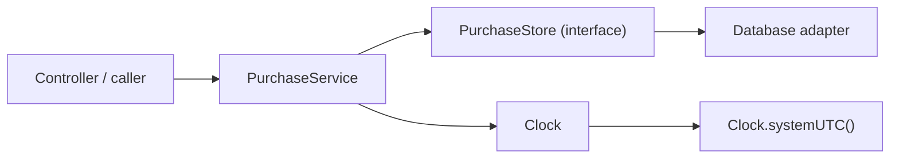
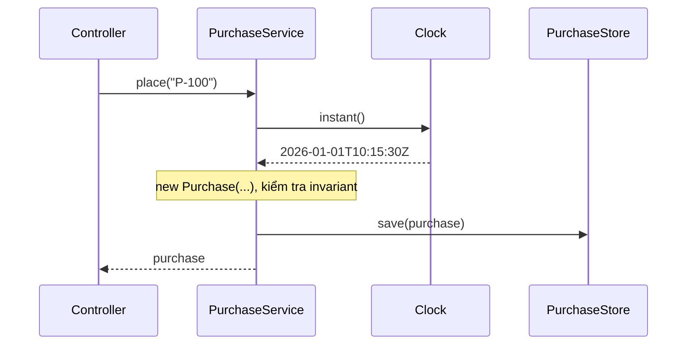

# Constructor, tính bất biến và thiết kế đối tượng dễ kiểm thử

Trong ứng dụng Spring Boot, một đối tượng thường vừa mang dữ liệu, vừa phối hợp với các đối tượng khác để xử lý nghiệp vụ. Cách khởi tạo đối tượng quyết định liệu nó có rơi vào trạng thái không hợp lệ hay không; cách quản lý trạng thái quyết định liệu dữ liệu có bị sửa ngoài ý muốn hay không; và cách truyền dependency quyết định liệu một lớp có thể được kiểm thử độc lập hay không.

Bài này xây dựng ba nền tảng có liên quan chặt chẽ:

1. **Constructor** tạo một đối tượng có đủ dữ liệu và dependency bắt buộc ngay từ đầu.
2. **Tính bất biến (immutability)** giúp trạng thái đã thiết lập được giữ ổn định, dễ suy luận.
3. **Thiết kế dễ kiểm thử (testable design)** cho phép thay dependency thật bằng implementation kiểm thử, đồng thời chủ động kiểm soát thời gian và những yếu tố bên ngoài.

Các ví dụ dùng cú pháp Java 21, JUnit 5 và Spring Boot 3. Mỗi đoạn mã tập trung vào một ý; khi đưa vào dự án, hãy đặt lớp vào tệp và package tương ứng, bổ sung các import được IDE gợi ý.

## 1. Constructor là hợp đồng tạo đối tượng

Constructor là một thành phần đặc biệt của lớp Java: tên trùng tên lớp, không có kiểu trả về (kể cả \`void\`), và chạy khi tạo đối tượng bằng \`new\` hoặc khi framework thực hiện việc khởi tạo phù hợp. Constructor thường có hai nhiệm vụ:

- Nhận những thông tin bắt buộc để đối tượng có thể hoạt động.
- Kiểm tra ràng buộc rồi gán trạng thái ban đầu hợp lệ.

Ví dụ một đơn hàng phải có mã tham chiếu và thời điểm tạo:

```java
import java.time.Instant;
import java.util.Objects;

public final class Purchase {
    private final String reference;
    private final Instant createdAt;

    public Purchase(String reference, Instant createdAt) {
        if (reference == null || reference.isBlank()) {
            throw new IllegalArgumentException("reference must not be blank");
        }
        this.reference = reference;
        this.createdAt = Objects.requireNonNull(createdAt, "createdAt");
    }

    public String reference() {
        return reference;
    }

    public Instant createdAt() {
        return createdAt;
    }
}
```

Đoạn mã này đặt **bất biến nghiệp vụ (invariant)** ở nơi tạo đối tượng: khi constructor hoàn tất thành công, \`reference\` không thể rỗng và \`createdAt\` không thể \`null\`. Mọi nơi gọi \`new Purchase(...)\` đều được kiểm tra theo cùng một quy tắc, thay vì phải nhớ kiểm tra ở từng controller hay service.

Hai dạng lỗi có ý nghĩa khác nhau: \`IllegalArgumentException\` mô tả một giá trị đầu vào không hợp lệ; \`NullPointerException\` từ \`Objects.requireNonNull\` báo dependency hoặc trường bắt buộc chưa được cung cấp. Trong API HTTP, Spring có thể chuyển lỗi nhập liệu thành phản hồi phù hợp ở tầng boundary, nhưng việc kiểm tra trong domain vẫn cần thiết.

### 1.1. Tham số, \`this\` và trường \`final\`

Trong lệnh \`this.reference = reference\`, vế trái là field của đối tượng hiện tại, còn vế phải là tham số constructor. Từ khóa \`this\` giúp phân biệt khi hai tên trùng nhau.

Trường \`final\` chỉ được gán một lần theo quy tắc khởi tạo của Java. Với field instance dạng \`blank final\`, constructor phải bảo đảm nó được khởi tạo trên mọi đường thực thi kết thúc bình thường. Đây là một cách làm cho thiếu dependency hoặc thiếu dữ liệu bắt buộc trở thành lỗi rõ ràng từ lúc tạo đối tượng.

Nếu lớp không khai báo constructor nào, trình biên dịch tạo constructor mặc định không tham số. **Khi đã tự khai báo ít nhất một constructor, Java không tự tạo constructor không tham số nữa.** Ví dụ:

```java
public class Course {
    private final String title;

    public Course(String title) {
        this.title = title;
    }
}

Course a = new Course("Spring Boot"); // Hợp lệ
// Course b = new Course();           // Lỗi biên dịch
```

### 1.2. Overloading và ủy quyền constructor

Một lớp có thể có nhiều constructor nếu danh sách tham số khác nhau. Khi một constructor gọi constructor khác của **cùng lớp**, dùng \`this(...)\`. Trên Java 21, lời gọi \`this(...)\` phải là câu lệnh đầu tiên của constructor gọi nó.

```java
public final class RetryPolicy {
    private final int maxAttempts;
    private final long delayMillis;

    public RetryPolicy(int maxAttempts) {
        this(maxAttempts, 200L);
    }

    public RetryPolicy(int maxAttempts, long delayMillis) {
        if (maxAttempts < 1 || delayMillis < 0) {
            throw new IllegalArgumentException("Invalid retry policy");
        }
        this.maxAttempts = maxAttempts;
        this.delayMillis = delayMillis;
    }
}
```

Ưu điểm: mọi đường khởi tạo đều đi qua một chỗ kiểm tra ràng buộc. Trong phân cấp kế thừa, \`super(...)\` gọi constructor của lớp cha; một constructor không thể đồng thời có cả \`this(...)\` và \`super(...)\` làm lời gọi đầu tiên. Nếu cần nhiều kiểu khởi tạo nhưng các tham số dễ gây nhầm lẫn, một static factory có tên như \`RetryPolicy.withDefaultDelay(3)\` có thể làm rõ ý định hơn.

### 1.3. Constructor không phải nơi chạy nghiệp vụ nặng

Constructor nên kiểm tra dữ liệu và gán field. Tránh gọi HTTP, gửi email, thực hiện truy vấn cơ sở dữ liệu, đọc file hoặc khởi chạy luồng xử lý dài trong constructor. Những hành động đó làm việc khởi tạo bean trở nên khó đoán và khiến unit test phải chuẩn bị cả hạ tầng ngay cả khi chỉ muốn kiểm tra một phương thức đơn giản.

Nếu cần tạo đối tượng qua nhiều bước nghiệp vụ, hãy đưa quy trình ấy vào service hoặc factory rõ trách nhiệm. Constructor vẫn là nơi bảo vệ trạng thái nội tại của đối tượng.

## 2. Bất biến dữ liệu là gì?

Một đối tượng **bất biến** là đối tượng mà trạng thái quan sát được của nó không thay đổi sau khi được tạo. Người dùng đối tượng có thể đọc dữ liệu nhưng không thể thay đổi trạng thái của chính đối tượng đó thông qua bất kỳ đường truy cập nào được cung cấp.

Lợi ích thực tế:

- Dễ hiểu: giá trị đã được kiểm tra trong constructor tiếp tục có hiệu lực.
- Dễ chia sẻ: giảm rủi ro hai phần hệ thống vô tình sửa cùng dữ liệu.
- Dễ kiểm thử: khi đầu vào đã cố định, kết quả ít phụ thuộc vào lịch sử lời gọi.
- Dễ làm việc với xử lý đồng thời: không có phép ghi vào trạng thái nội tại để gây tranh chấp, dù hệ thống xung quanh vẫn cần xử lý đồng bộ thích hợp.

**\`final\` không tự động khiến một đối tượng bất biến.** Nó ngăn việc gán lại biến tham chiếu, nhưng không ngăn thay đổi đối tượng được tham chiếu.

```java
final var tags = new java.util.ArrayList<String>();
tags.add("spring");
tags.add("java"); // Vẫn hợp lệ: danh sách có thể thay đổi

// tags = new ArrayList<>(); // Không hợp lệ: gán lại biến final
```

Tương tự, \`private final List<String> tags\` chỉ bảo vệ tham chiếu \`tags\`, không tự động bảo vệ nội dung danh sách.

### 2.1. Các thành phần tạo nên một kiểu bất biến

Với một giá trị dữ liệu (value object), cách thiết kế thông thường là:

1. Dùng field \`private final\`.
2. Cấp đủ giá trị bắt buộc qua constructor và kiểm tra invariant.
3. Không cung cấp setter hay phương thức làm biến đổi trạng thái.
4. Không để đối tượng có thể bị sửa ở bên ngoài truy cập trực tiếp vào dữ liệu nội bộ.
5. Sao chép phòng vệ (defensive copy) khi nhận hoặc trả dữ liệu có thể thay đổi.
6. Xem xét việc kế thừa: một \`final class\` không thể bị subclass làm sai hợp đồng bất biến.

Ví dụ:

```java
import java.util.List;
import java.util.Objects;

public final class CustomerProfile {
    private final String email;
    private final List<String> roles;

    public CustomerProfile(String email, List<String> roles) {
        if (email == null || email.isBlank()) {
            throw new IllegalArgumentException("email is required");
        }
        this.email = email;
        this.roles = List.copyOf(Objects.requireNonNull(roles, "roles"));
    }

    public String email() {
        return email;
    }

    public List<String> roles() {
        return roles;
    }
}
```

Tại sao dùng \`List.copyOf\`?

```java
var inputRoles = new java.util.ArrayList<String>();
inputRoles.add("USER");

var profile = new CustomerProfile("alice@example.com", inputRoles);
inputRoles.add("ADMIN");

System.out.println(profile.roles()); // [USER]
// profile.roles().add("ADMIN");      // UnsupportedOperationException
```

Nếu constructor chỉ gán \`this.roles = roles\`, việc sửa \`inputRoles\` sau đó sẽ làm trạng thái của \`profile\` thay đổi mà không thông qua \`profile\`. Nếu dùng \`Collections.unmodifiableList(roles)\` trực tiếp, kết quả là **view không cho sửa qua view** nhưng có thể vẫn phản ánh thay đổi từ danh sách gốc. \`List.copyOf\` cung cấp một snapshot không thể chỉnh sửa qua API danh sách; nó cũng từ chối phần tử \`null\`.

**Giới hạn quan trọng:** bản sao ở đây là **sao chép nông**. Nếu các phần tử của danh sách là đối tượng mutable, người dùng có thể sửa nội dung phần tử. Vì thế ví dụ dùng \`String\`, vốn là immutable; còn với phần tử mutable, hãy sao chép từng phần tử hoặc chuyển sang loại immutable.

### 2.2. Bản sao phòng vệ cho đối tượng mutable

Giả sử phải tích hợp một API cũ dùng \`java.util.Date\` (mutable). Chỉ đánh dấu field \`final\` chưa đủ:

```java
import java.util.Date;
import java.util.Objects;

public final class LegacyEvent {
    private final Date occurredAt;

    public LegacyEvent(Date occurredAt) {
        Date value = Objects.requireNonNull(occurredAt, "occurredAt");
        this.occurredAt = new Date(value.getTime()); // Sao chép khi nhận
    }

    public Date occurredAt() {
        return new Date(occurredAt.getTime());       // Sao chép khi trả
    }
}
```

Khi có thể, ưu tiên các kiểu bất biến của \`java.time\` như \`Instant\`, \`LocalDate\`, \`Duration\` thay cho \`Date\` và \`Calendar\` trong domain mới.

### 2.3. Record trong Java 21

Record là cú pháp gọn để biểu diễn dữ liệu có cấu trúc. Java tự sinh constructor chuẩn (canonical constructor), accessor, \`equals\`, \`hashCode\` và \`toString\`. Các component của record được lưu trong field \`private final\`, và record không thể được kế thừa.

```java
import java.util.List;
import java.util.Objects;

public record OrderLine(String sku, int quantity) {
    public OrderLine {
        if (sku == null || sku.isBlank()) {
            throw new IllegalArgumentException("sku is required");
        }
        if (quantity <= 0) {
            throw new IllegalArgumentException("quantity must be positive");
        }
    }
}

public record CreateOrderCommand(String customerId, List<OrderLine> lines) {
    public CreateOrderCommand {
        if (customerId == null || customerId.isBlank()) {
            throw new IllegalArgumentException("customerId is required");
        }
        lines = List.copyOf(Objects.requireNonNull(lines, "lines"));
        if (lines.isEmpty()) {
            throw new IllegalArgumentException("Order must have a line");
        }
    }
}
```

Đây là **compact constructor**: sau khi chạy các bước kiểm tra và điều chỉnh tham số, Java tự gán tham số đã xử lý vào các field của record. Với \`List<OrderLine>\`, snapshot an toàn vì \`OrderLine\` cũng là một record chỉ chứa \`String\` và \`int\`.

Record **không bảo đảm bất biến sâu** nếu component là \`List<MutableItem>\`, mảng, \`Date\` hoặc một đối tượng mutable khác. Người thiết kế vẫn phải quyết định chính sách copy và bảo vệ dữ liệu.

### 2.4. Khi nào nên dùng immutable, khi nào không?

| Trường hợp | Lựa chọn thường phù hợp | Lý do |
| --- | --- | --- |
| Giá trị nghiệp vụ: tiền, khoảng thời gian, địa chỉ | Immutable class hoặc record | Dễ kiểm tra và chia sẻ |
| DTO đầu vào/đầu ra không có vòng đời thay đổi trạng thái | Record hoặc immutable class | Hợp đồng dữ liệu rõ ràng |
| Cấu hình ứng dụng | Immutable configuration object | Hạn chế cấu hình bị sửa khi chạy |
| Domain object có thao tác thay đổi trạng thái hợp lệ | Encapsulation, mutation qua phương thức nghiệp vụ | Vẫn kiểm soát invariant |
| JPA entity | Thường cần class có cơ chế khởi tạo/trạng thái tương thích JPA | Provider phải tạo, theo dõi và cập nhật entity |

Không cần ép mọi đối tượng trong ứng dụng trở thành immutable. Với entity có vòng đời như \`Invoice\` chuyển từ \`DRAFT\` sang \`PAID\`, điều quan trọng là **kiểm soát cách thay đổi** qua phương thức nghiệp vụ, thay vì cung cấp setter tự do cho mọi field.

## 3. Constructor injection trong Spring Boot

Dependency là đối tượng một lớp cần để hoàn thành nhiệm vụ, chẳng hạn repository, gateway thanh toán, công cụ mã hóa mật khẩu hoặc nguồn thời gian. Trong Spring, container có trách nhiệm tạo và kết nối các bean thông qua **Dependency Injection (DI)**.

Xét service cần lưu giao dịch và lấy thời điểm hiện tại. Thay vì service tự tạo những dependency này, hãy yêu cầu chúng trong constructor:

```java
import java.time.Instant;
import java.util.Objects;

public record Purchase(String reference, Instant createdAt) {
    public Purchase {
        if (reference == null || reference.isBlank()) {
            throw new IllegalArgumentException("reference must not be blank");
        }
        Objects.requireNonNull(createdAt, "createdAt");
    }
}

public interface PurchaseStore {
    void save(Purchase purchase);
}
```

```java
import java.time.Clock;
import java.util.Objects;
import org.springframework.stereotype.Service;

@Service
public class PurchaseService {
    private final PurchaseStore store;
    private final Clock clock;

    public PurchaseService(PurchaseStore store, Clock clock) {
        this.store = Objects.requireNonNull(store, "store");
        this.clock = Objects.requireNonNull(clock, "clock");
    }

    public Purchase place(String reference) {
        Purchase purchase = new Purchase(reference, clock.instant());
        store.save(purchase);
        return purchase;
    }
}
```

Khi Spring tạo \`PurchaseService\`, nó cần tìm một bean phù hợp với \`PurchaseStore\` và một bean \`Clock\`. Ứng dụng cần cung cấp một implementation \`PurchaseStore\` (ví dụ adapter lưu database được đánh dấu \`@Repository\`) và có thể khai báo bean \`Clock\` như sau:

```java
import java.time.Clock;
import org.springframework.context.annotation.Bean;
import org.springframework.context.annotation.Configuration;

@Configuration
public class TimeConfiguration {
    @Bean
    public Clock clock() {
        return Clock.systemUTC();
    }
}
```

Với một constructor duy nhất, Spring có thể dùng constructor đó để inject dependency mà không cần \`@Autowired\`. Nếu có nhiều constructor đủ điều kiện, phải làm rõ constructor dùng cho injection theo quy tắc của Spring, thường bằng \`@Autowired\` trên constructor mong muốn.

Biểu diễn quan hệ:



\`PurchaseService\` biết **hợp đồng** lưu dữ liệu, nhưng không cần biết tầng lưu trữ dùng SQL, MongoDB, bộ nhớ hay adapter kiểm thử. Trong ứng dụng thật, dependency được Spring nối lại; trong unit test, ta có thể gọi constructor trực tiếp.

### 3.1. Vì sao constructor injection thường tốt hơn field injection?

So sánh hai cách:

```java
// Field injection: dependency không thể hiện trong API khởi tạo
@Service
class FieldInjectedService {
    @Autowired
    private PurchaseStore store;
}

// Constructor injection: dependency bắt buộc thể hiện công khai
@Service
class ConstructorInjectedService {
    private final PurchaseStore store;

    ConstructorInjectedService(PurchaseStore store) {
        this.store = Objects.requireNonNull(store);
    }
}
```

Với field injection, gọi \`new FieldInjectedService()\` ngoài Spring tạo ra instance có \`store == null\`, và người đọc không nhìn thấy dependency trong constructor. Constructor injection làm dependency rõ ràng, cho phép dùng \`final\`, thuận tiện tạo đối tượng trong test, và giúp phát hiện vòng phụ thuộc khi xây dựng bean graph.

Setter injection vẫn có chỗ dùng với một số dependency thực sự tùy chọn hoặc cấu hình cần thay đổi, nhưng không nên biến dependency bắt buộc thành trạng thái có thể thiếu sau khi tạo đối tượng.

### 3.2. Không tự \`new\` dependency bên trong service

Một mẫu khó kiểm thử:

```java
public class HardToTestPurchaseService {
    private final PurchaseStore store = new JdbcPurchaseStore(/* cấu hình kết nối */);

    // Khó thay JdbcPurchaseStore bằng implementation phục vụ unit test.
}
```

Đoạn trên chỉ là minh họa cho việc ghép cứng với adapter cụ thể; không phải lớp chạy độc lập. Khi service trực tiếp quyết định cách tạo dependency bên ngoài, test phải gánh theo chi phí khởi tạo hạ tầng. Hãy để tầng cấu hình/DI container chọn implementation và để service mô tả những gì nó cần qua constructor.

**Constructor dài là tín hiệu thiết kế:** nếu một service cần quá nhiều dependency không liên quan, hãy xem nó có đang gánh quá nhiều trách nhiệm hay không. Không nên chỉ gom tùy tiện tất cả dependency vào một lớp “context” để che đi vấn đề.

### 3.3. Lombok \`@RequiredArgsConstructor\`

Nếu dự án đã dùng Lombok, annotation này có thể sinh constructor cho các field \`final\` chưa khởi tạo và field được đánh dấu \`@NonNull\` theo cơ chế Lombok:

```java
import lombok.RequiredArgsConstructor;
import org.springframework.stereotype.Service;

@Service
@RequiredArgsConstructor
public class CatalogService {
    private final ProductCatalog catalog;

    public Product find(String sku) {
        return catalog.findBySku(sku);
    }
}
```

Ở ví dụ này, \`ProductCatalog\` và \`Product\` là kiểu minh họa của ứng dụng. Lombok thực hiện **sinh mã lúc biên dịch**; việc tiêm dependency vẫn do Spring thực hiện. Chỉ dùng Lombok khi dự án đã cấu hình annotation processing và nhóm hiểu phần constructor được sinh ra. Với bài học cơ bản, tự viết constructor thường giúp quan sát hợp đồng rõ hơn.

### 3.4. Cấu hình immutable với \`@ConfigurationProperties\`

Các cấu hình liên quan nên được gom vào một object có kiểu thay vì rải \`@Value\` khắp service:

```java
import java.time.Duration;
import org.springframework.boot.context.properties.ConfigurationProperties;

@ConfigurationProperties(prefix = "feature.checkout")
public record CheckoutProperties(boolean enabled, Duration timeout) {
    public CheckoutProperties {
        if (timeout == null || timeout.isNegative() || timeout.isZero()) {
            throw new IllegalArgumentException("timeout must be positive");
        }
    }
}
```

```yaml
feature:
  checkout:
    enabled: true
    timeout: 5s
```

Trong Spring Boot 3, một record có constructor chuẩn duy nhất có thể được bind từ cấu hình khi được đăng ký qua \`@ConfigurationPropertiesScan\` hoặc \`@EnableConfigurationProperties(CheckoutProperties.class)\`. Đây là dữ liệu cấu hình bất biến sau khi bind; không dùng \`@Component\` trên record đó chỉ để yêu cầu component scanning làm constructor binding.

## 4. Thiết kế để unit test không cần khởi động Spring

Điểm mạnh của constructor injection là có thể kiểm thử logic của lớp như một **đối tượng Java bình thường**. Khi dependency được thể hiện bằng interface, test có thể dùng implementation rất nhỏ thay cho database thật.

Với \`PurchaseService\` ở phần trước, một unit test JUnit 5:

```java
import static org.junit.jupiter.api.Assertions.assertEquals;
import static org.junit.jupiter.api.Assertions.assertThrows;
import static org.junit.jupiter.api.Assertions.assertTrue;

import java.time.Clock;
import java.time.Instant;
import java.time.ZoneOffset;
import java.util.ArrayList;
import java.util.List;
import org.junit.jupiter.api.Test;

class PurchaseServiceTest {
    private final Clock fixedClock = Clock.fixed(
            Instant.parse("2026-01-01T10:15:30Z"),
            ZoneOffset.UTC
    );

    @Test
    void placesPurchaseAtPredictableTime() {
        List<Purchase> saved = new ArrayList<>();
        PurchaseStore fakeStore = purchase -> saved.add(purchase);
        PurchaseService service = new PurchaseService(fakeStore, fixedClock);

        Purchase result = service.place("P-100");

        assertEquals("P-100", result.reference());
        assertEquals(Instant.parse("2026-01-01T10:15:30Z"), result.createdAt());
        assertEquals(List.of(result), saved);
    }

    @Test
    void rejectsBlankReferenceBeforeSaving() {
        List<Purchase> saved = new ArrayList<>();
        PurchaseService service = new PurchaseService(
                purchase -> saved.add(purchase),
                fixedClock
        );

        assertThrows(IllegalArgumentException.class, () -> service.place(" "));
        assertTrue(saved.isEmpty());
    }
}
```

Các test trên không dùng \`@SpringBootTest\`, context Spring, cổng mạng hay cơ sở dữ liệu. Chúng kiểm tra chính xác hai điều: dữ liệu đầu ra theo thời gian đã định và dữ liệu đầu vào sai không bị ghi xuống kho lưu trữ.

### 4.1. Vì sao inject \`Clock\` thay cho gọi trực tiếp \`Instant.now()\`?

Mã này gắn service vào thời gian thật:

```java
Purchase purchase = new Purchase(reference, Instant.now());
```

Test muốn so sánh thời điểm chính xác sẽ chịu sai số thời gian thực thi hoặc phải dùng khoảng dung sai. Inject \`Clock\` cho phép:

- Ứng dụng dùng \`Clock.systemUTC()\`.
- Test dùng \`Clock.fixed(...)\` để tạo thời gian cố định.
- Test khác dùng \`Clock.offset(...)\` để mô phỏng thời gian dịch chuyển.

Đây là ví dụ của nguyên tắc tổng quát: **mọi yếu tố không quyết định được hoặc phụ thuộc môi trường nên đi qua một boundary có thể thay thế**, như thời gian, sinh UUID, HTTP client hay dịch vụ gửi thông báo. Không cần tạo interface riêng cho mọi thao tác nếu Java hoặc thư viện đã có abstraction phù hợp (\`Clock\` là một ví dụ).

### 4.2. Fake, stub và mock khác nhau thế nào?

| Test double | Vai trò | Ví dụ |
| --- | --- | --- |
| Stub | Trả dữ liệu được lập trình sẵn | Repository luôn trả một \`Customer\` mẫu |
| Fake | Implementation đơn giản nhưng có hành vi | Kho lưu dữ liệu trong \`Map\` hoặc \`List\` |
| Mock | Ghi nhận/kiểm tra tương tác đã xảy ra | Xác nhận \`repository.save(...)\` được gọi |

Test của \`PurchaseService\` ở trên dùng một implementation nhỏ của \`PurchaseStore\` để ghi vào \`List\` rồi quan sát kết quả. Nếu cần Mockito, có thể thay bằng:

```java
import static org.mockito.Mockito.mock;
import static org.mockito.Mockito.verify;

PurchaseStore store = mock(PurchaseStore.class);
PurchaseService service = new PurchaseService(store, fixedClock);

Purchase created = service.place("P-100");
verify(store).save(created);
```

Hai cách đều hợp lệ. Chọn cách giúp diễn đạt hành vi cần kiểm chứng rõ nhất; không cần mock những object giá trị đơn giản. Tránh viết test chỉ lặp lại từng dòng implementation mà không xác nhận yêu cầu nghiệp vụ có ý nghĩa.

### 4.3. Unit test và integration test bổ sung cho nhau

| Loại test | Cần khởi động Spring? | Phù hợp kiểm tra |
| --- | --- | --- |
| Unit test lớp thuần Java | Không | Validation, nhánh nghiệp vụ, tương tác với dependency |
| Spring slice test | Một phần context | MVC binding, JSON, repository hoặc phần tích hợp chuyên biệt |
| \`@SpringBootTest\` | Thường có | Bean wiring, cấu hình và luồng tích hợp nhiều thành phần |

Unit test không phát hiện được mọi lỗi đăng ký bean. Integration test có thể phát hiện thiếu bean \`PurchaseStore\`, bean \`Clock\` bị trùng hoặc cấu hình Spring không hợp lệ. Nhưng không nên dùng \`@SpringBootTest\` cho mọi phép kiểm tra constructor hay phép tính thuần Java.

## 5. Ranh giới giữa dữ liệu, nghiệp vụ và hạ tầng

Một thiết kế dễ bảo trì thường phân biệt:

- **Value object / command / DTO**: dữ liệu được tạo qua constructor và kiểm tra invariant; ưu tiên bất biến.
- **Domain/service logic**: xử lý quy tắc và phối hợp các dependency được truyền vào constructor.
- **Adapter hạ tầng**: hiện thực hóa các interface như truy vấn database, HTTP client, gửi email.
- **Spring configuration**: chọn implementation và khai báo bean.

Ví dụ quy trình tạo một đơn:



Một controller tốt không tự thiết lập các dependency của service, còn service không tự lựa chọn công nghệ lưu trữ. Với cách phân chia này, thay \`PurchaseStore\` trong bài kiểm thử chỉ cần truyền một implementation khác vào constructor.

### 5.1. Đặc biệt lưu ý với JPA entity và Spring proxy

Ví dụ \`Purchase\` immutable ở trên là domain value, **không phải JPA entity**. Entity được JPA quản lý thường cần constructor không tham số có mức truy cập phù hợp (thường \`protected\`), và framework cần cơ chế tạo proxy/theo dõi trạng thái. Vì vậy không nên máy móc áp dụng \`final class\`, \`record\` hay field \`final\` cho tất cả entity.

Ví dụ một entity tối giản:

```java
import jakarta.persistence.Entity;
import jakarta.persistence.GeneratedValue;
import jakarta.persistence.GenerationType;
import jakarta.persistence.Id;

@Entity
public class InvoiceEntity {
    @Id
    @GeneratedValue(strategy = GenerationType.IDENTITY)
    private Long id;

    private String status;

    protected InvoiceEntity() {
        // Dành cho JPA
    }

    public InvoiceEntity(String status) {
        if (status == null || status.isBlank()) {
            throw new IllegalArgumentException("status is required");
        }
        this.status = status;
    }

    public void markPaid() {
        if (!"DRAFT".equals(status)) {
            throw new IllegalStateException("Only draft invoices can be paid");
        }
        this.status = "PAID";
    }
}
```

Entity này có mutation, nhưng mutation được đóng gói trong hành vi \`markPaid()\` cùng điều kiện hợp lệ. Trong ứng dụng thực tế, cần thiết kế thêm mapping, cơ chế persistence, phiên bản/đồng thời và transaction phù hợp.

Spring cũng có các cơ chế AOP và proxy (ví dụ \`@Transactional\`). Một số dạng proxy cần subclass và không thể override phương thức \`final\`. Vì vậy hãy cân nhắc việc đánh dấu service/entity là \`final\` khi chúng cần cơ chế proxy của framework. **Bất biến là quyết định theo bản chất dữ liệu**, không phải quy tắc bắt buộc trên mọi bean.

### 5.2. Bean singleton và tính an toàn luồng

Mặc định, Spring tạo bean singleton trong một application context. \`private final PurchaseStore store\` giữ tham chiếu dependency ổn định, nhưng **không khiến mọi trạng thái mà bean sử dụng đều thread-safe**.

Ví dụ này dễ gây lỗi:

```java
@Service
class UnsafeCounterService {
    private int counter;

    int next() {
        return ++counter; // Có thể race khi nhiều request gọi đồng thời
    }
}
```

Một service stateless thường dễ dùng chung giữa nhiều request hơn. Nếu bắt buộc giữ trạng thái thay đổi trong bean, cần thiết kế đồng bộ, atomic operation hoặc cơ chế lưu trữ đúng mục đích. Immutable value object giúp giảm một lớp vấn đề nhưng không thay thế thiết kế đồng thời của toàn ứng dụng.

## 6. Các lỗi thường gặp và cách nhận biết

| Dấu hiệu | Hệ quả | Hướng xử lý |
| --- | --- | --- |
| Constructor không kiểm tra giá trị bắt buộc | Đối tượng được tạo ở trạng thái sai | Kiểm tra invariant khi tạo |
| Có setter cho mọi field chỉ vì “tiện” | Bất kỳ nơi nào cũng có thể phá invariant | Chỉ mở thao tác thay đổi có ý nghĩa nghiệp vụ |
| Field \`final List\` nhưng giữ nguyên danh sách đầu vào | Caller sửa danh sách làm thay đổi object | Tạo snapshot; bảo vệ cả phần tử mutable |
| Record chứa collection mutable và không copy | Record không thực sự bất biến | Kiểm tra/copy ở compact constructor |
| Field injection cho dependency bắt buộc | Khó tạo object độc lập với Spring | Constructor injection với \`final\` |
| Service tự tạo HTTP/database client | Khó thay trong unit test | Inject interface/adapter thích hợp |
| Gọi \`Instant.now()\` trong logic cần test thời gian | Test khó dự đoán | Inject \`Clock\` |
| Constructor gọi database/network | Khởi tạo bean gây side effect | Chuyển tác vụ sang phương thức có chủ đích |
| Ép JPA entity và service proxied đều là \`final\` | Có thể xung đột cơ chế framework | Tách domain value khỏi entity; xem xét proxy |
| Bean singleton giữ mutable state tùy tiện | Nhiều request tranh chấp trạng thái | Ưu tiên stateless hoặc chọn cơ chế đồng thời phù hợp |

## 7. Quy trình thiết kế một lớp mới

Khi chuẩn bị tạo một lớp trong dự án Spring Boot, có thể suy nghĩ theo trình tự sau:

1. **Xác định vai trò**: lớp này mang giá trị, lưu trạng thái nghiệp vụ, hay điều phối hành vi?
2. **Liệt kê invariant**: giá trị nào bắt buộc, phạm vi hợp lệ là gì, điều kiện nào phải luôn đúng?
3. **Thiết kế constructor**: tham số nào cần có để đối tượng sẵn sàng sử dụng? Có cần overload hoặc factory có tên không?
4. **Xác định khả năng thay đổi**: có thể dùng \`record\`/immutable class không? Nếu thay đổi trạng thái, ai được phép thay đổi và theo thao tác nào?
5. **Tách dependency bên ngoài**: database, HTTP, email, nguồn thời gian và yếu tố ngẫu nhiên được truyền thế nào?
6. **Xác định mức kiểm thử**: logic thuần Java có thể được kiểm thử bằng \`new\`; wiring và tích hợp được kiểm bằng Spring/integration test khi cần.

Một phép thử tư duy hữu ích: *“Nếu không có Spring context và không có database, mình có tạo lớp này với các dependency giả và kiểm tra phần nghiệp vụ quan trọng nhất không?”* Nếu câu trả lời là không, hãy xem lớp có đang phụ thuộc trực tiếp vào hạ tầng, thời gian hoặc trạng thái dùng chung hay không.

## 8. Bài tập thực hành

### Bài tập 1 — Bảo vệ dữ liệu bất biến

Thiết kế \`ShoppingCartSnapshot\` gồm \`customerId\` và \`List<OrderLine>\`. Yêu cầu mã khách hàng không rỗng, danh sách không rỗng và sau khi tạo không thể bị thay đổi gián tiếp bằng cách sửa collection đầu vào. Tự thử thêm phần tử vào danh sách ban đầu sau khi khởi tạo, rồi xác nhận snapshot vẫn giữ nguyên.

Gợi ý: dùng \`record\`, compact constructor, \`List.copyOf\` và \`OrderLine\` immutable ở phần 2.

### Bài tập 2 — Chuyển từ field injection sang constructor injection

Cho lớp đang dùng \`@Autowired private NotificationGateway gateway;\`. Hãy thay bằng field \`private final\` và constructor nhận \`NotificationGateway\`. Viết một fake implementation ghi các thông báo được gửi vào danh sách, sau đó unit test kiểm tra kết quả khi gọi phương thức service.

### Bài tập 3 — Loại bỏ phụ thuộc vào đồng hồ thực

Một service tính hạn xử lý bằng \`Instant.now().plus(Duration.ofHours(24))\`. Hãy inject \`Clock\`, dùng \`Clock.systemUTC()\` trong cấu hình ứng dụng và \`Clock.fixed(...)\` trong unit test để xác nhận thời hạn chính xác.

### Bài tập 4 — Chọn mô hình trạng thái phù hợp

Xem xét hai đối tượng: \`Money(amount, currency)\` và \`Invoice(status, paidAt)\`. Giải thích vì sao \`Money\` thường nên bất biến, còn \`Invoice\` có thể cần phương thức nghiệp vụ đổi trạng thái. Nêu invariant phải giữ khi \`Invoice\` chuyển sang \`PAID\`.

## 9. Ghi nhớ khi áp dụng vào Spring Boot

Constructor trả lời câu hỏi **“đối tượng cần gì để được tạo hợp lệ?”**. Immutability trả lời **“sau khi tạo, ai được phép đổi dữ liệu này?”**. Constructor injection trả lời **“đối tượng lấy các cộng tác viên từ đâu?”**. Ba câu hỏi giúp xác định ranh giới của class trước khi thêm framework annotation.

Khi dữ liệu phù hợp để bất biến, hãy xây dựng trạng thái hoàn chỉnh ngay từ constructor, bảo vệ collection và các object mutable, và dùng record nếu nó diễn đạt tốt bài toán. Khi viết service, hãy truyền các dependency bắt buộc qua constructor, giữ business logic tách khỏi việc tạo hạ tầng và kiểm thử lớp như Java thuần trước khi cần kiểm thử integration. Với entity và bean cần proxy, cân nhắc các yêu cầu của framework thay vì áp một công thức duy nhất cho mọi lớp.
