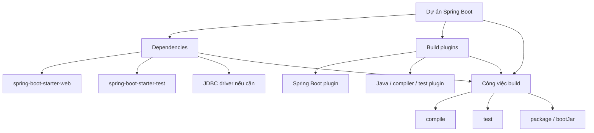

# Gradle hoặc Maven: phân biệt dependency, plugin và task

> **Spring Boot Fundamentals · Kiến thức chuẩn bị**  
> Bài học này giúp bạn đọc được một dự án Spring Boot dùng **Gradle** hoặc **Maven**, biết thư viện nào đi vào ứng dụng, công cụ nào hỗ trợ quá trình build và thao tác nào thật sự được thực thi khi chạy lệnh. Bạn không cần thành thạo cả hai hệ thống ngay từ đầu, nhưng cần phân biệt đúng **dependency**, **plugin** và **task/goal** để không bị rối khi thêm Spring Web, chạy test hoặc đóng gói ứng dụng.

## 1. Vì sao cần build tool khi học Spring Boot?

Một ứng dụng Spring Boot thường không chỉ chứa mã Java do chúng ta viết. Để xây dựng và chạy được ứng dụng, dự án còn phải:

- Tải các thư viện phù hợp như Spring Web, Spring Data JPA, Jackson hoặc JDBC driver.
- Biên dịch mã Java, đưa resource vào đúng vị trí và biên dịch mã test.
- Chạy test, kiểm tra chất lượng và tạo file đầu ra như `.jar`.
- Đóng gói một Spring Boot executable JAR có thể khởi động bằng `java -jar`.
- Thực hiện các công việc phụ trợ như sinh mã nguồn, tạo tài liệu hoặc build container image nếu dự án cần.

**Gradle** và **Maven** đều là công cụ xây dựng dự án (build tools) có thể giải quyết những việc trên. Chúng khác cách mô tả build và cách gọi lệnh, nhưng phục vụ nhiều mục tiêu tương tự.

| Câu hỏi | Maven | Gradle |
| --- | --- | --- |
| File build chính thường gặp | `pom.xml` | `build.gradle` (Groovy DSL) hoặc `build.gradle.kts` (Kotlin DSL) |
| Mô hình tổ chức công việc | Lifecycle gồm các phase; plugin có các goal | Các task với quan hệ phụ thuộc, tạo thành task graph |
| Cách khai báo thư viện ứng dụng | `<dependencies>` | `dependencies { ... }` |
| Cách mở rộng khả năng build | Maven plugin | Gradle plugin |
| Lệnh biên dịch, kiểm thử, đóng gói | `mvnw compile`, `mvnw test`, `mvnw package` | `gradlew compileJava`, `gradlew test`, `gradlew build`, `gradlew bootJar` |
| Cơ chế giữ môi trường build ổn định | Maven Wrapper `mvnw` | Gradle Wrapper `gradlew` |

Spring Boot hỗ trợ cả hai công cụ. Chọn một công cụ phù hợp với dự án đang dùng; hiểu đúng ba khái niệm cốt lõi quan trọng hơn việc tranh luận công cụ nào luôn tốt hơn.

## 2. Bức tranh tổng thể: dependency, plugin và công việc thực thi

Hãy tưởng tượng chúng ta muốn làm một API trả về danh sách sách.

- **Dependency (thư viện phụ thuộc):** mã đã được đóng gói mà **ứng dụng hoặc test của bạn sử dụng**, chẳng hạn Spring MVC.
- **Plugin:** phần mở rộng giúp **build tool biết cách thực hiện hoặc tổ chức công việc**, chẳng hạn plugin Spring Boot để chạy ứng dụng khi phát triển và tạo executable JAR.
- **Task (Gradle) / goal (Maven):** **công việc cụ thể được thực hiện** khi chạy build, chẳng hạn compile, test, tạo JAR hoặc chạy Spring Boot.



Sơ đồ thể hiện quan hệ khái niệm: plugin **có thể cung cấp** task hoặc goal; task/goal **có thể sử dụng** dependency khi chạy. Việc thêm một dependency tự nó không có nghĩa là bạn đã yêu cầu build tool chạy một task; việc áp dụng một plugin cũng không có nghĩa mọi task của plugin đều được thực thi.

### 2.1. Phân biệt bằng câu hỏi ngắn

| Khi gặp một dòng cấu hình hoặc lệnh | Hỏi gì? | Nhận diện |
| --- | --- | --- |
| `implementation 'org.springframework.boot:spring-boot-starter-web'` | Ứng dụng cần thư viện nào? | Dependency |
| `<dependency>...spring-boot-starter-web...</dependency>` | Ứng dụng cần thư viện nào? | Dependency |
| `id 'org.springframework.boot'` | Build tool được bổ sung khả năng gì? | Gradle plugin |
| `<artifactId>spring-boot-maven-plugin</artifactId>` bên trong `<build><plugins>` | Maven được bổ sung goal nào? | Maven plugin |
| `./gradlew bootRun` | Chạy thao tác nào? | Gradle task |
| `./mvnw spring-boot:run` | Gọi goal nào của plugin? | Maven plugin goal |
| `./mvnw package` | Yêu cầu lifecycle đến giai đoạn nào? | Maven lifecycle phase |

**Điểm dễ nhầm:** một Maven goal **không đồng nghĩa** với một Maven lifecycle phase. Gradle task và Maven goal gần nhau ở tính chất “công việc cụ thể”, còn Maven phase là một giai đoạn có thể kích hoạt nhiều goal đã được bind vào đó.

## 3. Dependency: thư viện mà ứng dụng hoặc test cần

Dependency là một gói phần mềm mà dự án dựa vào. Với Java, phần lớn dependency được phân phối dưới dạng JAR, có thể có thêm các dependency bắc cầu (transitive dependencies).

Ví dụ một REST API:

- `spring-boot-starter-web`: một starter giúp đưa các thư viện liên quan đến Spring MVC và JSON vào dự án trong cấu hình phù hợp.
- `spring-boot-starter-test`: tập dependency dành cho việc viết và chạy test.
- `org.postgresql:postgresql`: JDBC driver để kết nối PostgreSQL khi ứng dụng dùng cơ sở dữ liệu này.

Một starter cũng là **dependency**. Điểm đặc biệt là nó được thiết kế để giúp kéo vào một bộ dependency phù hợp cho một nhu cầu, thay vì buộc người dùng chọn từng thư viện hạ tầng.

### 3.1. Dependency trong Gradle

Ví dụ Groovy DSL, trích từ `build.gradle`:

```groovy
dependencies {
    implementation 'org.springframework.boot:spring-boot-starter-web'
    testImplementation 'org.springframework.boot:spring-boot-starter-test'
    runtimeOnly 'org.postgresql:postgresql'
}
```

Ở đây:

- `implementation`: dependency cần khi biên dịch và chạy mã ứng dụng; thường không được công bố như một phần API của module library dùng plugin `java-library`.
- `testImplementation`: dependency phục vụ biên dịch và chạy test.
- `runtimeOnly`: cần khi chạy nhưng thông thường không cần trên classpath biên dịch; JDBC driver thường có thể đặt ở đây khi code sử dụng API JDBC, không gọi trực tiếp class cụ thể của driver.

Các tên như `implementation`, `testImplementation` hoặc `runtimeOnly` được gọi là **dependency configurations** trong Gradle; chúng không phải Gradle task.

Một số configuration hữu ích khác:

| Gradle configuration | Vai trò chính | Ví dụ điển hình |
| --- | --- | --- |
| `implementation` | Mã ứng dụng cần khi biên dịch và chạy | Spring Web starter |
| `compileOnly` | Chỉ cần trong lúc biên dịch, không tự đi vào runtime classpath | API do môi trường chạy cung cấp |
| `runtimeOnly` | Chỉ cần khi thực thi | JDBC driver trong một số ứng dụng |
| `testImplementation` | Biên dịch và chạy test | Spring Boot Test starter |
| `testRuntimeOnly` | Chỉ cần khi chạy test | Một thành phần test runtime |
| `annotationProcessor` | Chạy annotation processor lúc biên dịch | Processor sinh mã, nếu sử dụng |

Các configuration được Gradle và plugin định nghĩa; ý nghĩa chi tiết phụ thuộc plugin như `java`, `java-library`. Chọn sai configuration có thể tạo lỗi khi biên dịch hoặc lỗi thiếu class lúc chạy.

### 3.2. Dependency trong Maven

Ví dụ trích từ `pom.xml`:

```xml
<dependencies>
    <dependency>
        <groupId>org.springframework.boot</groupId>
        <artifactId>spring-boot-starter-web</artifactId>
    </dependency>

    <dependency>
        <groupId>org.springframework.boot</groupId>
        <artifactId>spring-boot-starter-test</artifactId>
        <scope>test</scope>
    </dependency>

    <dependency>
        <groupId>org.postgresql</groupId>
        <artifactId>postgresql</artifactId>
        <scope>runtime</scope>
    </dependency>
</dependencies>
```

Maven dùng `<scope>` để biểu diễn phạm vi của dependency. Nếu không khai báo, scope mặc định là `compile`.

| Maven scope | Ý nghĩa thông thường | Ghi chú |
| --- | --- | --- |
| `compile` (mặc định) | Có trên classpath biên dịch, test và runtime; có thể được truyền bắc cầu | Phù hợp thư viện chính |
| `provided` | Cần khi biên dịch/test, dự kiến môi trường thực thi cung cấp | Không được đóng gói như dependency runtime thông thường |
| `runtime` | Không cần khi biên dịch mã chính, nhưng cần lúc chạy/test | Phù hợp một số driver |
| `test` | Dùng cho mã test và quá trình chạy test | Không đi vào runtime thông thường của ứng dụng |
| `system` | Tham chiếu JAR qua đường dẫn hệ thống | Nên tránh trong dự án thông thường vì giảm tính tái lập |
| `import` | Chỉ dùng cho POM trong `dependencyManagement` | Phục vụ import BOM; không phải scope cho một JAR thông thường |

**Gradle configuration và Maven scope không có ánh xạ một-một hoàn hảo.** Ví dụ `implementation` không tương đương toàn bộ với `compile` trong mọi loại module; cách công bố API cho module Java library còn phụ thuộc `api`, `implementation`, plugin và cơ chế publication.

### 3.3. Dependency được nhận diện bằng tọa độ

Một dependency thường được nhận diện qua nhóm, tên artifact và phiên bản:

```text
Group                  Artifact                      Version
org.springframework.boot : spring-boot-starter-web  : (managed)
org.postgresql          : postgresql                : (managed)
```

Trong Gradle, dạng ngắn phổ biến là:

```groovy
implementation 'group:artifact:version'
```

Trong Maven, dùng các thẻ:

```xml
<groupId>group</groupId>
<artifactId>artifact</artifactId>
<version>version</version>
```

Đôi khi ví dụ Spring Boot không ghi version cho starter hoặc JDBC driver. Điều này chỉ hoạt động khi **dependency management** cung cấp phiên bản tương ứng, chẳng hạn Spring Boot BOM hoặc cơ chế quản lý version từ parent/BOM của dự án.

Không nên hiểu rằng “bỏ version thì Gradle/Maven tự chọn một bản tùy ý”. Nếu không có quy tắc quản lý version thích hợp, dependency sẽ không resolve được hoặc sẽ dùng cơ chế version khác đã khai báo ở nơi khác.

### 3.4. Dependency bắc cầu (transitive dependencies)

Khi ứng dụng khai báo `spring-boot-starter-web`, dependency này lại khai báo những thư viện khác. Build tool sẽ giải quyết đồ thị dependency theo quy tắc của mình.

Ví dụ minh họa:

```text
Ứng dụng
└── spring-boot-starter-web
    ├── spring-boot-starter
    ├── spring-boot-starter-json
    └── spring-webmvc
        └── các thư viện Spring liên quan
```

Sơ đồ chỉ minh họa ý tưởng; dependency graph thực tế thay đổi theo phiên bản.

Dependency bắc cầu giúp giảm cấu hình thủ công nhưng cũng có thể dẫn đến xung đột phiên bản, dependency không mong muốn hoặc lỗi thiếu thư viện sau khi exclude. Khi nghi ngờ, hãy **xem đồ thị dependency được resolve**, không suy luận chỉ từ những dòng khai báo trực tiếp.

## 4. Plugin: mở rộng khả năng của build tool

Dependency ứng dụng trả lời “mã chương trình cần dùng thư viện nào?”. Plugin trả lời “build tool có khả năng và quy tắc bổ sung nào?”.

### 4.1. Plugin trong Gradle

Một ví dụ `build.gradle` sử dụng Groovy DSL:

```groovy
plugins {
    id 'java'
    id 'org.springframework.boot' version '3.5.0'
    id 'io.spring.dependency-management' version '1.1.7'
}
```

Ý nghĩa:

- `java`: áp dụng khả năng build dự án Java, cung cấp các configuration và task như `compileJava`, `test`, `jar`, `build`.
- `org.springframework.boot`: tích hợp Spring Boot vào quá trình build; cùng với Java plugin, nó có thể cung cấp `bootRun`, `bootJar`, `bootBuildImage` và các tính năng khác.
- `io.spring.dependency-management`: plugin quản lý dependency của Gradle; khi dùng cùng Spring Boot Gradle plugin, nó có thể tự động dùng BOM tương ứng với phiên bản Boot plugin.

**Chú ý phiên bản:** `3.5.0` và `1.1.7` ở đây là các phiên bản minh họa cho một cấu hình Spring Boot 3.x. Khi tạo dự án thật, dùng những phiên bản được hỗ trợ và tương thích theo tài liệu hoặc cấu hình dự án hiện tại.

Ở Gradle, áp dụng plugin thường sẽ **đăng ký** task và thiết lập cấu hình. Nó không đồng nghĩa với việc ngay lập tức chạy `test` hay tạo file JAR. Các task sẽ thực thi khi được yêu cầu trực tiếp hoặc nằm trong task graph của lệnh gọi.

### 4.2. Plugin trong Maven

Maven plugin được khai báo trong phần `<build>` của `pom.xml`, không phải phần `<dependencies>` dành cho thư viện ứng dụng.

```xml
<build>
    <plugins>
        <plugin>
            <groupId>org.springframework.boot</groupId>
            <artifactId>spring-boot-maven-plugin</artifactId>
        </plugin>
    </plugins>
</build>
```

`spring-boot-maven-plugin` cung cấp các goal, trong đó có:

- `spring-boot:run`: chạy ứng dụng Spring Boot trong quá trình phát triển.
- `spring-boot:repackage`: đóng gói lại artifact để có cấu trúc executable theo cơ chế Spring Boot.
- `spring-boot:build-image`: xây dựng container image bằng cơ chế được plugin hỗ trợ khi cấu hình phù hợp.

Trong dự án sử dụng `spring-boot-starter-parent`, cấu hình plugin, version và một số execution có thể đã được quản lý hoặc thiết lập qua parent. Với dự án không dùng parent đó, bạn có thể cần khai báo phiên bản plugin và binding/execution để `repackage` chạy đúng giai đoạn mong muốn. Chỉ có tên plugin trong file không bảo đảm mọi goal tự động được gọi khi chạy `package`.

Maven còn có những plugin nền tảng như compiler, resources, surefire (chạy unit test) và jar plugin. Nhiều goal của chúng được binding mặc định vào lifecycle dựa trên packaging và cấu hình dự án.

### 4.3. Vì sao Spring Boot starter và Spring Boot plugin không thay thế nhau?

Nhìn hai tên gần giống nhau:

```text
spring-boot-starter-web  -> dependency
org.springframework.boot -> Gradle plugin
spring-boot-maven-plugin -> Maven plugin
```

Nếu chỉ thêm Spring Web starter, bạn nhận các thư viện để lập trình web, nhưng không mặc nhiên có tác vụ `bootJar` hay goal `repackage`.

Nếu chỉ thêm Spring Boot build plugin, bạn có các khả năng tích hợp build, nhưng ứng dụng không tự nhiên có Spring MVC controller, Jackson hoặc JDBC driver nếu các dependency cần thiết chưa được thêm vào.

Một ứng dụng Spring Boot thông thường sử dụng **cả** dependency ứng dụng **và** build plugin; mỗi thứ phục vụ một mục đích riêng.

## 5. Task trong Gradle: một công việc có thể gọi tên

Gradle tổ chức build quanh **task**. Task có thể biên dịch mã, chạy test, tạo archive, sinh tài liệu hoặc thực hiện hành động tùy chỉnh.

Một số task thường gặp khi các plugin tương ứng được áp dụng:

| Gradle task | Chức năng thường gặp | Nguồn cung cấp |
| --- | --- | --- |
| `compileJava` | Biên dịch mã Java chính | Java plugin |
| `processResources` | Xử lý/copy resource chính | Java plugin |
| `classes` | Task vòng đời gom các bước tạo classes/resources chính | Java plugin |
| `test` | Chạy test theo thiết lập của dự án | Java plugin |
| `jar` | Tạo JAR Java thông thường | Java plugin |
| `assemble` | Tạo các artifact để phân phối | Base/Java plugin |
| `check` | Gom công việc kiểm tra, thường bao gồm test | Base/Java plugin |
| `build` | Thường phụ thuộc `assemble` và `check` | Base/Java plugin |
| `bootRun` | Chạy ứng dụng Spring Boot | Spring Boot Gradle plugin |
| `bootJar` | Tạo Spring Boot executable JAR | Spring Boot Gradle plugin |
| `bootBuildImage` | Tạo container image qua buildpacks | Spring Boot Gradle plugin |

**Task không phải một “giai đoạn tuyến tính” bắt buộc.** Gradle dựng **task graph** dựa trên task được yêu cầu và quan hệ phụ thuộc. Task không nằm trong graph thường sẽ không chạy; một task có thể được bỏ qua nếu đầu ra đã cập nhật và điều kiện incremental build phù hợp.

Ví dụ:

```bash
# Linux / macOS (khi ở thư mục dự án)
./gradlew tasks
./gradlew test
./gradlew build
./gradlew bootRun
./gradlew bootJar
```

Trên Windows PowerShell:

```powershell
.\gradlew.bat tasks
.\gradlew.bat test
.\gradlew.bat bootRun
```

`./gradlew build` thường kích hoạt những công việc cần thiết để build và kiểm tra dự án, không chỉ một lệnh biên dịch đơn lẻ. Với plugin Spring Boot, bạn cũng có thể gọi `bootJar` riêng khi muốn tạo executable JAR.

### 5.1. Tự tạo một task Gradle

Trong `build.gradle` dùng Groovy DSL:

```groovy
tasks.register('showModuleName') {
    group = 'help'
    description = 'In tên module của ví dụ'

    doLast {
        println 'catalog-service'
    }
}
```

Gọi task:

```bash
./gradlew showModuleName
```

Kết quả ví dụ:

```text
> Task :showModuleName
catalog-service
```

`tasks.register` khai báo task theo cơ chế lazy configuration của Gradle; `doLast` gắn hành động chạy khi task thực sự được thực thi. Việc mở file `build.gradle` hoặc chạy một task không liên quan không có nghĩa hành động `println` này sẽ được chạy.

### 5.2. Task dependency không phải library dependency

Hai đoạn Gradle sau dùng từ “dependency” nhưng nói về hai quan hệ khác nhau:

```groovy
dependencies {
    implementation 'org.springframework.boot:spring-boot-starter-web'
}

tasks.register('announce') {
    doLast {
        println 'Build is ready'
    }
}

tasks.register('verifyWithAnnouncement') {
    dependsOn tasks.named('announce')
}
```

- `dependencies { implementation ... }`: quan hệ giữa **module ứng dụng** và **thư viện JAR**.
- `dependsOn tasks.named('announce')`: quan hệ **thứ tự thực thi** giữa các task. Khi yêu cầu `verifyWithAnnouncement`, Gradle cũng thực hiện task `announce` trước.

Không nên nhầm `dependsOn` ở cấp task với dependency của ứng dụng, dù cả hai đều mang nghĩa “phụ thuộc”.

## 6. Goal và lifecycle phase trong Maven

Maven tổ chức build quanh **lifecycle**. Lifecycle tiêu chuẩn thường gặp nhất là `default`, với các phase như:

```text
validate
   ↓
compile
   ↓
test
   ↓
package
   ↓
verify
   ↓
install
   ↓
deploy
```

Đây là các mốc quan trọng được giản lược, không phải danh sách đầy đủ tất cả phase của lifecycle. Khi gọi một phase, Maven chạy những phase cần thiết trước nó trong **cùng lifecycle**, đồng thời thực thi các **plugin goal đã được bind** vào các phase đó.

Ví dụ:

```bash
# Linux / macOS
./mvnw test
./mvnw package
./mvnw verify
```

Trên Windows PowerShell:

```powershell
.\mvnw.cmd test
.\mvnw.cmd package
.\mvnw.cmd spring-boot:run
```

Thông thường:

- `mvnw test`: qua các giai đoạn cần thiết để biên dịch và chạy unit test.
- `mvnw package`: tiếp tục đến bước tạo artifact, thường là JAR/WAR tùy packaging.
- `mvnw verify`: thực hiện các bước kiểm tra bổ sung nếu dự án đã cấu hình.
- `mvnw spring-boot:run`: gọi **một plugin goal** để chạy ứng dụng Spring Boot; không phải phase có tên `run`.

### 6.1. Phân biệt phase và goal

Trong Maven:

- **Phase** là một mốc của lifecycle, ví dụ `package`.
- **Goal** là hành động cụ thể do một plugin cung cấp, ví dụ `compiler:compile`, `surefire:test`, `jar:jar`, `spring-boot:repackage`.
- **Plugin execution/binding** quyết định goal nào chạy tại phase nào, với cấu hình nào.

Ví dụ ý tưởng:

```text
mvn package
    ├── ... các phase trước package
    ├── compiler:compile      (khi được bind vào compile)
    ├── surefire:test         (khi được bind vào test)
    ├── jar:jar               (khi được bind vào package)
    └── spring-boot:repackage (nếu được bind/phù hợp)
```

Nếu không bind `spring-boot:repackage` vào quá trình build, goal này không tự chạy chỉ vì dự án có dependency `spring-boot-starter-web`.

### 6.2. Gọi goal trực tiếp

Giả sử đã khai báo Spring Boot Maven Plugin:

```bash
./mvnw spring-boot:run
```

Tên `spring-boot` là plugin prefix được Maven nhận diện cho `spring-boot-maven-plugin`; `run` là goal của plugin đó. Một dạng gọi plugin phổ biến khác là:

```bash
./mvnw dependency:tree
```

Lệnh trên gọi goal `tree` của Maven Dependency Plugin để hiển thị đồ thị dependency, nếu plugin và cơ chế resolve tương ứng hoạt động. Nó không thêm thư viện mới vào ứng dụng.

### 6.3. Maven có “task” không?

Trong giao tiếp hàng ngày, mọi người có thể gọi công việc Maven là “task”, nhưng tên chính xác trong mô hình Maven là **goal** và **phase**. Khi đọc hướng dẫn Spring Boot, sự khác biệt hữu ích là:

- `./gradlew bootRun`: yêu cầu **Gradle task**.
- `./mvnw spring-boot:run`: yêu cầu **Maven plugin goal**.
- `./mvnw package`: yêu cầu **Maven phase**, dẫn tới thực thi những goal đã được bind.

## 7. Hai dự án Spring Boot tương đương ở mức cơ bản

Các ví dụ dưới đây minh họa một Spring Boot 3.x REST service chạy Java 17. Chúng thể hiện **hai cách viết cấu hình**, không phải hai file cần tồn tại đồng thời trong cùng một ứng dụng.

### 7.1. Ví dụ Gradle Groovy DSL

File `settings.gradle`:

```groovy
rootProject.name = 'catalog-service'
```

File `build.gradle`:

```groovy
plugins {
    id 'java'
    id 'org.springframework.boot' version '3.5.0'
    id 'io.spring.dependency-management' version '1.1.7'
}

group = 'com.example'
version = '0.0.1-SNAPSHOT'

java {
    toolchain {
        languageVersion = JavaLanguageVersion.of(17)
    }
}

repositories {
    mavenCentral()
}

dependencies {
    implementation 'org.springframework.boot:spring-boot-starter-web'
    testImplementation 'org.springframework.boot:spring-boot-starter-test'
}

tasks.named('test') {
    useJUnitPlatform()
}
```

Đọc theo từng khối:

1. `plugins`: đưa vào công cụ build Java, tích hợp Spring Boot và dependency management.
2. `group`, `version`: định danh artifact của dự án, không phải plugin hoặc task.
3. `java { toolchain ... }`: cấu hình Java toolchain cho các task liên quan.
4. `repositories`: nơi Gradle tìm dependency, ở đây là Maven Central.
5. `dependencies`: thêm thư viện cần để code web và test hoạt động.
6. `tasks.named('test')`: tùy chỉnh **task đã tồn tại** để dùng JUnit Platform.

Đây là **Groovy DSL**. Nếu dự án có file `build.gradle.kts`, cú pháp Kotlin DSL khác, ví dụ:

```kotlin
dependencies {
    implementation("org.springframework.boot:spring-boot-starter-web")
    testImplementation("org.springframework.boot:spring-boot-starter-test")
}

tasks.named<Test>("test") {
    useJUnitPlatform()
}
```

Không sao chép nguyên cú pháp Groovy sang file Kotlin DSL hoặc ngược lại. Với đoạn `tasks.named<Test>` cần import hoặc để Gradle Kotlin DSL xử lý type `Test` theo những import phổ biến của script.

### 7.2. Ví dụ Maven

File `pom.xml`:

```xml
<project xmlns="http://maven.apache.org/POM/4.0.0"
         xmlns:xsi="http://www.w3.org/2001/XMLSchema-instance"
         xsi:schemaLocation="http://maven.apache.org/POM/4.0.0
         https://maven.apache.org/xsd/maven-4.0.0.xsd">
    <modelVersion>4.0.0</modelVersion>

    <parent>
        <groupId>org.springframework.boot</groupId>
        <artifactId>spring-boot-starter-parent</artifactId>
        <version>3.5.0</version>
        <relativePath/>
    </parent>

    <groupId>com.example</groupId>
    <artifactId>catalog-service</artifactId>
    <version>0.0.1-SNAPSHOT</version>

    <properties>
        <java.version>17</java.version>
    </properties>

    <dependencies>
        <dependency>
            <groupId>org.springframework.boot</groupId>
            <artifactId>spring-boot-starter-web</artifactId>
        </dependency>

        <dependency>
            <groupId>org.springframework.boot</groupId>
            <artifactId>spring-boot-starter-test</artifactId>
            <scope>test</scope>
        </dependency>
    </dependencies>

    <build>
        <plugins>
            <plugin>
                <groupId>org.springframework.boot</groupId>
                <artifactId>spring-boot-maven-plugin</artifactId>
            </plugin>
        </plugins>
    </build>
</project>
```

Đọc theo từng khối:

1. `parent`: lấy nhiều thiết lập chuẩn và dependency management của Spring Boot, cùng plugin management và những cấu hình build có liên quan.
2. `groupId`, `artifactId`, `version`: định danh artifact do dự án tạo ra.
3. `properties`: chọn Java version được parent/plugin dùng khi cấu hình build.
4. `dependencies`: thư viện ứng dụng và test, ở đây version do parent quản lý.
5. `build/plugins`: đăng ký Spring Boot Maven Plugin cho quá trình build.

Cả Gradle lẫn Maven đều có thể tạo ứng dụng Spring Boot hợp lệ. Hai file trên sử dụng phiên bản minh họa **3.5.0**; khi học trên dự án thực tế, điều quan trọng là theo **cùng một phiên bản Spring Boot đã được dự án chọn** và các plugin tương thích với phiên bản đó.

### 7.3. Kết nối với mã nguồn Java

Với cả hai cách build, mã nguồn có thể là:

```java
package com.example.catalog;

import org.springframework.boot.SpringApplication;
import org.springframework.boot.autoconfigure.SpringBootApplication;

@SpringBootApplication
public class CatalogApplication {
    public static void main(String[] args) {
        SpringApplication.run(CatalogApplication.class, args);
    }
}
```

Một controller trong package con `com.example.catalog.api`:

```java
package com.example.catalog.api;

import org.springframework.web.bind.annotation.GetMapping;
import org.springframework.web.bind.annotation.RestController;

@RestController
public class StatusController {

    @GetMapping("/status")
    public String status() {
        return "ready";
    }
}
```

Ứng dụng sử dụng dependency Spring Web để có các API annotation và HTTP handling. Gradle task `bootRun` hoặc Maven goal `spring-boot:run` giúp chạy ứng dụng; task/goal đóng gói tạo artifact có thể dùng để phân phối. **Cùng một mã ứng dụng** có thể được tổ chức bằng một trong hai hệ thống build.

## 8. Version management và BOM: ai quyết định version của thư viện?

Một ứng dụng Spring Boot kéo theo nhiều dependency. Nếu mỗi thư viện tùy chọn phiên bản độc lập, ta dễ gặp tập phiên bản không tương thích.

Spring Boot công bố một **BOM (Bill of Materials)** với những phiên bản dependency được quản lý, giúp các thư viện phổ biến có một bộ phiên bản tương thích. BOM **quản lý version**, chứ bản thân BOM không tự thêm tất cả thư viện thành dependency của ứng dụng.

### 8.1. Trong Maven: parent hoặc import BOM

Ví dụ ở phần trước dùng:

```xml
<parent>
    <groupId>org.springframework.boot</groupId>
    <artifactId>spring-boot-starter-parent</artifactId>
    <version>3.5.0</version>
    <relativePath/>
</parent>
```

Parent này mang đến dependency management và thiết lập Maven hữu ích. Nếu vì lý do tổ chức bạn không dùng Spring Boot parent, có thể import BOM vào `dependencyManagement`:

```xml
<dependencyManagement>
    <dependencies>
        <dependency>
            <groupId>org.springframework.boot</groupId>
            <artifactId>spring-boot-dependencies</artifactId>
            <version>3.5.0</version>
            <type>pom</type>
            <scope>import</scope>
        </dependency>
    </dependencies>
</dependencyManagement>
```

**Phân biệt:** `dependencyManagement` chỉ đặt quy tắc version và một số metadata cho dependency được dùng; nó không giống việc thêm `<dependency>` vào danh sách dependency thực tế. Khi dùng BOM thay parent, phần plugin version/execution thường cần được cấu hình riêng.

### 8.2. Trong Gradle: dependency-management plugin hoặc native platform

Cấu hình Gradle phần 7 sử dụng `io.spring.dependency-management` để tích hợp BOM. Với phương án dùng cơ chế BOM gốc của Gradle, ví dụ khối dependency minh họa như sau:

```groovy
dependencies {
    implementation platform(
        'org.springframework.boot:spring-boot-dependencies:3.5.0'
    )
    implementation 'org.springframework.boot:spring-boot-starter-web'

    testImplementation platform(
        'org.springframework.boot:spring-boot-dependencies:3.5.0'
    )
    testImplementation 'org.springframework.boot:spring-boot-starter-test'
}
```

Đây là **phương án thay thế về quản lý version**, không phải khối cần ghép thêm vào dự án đang dùng dependency-management plugin mà không xem xét. Cần đảm bảo platform được áp dụng vào các configuration dùng dependency không ghi version. Cách chọn và giải quyết version giữa hai cơ chế có chi tiết khác nhau.

### 8.3. Chỉ định version thủ công có được không?

Được, nhưng cần có lý do rõ ràng. Ghi version thủ công có thể thay đổi phiên bản mà Spring Boot đã kiểm thử cùng các thành phần khác. Khi nâng cấp một thư viện để sửa lỗi hoặc xử lý bảo mật, cần xét ảnh hưởng tương thích với cả tập dependency và kiểm thử ứng dụng.

**BOM không phải plugin và không phải task/goal.** BOM là một POM đặc biệt dùng để quản lý tập phiên bản của dependency.

## 9. Wrapper: công cụ giúp chạy build nhất quán

Để chạy một dự án, máy phát triển hoặc CI cần phiên bản build tool phù hợp. Gradle Wrapper và Maven Wrapper cung cấp script và cấu hình giúp dùng phiên bản tool đã được dự án chọn.

Ví dụ cấu trúc:

```text
Gradle:
catalog-service/
├── build.gradle
├── settings.gradle
├── gradlew
├── gradlew.bat
└── gradle/wrapper/...

Maven:
catalog-service/
├── pom.xml
├── mvnw
├── mvnw.cmd
└── .mvn/wrapper/...
```

- `gradlew` / `gradlew.bat`: script Gradle Wrapper.
- `mvnw` / `mvnw.cmd`: script Maven Wrapper.
- Các file cấu hình wrapper quyết định phiên bản và nguồn phân phối build tool.

Wrapper **không phải** dependency của ứng dụng, cũng không phải Gradle task hay Maven plugin goal. Nó là cơ chế khởi động công cụ build.

Trong dự án có wrapper, ưu tiên dùng script đó thay vì một Gradle hoặc Maven cài toàn cục không rõ phiên bản:

```bash
# Gradle
./gradlew build

# Maven
./mvnw verify
```

Các ví dụ lệnh Linux/macOS giả định script có quyền chạy phù hợp. Trên Windows dùng các file `.bat` hoặc `.cmd` như đã minh họa.

## 10. Tra cứu nhanh: từ nhu cầu thực tế đến nơi cần sửa và lệnh cần chạy

| Nhu cầu | Gradle | Maven |
| --- | --- | --- |
| Thêm Spring Web | `dependencies { implementation 'org.springframework.boot:spring-boot-starter-web' }` | Thêm `spring-boot-starter-web` vào `<dependencies>` |
| Thêm thư viện test | `testImplementation` | Dependency với `<scope>test</scope>` |
| Bật tích hợp build Spring Boot | Plugin `org.springframework.boot` | `spring-boot-maven-plugin` trong `<build><plugins>` |
| Chạy ứng dụng lúc phát triển | `./gradlew bootRun` | `./mvnw spring-boot:run` |
| Chạy test | `./gradlew test` | `./mvnw test` |
| Build/kiểm tra tổng quát | `./gradlew build` | `./mvnw verify` |
| Tạo Spring Boot executable JAR | `./gradlew bootJar` | `./mvnw package` khi goal `repackage` được cấu hình/bind |
| Xem danh sách công việc | `./gradlew tasks --all` | Xem lifecycle/plugin goals hoặc gọi `help:describe` cho plugin phù hợp |
| Xem dependency graph | `./gradlew dependencies --configuration runtimeClasspath` | `./mvnw dependency:tree` |
| Tìm lý do một version được chọn | `./gradlew dependencyInsight --dependency <name> --configuration runtimeClasspath` | `dependency:tree`, `help:effective-pom` và dependency management |
| Xóa output build rồi build lại | `./gradlew clean build` | `./mvnw clean package` |

Các lệnh chỉ hoạt động khi project đã cấu hình plugin, task hoặc goal tương ứng và môi trường đáp ứng yêu cầu. Ví dụ `bootRun` không có trong mọi dự án Gradle Java; `spring-boot:run` yêu cầu Spring Boot Maven Plugin được resolve phù hợp.

### 10.1. Có thể chạy build mà không chạy test không?

Đôi khi cần bỏ qua test để thí nghiệm nhanh; ví dụ:

```bash
# Gradle: bỏ qua task test nếu nó nằm trong task graph
./gradlew build -x test

# Maven: không thực thi test nhưng vẫn biên dịch test
./mvnw package -DskipTests
```

Hai cách này có tác dụng tương tự ở mục tiêu không thực thi test nhưng không hoàn toàn cùng cơ chế. Với Maven, `-Dmaven.test.skip=true` còn có thể bỏ qua cả việc biên dịch test và chỉ nên dùng khi hiểu hệ quả.

Trong CI và trước khi phát hành, nên chạy quy trình kiểm thử đã định nghĩa; bỏ test chỉ nên là quyết định có chủ đích, không phải cách xử lý mặc định khi build lỗi.

## 11. Điều tra các lỗi thường gặp

### Lỗi A — Thêm starter nhưng không tìm được `bootRun`

**Hiện tượng:** chạy `./gradlew bootRun` và Gradle báo không có task tương ứng.

**Cần nghĩ đến:** project có dependency `spring-boot-starter-web` chưa chắc đã áp dụng Spring Boot Gradle Plugin; đồng thời `bootRun` phụ thuộc vào việc dự án có loại plugin/cấu hình Java thích hợp.

**Hướng xử lý:** xem `plugins` trong `build.gradle` hoặc `build.gradle.kts`, xem `./gradlew tasks --all` và đối chiếu plugin với phiên bản dự án. Thêm starter vào `dependencies` không thay cho plugin build.

### Lỗi B — Maven báo không nhận goal `spring-boot:run`

**Hiện tượng:** Maven không resolve được plugin prefix hoặc không tìm thấy goal đã gọi.

**Cần nghĩ đến:** `spring-boot-maven-plugin` chưa được khai báo/resolve phù hợp; sai cú pháp, version hoặc repository.

**Hướng xử lý:** xem `<build><plugins>`, các thiết lập Maven và thông báo lỗi. `spring-boot:run` có dấu hai chấm vì đó là plugin goal; `mvn run` không phải cú pháp tương đương.

### Lỗi C — Code biên dịch được nhưng chạy báo thiếu class

**Hiện tượng:** `ClassNotFoundException` hoặc `NoClassDefFoundError` lúc runtime.

**Cần nghĩ đến:** thư viện đã nằm trên compile classpath nhưng không nằm trên runtime classpath; ví dụ dependency bị đưa vào `compileOnly` hoặc Maven `provided` sai mục đích, hay đã bị exclude.

**Hướng xử lý:** kiểm tra dependency graph của **runtime**, phạm vi dependency và cách đóng gói ứng dụng. Một dependency xuất hiện khi biên dịch không bảo đảm được mang theo khi chạy.

### Lỗi D — Không có version nhưng build vẫn chạy

**Hiện tượng:** cả Gradle và Maven không khai báo version của `spring-boot-starter-web` mà vẫn resolve được.

**Giải thích:** phiên bản có thể đã được quản lý qua Spring Boot BOM, parent hoặc một rule khác. Trường hợp này không phải Gradle/Maven đang bỏ qua version.

**Hướng xử lý:** xác định nơi quản lý version: Maven `dependencyManagement`/parent, Gradle `platform` hoặc dependency-management plugin.

### Lỗi E — Có plugin nhưng không thấy goal được chạy khi package

**Hiện tượng:** có `spring-boot-maven-plugin` trong `pom.xml` nhưng đầu ra chỉ là JAR thông thường.

**Cần nghĩ đến:** `spring-boot:repackage` không được bind vào phase mong muốn khi không dùng parent phù hợp, hoặc cấu hình execution/skip khiến nó không chạy.

**Hướng xử lý:** kiểm tra parent, `<executions>`, effective POM và output Maven khi build. Đăng ký plugin và gắn goal vào lifecycle là hai việc liên quan nhưng khác nhau.

### Lỗi F — Sửa `implementation` thành `runtimeOnly` rồi code không biên dịch

**Hiện tượng:** source Java import một lớp từ thư viện, nhưng compiler không tìm thấy lớp.

**Giải thích:** `runtimeOnly` không đặt dependency đó vào compile classpath của mã chính. Nếu Java code cần import API của dependency, configuration thường phải cho phép truy cập nó khi biên dịch.

**Hướng xử lý:** xác định code dùng lớp ở giai đoạn nào rồi chọn `implementation`, `compileOnly`, `runtimeOnly` hoặc cấu hình chuyên biệt phù hợp.

## 12. Cách đọc một dự án lạ trong năm phút

Khi nhận một repository Spring Boot chưa quen, có thể đi theo trình tự sau:

1. **Tìm build file.** `pom.xml` gợi ý Maven; `build.gradle` hoặc `build.gradle.kts` gợi ý Gradle. Với repo nhiều module, cần xem build file ở module và cấu hình gốc liên quan.
2. **Tìm wrapper.** Dùng `mvnw` hoặc `gradlew` tương ứng khi chúng có sẵn.
3. **Đọc plugin trước.** Xác định đây là dự án Java, Spring Boot, Kotlin hay dự án dùng plugin đặc thù nào; nhờ đó biết các công việc có thể có.
4. **Đọc dependencies.** Phân biệt thư viện runtime, compile, test và các dependency để build tool chạy.
5. **Xác định version management.** Tìm parent/BOM/plugin quản lý dependency, tránh đoán phiên bản từ tên starter.
6. **Xem lệnh build đang được dùng.** Chạy task hoặc phase thích hợp; khi gặp lỗi thì phân biệt lỗi cấu hình build và lỗi mã ứng dụng.

Một mẹo hữu ích: khi gặp dòng lạ trong file build, tự hỏi **“dòng này thêm thư viện cho ứng dụng, thêm khả năng cho build tool, hay yêu cầu thực hiện một công việc?”**. Câu hỏi đó thường chỉ ra đúng khái niệm cần tra cứu.

## 13. Bài thực hành tự làm

Bài tập giả định bạn có một ứng dụng Spring Boot REST đơn giản được tạo bằng Gradle **hoặc** Maven, có endpoint `GET /status` trả về `"ready"`. Chọn công cụ dự án đang dùng và làm các bước sau.

### Bài 1 — Nhận diện

Trong build file, chỉ ra:

1. Dependency chịu trách nhiệm cung cấp API web để viết controller.
2. Dependency dành cho test.
3. Plugin hỗ trợ đóng gói/chạy Spring Boot.
4. Lệnh nào thật sự chạy test và lệnh nào chạy ứng dụng.

Đừng nhầm Spring Boot starter với Spring Boot build plugin dù tên gần giống.

### Bài 2 — Thêm dependency, không đổi plugin

Thêm JDBC driver PostgreSQL vào phạm vi runtime phù hợp:

Gradle:

```groovy
dependencies {
    runtimeOnly 'org.postgresql:postgresql'
}
```

Maven:

```xml
<dependency>
    <groupId>org.postgresql</groupId>
    <artifactId>postgresql</artifactId>
    <scope>runtime</scope>
</dependency>
```

Giữ nguyên các dependency đã có. Sau đó xem đồ thị dependency và tìm driver. Việc driver được resolve **không tự làm** ứng dụng kết nối database thành công; cần có URL, credentials và các thành phần kết nối phù hợp.

### Bài 3 — Chạy một công việc build

Nếu dùng Gradle:

```bash
./gradlew test
./gradlew bootJar
```

Nếu dùng Maven:

```bash
./mvnw test
./mvnw package
```

Quan sát thông báo những task hoặc goal đã thực thi và artifact được tạo ra. Trên Windows, thay `./gradlew` bằng `.\gradlew.bat` và `./mvnw` bằng `.\mvnw.cmd`.

### Bài 4 — Giải thích tình huống

Cho ba nhận định:

- “Tôi đã thêm `spring-boot-starter-web` nên Gradle tự có task `bootRun`.”
- “Tôi khai báo `spring-boot-maven-plugin` trong `<dependencies>` vì ứng dụng cần plugin lúc chạy.”
- “Tôi chạy `mvn package`, vì vậy Maven sẽ thực thi goal `spring-boot:repackage` trong mọi trường hợp.”

Cả ba đều có điểm sai:

1. `bootRun` là task do cơ chế plugin build Spring Boot cùng cấu hình phù hợp cung cấp, không phải do starter web tự đăng ký.
2. Maven build plugin thuộc `<build><plugins>`; `<dependencies>` thông thường dành cho thư viện của ứng dụng/test.
3. Goal `repackage` chỉ chạy trong quá trình `package` khi được binding/execution tương ứng và các điều kiện cần thiết thỏa mãn.

## 14. Ghi nhớ để bước vào các bài Spring Boot tiếp theo

| Thành phần | Nó là gì? | Ví dụ rõ nhất |
| --- | --- | --- |
| **Dependency** | Thư viện mà mã ứng dụng hoặc test cần | `spring-boot-starter-web` |
| **Gradle plugin** | Phần mở rộng khả năng build của Gradle | `id 'org.springframework.boot'` |
| **Maven plugin** | Phần mở rộng cung cấp goal cho Maven | `spring-boot-maven-plugin` |
| **Gradle task** | Đơn vị công việc được thực thi trong task graph | `bootRun`, `bootJar`, `test` |
| **Maven goal** | Công việc cụ thể của Maven plugin | `spring-boot:run`, `compiler:compile` |
| **Maven lifecycle phase** | Mốc trong chu trình build có thể chạy nhiều goal | `test`, `package`, `verify` |
| **BOM / dependency management** | Cơ chế quản lý phiên bản dependency | `spring-boot-dependencies` |
| **Wrapper** | Script giúp dùng phiên bản build tool của dự án | `gradlew`, `mvnw` |

Với Spring Boot, hãy giữ ba câu hỏi tách biệt trong đầu: **Ứng dụng cần những thư viện nào? Build tool cần khả năng nào? Và mình muốn chạy công việc gì?** Trả lời rõ ba câu đó giúp bạn đọc cấu hình build, thêm dependency đúng chỗ, thực thi đúng lệnh và xử lý lỗi dự án có hệ thống.
