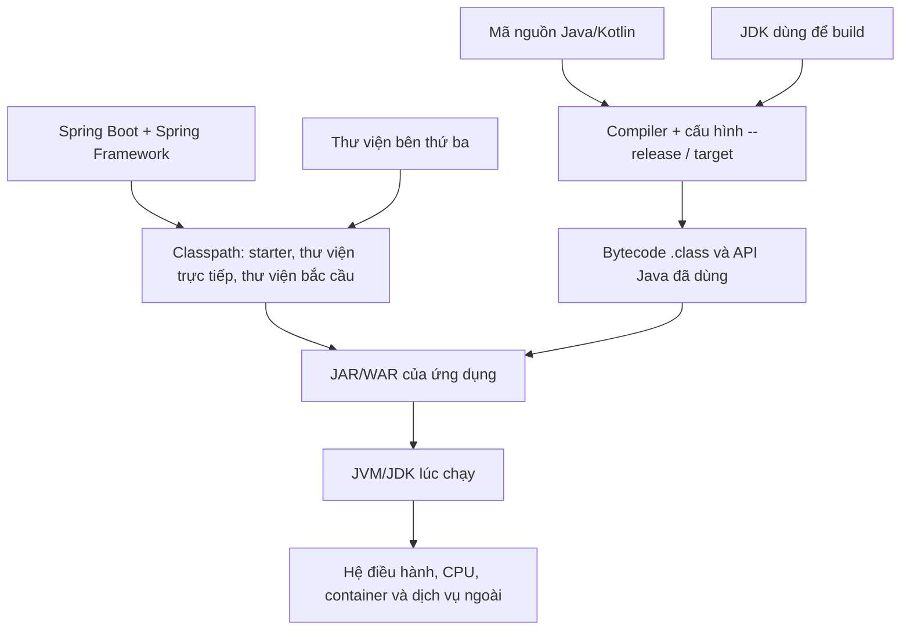
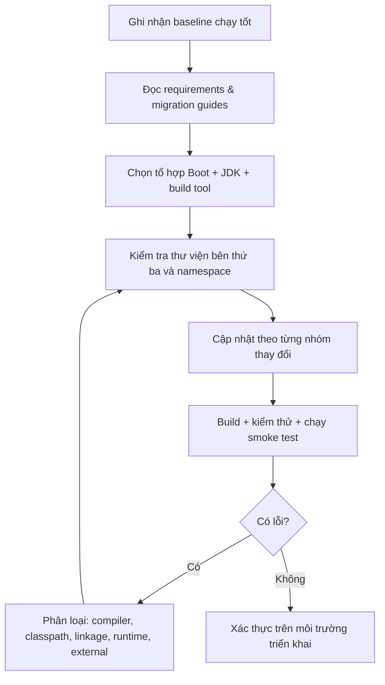

# Tương thích JDK, framework và thư viện bên thứ ba

Một dự án Spring Boot có thể **biên dịch thành công trên máy lập trình viên nhưng không chạy được trên máy chủ**. Một dự án khác chạy tốt với Java 17, nhưng khi nâng Spring Boot hoặc thêm một thư viện lại gặp `NoSuchMethodError`, `ClassNotFoundException` hay lỗi liên quan đến `javax` và `jakarta`. Những lỗi này thường xuất phát từ việc nhiều lớp phần mềm cùng tham gia vào quá trình build và chạy ứng dụng, nhưng không cùng một “hợp đồng tương thích”.

Bài học này giúp bạn đọc một dự án Spring Boot như **một hệ thống các phiên bản liên kết với nhau**, biết xác định lớp nào gây xung đột, và nâng cấp theo trình tự có thể kiểm soát. Bạn không cần học thuộc danh sách phiên bản của mọi thư viện; điều quan trọng là hiểu phải kiểm tra **cái gì, ở thời điểm nào, bằng bằng chứng nào**.

## 1. Bức tranh chung: tương thích là quan hệ giữa nhiều tầng

Một ứng dụng Spring Boot thường có các tầng sau:



Ứng dụng có thể thất bại nếu **bất kỳ đường nối quan trọng nào** không tương thích. Ví dụ:

- Bytecode được biên dịch cho Java 21 nhưng JVM production chỉ hỗ trợ đến Java 17.
- Code dùng API Spring Framework đời cũ trong khi Spring Boot phiên bản mới quản lý API khác.
- Một thư viện cũ tham chiếu `javax.servlet.*` nhưng ứng dụng Spring Boot 3 dùng hệ sinh thái Servlet với namespace `jakarta.servlet.*`.
- Hai thư viện cần hai phiên bản API khác nhau nhưng dependency resolution chỉ chọn một bản đưa lên runtime classpath.
- Thư viện Java chạy được, nhưng native library đi kèm không hỗ trợ kiến trúc CPU hoặc hệ điều hành của môi trường triển khai.

Vì vậy, câu hỏi “Dự án có hỗ trợ Java 21 không?” phải được làm rõ: **phiên bản Spring Boot nào, thư viện nào, build tool nào, bytecode mục tiêu nào, và JVM nào sẽ thực thi?**

### Năm loại tương thích cần phân biệt

| Loại | Câu hỏi cần trả lời | Ví dụ thất bại |
|---|---|---|
| **Build-tool compatibility** | Gradle/Maven và plugin có chạy trên JDK hiện tại không? | Gradle wrapper quá cũ không khởi động trên JDK mới |
| **Source/API compatibility** | Source code có dùng được API và cú pháp trên target đã chọn không? | Dùng API chỉ có từ Java 21 nhưng đặt `--release 17` |
| **Binary/runtime compatibility** | JVM có đọc được bytecode, và các method/class mà bytecode tham chiếu có còn không? | `UnsupportedClassVersionError`, `NoSuchMethodError` |
| **Framework integration compatibility** | Spring Boot, Spring Framework và thư viện tích hợp có cùng thế hệ API không? | Spring Security/Hibernate/Servlet tích hợp sai thế hệ |
| **Environment compatibility** | Hệ điều hành, CPU, native dependency, database và cấu hình triển khai có phù hợp? | JNI library chỉ có bản x86_64 nhưng server ARM64 |

“Biên dịch được” chỉ kiểm chứng **một phần** trong bảng. Nó không tự chứng minh rằng mọi nhánh runtime đều hoạt động.

## 2. JDK, JRE, JVM và bytecode: ai làm việc gì?

Trước khi bàn về Spring Boot, cần tách các khái niệm Java:

- **JDK (Java Development Kit)** chứa công cụ phục vụ phát triển như `javac`, `jar`, `javadoc` và các công cụ chẩn đoán, cùng Java runtime tương ứng.
- **JVM (Java Virtual Machine)** thực thi bytecode Java. Một JVM cụ thể chỉ hiểu những định dạng class file và tính năng runtime mà phiên bản đó hỗ trợ.
- **Java runtime** là môi trường cần để chạy ứng dụng. Trong triển khai thực tế, nó có thể là image runtime/JDK hoặc runtime image thu gọn tạo từ `jlink`.
- **Bytecode** nằm trong các tệp `.class` được sinh khi biên dịch. Định dạng class file có version riêng.
- **Java API** là các class, method và hành vi mà source/bytecode sử dụng. Định dạng bytecode tương thích chưa đủ nếu API được dùng không tồn tại ở runtime.

Một số class file major version thường gặp:

| Bản Java mục tiêu | Class file major version | Hệ quả |
|---|---:|---|
| Java 8 | 52 | JVM Java 8 hiểu bytecode tối đa ở mức của nó |
| Java 11 | 55 | Không thể chạy trực tiếp trên JVM Java 8 |
| Java 17 | 61 | Không thể chạy trực tiếp trên JVM Java 11 |
| Java 21 | 65 | Không thể chạy trực tiếp trên JVM Java 17 |

Thông thường, JVM mới có thể chạy bytecode cũ hơn. Tuy nhiên, **không nên đồng nhất khả năng đọc bytecode với việc ứng dụng chắc chắn chạy đúng**: API đã bị loại bỏ, hành vi thay đổi, thư viện native, thay đổi bảo mật và reflective access đều có thể gây lỗi.

### Lỗi điển hình: biên dịch Java 21, chạy Java 17

Nếu compiler sinh class file major version 65 nhưng runtime chỉ hỗ trợ đến 61, bạn có thể thấy:

```text
java.lang.UnsupportedClassVersionError:
  ... has been compiled by a more recent version of
  the Java Runtime (class file version 65.0),
  this version of the Java Runtime only recognizes
  class file versions up to 61.0
```

Điều này có nghĩa **JVM đang chạy quá cũ so với bytecode**, không phải lỗi của `@SpringBootApplication` hoặc dependency injection. Hướng xử lý là:

1. Xác nhận JVM thực tế đang chạy ứng dụng.
2. Nâng runtime lên phiên bản phù hợp **hoặc** biên dịch lại với target được hỗ trợ, nếu toàn bộ code và dependency thật sự có thể chạy trên target đó.
3. Bảo đảm các JAR của thư viện cũng dùng bytecode không vượt giới hạn JVM production.

Chỉ hạ target của **mã nguồn ứng dụng** không thể sửa một thư viện đã phát hành sẵn với bytecode Java 21.

### Kiểm tra phiên bản Java đang được dùng

Trên terminal:

```bash
java --version
javac --version
```

Lệnh đầu cho biết Java launcher/runtime được tìm thấy qua môi trường hiện tại. Lệnh thứ hai cho biết compiler có sẵn. Chúng **có thể thuộc hai JDK khác nhau** nếu `PATH` và `JAVA_HOME` chưa thống nhất.

Đối với dự án Gradle, lệnh sau giúp thấy JVM dùng để chạy Gradle:

```bash
./gradlew --version
```

Trên Windows với PowerShell/CMD, thường dùng `.\gradlew.bat --version`. Đừng cho rằng JDK dùng để chạy Gradle luôn là JDK dùng để compile: **Java toolchain** có thể chọn JDK khác cho tác vụ JavaCompile, test hoặc các tác vụ Java khác tùy cấu hình.

## 3. JDK dùng để build khác với phiên bản Java đích

Hãy phân biệt ba thông tin:

1. **JDK chạy build tool**: Gradle daemon hoặc Maven được khởi động bằng JVM nào?
2. **JDK compiler/toolchain**: `javac` nào biên dịch source?
3. **Java release/bytecode target**: application và các thư viện cần runtime Java tối thiểu nào?

Ví dụ dự án Gradle có thể dùng JDK 21 để biên dịch source theo Java 17:

```groovy
plugins {
    id 'java'
}

java {
    toolchain {
        languageVersion = JavaLanguageVersion.of(21)
    }
}

tasks.withType(JavaCompile).configureEach {
    options.release = 17
}
```

Trong ví dụ này, toolchain yêu cầu compiler Java 21, còn `--release 17` giới hạn ngôn ngữ, API nền tảng và bytecode theo Java 17. Cấu hình này có ý nghĩa **khi cả framework lẫn tất cả dependency runtime đều hỗ trợ Java 17**.

Ngược lại, nếu sử dụng chỉ:

```groovy
java {
    toolchain {
        languageVersion = JavaLanguageVersion.of(21)
    }
}
```

thì mặc định biên dịch thường nhắm đến Java 21. Không nên tự suy đoán rằng vì source chỉ dùng cú pháp đơn giản nên bytecode sẽ chạy trên Java 17.

**Vì sao `--release` quan trọng?** Các tùy chọn `-source` và `-target` đơn lẻ không bảo đảm hạn chế các API nền tảng chỉ xuất hiện trên JDK mới. `--release` giúp kiểm soát cả phần API Java tiêu chuẩn nhìn thấy khi biên dịch. Tuy nhiên nó không thay bạn kiểm tra mức Java yêu cầu của dependency bên ngoài.

### Một bảng tình huống ngắn

| Compiler | `--release` | JVM lúc chạy | Kết quả dự kiến |
|---|---:|---|---|
| JDK 21 | 21 | Java 21 | Phù hợp ở mức bytecode |
| JDK 21 | 17 | Java 17 | Có thể phù hợp nếu mọi dependency cũng hỗ trợ 17 |
| JDK 21 | 21 | Java 17 | Không phù hợp với class file 65 |
| JDK 17 | 21 | Java 21 | Compiler 17 không thể target release 21 |

Không có một con số Java duy nhất đủ mô tả cấu hình của toàn dự án.

## 4. Spring Boot, Spring Framework và JDK phải tương thích theo bộ

Spring Boot là lớp tích hợp và cấu hình ứng dụng dựa trên nhiều dự án: Spring Framework, Spring Data, Spring Security (nếu dùng), thư viện HTTP server, JSON, persistence, logging, testing và nhiều thành phần khác.

Các phiên bản Spring Boot thường đi kèm một **bộ phiên bản dependency được kiểm thử và quản lý**. Khi chọn phiên bản Boot, bạn cũng đang chọn một tổ hợp thư viện nền tảng. Vì thế, tự nâng hoặc hạ phiên bản Spring Framework riêng lẻ có thể tạo ra tổ hợp chưa được Boot đó kiểm chứng.

Một số mốc **minh họa theo thế hệ, không phải danh sách tất cả phiên bản mới nhất**:

| Thế hệ ứng dụng | Khung liên quan | Điều cần lưu tâm |
|---|---|---|
| Spring Boot 2.x | Spring Framework 5.x | Nhiều API tích hợp Java EE đời cũ dùng namespace `javax.*` |
| Spring Boot 3.x | Spring Framework 6.x | Yêu cầu Java 17 trở lên; hệ sinh thái Jakarta EE chuyển nhiều API từ `javax.*` sang `jakarta.*` |

Ví dụ, với một dự án Spring Boot 3.x, lựa chọn Java 17 hoặc Java 21 cần đối chiếu **đúng dòng phiên bản Boot đang dùng**, tài liệu hệ thống build và các thư viện còn lại. Nếu nâng lên một **major version** Boot khác, cần đọc release notes/migration guide tương ứng, bởi major upgrade có thể đổi mức Java tối thiểu, API framework, phiên bản dependency hoặc cơ chế cấu hình.

### Vì sao không nên “chọn framework mới nhất rồi ép vào Boot cũ”?

Giả sử một Spring Boot release quản lý nhóm Spring Framework 6.x cụ thể. Bạn khai báo ép `spring-context` phiên bản khác nhưng vẫn để `spring-webmvc`, `spring-core` và các module Spring khác theo BOM cũ. Build tool có thể tạo ra **tổ hợp không đồng nhất**.

Lỗi có thể không xuất hiện lúc biên dịch source của ứng dụng. Nó có thể chỉ phát sinh khi một class Spring gọi method mà class Spring khác không có ở runtime:

```text
java.lang.NoSuchMethodError:
  '... org.springframework.somepackage.SomeType.someMethod(...)'
```

Đây là lỗi **liên kết nhị phân (binary linkage)** giữa các phiên bản API. Trước khi sửa code, hãy xem dependency graph và kiểm tra nhóm phiên bản Spring đang được chọn.

**Quy tắc thực hành:** với dependency được Spring Boot quản lý, ưu tiên để BOM của Boot chọn phiên bản. Chỉ override một thư viện khi có lý do rõ ràng, đã đọc ghi chú tương thích và có kiểm thử thích hợp.

## 5. Bước ngoặt `javax` → `jakarta`

Một thay đổi quan trọng khi chuyển từ các hệ thống Java EE cũ sang Jakarta EE là đổi namespace của nhiều API. Với Spring Boot 3, những thư viện Servlet/JPA/Validation theo Jakarta được dùng ở các mảng liên quan.

| Chức năng | API Java EE cũ | API Jakarta tương ứng |
|---|---|---|
| Servlet | `javax.servlet.http.HttpServletRequest` | `jakarta.servlet.http.HttpServletRequest` |
| Persistence (JPA) | `javax.persistence.Entity` | `jakarta.persistence.Entity` |
| Bean Validation | `javax.validation.Valid` | `jakarta.validation.Valid` |
| Lifecycle annotations | `javax.annotation.PostConstruct` | `jakarta.annotation.PostConstruct` |

Ví dụ một entity theo Jakarta Persistence:

```java
package com.example.catalog;

import jakarta.persistence.Entity;
import jakarta.persistence.GeneratedValue;
import jakarta.persistence.GenerationType;
import jakarta.persistence.Id;

@Entity
public class Product {

    @Id
    @GeneratedValue(strategy = GenerationType.IDENTITY)
    private Long id;

    private String name;

    protected Product() {
    }

    public Product(String name) {
        this.name = name;
    }
}
```

Đoạn trên minh họa namespace/annotation phù hợp trong môi trường JPA Jakarta. Để thực sự chạy persistence, ứng dụng còn cần dependency JPA và cấu hình database/provider tương ứng.

**Không được hiểu rằng mọi package `javax.*` đều cần đổi thành `jakarta.*`.** Những API Java SE như `javax.crypto` hay `javax.swing` không phải các API Jakarta EE được đổi tên ở đây. Chỉ đổi những namespace thuộc bộ API có migration tương ứng.

### Vấn đề với thư viện bên thứ ba chưa hỗ trợ Jakarta

Giả sử bạn nâng ứng dụng lên Spring Boot 3 nhưng một thư viện filter servlet cũ vẫn dùng:

```java
import javax.servlet.Filter;
```

trong khi runtime server/framework đang dùng `jakarta.servlet.Filter`. Hai kiểu này có **tên binary khác nhau**, do đó không thể coi một object implement interface cũ là đã implement interface mới. Việc thêm cả hai JAR API vào classpath không tự chuyển đổi implementation. Trường hợp này thường cần:

1. Nâng thư viện filter lên release hỗ trợ Jakarta.
2. Nếu thư viện không còn được duy trì, cân nhắc thư viện thay thế hoặc viết lại tích hợp cần thiết bằng Jakarta API.
3. Xác minh toàn bộ chuỗi tích hợp: Spring Security, Servlet container, JPA provider, Bean Validation, JSON và các starter liên quan nếu dự án sử dụng.

Đây là **sự khác biệt ở cấp API**, không phải lỗi “thiếu một dòng import” có thể sửa bằng cách đổi tên package trong source ứng dụng mà không kiểm tra binary dependency.

## 6. Starter và BOM: vì sao Boot giúp giảm xung đột phiên bản?

Trong Spring Boot, **starter** thường là dependency tổng hợp cho một chức năng, ví dụ `spring-boot-starter-web` hoặc `spring-boot-starter-data-jpa`. Các starter mang theo những dependency cần thiết theo một tổ hợp hợp lý.

**BOM (Bill of Materials)** là tập quy tắc quản lý phiên bản cho nhiều artifact. Một dự án sử dụng Spring Boot dependency management phù hợp có thể khai báo dependency được quản lý mà không ghi version tại từng dòng:

```groovy
dependencies {
    implementation 'org.springframework.boot:spring-boot-starter-web'
    implementation 'org.springframework.boot:spring-boot-starter-validation'
    testImplementation 'org.springframework.boot:spring-boot-starter-test'
}
```

Đoạn cấu hình này **giả định dự án đã áp dụng cơ chế quản lý version của Spring Boot** (chẳng hạn plugin `io.spring.dependency-management` tích hợp với Boot hoặc Gradle native BOM platform đúng cách). Nếu không có dependency management, nhiều dependency khai báo không có version sẽ không resolve được.

Lợi ích của BOM:

- Giảm việc tự chọn hàng loạt phiên bản framework và thư viện tích hợp.
- Hạn chế nguy cơ lệch các module Spring hoặc các thư viện mà Boot cần phối hợp.
- Tạo một baseline nhất quán để nâng cấp theo một release Boot cụ thể.

Nhưng BOM **không phải lời bảo đảm tuyệt đối**:

- Nó không kiểm tra mọi dependency bên ngoài BOM.
- Nó không tự giải quyết sự thay đổi API giữa một thư viện cũ và Boot mới.
- Nó không làm thư viện bytecode Java 21 chạy được trên Java 17.
- Nó không thay thế việc kiểm thử chức năng với database, message broker, hệ điều hành và dịch vụ thật.

### Ví dụ: thư viện trực tiếp và thư viện bắc cầu

Giả sử cây dependency đơn giản như sau:

```text
my-spring-boot-app
├── spring-boot-starter-web
│   ├── spring-webmvc
│   ├── spring-boot-starter-json
│   │   └── jackson-databind
│   └── spring-boot-starter-tomcat
└── legacy-reporting-client
    └── jackson-databind (đòi một bản khác)
```

Hai nhánh cùng phụ thuộc `jackson-databind`. Build tool phải phân giải artifact/version được chọn cho một cấu hình classpath nhất định. Cách phân giải **khác nhau giữa Gradle và Maven**, còn BOM, constraints, direct dependencies và exclusions đều có thể tác động đến kết quả. Vì thế đừng dựa vào giả định “thư viện tôi thêm sau cùng sẽ thắng”.

Cần đọc **dependency graph đã resolve thực tế**, không chỉ danh sách khai báo trong `build.gradle` hoặc `pom.xml`.

### Khi nào nên khai báo version tường minh?

- Dependency **không được BOM hiện tại quản lý** thường cần phiên bản được chọn rõ ràng.
- Một dependency cần **bản sửa lỗi bảo mật** chưa có trong BOM hiện tại có thể cần override tạm thời, nhưng phải cân nhắc tương thích và kế hoạch quay về phiên bản được Boot quản lý khi có release phù hợp.
- Khi dùng một starter/extension từ bên thứ ba, hãy đối chiếu **ma trận tương thích do chính dự án đó công bố** với Spring Boot/JDK bạn đang dùng.

Đừng nâng riêng Spring Framework, Hibernate, Jackson hoặc Spring Security chỉ vì thấy phiên bản mới hơn, trước khi hiểu chúng liên kết thế nào với Boot release.

## 7. Tương thích của thư viện bên thứ ba: bốn lớp kiểm tra

Một thư viện có thể “hỗ trợ Java 17” nhưng vẫn không hoạt động với ứng dụng Spring Boot 3. Chữ “hỗ trợ” cần được bóc tách.

### 7.1. Mức Java tối thiểu và bytecode

JAR thư viện chứa các class đã biên dịch. Nếu class đó có major version 65 thì cần runtime hiểu được bytecode tương ứng (Java 21 trở lên). Dù source của bạn biên dịch theo `--release 17`, bản thân JAR này vẫn không chạy trên JVM 17.

Với các thư viện dùng multi-release JAR, có thể có class implementation khác nhau cho từng mức Java. Tương thích lúc này cần dựa trên cách runtime lựa chọn class và cam kết của thư viện, không suy luận chỉ từ tên file.

### 7.2. API nguồn và tương thích nhị phân

Hai khái niệm thường bị lẫn:

- **Source compatibility**: code nguồn cũ còn biên dịch được khi dùng API phiên bản mới hay không.
- **Binary compatibility**: bytecode đã biên dịch từ trước còn liên kết được với class/method/field ở runtime mới hay không.

Một method bị xóa hoặc đổi chữ ký có thể làm nổ `NoSuchMethodError` khi chạy, dù dự án vẫn build thành công do class gây lỗi nằm trong một dependency đã được biên dịch sẵn.

Ví dụ mang tính mô tả:

```text
Library A được compile với Library B phiên bản X:
  BClient.send(String)

Runtime thực tế chỉ có Library B phiên bản Y:
  BClient.send(Request)

Khi A gọi send(String) → có thể xảy ra NoSuchMethodError.
```

Giải pháp không phải thêm `try/catch` để bỏ qua lỗi liên kết; cần đồng bộ API/binary version hoặc đổi adapter gọi API tương ứng.

### 7.3. Tương thích với extension point của framework

Các thư viện mở rộng Spring có thể phụ thuộc sâu vào API của framework:

- Security filter chain và authentication infrastructure.
- Servlet filters, interceptors, controllers và embedded server.
- Spring Data, JPA/Hibernate, transaction manager và persistence integration.
- Validation provider, Jackson modules và serialization customizers.
- Actuator, logging và quan sát hệ thống.

Ví dụ, thư viện starter dành cho Spring Boot 2 không đương nhiên dùng được với Boot 3 chỉ vì cả hai đều chạy trên một JDK mới. Hãy tìm release phù hợp **thế hệ Boot**, không chỉ đúng mức Java.

### 7.4. Điều kiện môi trường và native component

Một số thư viện mang JNI/native code, tích hợp trình duyệt, sử dụng codec nén, thư viện mật mã hoặc truy cập hệ điều hành. Chúng có thể yêu cầu:

- Đúng hệ điều hành: Windows, Linux hoặc macOS.
- Đúng kiến trúc CPU: x86_64, ARM64.
- Đúng C library/native runtime hoặc các thành phần hệ thống.
- Quyền truy cập file/network và cấu hình container phù hợp.

Vì vậy việc test chạy trên laptop chưa thể chứng minh tương thích khi deploy lên Linux container ARM64, kể cả khi JVM và Boot trùng phiên bản.

## 8. Đừng quên build tool, plugin và annotation processor

Ứng dụng Spring Boot đi qua một hệ thống build trước khi trở thành JAR chạy được. Các thành phần này có **vòng đời hỗ trợ phiên bản riêng**:

| Thành phần | Phải khớp với gì? | Ví dụ vấn đề |
|---|---|---|
| Gradle wrapper | JDK chạy Gradle và phiên bản plugin | Wrapper cũ không hỗ trợ JDK dùng cho build |
| Maven | JDK khởi động Maven và plugin version | Compiler/test plugin đời cũ không hiểu release mới |
| Spring Boot Gradle/Maven plugin | Build tool và Spring Boot release | Plugin cũ không hỗ trợ cách đóng gói/tác vụ hiện tại |
| Compiler plugin / `javac` | Source level và Java release | “invalid target release” |
| Annotation processor (ví dụ Lombok, MapStruct) | JDK compiler, API annotation và tooling | Lỗi compilation processor với JDK mới |
| Test framework | JDK, test engine, Spring Test | Không phát hiện test hoặc test runtime lỗi |

Khi nâng JDK, đôi khi **việc đầu tiên cần nâng là Gradle wrapper/Maven plugin**, trước cả khi chỉnh ứng dụng. Đọc tài liệu về “JDK supported to run Gradle” và “JDK supported for compilation via toolchains”: hai tiêu chí này không nhất thiết trùng nhau.

Nếu dùng IDE, hãy phân biệt thêm:

- Project SDK/JDK trong IDE.
- Gradle JVM hoặc Maven runner JDK do IDE sử dụng.
- Java toolchain và bytecode target mà build file khai báo.
- JVM thực tế của cấu hình Run/Debug.

Chênh lệch ở các nơi này giải thích vì sao “chạy trong IDE được, chạy bằng Gradle không được” hoặc ngược lại.

## 9. Một kịch bản cụ thể: nâng từ ứng dụng cũ lên Spring Boot 3

Giả sử một ứng dụng lâu năm dùng Spring Boot 2.x, tích hợp servlet filter cũ, Spring Security cũ và JPA theo `javax.persistence`. Bạn muốn chuyển sang Spring Boot 3.x và JDK 21.

Đây là **hai thay đổi khác nhau**:

1. **Đổi JDK**: kiểm tra build tool/plugin hỗ trợ JDK 21, target bytecode, reflection, dependency Java version và runtime image.
2. **Đổi major Spring Boot**: kiểm tra yêu cầu Java tối thiểu, Spring Framework 6, Jakarta namespace, các bản tương ứng của Hibernate/Security/Servlet/Validation, thay đổi property và auto-configuration.

Thực hiện cả hai trong một commit lớn mà không đo được baseline dễ khiến bạn không biết lỗi nằm ở Java, framework hay thư viện tích hợp.

### Mô hình thực hiện có kiểm soát



**Bước 1 — Ghi nhận baseline.** Lưu phiên bản hiện tại của JDK, Spring Boot, build tool và các dependency trực tiếp/đã resolve. Ghi lại một số luồng nghiệp vụ quan trọng đang chạy được để đối chiếu.

**Bước 2 — Chọn một bộ phiên bản được hỗ trợ.** Dùng system requirements và dependency versions của **release Spring Boot cụ thể** bạn định dùng. Cùng lúc đối chiếu release notes của thư viện tích hợp như Hibernate, Spring Security và các starter bên thứ ba.

**Bước 3 — Cập nhật build tool và cấu hình Java.** Đảm bảo wrapper/plugin chạy được với JDK mới; khai báo toolchain để môi trường dev và CI nhất quán. Xác định rõ runtime Java mục tiêu.

**Bước 4 — Chuyển API tích hợp nếu cần.** Đổi các import Java EE liên quan sang Jakarta; nâng thư viện chỉ biết `javax.servlet`/`javax.persistence` lên bản hỗ trợ Jakarta.

**Bước 5 — Giữ dependency management đồng nhất.** Ưu tiên BOM của Boot và loại bỏ các override cũ không còn lý do tồn tại. Với dependency không được quản lý, chọn version theo tài liệu tương thích.

**Bước 6 — Kiểm thử và xác thực deployment.** Biên dịch, chạy test, khởi động ứng dụng, gọi endpoint, kiểm tra kết nối database/transaction/serialization/authentication, rồi chạy trên container/JVM giống production.

Việc **tăng JDK runtime trước** hoặc **nâng Boot trước** tùy constraints dự án; ví dụ có giai đoạn trung gian giúp giảm số thay đổi đồng thời, có giai đoạn không khả thi vì thư viện cũ không hỗ trợ JDK mới. Điều cần giữ là một ma trận phiên bản rõ ràng và bước xác minh sau mỗi lần nâng.

## 10. Đọc dependency graph bằng Gradle và Maven

Khi gặp lỗi classpath, nhìn mỗi dòng `implementation` trong build file là chưa đủ. Cần xem **phiên bản nào được chọn thực tế** và **nó đi vào dự án từ nhánh nào**.

### Với Gradle

Trên Linux/macOS (Windows dùng `.\gradlew.bat` thay cho `./gradlew`):

```bash
# Gradle JVM và phiên bản wrapper
./gradlew --version

# Liệt kê các Java toolchain mà Gradle phát hiện
./gradlew javaToolchains

# Xem dependency đã resolve cho runtime
./gradlew dependencies --configuration runtimeClasspath

# Tìm vì sao một module được chọn và được kéo vào từ đâu
./gradlew dependencyInsight \
  --configuration runtimeClasspath \
  --dependency jackson-databind
```

Ở dự án nhiều module, bạn có thể thêm đường dẫn project, ví dụ `./gradlew :app:dependencies --configuration runtimeClasspath` nếu thực sự có module Gradle tên `app`.

Phân biệt `compileClasspath` và `runtimeClasspath`: một dependency có thể có mặt khi compile nhưng không xuất hiện (hoặc có version khác) lúc chạy. Đó là lý do phải điều tra **classpath đang gây lỗi**, không chỉ kiểm tra dependency compile.

### Với Maven

```bash
# Maven đang chạy trên JDK nào?
mvn -version

# Dependency tree của dự án
mvn dependency:tree

# Thu hẹp vào một nhóm/thư viện, cú pháp filter tùy plugin
mvn dependency:tree -Dincludes=com.fasterxml.jackson.core:jackson-databind
```

Nếu dự án dùng Maven Wrapper, ưu tiên `./mvnw` (hoặc `mvnw.cmd` trên Windows) để nhất quán phiên bản Maven mà dự án chỉ định.

Trong Maven, quản lý version qua `dependencyManagement` và cách chọn phiên bản theo quan hệ phụ thuộc có quy tắc riêng; trong Gradle, platform/constraints và conflict resolution ảnh hưởng đến bản được chọn. **Hai công cụ không luôn ra cùng một dependency graph chỉ từ các khai báo trông giống nhau.**

### Khi cần tìm class file thuộc JAR nào

Đôi khi lỗi nêu một class nhưng bạn không biết nó đến từ dependency nào. Hãy bắt đầu với dependency graph, sau đó kiểm tra nội dung JAR cụ thể:

```bash
jar tf some-library.jar
```

Tên JAR trên chỉ là placeholder. Cần dùng đúng đường dẫn artifact thực tế. Có thể dùng `javap -verbose` để xem thông tin class file của một class đã trích xuất/đặt trên classpath, trong đó có `major version`.

Nếu có nhiều JAR chứa cùng một fully qualified class, thứ tự classloader/classpath cũng có thể tạo ra lỗi khó đoán. Cần xử lý nguồn của thư viện trùng, thay vì chỉ sửa import trong source.

## 11. Giải mã lỗi theo lớp tương thích

| Lỗi/triệu chứng | Lớp nghi vấn đầu tiên | Hướng điều tra |
|---|---|---|
| `invalid target release: 21` | Compiler/build JDK | `javac --version`, toolchain, compiler plugin |
| `UnsupportedClassVersionError` | Bytecode > JVM runtime | Class file major version, `java --version` trong môi trường chạy |
| `ClassNotFoundException` | Thiếu class ở classpath hiện tại | Dependency/runtime packaging, namespace, classloader |
| `NoClassDefFoundError` | Class cần thiết không thể nạp/khởi tạo được | Xem root cause, classpath và initialization failure |
| `NoSuchMethodError` | Lệch phiên bản binary API | Dependency graph, JAR chứa class, bản API đã compile |
| `IncompatibleClassChangeError` | Thay đổi không tương thích ở binary structure | Đồng bộ thư viện và framework đang liên kết |
| Lỗi `javax.servlet...` / `jakarta.servlet...` | Khác thế hệ Servlet API | Kiểm tra Boot/Servlet/starter của bên thứ ba |
| `BeanCreationException` sau khi nâng Boot | Cấu hình/auto-configuration/framework integration | Đọc nested cause, điều kiện cấu hình, migration guide |
| `UnsatisfiedDependencyException` | Bean wiring hoặc Bean nền tảng không tạo được | Kiểm tra nguyên nhân sâu nhất; có thể do dependency thiếu |
| JVM/Gradle không khởi động được sau nâng Java | Build tool/JDK compatibility | Gradle wrapper hoặc Maven/plugin requirements |
| Chỉ lỗi trên container production | Runtime image/platform/config | Java trong image, CPU/OS, biến môi trường, native dependency |

Một lỗi Spring ở tầng cao thường chỉ là **hậu quả**. Ví dụ `BeanCreationException` có thể bọc `NoClassDefFoundError`, rồi phía dưới nữa mới là dependency thiếu. Khi debug, hãy tìm **root cause** trong stack trace.

### Ba chuỗi suy luận mẫu

**Trường hợp A — `UnsupportedClassVersionError` ngay khi chạy JAR**

Kiểm tra `java --version` trong container thật. Nếu runtime là Java 17 nhưng bytecode là class file 65, vấn đề thuộc JDK/target. Không cần bắt đầu bằng sửa controller hay Bean.

**Trường hợp B — nâng starter bên thứ ba xong gặp `NoSuchMethodError`**

Tìm class/method trong stack trace, truy lại artifact sở hữu nó, dùng `dependencyInsight` hoặc `dependency:tree` để xem version runtime. So với phiên bản mà thư viện gọi method đã được compile/kiểm thử. Sửa bằng tổ hợp thư viện tương thích.

**Trường hợp C — chuyển lên Spring Boot 3 xong filter không load**

Kiểm tra API mà filter implement: `javax.servlet.Filter` hay `jakarta.servlet.Filter`. Xác minh bản library hỗ trợ Jakarta và Servlet container/framework tương ứng. Thêm JAR `javax.servlet-api` thường không làm filter cũ trở thành filter Jakarta.

## 12. Phân biệt compatibility với version “mới hơn”

Version cao hơn không mặc nhiên tương thích hơn:

- **Patch/minor/major** là một quy ước ý định thay đổi; mức độ giữ tương thích còn tùy cách mỗi dự án áp dụng chính sách phiên bản.
- API có thể bị deprecated trước khi bị loại bỏ ở major release; việc compile với cảnh báo chưa chứng minh tương thích ở release tương lai.
- Một thư viện mới có thể yêu cầu JDK cao hơn; Java runtime production cũ trở thành nút thắt.
- Một bản mới có thể hỗ trợ Spring Boot mới nhưng ngừng hỗ trợ Boot cũ.
- Một dependency override có thể giải quyết lỗ hổng cụ thể nhưng đồng thời phá vỡ binary API của thư viện khác.

Trong một nhóm artifact được Boot quản lý, **độ tương thích của cả tổ hợp** thường hữu ích hơn việc từng artifact đứng ở phiên bản cao nhất.

### Khóa phiên bản và tính tái lập

Build ổn định cần biết chính xác đang dùng những artifact nào:

- Commit Gradle Wrapper hoặc Maven Wrapper của dự án.
- Quản lý các phiên bản dependency trực tiếp, BOM và plugin một cách rõ ràng.
- Với hệ thống có yêu cầu tái lập chặt chẽ, xem xét dependency locking và dependency verification theo công cụ build đang dùng.
- Tránh dùng các phiên bản thay đổi động như `latest.release`/mẫu `+` ở môi trường cần kiểm soát.
- Ghi nhận image/runtime Java được triển khai; đừng phụ thuộc vào tag container có thể đổi nội dung mà không được kiểm soát.

Những việc này giảm tình huống “hôm qua build được, hôm nay không build được” dù source ứng dụng không đổi.

## 13. Ma trận tương thích: công cụ ra quyết định đơn giản

Trước khi chốt nâng cấp, hãy lập bảng theo **môi trường thực tế của dự án**, không tự động lấy số mới nhất:

| Thành phần | Hiện tại | Mục tiêu | Nguồn xác minh |
|---|---|---|---|
| JDK cho Gradle/Maven | Ví dụ Java 17 | Ví dụ Java 21 | Requirements của build tool/plugin |
| Java compile target | 17 | 17 hoặc 21 | Cấu hình `--release`/toolchain |
| JVM production | 17 | 21 nếu target 21 | Image/runtime deployment |
| Spring Boot | Một release cụ thể | Release mục tiêu | System requirements, migration guide |
| Spring Framework | Theo BOM hiện tại | Theo BOM mục tiêu | Dependency versions của Boot |
| HTTP/Servlet stack | Theo starter hiện tại | Theo starter mục tiêu | Servlet/Jakarta compatibility |
| Persistence/Validation | Provider hiện tại | Provider tương thích | Notes của provider/starter |
| Third-party starters | Các phiên bản đang dùng | Phiên bản hỗ trợ Boot mục tiêu | Compatibility matrix của vendor |
| Test/build tooling | Wrapper/plugin hiện tại | Phiên bản hỗ trợ JDK mục tiêu | Tool requirements và CI |

Khi điền bảng, tránh chỉ ghi “Spring Boot 3” hay “Java 21”: phiên bản patch/minor, build plugin, runtime image và các starter cụ thể thường quyết định việc ứng dụng có chạy thật hay không.

### Ví dụ đọc ma trận

Giả sử có ba phương án:

| Phương án | Boot | Compile target | Runtime | Nhận định |
|---|---|---|---|---|
| A | Boot 3.x phù hợp | Java 17 | Java 17 | Hợp lý ở mức yêu cầu Java cơ bản; vẫn phải kiểm tra dependency |
| B | Boot 3.x phù hợp | Java 21 | Java 17 | Không phù hợp ở mức bytecode |
| C | Boot 3.x phù hợp | Java 17 | Java 21 | Bytecode có thể chạy trên JVM mới hơn; vẫn phải kiểm tra framework/library và hành vi runtime |

Bảng này **không xác nhận toàn bộ tổ hợp phiên bản của một dự án bất kỳ**. Nó chỉ minh họa cách lập luận: cần thỏa mọi đường nối cùng lúc.

## 14. Bài thực hành tự kiểm chứng

### Bài 1 — Xác định ba bản Java

Trong một dự án Spring Boot dùng Gradle:

1. Chạy `java --version`, `javac --version` và `./gradlew --version`.
2. Mở build file, tìm Java toolchain và `options.release` (nếu có).
3. Xem image/runtime thực tế trên môi trường chạy.
4. Ghi thành ba cột: **JDK chạy build**, **target bytecode**, **JVM chạy app**. Nếu chưa khớp, giải thích tại sao.

Đầu ra mong muốn là một bảng có phiên bản cụ thể, không chỉ dòng kết luận “máy đang dùng Java 21”.

### Bài 2 — Lần theo thư viện bắc cầu

Với một dự án có `spring-boot-starter-web`:

1. Chạy `./gradlew dependencies --configuration runtimeClasspath`.
2. Tìm `jackson-databind` trong kết quả.
3. Chạy `./gradlew dependencyInsight --configuration runtimeClasspath --dependency jackson-databind`.
4. Ghi lại bản được chọn và ít nhất một đường phụ thuộc kéo nó vào dự án.

Nếu dùng Maven, dùng `mvn dependency:tree` với filter phù hợp.

### Bài 3 — Phân loại lỗi nâng cấp

Cho ba thông báo:

```text
A. UnsupportedClassVersionError: class file version 65.0; runtime up to 61.0
B. java.lang.NoSuchMethodError: 'X LibraryB.someMethod(...)'
C. java.lang.ClassNotFoundException: javax.servlet.Filter
```

Hãy xác định hướng điều tra đầu tiên:

- **A:** tương thích bytecode/JVM, kiểm tra build target và Java runtime.
- **B:** binary API/dependency resolution, kiểm tra artifact và version thực được chọn.
- **C:** classpath và thế hệ Servlet/Jakarta, đặc biệt khi đổi major Spring Boot.

Sau khi phân loại, đề xuất **một bằng chứng có thể thu thập** trước khi sửa source: phiên bản Java runtime, dependency graph, hoặc JAR/API mà thư viện đang sử dụng.

## 15. Nguồn cần tra cứu khi chọn phiên bản thực tế

Ma trận phiên bản thay đổi theo từng release, vì vậy khi bắt đầu một dự án hoặc nâng cấp ứng dụng, nên xem tài liệu của **đúng release**:

- [Spring Boot Reference Documentation](https://docs.spring.io/spring-boot/index.html): yêu cầu Java/build tool, dependency versions, starters, migration.
- [Spring Framework Reference](https://docs.spring.io/spring-framework/reference/): API và khả năng tích hợp của Spring Framework.
- [Gradle Compatibility Matrix](https://docs.gradle.org/current/userguide/compatibility.html): JDK chạy Gradle và khả năng dùng Java toolchains.
- [Maven Compiler Plugin Documentation](https://maven.apache.org/plugins/maven-compiler-plugin/): cấu hình source/target/release khi dùng Maven.
- [Java SE Releases](https://www.oracle.com/java/technologies/java-se-glance.html): thông tin về các thế hệ Java SE.
- Release notes/compatibility matrix của **mỗi thư viện bên thứ ba cụ thể**, nhất là thư viện tích hợp sâu vào Spring, JPA, Servlet hoặc Security.

Các đường dẫn trên là điểm bắt đầu. Hãy chọn phiên bản tài liệu khớp với artifact đang sử dụng; “current” không nhất thiết mô tả hành vi của một ứng dụng giữ nguyên release cũ.

## 16. Mô hình cần ghi nhớ

Đừng chỉ hỏi **“Thư viện này có chạy với Java mới không?”**. Hãy lần lượt trả lời:

1. **Build được không?** Gradle/Maven, plugin, compiler và JDK có phối hợp được không?
2. **Bytecode chạy được không?** JVM runtime có hỗ trợ class file và API Java cần thiết không?
3. **Framework khớp không?** Spring Boot, Spring Framework và các starter có thuộc cùng một bộ phiên bản tương thích không?
4. **Thư viện tích hợp khớp không?** API, binary compatibility và namespace Jakarta/Java EE của các thư viện bên thứ ba có phù hợp không?
5. **Triển khai thực tế chạy được không?** Container image, OS/CPU, native dependency, cấu hình và dịch vụ ngoài có đúng điều kiện không?

Tương thích trong Spring Boot là **tính chất của cả tổ hợp**, từ compiler tới JVM, từ BOM tới dependency graph và từ source tới môi trường production. Khi gặp lỗi, nhận diện tầng đang phá vỡ hợp đồng sẽ giúp bạn chọn đúng công cụ kiểm tra và sửa nguyên nhân thay vì thử đổi phiên bản một cách ngẫu nhiên.
