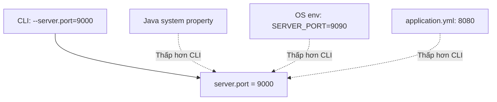

# Nguyên tắc ưu tiên khi một thuộc tính xuất hiện ở nhiều nguồn

> **Spring Boot Fundamentals · Cấu hình ứng dụng**  
> Một thuộc tính như `server.port`, `spring.datasource.url` hoặc `app.feature.enabled` có thể được khai báo đồng thời trong `application.yml`, một file cấu hình ngoài JAR, biến môi trường, Java system property và tham số dòng lệnh. Spring Boot có **thứ tự ưu tiên xác định** để chọn giá trị có hiệu lực. Hiểu thứ tự đó giúp triển khai cùng một bản JAR ở nhiều môi trường, giải thích vì sao một giá trị bị ghi đè và tránh những lỗi khó tìm trong vận hành.

## 1. Khi nhiều nguồn cùng khai báo một khóa, Spring Boot chọn thế nào?

Giả sử ứng dụng có một giá trị mặc định:

```yaml
# src/main/resources/application.yml
server:
  port: 8080
```

Môi trường triển khai đặt thêm:

```bash
export SERVER_PORT=9090
```

Và khi chạy ứng dụng, người vận hành truyền:

```bash
java -jar orders.jar --server.port=9000
```

Trong một lần chạy với các nguồn này cùng có hiệu lực, `server.port` cuối cùng là `9000`: command-line argument có ưu tiên cao hơn biến môi trường, biến môi trường lại cao hơn giá trị trong file `application.yml`.

Không phải Spring Boot chọn giá trị vì “file được đọc sau” hay vì “khóa được khai báo gần cuối source code”. Nó xây dựng `Environment` từ nhiều `PropertySource`, áp dụng thứ tự ưu tiên, rồi resolve giá trị theo thứ tự đó.



**Quy tắc nền tảng:** Khi hai nguồn cung cấp cùng một thuộc tính được Spring nhận diện là cùng khóa, giá trị của nguồn có **độ ưu tiên cao hơn** sẽ thắng. Các giá trị còn lại vẫn tồn tại trong nguồn ban đầu, nhưng không phải giá trị mà `Environment` trả về cho khóa đó.

### 1.1. PropertySource là gì?

`PropertySource` là một nguồn các cặp khóa–giá trị. Ví dụ:

- Một file `application.properties`.
- Một tài liệu YAML được tải vào config data.
- Biến môi trường của hệ điều hành.
- Java system properties.
- Command-line arguments.
- Một nguồn được thêm thủ công hoặc do thư viện tích hợp cung cấp.

Spring tập hợp các nguồn qua abstraction `Environment`. Các API như `Environment.getProperty(...)`, `@Value` và `@ConfigurationProperties` dựa trên cơ chế cấu hình đó để lấy hoặc bind dữ liệu.

```java
@Component
public class EffectivePortReporter {

    private final Environment environment;

    public EffectivePortReporter(Environment environment) {
        this.environment = environment;
    }

    public String readPort() {
        return environment.getProperty("server.port", "8080");
    }
}
```

Tham số mặc định `"8080"` trong `getProperty` chỉ được dùng khi môi trường không resolve được thuộc tính; nó **không phải một PropertySource có thể cạnh tranh** với các nguồn bên ngoài.

### 1.2. Ưu tiên không đồng nghĩa với độ tin cậy

Một property từ command line được ưu tiên hơn file không có nghĩa nó luôn đúng hoặc an toàn. Thứ tự ưu tiên là quy tắc kỹ thuật giúp ứng dụng có thể được cấu hình bên ngoài. Giá trị cuối cùng vẫn cần được kiểm tra tính hợp lệ, kiểu dữ liệu và tính phù hợp với môi trường.

Ví dụ cấu hình `server.port=-100` có thể thắng trong quá trình resolve nhưng vẫn gây lỗi khi server sử dụng giá trị không hợp lệ.

## 2. Thứ tự ưu tiên của các nguồn cấu hình

Tài liệu Spring Boot 3.x liệt kê các nguồn theo thứ tự từ **thấp đến cao**; nguồn được liệt kê sau có thể ghi đè nguồn trước. Bảng sau trình bày ngược lại, từ **cao xuống thấp**, để thuận tiện xem khi xử lý xung đột.

| Mức ưu tiên | Nguồn cấu hình | Ghi chú |
| --- | --- | --- |
| 1 — cao | Devtools global settings | Chỉ khi Devtools hoạt động, phục vụ phát triển |
| 2 | `@TestPropertySource` | Nguồn phục vụ kiểm thử |
| 3 | `@DynamicPropertySource` | Nguồn động phục vụ kiểm thử |
| 4 | Thuộc tính `properties` trên `@SpringBootTest` hoặc các test slice | Nguồn phục vụ kiểm thử |
| 5 | Command-line arguments | Ví dụ `--server.port=9000` |
| 6 | `SPRING_APPLICATION_JSON` | JSON cấu hình được truyền qua env/system property/CLI |
| 7 | `ServletConfig` init parameters | Chỉ áp dụng trong môi trường servlet phù hợp |
| 8 | `ServletContext` init parameters | Chỉ áp dụng trong môi trường servlet phù hợp |
| 9 | JNDI attributes | Ví dụ `java:comp/env` khi có JNDI |
| 10 | Java system properties | Ví dụ `-Dserver.port=8081` |
| 11 | OS environment variables | Ví dụ `SERVER_PORT=9090` |
| 12 | `RandomValuePropertySource` | Chủ yếu cho `random.*` |
| 13 | Config data | `application.properties`/`application.yml` và các file import |
| 14 | `@PropertySource` trên lớp `@Configuration` | Được thêm khi context refresh, có giới hạn thời điểm |
| 15 — thấp | Default properties | Được đặt qua `SpringApplication.setDefaultProperties(...)` |

**Lưu ý phạm vi:** Đây là thứ tự nguồn mặc định được mô tả cho Spring Boot 3.x. Các nguồn chỉ tồn tại trong môi trường phù hợp; ứng dụng CLI thuần thường không có servlet sources, còn nguồn test không xuất hiện ở production. Thư viện hoặc code tùy biến có thể thêm `PropertySource` với vị trí riêng, nên cần xem `Environment` thực tế khi có extension.

### 2.1. Những nguồn quan trọng nhất trong ứng dụng thông thường

Trong phần lớn ứng dụng Spring Boot, ta thường gặp các nguồn sau theo thứ tự từ cao xuống thấp:

```text
Command-line arguments
          ↓
SPRING_APPLICATION_JSON
          ↓
Java system properties (-D...)
          ↓
OS environment variables
          ↓
Config data (application.yml, profile files, external files...)
          ↓
@PropertySource
          ↓
Default properties
```

Mũi tên chỉ chiều **giảm dần ưu tiên**. Nếu khóa tồn tại ở mức trên, giá trị ở mức dưới sẽ không phải giá trị có hiệu lực, trừ khi nguồn phía trên bị bỏ qua hoặc không có khóa tương ứng.

### 2.2. Hai điều cần nhớ

Một là, thứ tự ưu tiên trên áp dụng cho **nguồn cấu hình**, không phải thứ tự các lệnh được viết trong source code Java.

Hai là, **config data có thứ tự riêng ở bên trong**: có nhiều vị trí file, nhiều profile và import. Khi cùng một khóa xuất hiện ở nhiều file, cần xem cả thứ tự bên trong nhóm config data trước khi so sánh với env/system/CLI.

## 3. Ví dụ tổng hợp: một khóa ở năm nơi

Giả sử các giá trị dưới đây đều có hiệu lực trong một lần khởi động:

| Nguồn | Cách khai báo | Giá trị |
| --- | --- | --- |
| `application.yml` trong JAR | `server.port: 8080` | 8080 |
| `./config/application.yml` ngoài JAR | `server.port: 8085` | 8085 |
| Biến môi trường | `SERVER_PORT=9090` | 9090 |
| System property | `-Dserver.port=8081` | 8081 |
| Command-line argument | `--server.port=9000` | 9000 |

Lệnh minh họa trong môi trường Unix shell:

```bash
export SERVER_PORT=9090
java -Dserver.port=8081 -jar orders.jar --server.port=9000
```

Nếu không có nguồn đặc biệt khác có ưu tiên cao hơn, `server.port` là `9000`.

Bỏ lần lượt từng nguồn sẽ thấy sự thay đổi:

| Cấu hình có mặt | Kết quả |
| --- | --- |
| Tất cả năm nguồn | 9000 |
| Bỏ command line | 8081 |
| Bỏ command line và system property | 9090 |
| Chỉ còn hai file | 8085 |
| Chỉ còn file trong JAR | 8080 |

Bảng này giúp quan sát các lớp ghi đè. Giá trị trong file không hề biến mất; chỉ là nguồn có ưu tiên cao hơn đang che nó.

### 3.1. Vị trí đặt `-D` và `--` khác nhau

Java system property được truyền cho JVM bằng `-D`, thường đặt **trước `-jar`**:

```bash
java -Dserver.port=8081 -jar orders.jar
```

Command-line argument của Spring Boot được đặt **sau tên JAR** và có dạng `--key=value`:

```bash
java -jar orders.jar --server.port=9000
```

Hai cơ chế này cùng có thể ảnh hưởng tới `server.port` nhưng thuộc hai PropertySource khác nhau. Lời gọi CLI do Spring Boot xử lý có ưu tiên cao hơn Java system property trong thứ tự mặc định.

### 3.2. Khi command-line properties bị tắt

Theo mặc định, Spring Boot chuyển các tham số dạng `--name=value` thành properties. Có thể tắt cơ chế này khi khởi tạo ứng dụng:

```java
public static void main(String[] args) {
    SpringApplication app = new SpringApplication(OrdersApplication.class);
    app.setAddCommandLineProperties(false);
    app.run(args);
}
```

Nếu tắt, `--server.port=9000` sẽ không được đưa vào Environment dưới dạng command-line property theo cơ chế mặc định. Khi đó một nguồn khác có ưu tiên cao nhất trong số các nguồn còn lại sẽ quyết định giá trị.

Không nên tắt tính năng này nếu ứng dụng vẫn cần nhận các cờ cấu hình qua command line.

## 4. Thứ tự ưu tiên trong nhóm config data

`application.yml` hoặc `application.properties` thuộc nhóm **config data**. Spring Boot tự tìm các file trong JAR/classpath và bên ngoài JAR ở các vị trí mặc định.

Với trường hợp phổ biến, thứ tự từ thấp đến cao trong config data là:

1. File ứng dụng cơ bản đóng gói trong JAR.
2. File theo profile đóng gói trong JAR.
3. File ứng dụng cơ bản nằm ngoài JAR.
4. File theo profile nằm ngoài JAR.

Ví dụ nếu cùng một thuộc tính có trong:

```text
classpath:/application.yml
classpath:/application-prod.yml
file:./application.yml
file:./application-prod.yml
```

và profile `prod` đang active, thì file `./application-prod.yml` có thể cung cấp giá trị thắng trong nhóm config data.

### 4.1. File ngoài JAR ưu tiên hơn file đóng gói

Ví dụ trong JAR:

```yaml
# src/main/resources/application.yml
app:
  greeting: "Hello from JAR"
```

File ngoài JAR tại vị trí được Spring Boot tự tìm:

```yaml
# ./config/application.yml
app:
  greeting: "Hello from deployment"
```

Nếu không có env/system/CLI ghi đè, `app.greeting` được resolve từ file ngoài JAR.

Đây là cơ sở của mô hình build một JAR rồi cấu hình khác nhau ở staging, production và local mà không cần sửa source hoặc build lại.

### 4.2. Profile-specific ghi đè non-profile trong cùng thứ tự location

Trong JAR:

```yaml
# application.yml
app:
  mode: standard
  retry-count: 2
```

Và:

```yaml
# application-prod.yml
app:
  mode: production
```

Khi active profile `prod`:

- `app.mode` nhận `production`.
- `app.retry-count` vẫn là `2` vì profile file không khai báo giá trị thay thế.

Đây là kiểu ghi đè **theo thuộc tính có mặt**, không bắt buộc sao chép lại mọi khóa từ file cơ bản sang profile file.

### 4.3. Khi nhiều profile cùng active

Ví dụ:

```bash
java -jar orders.jar --spring.profiles.active=prod,live
```

Nếu hai file profile trong cùng location group cùng khai báo một thuộc tính, profile xuất hiện sau trong danh sách active có thể thắng theo quy tắc “last wins”; trong ví dụ, giá trị từ `application-live.yml` có thể ghi đè giá trị tương ứng từ `application-prod.yml`.

Quy tắc này áp dụng ở **mức location group**. Khi dùng `spring.config.location` với nhiều location/group, cần xem cách nhóm location; không được suy luận mọi profile file của mọi location luôn được so sánh bằng một thứ tự toàn cục duy nhất.

### 4.4. Nếu có cả properties và YAML tại cùng vị trí

Nếu cùng một location có cả `application.properties` và `application.yml`, Spring Boot ưu tiên phiên bản `.properties` cho các khóa trùng nhau.

Nên chọn một định dạng chính trong mỗi vị trí cấu hình để tránh không rõ nguồn thắng. Chuyển định dạng từ YAML sang properties không làm biến đổi thứ tự ưu tiên giữa CLI, env và config data, nhưng có thể ảnh hưởng việc chọn file trong cùng location.

### 4.5. Các vị trí được tìm mặc định

Spring Boot thường tìm config data ở classpath root, thư mục `config/` trong classpath, working directory, thư mục `config/` ngoài working directory và các thư mục con trực tiếp của `config/` ngoài JAR. Các vị trí sau trong danh sách mặc định có thể ghi đè vị trí trước theo quy tắc config data.

Vị trí tương đối `./` dựa trên **working directory của tiến trình**, không nhất thiết là thư mục chứa file JAR. Trong Docker hoặc systemd, working directory có thể khác thư mục mà người phát triển nhìn thấy khi chạy local.

## 5. `spring.config.location` và `spring.config.additional-location`

Spring Boot cho phép chỉ định đường dẫn cấu hình thay vì chỉ dùng các vị trí mặc định.

### 5.1. `spring.config.location` thay thế các vị trí mặc định

Ví dụ:

```bash
java -jar orders.jar \
  --spring.config.location=optional:classpath:/defaults/,optional:file:./deploy-config/
```

Đây là cách chỉ định tập location mà Spring Boot nên tìm. Khi dùng `spring.config.location`, nó **thay thế** tập location mặc định theo cơ chế config data.

Điều này có thể gây bất ngờ: một file `application.yml` trong JAR không còn được tìm theo vị trí mặc định nếu không được đưa vào tập location mới.

Dùng `optional:` khi file hoặc thư mục có thể không tồn tại và việc thiếu nó là hợp lệ. Nếu location bắt buộc không tồn tại, Spring Boot có thể dừng startup với lỗi liên quan `ConfigDataLocationNotFoundException`.

### 5.2. `spring.config.additional-location` bổ sung location

Ví dụ:

```bash
java -jar orders.jar \
  --spring.config.additional-location=optional:file:./private-config/
```

Thuộc tính này **bổ sung** location vào những vị trí mặc định. Những location bổ sung được xét theo quy tắc ưu tiên của config data và có thể ghi đè file mặc định.

Nếu mục tiêu là giữ file cấu hình trong JAR nhưng cho phép file bên ngoài ghi đè, additional-location thường dễ hiểu hơn việc tự viết lại mọi location mặc định.

### 5.3. Thứ tự location và location group

Nhiều location được phân tách bởi dấu phẩy; location được xét theo thứ tự khai báo và location sau có thể ghi đè location trước. Dấu chấm phẩy có thể dùng để nhóm các location cùng mức ưu tiên (location group).

Ví dụ khác nhau về ý nghĩa:

```properties
spring.config.location=classpath:/cfg/,classpath:/ext/
```

và:

```properties
spring.config.location=classpath:/cfg/;classpath:/ext/
```

Với nhiều profile, việc nhóm sẽ ảnh hưởng thứ tự tài liệu theo profile và do đó ảnh hưởng giá trị cuối cùng. Không nên thêm hoặc bỏ dấu `;` chỉ vì muốn định dạng dễ đọc.

### 5.4. Các thuộc tính tìm file phải được đặt từ sớm

`spring.config.name`, `spring.config.location` và `spring.config.additional-location` được dùng **trước khi** các file config data được tải để biết phải tìm file nào. Vì vậy, nên cung cấp chúng qua nguồn cấu hình có sẵn rất sớm như biến môi trường, Java system property hoặc command-line argument.

Không dựa vào một file `application.yml` chưa được tìm thấy để chỉ định vị trí của chính file đó.

## 6. `spring.config.import`: nguồn được import có thể ghi đè file khai báo

File `application.yml` có thể import thêm dữ liệu:

```yaml
spring:
  config:
    import: optional:file:./overrides.properties

app:
  theme: light
```

File `overrides.properties`:

```properties
app.theme=dark
```

Khi import được tải thành công, `app.theme` trong nhóm config data có thể nhận `dark`. Spring Boot xử lý imported config như tài liệu bổ sung với ưu tiên **cao hơn file khai báo import**.

### 6.1. Thứ tự dòng import trong file không quyết định

Hai cách viết sau có cùng ý nghĩa về thứ tự nguồn:

```properties
spring.config.import=optional:file:./overrides.properties
app.theme=light
```

```properties
app.theme=light
spring.config.import=optional:file:./overrides.properties
```

Không phải vì dòng import đứng trước hay sau `app.theme` mà thay đổi độ ưu tiên. Thứ tự được quyết định bởi cơ chế config data import.

### 6.2. Khi import nhiều location

Có thể truyền nhiều location trong `spring.config.import`. Các import được xét theo thứ tự khai báo; import sau có thể ghi đè import trước.

Ngoài ra, khi thích hợp, Boot cũng xét biến thể theo profile của file được import. Vì vậy, cần kiểm tra cả profile active và file import thực sự đã được tải khi giá trị bất ngờ.

### 6.3. Import không ghi đè được nguồn cấp cao hơn như CLI

Dù một file import có ưu tiên cao hơn file khai báo import trong nhóm config data, nó vẫn nằm trong nhóm **config data**. Command-line arguments, Java system properties và OS environment variables có ưu tiên cao hơn toàn bộ nhóm config data theo thứ tự mặc định.

Vì vậy, nếu file import khai báo `app.theme=dark` nhưng command line có `--app.theme=contrast`, giá trị hiệu lực vẫn là `contrast`.

## 7. Biến môi trường và quy tắc đặt tên khóa

Nhiều hệ điều hành hoặc nền tảng triển khai không thuận tiện khi đặt dấu chấm hoặc dấu gạch ngang trong tên biến môi trường. Spring Boot hỗ trợ tên biến tương thích với cơ chế bind cấu hình.

Ví dụ:

```properties
server.port=8080
spring.profiles.active=prod
app.feature.enabled=true
```

Có thể cung cấp qua biến môi trường:

```bash
export SERVER_PORT=9090
export SPRING_PROFILES_ACTIVE=prod
export APP_FEATURE_ENABLED=true
```

Với `@ConfigurationProperties`, Spring Boot dùng **relaxed binding** để liên kết các biến thể tên phù hợp của thuộc tính.

### 7.1. Quy tắc thường dùng khi ánh xạ env

Với tên cấu hình canonical kebab-case, khi chuyển thành tên biến môi trường thường:

1. Thay dấu chấm `.` bằng dấu gạch dưới `_`.
2. Bỏ dấu gạch ngang `-` trong mỗi đoạn.
3. Chuyển sang chữ hoa.

Ví dụ:

| Thuộc tính | Biến môi trường thường dùng |
| --- | --- |
| `server.port` | `SERVER_PORT` |
| `spring.profiles.active` | `SPRING_PROFILES_ACTIVE` |
| `my.service.remote-address` | `MY_SERVICE_REMOTEADDRESS` |
| `app.feature.enabled` | `APP_FEATURE_ENABLED` |

Tùy kiểu khóa và API truy cập, quy tắc relaxed binding có những sắc thái khác nhau. Trong ứng dụng thực tế, nên định nghĩa thuộc tính chuẩn dạng kebab-case và dùng `@ConfigurationProperties` cho cấu hình có cấu trúc.

### 7.2. Biến môi trường thắng file

Nếu file `application.yml` có:

```yaml
app:
  feature:
    enabled: false
```

và môi trường có:

```bash
export APP_FEATURE_ENABLED=true
```

thì giá trị bind vào property tương ứng có thể là `true` vì OS environment variables có ưu tiên cao hơn config data.

Nên đặc biệt chú ý biến môi trường do Kubernetes Deployment, Docker Compose, CI/CD pipeline hoặc hệ thống hosting tự đặt, bởi chúng có thể đang ghi đè giá trị trong repository.

### 7.3. Có env và Java system property cùng lúc

Ví dụ:

```bash
export SERVER_PORT=9090
java -Dserver.port=8081 -jar orders.jar
```

Khi không có CLI property hoặc nguồn ưu tiên cao hơn, `server.port` là `8081` vì Java system properties đứng trên OS environment variables trong thứ tự mặc định.

**Không nhầm OS environment variable với Java system property:** mặc dù cả hai đều có thể được cung cấp từ bên ngoài JAR, chúng thuộc hai nguồn và hai mức ưu tiên khác nhau.

## 8. `SPRING_APPLICATION_JSON`: nhiều thuộc tính trong một JSON

Khi nền tảng triển khai chỉ thuận tiện truyền một biến môi trường, có thể dùng `SPRING_APPLICATION_JSON`:

```bash
export SPRING_APPLICATION_JSON='{"app":{"feature":{"enabled":true},"mode":"fast"}}'
java -jar orders.jar
```

Spring Boot phân tích JSON thành các key như:

```text
app.feature.enabled=true
app.mode=fast
```

Nguồn này có ưu tiên cao hơn Java system properties và OS environment variables, nhưng thấp hơn command-line arguments theo thứ tự mặc định.

Có thể truyền dữ liệu JSON qua Java system property hoặc command-line argument dưới tên `spring.application.json` tương ứng.

### 8.1. JSON `null` không có nghĩa là xóa giá trị thấp hơn

Nếu JSON chứa:

```json
{"app":{"mode":null}}
```

`PropertySourcesPropertyResolver` coi giá trị `null` như một property không có giá trị. Do đó, JSON `null` **không thể dùng để xóa/ghi đè bằng null** một giá trị `app.mode` đang có ở nguồn ưu tiên thấp hơn.

Nếu muốn vô hiệu hóa tính năng, nên dùng một giá trị có nghĩa rõ ràng như `enabled=false` thay vì kỳ vọng null che được cấu hình cũ.

## 9. `@PropertySource` và default properties

### 9.1. `@PropertySource` có ưu tiên tương đối thấp

Ví dụ:

```java
@Configuration(proxyBeanMethods = false)
@PropertySource("classpath:integration-defaults.properties")
public class IntegrationConfiguration {
}
```

File `integration-defaults.properties` có thể cung cấp giá trị fallback cho những khóa chưa được định nghĩa ở config data hoặc nguồn ưu tiên cao hơn.

Tuy nhiên, property source khai báo bằng `@PropertySource` được thêm khi ApplicationContext refresh. Vì vậy, nó có thể đến **quá muộn** để điều khiển một số thiết lập cần đọc ngay trong giai đoạn khởi động sớm như `logging.*` và `spring.main.*`.

Với các thuộc tính cốt lõi của Spring Boot, nên ưu tiên config data hoặc nguồn bên ngoài được xử lý đúng thời điểm.

### 9.2. Default properties có ưu tiên thấp nhất

Có thể đặt fallback bằng code:

```java
public static void main(String[] args) {
    SpringApplication app = new SpringApplication(OrdersApplication.class);

    Map<String, Object> defaults = new HashMap<>();
    defaults.put("app.feature.enabled", "false");
    defaults.put("app.timeout", "5s");

    app.setDefaultProperties(defaults);
    app.run(args);
}
```

Các default này chỉ có hiệu lực nếu không có nguồn ưu tiên cao hơn cung cấp khóa tương ứng.

Cách dùng này phù hợp khi ứng dụng cần giá trị fallback ở mức bootstrap, nhưng không nên dùng nó như cách ghi đè cấu hình deployment.

### 9.3. Default value trong `@Value` là tầng fallback khác

```java
@Value("${app.timeout:5s}")
private Duration timeout;
```

`5s` trong placeholder là giá trị mặc định khi không có property phù hợp, chứ không tạo một `PropertySource` mới. Nếu môi trường có `app.timeout=20s` ở bất kỳ nguồn hợp lệ nào, giá trị được inject sẽ là `20s` sau khi chuyển đổi kiểu phù hợp.

## 10. `@Value`, `Environment` và `@ConfigurationProperties` có dùng cùng một quy tắc không?

Cả ba cách đều khai thác cấu hình từ Spring Environment, nhưng có sự khác biệt về khả năng bind và chuyển đổi kiểu.

### 10.1. `Environment.getProperty`

```java
@Component
public class ModeReporter {

    private final Environment environment;

    public ModeReporter(Environment environment) {
        this.environment = environment;
    }

    public String mode() {
        return environment.getProperty("app.mode", "standard");
    }
}
```

Dùng khi cần truy cập một vài khóa cụ thể. Với cùng `Environment` và khóa tương ứng, nguồn ưu tiên cao hơn quyết định giá trị được resolve.

### 10.2. `@Value`

```java
@Component
public class AuditClient {

    public AuditClient(
            @Value("${app.audit.enabled:false}") boolean enabled) {
        // Sử dụng giá trị được resolve và chuyển đổi kiểu.
    }
}
```

`@Value` phù hợp với một vài giá trị lẻ. Nên dùng tên placeholder canonical dạng kebab-case để hưởng khả năng resolve tên nhất quán hơn.

### 10.3. `@ConfigurationProperties`

```java
@ConfigurationProperties(prefix = "app.retry")
public class RetryProperties {

    private int maxAttempts = 3;
    private Duration delay = Duration.ofSeconds(1);

    public int getMaxAttempts() {
        return maxAttempts;
    }

    public void setMaxAttempts(int maxAttempts) {
        this.maxAttempts = maxAttempts;
    }

    public Duration getDelay() {
        return delay;
    }

    public void setDelay(Duration delay) {
        this.delay = delay;
    }
}
```

Với nhiều thuộc tính liên quan, typed binding giúp gom dữ liệu thành một object và hỗ trợ relaxed binding, chuyển đổi kiểu, metadata và validation.

**Điểm cần phân biệt:** Ưu tiên nguồn và **quy tắc kết hợp cấu trúc** là hai chuyện khác nhau. Một scalar thường nhận giá trị từ nguồn ưu tiên cao nhất; một collection hoặc map có thêm quy tắc bind riêng.

## 11. Khi thuộc tính là list hoặc map: thay thế hay kết hợp?

Đây là chỗ dễ suy luận sai từ quy tắc “nguồn trên ghi đè nguồn dưới”.

### 11.1. List thường được thay thế, không nối phần tử

Ví dụ file cơ bản:

```yaml
app:
  servers:
    - https://one.example
    - https://two.example
```

File profile:

```yaml
app:
  servers:
    - https://prod.example
```

Khi bind list của `@ConfigurationProperties` với profile có ưu tiên cao hơn, kết quả thường là danh sách chỉ chứa `https://prod.example`. Spring Boot không tự nối thêm hai phần tử từ file cơ bản vào list profile.

Điều này phù hợp khi muốn một profile định nghĩa đầy đủ tập server của nó.

### 11.2. Map có thể hợp nhất theo key

Ví dụ file cơ bản:

```yaml
app:
  labels:
    region: global
    owner: platform
```

File profile:

```yaml
app:
  labels:
    region: apac
```

Khi bind map, giá trị theo key `region` từ nguồn ưu tiên cao hơn có thể thắng, còn key `owner` từ nguồn thấp hơn vẫn được giữ nếu không bị ghi đè.

Kết quả khái niệm:

```yaml
app:
  labels:
    region: apac
    owner: platform
```

Các trường hợp map có giá trị phức tạp cần xem quy tắc binding chi tiết; không nên suy luận mọi cấu trúc nested đều được deep merge giống hệt YAML merge.

### 11.3. Hệ quả thực tế

Nếu một biến môi trường hoặc profile chỉ đặt một phần tử list, bạn có thể vô tình làm mất những phần tử đã khai báo trong file cơ bản. Với map, có thể vẫn còn key từ nguồn thấp hơn. Khi thấy giá trị “thiếu” hoặc “thừa”, hãy kiểm tra kiểu dữ liệu và quy tắc binder thay vì chỉ nhìn thứ tự PropertySource.

## 12. Nhiều tài liệu trong cùng file YAML

Spring Boot hỗ trợ chia một file YAML thành nhiều tài liệu với dấu `---`. Các tài liệu có thể có điều kiện kích hoạt riêng:

```yaml
app:
  message: default
---
spring:
  config:
    activate:
      on-profile: prod
app:
  message: production
```

Khi profile `prod` active, tài liệu thứ hai được kích hoạt và có thể ghi đè `app.message` từ tài liệu đầu. Khi không có profile đó, giá trị từ tài liệu mặc định được dùng.

Các tài liệu được xử lý theo thứ tự và điều kiện kích hoạt phù hợp. Nếu cùng một file có nhiều tài liệu active và cùng định nghĩa một key, tài liệu sau có thể ghi đè tài liệu trước.

Không nhầm dấu `---` bên trong YAML với dấu gạch phân tách một tài liệu Markdown; trong code block YAML nó là cú pháp tài liệu YAML.

## 13. Ưu tiên trong kiểm thử Spring Boot

Trong test, một khóa có thể bị ghi đè bởi nguồn cấu hình chỉ tồn tại trong môi trường kiểm thử.

Ví dụ:

```java
@SpringBootTest(properties = "app.feature.enabled=false")
class FeatureTests {
}
```

Hoặc:

```java
@TestPropertySource(properties = "app.feature.enabled=true")
@SpringBootTest
class FeatureOverrideTests {
}
```

Hoặc property động, thường dùng với Testcontainers:

```java
@DynamicPropertySource
static void databaseProperties(DynamicPropertyRegistry registry) {
    registry.add("spring.datasource.url", () -> database.getJdbcUrl());
}
```

Theo thứ tự nguồn Spring Boot 3.x, `@TestPropertySource` và `@DynamicPropertySource` thuộc nhóm nguồn test ưu tiên cao hơn các nguồn ứng dụng thông thường. `@TestPropertySource` nằm phía trên `@DynamicPropertySource` trong danh sách nguồn của Boot. Các test annotation có thể tạo và kết hợp property source theo cơ chế Spring Test riêng, nên khi nhiều annotation cùng ghi một key, hãy kiểm tra context test thực tế.

### 13.1. Tránh phụ thuộc vào môi trường máy chạy test

Một test cần giá trị cụ thể nên đặt giá trị đó trong cấu hình test thay vì giả định máy CI không có biến môi trường trùng tên. Với test tích hợp, có thể dùng `@SpringBootTest(properties = ...)` hoặc một cơ chế phù hợp để giảm tác động từ cấu hình bên ngoài.

### 13.2. `ApplicationContextRunner` giúp quan sát cấu hình

Ví dụ:

```java
class AppPropertyTests {

    private final ApplicationContextRunner runner =
            new ApplicationContextRunner()
                    .withPropertyValues("app.mode=test");

    @Test
    void readsConfiguredMode() {
        runner.run(context -> {
            String mode = context.getEnvironment()
                    .getProperty("app.mode");

            assertThat(mode).isEqualTo("test");
        });
    }
}
```

`ApplicationContextRunner` phù hợp để thử các giá trị và điều kiện khởi tạo context trong phạm vi nhỏ. Ví dụ là test Java minh họa; các import cho JUnit, AssertJ và Spring Boot test được lược bớt để tập trung vào ý tưởng.

## 14. Cách xác định nguồn nào đang thắng

Khi ứng dụng đọc một giá trị khác dự kiến, nên kiểm tra từ ngoài vào trong:

1. Có command-line argument nào đặt cùng khóa không?
2. Có `SPRING_APPLICATION_JSON` không?
3. Có Java system property `-D...` không?
4. Có biến môi trường do shell/container/CI/CD cung cấp không?
5. Profile nào đang active?
6. Có file ngoài JAR hoặc `spring.config.additional-location` không?
7. Có `spring.config.import` không?
8. Có nhiều file properties/YAML tại cùng location không?
9. Có nguồn custom hoặc nguồn test nào được thêm vào Environment không?

Đây là thứ tự rà soát thực tế, không thay thế bảng precedence đầy đủ. Khi tìm được nguồn cao hơn đang chứa khóa, có thể giải thích tại sao giá trị trong file bị che.

### 14.1. In danh sách `PropertySource` để chẩn đoán

Ví dụ chỉ truy vết khóa không nhạy cảm `server.port`:

```java
@Component
public class PropertyOriginReporter implements ApplicationRunner {

    private final ConfigurableEnvironment environment;

    public PropertyOriginReporter(ConfigurableEnvironment environment) {
        this.environment = environment;
    }

    @Override
    public void run(ApplicationArguments args) {
        String key = "server.port";
        System.out.println("Resolved: " + environment.getProperty(key));

        for (PropertySource<?> source : environment.getPropertySources()) {
            Object candidate = source.getProperty(key);
            if (candidate != null) {
                System.out.println(source.getName() + " -> " + candidate);
            }
        }
    }
}
```

Trong một `ConfigurableEnvironment`, collection property sources được duyệt theo thứ tự ưu tiên của resolver; nguồn ở đầu thường có ưu tiên cao hơn. Tuy nhiên, tra cứu trực tiếp `source.getProperty(key)` có thể khác cách relaxed binding xử lý alias và biến thể tên, nên hãy xem đoạn trên là công cụ quan sát, không phải một bộ phân tích nguồn đầy đủ cho mọi kiểu khóa.

Không log các khóa như password, token, API key hoặc private key. Khi debug production, ưu tiên công cụ có cơ chế che giá trị nhạy cảm.

### 14.2. Spring Boot Actuator

Nếu ứng dụng có Actuator, hai endpoint hữu ích là:

- `/actuator/env`: xem thông tin Environment, property sources và nguồn gốc giá trị trong phạm vi được endpoint hỗ trợ.
- `/actuator/configprops`: xem các cấu hình đã bind vào `@ConfigurationProperties`.

Việc có thể truy cập endpoint phụ thuộc cấu hình enable/expose và bảo mật. Không expose công khai chỉ để xem cấu hình, vì metadata hoặc giá trị cấu hình có thể là thông tin nhạy cảm.

### 14.3. Log config data khi khởi động

Để xem Spring Boot đang tải file config nào, có thể bật logging chi tiết cho package:

```properties
logging.level.org.springframework.boot.context.config=TRACE
```

Đây là công cụ chẩn đoán thứ tự và vị trí file; không nên bật trace lâu dài ở production nếu log quá lớn hoặc có nguy cơ lộ thông tin vận hành.

`--debug` thường hỗ trợ Condition Evaluation Report để hiểu auto-configuration, nhưng report điều kiện **không thay thế** việc kiểm tra nguồn giá trị của từng thuộc tính. Với câu hỏi “vì sao app.mode là X”, hãy xem Environment/property origin.

## 15. Một số tình huống thực tế

### Tình huống A — File trong JAR không có tác dụng

`application.yml` chứa `server.port=8080` nhưng server chạy cổng `9000`. Kiểm tra command line trước; rất có thể lệnh triển khai đang truyền `--server.port=9000`. Nếu không có, kiểm tra system property và OS env.

### Tình huống B — Đã sửa file YAML nhưng kết quả không đổi

Có thể ứng dụng đang nạp file ngoài JAR có ưu tiên cao hơn, có active profile file ghi đè, hoặc có biến môi trường chứa cùng khóa. Kiểm tra working directory, danh sách file được load, và property origin.

### Tình huống C — Trên local đúng, trong Docker sai

Docker Compose hoặc Kubernetes có thể khai báo `SERVER_PORT`, `SPRING_PROFILES_ACTIVE` hay biến ứng dụng trong container. Các biến đó có ưu tiên cao hơn file config data trong image. Kiểm tra env thực tế của container, không chỉ file cấu hình trong repo.

### Tình huống D — Đã đặt property trong `@PropertySource` nhưng logging không đổi

Một số thuộc tính khởi động sớm đã được đọc trước lúc `@PropertySource` được thêm vào Environment. Chuyển giá trị sang nguồn được xử lý sớm hơn như config data hoặc biến môi trường.

### Tình huống E — Chỉ thay một phần list nhưng mất phần tử khác

List được bind từ nguồn ưu tiên cao hơn thường **thay thế** list thấp hơn. Nếu muốn danh sách đầy đủ, khai báo đầy đủ các phần tử cần dùng trong nguồn cao hơn thay vì kỳ vọng nối thêm tự động.

### Tình huống F — File import ghi đè file khai báo

`spring.config.import` làm imported document có ưu tiên cao hơn tài liệu khai báo import. Kiểm tra giá trị trong file import và biến thể profile của file đó.

### Tình huống G — Dùng `spring.config.location` rồi không còn đọc file mặc định

`spring.config.location` thay thế các location mặc định. Nếu chỉ muốn thêm một thư mục cấu hình, hãy xem `spring.config.additional-location`.

### Tình huống H — JSON đặt giá trị null nhưng giá trị cũ vẫn xuất hiện

`SPRING_APPLICATION_JSON` với JSON null không xóa giá trị thấp hơn theo resolver mặc định. Dùng giá trị tường minh có semantics phù hợp hoặc thiết kế lại cách vô hiệu hóa cấu hình.

## 16. Bài thực hành: quan sát sự ghi đè từng tầng

### Bước 1 — Khai báo trong file

Tạo `src/main/resources/application.yml`:

```yaml
app:
  display-name: from-jar
  feature:
    enabled: false
```

### Bước 2 — Đọc giá trị qua `Environment`

```java
@Component
public class ConfigPrinter implements ApplicationRunner {

    private final Environment environment;

    public ConfigPrinter(Environment environment) {
        this.environment = environment;
    }

    @Override
    public void run(ApplicationArguments args) {
        System.out.println(
                "app.display-name = "
                        + environment.getProperty("app.display-name"));
    }
}
```

Chạy ứng dụng và quan sát `from-jar`.

### Bước 3 — Tạo file ngoài JAR

Tạo `./config/application.yml` tại working directory của tiến trình:

```yaml
app:
  display-name: from-external-file
```

Chạy lại, quan sát giá trị từ file ngoài JAR.

### Bước 4 — Ghi đè bằng env

Trong Unix shell:

```bash
export APP_DISPLAYNAME=from-env
java -jar orders.jar
```

Quan sát giá trị env được bind/resolve phù hợp. Với ví dụ property có gạch ngang, cần chú ý cách chuyển tên env theo relaxed binding.

### Bước 5 — Ghi đè bằng system property

```bash
java -Dapp.display-name=from-system -jar orders.jar
```

System property ưu tiên hơn OS env khi không có nguồn cao hơn.

### Bước 6 — Ghi đè bằng CLI

```bash
java -Dapp.display-name=from-system \
  -jar orders.jar \
  --app.display-name=from-cli
```

Giá trị mong đợi là `from-cli`.

### Bước 7 — Thử profile

Tạo `application-prod.yml` đặt `app.display-name=from-prod-profile` rồi chạy:

```bash
java -jar orders.jar --spring.profiles.active=prod
```

Nếu không có env/system/CLI đang ghi đè `app.display-name`, file profile có thể quyết định giá trị trong nhóm config data.

### Bước 8 — Giải thích kết quả

Viết bảng với các cột: nguồn, khóa, giá trị, mức ưu tiên, giá trị cuối cùng. Mỗi lần chạy chỉ thay một nguồn và nêu lý do nguồn nào thắng theo thứ tự.

### Câu hỏi tự kiểm tra

1. `PropertySource` và `Environment` có vai trò gì?
2. Khi CLI, Java system property và env cùng khai báo một khóa, nguồn nào ưu tiên cao nhất?
3. Vì sao giá trị trong `application.yml` có thể bị file ngoài JAR ghi đè?
4. Profile-specific file khác file cơ bản ở đâu trong thứ tự config data?
5. Nếu active `prod,live`, profile nào có thể ghi đè trong cùng location group?
6. `spring.config.location` khác `spring.config.additional-location` thế nào?
7. Vì sao `spring.config.location` nên được khai báo từ sớm?
8. File được nhập bằng `spring.config.import` có thể ghi đè file khai báo import không?
9. Biến môi trường nào thường tương ứng với `spring.profiles.active`?
10. Vì sao `@PropertySource` không luôn điều khiển được `logging.*`?
11. JSON null có xóa được giá trị của nguồn thấp hơn không?
12. List và map khác nhau như thế nào khi bind từ nhiều nguồn?
13. Cách nào giúp xác định nguồn thực tế của giá trị trong ứng dụng đang chạy?
14. Vì sao thay đổi một thuộc tính trong repository chưa chắc làm thay đổi ứng dụng trong Docker?
15. Nếu ứng dụng thêm custom PropertySource, có thể giả định thứ tự mặc định vẫn tuyệt đối đúng không?

## 17. Bảng tra cứu nhanh

| Câu hỏi | Quy tắc |
| --- | --- |
| CLI hay env thắng? | CLI thắng |
| Java system property hay OS env thắng? | Java system property thắng |
| OS env hay application.yml thắng? | OS env thắng |
| File ngoài JAR hay file trong JAR thắng? | File ngoài thường thắng trong config data mặc định |
| Profile file hay file cơ bản thắng? | Profile file thắng ở cùng thứ tự location |
| Trong cùng location có .properties và YAML? | .properties ưu tiên |
| File import hay file khai báo import? | File import ưu tiên hơn tài liệu khai báo import |
| `spring.config.location` hay `spring.config.additional-location`? | Một cái thay thế location mặc định, một cái bổ sung |
| `@PropertySource` có thích hợp cho `logging.*` sớm không? | Thường không vì được thêm quá muộn |
| JSON null có xóa giá trị cũ không? | Không theo resolver mặc định |
| List từ nhiều nguồn có tự nối không? | Thường không; nguồn cao hơn thay thế list |
| Map từ nhiều nguồn? | Có thể hợp nhất theo key với key ở nguồn cao hơn thắng |
| Xem nguồn giá trị ở đâu? | Environment, Actuator env/configprops, log config data |

**Nguyên tắc cần ghi nhớ:** Spring Boot có nhiều `PropertySource` theo thứ tự ưu tiên. Khi cùng một thuộc tính xuất hiện ở nhiều nguồn, nguồn **cao hơn** quyết định giá trị hiệu lực. Trong nhóm config data, vị trí file, profile, location group và import lại quyết định thứ tự riêng. Khi kết quả khác mong đợi, cần xác định chính xác các nguồn đã được nạp, nguồn nào đang thắng và kiểu dữ liệu được bind.

**Tài liệu tham khảo chính thức:** [Spring Boot — Externalized Configuration](https://docs.spring.io/spring-boot/3.5/reference/features/external-config.html).
