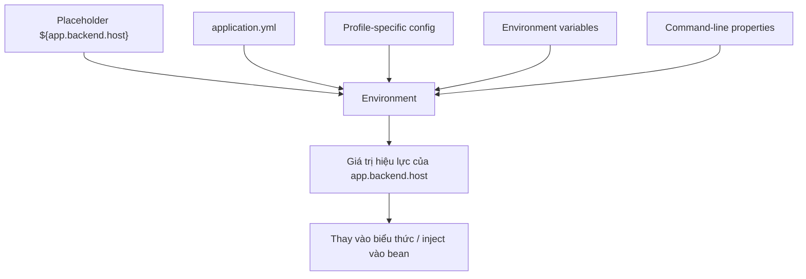
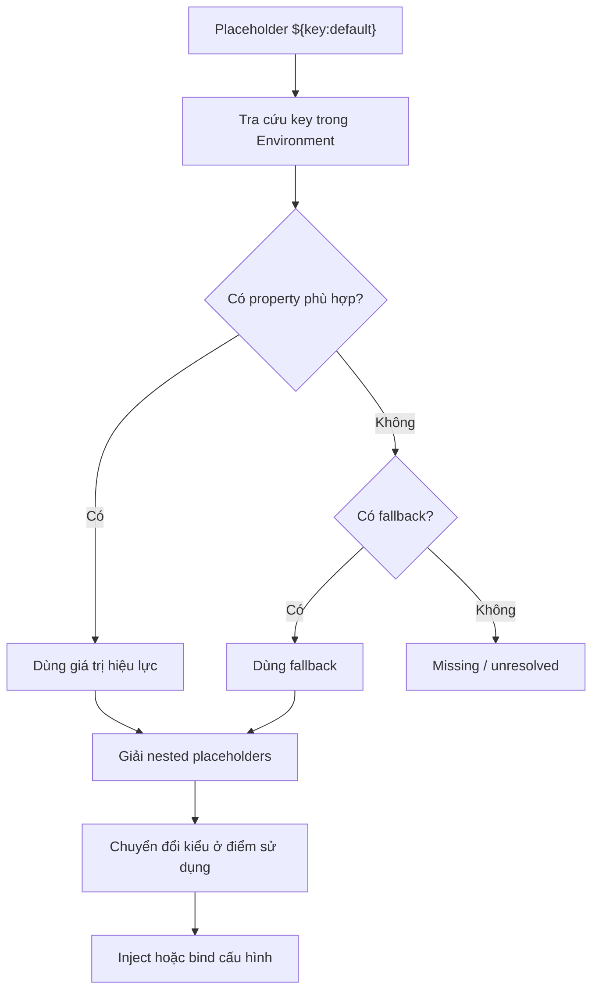

# Placeholder ${...}, giá trị mặc định và tham chiếu thuộc tính

Trong Spring Boot, cấu hình ứng dụng thường đến từ nhiều nguồn: `application.properties`, `application.yml`, biến môi trường, tham số dòng lệnh hoặc file theo profile. Một thuộc tính có thể cần dùng lại giá trị của thuộc tính khác. Cú pháp **placeholder** `${...}` cho phép Spring thực hiện việc tham chiếu đó mà không phải sao chép giá trị cố định.

```properties
app.backend.host=localhost
app.backend.port=8081
app.backend.base-url=http://${app.backend.host}:${app.backend.port}/api
```

Khi ứng dụng đọc `app.backend.base-url` qua cơ chế phân giải thuộc tính của Spring, kết quả là:

```text
http://localhost:8081/api
```

Placeholder còn cho phép **giá trị mặc định** khi một khóa chưa được cung cấp:

```text
${ten-thuoc-tinh}
${ten-thuoc-tinh:gia-tri-mac-dinh}
```

Bài học thuộc chương **Cấu hình ứng dụng** của *Spring Boot Fundamentals*. Ta sẽ tìm hiểu ý nghĩa của placeholder, cách phân giải giá trị từ `Environment`, cách kết hợp fallback và tham chiếu nhiều tầng, cách sử dụng với `@Value` và `@ConfigurationProperties`, cũng như những lỗi cấu hình thường gặp.

Ví dụ dùng Java 21 và Spring Boot 3.x. Placeholder trong bài là cú pháp của Spring, không phải cú pháp template HTML hoặc lệnh shell.

## 1. Placeholder là gì?

Một placeholder là một biểu thức yêu cầu Spring tìm một **property** rồi chèn giá trị của property đó vào vị trí biểu thức.

Ví dụ:

```java
@Value("${app.display-name}")
private String displayName;
```

Với cấu hình:

```yaml
app:
  display-name: Order Service
```

`displayName` nhận giá trị `Order Service`. Spring tra cứu property theo tên trong môi trường cấu hình hiện tại, thay vì lấy giá trị từ một biến Java có tên tương tự.

### 1.1. Vai trò của Environment và PropertySource

Spring dùng abstraction `Environment` để đọc các thuộc tính cấu hình. Bên dưới, Environment có thể chứa nhiều `PropertySource`, chẳng hạn giá trị từ file, môi trường hệ điều hành, system properties hoặc command-line arguments.

Khi Spring phân giải:

```text
${app.backend.host}
```

nó tìm giá trị hiệu lực của khóa `app.backend.host` trong các nguồn cấu hình được đăng ký. Nếu có nhiều nguồn cùng khai báo một khóa, **thứ tự ưu tiên của property sources** quyết định giá trị nào được sử dụng.



Placeholder không đăng ký Spring bean và không tạo property mới. Nó chỉ yêu cầu **tra cứu và thay thế giá trị** trong ngữ cảnh Spring hỗ trợ placeholder resolution.

### 1.2. Hai dạng cú pháp phổ biến

| Biểu thức | Ý nghĩa |
|---|---|
| `${app.name}` | Tìm giá trị của `app.name`. |
| `${app.name:demo}` | Tìm `app.name`; nếu không được cung cấp, dùng `demo`. |
| `${app.port:8080}` | Dùng port đã khai báo hoặc mặc định `8080`. |
| `${app.optional-label:}` | Fallback là chuỗi rỗng. |

Trong những ngữ cảnh phân giải nghiêm ngặt như `@Value("${app.name}")` ở Spring Boot, nếu khóa bắt buộc không tồn tại và không có fallback, việc tạo bean thường thất bại với lỗi unresolved placeholder.

## 2. Dùng dấu hai chấm để khai báo giá trị mặc định

Xét một service cần biết số lần retry:

```java
import org.springframework.beans.factory.annotation.Value;
import org.springframework.stereotype.Component;

@Component
public class RetrySettings {

    private final int maxAttempts;

    public RetrySettings(
            @Value("${app.retry.max-attempts:3}") int maxAttempts) {
        this.maxAttempts = maxAttempts;
    }

    public int maxAttempts() {
        return maxAttempts;
    }
}
```

Với `app.retry.max-attempts=5`, bean nhận giá trị `5`. Khi thuộc tính vắng mặt, bean nhận mặc định `3`.

### 2.1. Giá trị mặc định là dữ liệu, không phải validation

Placeholder `${app.retry.max-attempts:3}` không có nghĩa Spring sẽ tự sửa mọi giá trị sai thành `3`:

| Giá trị property | Kết quả khi inject thành `int` |
|---|---|
| Không có property | Dùng chuỗi mặc định `3`, chuyển thành số 3. |
| `app.retry.max-attempts=5` | Nhận số 5. |
| `app.retry.max-attempts=abc` | Có thể thất bại khi chuyển sang `int`. |
| `app.retry.max-attempts=` | Có thể thất bại khi chuyển chuỗi rỗng sang `int`. |

Fallback được dùng khi **không phân giải được property** theo quy tắc của resolver, không phải một cơ chế xác thực dữ liệu hoặc xử lý mọi giá trị không hợp lệ.

### 2.2. Fallback là chuỗi rỗng

```java
@Value("${app.banner:}")
private String banner;
```

Nếu không có `app.banner`, kết quả thường là `""`. Cách này hữu ích nếu field chuỗi thật sự tùy chọn. Với số, ngày, URL bắt buộc hoặc secret, nên chọn fallback hợp lệ hoặc yêu cầu cấu hình rõ ràng.

### 2.3. Fallback có dấu hai chấm

URL có thể là giá trị mặc định:

```java
@Value("${app.backend.base-url:http://localhost:8080}")
private String baseUrl;
```

Trong biểu thức trên, dấu hai chấm đầu tiên sau khóa phân tách khóa với fallback. Phần `http://localhost:8080` là nội dung mặc định. Với biểu thức dài, khai báo URL mặc định trong file cấu hình sẽ dễ đọc hơn.

## 3. Tham chiếu property trong application.properties

Giả sử ứng dụng có nhiều endpoint dùng chung backend:

```properties
app.backend.host=localhost
app.backend.port=8081

app.backend.base-url=http://${app.backend.host}:${app.backend.port}
app.backend.users-url=${app.backend.base-url}/users
app.backend.orders-url=${app.backend.base-url}/orders
app.backend.health-url=${app.backend.base-url}/actuator/health
```

Kết quả khi các property được phân giải:

| Thuộc tính | Giá trị hiệu lực |
|---|---|
| `app.backend.base-url` | `http://localhost:8081` |
| `app.backend.users-url` | `http://localhost:8081/users` |
| `app.backend.orders-url` | `http://localhost:8081/orders` |
| `app.backend.health-url` | `http://localhost:8081/actuator/health` |

Thay vì sao chép địa chỉ backend vào từng dòng, ta chỉ cần quản lý một cặp host/port. Điều này có lợi khi ứng dụng chạy ở nhiều môi trường khác nhau.

### 3.1. Tham chiếu nhiều tầng

```properties
app.host=localhost
app.port=8080
app.root-url=http://${app.host}:${app.port}
app.api-url=${app.root-url}/v1
app.user-url=${app.api-url}/users
```

Khi Spring giải quyết `app.user-url`, nó phải xử lý các tham chiếu bên trong `app.api-url` và `app.root-url` để lấy URL cuối cùng.

### 3.2. Không tạo chu trình

Đây là cấu hình sai:

```properties
app.first=${app.second}
app.second=${app.first}
```

Hai property tham chiếu vòng quanh, không có giá trị cuối cùng. Spring có thể báo lỗi circular placeholder reference. Hãy chọn một property làm nguồn gốc hoặc dùng fallback thật sự độc lập với chu trình.

### 3.3. Property được tham chiếu không bắt buộc nằm cùng file

```properties
app.backend.base-url=https://${app.backend.host}:${app.backend.port:443}/v1
```

`app.backend.host` có thể nằm trong file theo profile, biến môi trường hoặc tham số dòng lệnh. Placeholder tra cứu qua Environment, vì vậy ứng dụng có thể triển khai cùng một file cấu hình nền ở nhiều nơi.

## 4. Dùng placeholder trong application.yml

YAML biểu diễn các property bằng cấu trúc lồng nhau:

```yaml
app:
  backend:
    host: localhost
    port: 8081
    base-url: "http://${app.backend.host}:${app.backend.port}"
    users-url: "${app.backend.base-url}/users"
  title: "Backend at ${app.backend.host}"
```

Tên property trong placeholder vẫn dùng **dạng dotted** như `app.backend.host`, mặc dù YAML dùng các cấp thụt lề.

### 4.1. Quoting trong YAML

Nên đặt các chuỗi chứa URL, dấu hai chấm hoặc nhiều placeholder trong dấu nháy:

```yaml
app:
  backend:
    url: "https://${app.backend.host:localhost}:${app.backend.port:8443}/api"
```

Quoting giúp YAML parser hiểu giá trị là một chuỗi. Cần phân biệt hai lỗi:

- **Lỗi YAML:** file không có cú pháp YAML hợp lệ.
- **Lỗi placeholder:** YAML đã được nạp, nhưng Spring không giải quyết được khóa được tham chiếu.

### 4.2. Dấu hai chấm có hai vai trò

Trong YAML:

```yaml
app:
  backend:
    host: localhost
    url: "http://${app.backend.host:localhost}"
```

Dấu hai chấm ở `host: localhost` thuộc cú pháp ánh xạ YAML. Dấu hai chấm ở `${app.backend.host:localhost}` là dấu phân cách giá trị mặc định của Spring placeholder.

## 5. Tiêm giá trị bằng @Value

`@Value` có thể xuất hiện ở field, constructor parameter, method parameter hoặc factory method `@Bean`. Đây là cách trực tiếp nhất để lấy một vài cấu hình đơn giản.

### 5.1. Field injection

```java
package com.example.demo;

import org.springframework.beans.factory.annotation.Value;
import org.springframework.stereotype.Component;

@Component
public class AppInfo {

    @Value("${app.display-name:Demo application}")
    private String displayName;

    public String displayName() {
        return displayName;
    }
}
```

Giá trị sẽ được phân giải khi Spring tạo và xử lý bean. Dạng field ngắn gọn, nhưng constructor giúp thể hiện dependency rõ ràng và cho phép test object không cần Spring.

### 5.2. Constructor injection

```java
package com.example.demo.client;

import org.springframework.beans.factory.annotation.Value;
import org.springframework.stereotype.Component;

@Component
public class BackendSettings {

    private final String baseUrl;
    private final int retryLimit;

    public BackendSettings(
            @Value("${app.backend.base-url:http://localhost:8080}")
            String baseUrl,
            @Value("${app.backend.retry-limit:3}")
            int retryLimit) {
        this.baseUrl = baseUrl;
        this.retryLimit = retryLimit;
    }

    public String baseUrl() {
        return baseUrl;
    }

    public int retryLimit() {
        return retryLimit;
    }
}
```

Spring giải placeholder, sau đó chuyển giá trị sang kiểu `String` hoặc `int` để gọi constructor. Nếu có giá trị không hợp lệ hoặc thiếu một property bắt buộc, việc tạo bean có thể thất bại.

### 5.3. Tham số của method @Bean

```java
import org.springframework.beans.factory.annotation.Value;
import org.springframework.context.annotation.Bean;
import org.springframework.context.annotation.Configuration;

@Configuration(proxyBeanMethods = false)
public class BackendConfiguration {

    @Bean
    BackendClient backendClient(
            @Value("${app.backend.base-url:http://localhost:8080}")
            String baseUrl) {
        return new BackendClient(baseUrl);
    }
}
```

`BackendClient` là class minh họa có constructor nhận URL. Cách này phù hợp khi tạo bean thư viện bên ngoài từ giá trị cấu hình.

## 6. Tham chiếu thuộc tính giữa các nguồn cấu hình

`Environment` của Spring Boot có thể kết hợp những nguồn như:

- File `application.properties` hoặc `application.yml`.
- File theo profile: `application-dev.yml`, `application-prod.yml`.
- Environment variables.
- Java system properties.
- Command-line arguments.
- Các PropertySource và Config Data khác được cấu hình.

Khi có cùng một khóa ở nhiều nguồn, **giá trị của nguồn ưu tiên cao hơn** sẽ được sử dụng.

Ví dụ `application.properties`:

```properties
app.backend.host=localhost
app.backend.port=8080
app.backend.url=http://${app.backend.host}:${app.backend.port}
```

Trên máy chủ triển khai, ứng dụng có biến môi trường:

```text
APP_BACKEND_HOST=backend.internal
APP_BACKEND_PORT=9090
```

Theo quy tắc ánh xạ thuộc tính từ biến môi trường của Boot, `app.backend.url` có thể được phân giải thành:

```text
http://backend.internal:9090
```

Chính property host/port được ghi đè; dòng định nghĩa URL vẫn giữ nguyên.

### 6.1. Ghi đè qua command line

```bash
./gradlew bootRun --args='--app.backend.host=staging.internal --app.backend.port=8181'
```

Với Windows PowerShell:

```powershell
.\gradlew.bat bootRun --args="--app.backend.host=staging.internal --app.backend.port=8181"
```

Command-line properties trong cấu hình Boot thông thường có thể ghi đè giá trị trong file. Vì thế placeholder `${app.backend.host}` không nhất thiết sử dụng đúng dòng mà bạn đang nhìn thấy trong `application.properties`.

### 6.2. Profile-specific configuration

`application.yml`:

```yaml
app:
  backend:
    host: localhost
    port: 8080
    url: "http://${app.backend.host}:${app.backend.port}"
```

`application-prod.yml`:

```yaml
app:
  backend:
    host: backend.production.internal
    port: 8443
```

Khi profile `prod` hoạt động và không có nguồn ưu tiên cao hơn ghi đè, URL sẽ dùng host và port của profile prod. Việc tham chiếu giúp tránh nhân bản cùng một cấu trúc URL ở mọi profile.

## 7. Tên khóa canonical và relaxed binding

Spring Boot có cơ chế **relaxed binding** để ánh xạ property giữa các dạng tên phù hợp với từng nguồn cấu hình. Với các placeholder trong file Spring Boot, nên dùng tên thuộc tính **canonical kebab-case, chữ thường**:

```text
${app.backend.base-url}
```

Ví dụ tên property có thể xuất hiện trong những dạng khác nhau:

```text
app.backend.base-url
app.backend.baseUrl
APP_BACKEND_BASEURL
```

Spring Boot có thể xử lý các dạng tương thích theo nguồn. Viết placeholder ở dạng canonical giúp cơ chế relaxed lookup hoạt động nhất quán hơn, thay vì gắn biểu thức vào một biến thể camelCase cụ thể.

### 7.1. Tên biến môi trường tương ứng

Quy tắc chuyển tên canonical sang biến môi trường thường là thay dấu chấm bằng dấu gạch dưới, bỏ dấu gạch ngang trong mỗi thành phần rồi chuyển chữ hoa:

| Property | Biến môi trường |
|---|---|
| `app.backend.host` | `APP_BACKEND_HOST` |
| `app.backend.port` | `APP_BACKEND_PORT` |
| `app.backend.base-url` | `APP_BACKEND_BASEURL` |
| `app.retry.max-attempts` | `APP_RETRY_MAXATTEMPTS` |

Tên biến môi trường có thể trở nên khó đoán khi property gồm nhiều từ. Vì vậy khi một override không có hiệu lực, hãy kiểm tra lại cách ánh xạ tên và môi trường chạy.

### 7.2. Luôn nhất quán trong tài liệu

Thay vì luân phiên giữa `app.backend.baseUrl` và `app.backend.base-url`, hãy chọn dạng canonical cho ví dụ, cấu hình và placeholder. Điều này giảm lỗi khi chuyển giữa YAML, properties, biến môi trường và tham số dòng lệnh.

## 8. Placeholder lồng nhau và nhiều tầng fallback

Fallback có thể lại là một placeholder:

```properties
app.primary-region=${APP_REGION:local}
app.processing-region=${app.override-region:${app.primary-region}}
```

Nếu `app.override-region` có giá trị, nó được dùng. Nếu không, Spring thử `app.primary-region`. Nếu `APP_REGION` cũng không có, kết quả cuối là `local`.

### 8.1. Một ví dụ cấu hình endpoint

```properties
app.backend.host=${app.default-host:localhost}
app.backend.port=${app.default-port:8080}
app.backend.url=http://${app.backend.host}:${app.backend.port}
```

Tất cả các thuộc tính vẫn được quản lý bởi Environment. Nếu bạn cung cấp trực tiếp `app.backend.host` qua nguồn ưu tiên cao hơn, giá trị đó thắng dòng fallback trong file nền.

### 8.2. Tham chiếu động trong tên khóa

Spring có thể phân giải placeholder lồng trong tên khóa:

```properties
app.environment=dev
app.endpoint.dev=https://dev.example.internal
app.endpoint.prod=https://prod.example.internal
app.active-endpoint=${app.endpoint.${app.environment}}
```

Với `app.environment=dev`, khóa cuối cần đọc là `app.endpoint.dev`. Cơ chế này hữu ích trong một số trường hợp, nhưng với cấu hình môi trường lớn, profile-specific Config Data thường dễ hiểu hơn.

### 8.3. Cẩn thận với vòng tham chiếu

```properties
app.a=${app.b}
app.b=${app.a}
```

Không có giá trị gốc để kết thúc vòng tham chiếu. Spring có thể báo lỗi vòng lặp. Khi debug, hãy lần theo chuỗi tham chiếu, không chỉ nhìn property cuối cùng được inject.

## 9. Phân biệt placeholder với SpEL

Spring có hai cú pháp khác nhau:

| Cú pháp | Vai trò | Ví dụ |
|---|---|---|
| `${...}` | Tham chiếu property trong Environment | `${app.backend.port:8080}` |
| `#{...}` | Đánh giá Spring Expression Language trong ngữ cảnh hỗ trợ | `#{2 * 3}` |

Ví dụ:

```java
@Value("${app.backend.port:8080}")
private int backendPort;

@Value("#{2 * 3}")
private int six;
```

Biến `backendPort` lấy dữ liệu cấu hình hoặc fallback. Biến `six` nhận kết quả tính biểu thức SpEL.

Trong ngữ cảnh `@Value` có thể phối hợp hai cơ chế:

```java
@Value("#{${app.feature.enabled:false} ? 'enabled' : 'disabled'}")
private String featureLabel;
```

Nhưng hãy hạn chế biểu thức dài. Với logic nhiều nhánh, bind property thành kiểu boolean rồi xử lý bằng Java sẽ dễ đọc và dễ test hơn.

Một giá trị trong `application.properties` không tự động trở thành SpEL chỉ vì nó chứa `#{...}`. Property placeholder resolution và SpEL evaluation là hai bước có điều kiện và ngữ cảnh riêng.

## 10. Placeholder trong Spring khác biến shell

Bash cũng có cách viết biến bằng dấu dollar và ngoặc nhọn:

```bash
echo "${APP_REGION}"
```

Trong Bash, shell thực hiện variable expansion. Nhưng trong `application.properties`:

```properties
app.region=${APP_REGION:local}
```

Spring mới là thành phần phân giải placeholder khi đọc giá trị property. Hai nơi có cú pháp gần giống nhau nhưng thời điểm và nguồn đọc giá trị khác nhau.

Trong PowerShell, cú pháp đọc biến môi trường lại là:

```powershell
$env:APP_REGION
```

Khi viết script khởi chạy, cần phân biệt chuỗi được shell xử lý trước với nội dung file cấu hình được Spring xử lý sau.

## 11. Cấu hình bắt buộc, cấu hình tùy chọn và secret

Không phải property nào cũng nên có fallback.

Ví dụ một URL phục vụ môi trường local:

```java
@Value("${app.backend.base-url:http://localhost:8080}")
private String backendUrl;
```

Fallback localhost hợp lý cho demo hoặc môi trường phát triển. Ngược lại, với API key:

```java
@Value("${payment.provider.api-key}")
private String apiKey;
```

Nếu key là bắt buộc, thường nên để quá trình tạo bean thất bại khi thiếu key và cung cấp giá trị qua secret management hoặc environment phù hợp.

Đặt một fallback giả như:

```java
@Value("${payment.provider.api-key:dummy}")
private String apiKey;
```

có thể khiến ứng dụng khởi động thành công nhưng phát sinh lỗi khi gọi hệ thống bên ngoài. Fallback là một quyết định nghiệp vụ, không phải cách mặc định để che mọi lỗi cấu hình.

### 11.1. Giá trị thiếu khác giá trị rỗng

`${app.banner:}` có fallback là chuỗi rỗng nếu property vắng mặt. Nhưng khi có một property với nội dung rỗng, resolver có thể xem đó là một giá trị đã được cung cấp. Đừng giả định fallback luôn thay thế chuỗi rỗng.

Với thuộc tính bắt buộc, hãy kết hợp typed configuration và validation nếu cần bảo đảm giá trị không rỗng hoặc nằm trong khoảng hợp lệ.

## 12. @Value hay @ConfigurationProperties?

`@Value` phù hợp khi bean chỉ cần một hoặc hai cấu hình đơn giản. Khi cấu hình lớn và liên quan tới nhau, `@ConfigurationProperties` dễ tổ chức hơn.

| Đặc điểm | `@Value` | `@ConfigurationProperties` |
|---|---|---|
| Định nghĩa | Biểu thức đặt tại điểm inject | Object gom các property có prefix |
| Kiểu dữ liệu | Chuyển đổi từng giá trị | Binder hỗ trợ object, nested values, collections |
| Độ phù hợp | Một vài giá trị rời rạc | Cả nhóm cấu hình của module |
| Validation | Tự triển khai theo nhu cầu | Dễ kết hợp Bean Validation |
| Placeholder trong nguồn | Có thể dùng | Có thể dùng trong giá trị được bind |

Ví dụ cấu hình:

```yaml
app:
  backend:
    host: localhost
    port: 8081
    base-url: "http://${app.backend.host}:${app.backend.port}"
```

Khai báo record:

```java
package com.example.demo.config;

import org.springframework.boot.context.properties.ConfigurationProperties;

@ConfigurationProperties(prefix = "app.backend")
public record BackendProperties(
        String host,
        int port,
        String baseUrl
) {
}
```

Đăng ký binding:

```java
import org.springframework.boot.context.properties.EnableConfigurationProperties;
import org.springframework.context.annotation.Configuration;

@Configuration(proxyBeanMethods = false)
@EnableConfigurationProperties(BackendProperties.class)
public class BackendPropertiesConfiguration {
}
```

Consumer:

```java
@Service
public class BackendService {

    private final BackendProperties properties;

    public BackendService(BackendProperties properties) {
        this.properties = properties;
    }

    public String baseUrl() {
        return properties.baseUrl();
    }
}
```

Nhóm cấu hình này vẫn có thể sử dụng placeholder để tạo `base-url` từ host và port. Nếu cần default/validation có cấu trúc, có thể thiết kế chúng trực tiếp trong kiểu cấu hình thay vì rải fallback ở nhiều bean.

## 13. Đọc giá trị bằng Environment

Nếu cần đọc property theo điều kiện lúc chạy, một bean có thể inject `Environment`:

```java
package com.example.demo.config;

import org.springframework.core.env.Environment;
import org.springframework.stereotype.Component;

@Component
public class ConfigurationReporter {

    private final Environment environment;

    public ConfigurationReporter(Environment environment) {
        this.environment = environment;
    }

    public String backendUrl() {
        return environment.getProperty(
                "app.backend.base-url",
                "http://localhost:8080");
    }
}
```

`getProperty(key, defaultValue)` nhận fallback qua API. Cách đó khác cú pháp `${key:default}` được đặt trong một chuỗi placeholder, dù hai cách có thể dẫn đến giá trị giống nhau.

Nếu thuộc tính bắt buộc, có thể dùng:

```java
String apiKey =
        environment.getRequiredProperty("payment.provider.api-key");
```

Nếu không tìm thấy property, `getRequiredProperty` có thể ném exception. Tránh log trực tiếp token, password và secret khi kiểm tra cấu hình.

## 14. Kiểm thử placeholder bằng ApplicationContextRunner

Spring Boot Test có `ApplicationContextRunner` để tạo context nhỏ và kiểm tra cách Spring inject giá trị.

Ví dụ tự chứa cho phần cấu hình:

```java
package com.example.demo.config;

import static org.assertj.core.api.Assertions.assertThat;

import org.junit.jupiter.api.Test;
import org.springframework.beans.factory.annotation.Value;
import org.springframework.boot.test.context.runner.ApplicationContextRunner;
import org.springframework.context.annotation.Bean;
import org.springframework.context.annotation.Configuration;

class PlaceholderResolutionTest {

    record Endpoint(String url, int port) {}

    @Configuration(proxyBeanMethods = false)
    static class EndpointConfiguration {

        @Bean
        Endpoint endpoint(
                @Value("${app.backend.base-url:http://localhost:8080}")
                String url,
                @Value("${app.backend.port:8080}")
                int port) {
            return new Endpoint(url, port);
        }
    }

    private final ApplicationContextRunner runner =
            new ApplicationContextRunner()
                    .withUserConfiguration(EndpointConfiguration.class);

    @Test
    void usesFallbackWhenPropertyIsAbsent() {
        runner.run(context -> {
            Endpoint endpoint = context.getBean(Endpoint.class);
            assertThat(endpoint.url())
                    .isEqualTo("http://localhost:8080");
            assertThat(endpoint.port()).isEqualTo(8080);
        });
    }

    @Test
    void resolvesReferencesFromPropertyValues() {
        runner.withPropertyValues(
                "app.backend.host=api.internal",
                "app.backend.port=9091",
                "app.backend.base-url=https://${app.backend.host}:${app.backend.port}/v1")
              .run(context -> {
                  Endpoint endpoint = context.getBean(Endpoint.class);
                  assertThat(endpoint.url())
                          .isEqualTo("https://api.internal:9091/v1");
                  assertThat(endpoint.port()).isEqualTo(9091);
              });
    }
}
```

Test thứ nhất kiểm tra fallback; test thứ hai kiểm tra chuỗi tham chiếu giữa các property. Để chạy cần dependency Spring Boot Test/JUnit/AssertJ phù hợp. Không cần tạo REST endpoint chỉ để kiểm tra placeholder.

### 14.1. Thử property bắt buộc thiếu

```java
@Bean
RequiredClient requiredClient(
        @Value("${app.required-endpoint}") String endpoint) {
    return new RequiredClient(endpoint);
}
```

Nếu `app.required-endpoint` không có và bean này được tạo, context có thể thất bại. Có thể thêm test kiểm tra startup failure để bảo đảm cấu hình bắt buộc được kiểm soát đúng.

### 14.2. Test không nên phụ thuộc biến môi trường trên máy cá nhân

Trong test, nên khai báo các property cần thiết tường minh qua `withPropertyValues` hoặc cấu hình test. Nếu dựa vào biến môi trường thật trên máy, kết quả có thể khác trên CI hoặc máy của đồng đội.

## 15. Các nhầm lẫn thường gặp

| Hiện tượng | Nguyên nhân có thể | Hướng xử lý |
|---|---|---|
| `Could not resolve placeholder 'app.name'` | Property thiếu hoặc tên không đúng | Kiểm tra Environment, profile và fallback |
| Luôn nhận fallback dù đã đặt environment variable | Tên biến môi trường không ánh xạ đúng khóa | Dùng canonical key và kiểm tra quy tắc relaxed binding |
| Inject kiểu số thất bại | Giá trị rỗng hoặc không phải số | Cấu hình dữ liệu hợp lệ và validation |
| URL vẫn chứa nguyên ký hiệu placeholder | Chuỗi không được xử lý qua cơ chế placeholder của Spring | Kiểm tra cách đọc và nơi lưu chuỗi |
| Giá trị khác application.yml | Nguồn ưu tiên cao hơn đã ghi đè | Kiểm tra profile, command line và property sources |
| Chu trình hai property | Property tham chiếu lẫn nhau | Bỏ vòng tham chiếu |
| Dùng `#{...}` thay cho `${...}` | Nhầm SpEL với placeholder | Chọn cú pháp đúng |
| Tham chiếu sai nested key YAML | Nhầm cấu trúc YAML với tên property dotted | Dùng dạng `app.backend.host` |

### 15.1. Unresolved placeholder

Giả sử:

```java
@Value("${payment.provider.url}")
private String providerUrl;
```

Khi thiếu `payment.provider.url`, lỗi có thể có thông báo:

```text
Could not resolve placeholder 'payment.provider.url'
```

Cần kiểm tra khóa, profile đang chạy, nguồn cấu hình đã nạp và liệu đây có phải giá trị bắt buộc không. Đừng vội thêm fallback giả nếu giá trị phải được cấp trong production.

### 15.2. Placeholder không phải bean lookup

`${app.backend.url}` đọc property trong Environment. Nó không có nghĩa “tìm bean tên app.backend.url”. Để inject bean, sử dụng constructor injection, `@Qualifier` hoặc API bean lookup phù hợp.

## 16. Quy trình chẩn đoán

Khi một placeholder không cho kết quả mong đợi, làm lần lượt:

1. **Đọc biểu thức.** Khóa được tìm là gì? Có fallback không?
2. **Xác định nơi phân giải.** `@Value`, `@ConfigurationProperties`, `Environment` hay code ngoài Spring?
3. **Kiểm tra nguồn cấu hình.** File base, file profile, environment variables, system properties và command-line arguments đã được nạp đúng chưa?
4. **Kiểm tra tên khóa.** Có dùng canonical kebab-case và ánh xạ tên biến môi trường chính xác không?
5. **Tìm nguồn đang thắng.** PropertySource nào có mức ưu tiên cao nhất với khóa đó?
6. **Kiểm tra trạng thái giá trị.** Thiếu, rỗng hay sai kiểu?
7. **Theo dõi tham chiếu lồng nhau.** Có vòng lặp hoặc một khóa chưa được khai báo không?
8. **Kiểm tra kiểu đích.** Chuỗi cuối cùng có chuyển thành `int`, `Duration`, URL hoặc kiểu yêu cầu không?
9. **Xác định mục tiêu nghiệp vụ.** Nên dùng fallback hay fail fast?



Sơ đồ là luồng khái quát; một resolver có thể có quy tắc nghiêm ngặt hoặc cho phép giữ placeholder chưa phân giải tùy API và cách cấu hình.

## 17. Bài thực hành tổng hợp

Tạo một Spring Boot application với `application.yml` và một bean đọc cấu hình. Lần lượt thực hiện:

**Bước A — Property cơ bản.** Khai báo `app.backend.host` và `app.backend.port`. Dùng placeholder tạo `app.backend.base-url`.

**Bước B — Fallback.** Bỏ port, dùng `${app.backend.port:8080}` rồi quan sát URL.

**Bước C — Environment override.** Cấp host bằng biến môi trường hoặc command-line argument; xác nhận URL thay đổi theo giá trị hiệu lực.

**Bước D — Profile.** Tạo `application-dev.yml` và `application-prod.yml`; đặt host khác nhau, chạy từng profile và so sánh.

**Bước E — Inject bằng @Value.** Inject URL và retry limit vào constructor của một bean. Quan sát giá trị sau chuyển kiểu.

**Bước F — Nested fallback.** Dùng `${app.backend.host:${app.default-host:localhost}}`; thử cung cấp và bỏ từng khóa.

**Bước G — Cấu hình bắt buộc.** Thêm `@Value("${app.required-token}")`, bỏ property và xem startup failure.

**Bước H — Giá trị sai kiểu.** Cấp `app.backend.port=abc` cho tham số `int` để hiểu vì sao fallback không thay validation.

**Bước I — ConfigurationProperties.** Gom host, port, URL thành một record và inject vào service.

**Bước J — Test tự động.** Dùng `ApplicationContextRunner` kiểm tra kết quả trong hai trường hợp có property và thiếu property.

Sau mỗi bước, hãy trả lời: **Property được lấy từ đâu? Fallback có được dùng không? Giá trị cuối được chuyển thành kiểu nào?**

## 18. Câu hỏi tự đánh giá

1. `${app.name}` yêu cầu Spring làm gì?
2. `${app.name:demo}` khác `${app.name}` ở điểm nào?
3. Có phải fallback luôn được áp dụng khi giá trị đã tồn tại nhưng rỗng không?
4. Vì sao nên tham chiếu host và port để tạo base URL thay vì sao chép URL nhiều nơi?
5. Placeholder trong YAML cần tên khóa theo dạng nào?
6. Nếu cùng một property có trong file và command line, giá trị nào được dùng?
7. Vì sao Spring Boot khuyến nghị placeholder theo canonical kebab-case?
8. Cách ánh xạ `app.backend.base-url` sang biến môi trường thông thường là gì?
9. `@Value` có thể chuyển chuỗi fallback sang `int` như thế nào?
10. `${...}` khác `#{...}` về mục đích ra sao?
11. Khi nào `@ConfigurationProperties` phù hợp hơn nhiều field `@Value`?
12. Tham chiếu vòng giữa hai property gây ra vấn đề gì?
13. Vì sao không nên đặt fallback giả cho secret bắt buộc?
14. `Environment.getProperty` có ưu điểm gì khi cần đọc cấu hình bằng API?
15. Khi một placeholder không resolve, bạn cần kiểm tra những nguồn dữ liệu nào?

### Mẫu giải thích hoàn chỉnh

> Trong Spring Boot, placeholder `${key}` dùng để tìm một property trong `Environment`. Cú pháp `${key:default}` bổ sung fallback khi không có giá trị phù hợp. Placeholder có thể được dùng trong `application.properties`, `application.yml` hoặc `@Value` để tạo giá trị từ những property khác. Environment kết hợp nhiều PropertySource và áp dụng thứ tự ưu tiên, nên property được tham chiếu có thể lấy từ profile, biến môi trường hoặc command-line argument. Dùng tên canonical kebab-case để tương thích tốt với relaxed binding. Khi property thiếu, rỗng hoặc sai kiểu, cần phân biệt các tình huống: fallback không thay thế validation và một placeholder bắt buộc không được giải quyết có thể làm tạo bean thất bại. `@Value` phù hợp với vài giá trị, còn `@ConfigurationProperties` thuận tiện hơn cho nhóm cấu hình có cấu trúc.

Khi bạn xác định được khóa trong `${...}`, biết fallback nào được dùng và nguồn PropertySource nào cung cấp giá trị cuối, bạn đã hiểu cách **placeholder, giá trị mặc định và tham chiếu thuộc tính** hoạt động trong Spring Boot.
