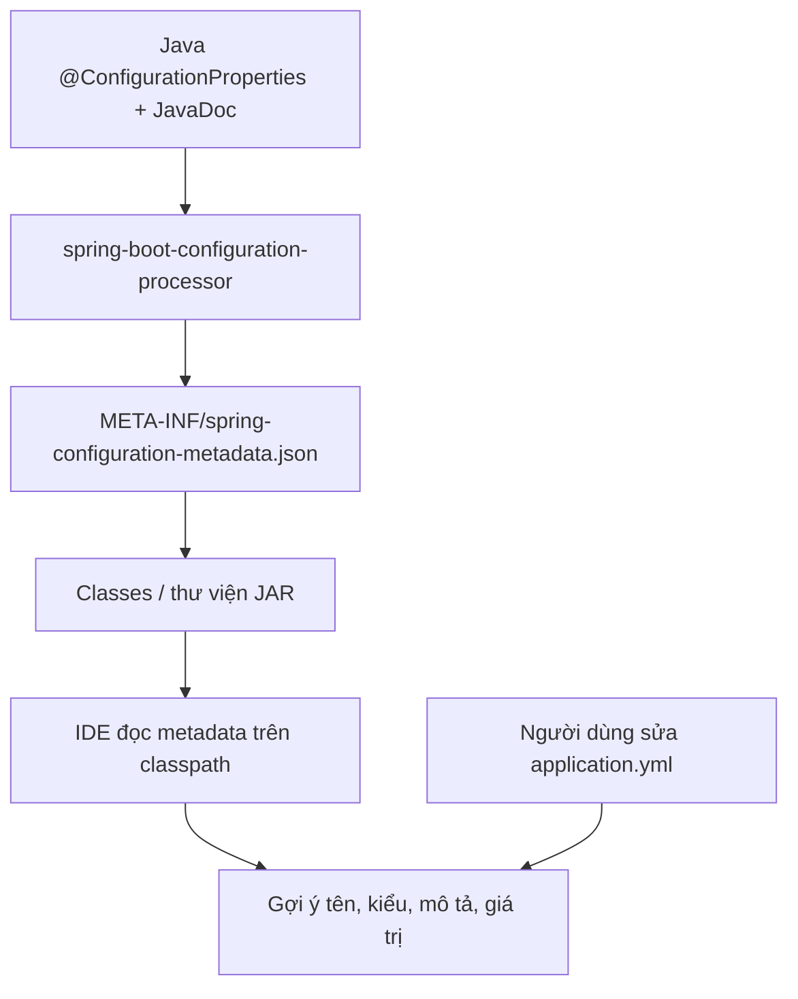
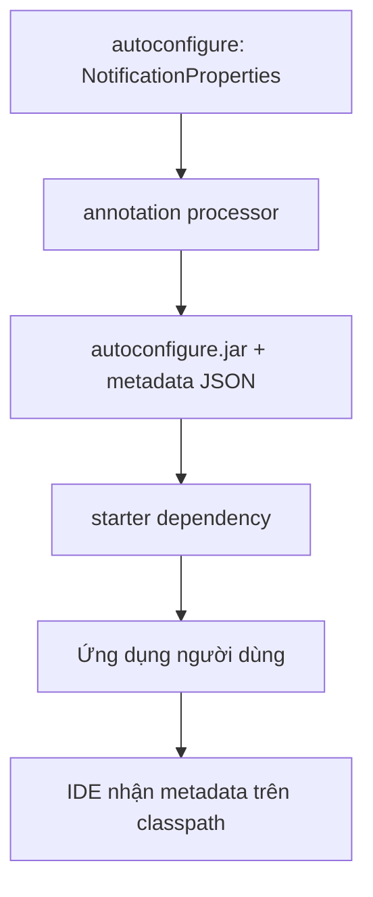

# Configuration metadata và gợi ý thuộc tính trong IDE

> **Spring Boot Fundamentals · Cấu hình ứng dụng**  
> Khi mở `application.yml` hoặc `application.properties`, IDE có thể gợi ý những khóa như `server.port`, giải thích ý nghĩa của chúng và cho biết kiểu dữ liệu mong đợi. Với thuộc tính do chính dự án hoặc một starter tự phát triển định nghĩa, trải nghiệm tương tự đến từ **Spring Boot configuration metadata**. Metadata mô tả các nhóm cấu hình, tên thuộc tính, kiểu dữ liệu, giá trị mặc định, trạng thái deprecated và các gợi ý hoàn thành. Nó giúp người viết cấu hình biết *có những khóa nào, nên nhập gì và xem tài liệu ở đâu*; metadata **không phải** cơ chế tự tạo bean, tự bind property hay tự xác thực dữ liệu lúc chạy.

## 1. Vấn đề: IDE biết tên các property từ đâu?

Giả sử ứng dụng có lớp:

```java
@ConfigurationProperties(prefix = "acme.notifications")
public class NotificationProperties {
    private boolean enabled;
    // ...
}
```

Người phát triển mở `application.yml` và bắt đầu nhập:

```yaml
acme:
  notifications:
    en
```

Nếu module có metadata đúng và IDE hỗ trợ Spring Boot, IDE có thể đề xuất `enabled`, gợi ý kiểu boolean, hiển thị mô tả và đôi khi cung cấp nút điều hướng tới class khai báo.

Để làm được điều đó, IDE không nhất thiết phải chạy ứng dụng. Thay vào đó, IDE đọc metadata có sẵn trong classpath, thường từ những JAR chứa file:

```text
META-INF/spring-configuration-metadata.json
```

File JSON này được tạo chủ yếu bởi **`spring-boot-configuration-processor`** trong quá trình biên dịch các lớp `@ConfigurationProperties`. Thư viện Spring Boot và nhiều starter cũng đóng gói metadata tương ứng.



Hãy tách rõ ba lớp:

| Lớp | Trách nhiệm |
| --- | --- |
| `@ConfigurationProperties` và Spring Boot Binder | Xác định cách bind dữ liệu cấu hình vào object khi ứng dụng chạy |
| `spring-boot-configuration-processor` | Phân tích mã nguồn và sinh mô tả JSON lúc build |
| IDE hoặc extension Spring | Đọc JSON để cung cấp completion, documentation và cảnh báo trong editor |

Tạo được metadata **không đảm bảo** một bean cấu hình đã được đăng ký. Ngược lại, ứng dụng có thể bind một property thành công khi chạy dù chưa sinh metadata, nhưng IDE có thể không gợi ý khóa đó.

## 2. Phân biệt tên khóa, giá trị và metadata

Ví dụ cấu hình thật trong `application.yml`:

```yaml
acme:
  notifications:
    enabled: true
    timeout: 3s
    transport: email
```

Dữ liệu này chứa các **giá trị của môi trường chạy**. Khi ứng dụng khởi động, chúng có thể bị ghi đè bởi profile, biến môi trường hoặc command line theo thứ tự ưu tiên PropertySource.

Metadata lại mô tả khóa và cách dùng:

```json
{
  "properties": [
    {
      "name": "acme.notifications.enabled",
      "type": "java.lang.Boolean",
      "description": "Bật hoặc tắt việc gửi thông báo."
    },
    {
      "name": "acme.notifications.timeout",
      "type": "java.time.Duration",
      "description": "Thời gian chờ cho thao tác gửi."
    }
  ]
}
```

Đây là **ví dụ rút gọn** về JSON metadata, không phải lời cam kết rằng processor luôn tạo đúng byte-for-byte các trường như trên. Tên type, thứ tự entries và các metadata bổ sung phụ thuộc mã nguồn và phiên bản processor.

Sự khác biệt:

- `application.yml` có `enabled: true` nghĩa là môi trường này muốn bật tính năng.
- Metadata có `enabled` và `type: java.lang.Boolean` nghĩa là đây là khóa được tài liệu hóa có kiểu boolean.
- IDE dùng metadata để hỗ trợ người viết file cấu hình.
- Spring Boot Binder vẫn phải đọc giá trị, chuyển đổi kiểu, tạo object và xử lý lỗi khi khởi động.

Một file metadata được đóng gói trong starter **không tự áp dụng giá trị cấu hình** cho ứng dụng. Giá trị phải đến từ Environment hoặc default trong lớp cấu hình.

## 3. Ba phần quan trọng của định dạng JSON

Một file `spring-configuration-metadata.json` thường có những mảng:

- `groups`: các nhóm thuộc tính có prefix chung, thường tương ứng với một lớp `@ConfigurationProperties`.
- `properties`: các thuộc tính cụ thể cùng kiểu, mô tả, nguồn khai báo và giá trị mặc định khi biết.
- `hints`: gợi ý giá trị hoặc provider để IDE đề xuất cách nhập.

Ví dụ tổng thể:

```json
{
  "groups": [
    {
      "name": "acme.notifications",
      "type": "com.example.shop.config.NotificationProperties",
      "sourceType": "com.example.shop.config.NotificationProperties"
    }
  ],
  "properties": [
    {
      "name": "acme.notifications.enabled",
      "type": "java.lang.Boolean",
      "description": "Bật hoặc tắt việc gửi thông báo.",
      "sourceType": "com.example.shop.config.NotificationProperties"
    },
    {
      "name": "acme.notifications.timeout",
      "type": "java.time.Duration",
      "description": "Thời gian chờ cho thao tác gửi.",
      "sourceType": "com.example.shop.config.NotificationProperties"
    }
  ],
  "hints": [
    {
      "name": "acme.notifications.template-id",
      "values": [
        {
          "value": "welcome",
          "description": "Mẫu thông báo chào mừng."
        },
        {
          "value": "order-confirmed",
          "description": "Mẫu xác nhận đơn hàng."
        }
      ]
    }
  ]
}
```

Những trường thường gặp:

| Trường | Ý nghĩa |
| --- | --- |
| `name` | Tên canonical của nhóm hoặc thuộc tính, ví dụ `acme.notifications.timeout` |
| `type` | Kiểu Java liên quan, ví dụ `java.time.Duration` hoặc tên class của properties object |
| `sourceType` | Class chứa khai báo hoặc nguồn dữ liệu được processor nhận diện |
| `sourceMethod` | Tên method nguồn khi metadata liên quan factory method |
| `description` | Mô tả giúp IDE hiển thị tài liệu |
| `defaultValue` | Giá trị mặc định có thể biểu diễn trong metadata |
| `deprecation` | Thông tin thuộc tính không còn được khuyến nghị và khóa thay thế |
| `values` trong `hints` | Danh sách giá trị được gợi ý |
| `providers` trong `hints` | Cơ chế gợi ý linh hoạt do IDE hỗ trợ |

Không phải property nào cũng có tất cả trường. Metadata được thiết kế để mô tả những thông tin có thể suy ra từ code hoặc được bổ sung thủ công.

### 3.1. Tên canonical nên dùng kebab-case

Ví dụ nên đặt là:

```properties
acme.notifications.retry.max-attempts=5
```

thay vì trộn nhiều tên kiểu camelCase, snake_case hoặc upper case trong các file cấu hình. Spring Boot Binder có relaxed binding, nên biến môi trường có thể có cách đặt tên khác, nhưng metadata thường dùng tên canonical dạng chữ thường, các đoạn phân tách bởi dấu chấm và từ ghép bằng gạch ngang.

### 3.2. Metadata mô tả, không phải JSON Schema thực thi

Không nên coi file metadata là một schema bắt buộc toàn bộ cấu hình phải tuân theo lúc chạy. Nếu IDE phát hiện property không được khai báo trong metadata, nó có thể cảnh báo hoặc không có completion, nhưng Spring Boot không mặc định từ chối mọi khóa không có trong file JSON này.

Muốn xác thực cấu hình ở runtime, dùng kiểu dữ liệu phù hợp, validation trên `@ConfigurationProperties`, điều kiện bean hoặc logic kiểm tra rõ ràng.

## 4. Chuẩn bị ví dụ `@ConfigurationProperties`

Ta xây dựng cấu hình cho chức năng gửi thông báo. Các thuộc tính gồm:

| Khóa | Mục đích |
| --- | --- |
| `acme.notifications.enabled` | Bật/tắt gửi thông báo |
| `acme.notifications.endpoint` | Địa chỉ service thông báo |
| `acme.notifications.timeout` | Thời gian chờ |
| `acme.notifications.transport` | Loại transport |
| `acme.notifications.template-id` | Tên mẫu thông báo |
| `acme.notifications.retry.max-attempts` | Số lần thử tối đa |
| `acme.notifications.retry.delay` | Khoảng chờ giữa các lần thử |

### 4.1. Lớp cấu hình JavaBean

```java
package com.example.shop.config;

import java.net.URI;
import java.time.Duration;

import org.springframework.boot.context.properties.ConfigurationProperties;

@ConfigurationProperties(prefix = "acme.notifications")
public class NotificationProperties {

    /** Bật hoặc tắt việc gửi thông báo. */
    private boolean enabled = false;

    /** Địa chỉ service dùng để gửi thông báo. */
    private URI endpoint;

    /** Thời gian chờ tối đa cho một thao tác gửi. */
    private Duration timeout = Duration.ofSeconds(3);

    /** Transport được dùng để phát thông báo. */
    private Transport transport = Transport.CONSOLE;

    /** Mã mẫu thông báo mặc định. */
    private String templateId = "welcome";

    /** Thiết lập thử lại khi gửi thất bại. */
    private Retry retry = new Retry();

    public boolean isEnabled() {
        return enabled;
    }

    public void setEnabled(boolean enabled) {
        this.enabled = enabled;
    }

    public URI getEndpoint() {
        return endpoint;
    }

    public void setEndpoint(URI endpoint) {
        this.endpoint = endpoint;
    }

    public Duration getTimeout() {
        return timeout;
    }

    public void setTimeout(Duration timeout) {
        this.timeout = timeout;
    }

    public Transport getTransport() {
        return transport;
    }

    public void setTransport(Transport transport) {
        this.transport = transport;
    }

    public String getTemplateId() {
        return templateId;
    }

    public void setTemplateId(String templateId) {
        this.templateId = templateId;
    }

    public Retry getRetry() {
        return retry;
    }

    public void setRetry(Retry retry) {
        this.retry = retry;
    }

    public enum Transport {
        CONSOLE,
        EMAIL
    }

    public static class Retry {

        /** Số lần thử tối đa, bao gồm lần đầu tiên. */
        private int maxAttempts = 3;

        /** Khoảng chờ giữa các lần thử. */
        private Duration delay = Duration.ofMillis(250);

        public int getMaxAttempts() {
            return maxAttempts;
        }

        public void setMaxAttempts(int maxAttempts) {
            this.maxAttempts = maxAttempts;
        }

        public Duration getDelay() {
            return delay;
        }

        public void setDelay(Duration delay) {
            this.delay = delay;
        }
    }
}
```

Cấu hình JavaBean này tạo ra một object có cấu trúc. Property `retry` là một object lồng nhau, vì vậy các khóa như `acme.notifications.retry.max-attempts` có thể được bind vào instance `Retry`.

Các comment `/** ... */` đặt trên field nhằm tạo tài liệu cho thuộc tính. Processor có thể sử dụng JavaDoc này khi tạo metadata.

### 4.2. File cấu hình ứng dụng

```yaml
acme:
  notifications:
    enabled: true
    endpoint: https://notify.example.test
    timeout: 5s
    transport: email
    template-id: order-confirmed
    retry:
      max-attempts: 4
      delay: 500ms
```

Khi được bind:

- `enabled` trở thành `true`.
- `endpoint` được chuyển thành `URI`.
- `timeout` và `retry.delay` được chuyển thành `Duration`.
- `transport` được chuyển thành enum `Transport.EMAIL`.
- `retry.maxAttempts` trở thành `4`.

Processor có thể cung cấp thông tin tên và kiểu cho IDE; Binder mới là thành phần thực hiện chuyển đổi giá trị khi chạy.

### 4.3. Đừng quên đăng ký properties bean

`@ConfigurationProperties` đánh dấu một class có thể được bind, nhưng class đó còn cần được đăng ký đúng cách.

Một lựa chọn cho ứng dụng:

```java
@SpringBootApplication
@ConfigurationPropertiesScan
public class ShopApplication {

    public static void main(String[] args) {
        SpringApplication.run(ShopApplication.class, args);
    }
}
```

`@ConfigurationPropertiesScan` tìm các lớp `@ConfigurationProperties` trong package được scan phù hợp.

Một lựa chọn cho module cấu hình cụ thể:

```java
@Configuration(proxyBeanMethods = false)
@EnableConfigurationProperties(NotificationProperties.class)
public class NotificationConfiguration {

    @Bean
    NotificationService notificationService(
            NotificationProperties properties) {
        return new NotificationService(properties);
    }
}
```

Ví dụ giả định `NotificationService` là class ứng dụng có constructor tương ứng. Dùng một cách đăng ký có chủ đích; không cần trộn nhiều cơ chế làm xuất hiện các bean không mong muốn.

**Quan trọng:** Việc processor sinh metadata cho `NotificationProperties` không thay thế `@ConfigurationPropertiesScan` hoặc `@EnableConfigurationProperties`.

## 5. Thêm `spring-boot-configuration-processor` cho Maven

Trong dự án dùng Spring Boot dependency management, khai báo processor trong module chứa các lớp `@ConfigurationProperties`:

```xml
<dependency>
    <groupId>org.springframework.boot</groupId>
    <artifactId>spring-boot-configuration-processor</artifactId>
    <optional>true</optional>
</dependency>
```

Ý nghĩa:

- Dependency cung cấp annotation processor chạy lúc compile.
- Processor đọc annotation, type và JavaDoc để tạo metadata.
- `optional` tránh việc dependency processor tự động trở thành dependency bắc cầu thông thường cho ứng dụng tiêu thụ thư viện.
- Nếu không dùng Spring Boot BOM hoặc parent POM, cần quản lý version của processor tương thích với phiên bản Boot đang dùng.

### 5.1. Annotation processing phải thực sự được bật

Chỉ thêm dependency vào POM chưa chắc đã đủ trong mọi JDK, Maven Compiler Plugin hoặc môi trường build. Phải bảo đảm compiler đã cấu hình annotation processing và processor được đưa vào đúng processor path.

Với một dự án có thiết lập processor path tường minh, cấu hình có thể tương tự:

```xml
<build>
    <plugins>
        <plugin>
            <groupId>org.apache.maven.plugins</groupId>
            <artifactId>maven-compiler-plugin</artifactId>
            <configuration>
                <annotationProcessorPaths>
                    <path>
                        <groupId>org.springframework.boot</groupId>
                        <artifactId>spring-boot-configuration-processor</artifactId>
                        <version>${spring-boot.version}</version>
                    </path>
                </annotationProcessorPaths>
            </configuration>
        </plugin>
    </plugins>
</build>
```

Đây là ví dụ cho cách dùng `annotationProcessorPaths`; hãy chọn cú pháp và cách quản lý version phù hợp với plugin/JDK của dự án. Nếu dùng processor khác (chẳng hạn Lombok), đường dẫn xử lý cần khai báo đủ và kiểm tra quan hệ giữa các processor.

### 5.2. Sinh metadata bằng Maven

Ví dụ:

```bash
./mvnw clean compile
```

Sau khi compile, file metadata thường xuất hiện trong output của module, ví dụ:

```text
target/classes/META-INF/spring-configuration-metadata.json
```

Nếu build thành JAR, file đó cần nằm trên classpath của artifact được publish. IDE thường cần Maven project được import/reload và build nhận diện metadata mới.

### 5.3. Phụ thuộc processor không phải dependency runtime

Không nên dùng processor như một thư viện mà code business gọi ở runtime. Metadata sinh ra được đóng gói cùng classes/resources của module; IDE đọc JSON đó. Ứng dụng vẫn có thể khởi động mà không cần processor JAR xuất hiện trong runtime classpath.

## 6. Thêm processor cho Gradle

Trong dự án Gradle dùng plugin Java và có version management cho Spring Boot:

```groovy
plugins {
    id 'java'
}

dependencies {
    annotationProcessor 'org.springframework.boot:spring-boot-configuration-processor'
}
```

Nếu Gradle project không có BOM/platform quản lý version, khai báo version processor phù hợp.

### 6.1. Annotation processor và runtime dependency là hai configuration khác nhau

| Gradle configuration | Mục đích |
| --- | --- |
| `annotationProcessor` | Cấp annotation processor cho compiler |
| `implementation` | Cung cấp thư viện mà module cần để compile và chạy |
| `api` trong `java-library` | Dependency hiện diện trên compile API của consumer |
| `compileOnly` | Chỉ cần khi compile, không tự xuất hiện trên runtime |
| `runtimeOnly` | Chỉ cần khi chạy |

Processor nên nằm trên `annotationProcessor` path. Không thay bằng `runtimeOnly`, vì runtime classpath không làm compiler tự sinh JSON.

### 6.2. Build và vị trí file được tạo

```bash
./gradlew clean compileJava
```

Output điển hình:

```text
build/classes/java/main/META-INF/spring-configuration-metadata.json
```

Đường dẫn chính xác tùy plugin, language và source set. Muốn biết metadata có được đóng gói hay không, cần kiểm tra artifact đầu ra chứ không chỉ sự tồn tại của annotation trong Java source.

### 6.3. Với metadata bổ sung, cần chú ý thứ tự task

Nếu cung cấp file `additional-spring-configuration-metadata.json` trong resources để processor kết hợp, với Gradle có thể cần bảo đảm resources sẵn có khi `compileJava` chạy:

```groovy
tasks.named('compileJava') {
    dependsOn tasks.named('processResources')
}
```

Cấu hình này mang tính minh họa cho các dự án Gradle cần liên kết task. Hãy dùng đúng DSL và task graph của project đang có; nếu dự án đã xử lý việc này qua plugin, không cần thêm cấu hình trùng lặp.

## 7. Metadata được sinh tự động có những gì?

Processor có thể nhận diện cấu trúc của `@ConfigurationProperties` để tạo mô tả property. Những thông tin điển hình gồm:

- Tên group dựa trên `prefix`.
- Tên các thuộc tính theo quy tắc canonical của Boot.
- Kiểu Java của thuộc tính.
- JavaDoc description.
- Thông tin thuộc tính lồng nhau.
- Một số default value có thể suy ra tại compile time.
- Metadata deprecated nếu khai báo bằng annotation tương ứng.

Một vài chi tiết phụ thuộc phiên bản Spring Boot, compiler, hình thức binding và cách khai báo field/getter/constructor.

### 7.1. Metadata sinh từ source, không đọc giá trị runtime

Giả sử:

```java
private Duration timeout = Duration.ofSeconds(3);
```

Binder có thể dùng giá trị object khởi tạo làm mặc định nếu không được ghi đè. Nhưng annotation processor không nhất thiết suy luận được giá trị `3s` cho mọi biểu thức Java phức tạp.

Không nên coi `defaultValue` thiếu trong JSON là bằng chứng rằng ứng dụng không có mặc định. Ngược lại, một default được ghi trong metadata không bảo đảm một property source ưu tiên cao hơn sẽ không thay giá trị khi chạy.

Với những giá trị mặc định khó suy ra, có thể cung cấp metadata bổ sung để IDE mô tả chính xác hơn.

### 7.2. Boolean, số, enum và duration

Các type như `boolean`, `int`, `Duration` hoặc enum cung cấp tín hiệu quan trọng cho IDE:

- Boolean: thường gợi ý `true`/`false`.
- Integer: IDE có thể nhận diện kiểu số.
- Enum: IDE có thể đề xuất các enum constants.
- Duration: editor có thể hiểu dạng `3s` hoặc `500ms`.
- URI: IDE biết thuộc tính mong đợi địa chỉ.

Mức hỗ trợ thực tế tùy IDE và extension. Metadata không tự quy định một giao diện gợi ý giống hệt ở mọi IDE.

### 7.3. Nested properties

Với lớp `NotificationProperties` phía trên, nhóm retry có thể được mô tả theo đường dẫn:

```text
acme.notifications.retry.max-attempts
acme.notifications.retry.delay
```

Các kiểu inner class được binder hỗ trợ như object lồng nhau có thể được processor phân tích tự động. Khi dùng một kiểu lồng ngoài class properties hoặc cần làm rõ ranh giới nested object, có thể dùng `@NestedConfigurationProperty` trên field hoặc getter phù hợp.

Ví dụ:

```java
@NestedConfigurationProperty
private RetryPolicy retry = new RetryPolicy();
```

Annotation này là gợi ý cho metadata processor về cấu trúc lồng nhau; nó **không tự thay đổi cách Binder hoạt động**. Collections và maps thường đã được nhận diện là cấu trúc container, không phải cứ có List/Map là cần gắn `@NestedConfigurationProperty`.

## 8. Constructor binding và Java record

Spring Boot hỗ trợ cấu hình dạng immutable object qua constructor binding. Với một record có một constructor phù hợp, Boot 3.x có thể dùng constructor đó để bind mà không cần setters.

Ví dụ:

```java
package com.example.shop.config;

import java.time.Duration;

import org.springframework.boot.context.properties.ConfigurationProperties;
import org.springframework.boot.context.properties.bind.DefaultValue;

@ConfigurationProperties(prefix = "acme.retry")
public record RetryProperties(
        @DefaultValue("3") int maxAttempts,
        @DefaultValue("250ms") Duration delay
) {
}
```

Khi object này được đăng ký bằng `@ConfigurationPropertiesScan` hoặc `@EnableConfigurationProperties`, Binder có thể dùng giá trị `@DefaultValue` nếu không có property tương ứng.

Processor cũng có thể sinh metadata dựa trên record components và annotation liên quan. Cách sử dụng `@DefaultValue` và constructor binding phải tương thích với phiên bản Spring Boot đang dùng.

### 8.1. Khi nào dùng JavaBean hoặc record?

| JavaBean properties | Record/constructor binding |
| --- | --- |
| Phù hợp khi cần setters và object mutable | Phù hợp cho cấu hình bất biến |
| Giá trị mặc định có thể đặt bằng field initializer | Giá trị mặc định có thể biểu diễn qua constructor/`@DefaultValue` |
| Dễ dùng với mẫu JavaBean truyền thống | Dễ thấy cấu hình bắt buộc trong constructor |
| Processor có thể đọc field/getter | Processor có thể đọc constructor/record components |

Cả hai đều có thể cung cấp metadata; hãy chọn theo mô hình dữ liệu của ứng dụng, không vì muốn IDE có gợi ý mà bắt buộc đổi toàn bộ code sang một hình thức.

### 8.2. Không dùng `@Component` một cách tùy tiện với constructor binding

Với immutable properties, cách đăng ký qua `@ConfigurationPropertiesScan` hoặc `@EnableConfigurationProperties` giúp Spring Boot quản lý binder theo đúng cơ chế của nó. Một bean tạo bằng `@Component` hoặc factory method thông thường có cách hình thành object khác; không nên giả định mọi constructor của một Spring component sẽ tự được coi là constructor binding.

## 9. Bổ sung gợi ý mà processor không tự suy ra

Metadata tự động không thể biết mọi giá trị hợp lệ. Ví dụ `template-id` là String, nhưng đội phát triển chỉ muốn gợi ý hai template phổ biến: `welcome` và `order-confirmed`.

Tạo file nguồn:

```text
src/main/resources/META-INF/additional-spring-configuration-metadata.json
```

Nội dung:

```json
{
  "hints": [
    {
      "name": "acme.notifications.template-id",
      "values": [
        {
          "value": "welcome",
          "description": "Mẫu chào mừng người dùng."
        },
        {
          "value": "order-confirmed",
          "description": "Mẫu xác nhận đơn hàng."
        }
      ]
    }
  ]
}
```

Processor đọc metadata bổ sung và kết hợp với metadata sinh tự động trong quá trình build. Khi IDE nhận diện thành công, người dùng có thể thấy hai giá trị đề xuất cho `acme.notifications.template-id`.

### 9.1. File additional và file generated khác nhau

| File | Nguồn tạo | Có nên chỉnh trực tiếp? |
| --- | --- | --- |
| `spring-configuration-metadata.json` | Processor tạo khi build | Không nên sửa thủ công trong output build |
| `additional-spring-configuration-metadata.json` | Lập trình viên tạo trong source resources | Có, đây là đầu vào để bổ sung metadata |

Nếu chỉnh file trong `target/classes` hoặc `build/classes`, lần build sạch tiếp theo có thể ghi đè. Hãy quản lý metadata bổ sung trong source control và build lại.

### 9.2. Có thể bổ sung property mà processor không thấy

Một số property không xuất phát trực tiếp từ một class `@ConfigurationProperties`; ví dụ code đọc thuộc tính bằng `Environment.getProperty` hoặc thông qua API riêng của thư viện.

Có thể mô tả chúng trong file bổ sung:

```json
{
  "properties": [
    {
      "name": "acme.notifications.compatibility-mode",
      "type": "java.lang.Boolean",
      "description": "Bật chế độ tương thích cho client đời cũ.",
      "defaultValue": false
    }
  ]
}
```

Nhưng thêm entry vào metadata **không tự triển khai** khả năng đọc khóa `compatibility-mode`. Code vẫn phải thực sự xử lý property đó. Metadata chỉ giúp IDE và người dùng biết ý nghĩa của khóa.

### 9.3. Tránh định nghĩa chồng chéo gây mâu thuẫn

Có thể dùng file bổ sung để hoàn thiện thông tin còn thiếu trong metadata tự động. Nếu cùng một property xuất hiện ở cả metadata tự động và bổ sung, cơ chế merge cần được kiểm tra ở artifact được build, nhất là khi chúng khác nhau về type, default hoặc description.

Thực hành dễ duy trì là: **để processor sinh phần có thể suy ra từ Java code; dùng additional metadata cho những chi tiết mà processor không thể biết chắc, như giá trị gợi ý hoặc property đọc thủ công**.

## 10. `hints`: hướng dẫn nhập giá trị trong IDE

Một property `String` có thể nhận nhiều loại giá trị. Nếu IDE chỉ biết nó là String, thường sẽ không thể biết giá trị nào hữu ích. `hints` bổ sung thông tin đó.

Ví dụ:

```json
{
  "hints": [
    {
      "name": "acme.notifications.template-id",
      "values": [
        {"value": "welcome", "description": "Thông báo chào mừng."},
        {"value": "order-confirmed", "description": "Xác nhận đơn hàng."},
        {"value": "delivery-updated", "description": "Cập nhật giao hàng."}
      ]
    }
  ]
}
```

Các giá trị này thường là **gợi ý**, không phải danh sách bị ép buộc trong runtime.

### 10.1. Values có phải whitelist không?

Không. Nếu property là String và binder không có validation giới hạn giá trị, người dùng vẫn có thể cấu hình `template-id: another-template`. IDE có thể không đề xuất giá trị đó nhưng Binder không tự từ chối chỉ vì thiếu trong `hints`.

Nếu chỉ chấp nhận một tập giá trị cố định:

- Dùng enum hoặc validation có ý nghĩa.
- Hoặc kiểm tra giá trị trong logic khởi tạo.
- Cung cấp thông báo lỗi rõ ràng khi cấu hình không hợp lệ.

Metadata giúp hướng dẫn; validation quyết định dữ liệu nào được chấp nhận khi chạy.

### 10.2. Dùng enum khi tập giá trị thực sự đóng

Ví dụ transport:

```java
public enum Transport {
    CONSOLE,
    EMAIL
}
```

Khi property là enum, IDE có thể suy ra gợi ý từ type mà không cần nhập tay từng giá trị vào JSON. Cách này tránh việc enum trong code thay đổi nhưng danh sách hints bị bỏ quên.

Với tập giá trị thay đổi theo deployment hoặc user, dùng String và hints linh hoạt có thể phù hợp hơn.

### 10.3. Value providers

Metadata cũng hỗ trợ `providers` để IDE gợi ý các giá trị theo ngữ cảnh, chẳng hạn tên class, tên Spring bean hoặc profile name — nếu IDE hỗ trợ provider tương ứng.

Đây là cơ chế mở rộng. Không phải mọi provider đều hoạt động trên mọi IDE; khi viết metadata nâng cao, hãy kiểm tra với các công cụ mà nhóm đang dùng và cung cấp tài liệu fallback cho người sử dụng.

## 11. Mô tả và JavaDoc giúp người đọc property

Một property name ngắn có thể không giải thích đủ hành vi.

Ví dụ chỉ viết:

```java
private Duration timeout;
```

IDE có thể cho biết đây là Duration nhưng không biết timeout dùng cho kết nối, đọc dữ liệu hay toàn bộ request.

Nên viết JavaDoc cụ thể:

```java
/**
 * Thời gian tối đa chờ phản hồi khi gửi thông báo.
 * Nếu quá thời gian này, thao tác gửi bị coi là thất bại.
 */
private Duration timeout = Duration.ofSeconds(3);
```

Mô tả tốt trả lời được:

1. Property điều khiển điều gì?
2. Đơn vị hoặc định dạng nào phù hợp?
3. Giá trị mặc định là gì, nếu có?
4. Điều gì xảy ra khi không khai báo?
5. Có phụ thuộc property khác hoặc giới hạn nghiệp vụ nào?

### 11.1. Mô tả không nên lặp lại tên property

Ví dụ chưa hữu ích:

```java
/** Notification timeout. */
private Duration timeout;
```

Mô tả cụ thể hơn:

```java
/**
 * Thời gian chờ tối đa cho một yêu cầu gửi thông báo.
 * Giá trị phải dương; ví dụ 500ms hoặc 3s.
 */
private Duration timeout = Duration.ofSeconds(3);
```

### 11.2. Ghi rõ đơn vị

Với `Duration` và `DataSize`, người dùng thường nhập giá trị như `2s`, `500ms`, `64MB`. Nếu chỉ nhập số không đơn vị, Binder có thể dùng đơn vị mặc định của kiểu hoặc annotation liên quan; vì vậy tài liệu nên khuyến khích cú pháp kèm đơn vị để tránh hiểu nhầm.

Ví dụ:

```yaml
acme:
  notifications:
    timeout: 3s
```

tường minh hơn `timeout: 3`.

### 11.3. Metadata không nên tiết lộ thông tin bí mật

Metadata được đóng gói trong JAR và dễ dàng được IDE, tool build hoặc người có artifact đọc. Không đặt API key, password, private token hoặc endpoint nội bộ bí mật vào `defaultValue`, danh sách hints hoặc JavaDoc.

Hãy mô tả tên property và cách cung cấp secret qua môi trường bảo mật, thay vì đưa giá trị thật vào metadata.

## 12. Đánh dấu thuộc tính deprecated

Ứng dụng có thể đổi tên property trong một phiên bản mới. Ví dụ khóa cũ:

```properties
acme.notifications.legacy-enabled=true
```

được thay bằng:

```properties
acme.notifications.enabled=true
```

Metadata có thể chứa thông tin deprecation để IDE gợi ý người dùng chuyển sang khóa mới.

### 12.1. `@DeprecatedConfigurationProperty`

Ví dụ một JavaBean compatibility property:

```java
private boolean legacyEnabled;

/**
 * Thuộc tính cũ, chỉ giữ để tương thích.
 */
@Deprecated
@DeprecatedConfigurationProperty(
        reason = "Tên này không còn phản ánh cấu trúc cấu hình hiện tại.",
        replacement = "acme.notifications.enabled"
)
public boolean isLegacyEnabled() {
    return legacyEnabled;
}

@Deprecated
public void setLegacyEnabled(boolean legacyEnabled) {
    this.legacyEnabled = legacyEnabled;
}
```

Annotation `@DeprecatedConfigurationProperty` được đặt trên getter khi dùng phong cách JavaBean và giúp processor sinh deprecation metadata. `@Deprecated` là annotation Java; hai annotation phục vụ các lớp thông tin khác nhau.

### 12.2. JSON deprecation minh họa

```json
{
  "properties": [
    {
      "name": "acme.notifications.legacy-enabled",
      "type": "java.lang.Boolean",
      "deprecation": {
        "reason": "Sử dụng thuộc tính enabled thay thế.",
        "replacement": "acme.notifications.enabled",
        "level": "warning"
      }
    }
  ]
}
```

Metadata có thể dùng `warning` hoặc `error` để biểu thị mức độ deprecated theo schema và cách IDE hỗ trợ. Mức độ này không tự biến thành một exception lúc runtime.

### 12.3. Metadata không tự di chuyển giá trị cũ

Chỉ khai báo replacement trong JSON **không** khiến Spring Boot tự sao chép giá trị từ khóa cũ sang khóa mới. Nếu cần hỗ trợ tính tương thích, thư viện phải tự định nghĩa chính sách:

- Tiếp tục đọc khóa cũ trong thời gian chuyển tiếp.
- Có logic rõ ràng khi cả khóa cũ và mới cùng xuất hiện.
- Ghi tài liệu nâng cấp và thời điểm loại bỏ khóa cũ.
- Dùng cơ chế migration phù hợp nếu hệ sinh thái có hỗ trợ.

Không được xem deprecation hint là một migration engine.

## 13. Metadata và cấu hình theo nhiều môi trường

Giả sử properties class được đóng gói trong một starter. Ứng dụng có:

```yaml
# application.yml
acme:
  notifications:
    enabled: false
    timeout: 3s
```

và:

```yaml
# application-prod.yml
acme:
  notifications:
    enabled: true
    timeout: 5s
```

Metadata của starter có thể giống nhau ở cả local, test và production. Nó mô tả **tập khóa được hỗ trợ**, không mô tả giá trị cuối cùng sau khi áp dụng profile và thứ tự PropertySource.

Nếu môi trường triển khai có biến môi trường ưu tiên cao hơn, giá trị runtime có thể khác cả hai file YAML. Điều đó không làm metadata sai; đó là hai cơ chế khác nhau.

### 13.1. Metadata không phải công cụ xác định nguồn nào thắng

Muốn biết `acme.notifications.timeout` cuối cùng là `3s`, `5s` hay một giá trị từ CLI, cần xem `Environment` và thứ tự PropertySource.

Metadata chỉ cho biết `timeout` tồn tại và có kiểu `Duration`. Để truy vết nguồn, dùng logging config data, `Environment`, property origin hoặc Actuator `env` với bảo mật thích hợp.

### 13.2. Có thể có metadata ngay cả khi tính năng đang tắt

Ví dụ auto-configuration có:

```java
@ConditionalOnProperty(
        prefix = "acme.notifications",
        name = "enabled",
        havingValue = "true"
)
```

Khi enabled=false, bean gửi thông báo có thể không được tạo. Nhưng metadata về `acme.notifications.timeout` vẫn nằm trong JAR, nên IDE có thể tiếp tục gợi ý nó.

Điều đó là bình thường: **điều kiện tạo bean và metadata cho editor có vòng đời độc lập**.

## 14. Cách IDE sử dụng metadata trong thực tế

Khi IDE hỗ trợ Spring Boot configuration metadata và classpath đã được import đúng, một số khả năng thường có là:

- Gợi ý các property name khi đang nhập YAML hoặc properties.
- Hiển thị kiểu dữ liệu dự kiến của property.
- Hiển thị mô tả hoặc quick documentation.
- Đề xuất giá trị từ enum hoặc metadata hints.
- Đánh dấu property deprecated và gợi ý replacement.
- Trong một số IDE, điều hướng từ property tới class hoặc field khai báo.

Ví dụ đang nhập:

```yaml
acme:
  notifications:
    tr
```

IDE có thể gợi ý `transport`. Khi nhập:

```yaml
acme:
  notifications:
    transport:
```

IDE có thể đề xuất `console` và `email` vì property là enum hoặc có hints.

### 14.1. IDE và extension quyết định trải nghiệm cuối cùng

Metadata là nguồn thông tin chung, nhưng tính năng thực tế phụ thuộc editor:

- IntelliJ IDEA với hỗ trợ Spring phù hợp có thể dùng metadata từ dependency.
- VS Code thường cần các extension Spring Boot/Spring Tools thích hợp.
- Eclipse/STS có cơ chế hỗ trợ Spring configuration riêng.
- Các editor khác có thể chỉ hiển thị YAML syntax mà không đọc metadata.

Không nên giả định mọi phiên bản IDE đều tự động gợi ý property custom chỉ vì file JSON có trong JAR. Cần kiểm tra plugin, Maven/Gradle import và hỗ trợ cho phiên bản Boot đang dùng.

### 14.2. IDE có thể gợi ý property dù chưa chạy ứng dụng

Đó là điểm hữu ích của metadata. IDE chỉ cần source/project model và JAR chứa JSON phù hợp; không nhất thiết phải khởi động ApplicationContext để biết tên thuộc tính.

Ngược lại, một property chỉ được tạo hoặc đọc theo logic runtime động mà không được mô tả trong metadata có thể không xuất hiện trong completion dù ứng dụng vẫn sử dụng được.

### 14.3. Unknown property warning có tuyệt đối đúng không?

Không. IDE có thể cảnh báo một khóa là unknown nếu:

- Module chứa metadata chưa được build hoặc import.
- Starter có trên runtime nhưng thiếu trên model classpath của IDE.
- Annotation processing chưa chạy.
- Khóa được tạo động bằng `Environment.getProperty`.
- IDE không hỗ trợ schema hoặc provider cụ thể.

Đừng xóa property hợp lệ chỉ vì editor chưa gợi ý. Hãy xác minh class khai báo, cách bind, artifact metadata và log runtime.

## 15. Metadata trong starter và module auto-configuration riêng

Khi tự phát triển Spring Boot starter, cấu trúc phổ biến:

```text
acme-notifications/
├── acme-notifications-core/
│   └── src/main/java/.../
├── acme-notifications-autoconfigure/
│   ├── src/main/java/.../NotificationProperties.java
│   ├── src/main/java/.../NotificationAutoConfiguration.java
│   └── src/main/resources/META-INF/
│       └── additional-spring-configuration-metadata.json
└── acme-notifications-starter/
    └── pom.xml
```

Module `autoconfigure` sở hữu class `@ConfigurationProperties` nên nên có processor để sinh metadata. Module `starter` chủ yếu gom dependency và không cần processor nếu nó không chứa source có properties class cần xử lý.

### 15.1. Luồng metadata đi đến ứng dụng tiêu thụ



Nếu starter kéo đúng artifact auto-configuration, IDE có thể đọc metadata từ JAR đó. Không nhất thiết phải sao chép JSON sang JAR của starter.

### 15.2. Metadata có thể nằm trong thư viện phụ thuộc

Ứng dụng không cần tự viết `@ConfigurationProperties` cho mọi thư viện. Khi một starter đã đóng gói metadata, IDE có thể tự gợi ý các thuộc tính của starter. Đây là lý do người dùng thường thấy completion cho `spring.datasource.*` hoặc `management.*` sau khi thêm dependency tương ứng.

### 15.3. Giữ version đồng bộ

Module chứa annotation processor, module auto-configuration và Spring Boot runtime nên được quản lý version tương thích bằng dependency management/BOM. Nếu library được build bằng một thế hệ Boot rất khác runtime ứng dụng, metadata và behavior có thể không khớp.

Metadata giúp phát hiện property trong IDE; nó không phải bằng chứng rằng mọi tổ hợp version của starter/Boot đều tương thích về binary API.

## 16. Đóng gói và kiểm tra file JSON

Sau khi build thư viện, kiểm tra JAR:

```bash
jar tf target/acme-notifications-autoconfigure-1.0.0.jar
```

Tìm:

```text
META-INF/spring-configuration-metadata.json
```

Có thể xem nội dung file trong artifact:

```bash
unzip -p target/acme-notifications-autoconfigure-1.0.0.jar \
  META-INF/spring-configuration-metadata.json
```

Lệnh `unzip` tùy hệ điều hành và công cụ sẵn có; trên Windows có thể dùng công cụ giải nén JAR tương đương. Mục tiêu là xác nhận metadata **thực sự được đóng gói**, không chỉ xuất hiện thoáng qua trong thư mục build.

### 16.1. Phân biệt các file metadata dễ nhầm

| File | Mục đích |
| --- | --- |
| `META-INF/spring-configuration-metadata.json` | Thông tin property cho IDE và công cụ |
| `META-INF/additional-spring-configuration-metadata.json` | Metadata bổ sung do developer khai báo làm đầu vào cho processor |
| `META-INF/spring/org.springframework.boot.autoconfigure.AutoConfiguration.imports` | Danh sách class auto-configuration để Spring Boot import |
| `application.yml` / `application.properties` | Giá trị cấu hình cho một ứng dụng hoặc môi trường |
| `META-INF/spring.factories` | Cơ chế metadata lịch sử cho một số extension, không thay thế JSON configuration metadata |

Đây là các file có mục đích hoàn toàn khác nhau. Một thư viện có `spring-configuration-metadata.json` không tự động trở thành auto-configuration. Ngược lại, có `AutoConfiguration.imports` không chứng minh rằng các property đã có IDE completion.

### 16.2. Có cần commit file generated không?

Thông thường không cần commit bản `spring-configuration-metadata.json` sinh trong `target` hoặc `build`. Commit source Java và file `additional-spring-configuration-metadata.json` (nếu có), rồi để build reproducible sinh output.

Nếu tổ chức có pipeline đóng gói đặc biệt, phải bảo đảm generated metadata được đưa vào JAR, không bị loại do cấu hình resource filtering, shading hoặc packaging.

## 17. Chẩn đoán khi IDE không gợi ý property

Một tình huống thường gặp: lớp `@ConfigurationProperties` đã viết đúng nhưng `application.yml` không có completion.

Thử kiểm tra theo trình tự:

1. **Processor có nằm trong build không?** Xem Maven dependency/plugin hoặc Gradle `annotationProcessor`.
2. **Annotation processing có hoạt động không?** Build compile và kiểm tra file JSON được tạo.
3. **Lớp properties có được nhận diện không?** Kiểm tra `@ConfigurationProperties(prefix = ...)`, getter/setter hoặc constructor binding, visibility và cách tổ chức nested types.
4. **Metadata JSON có đúng khóa không?** Mở output để xem `properties[].name` và `groups[].name`.
5. **Artifact có chứa metadata không?** Xem nội dung JAR, đặc biệt khi module được publish.
6. **IDE đã cập nhật project model chưa?** Reload Maven/Gradle, reimport hoặc rebuild.
7. **Plugin Spring Boot có được bật không?** Kiểm tra hỗ trợ của IDE.
8. **Đang sửa đúng module/classpath không?** Với multi-module, module chứa `application.yml` phải nhìn thấy JAR chứa metadata.
9. **Có lỗi JSON ở additional metadata không?** Kiểm tra cú pháp, đường dẫn và task ordering.
10. **Property có phải dynamic key không?** Nếu code đọc thủ công bằng `Environment`, processor có thể không biết và cần metadata bổ sung.

### 17.1. Không có file generated

Nguyên nhân có thể là:

- Thiếu `spring-boot-configuration-processor`.
- Đưa processor sai vào runtime configuration thay vì compiler processor path.
- Annotation processing bị tắt hoặc chưa chạy.
- Build module không chứa lớp `@ConfigurationProperties`.
- Compiler/plugin không cấu hình processor path đúng.
- Dự án bị lỗi biên dịch trước khi sinh metadata.

Hướng xử lý là kiểm tra cấu hình build và output compile, không sửa YAML để “kích hoạt” IDE.

### 17.2. Có file JSON nhưng không có completion

Nguyên nhân có thể là:

- JSON không nằm trên classpath IDE dùng cho module đang mở.
- IDE chưa reimport dependency sau build.
- Plugin hỗ trợ Spring Boot chưa cài/bật.
- Property được viết khác prefix hoặc tên canonical mà metadata khai báo.
- IDE không hỗ trợ một loại hint nhất định.
- JSON sinh ra không hợp lệ hoặc bị packaging làm mất.

Trường hợp này thường nằm ở **đường đi từ metadata đến editor**, không phải Binder.

### 17.3. IDE gợi ý nhưng application startup vẫn lỗi

Ví dụ IDE biết `acme.notifications.timeout` là Duration và gợi ý nó, nhưng người dùng nhập:

```yaml
acme:
  notifications:
    timeout: not-a-duration
```

Ứng dụng có thể lỗi binding khi startup vì không chuyển được giá trị thành `Duration`. Metadata giúp phát hiện vấn đề sớm nếu IDE hỗ trợ validation, nhưng không bảo đảm mọi giá trị người dùng nhập đều hợp lệ.

### 17.4. Metadata có description sai hoặc cũ

Có thể build cache giữ bản cũ, JavaDoc thay đổi nhưng processor chưa chạy lại, hoặc additional metadata đang mâu thuẫn với source. Hãy rebuild module sinh metadata, mở JSON mới rồi reload dependency trong consumer.

Không sửa JSON trong thư mục output build mà bỏ qua source, bởi lần compile tiếp theo có thể xóa thay đổi đó.

## 18. Metadata và validation là hai tính năng khác nhau

Nếu muốn timeout phải dương và số lần thử phải nằm trong một khoảng cho phép, hãy dùng runtime validation.

Ví dụ với Jakarta Bean Validation và `@Validated`:

```java
@Validated
@ConfigurationProperties(prefix = "acme.notifications")
public class NotificationProperties {

    @Min(1)
    @Max(10)
    private int maxAttempts = 3;

    // Getter và setter được lược bớt.
}
```

Khi properties bean được tạo và cơ chế validation được cấu hình đúng, Spring Boot có thể kiểm tra constraint lúc bind. Dự án cần có implementation Bean Validation phù hợp trên classpath.

`@Min` và `@Max` không tự làm metadata JSON thành một bộ máy validation có khả năng bắt mọi giá trị sai trong IDE. IDE có thể tận dụng một số signal, nhưng kiểm tra quyết định vẫn diễn ra ở runtime theo validator.

### 18.1. Tách ba câu hỏi

| Câu hỏi | Cơ chế trả lời |
| --- | --- |
| “Khóa này có tên và kiểu gì?” | Configuration metadata |
| “Giá trị cuối cùng đến từ nguồn nào?” | Environment và PropertySource precedence |
| “Giá trị cuối cùng có hợp lệ không?” | Binder, conversion và validation |

Không nên giải quyết lỗi thứ tự ưu tiên bằng cách sửa metadata; cũng không nên giải quyết lỗi validation chỉ bằng danh sách hints.

## 19. Bài thực hành: tạo gợi ý thuộc tính cho ứng dụng

Bài thực hành áp dụng được với một project Spring Boot 3.x dùng Java 17+, Maven hoặc Gradle, có IDE hỗ trợ Spring Boot.

### Bước 1 — Tạo properties class

Tạo `NotificationProperties` với prefix `acme.notifications`. Thêm ít nhất:

- `enabled` kiểu boolean.
- `timeout` kiểu `Duration`.
- `transport` là enum `CONSOLE`/`EMAIL`.
- `templateId` là String.
- `retry.maxAttempts` trong nested object.

Đặt JavaDoc mô tả mục đích của từng property.

### Bước 2 — Đăng ký class

Dùng `@ConfigurationPropertiesScan` trên ứng dụng hoặc `@EnableConfigurationProperties(NotificationProperties.class)` trong một configuration.

Thử inject `NotificationProperties` vào service và đọc các giá trị sau khi app khởi động để chứng minh runtime binding hoạt động.

### Bước 3 — Thêm annotation processor

Maven: cấu hình `spring-boot-configuration-processor` trong module có properties class.

Gradle: thêm dependency ở `annotationProcessor`.

Chạy compile của module. Không cần khởi động ứng dụng chỉ để sinh JSON.

### Bước 4 — Tìm metadata generated

Mở:

```text
META-INF/spring-configuration-metadata.json
```

trong output build. Tìm entry `acme.notifications.enabled` và `acme.notifications.timeout`. Xem name, type, description và defaultValue nếu có.

### Bước 5 — Thử gợi ý IDE

Mở `application.yml`, nhập:

```yaml
acme:
  notifications:
```

Kích hoạt completion của IDE và quan sát property có được gợi ý không. Thử nhập `transport:` và quan sát các giá trị enum được đề xuất, nếu IDE hỗ trợ.

### Bước 6 — Thêm metadata bổ sung

Tạo:

```text
src/main/resources/META-INF/additional-spring-configuration-metadata.json
```

Thêm hints cho `acme.notifications.template-id` với hai giá trị `welcome` và `order-confirmed`. Build lại, kiểm tra metadata generated và thử completion trong IDE.

### Bước 7 — Thử deprecation

Thêm một property cũ, đánh dấu `@DeprecatedConfigurationProperty` trên getter và chỉ rõ replacement. Build lại rồi quan sát entry `deprecation` và cảnh báo trong IDE nếu được hỗ trợ.

### Bước 8 — Thử lỗi runtime

Cho `timeout: invalid-value` trong YAML rồi khởi động ứng dụng. Quan sát lỗi binding. Từ đó phân biệt giữa “IDE biết thuộc tính” và “runtime chấp nhận giá trị”.

### Bước 9 — Đóng gói và dùng từ một module khác

Nếu có multi-module project, chuyển properties và processor sang module auto-configuration. Đóng gói JAR, thêm dependency vào một sample consumer, rồi xác nhận IDE consumer vẫn đọc được metadata từ thư viện.

### Câu hỏi tự kiểm tra

1. `spring-configuration-metadata.json` dùng để làm gì?
2. File metadata được tạo trong giai đoạn build hay trong mỗi lần application startup?
3. `@ConfigurationProperties` có tự sinh JSON nếu không có annotation processor không?
4. `spring-boot-configuration-processor` có cần xuất hiện trên runtime classpath không?
5. `groups`, `properties` và `hints` khác nhau thế nào?
6. Một entry trong metadata có tự tạo bean hoặc tự bind property không?
7. Vì sao nên dùng JavaDoc có ý nghĩa trên field cấu hình?
8. Tại sao một default value trong Java code có thể không xuất hiện trong metadata?
9. `additional-spring-configuration-metadata.json` giải quyết nhu cầu gì?
10. Hints values có phải whitelist được Spring Boot bắt buộc lúc chạy không?
11. Enum có thể giúp IDE gợi ý giá trị mà không cần JSON viết tay không?
12. `@DeprecatedConfigurationProperty` có tự chuyển giá trị từ khóa cũ sang khóa mới không?
13. Khi có nested properties, vì sao IDE có thể đề xuất `retry.max-attempts`?
14. Tại sao metadata của starter vẫn xuất hiện dù condition tạo bean không khớp?
15. Nếu IDE không gợi ý, nên kiểm tra build output hay thay đổi YAML trước?
16. Nếu IDE gợi ý property nhưng ứng dụng không bind được, cần kiểm tra những lớp nào?
17. Trong project nhiều module, nên đặt processor ở module starter rỗng hay module có `@ConfigurationProperties`?
18. File `AutoConfiguration.imports` có thay cho `spring-configuration-metadata.json` không?

## 20. Bảng ghi nhớ nhanh

| Nhu cầu | Thành phần liên quan |
| --- | --- |
| Định nghĩa một nhóm thuộc tính bind theo prefix | `@ConfigurationProperties` |
| Đăng ký properties object làm bean | `@ConfigurationPropertiesScan` hoặc `@EnableConfigurationProperties` |
| Sinh JSON gợi ý cho IDE | `spring-boot-configuration-processor` |
| File metadata được IDE đọc | `META-INF/spring-configuration-metadata.json` |
| Bổ sung mô tả/property/hints thủ công | `META-INF/additional-spring-configuration-metadata.json` |
| Thêm các giá trị gợi ý cho String | `hints.values` |
| Hỗ trợ gợi ý theo ngữ cảnh | `hints.providers` khi IDE hỗ trợ |
| Mô tả property rõ ràng | JavaDoc trên field/getter phù hợp |
| Cảnh báo khóa cấu hình cũ | `@DeprecatedConfigurationProperty` hoặc deprecation metadata |
| Kiểm tra giá trị khi chạy | Binder, type conversion và validation |
| Tìm nguồn cấu hình ghi đè | `Environment` và `PropertySource` |
| Kiểm tra JAR của thư viện | Xem `META-INF/spring-configuration-metadata.json` trong artifact |
| Starter của thư viện | Kéo module chứa auto-configuration và metadata |
| Chẩn đoán mất completion | Processor, build output, IDE import/plugin và classpath |

**Kết luận:** Configuration metadata là “hợp đồng mô tả” giữa thư viện Spring Boot và công cụ phát triển. `@ConfigurationProperties` định nghĩa cấu trúc cấu hình; `spring-boot-configuration-processor` chuyển cấu trúc và tài liệu thành `spring-configuration-metadata.json`; IDE sử dụng metadata để gợi ý tên, kiểu và giá trị thuộc tính. Khi cần chi tiết mà processor không suy ra được, hãy bổ sung metadata bằng file `additional-spring-configuration-metadata.json`. Điều này nâng cao trải nghiệm cấu hình nhưng không thay thế runtime binding, property-source precedence, bean registration hoặc validation.
