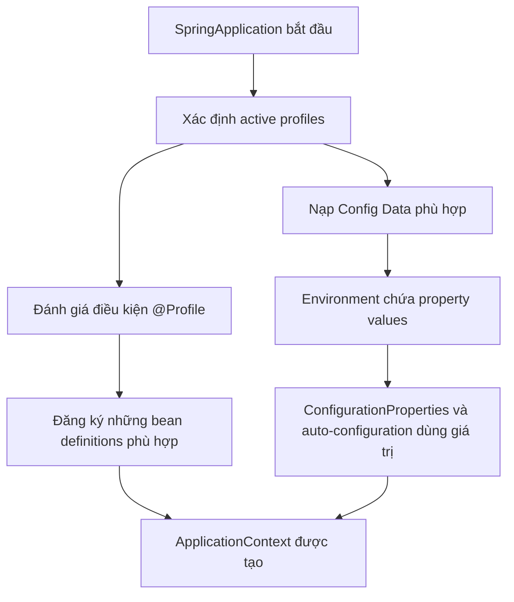

# Profile dùng để lựa chọn phần cấu hình nào

Trong một dự án Spring Boot, cùng một mã nguồn có thể được chạy trên máy lập trình viên, môi trường kiểm thử, staging và production. Các môi trường này thường khác nhau ở URL của dịch vụ bên ngoài, cách gửi thông báo, thông số kết nối, mức ghi log hoặc một số bean chỉ cần trong môi trường nhất định.

Spring Profiles giúp lựa chọn **những phần cấu hình được áp dụng khi xây dựng ApplicationContext** dựa trên tập profile đang hoạt động (*active profiles*). Cơ chế này cho phép giữ một codebase mà vẫn tổ chức được các lựa chọn theo môi trường.

Có hai câu hỏi quan trọng:

1. **Bean nào được đăng ký?** Ví dụ, dùng một implementation giả lập trong `test` và implementation thật trong `prod`.
2. **Giá trị cấu hình nào được nạp?** Ví dụ, `catalog.base-url` trong `application-dev.yml` khác `application-prod.yml`.

Profile không tự thay đổi tất cả hành vi của ứng dụng. Spring chỉ thực hiện những lựa chọn mà ta đã liên kết với profile bằng annotation, file Config Data hoặc điều kiện tương ứng.

## 1. Mô hình tư duy: Profile chọn cấu hình, không tự sinh ra hành vi

Hãy hình dung một ứng dụng có cấu trúc:

```text
application.yml
application-dev.yml
application-test.yml
application-prod.yml

AuditService
  ├── ConsoleAuditRecorder   (@Profile("dev"))
  ├── FakeAuditRecorder      (@Profile("test"))
  └── DatabaseAuditRecorder  (@Profile("prod"))
```

Khi `dev` active, Spring Boot có thể nạp `application-dev.yml` và Spring Framework có thể đăng ký `ConsoleAuditRecorder`. Khi `prod` active, phần Config Data và bean definitions của production được chọn.



Đây là sơ đồ khái quát. Trong quá trình bootstrap, việc chuẩn bị Environment và xử lý Config Data có thứ tự cụ thể; những bean condition được đánh giá khi container xử lý các định nghĩa tương ứng.

Một profile như `prod` chỉ là **nhãn**. Nó không tự bật HTTPS, không tự bảo vệ secret, không tự chọn database production và không tự biến các method thành thread-safe. Mọi tác động phải đến từ cấu hình và code được viết rõ ràng.

## 2. Những phần cấu hình mà profile có thể lựa chọn

| Loại cấu hình | Profile tác động thế nào? | Ví dụ |
|---|---|---|
| Bean của component scan | `@Profile` quyết định bean có được đăng ký hay không | `@Service @Profile("test")` |
| Bean tạo bằng Java configuration | `@Profile` trên `@Bean` method | Clock giả trong test |
| Cả configuration class | `@Profile` trên `@Configuration` | Nhóm bean local-only |
| Property values | Nạp file profile-specific | `application-prod.yml` |
| Tài liệu YAML/properties có điều kiện | `spring.config.activate.on-profile` | Phần config chỉ áp dụng khi prod |
| Thông số cho auto-configuration | Profile nạp property; auto-configuration đọc property | JDBC URL, logging level, server port |
| Feature flag gián tiếp | Profile cung cấp giá trị, condition khác dùng giá trị | `@ConditionalOnProperty` |
| Một tập profile phụ trợ | Profile groups hoặc include | `production` kích hoạt `proddb`, `prodmq` |

Profile **không tự** chọn một object nếu object được tạo bên ngoài Spring bằng `new` và không có logic kiểm tra Environment; không tự đổi implementation theo từng HTTP request; không bảo đảm một kết nối đã sẵn sàng; và không làm bean có sẵn trong context lập tức thay đổi khi chỉnh file YAML sau startup.

## 3. @Profile lựa chọn bean implementation

Giả sử ứng dụng cần ghi audit:

```java
package com.example.audit;

public interface AuditRecorder {
    void record(String event);
}
```

Ở môi trường phát triển, ta muốn ghi ra console:

```java
package com.example.audit;

import org.springframework.context.annotation.Profile;
import org.springframework.stereotype.Component;

@Component
@Profile("dev")
public class ConsoleAuditRecorder implements AuditRecorder {

    @Override
    public void record(String event) {
        System.out.println("[DEV AUDIT] " + event);
    }
}
```

Ở môi trường test, ta muốn một implementation dễ quan sát mà không gọi hạ tầng thật:

```java
package com.example.audit;

import org.springframework.context.annotation.Profile;
import org.springframework.stereotype.Component;

import java.util.ArrayList;
import java.util.List;

@Component
@Profile("test")
public class InMemoryAuditRecorder implements AuditRecorder {

    private final List<String> events = new ArrayList<>();

    @Override
    public void record(String event) {
        events.add(event);
    }

    public List<String> events() {
        return List.copyOf(events);
    }
}
```

Ở production, ví dụ một implementation tích hợp hạ tầng audit:

```java
package com.example.audit;

import org.springframework.context.annotation.Profile;
import org.springframework.stereotype.Component;

@Component
@Profile("prod")
public class ProductionAuditRecorder implements AuditRecorder {

    private final AuditGateway gateway;

    public ProductionAuditRecorder(AuditGateway gateway) {
        this.gateway = gateway;
    }

    @Override
    public void record(String event) {
        gateway.send(event);
    }
}
```

`AuditGateway` là abstraction do project cung cấp. Để ứng dụng production khởi động, bean `AuditGateway` phù hợp cũng phải có mặt.

Service nghiệp vụ chỉ cần interface:

```java
package com.example.orders;

import com.example.audit.AuditRecorder;
import org.springframework.stereotype.Service;

@Service
public class OrderService {

    private final AuditRecorder auditRecorder;

    public OrderService(AuditRecorder auditRecorder) {
        this.auditRecorder = auditRecorder;
    }

    public void placeOrder() {
        // Xử lý đơn hàng.
        auditRecorder.record("ORDER_CREATED");
    }
}
```

Nếu chỉ `dev` active, container đăng ký `ConsoleAuditRecorder`. Nếu chỉ `test` active, container đăng ký `InMemoryAuditRecorder`. Nếu chỉ `prod` active, container đăng ký `ProductionAuditRecorder`.

### 3.1. Tại sao không kiểm tra tên profile trong mỗi service?

Có thể viết logic:

```java
if ("prod".equals(currentProfile)) {
    // ...
} else {
    // ...
}
```

Nhưng khi nhiều service tự kiểm tra profile, logic chọn môi trường bị phân tán. `@Profile` cho phép đặt điều kiện tại **điểm tạo bean**, còn code nghiệp vụ chỉ phụ thuộc abstraction.

Cách này phù hợp khi **implementation thật sự khác nhau**. Nếu chỉ khác URL hoặc timeout, thường không cần tạo nhiều implementation.

### 3.2. Nếu không có bean nào phù hợp thì sao?

Ví dụ trên không có bean `AuditRecorder` cho trường hợp chỉ `staging` active. `OrderService` có thể khởi động thất bại vì constructor không có dependency phù hợp.

Spring không tự suy luận “staging gần giống production” để chọn bean prod.

Cần thiết kế rõ một trong các lựa chọn:

- Cung cấp implementation riêng cho staging.
- Cho phép một implementation được dùng bởi nhiều profile.
- Đưa một bean mặc định có condition phù hợp.
- Chặn các tổ hợp profile không được hỗ trợ và báo lỗi rõ ràng.

## 4. @Profile trên @Bean method

Với class không dùng Spring annotation, có thể đặt `@Profile` ngay trên phương thức `@Bean`.

Ví dụ dùng `Clock` có sẵn trong JDK:

```java
package com.example.time;

import java.time.Clock;
import java.time.Instant;
import java.time.ZoneOffset;

import org.springframework.context.annotation.Bean;
import org.springframework.context.annotation.Configuration;
import org.springframework.context.annotation.Profile;

@Configuration(proxyBeanMethods = false)
public class ClockConfiguration {

    @Bean
    @Profile("test")
    public Clock fixedClockForTests() {
        return Clock.fixed(
                Instant.parse("2026-01-01T00:00:00Z"),
                ZoneOffset.UTC
        );
    }

    @Bean
    @Profile("!test")
    public Clock systemClock() {
        return Clock.systemUTC();
    }
}
```

Với `test` active, chỉ `fixedClockForTests` phù hợp. Khi `test` không active, `systemClock` phù hợp.

Đây là lựa chọn tốt để minh họa vì ta không cần chỉnh class `Clock` của JDK. Annotation nằm ở **bean definition**, không nằm ở implementation.

### 4.1. Một configuration class có thể chứa bean có các profile khác nhau

```java
@Configuration(proxyBeanMethods = false)
public class ReportingConfiguration {

    @Bean
    @Profile("local")
    ReportStore localReportStore() {
        return new InMemoryReportStore();
    }

    @Bean
    @Profile("cloud")
    ReportStore cloudReportStore(CloudClient client) {
        return new CloudReportStore(client);
    }

    @Bean
    ReportFormatter reportFormatter() {
        return new ReportFormatter();
    }
}
```

Ở ví dụ này `ReportStore`, `CloudClient` và các implementation là những class/abstraction do project định nghĩa.

- `localReportStore` chỉ được đăng ký nếu `local` active.
- `cloudReportStore` chỉ được đăng ký nếu `cloud` active và dependency cần thiết có mặt.
- `reportFormatter` không bị giới hạn bởi profile đặt trên hai method kia.

Khi một bean dùng ở mọi môi trường, không cần gắn `@Profile` chỉ để tạo cảm giác “có cấu hình”.

## 5. @Profile trên @Configuration class

Khi nhiều bean thuộc cùng một cấu hình chỉ áp dụng cho một profile, đặt annotation trên cả class:

```java
@Configuration(proxyBeanMethods = false)
@Profile("local")
public class LocalIntegrationConfiguration {

    @Bean
    LocalMessageQueue localMessageQueue() {
        return new LocalMessageQueue();
    }

    @Bean
    LocalEventPublisher localEventPublisher(
            LocalMessageQueue queue
    ) {
        return new LocalEventPublisher(queue);
    }
}
```

Khi `local` không active, các bean method không được đăng ký **từ configuration này**.

Đặt `@Profile` ở class-level giúp tránh lặp annotation trên từng method, nhưng cũng dễ vô tình loại cả những bean lẽ ra dùng ở mọi môi trường. Nếu một bean không phải local-only, hãy đưa nó vào configuration class khác.

### 5.1. Điều kiện ở class và method có thể kết hợp

Nếu một configuration class mang `@Profile("cloud")` và một method bên trong mang `@Profile("dev")`, bean method phải thỏa điều kiện class-level lẫn điều kiện method-level. Trong trường hợp đơn giản, điều đó tương ứng cần cả `cloud` và `dev` active.

Không đọc mỗi annotation method riêng lẻ mà bỏ qua condition của class chứa nó.

## 6. Profile-specific Config Data: application-{profile}.yml

Spring Boot nạp những nguồn cấu hình thích hợp với profile. Cấu trúc phổ biến:

```text
src/main/resources/
├── application.yml
├── application-dev.yml
├── application-test.yml
└── application-prod.yml
```

File `application.yml` chứa các giá trị chung:

```yaml
spring:
  application:
    name: catalog-service

server:
  port: 8080

app:
  catalog:
    base-url: http://localhost:9000
    timeout: 3s
```

File `application-dev.yml` chứa giá trị dành cho phát triển:

```yaml
logging:
  level:
    com.example.catalog: DEBUG

app:
  catalog:
    base-url: http://localhost:9001
    timeout: 1s
```

File `application-prod.yml`:

```yaml
logging:
  level:
    com.example.catalog: INFO

app:
  catalog:
    base-url: https://catalog.internal.example
    timeout: 5s
```

Nếu chỉ `dev` active và không có nguồn cấu hình ưu tiên cao hơn ghi đè, các giá trị hiệu lực có thể là:

| Property | Giá trị |
|---|---|
| `spring.application.name` | `catalog-service` |
| `server.port` | `8080` |
| `app.catalog.base-url` | `http://localhost:9001` |
| `app.catalog.timeout` | `1s` |
| `logging.level.com.example.catalog` | `DEBUG` |

File chung vẫn có tác dụng; file profile-specific không bắt buộc lặp lại mọi property.

### 6.1. Thay property không tự thay implementation

Đặt `app.catalog.timeout: 1s` trong YAML chỉ tạo ra một giá trị trong `Environment`. Spring Boot hoặc code ứng dụng phải **sử dụng** property đó để nó ảnh hưởng hành vi.

Ví dụ, nếu `CatalogClient` không đọc `app.catalog.timeout`, thì profile đã nạp đúng file nhưng timeout của client vẫn không thay đổi.

**Phân biệt:**
- Profile chọn **nguồn giá trị**.
- Bean hoặc auto-configuration quyết định **cách áp dụng giá trị**.

### 6.2. File .properties cũng được hỗ trợ

Bên cạnh YAML, có thể viết:

```properties
# application-prod.properties
app.catalog.base-url=https://catalog.internal.example
app.catalog.timeout=5s
logging.level.com.example.catalog=INFO
```

Hãy chọn một quy ước thống nhất trong project và tránh khai báo trùng cùng property ở nhiều file mà không hiểu quy tắc ưu tiên.

## 7. @ConfigurationProperties để nhận giá trị theo profile

Khi nhiều property thuộc cùng một tính năng, nên bind vào một class có kiểu rõ ràng:

```java
package com.example.catalog;

import java.net.URI;
import java.time.Duration;
import org.springframework.boot.context.properties.ConfigurationProperties;

@ConfigurationProperties(prefix = "app.catalog")
public class CatalogProperties {

    private URI baseUrl = URI.create("http://localhost:9000");
    private Duration timeout = Duration.ofSeconds(3);

    public URI getBaseUrl() {
        return baseUrl;
    }

    public void setBaseUrl(URI baseUrl) {
        this.baseUrl = baseUrl;
    }

    public Duration getTimeout() {
        return timeout;
    }

    public void setTimeout(Duration timeout) {
        this.timeout = timeout;
    }
}
```

Đăng ký properties bean:

```java
import org.springframework.boot.context.properties.EnableConfigurationProperties;
import org.springframework.context.annotation.Bean;
import org.springframework.context.annotation.Configuration;

@Configuration(proxyBeanMethods = false)
@EnableConfigurationProperties(CatalogProperties.class)
public class CatalogConfiguration {

    @Bean
    CatalogClient catalogClient(CatalogProperties properties) {
        return new CatalogClient(
                properties.getBaseUrl(),
                properties.getTimeout()
        );
    }
}
```

`CatalogClient` ở đây là class ứng dụng với constructor nhận `URI` và `Duration`.

Khi active profile thay đổi giữa các lần khởi động, cùng factory method có thể tạo bean dùng các giá trị khác nhau.

### 7.1. Có nên đặt @Profile trên properties class?

Nếu properties bean được đăng ký qua `@EnableConfigurationProperties`, vị trí thích hợp để điều kiện hóa việc đăng ký theo profile là configuration class dùng `@EnableConfigurationProperties`. Nếu properties bean được đăng ký qua configuration-properties scanning, `@Profile` có thể được đặt trên chính properties class được scan.

Không nên đặt `@Profile` ngẫu nhiên rồi giả định nó luôn được áp dụng, vì cách đăng ký `@ConfigurationProperties` ảnh hưởng điểm điều kiện được xử lý.

## 8. Chọn từng tài liệu YAML bằng spring.config.activate.on-profile

Không bắt buộc tạo một file cho mỗi profile. Một `application.yml` có thể chứa nhiều tài liệu, ngăn cách bằng `---`.

```yaml
spring:
  application:
    name: catalog-service

app:
  catalog:
    timeout: 3s
    base-url: http://localhost:9000

---
spring:
  config:
    activate:
      on-profile: dev

app:
  catalog:
    timeout: 1s
    base-url: http://localhost:9001

---
spring:
  config:
    activate:
      on-profile: prod

app:
  catalog:
    timeout: 5s
    base-url: https://catalog.internal.example
```

Phần đầu luôn có thể được áp dụng theo các quy tắc nạp Config Data. Phần thứ hai chỉ được kích hoạt khi profile `dev` match; phần thứ ba khi `prod` match.

### 8.1. on-profile hỗ trợ biểu thức

Ví dụ một tài liệu dùng cho staging hoặc production:

```yaml
spring:
  config:
    activate:
      on-profile: "staging | prod"

app:
  observability:
    detailed-audit: true
```

Biểu thức dùng toán tử OR nên tài liệu phù hợp nếu `staging` hoặc `prod` active. Biểu thức phức tạp có thể kết hợp AND, NOT và dấu ngoặc theo cú pháp profile expression của Spring.

### 8.2. Chọn nhiều file hay một file nhiều tài liệu?

Dùng file riêng như `application-prod.yml` khi cấu hình mỗi môi trường đủ dài, cần review độc lập hoặc muốn tách rõ trách nhiệm.

Dùng nhiều tài liệu trong một file khi khác biệt nhỏ và dễ đọc cạnh nhau.

Không nên vừa khai báo cùng một nhóm property trong `application-prod.yml` vừa khai báo lặp lại ở tài liệu `on-profile: prod` nếu nhóm chưa chủ đích thiết kế thứ tự ghi đè.

## 9. Kích hoạt profile bằng những cách nào?

Active profile phải được xác định trong `Environment` trước khi Spring đánh giá các phần cấu hình theo profile.

### 9.1. Command-line argument

```bash
java -jar catalog-service.jar --spring.profiles.active=dev
```

Nhiều profile:

```bash
java -jar catalog-service.jar --spring.profiles.active=prod,metrics
```

### 9.2. Environment variable

Linux/macOS:

```bash
export SPRING_PROFILES_ACTIVE=prod
java -jar catalog-service.jar
```

Windows PowerShell:

```powershell
$env:SPRING_PROFILES_ACTIVE = "dev"
java -jar catalog-service.jar
```

Spring Boot hỗ trợ relaxed binding để biến môi trường `SPRING_PROFILES_ACTIVE` tương ứng với property `spring.profiles.active`.

### 9.3. Qua file cấu hình không gắn điều kiện profile

```yaml
spring:
  profiles:
    active: dev
```

Cách này tiện để trình diễn nhưng không nên hard-code `prod` hay `dev` trong artifact dùng chung cho tất cả môi trường nếu hệ thống triển khai cần quyền lựa chọn.

### 9.4. Qua SpringApplication

```java
SpringApplication application =
        new SpringApplication(CatalogApplication.class);

application.setAdditionalProfiles("local");

application.run(args);
```

Có thể bổ sung profile bằng API khi có yêu cầu bootstrap riêng. Tuy nhiên, với dự án bình thường, cấu hình triển khai tường minh thường dễ kiểm tra hơn thay vì để code main tự quyết định môi trường.

### 9.5. Xác nhận qua startup log

Log có thể chứa thông báo như:

```text
The following 1 profile is active: "dev"
```

Hoặc khi không có active profile:

```text
No active profile set, falling back to 1 default profile: "default"
```

Câu chữ có thể thay đổi theo phiên bản. Khi điều tra vấn đề config, hãy luôn xác nhận tập profile **thực sự đang hoạt động**, không dựa vào phỏng đoán tên môi trường.

## 10. Default profile là gì?

Khi không có active profile nào được khai báo, Spring có cơ chế **default profiles**. Tên default thường là `default`.

Ví dụ:

```java
@Component
@Profile("default")
public class DefaultAuditRecorder implements AuditRecorder {
    // ...
}
```

Bean này phù hợp khi Spring đang sử dụng default profile, chứ **không** phải khi một profile khác đã active nhưng bean của profile đó bị thiếu.

### 10.1. Default profile không phải fallback theo từng bean

Giả sử `dev` active nhưng không có `AuditRecorder` cho dev. Spring không tự chuyển sang `@Profile("default")` để lấp chỗ trống nếu default profile không được kích hoạt.

Default profile chỉ phản ánh tập profile áp dụng khi không có active profile theo quy tắc của `Environment`.

### 10.2. Thay đổi default profile

Có thể cấu hình:

```properties
spring.profiles.default=local
```

Khi không có active profile, `local` có thể là default profile thay cho `default`. Nếu muốn vô hiệu hóa default profile đặc biệt, Spring Boot còn hỗ trợ giá trị `none` trong cách cấu hình tương ứng.

Với hệ thống production, nên kích hoạt profile tường minh; tránh để một default profile vô tình bật hạ tầng production.

## 11. Có thể active nhiều profile cùng lúc

```properties
spring.profiles.active=dev,metrics
```

Tập profile này làm cả `dev` và `metrics` được xem là active. Điều đó hữu ích nếu một nhóm cấu hình mô tả môi trường, nhóm khác mô tả khả năng bổ sung.

### 11.1. @Profile với mảng giá trị là OR

```java
@Component
@Profile({"dev", "test"})
public class ConsoleNotificationSender implements NotificationSender {
    // ...
}
```

Bean được đăng ký khi **ít nhất một** profile trong danh sách match.

Nếu muốn cả hai profile đồng thời match, dùng profile expression:

```java
@Component
@Profile("dev & cloud")
public class CloudDevelopmentDiagnostics {
    // ...
}
```

Nếu muốn một trong hai, có thể viết:

```java
@Component
@Profile("dev | test")
public class NonProductionDiagnostics {
    // ...
}
```

### 11.2. Phủ định profile

```java
@Component
@Profile("!prod")
public class LocalSafetyBanner {
    // ...
}
```

Bean này được đăng ký khi `prod` không active.

Cẩn thận: `!prod` không tương đương “chỉ dev”. Nó còn match với `staging`, `test` hoặc trường hợp không có prod. Nếu chỉ muốn dev/test, dùng điều kiện giới hạn cụ thể.

### 11.3. Hai profile có thể làm hai implementation xuất hiện

Nếu đồng thời active `dev,prod`, hai bean:

```java
@Bean
@Profile("dev")
AuditRecorder devRecorder() { /* ... */ }

@Bean
@Profile("prod")
AuditRecorder prodRecorder() { /* ... */ }
```

đều có thể được đăng ký.

Khi một service inject một `AuditRecorder` theo kiểu, Spring có thể gặp lỗi nhiều bean phù hợp (`NoUniqueBeanDefinitionException`). Profile không tự coi production có độ ưu tiên cao hơn development khi chọn implementation.

Đây là lý do cần quy định rõ các tổ hợp profile được hỗ trợ, hoặc thiết kế cơ chế chọn candidate khác như `@Qualifier`/`@Primary` khi thực sự cần.

## 12. Khi nhiều profile cùng đặt một property

Giả sử ứng dụng active:

```properties
spring.profiles.active=dev,metrics
```

Và cả `application-dev.yml` lẫn `application-metrics.yml` đặt `app.logging.detail`. Trong trường hợp các file cùng nhóm và vị trí cấu hình tương đương, Spring Boot dùng thứ tự profile-specific config, với profile được khai báo sau thường có thể ghi đè giá trị cùng key theo nguyên tắc **last-wins**.

Tuy nhiên, Spring Boot không chỉ có những file đó. Command-line arguments, environment variables, Config Data import và các property sources khác cũng tham gia với thứ tự ưu tiên riêng.

Vì vậy, không được kết luận rằng “`application-prod.yml` luôn thắng mọi nguồn khác”. Hãy kiểm tra nguồn nào đang cung cấp giá trị cuối cùng.

### 12.1. Cách xác định một giá trị hiệu lực

Khi `app.catalog.base-url` không đúng, hãy xem:

1. Active profiles thực tế và thứ tự của chúng.
2. File `application.yml` và các file `application-{profile}.yml`.
3. Tài liệu `on-profile` trong các file nhiều đoạn.
4. Giá trị từ environment hoặc command-line.
5. `spring.config.import` và các vị trí config bên ngoài.
6. Bean có bind/đọc đúng key hay không.

Một log chỉ cho biết profile active, không tự chứng minh property được lấy từ file nào.

## 13. spring.profiles.group: nhóm nhiều profile

Spring Boot hỗ trợ profile group để một profile logic kích hoạt thêm các profile thành phần.

```yaml
spring:
  profiles:
    group:
      production:
        - proddb
        - prodmq
        - observability
```

Nếu chạy:

```bash
java -jar app.jar --spring.profiles.active=production
```

Spring Boot có thể kích hoạt `production` cùng các profile được khai báo trong group: `proddb`, `prodmq` và `observability`.

Điều này hữu ích khi production cần nhiều module cấu hình mà người triển khai không nên phải nhập từng profile.

### 13.1. Group không tự tạo dependency

Kích hoạt `prodmq` không tự cài đặt Kafka/RabbitMQ client hoặc tạo cấu hình kết nối chính xác. Các thư viện, bean và property cần thiết vẫn phải tồn tại.

Group chỉ tổ chức tập tên profile, không phải cơ chế kiểm tra readiness hay cài package.

### 13.2. Vị trí khai báo group

Theo quy tắc Config Data của Spring Boot hiện đại, `spring.profiles.group` được khai báo trong tài liệu **không phải profile-specific**. Tránh đặt group ở trong tài liệu chỉ được kích hoạt bằng `spring.config.activate.on-profile`.

## 14. spring.profiles.include: bổ sung profile

Một cách khác là:

```yaml
spring:
  profiles:
    include:
      - common-observability
```

`spring.profiles.include` bổ sung profile theo cấu hình được hỗ trợ.

| Thuộc tính | Mục đích |
|---|---|
| `spring.profiles.active` | Chọn active profiles |
| `spring.profiles.default` | Chọn default profiles khi không có active profile |
| `spring.profiles.include` | Bổ sung các profile khác |
| `spring.profiles.group.*` | Gộp các profile thành tên logic |

### 14.1. Không khai báo active/include/group trong tài liệu profile-specific

Trong Spring Boot dùng Config Data (từ dòng 2.4 trở đi), các thuộc tính như `spring.profiles.active`, `spring.profiles.default`, `spring.profiles.include` và `spring.profiles.group` có quy tắc chỉ được dùng trong tài liệu không được kích hoạt theo profile.

Ví dụ không hợp lệ về mặt ý định cấu hình:

```yaml
spring:
  config:
    activate:
      on-profile: prod
  profiles:
    active: metrics
```

Tài liệu đã yêu cầu active `prod` nhưng lại cố chọn thêm active profile ngay bên trong. Đừng dùng kiểu “kích hoạt dây chuyền” này. Thay vào đó, dùng group ở tài liệu chung hoặc cung cấp tập active profiles từ môi trường triển khai.

## 15. Profile và @ConditionalOnProperty khác nhau

Một profile thường đại diện cho môi trường hoặc nhóm cấu hình, còn feature flag là lựa chọn bật/tắt một tính năng cụ thể. Hai khái niệm có thể liên quan nhưng không đồng nhất.

Ví dụ ứng dụng chỉ đăng ký scheduler khi:

```java
@Configuration(proxyBeanMethods = false)
public class ReportingSchedulingConfiguration {

    @Bean
    @ConditionalOnProperty(
            prefix = "app.reporting",
            name = "scheduler-enabled",
            havingValue = "true"
    )
    ReportScheduler reportScheduler() {
        return new ReportScheduler();
    }
}
```

`application-dev.yml`:

```yaml
app:
  reporting:
    scheduler-enabled: false
```

`application-prod.yml`:

```yaml
app:
  reporting:
    scheduler-enabled: true
```

Ở đây, **profile chọn giá trị** property. Chính `@ConditionalOnProperty` quyết định bean `ReportScheduler` có được đăng ký hay không.

Nếu cần tắt scheduler tạm thời trong production, chỉ cần override property tương ứng ở môi trường triển khai, không nhất thiết đổi profile của toàn ứng dụng.

### 15.1. Bảng chọn công cụ

| Yêu cầu | Cơ chế nên cân nhắc |
|---|---|
| Chọn fake payment gateway cho test | `@Profile("test")` |
| Thay URL, timeout theo môi trường | Config Data + `@ConfigurationProperties` |
| Bật/tắt một feature độc lập với môi trường | `@ConditionalOnProperty` |
| Chỉ tạo bean khi dependency đã có | `@ConditionalOnBean` |
| Cung cấp default bean và cho ứng dụng thay thế | `@ConditionalOnMissingBean` |
| Thay đổi behavior theo tenant của mỗi request | Strategy/routing runtime, không chỉ `@Profile` |

Không nên dùng `@Profile` cho mọi trường hợp chỉ vì nó dễ viết. Chọn đúng cơ chế giúp tránh sinh quá nhiều tên profile, chẳng hạn `prod-with-email`, `prod-without-email` hoặc `staging-feature-x`.

## 16. Profile không thay thế Environment và property-source precedence

`Environment` của Spring quản lý cả active profiles lẫn các property sources. Profile là một cách lựa chọn Config Data, không phải toàn bộ cơ chế resolve property.

Một property có thể tới từ:

- File `application.yml` đóng gói.
- File profile-specific.
- Config Data bên ngoài.
- Biến môi trường.
- JVM system properties.
- Command-line arguments.
- Property source do test hoặc code cung cấp.

Ví dụ, dù `application-prod.yml` đặt:

```yaml
server:
  port: 8080
```

lệnh sau có thể làm server dùng cổng `9090`:

```bash
java -jar app.jar --spring.profiles.active=prod --server.port=9090
```

Command-line arguments có độ ưu tiên cao hơn file cấu hình đóng gói trong những trường hợp Spring Boot thông thường.

### 16.1. Profile không bảo đảm secret an toàn

Không nên commit password/API key production thật trong `application-prod.yml`. Profile-specific file vẫn có thể nằm trong source repository hoặc được đóng gói vào JAR.

Ví dụ tham chiếu biến môi trường:

```yaml
app:
  payment:
    endpoint: https://payments.internal.example
    api-key: ${PAYMENT_API_KEY}
```

Trong bản Markdown cuối cùng, biểu thức tham chiếu này mang cú pháp `${PAYMENT_API_KEY}`; môi trường deploy phải cung cấp giá trị tương ứng bằng secret manager hoặc cơ chế an toàn phù hợp.

Profile chỉ chọn phần cấu hình; authentication, authorization, TLS và secret management phải được thiết kế độc lập.

## 17. Profile không đổi bean đã được tạo ở runtime

`@Profile` được đánh giá trong quá trình xây dựng ApplicationContext. Sau khi container đã tạo bean, chỉ sửa file `application-prod.yml` trên ổ đĩa hoặc đổi biến môi trường bên ngoài không làm bean đã inject tự biến thành implementation khác.

Ví dụ:

1. Ứng dụng khởi động với `dev`.
2. Spring đăng ký `ConsoleAuditRecorder` và inject nó vào `OrderService`.
3. Ai đó sửa biến môi trường của hệ điều hành thành `prod`.
4. `OrderService` không tự nhận `ProductionAuditRecorder` trong context hiện tại.

Thông thường cần restart/redeploy để cấu hình được chọn lại. Nếu hệ thống có cơ chế refresh động, đó là một thiết kế bổ sung với giới hạn về lifecycle, refresh scope và consistency.

Profile cũng không phải giải pháp chọn provider theo từng HTTP request. Nếu mỗi tenant cần một nhà cung cấp thanh toán khác nhau, hãy dùng strategy/routing bean hoặc service thích hợp.

## 18. Ví dụ xuyên suốt: dev, test, prod chọn những gì?

Giả sử hệ thống có:

- `NotificationSender` để gửi thông báo.
- `CatalogClient` để gọi catalog.
- `ReportScheduler` để đồng bộ định kỳ.
- JDBC DataSource để truy cập database.

Một cách tổ chức phù hợp:

```text
Profile dev:
  NotificationSender = logging implementation
  Catalog URL = http://localhost:9000
  Scheduler enabled = false
  JDBC URL = local database

Profile test:
  NotificationSender = fake implementation
  Catalog URL = local fake server
  Scheduler enabled = false
  JDBC URL = test database

Profile prod:
  NotificationSender = production gateway
  Catalog URL = internal HTTPS endpoint
  Scheduler enabled = true
  JDBC URL = external secret/config
```

### 18.1. Chọn NotificationSender bằng @Profile

```java
public interface NotificationSender {
    void send(String recipient, String message);
}
```

```java
@Configuration(proxyBeanMethods = false)
public class NotificationConfiguration {

    @Bean
    @Profile({"dev", "test"})
    NotificationSender loggingNotificationSender() {
        return (recipient, message) ->
                System.out.println(
                        "Notification to " + recipient + ": " + message
                );
    }

    @Bean
    @Profile("prod")
    NotificationSender productionNotificationSender(
            ExternalNotificationGateway gateway
    ) {
        return gateway::send;
    }
}
```

`ExternalNotificationGateway` là interface của project với method `send(String, String)`. Trong production phải có bean tương ứng; test không được vô tình gọi ra gateway production.

### 18.2. Chọn property bằng Config Data

`application.yml`:

```yaml
spring:
  application:
    name: order-service

app:
  catalog:
    timeout: 3s
```

`application-dev.yml`:

```yaml
app:
  catalog:
    base-url: http://localhost:9000
  reports:
    scheduler-enabled: false
```

`application-test.yml`:

```yaml
app:
  catalog:
    base-url: http://localhost:9010
  reports:
    scheduler-enabled: false
```

`application-prod.yml`:

```yaml
app:
  catalog:
    base-url: https://catalog.internal.example
    timeout: 5s
  reports:
    scheduler-enabled: true
```

### 18.3. Chọn scheduler bằng property condition

```java
@Bean
@ConditionalOnProperty(
        prefix = "app.reports",
        name = "scheduler-enabled",
        havingValue = "true"
)
ReportScheduler reportScheduler() {
    return new ReportScheduler();
}
```

Trong ví dụ này, chính property condition tạo quyết định bật scheduler, còn profile nạp giá trị từ file tương ứng.

### 18.4. Chọn thông số DataSource mà không đổi class DataSource

Trong ứng dụng có JDBC/JPA starter và driver phù hợp, `application-dev.yml` có thể chứa:

```yaml
spring:
  datasource:
    url: jdbc:h2:mem:devdb
    username: sa
    password: ""
```

Còn production:

```yaml
spring:
  datasource:
    url: ${DB_JDBC_URL}
    username: ${DB_USERNAME}
    password: ${DB_PASSWORD}
```

Spring Boot có thể vẫn tạo cùng loại infrastructure bean; chỉ các giá trị kết nối khác nhau. H2 yêu cầu driver tương ứng trên classpath. Production cần driver, credentials, network và database thực tế.

## 19. Kiểm thử @Profile bằng @ActiveProfiles

Spring Test hỗ trợ `@ActiveProfiles` để điều khiển profile trong test context.

```java
import org.junit.jupiter.api.Test;
import org.springframework.beans.factory.annotation.Autowired;
import org.springframework.boot.test.context.SpringBootTest;
import org.springframework.context.ApplicationContext;
import org.springframework.test.context.ActiveProfiles;

import static org.assertj.core.api.Assertions.assertThat;

@SpringBootTest
@ActiveProfiles("dev")
class DevelopmentWiringTest {

    @Autowired
    private ApplicationContext context;

    @Test
    void usesDevelopmentNotificationSender() {
        assertThat(context.containsBean("loggingNotificationSender"))
                .isTrue();
        assertThat(context.containsBean("productionNotificationSender"))
                .isFalse();
    }
}
```

Một test tương ứng với `prod`:

```java
@SpringBootTest
@ActiveProfiles("prod")
class ProductionWiringTest {

    @Autowired
    ApplicationContext context;

    @Test
    void usesProductionNotificationSender() {
        assertThat(context.containsBean("productionNotificationSender"))
                .isTrue();
        assertThat(context.containsBean("loggingNotificationSender"))
                .isFalse();
    }
}
```

Lưu ý: Để context prod khởi động trong test, phải cung cấp fake/mock phù hợp cho `ExternalNotificationGateway` và các dependency production cần thiết. Không để test thực hiện giao dịch hoặc gửi message tới hạ tầng thật.

### 19.1. Test phải kiểm tra cả bean có mặt và vắng mặt

Chỉ assert `loggingNotificationSender` có mặt chưa chắc phát hiện lỗi cả sender production cũng được đăng ký. Test tốt cần kiểm tra:

- Bean mong đợi tồn tại.
- Bean không phù hợp không tồn tại.
- Không có nhiều candidate cùng abstraction ngoài ý muốn.
- Property cuối cùng đúng với profile đang active.

### 19.2. Test lựa chọn bean bằng ApplicationContextRunner

Với một context nhỏ, có thể chủ động đặt profile:

```java
import org.junit.jupiter.api.Test;
import org.springframework.boot.test.context.runner.ApplicationContextRunner;

import static org.assertj.core.api.Assertions.assertThat;

class ClockConfigurationTests {

    private final ApplicationContextRunner runner =
            new ApplicationContextRunner()
                    .withUserConfiguration(ClockConfiguration.class);

    @Test
    void usesFixedClockWithTestProfile() {
        runner
                .withInitializer(context ->
                        context.getEnvironment()
                                .setActiveProfiles("test"))
                .run(context -> {
                    assertThat(context).hasBean("fixedClockForTests");
                    assertThat(context).doesNotHaveBean("systemClock");
                });
    }

    @Test
    void usesSystemClockOtherwise() {
        runner.run(context -> {
            assertThat(context).hasBean("systemClock");
            assertThat(context).doesNotHaveBean("fixedClockForTests");
        });
    }
}
```

`ApplicationContextRunner` kiểm tra bean conditions trong context cô lập. Nó không tự động chứng minh rằng toàn bộ quy trình nạp file `application-test.yml` của `SpringApplication` đã chạy giống production. Nếu mục tiêu là kiểm tra file Config Data thật, nên có integration test phù hợp với quá trình bootstrap của Spring Boot.

## 20. Điều tra khi profile không chọn cấu hình mong đợi

Khi ứng dụng dùng sai URL hoặc bean không xuất hiện, hãy chẩn đoán theo một trình tự rõ ràng.

### Bước 1: Xác nhận active profiles

Xem startup log hoặc đọc `Environment`:

```java
import java.util.Arrays;
import org.springframework.core.env.Environment;
import org.springframework.stereotype.Component;

@Component
public class ActiveProfileLogger {

    public ActiveProfileLogger(Environment environment) {
        System.out.println(
                "Active profiles: " +
                Arrays.toString(environment.getActiveProfiles())
        );
    }
}
```

### Bước 2: Kiểm tra phạm vi đăng ký bean

- Class có nằm trong component-scan path không?
- `@Configuration` có được import không?
- `@Profile` nằm trên component, configuration hay `@Bean`?
- Có class-level condition khiến toàn bộ bean bị loại không?
- Có một condition khác như `@ConditionalOnClass` hoặc `@ConditionalOnProperty` cũng phải thỏa không?

### Bước 3: Kiểm tra file và property sources

- Có đúng tên `application-dev.yml` hay `application-prod.yml` không?
- File nằm đúng classpath/vị trí config được nạp không?
- Có tài liệu `spring.config.activate.on-profile` không?
- Command line hoặc environment có ghi đè property không?
- Có Config Data import nào áp dụng trong môi trường đó không?
- Property class đã được bind và factory sử dụng chưa?

### Bước 4: Đọc lỗi Spring

Nếu không có bean, có thể gặp `UnsatisfiedDependencyException` hoặc `NoSuchBeanDefinitionException`. Nếu cả hai implementation cùng tồn tại, có thể gặp `NoUniqueBeanDefinitionException`.

Đừng sửa bằng `@Primary` ngay nếu mục tiêu ban đầu là chỉ một bean được đăng ký. Hãy xác định profile nào match, condition nào có hiệu lực và tại sao có nhiều candidate.

### Bước 5: Dùng công cụ chẩn đoán

Chạy với `--debug`:

```bash
java -jar catalog-service.jar --debug
```

Condition Evaluation Report có thể giúp giải thích những auto-configuration đã match hoặc không match. Với bean profile, xem bean definitions, log và test context để xác nhận.

Các endpoint Actuator như `env`, `configprops` và `conditions` có thể hữu ích nếu được bật phù hợp. Chúng có thể chứa thông tin nội bộ, nên cần cấu hình exposure/security cẩn thận và không công khai dữ liệu nhạy cảm.

## 21. Những nhầm lẫn thường gặp

| Nhận định | Đúng hay sai? | Giải thích |
|---|---|---|
| Có file `application-dev.yml` thì dev tự active | **Sai** | Cần có active/default profile tương ứng |
| Profile chỉ chọn bean | **Sai** | Profile còn chọn Config Data |
| Profile chỉ thay property | **Sai** | `@Profile` có thể chọn bean definitions |
| `@Profile({"dev","test"})` cần cả hai active | **Sai** | Đây là phép OR |
| `@Profile("!prod")` nghĩa là chỉ dev | **Sai** | Mọi tổ hợp không có prod đều có thể match |
| Hai profile active thì Spring chọn prod bean trước dev bean | **Sai** | Hai bean cùng kiểu có thể cùng tồn tại |
| `application-prod.yml` luôn có ưu tiên cao hơn mọi nguồn config | **Sai** | Phải xét property-source precedence |
| Property mới trong YAML tự tạo behavior | **Sai** | Cần code hoặc auto-configuration đọc property |
| `@Profile("default")` là fallback cho bean bị thiếu | **Sai** | Default profile dùng khi không có active profile |
| Đổi file YAML lúc runtime lập tức thay bean | **Sai** | Không phải hành vi mặc định của `@Profile` |
| Profile bảo đảm database đã kết nối | **Sai** | Cần health checks và kiểm chứng runtime |
| Dùng profile prod là đủ để bảo vệ secret | **Sai** | Cần secret management riêng |
| Mọi feature flag nên là profile | **Sai** | Feature độc lập nên dùng property condition |
| `@ActiveProfiles("test")` tự chặn toàn bộ gọi API thật | **Sai** | Test cần fake/mock và isolation phù hợp |

## 22. Bài tập tự kiểm tra

### Bài 1: Thay timeout

Ứng dụng chỉ khác timeout HTTP giữa dev và prod, còn implementation HTTP client giống hệt nhau.

**Câu hỏi:** Có cần tạo hai client bean với `@Profile` không?

**Đáp án:** Thường không. Dùng profile-specific property và `@ConfigurationProperties` là đủ.

### Bài 2: Thay implementation

Test không được gọi payment gateway thật, production phải dùng gateway thật.

**Câu hỏi:** Có thể dùng profile ở đâu?

**Đáp án:** Dùng `@Profile("test")` cho fake gateway và `@Profile("prod")` cho production gateway, đồng thời bảo đảm các tổ hợp profile được hỗ trợ luôn có đúng dependency phù hợp.

### Bài 3: Tài liệu on-profile

```yaml
app:
  feature:
    mode: basic

---
spring:
  config:
    activate:
      on-profile: staging

app:
  feature:
    mode: preview
```

**Câu hỏi:** Khi staging active và không có nguồn ưu tiên cao hơn, `app.feature.mode` là gì?

**Đáp án:** `preview`.

### Bài 4: Kết hợp profile

Có hai bean `CacheStore`, lần lượt gắn `@Profile("dev")` và `@Profile("metrics")`.

**Câu hỏi:** Điều gì có thể xảy ra nếu active `dev,metrics`?

**Đáp án:** Cả hai bean có thể được đăng ký; injection `CacheStore` theo kiểu có thể ambiguous nếu không có quy tắc chọn thích hợp.

### Bài 5: Khai báo sai vị trí

Một tài liệu YAML dùng `spring.config.activate.on-profile: prod` nhưng cũng khai báo `spring.profiles.active: metrics` trong chính tài liệu đó.

**Câu hỏi:** Có phải cách hợp lệ để thêm profile không?

**Đáp án:** Không theo quy tắc Config Data hiện đại. Đặt profile group/include/activation ở vị trí không phụ thuộc profile theo quy định.

### Bài 6: Feature flag

Một scheduler cần bật/tắt độc lập với việc ứng dụng đang chạy ở staging hay prod.

**Câu hỏi:** Nên dùng profile hay property condition?

**Đáp án:** `@ConditionalOnProperty` phù hợp hơn, còn profile-specific configuration có thể cung cấp giá trị mặc định theo môi trường.

### Bài 7: Default profile

Một bean `@Profile("default")` có tự xuất hiện khi `dev` active nhưng thiếu bean dành cho dev không?

**Đáp án:** Không. Default profile không phải fallback theo từng bean.

### Bài 8: Runtime

Ứng dụng đã khởi động với `dev` và inject `ConsoleAuditRecorder`. Sau đó file `application-prod.yml` bị sửa.

**Câu hỏi:** Bean đang dùng có tự trở thành production recorder không?

**Đáp án:** Không. Cần restart/redeploy hoặc cơ chế refresh động được thiết kế rõ ràng.

## 23. Ghi nhớ

- **Profile chọn phần cấu hình**, chủ yếu gồm bean definitions và nguồn Config Data.
- `@Profile` được dùng trên component, configuration class hoặc `@Bean` method để quyết định bean nào có mặt trong context.
- `application-{profile}.yml` và `spring.config.activate.on-profile` dùng để chọn giá trị property theo profile.
- Profile không tự biến một property tùy biến thành tính năng; bean hoặc auto-configuration phải đọc và dùng giá trị đó.
- Active profile có thể khai báo qua command-line, environment, file cấu hình hợp lệ hoặc API bootstrap.
- Default profile áp dụng khi không có active profile; không phải fallback cho từng bean.
- Có thể active nhiều profile cùng lúc; mảng `@Profile` là OR và biểu thức có thể dùng AND, OR, NOT.
- Profile group/include giúp tổ chức các profile liên quan nhưng phải khai báo tại vị trí Config Data hợp lệ.
- `@ConditionalOnProperty` thường phù hợp hơn cho feature flag độc lập với môi trường.
- Profile không thay thế secret management, health check, runtime routing hoặc cơ chế refresh động.
- Kiểm thử bằng `@ActiveProfiles`, kiểm tra cả bean được đăng ký, bean bị loại và giá trị property cuối cùng.

Khi thiết kế cấu hình một ứng dụng Spring Boot, hãy tự hỏi: **“Khác biệt giữa các môi trường là implementation của bean, giá trị cấu hình hay chỉ một công tắc tính năng?”** Câu trả lời sẽ giúp bạn chọn đúng giữa `@Profile`, profile-specific Config Data và những điều kiện cấu hình khác.
