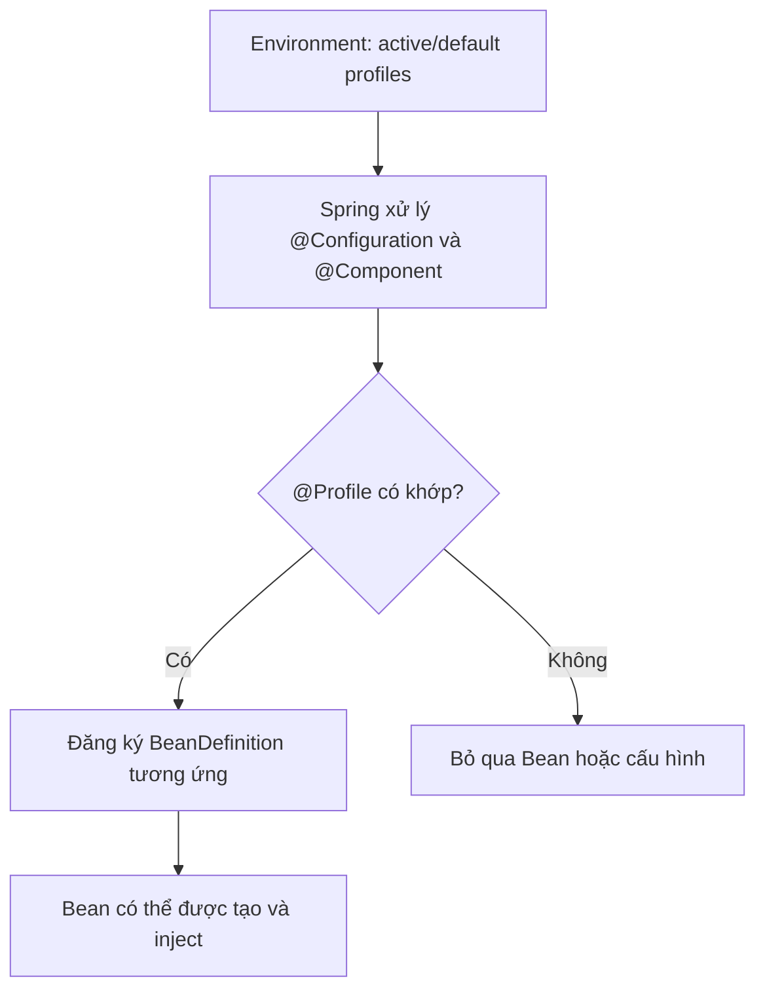
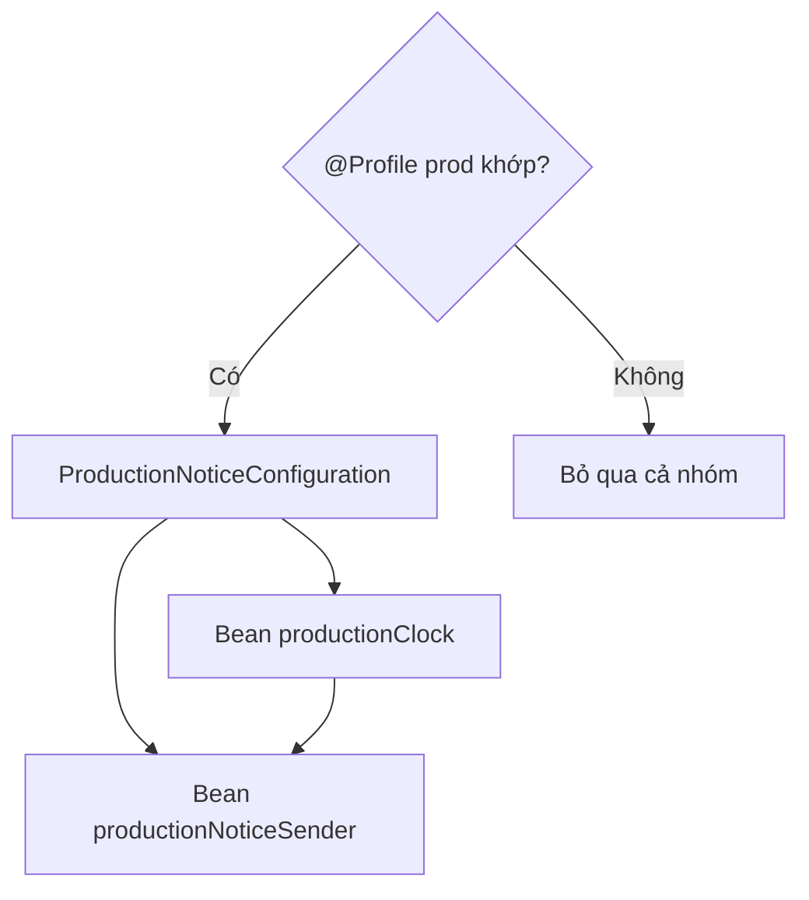

# @Profile trên component, configuration và nhóm bean

Một ứng dụng Spring Boot thường phải chạy ở nhiều môi trường: máy lập trình viên, môi trường tích hợp, kiểm thử và production. Các môi trường đó có thể dùng cùng mã nguồn nhưng cần những Bean khác nhau. Chẳng hạn, ở môi trường phát triển ta muốn gửi thông báo ra console, trong khi production dùng một adapter có thể gửi thông báo tới hệ thống thật.

Spring cung cấp annotation `@Profile` để **chỉ đăng ký một component hoặc một cấu hình khi profile phù hợp đang được kích hoạt**. Annotation này có thể đặt trên một component riêng lẻ, trên class `@Configuration` để áp dụng cho cả nhóm Bean, hoặc trên từng method `@Bean` để chọn lọc bên trong class cấu hình.

Điều quan trọng là hiểu `@Profile` làm việc ở **giai đoạn đăng ký cấu hình và BeanDefinition**, chứ không phải một câu lệnh `if` được thực thi mỗi lần service chạy. Khi context khởi động, Spring xem active/default profiles, đánh giá điều kiện và quyết định Bean nào tồn tại trong container.

Sau bài học, bạn sẽ biết lựa chọn vị trí đặt `@Profile`, tổ chức nhóm Bean theo môi trường, kết hợp nhiều profile, dùng profile groups của Spring Boot và kiểm tra cấu hình thực tế mà không gây mơ hồ khi dependency injection.

## 1. Profile là gì trong Spring?

Profile là một tên logic dùng để phân biệt **tập cấu hình được kích hoạt**. Ví dụ:

- `dev`: môi trường phát triển.
- `test`: kiểm thử tích hợp.
- `staging`: tiền production.
- `prod`: production.
- `cloud`: một đặc tính triển khai.
- `observability`: một nhóm cấu hình đo đạc/quan sát.

Các tên này là ví dụ do đội phát triển lựa chọn, không phải một tập tên bắt buộc mà Spring áp đặt. Spring lưu thông tin profile trong `Environment`.



Hai khái niệm cần tách biệt:

- **Active profiles:** những profile đã được kích hoạt rõ ràng, thường bằng property, biến môi trường, command line hoặc API.
- **Default profiles:** những profile dự phòng được dùng khi không có active profile nào. Theo cấu hình mặc định của Spring, tên default profile là `default`, nhưng có thể tùy chỉnh.

Nhiều profile có thể active **đồng thời**. Profile không phải một enum chỉ có duy nhất một giá trị; chẳng hạn `prod` và `cloud` có thể cùng được kích hoạt. Điều này tạo sự linh hoạt nhưng cũng có thể khiến nhiều Bean cùng kiểu xuất hiện nếu bạn không thiết kế điều kiện cẩn thận.

## 2. Khai báo và kích hoạt profile trong Spring Boot

Spring Boot hỗ trợ property:

```properties
spring.profiles.active=dev
```

Bạn có thể đặt trong `application.properties` hoặc cấu hình nguồn bên ngoài tương ứng. Với YAML:

```yaml
spring:
  profiles:
    active: dev
```

Có thể chỉ định nhiều profile, phân tách bằng dấu phẩy:

```properties
spring.profiles.active=prod,cloud
```

### Truyền qua command line

```bash
java -jar profile-demo.jar --spring.profiles.active=dev
```

Hoặc chạy với profile production:

```bash
java -jar profile-demo.jar --spring.profiles.active=prod
```

### Qua biến môi trường

Trong môi trường triển khai, có thể dùng:

```bash
export SPRING_PROFILES_ACTIVE=prod
java -jar profile-demo.jar
```

Ví dụ này sử dụng cú pháp shell phổ biến trên Linux/macOS. Trên Windows hoặc hệ thống container/orchestration, cách thiết lập biến môi trường khác nhau.

### Chọn nguồn cấu hình phù hợp

Các property source trong Spring Boot có quy tắc ưu tiên. Command-line argument hoặc biến môi trường có thể được dùng để thay đổi profile mà không sửa artifact. Thay vì đóng cứng `prod` vào mã nguồn, hãy cho hệ thống triển khai cung cấp profile qua cấu hình.

Trong các ứng dụng nhiều môi trường, một cách tổ chức hữu ích là giữ `application.yml` cho thiết lập chung và dùng `application-dev.yml`, `application-prod.yml` cho các giá trị cấu hình theo môi trường. Tuy nhiên, **file cấu hình theo profile và annotation `@Profile` là hai cơ chế khác nhau**: một cơ chế nạp giá trị cấu hình, còn cơ chế kia quyết định Bean/cấu hình nào được đăng ký.

## 3. @Profile trên một component riêng lẻ

Trường hợp dễ hiểu nhất là muốn một implementation chỉ tồn tại trong một môi trường:

```java
package com.example.profiledemo;

public interface NoticeSender {
    String send(String message);
}
```

Bean cho môi trường phát triển:

```java
package com.example.profiledemo;

import org.springframework.context.annotation.Profile;
import org.springframework.stereotype.Component;

@Component
@Profile("dev")
public class DevNoticeSender implements NoticeSender {
    @Override
    public String send(String message) {
        return "[DEV-CONSOLE] " + message;
    }
}
```

Khi Spring component scan class này:

- Nếu profile `dev` đang active, BeanDefinition của `DevNoticeSender` được đăng ký.
- Nếu profile `dev` không phù hợp, class bị bỏ qua trong quá trình đăng ký.
- Class Java vẫn có thể tồn tại trên classpath; `@Profile` không xóa class hoặc cấm tạo object bằng `new`.

Vì `@Profile` là điều kiện của Spring, đoạn sau **không** có ngữ nghĩa profile:

```java
DevNoticeSender sender = new DevNoticeSender();
```

Bạn tự tạo object bằng Java nên Spring không đánh giá `@Profile` hay quản lý object đó.

### Những stereotype khác cũng áp dụng được

`@Service`, `@Repository`, `@Controller` và `@RestController` là những stereotype được Spring phát hiện như component. Bạn có thể đặt `@Profile` trên các class đó:

```java
@Service
@Profile("test")
public class StubFraudCheckService implements FraudCheckService {
    @Override
    public boolean isAllowed(String account) {
        return true; // Chỉ là stub phục vụ một loại test.
    }
}
```

Trong production, hãy cung cấp một implementation phù hợp khác và không để stub mở rộng ngoài profile dự định. Cần nhớ rằng nếu không có Bean `FraudCheckService` nào được đăng ký mà một service khác bắt buộc inject nó, context sẽ báo lỗi tạo Bean.

## 4. @Profile trên @Configuration: bật hoặc tắt cả nhóm Bean

Nếu nhiều Bean luôn đi cùng một môi trường, đặt `@Profile` trên từng method sẽ lặp lại và dễ bỏ sót. Khi đó đặt `@Profile` trên **class cấu hình**:

```java
package com.example.profiledemo;

import java.time.Clock;
import java.time.Instant;
import org.springframework.context.annotation.Bean;
import org.springframework.context.annotation.Configuration;
import org.springframework.context.annotation.Profile;

@Configuration(proxyBeanMethods = false)
@Profile("prod")
public class ProductionNoticeConfiguration {

    @Bean
    Clock productionClock() {
        return Clock.systemUTC();
    }

    @Bean
    NoticeSender productionNoticeSender(Clock productionClock) {
        return message -> "[PROD " + Instant.now(productionClock)
                + "] " + message;
    }
}
```

Khi `prod` active, Spring có thể đăng ký cả hai Bean:

- `productionClock` thuộc kiểu `Clock`.
- `productionNoticeSender` thuộc kiểu `NoticeSender`.

Khi `prod` không phù hợp, **toàn bộ class cấu hình bị bỏ qua**, nên hai Bean từ class đó không được đăng ký.



Cách này phù hợp với một nhóm thành phần có ranh giới rõ: kết nối tới hệ thống ngoài, provider cụ thể, bộ adapter production hoặc một nhóm mock/stub cho môi trường test.

### Vì sao dùng proxyBeanMethods = false?

Trong ví dụ trên, `@Configuration(proxyBeanMethods = false)` tránh CGLIB interception của các lời gọi trực tiếp giữa các method `@Bean`. Mỗi Bean nhận dependency qua tham số factory method:

```java
NoticeSender productionNoticeSender(Clock productionClock)
```

Spring phân giải `Clock` từ container. Điều này rõ ràng hơn cách gọi trực tiếp `productionClock()` bên trong factory method, đặc biệt khi dùng lite configuration. Chế độ configuration không làm thay đổi ý nghĩa điều kiện `@Profile`.

## 5. @Profile trên từng method @Bean

Đôi khi class cấu hình chứa một số Bean dùng chung và một số Bean chỉ dành cho môi trường cụ thể. Bạn có thể đặt `@Profile` ở **cấp method**:

```java
@Configuration(proxyBeanMethods = false)
public class ConnectorConfiguration {

    @Bean
    Clock systemClock() {
        return Clock.systemUTC(); // Dùng ở mọi profile.
    }

    @Bean
    @Profile("dev")
    StorageClient localStorageClient() {
        return new InMemoryStorageClient();
    }

    @Bean
    @Profile("prod")
    StorageClient remoteStorageClient() {
        return new RemoteStorageClient();
    }
}
```

Giả sử `StorageClient` là interface và hai class trên là implementation hợp lệ. Ở đây:

- `systemClock` được đăng ký không phụ thuộc vào profile.
- `localStorageClient` chỉ có khi `dev` phù hợp.
- `remoteStorageClient` chỉ có khi `prod` phù hợp.

Nếu cả `dev` và `prod` active, **cả hai implementation có thể được đăng ký**. Khi đó một constructor yêu cầu đúng một `StorageClient` sẽ có thể gặp lỗi nhiều Bean phù hợp nếu không có qualifier/primary hoặc quy tắc chọn khác.

### Class-level và method-level kết hợp theo AND

Khi class cấu hình và method cùng có `@Profile`, method chỉ được xem xét nếu **cả điều kiện cấp class và cấp method đều phù hợp**:

```java
@Configuration(proxyBeanMethods = false)
@Profile("prod")
public class ProductionIntegrationConfiguration {

    @Bean
    AuditClient auditClient() {
        return new RemoteAuditClient();
    }

    @Bean
    @Profile("cloud")
    CloudUploader cloudUploader() {
        return new CloudUploader();
    }
}
```

Với ví dụ này:

| Active profiles | `auditClient` | `cloudUploader` |
|---|---|---|
| `dev` | Không | Không |
| `prod` | Có | Không |
| `cloud` | Không | Không |
| `prod,cloud` | Có | Có |

Phần method không thể “mở lại” một class cấu hình đã bị `@Profile("prod")` loại bỏ.

## 6. Nhóm Bean theo môi trường bằng configuration class

Một cách tổ chức rõ ràng là tạo một class cấu hình cho từng nhóm phụ thuộc:

```text
com.example.shop
├── ShopApplication.java
├── service
│   └── CheckoutService.java
└── config
    ├── CommonConfiguration.java
    ├── DevelopmentInfrastructureConfiguration.java
    └── ProductionInfrastructureConfiguration.java
```

Ví dụ cấu hình chung:

```java
@Configuration(proxyBeanMethods = false)
public class CommonConfiguration {

    @Bean
    CheckoutPolicy checkoutPolicy() {
        return new StandardCheckoutPolicy();
    }
}
```

Nhóm phát triển:

```java
@Configuration(proxyBeanMethods = false)
@Profile("dev")
public class DevelopmentInfrastructureConfiguration {

    @Bean
    PaymentGateway developmentPaymentGateway() {
        return new FakePaymentGateway();
    }

    @Bean
    EmailGateway developmentEmailGateway() {
        return new LoggingEmailGateway();
    }
}
```

Nhóm production:

```java
@Configuration(proxyBeanMethods = false)
@Profile("prod")
public class ProductionInfrastructureConfiguration {

    @Bean
    PaymentGateway productionPaymentGateway() {
        return new RemotePaymentGateway();
    }

    @Bean
    EmailGateway productionEmailGateway() {
        return new SmtpEmailGateway();
    }
}
```

Các class trong ví dụ giả định những kiểu nghiệp vụ đã được định nghĩa. Cấu trúc cho thấy:

1. Bean chung không bị gắn profile một cách không cần thiết.
2. Các adapter liên quan cùng môi trường được bật/tắt như một nhóm.
3. Service nghiệp vụ chỉ phụ thuộc vào interface, không cần biết mình đang ở dev hay prod.
4. Việc thay đổi môi trường diễn ra ở lúc khởi động context, không rải rác qua các `if (environment...)` trong mọi service.

### Đừng gom mọi Bean vào một class theo profile

Một class cấu hình khổng lồ chứa database, email, cache, scheduling và security có thể trở nên khó hiểu. Nên nhóm theo chức năng hoặc ranh giới triển khai; áp dụng `@Profile` lên class khi **mọi Bean trong class thực sự cùng điều kiện kích hoạt**.

Nếu chỉ một method có điều kiện khác, có thể giữ nó trong class chung và đặt `@Profile` ở method. Nếu toàn bộ nhóm điều kiện giống nhau, class-level annotation thường rõ ràng hơn.

## 7. Profile expressions: OR, AND và phủ định

`@Profile` hỗ trợ biểu thức profile thay vì chỉ một tên đơn. Spring có cú pháp biểu thức thông qua `Profiles.of(...)`:

| Cách khai báo | Ý nghĩa |
|---|---|
| `@Profile("dev")` | Có profile dev phù hợp |
| `@Profile("!prod")` | Profile prod không active |
| `@Profile({"dev", "test"})` | dev **hoặc** test phù hợp |
| `@Profile("dev | test")` | dev **hoặc** test phù hợp |
| `@Profile("prod & cloud")` | prod **và** cloud đều phù hợp |
| `@Profile("prod & !maintenance")` | prod phù hợp và maintenance không active |
| `@Profile("(prod | staging) & cloud")` | cloud phù hợp và có prod hoặc staging |

### Nhiều giá trị trong annotation là OR

```java
@Component
@Profile({"dev", "test"})
public class DebugDiagnostics implements Diagnostics {
    // ...
}
```

Component này có thể được đăng ký khi `dev` **hoặc** `test` phù hợp. Mảng không mang ý nghĩa “phải bật cả dev và test”.

Nếu cần cả hai, dùng biểu thức:

```java
@Component
@Profile("dev & integration")
public class DevelopmentIntegrationProbe {
}
```

### Dùng dấu phủ định cẩn thận

```java
@Profile("!prod")
```

Điều kiện trên không đồng nghĩa “chỉ dev”. Nó có thể khớp cả khi active profile là `staging`, `test` hoặc khi đang dùng default profile không có `prod`. Nếu class chứa mock có thể gây rủi ro, hãy ưu tiên danh sách cho phép rõ ràng:

```java
@Profile({"dev", "test"})
```

### Ưu tiên dấu ngoặc khi kết hợp toán tử

Biểu thức trộn toán tử `&` và `|` cần được nhóm rõ bằng dấu ngoặc. Ví dụ:

```java
@Profile("(dev | test) & !cloud")
```

Đừng dựa vào trực giác về thứ tự ưu tiên của toán tử như trong Java. Cú pháp profile expression có quy tắc riêng; dùng dấu ngoặc giúp tránh mơ hồ và dễ đọc hơn.

## 8. Default profile và @Profile("default")

Khi không có active profile nào, Spring dùng default profile. Theo mặc định, đó là profile có tên `default`.

Vì vậy Bean sau có thể được dùng làm lựa chọn dự phòng cho ứng dụng chạy không cấu hình profile:

```java
@Configuration(proxyBeanMethods = false)
@Profile("default")
public class DefaultNoticeConfiguration {

    @Bean
    NoticeSender defaultNoticeSender() {
        return message -> "[DEFAULT] " + message;
    }
}
```

Ví dụ với `spring.profiles.active`:

| Active profiles | Có `defaultNoticeSender`? |
|---|---|
| Không đặt, default profile vẫn là `default` | Có |
| `dev` | Không |
| `prod` | Không |
| `test` | Không |

Điểm cần lưu ý: default profile **có thể được đổi** bằng `spring.profiles.default` hoặc qua Environment API. Nếu đã thay thế default profile bằng một tên khác, không nên mặc định `@Profile("default")` vẫn khớp khi không có active profile.

### Default không phải fallback cho mọi profile chưa được hỗ trợ

Giả sử ứng dụng có `@Profile("dev")`, `@Profile("prod")` và `@Profile("default")` cho ba implementation của cùng interface. Nếu chỉ bật `qa`, default profile không được áp dụng, nên có thể **không còn implementation nào**.

Vì vậy Bean default phù hợp khi bạn thật sự muốn nó hoạt động **nếu không có active profile**. Nếu nghiệp vụ cần một fallback cho những profile khác, hãy thiết kế điều kiện theo yêu cầu cụ thể; đừng đánh đồng default profile với `@ConditionalOnMissingBean`.

## 9. Ví dụ Spring Boot hoàn chỉnh

Ta xây một ứng dụng console nhỏ để quan sát ba chế độ: không có active profile, `dev` và `prod`. Để chạy ví dụ cần project Spring Boot có starter nền tảng phù hợp, chẳng hạn:

```groovy
dependencies {
    implementation 'org.springframework.boot:spring-boot-starter'
}
```

Ví dụ sử dụng cú pháp Gradle Groovy DSL và giả định dự án đã cấu hình Spring Boot plugin, Java plugin và quản lý version dependency.

### Cấu trúc

```text
src/main/java/com/example/profiledemo/
├── ProfileDemoApplication.java
├── NoticeSender.java
├── DevNoticeSender.java
├── ProductionNoticeConfiguration.java
└── DefaultNoticeConfiguration.java
```

**NoticeSender.java**

```java
package com.example.profiledemo;

public interface NoticeSender {
    String send(String message);
}
```

**DevNoticeSender.java**

```java
package com.example.profiledemo;

import org.springframework.context.annotation.Profile;
import org.springframework.stereotype.Component;

@Component
@Profile("dev")
public class DevNoticeSender implements NoticeSender {
    @Override
    public String send(String message) {
        return "[DEV] " + message;
    }
}
```

**ProductionNoticeConfiguration.java**

```java
package com.example.profiledemo;

import java.time.Clock;
import java.time.Instant;
import org.springframework.context.annotation.Bean;
import org.springframework.context.annotation.Configuration;
import org.springframework.context.annotation.Profile;

@Configuration(proxyBeanMethods = false)
@Profile("prod")
public class ProductionNoticeConfiguration {

    @Bean
    Clock productionClock() {
        return Clock.systemUTC();
    }

    @Bean
    NoticeSender productionNoticeSender(Clock productionClock) {
        return message -> "[PROD " + Instant.now(productionClock)
                + "] " + message;
    }
}
```

**DefaultNoticeConfiguration.java**

```java
package com.example.profiledemo;

import org.springframework.context.annotation.Bean;
import org.springframework.context.annotation.Configuration;
import org.springframework.context.annotation.Profile;

@Configuration(proxyBeanMethods = false)
@Profile("default")
public class DefaultNoticeConfiguration {

    @Bean
    NoticeSender defaultNoticeSender() {
        return message -> "[DEFAULT] " + message;
    }
}
```

**ProfileDemoApplication.java**

```java
package com.example.profiledemo;

import java.util.Arrays;
import org.springframework.boot.ApplicationRunner;
import org.springframework.boot.SpringApplication;
import org.springframework.boot.autoconfigure.SpringBootApplication;
import org.springframework.context.annotation.Bean;
import org.springframework.core.env.Environment;

@SpringBootApplication
public class ProfileDemoApplication {

    public static void main(String[] args) {
        SpringApplication.run(ProfileDemoApplication.class, args);
    }

    @Bean
    ApplicationRunner showActiveSender(
            NoticeSender sender, Environment environment) {
        return args -> {
            System.out.println("Active profiles: "
                    + Arrays.toString(environment.getActiveProfiles()));
            System.out.println(sender.send("Xin chào Spring Boot"));
        };
    }
}
```

`@SpringBootApplication` kích hoạt component scan trong package `com.example.profiledemo` và các package con. Vì toàn bộ class ví dụ nằm trong package này, Spring có thể phát hiện các component/configuration mà không cần `@ComponentScan` tường minh.

### Chạy không chỉ định profile

```bash
./gradlew bootRun
```

Trong trường hợp dự án không có property active/default profile tùy chỉnh, kết quả minh họa:

```text
Active profiles: []
[DEFAULT] Xin chào Spring Boot
```

Mảng active profiles rỗng **không có nghĩa không có profile nào áp dụng**. Khi không active profile, default profile có thể được dùng trong quá trình đánh giá điều kiện.

### Chạy với dev

```bash
java -jar build/libs/profile-demo.jar --spring.profiles.active=dev
```

Đây là ví dụ tên artifact; dùng tên JAR thật do build tạo. Kết quả minh họa:

```text
Active profiles: [dev]
[DEV] Xin chào Spring Boot
```

Bean từ `ProductionNoticeConfiguration` và `DefaultNoticeConfiguration` không được đăng ký. ApplicationRunner chỉ nhận `DevNoticeSender`.

### Chạy với prod

```bash
java -jar build/libs/profile-demo.jar --spring.profiles.active=prod
```

Kết quả minh họa:

```text
Active profiles: [prod]
[PROD 2026-...Z] Xin chào Spring Boot
```

Timestamp thay đổi theo thời điểm chạy. Ở môi trường này, Spring đăng ký cả `productionClock` và `productionNoticeSender` vì `@Profile` đặt trên class cấu hình.

### Nếu active dev và prod cùng lúc

```bash
java -jar build/libs/profile-demo.jar --spring.profiles.active=dev,prod
```

Lúc đó `DevNoticeSender` và `productionNoticeSender` đều có thể được đăng ký. Factory method `showActiveSender(NoticeSender sender, ...)` yêu cầu một Bean duy nhất nhưng có hai ứng viên. Spring có thể báo lỗi phân giải dependency.

Đây là hành vi quan trọng cần chủ động kiểm soát. Profile không có quy tắc mặc định “prod thắng dev”. Nếu hai môi trường phải loại trừ nhau, nên ràng buộc ở cấu hình triển khai hoặc tổ chức điều kiện sao cho không thể tạo hai adapter mơ hồ.

## 10. Spring Boot profile groups khác nhóm Bean theo @Configuration

Có hai khái niệm cùng chứa từ “nhóm”:

1. **Nhóm Bean:** đặt `@Profile` trên một class `@Configuration`, để nhiều method `@Bean` cùng chịu một điều kiện.
2. **Nhóm profile:** dùng `spring.profiles.group` để kích hoạt một tập profile liên quan khi chọn một profile tổng.

Chúng giải quyết hai việc khác nhau và có thể kết hợp.

### Khai báo nhóm profile

Ví dụ trong `application.yml`:

```yaml
spring:
  profiles:
    group:
      production:
        - proddb
        - prodmq
        - observability
```

Khi chạy:

```bash
java -jar shop.jar --spring.profiles.active=production
```

Spring Boot kích hoạt profile `production` và các thành viên của nhóm như `proddb`, `prodmq`, `observability`. Các class được đánh dấu `@Profile("proddb")` hoặc `@Profile("prodmq")` có thể được chọn theo group đã kích hoạt.

Ví dụ:

```java
@Configuration(proxyBeanMethods = false)
@Profile("proddb")
class DatabaseConfiguration {
    @Bean
    DatabaseConnector databaseConnector() {
        return new DatabaseConnector();
    }
}

@Configuration(proxyBeanMethods = false)
@Profile("prodmq")
class MessagingConfiguration {
    @Bean
    MessagePublisher messagePublisher() {
        return new MessagePublisher();
    }
}
```

Giả sử các class `DatabaseConnector` và `MessagePublisher` là thành phần ví dụ. Việc bật `production` gián tiếp làm những Bean của hai configuration này đủ điều kiện đăng ký.

### Đặt spring.profiles.group ở đúng nguồn cấu hình

Spring Boot yêu cầu các property điều khiển việc kích hoạt profile, như `spring.profiles.active`, `spring.profiles.default` và `spring.profiles.group`, được khai báo trong **tài liệu cấu hình không phụ thuộc profile** (non-profile-specific document).

Không đặt `spring.profiles.group` trong `application-prod.yml` hoặc bên trong một YAML document được kích hoạt bằng `spring.config.activate.on-profile` với kỳ vọng Boot chỉ biết nhóm sau khi bật prod. Những thuộc tính này phải được xử lý ở giai đoạn xác định profiles, trước khi nạp nội dung dành riêng cho profile.

Đây là một điểm khác biệt giữa **quy tắc chọn profile** và **property chỉ có hiệu lực khi một profile đã được chọn**.

### Khi nào cần group?

Nhóm profile hữu ích khi một môi trường cần nhiều lựa chọn cấu hình trực giao, ví dụ database, messaging và observability. Thay vì yêu cầu người triển khai nhớ ba tên profile, họ chỉ cần bật một tên nhóm có ý nghĩa.

Tuy nhiên, không nên dùng profile groups để che giấu quá nhiều cấu hình không liên quan. Nếu một đặc tính có thể bật/tắt độc lập ở mọi môi trường, một property như `app.metrics.enabled` kết hợp `@ConditionalOnProperty` có thể rõ hơn.

## 11. @Profile với cấu hình theo môi trường và @ConfigurationProperties

Profile có thể chọn nhóm Bean; property nên mang **giá trị có thể cấu hình** của Bean. Ví dụ production và staging cùng dùng client HTTP nhưng có endpoint khác nhau:

```yaml
# application-prod.yml
integrations:
  billing:
    base-url: https://billing.example.com
```

```yaml
# application-staging.yml
integrations:
  billing:
    base-url: https://billing-staging.example.com
```

Nếu class client giống nhau ở hai môi trường, không nhất thiết tạo hai class/configuration chỉ để thay URL. Bạn có thể inject property qua `@ConfigurationProperties` và giữ một Bean chung:

```java
@ConfigurationProperties(prefix = "integrations.billing")
public record BillingProperties(URI baseUrl) {
}
```

```java
@Configuration(proxyBeanMethods = false)
@EnableConfigurationProperties(BillingProperties.class)
public class BillingConfiguration {

    @Bean
    BillingClient billingClient(BillingProperties properties) {
        return new BillingClient(properties.baseUrl());
    }
}
```

Ví dụ này giả định `BillingClient` có constructor nhận `URI` và các class/import Java phù hợp. Chỉ dùng `@Profile` khi **cấu trúc Bean hoặc implementation cần thay đổi**, thay vì khi giá trị URL thay đổi.

**Lưu ý:** Profile không phải cơ chế bảo vệ secrets. Password, token và key phải được cung cấp qua hệ thống quản lý secret hoặc property source an toàn, không dựa vào việc file prod profile bị bỏ qua để coi secret đã được bảo vệ.

## 12. Profile được đánh giá ở thời điểm nào?

`@Profile` là một dạng conditional registration. Trong quá trình xử lý cấu hình và component scanning, Spring đọc metadata và xác định điều kiện có khớp với Environment hiện có không.

```text
SpringApplication.run
   ↓
Chuẩn bị Environment và active/default profiles
   ↓
Nạp class cấu hình / component scan
   ↓
Đánh giá @Profile
   ↓
Đăng ký BeanDefinition tương ứng (hoặc bỏ qua)
   ↓
Khởi tạo Bean theo scope/lifecycle
```

Vì thế:

- Không có nghĩa Spring luôn tạo mọi Bean rồi sau đó mới chọn Bean nào giữ lại.
- Không nên thay đổi active profiles tùy tiện sau khi context đã refresh rồi mong các Bean hiện có tự biến mất hoặc được tạo lại.
- Nếu cần chuyển profile, cách thông thường là khởi động context mới với Environment phù hợp.

### Đọc profile từ Environment

Một Bean có thể quan sát trạng thái:

```java
@Component
public class ProfilePrinter {
    private final Environment environment;

    public ProfilePrinter(Environment environment) {
        this.environment = environment;
    }

    public void printProfiles() {
        System.out.println("Active: "
                + Arrays.toString(environment.getActiveProfiles()));
        System.out.println("Default: "
                + Arrays.toString(environment.getDefaultProfiles()));
    }
}
```

Spring cũng cung cấp API kiểm tra biểu thức:

```java
boolean inDevelopment =
        environment.acceptsProfiles(Profiles.of("dev"));
```

API này có ích cho diagnostics hoặc một số logic đặc biệt. Tuy nhiên, với mục đích chọn implementation Bean, `@Profile` hoặc các điều kiện khai báo thường tốt hơn việc rải `if (environment.acceptsProfiles(...))` trong business logic.

## 13. Kiểm thử @Profile bằng Spring Boot Test

Spring Test cung cấp annotation `@ActiveProfiles` để chủ động đặt profile khi tạo test ApplicationContext:

```java
import org.junit.jupiter.api.Test;
import org.springframework.beans.factory.annotation.Autowired;
import org.springframework.boot.test.context.SpringBootTest;
import org.springframework.test.context.ActiveProfiles;

import static org.assertj.core.api.Assertions.assertThat;

@SpringBootTest
@ActiveProfiles("dev")
class DevProfileIntegrationTest {

    @Autowired
    NoticeSender sender;

    @Test
    void devSenderIsSelected() {
        assertThat(sender).isInstanceOf(DevNoticeSender.class);
        assertThat(sender.send("ping")).startsWith("[DEV]");
    }
}
```

Ở đây `@ActiveProfiles("dev")` là một phần của test configuration. Nó rõ ràng hơn việc kỳ vọng máy chạy test đã vô tình đặt `SPRING_PROFILES_ACTIVE=dev`.

Muốn kiểm tra prod, có thể tạo test riêng:

```java
@SpringBootTest
@ActiveProfiles("prod")
class ProdProfileIntegrationTest {

    @Autowired
    ApplicationContext context;

    @Test
    void productionBeansAreRegistered() {
        assertThat(context.containsBean("productionClock")).isTrue();
        assertThat(context.containsBean("productionNoticeSender")).isTrue();
        assertThat(context.containsBean("defaultNoticeSender")).isFalse();
    }
}
```

Test này kiểm tra Bean registration theo profile, không kiểm tra thực sự gửi thông báo tới hệ thống ngoài. Nếu implementation production mở network connection khi khởi tạo, bạn có thể dùng cấu hình test chuyên biệt hoặc fake integration để tránh side effect khi chạy test.

## 14. Kiểm tra condition bằng ApplicationContextRunner

Với thư viện cấu hình hoặc một nhóm `@Bean` độc lập, `ApplicationContextRunner` cho phép dựng context nhỏ với profile khác nhau, không cần khởi động cả ứng dụng.

```java
import org.junit.jupiter.api.Test;
import org.springframework.boot.test.context.runner.ApplicationContextRunner;
import org.springframework.context.annotation.Bean;
import org.springframework.context.annotation.Configuration;
import org.springframework.context.annotation.Profile;

import static org.assertj.core.api.Assertions.assertThat;

class SenderProfileConfigurationTest {

    private final ApplicationContextRunner runner =
            new ApplicationContextRunner()
                    .withUserConfiguration(TestSenderConfiguration.class);

    @Test
    void usesDevBeanWhenDevIsActive() {
        runner.withInitializer(context ->
                    context.getEnvironment().setActiveProfiles("dev"))
                .run(context -> {
                    assertThat(context).hasSingleBean(NoticeSender.class);
                    assertThat(context).hasBean("devSender");
                });
    }

    @Test
    void usesProdBeanWhenProdIsActive() {
        runner.withInitializer(context ->
                    context.getEnvironment().setActiveProfiles("prod"))
                .run(context -> {
                    assertThat(context).hasSingleBean(NoticeSender.class);
                    assertThat(context).hasBean("prodSender");
                });
    }

    @Test
    void usesDefaultWhenNoProfileIsActive() {
        runner.run(context -> {
            assertThat(context).hasSingleBean(NoticeSender.class);
            assertThat(context).hasBean("defaultSender");
        });
    }

    @Configuration(proxyBeanMethods = false)
    static class TestSenderConfiguration {

        @Bean
        @Profile("dev")
        NoticeSender devSender() {
            return message -> "[DEV] " + message;
        }

        @Bean
        @Profile("prod")
        NoticeSender prodSender() {
            return message -> "[PROD] " + message;
        }

        @Bean
        @Profile("default")
        NoticeSender defaultSender() {
            return message -> "[DEFAULT] " + message;
        }
    }
}
```

Ví dụ dựa trên Spring Boot test, JUnit Jupiter và AssertJ. `NoticeSender` là interface đã được định nghĩa ở phần ứng dụng minh họa. Ba test kiểm tra:

1. Profile `dev` chọn Bean dev.
2. Profile `prod` chọn Bean prod.
3. Khi không có active profile và default profile giữ nguyên, Bean default được chọn.

Nếu muốn kiểm tra trường hợp `dev,prod` cùng active, hãy tạo một context riêng, xem nó có cả hai Bean hay không và xác nhận cách consumer xử lý ambiguity. Điều đó đặc biệt quan trọng với các module có nhiều implementation cùng interface.

## 15. @Profile và @ConditionalOnProperty: chọn đúng loại điều kiện

`@Profile` phù hợp với những khác biệt lớn theo môi trường hoặc một nhóm cấu hình. Nhưng không phải mọi tính năng bật/tắt đều nên trở thành profile.

Ví dụ tính năng export có thể bật riêng ở dev, staging hoặc production:

```java
@Configuration(proxyBeanMethods = false)
public class ExportConfiguration {

    @Bean
    @ConditionalOnProperty(
            prefix = "app.export",
            name = "enabled",
            havingValue = "true"
    )
    ExportService exportService() {
        return new ExportService();
    }
}
```

Sự khác nhau:

| Tiêu chí | `@Profile` | `@ConditionalOnProperty` |
|---|---|---|
| Điều khiển bằng | Active/default profile | Giá trị property |
| Mục đích thường gặp | Nhóm cấu hình theo môi trường | Feature toggle/configurable capability |
| Có thể kết hợp? | Có | Có |
| Thời điểm đánh giá | Khi đăng ký Bean/configuration | Khi đăng ký Bean/configuration |

Bạn có thể kết hợp cả hai:

```java
@Bean
@Profile("prod")
@ConditionalOnProperty(
        prefix = "app.audit",
        name = "enabled",
        havingValue = "true"
)
AuditPublisher auditPublisher() {
    return new AuditPublisher();
}
```

Bean này chỉ được đăng ký khi **profile prod phù hợp và property audit được bật**. Các điều kiện khác nhau thông thường phải cùng thỏa mãn; không phải chỉ cần một trong hai.

Trong thiết kế cấu hình, ưu tiên dùng property để biểu đạt các biến số như endpoint, timeout, retry count; chỉ dùng profile để chọn **tập Bean hoặc implementation** khi môi trường thật sự yêu cầu cấu trúc khác.

## 16. Các trường hợp dễ mắc lỗi

| Hiện tượng | Nguyên nhân thường gặp | Hướng xử lý |
|---|---|---|
| `NoSuchBeanDefinitionException` ở startup | Không có implementation nào khớp profile đang active | Kiểm tra active/default profiles, package scan và điều kiện của Bean |
| `NoUniqueBeanDefinitionException` | Nhiều profile active dẫn tới nhiều implementation cùng interface | Điều chỉnh điều kiện, dùng qualifier/primary khi đúng ý nghĩa hoặc tách trách nhiệm |
| `@Profile` có vẻ bị bỏ qua | Object được tạo bằng `new` hoặc class không do Spring quản lý | Đăng ký Bean qua component scan, `@Bean` hay import phù hợp |
| Cả nhóm Bean biến mất | `@Profile` đặt trên class cấu hình không khớp | Kiểm tra điều kiện cấp class trước điều kiện cấp method |
| Default Bean không xuất hiện | Đã bật active profile khác, kể cả profile không có implementation | Nhớ `default` chỉ áp dụng khi không có active profile |
| Stub dev xuất hiện ngoài dev | Dùng `@Profile("!prod")` nên các profile khác cũng khớp | Thay bằng danh sách profile cho phép tường minh |
| Đổi property profile lúc runtime mà Bean không thay | BeanDefinition đã được đăng ký khi context khởi động | Khởi động context mới hoặc thiết kế runtime switching riêng |
| Profile group không có hiệu lực | Khai báo group trong tài liệu cấu hình theo profile | Chuyển `spring.profiles.group` sang non-profile-specific document |
| Hai method `@Bean` cùng tên gây hành vi khó hiểu | Overload method Java cùng tên với điều kiện profile khác nhau | Đặt method name khác nhau, khai báo Bean name rõ ràng nếu cần |

### Bẫy của @Bean method overload

Spring hỗ trợ overload method Java, nhưng `@Profile` **không phải cơ chế chọn overload factory method theo môi trường**. Ví dụ nên tránh:

```java
@Bean
@Profile("dev")
DataSource dataSource() {
    return createDevDataSource();
}

@Bean
@Profile("prod")
DataSource dataSource(Environment environment) {
    return createProductionDataSource(environment);
}
```

Hai method cùng tên `dataSource` có thể được Spring xem là các overload của cùng factory method, không phải hai Bean profile-specific độc lập như bạn tưởng. Quy tắc condition của overload có những hạn chế, do đó không nên dùng `@Profile` để phân tách các overload cùng tên.

Cách rõ ràng hơn:

```java
@Bean("dataSource")
@Profile("dev")
DataSource developmentDataSource() {
    return createDevDataSource();
}

@Bean("dataSource")
@Profile("prod")
DataSource productionDataSource(Environment environment) {
    return createProductionDataSource(environment);
}
```

Ở đây tên method khác nhau, còn tên Bean cố ý giống nhau. Chỉ dùng cùng tên Bean khi các profile thực sự loại trừ nhau trong triển khai; nếu cùng active, có thể xảy ra xung đột định nghĩa. Nếu không cần tên Bean cố định, dùng hai tên Bean khác nhau và inject theo interface là cách giảm coupling.

## 17. Cách tổ chức profile dễ bảo trì

Một số nguyên tắc hữu ích:

**Đặt tên theo ý nghĩa triển khai.** Chọn các tên như `dev`, `prod`, `local`, `cloud`, `integration` có quy ước rõ ràng trong dự án. Đừng trộn nhiều ý nghĩa vào một profile duy nhất nếu những ý nghĩa đó cần thay đổi độc lập.

**Giữ business service độc lập với môi trường.** Service nên nhận interface qua constructor. `@Profile` chọn implementation ở lớp configuration/infrastructure thay vì service tự hỏi Environment ở mọi method.

**Nhóm Bean thật sự đi cùng nhau.** Dùng class-level `@Profile` khi tất cả Bean trong class thuộc cùng điều kiện. Dùng method-level khi chỉ một Bean khác biệt.

**Đừng dựa vào thứ tự các Bean được khai báo.** Khi nhiều profile cùng active, nhiều implementation có thể xuất hiện. Chọn Bean bằng hợp đồng và metadata rõ ràng thay vì giả định Bean đầu tiên sẽ thắng.

**Kiểm thử profile quan trọng.** Với mỗi môi trường chính, xác nhận các Bean bắt buộc tồn tại và stub/mock không bị kích hoạt sai.

**Dùng cấu hình ngoài để chọn profile.** Không đóng cứng `prod` trong source code hoặc hardcode secret vào file theo môi trường.

**Tránh tạo quá nhiều profile cho feature flags.** Những tùy chọn có thể bật/tắt độc lập nên được thể hiện bằng property/conditional phù hợp, không luôn cần một tên profile mới.

## 18. Bài thực hành

Từ ứng dụng `NoticeSender` ở phần trên, hãy tự thử:

1. Chạy không chỉ định profile. Quan sát Bean default được chọn trong trường hợp default profile không đổi.
2. Chạy với `dev` và kiểm tra component `DevNoticeSender` xuất hiện, còn class cấu hình production bị bỏ qua.
3. Chạy với `prod` và kiểm tra cả `productionClock` lẫn `productionNoticeSender` được đăng ký.
4. Chạy với `dev,prod`, quan sát lỗi nhiều Bean khi inject `NoticeSender` rồi xác định có nên cấm tổ hợp profile này hay không.
5. Thay `@Profile("dev")` bằng `@Profile({"dev", "test"})` và quan sát `test` có thể tạo Bean đó.
6. Đặt `@Profile("prod & cloud")` lên một configuration. So sánh khi chỉ active `prod` và khi active cả `prod,cloud`.
7. Khai báo `spring.profiles.group.production` có các thành viên `proddb`, `prodmq`; chạy với `production` và xem những nhóm Bean nào được kích hoạt.
8. Tạo test `@ActiveProfiles("dev")` và `@ActiveProfiles("prod")`, xác nhận Bean được inject có kiểu đúng.
9. Dùng `Environment.getActiveProfiles()` và `getDefaultProfiles()` để so sánh các trạng thái.

Đừng chỉ kiểm tra log “profile active”, mà hãy kiểm tra **BeanDefinition và dependency thực tế**. Chỉ như vậy mới biết những annotation `@Profile` có đang tạo đúng object graph hay không.

## 19. Tổng hợp: ba vị trí đặt @Profile

```mermaid
flowchart TD
    A["Environment có active/default profiles"] --> B{"@Profile đặt ở đâu?"}
    B -->|Component class| C["Chọn hoặc bỏ qua một component"]
    B -->|Configuration class| D["Chọn hoặc bỏ qua toàn nhóm @Bean"]
    B -->|@Bean method| E["Chọn hoặc bỏ qua một factory method"]
    C --> F["Bean definitions phù hợp"]
    D --> F
    E --> F
    F --> G["IoC container tạo và inject các Bean"]
```

| Vị trí | Phạm vi ảnh hưởng | Trường hợp điển hình |
|---|---|---|
| `@Profile` trên `@Component`/`@Service` | Một class component được đăng ký bởi Spring | Chọn implementation dev/test/prod |
| `@Profile` trên `@Configuration` | Toàn bộ cấu hình và các Bean trong class | Bật cả nhóm adapter/infrastructure |
| `@Profile` trên method `@Bean` | Một Bean khai báo bởi method | Một Bean có điều kiện bên cạnh các Bean chung |
| `spring.profiles.group` trong cấu hình Boot | Mở rộng tập active profiles | Bật nhiều nhóm profile qua một tên |

Khi hiểu ba vị trí của `@Profile` và cách Spring Boot kích hoạt profile groups, bạn có thể mô tả rõ ràng môi trường nào được phép đăng ký Bean nào. Hãy dùng component-level cho implementation đơn lẻ, configuration-level cho nhóm Bean cùng điều kiện, method-level cho trường hợp chọn lọc, và profile groups khi cần tổ hợp nhiều profile liên quan. Điều đó giúp cấu hình Spring Boot dễ đọc, tránh Bean mơ hồ và giữ service nghiệp vụ độc lập với chi tiết triển khai từng môi trường.
