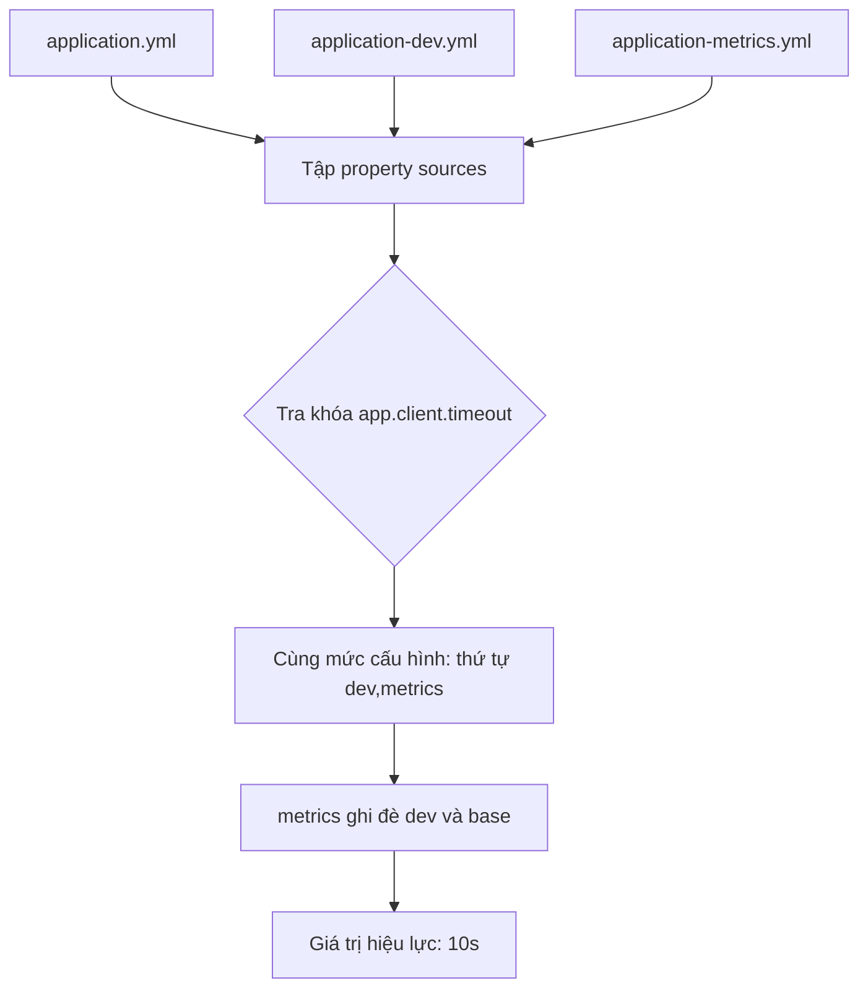
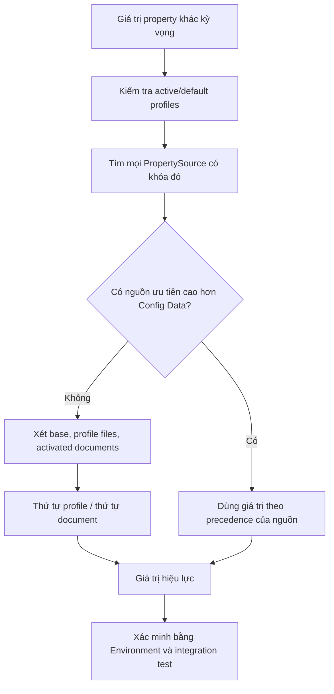

# Kích hoạt nhiều profile và xử lý giá trị chồng lấp

Một ứng dụng Spring Boot có thể chạy với nhiều profile cùng lúc. Chẳng hạn, môi trường phát triển cần profile `dev` để kết nối tới dịch vụ thử nghiệm, đồng thời cần profile `observability` để bật những thiết lập quan sát. Hai profile đều có thể đóng góp thuộc tính cấu hình và điều kiện đăng ký bean. Nếu chúng cùng khai báo một thuộc tính, Spring Boot phải quyết định **giá trị nào có hiệu lực**.

Ví dụ:

```text
spring.profiles.active=dev,observability
```

Khi đó cả `dev` lẫn `observability` đều hoạt động. Nhưng có hai câu hỏi khác nhau:

1. **Những cấu hình nào được kích hoạt?** File cấu hình theo profile, tài liệu YAML có `spring.config.activate.on-profile` và bean có `@Profile` nào được xét?
2. **Khi giá trị trùng nhau, giá trị nào thắng?** Điều này phụ thuộc thứ tự profile và mức ưu tiên của các nguồn cấu hình.

Bài học thuộc chương **Profile** trong *Spring Boot Fundamentals*. Ta sẽ tìm hiểu cách kích hoạt nhiều profile, quy tắc “profile được liệt kê sau thường thắng khi cùng mức nguồn”, cơ chế chồng lấp của Config Data, profile groups, `spring.profiles.include`, cách phối hợp `@Profile` với bean, và cách kiểm chứng giá trị hiệu lực.

Ví dụ dùng Java 21 và Spring Boot 3.x. Một số cấu hình có mức ưu tiên riêng tùy nguồn và phiên bản; vì thế các kết luận về thứ tự profile trong bài luôn được đặt trong ngữ cảnh các file profile **cùng vị trí và cùng nhóm ưu tiên**.

## 1. Profile trong Spring Boot là gì?

Profile là một tên logic dùng để chọn cấu hình phù hợp với bối cảnh chạy. Những tên thường thấy:

- `dev`: phát triển cục bộ.
- `test`: kiểm thử.
- `staging`: thử nghiệm gần với production.
- `prod`: production.
- `metrics`: bật cấu hình quan sát theo nhu cầu.
- `cloud`: cấu hình cho môi trường cloud.

Spring nhận danh sách profile đang hoạt động qua `Environment` và dùng chúng để:

- Nạp file `application-{profile}.properties` hoặc `application-{profile}.yml`.
- Kích hoạt những phần tài liệu cấu hình có điều kiện theo profile.
- Xác định class hoặc method có `@Profile` được đăng ký hay bỏ qua.
- Đánh giá các điều kiện khác cần biết môi trường cấu hình.

Profile **không phải** một bản sao của application context. Khi bật `dev` và `metrics`, ứng dụng vẫn có một context chính thông thường; các profile cùng đóng góp cấu hình và bean definitions vào context đó.

## 2. Kích hoạt nhiều profile bằng spring.profiles.active

Cách ngắn nhất là đặt danh sách tên profile, phân cách bởi dấu phẩy:

```properties
spring.profiles.active=dev,metrics
```

Hoặc trong `application.yml`:

```yaml
spring:
  profiles:
    active: dev,metrics
```

Khi khởi động, `Environment.getActiveProfiles()` có thể trả về những tên profile đã kích hoạt. Spring Boot nạp các cấu hình theo profile tương ứng.

### 2.1. Kích hoạt qua tham số dòng lệnh

Với ứng dụng được đóng gói thành JAR:

```bash
java -jar app.jar --spring.profiles.active=dev,metrics
```

Với Gradle trên macOS/Linux:

```bash
./gradlew bootRun --args='--spring.profiles.active=dev,metrics'
```

Với Windows PowerShell:

```powershell
.\gradlew.bat bootRun --args="--spring.profiles.active=dev,metrics"
```

Tham số này cho phép chọn profile khi chạy mà không cần sửa file cấu hình đóng gói trong ứng dụng.

### 2.2. Kích hoạt qua biến môi trường

Spring Boot ánh xạ tên property `spring.profiles.active` sang biến môi trường phổ biến:

```text
SPRING_PROFILES_ACTIVE=dev,metrics
```

Ví dụ trong PowerShell:

```powershell
$env:SPRING_PROFILES_ACTIVE = "dev,metrics"
.\gradlew.bat bootRun
```

Trong shell Bash:

```bash
SPRING_PROFILES_ACTIVE=dev,metrics java -jar app.jar
```

Cách này phù hợp với container, pipeline và môi trường triển khai. Hãy tránh đóng cứng profile `prod` trong file cấu hình chung nếu cùng một artifact phải được tái sử dụng cho nhiều môi trường.

### 2.3. Đặt trong file cấu hình cơ sở

Có thể đặt `spring.profiles.active` trong **tài liệu cấu hình không phụ thuộc profile**, chẳng hạn phần cơ sở của `application.yml`.

Tuy nhiên, **không đặt** `spring.profiles.active` trong `application-dev.yml` hoặc trong tài liệu YAML đã có `spring.config.activate.on-profile`. Spring Boot 3.x giới hạn những thuộc tính điều khiển kích hoạt profile này ở tài liệu không phụ thuộc profile; đặt sai nơi có thể khiến ứng dụng báo lỗi cấu hình.

Một lựa chọn dễ vận hành là để file cơ sở không chỉ định profile và cấp `spring.profiles.active` qua tham số khởi chạy.

## 3. Ví dụ đầy đủ: nhiều profile cùng đóng góp cấu hình

Giả sử project có ba file trong `src/main/resources`:

```text
src/main/resources/
├── application.yml
├── application-dev.yml
└── application-metrics.yml
```

`application.yml`:

```yaml
app:
  client:
    base-url: "https://api.example.internal"
    timeout: 5s
    retry-count: 2
  feature:
    detailed-logging: false
logging:
  level:
    com.example.demo: INFO
```

`application-dev.yml`:

```yaml
app:
  client:
    base-url: "http://localhost:9000"
    timeout: 2s
  feature:
    detailed-logging: true
logging:
  level:
    com.example.demo: DEBUG
```

`application-metrics.yml`:

```yaml
app:
  client:
    timeout: 10s
logging:
  level:
    com.example.demo: WARN
```

Khi chạy:

```bash
java -jar app.jar --spring.profiles.active=dev,metrics
```

trong trường hợp các file này nằm **cùng vị trí cấu hình**, giá trị hiệu lực thường là:

| Khóa | Giá trị cuối | Lý do |
|---|---|---|
| `app.client.base-url` | `http://localhost:9000` | `dev` ghi đè giá trị cơ sở; `metrics` không khai báo khóa này. |
| `app.client.timeout` | `10s` | Cả `dev` và `metrics` khai báo; `metrics` đứng sau trong danh sách active profiles. |
| `app.client.retry-count` | `2` | Chỉ file cơ sở khai báo. |
| `app.feature.detailed-logging` | `true` | `dev` ghi đè `false` từ file cơ sở. |
| `logging.level.com.example.demo` | `WARN` | `metrics` ghi đè `DEBUG` từ `dev` ở cùng tầng nguồn. |

Điểm đáng chú ý: **không có chuyện profile `metrics` làm mất toàn bộ cấu hình của `dev`**. Với các thuộc tính đơn giản, mỗi khóa được giải theo tập nguồn cấu hình. Khóa mà `metrics` không định nghĩa vẫn có thể lấy giá trị từ `dev` hoặc file cơ sở.

### 3.1. Đảo thứ tự profile sẽ thay đổi kết quả

Thử:

```bash
java -jar app.jar --spring.profiles.active=metrics,dev
```

Lần này `dev` nằm sau `metrics`. Trong trường hợp các file profile cùng mức ưu tiên, các giá trị trùng nhau thường thay đổi:

| Khóa | `dev,metrics` | `metrics,dev` |
|---|---|---|
| `app.client.base-url` | `http://localhost:9000` | `http://localhost:9000` |
| `app.client.timeout` | `10s` | `2s` |
| `app.client.retry-count` | `2` | `2` |
| `logging.level.com.example.demo` | `WARN` | `DEBUG` |

Bạn có thể nhớ quy tắc làm việc: **ở cùng vị trí Config Data, nếu nhiều profile đều định nghĩa một khóa, profile kích hoạt sau có thể ghi đè profile trước**. Nhưng điều này chưa phải toàn bộ hệ thống precedence của Spring Boot.



## 4. Thứ tự profile chỉ là một phần của property precedence

Một sai lầm thường gặp là nghĩ “profile đứng cuối luôn thắng mọi giá trị trong ứng dụng”. Thực tế, Spring Boot có nhiều **lớp nguồn cấu hình** với mức ưu tiên khác nhau.

Chẳng hạn, cùng một khóa `app.client.timeout` có thể được khai báo trong:

- `application.yml` đóng gói trong JAR.
- `application-dev.yml` đóng gói trong JAR.
- `application.yml` bên ngoài JAR.
- `application-metrics.yml` bên ngoài JAR.
- Biến môi trường.
- Java system property.
- Command-line argument.

Quy tắc thứ tự giữa các profile file cần được xem **trong thứ tự ưu tiên rộng hơn của toàn bộ PropertySource**.

### 4.1. Config Data đóng gói và Config Data bên ngoài

Trong cách nạp Config Data thông dụng của Spring Boot, file bên ngoài JAR có thể ưu tiên hơn file đóng gói trong JAR. File theo profile thường ưu tiên hơn file không gắn profile trong cùng nhóm vị trí tương ứng.

Ví dụ:

```text
jar:
  application-dev.yml         app.client.timeout=2s

external ./config/:
  application.yml             app.client.timeout=7s
```

Nếu ứng dụng nạp cả hai từ các vị trí chuẩn, giá trị từ file bên ngoài có thể thắng dù file trong JAR là file theo profile. Đừng suy ra kết quả chỉ từ thứ tự `spring.profiles.active` mà bỏ qua vị trí file.

### 4.2. Command-line argument có thể ghi đè cả hai profile

Ví dụ:

```bash
java -jar app.jar --spring.profiles.active=dev,metrics --app.client.timeout=15s
```

Trong cấu hình Boot thông thường, giá trị `15s` từ command line có độ ưu tiên cao hơn những giá trị trong file Config Data:

```text
app.client.timeout = 15s
```

Dù `dev` hay `metrics` đứng cuối, override từ command line vẫn có thể là giá trị được dùng.

### 4.3. Hai nguyên tắc cần áp dụng cùng nhau

1. Xác định **các PropertySource được nạp** và mức ưu tiên của chúng.
2. Trong các file profile cùng mức nguồn, xét **thứ tự profile** nếu nhiều file định nghĩa cùng một khóa.

Khi debug một giá trị, hãy hỏi “Nguồn nào cung cấp giá trị hiệu lực?” trước khi hỏi “Profile nào đứng sau?”.

## 5. spring.profiles.active có bị cộng dồn từ nhiều nguồn không?

Giả sử:

```yaml
# application.yml
spring:
  profiles:
    active: dev
```

và bạn chạy:

```bash
java -jar app.jar --spring.profiles.active=prod
```

`spring.profiles.active` là một **property**, nên cũng tuân theo property-source precedence. Giá trị có độ ưu tiên cao hơn có thể thay thế giá trị thấp hơn. Trong trường hợp phổ biến này, không nên kỳ vọng kết quả là `dev,prod`; danh sách profile active hiệu lực do tham số dòng lệnh chọn có thể là `prod`.

Nếu muốn **thêm** profile vào danh sách theo cơ chế được Boot hỗ trợ, hãy xem `spring.profiles.include`, profile groups hoặc API additional profiles, thay vì khai báo lại `spring.profiles.active` ở nhiều nguồn rồi tưởng rằng Spring tự nối các danh sách.

## 6. Dùng spring.profiles.include để bổ sung profile

`spring.profiles.include` bổ sung một hay nhiều profile ngoài những profile đang được kích hoạt.

Ví dụ trong file cấu hình cơ sở:

```yaml
spring:
  profiles:
    include:
      - common-logging
      - monitoring
```

Khi chạy ứng dụng với:

```bash
java -jar app.jar --spring.profiles.active=dev
```

Boot có thể kích hoạt `common-logging`, `monitoring` và `dev` theo cơ chế include. Nhờ đó nhóm cấu hình chung có thể được dùng trong nhiều môi trường.

### 6.1. Include khác active

| Thuộc tính | Vai trò |
|---|---|
| `spring.profiles.active` | Khai báo danh sách active profiles chính theo giá trị hiệu lực của property. |
| `spring.profiles.include` | Bổ sung profile vào tập profile đang hoạt động. |
| `spring.profiles.default` | Quy định profile mặc định khi không có active profiles. |

Trong Spring Boot 3.x, `spring.profiles.include` chỉ nên đặt trong các tài liệu cấu hình **không kích hoạt theo profile**. Không đặt nó trong `application-dev.yml` hay trong tài liệu đã có `spring.config.activate.on-profile`.

### 6.2. Include không phải công cụ giải quyết mọi xung đột

Một profile được include vẫn có thể có file cấu hình và bean riêng. Nếu nó cùng ghi một khóa với profile khác, giá trị hiệu lực vẫn phụ thuộc vào quá trình nạp Config Data và thứ tự nguồn.

Đừng dựa vào một giả định không được kiểm chứng rằng “include luôn thắng” hoặc “active luôn thắng”. Với cấu hình chồng lấp, hãy kiểm tra giá trị bằng `Environment` hoặc một test khởi động với đúng tập profile.

## 7. Profile groups: kích hoạt một nhóm bằng tên chung

Một ứng dụng production có thể cần nhiều profile con như:

- `prod-db`: cấu hình database production.
- `prod-queue`: cấu hình message broker production.
- `monitoring`: cấu hình quan sát.

Thay vì yêu cầu người vận hành nhớ cả ba tên, Spring Boot hỗ trợ **profile groups**:

```yaml
spring:
  profiles:
    group:
      production:
        - prod-db
        - prod-queue
        - monitoring
```

Khi chạy:

```bash
java -jar app.jar --spring.profiles.active=production
```

Boot mở rộng nhóm `production` và kích hoạt các profile thành viên. Nếu có file `application-production.yml`, tên nhóm `production` cũng có thể đóng góp cấu hình riêng.

### 7.1. Nhóm profile không phải tên file có nội dung được tự ghép

Việc khai báo group chỉ mô tả quan hệ kích hoạt. File cụ thể như:

```text
application-prod-db.yml
application-prod-queue.yml
application-monitoring.yml
```

vẫn phải tồn tại trong các vị trí cấu hình được nạp nếu muốn cung cấp property tương ứng. Group không tạo ra URL, password hoặc bean nào một cách tự động.

### 7.2. Không khai báo group trong profile-specific document

`spring.profiles.group` cũng là thuộc tính điều khiển kích hoạt profile. Trong Spring Boot 3.x, hãy đặt định nghĩa group ở tài liệu cấu hình không phụ thuộc profile, tương tự `active` và `include`.

### 7.3. Khi nào dùng group, khi nào dùng include?

| Nhu cầu | Cách thường phù hợp |
|---|---|
| Muốn “production” đại diện cho nhiều cấu hình production | `spring.profiles.group.production` |
| Muốn bổ sung một số profile chung từ cấu hình cơ sở | `spring.profiles.include` |
| Muốn chọn trực tiếp một tập profile khi chạy | `spring.profiles.active` |
| Muốn bổ sung profile qua Java bootstrap | `SpringApplication.setAdditionalProfiles(...)` |

Nếu thứ tự các thành viên có ảnh hưởng tới khóa trùng nhau, hãy thiết kế để tránh ghi đè khó đoán và xác nhận bằng test, nhất là khi kết hợp group, include và các nguồn có mức ưu tiên khác nhau.

## 8. Thêm profile qua SpringApplication

Bạn có thể điều khiển profile khi khởi động bằng code:

```java
package com.example.demo;

import org.springframework.boot.SpringApplication;
import org.springframework.boot.autoconfigure.SpringBootApplication;

@SpringBootApplication
public class DemoApplication {

    public static void main(String[] args) {
        SpringApplication application =
                new SpringApplication(DemoApplication.class);
        application.setAdditionalProfiles("audit");
        application.run(args);
    }
}
```

`setAdditionalProfiles("audit")` bổ sung `audit` vào tập profile được kích hoạt cho lần chạy đó. Đây là cách hữu ích khi framework/bootstrap code cần thêm profile có chủ đích, nhưng với phần lớn môi trường triển khai, cấu hình ngoài ứng dụng thường dễ quản lý hơn.

Không nên đặt nhiều logic lựa chọn môi trường rải rác trong code bootstrap. Nếu profile được kích hoạt từ nhiều nơi, rất khó nhận biết danh sách cuối và vì sao một tài liệu cấu hình được nạp.

## 9. Profile mặc định và điều gì xảy ra khi không kích hoạt gì?

Nếu không có profile active tường minh, Spring có khái niệm **default profile**. Mặc định tên thường là `default`.

Ví dụ có hai file:

```text
application.yml
application-default.yml
```

Khi không có active profile, `application-default.yml` có thể được nạp theo default profile. Nếu bật `dev`, cấu hình `default` không còn đóng vai trò profile fallback theo cách tương tự.

Bạn cũng có thể thay đổi default:

```properties
spring.profiles.default=local
```

Khi không có active profile, `local` được dùng làm default profile. Spring Boot cũng hỗ trợ cấu hình `spring.profiles.default=none` để không dùng một default profile mang tên `default`.

### 9.1. Phân biệt active và default trong Environment

```java
import java.util.Arrays;
import org.springframework.core.env.Environment;
import org.springframework.stereotype.Component;

@Component
public class ProfileReporter {

    private final Environment environment;

    public ProfileReporter(Environment environment) {
        this.environment = environment;
    }

    public void printProfiles() {
        System.out.println("Active: "
                + Arrays.toString(environment.getActiveProfiles()));
        System.out.println("Default: "
                + Arrays.toString(environment.getDefaultProfiles()));
    }
}
```

Nếu chưa chỉ định active profile, `getActiveProfiles()` có thể là mảng rỗng nhưng `getDefaultProfiles()` vẫn có tên `default`. Không nên kết luận rằng ứng dụng không có cơ chế profile chỉ vì active array rỗng.

## 10. Multi-document YAML và spring.config.activate.on-profile

Bên cạnh các file `application-dev.yml` riêng, Spring Boot cho phép một file YAML có **nhiều tài liệu**, ngăn cách bởi `---`:

```yaml
app:
  description: common
  client:
    timeout: 5s

---
spring:
  config:
    activate:
      on-profile: dev
app:
  description: development
  client:
    timeout: 2s

---
spring:
  config:
    activate:
      on-profile: metrics
app:
  description: metrics
  client:
    timeout: 10s
```

Tài liệu đầu không có điều kiện nên được áp dụng như cấu hình cơ sở. Tài liệu thứ hai chỉ được kích hoạt khi profile `dev` phù hợp; tài liệu thứ ba khi `metrics` phù hợp.

Nếu chạy với `dev,metrics`, cả hai tài liệu có điều kiện đều có thể được nạp. Với nhiều tài liệu cùng file được kích hoạt, **tài liệu xuất hiện sau thường ghi đè giá trị trùng từ tài liệu xuất hiện trước**. Ở ví dụ này, `app.client.timeout` thành `10s`.

### 10.1. on-profile không tự bật profile

Đây là điểm dễ nhầm:

```yaml
spring:
  config:
    activate:
      on-profile: "dev"
```

không có nghĩa “tự bật `dev`”. Nó có nghĩa “tài liệu này chỉ áp dụng **nếu** `dev` đã phù hợp”. Profile được bật qua các cơ chế active/include/group/additional profiles hoặc default, rồi tài liệu mới được xét.

### 10.2. Dùng biểu thức profile

`spring.config.activate.on-profile` hỗ trợ biểu thức profile:

```yaml
spring:
  config:
    activate:
      on-profile: "dev | staging"
app:
  tracing:
    sample-rate: 1.0
```

Tài liệu phù hợp khi `dev` **hoặc** `staging` đang hoạt động.

Ví dụ yêu cầu cả hai điều kiện:

```yaml
spring:
  config:
    activate:
      on-profile: "prod & cloud"
app:
  storage:
    provider: cloud
```

Tài liệu chỉ áp dụng khi cả `prod` và `cloud` đều phù hợp. Với biểu thức có nhiều toán tử, nên dùng dấu ngoặc và giữ ý định rõ ràng để tránh hiểu sai.

### 10.3. Không đặt active/include/group trong tài liệu đã kích hoạt

Ví dụ **không hợp lệ** cho Spring Boot 3.x:

```yaml
spring:
  config:
    activate:
      on-profile: dev
  profiles:
    active: metrics
```

Thuộc tính `spring.profiles.active` ở đây nằm trong tài liệu chỉ được nạp khi `dev` phù hợp; Boot không cho phép cấu hình điều khiển activation theo cách vòng lặp đó.

Đặt `active`, `include` và `group` ở tài liệu không phụ thuộc profile. Dùng `on-profile` để **điều kiện hóa nội dung**, không dùng nó để kích hoạt thêm profile.

## 11. Quy tắc ghi đè trong multi-document YAML khác gì thứ tự profile?

Hai quy tắc có thể cùng xuất hiện:

1. **Thứ tự tài liệu:** trong cùng một file đa tài liệu, document phía sau được áp dụng có thể ghi đè document phía trước.
2. **Thứ tự profile:** với nhiều file `application-{profile}.yml` ở cùng vị trí, profile được liệt kê sau thường có mức ưu tiên cao hơn nếu trùng khóa.

Đừng trộn hai cơ chế thành một quy tắc toàn cục như “tất cả file có metrics luôn thắng”. Hãy nhìn:

- Giá trị nằm trong file nào?
- Đó là file base hay file profile?
- Đó là document thứ mấy trong file?
- File nằm trong JAR hay bên ngoài?
- Có property source ưu tiên cao hơn không?

Một test khởi động với đúng các file sẽ giúp xác nhận cách Boot nạp Config Data trong dự án thực tế.

## 12. Giá trị trùng nhau trong cấu hình dạng map và list

Những ví dụ trước dùng thuộc tính scalar như chuỗi, số hoặc boolean. Với collection, cần hiểu cách Spring Boot Binder kết hợp dữ liệu từ nhiều nguồn.

### 12.1. Map có thể nhận khóa từ nhiều nguồn

Cấu hình cơ sở:

```yaml
app:
  labels:
    owner: platform
    region: global
```

Cấu hình `application-dev.yml`:

```yaml
app:
  labels:
    region: local
    debug: enabled
```

Khi bind thành `Map<String, String>` trong `@ConfigurationProperties`, các khóa có thể được tổng hợp theo nguồn: `owner` đến từ base, `region` lấy giá trị có ưu tiên cao hơn từ dev, và `debug` được thêm từ dev.

### 12.2. List thường bị thay thế, không được nối tự động

`application.yml`:

```yaml
app:
  allowed-origins:
    - https://portal.example
    - https://admin.example
```

`application-dev.yml`:

```yaml
app:
  allowed-origins:
    - http://localhost:3000
```

Với binding list của `@ConfigurationProperties`, danh sách ở nguồn có ưu tiên cao hơn thường **thay thế toàn bộ list** của nguồn thấp hơn. Kết quả cho `dev` có thể chỉ còn:

```text
[http://localhost:3000]
```

Không nên giả định Spring sẽ tạo:

```text
[https://portal.example, https://admin.example, http://localhost:3000]
```

Điều này đặc biệt quan trọng với allowed origins, danh sách endpoint hoặc nhiều URL của hệ thống.

### 12.3. Khi cần kết hợp danh sách

Nếu muốn một danh sách chung và danh sách riêng theo môi trường, cân nhắc khai báo hai property khác nhau rồi hợp nhất có kiểm soát trong Java, hoặc định nghĩa toàn bộ danh sách cuối ở mỗi profile. Đừng dựa vào một cơ chế merge list không được thiết kế rõ ràng.

## 13. Nhiều profile ảnh hưởng tới @Profile trên bean như thế nào?

Profile không chỉ điều khiển properties; nó còn có thể điều khiển **bean registration**.

Ví dụ:

```java
package com.example.demo.notifications;

public interface NotificationSender {
    void send(String message);
}
```

Cấu hình:

```java
package com.example.demo.notifications;

import org.springframework.context.annotation.Bean;
import org.springframework.context.annotation.Configuration;
import org.springframework.context.annotation.Profile;

@Configuration(proxyBeanMethods = false)
public class NotificationConfiguration {

    @Bean
    @Profile("dev")
    NotificationSender consoleSender() {
        return message -> System.out.println("DEV: " + message);
    }

    @Bean
    @Profile("prod")
    NotificationSender remoteSender() {
        return message -> System.out.println("REMOTE: " + message);
    }
}
```

Nếu chỉ `dev` hoạt động, bean `consoleSender` được đăng ký. Nếu chỉ `prod` hoạt động, bean `remoteSender` được đăng ký.

Nhưng nếu bật **cả** `dev,prod`, cả hai method có thể được áp dụng. Ứng dụng có thể có **hai bean kiểu `NotificationSender`**. Khi inject chỉ theo interface:

```java
public AlertService(NotificationSender sender) {
    this.sender = sender;
}
```

Spring có thể không chọn được một candidate duy nhất và báo lỗi ambiguity, trừ khi có `@Qualifier`, `@Primary` hoặc một quy tắc resolve candidate khác.

**Quy tắc last-wins của property không có nghĩa bean cùng kiểu được tự động ghi đè theo profile cuối.** Property resolution và bean registration là hai cơ chế khác nhau.

### 13.1. Dùng điều kiện profile loại trừ lẫn nhau

Nếu một ứng dụng không được đồng thời có hai implementation, có thể viết:

```java
@Bean
@Profile("dev & !prod")
NotificationSender consoleSender() {
    return message -> System.out.println("DEV: " + message);
}

@Bean
@Profile("prod")
NotificationSender remoteSender() {
    return message -> System.out.println("REMOTE: " + message);
}
```

Khi bật cả `dev` và `prod`, điều kiện `dev & !prod` không khớp, nên chỉ method `remoteSender` thỏa điều kiện trong cặp ví dụ này.

Điều kiện phủ định cũng cần thiết kế cẩn thận: `@Profile("!prod")` có thể đúng khi không có profile active và chỉ default profile đang hoạt động.

### 13.2. @Profile với nhiều tên và biểu thức

Các cách viết thường gặp:

```java
@Profile({"dev", "staging"})  // dev HOẶC staging
@Profile("prod & cloud")      // prod VÀ cloud
@Profile("!prod")             // không có prod
```

Mỗi dòng minh họa **một lựa chọn annotation độc lập**, không phải ba annotation cần đặt chồng lên cùng một class. Khi đặt nhiều tên trong mảng, chỉ cần một profile phù hợp.

### 13.3. @Primary không ngăn bean khác được đăng ký

`@Primary` ưu tiên một bean khi Spring cần resolve dependency đơn trị. Nó không bảo đảm những bean còn lại bị bỏ qua hoặc không được khởi tạo.

Nếu mục tiêu là **chỉ đăng ký một implementation**, hãy dùng `@Profile` có điều kiện loại trừ nhau hoặc cơ chế conditional configuration phù hợp. Nếu thật sự cần nhiều implementation cùng tồn tại, dùng `@Qualifier` để consumer chọn rõ.

### 13.4. Tránh trùng bean name

Nếu hai cấu hình theo profile cùng khai báo một bean name như `notificationSender` nhưng đều hoạt động, đây có thể là **xung đột bean definition name**, không chỉ là việc chọn giữa hai candidate cùng kiểu.

Không nên coi thứ tự profile là giải pháp bean overriding. Hãy đặt tên bean rõ ràng, xác định điều kiện không chồng lấp hoặc thiết kế abstraction phù hợp.

## 14. Kiểm tra active profiles và giá trị hiệu lực lúc chạy

Một `ApplicationRunner` có thể in danh sách profile và một số giá trị không nhạy cảm để hỗ trợ debug:

```java
package com.example.demo.diagnostics;

import java.util.Arrays;
import org.springframework.boot.ApplicationArguments;
import org.springframework.boot.ApplicationRunner;
import org.springframework.core.env.Environment;
import org.springframework.stereotype.Component;

@Component
public class ProfileDiagnostics implements ApplicationRunner {

    private final Environment environment;

    public ProfileDiagnostics(Environment environment) {
        this.environment = environment;
    }

    @Override
    public void run(ApplicationArguments args) {
        System.out.println("Active profiles: "
                + Arrays.toString(environment.getActiveProfiles()));

        System.out.println("Client timeout: "
                + environment.getProperty("app.client.timeout"));

        System.out.println("Client base URL: "
                + environment.getProperty("app.client.base-url"));
    }
}
```

Trong ví dụ ba file ở mục 3, chạy với `dev,metrics` sẽ cho các giá trị tương ứng `10s` và `http://localhost:9000`, nếu không có nguồn ưu tiên cao hơn ghi đè.

### 14.1. Vì sao chỉ đọc tên profile chưa đủ?

`getActiveProfiles()` cho biết **profile nào hoạt động**. Nó không trực tiếp cho biết nguồn nào cung cấp `app.client.timeout`.

Hai lần chạy có thể có cùng active profiles nhưng khác kết quả vì:

- Một lần có file cấu hình bên ngoài JAR.
- Một lần có biến môi trường.
- Một lần có command-line argument.
- Một lần dùng `spring.config.import` để nạp nguồn cấu hình khác.

Khi cần xác định nguồn chính xác, hãy quan sát property sources, log Config Data hoặc dùng công cụ chẩn đoán phù hợp.

### 14.2. Actuator env và configprops

Khi có Spring Boot Actuator, các endpoint `/actuator/env` và `/actuator/configprops` có thể hỗ trợ kiểm tra những property và object cấu hình đã bind.

Ví dụ khai báo trong môi trường phát triển được bảo vệ:

```yaml
management:
  endpoints:
    web:
      exposure:
        include: health,env,configprops
```

Actuator có cơ chế giới hạn và ẩn thông tin nhạy cảm theo cấu hình. Đừng tự expose `env` hoặc `configprops` công khai trên production chỉ để xem một property; hãy bảo vệ endpoint và tránh log secret.

## 15. Kiểm thử precedence bằng @ActiveProfiles

Spring Test cung cấp `@ActiveProfiles` để bật một hoặc nhiều profile trong context test.

Giả sử ba file `application.yml`, `application-dev.yml` và `application-metrics.yml` ở mục 3 nằm trong source resources của test.

Một integration test có thể viết:

```java
package com.example.demo;

import static org.assertj.core.api.Assertions.assertThat;

import org.junit.jupiter.api.Test;
import org.springframework.beans.factory.annotation.Autowired;
import org.springframework.boot.test.context.SpringBootTest;
import org.springframework.core.env.Environment;
import org.springframework.test.context.ActiveProfiles;

@SpringBootTest(webEnvironment = SpringBootTest.WebEnvironment.NONE)
@ActiveProfiles({"dev", "metrics"})
class MultiProfileTest {

    @Autowired
    Environment environment;

    @Test
    void laterProfileOverridesOverlappingConfig() {
        assertThat(environment.getProperty("app.client.base-url"))
                .isEqualTo("http://localhost:9000");

        assertThat(environment.getProperty("app.client.timeout"))
                .isEqualTo("10s");

        assertThat(environment.getProperty("app.client.retry-count"))
                .isEqualTo("2");

        assertThat(environment.getProperty("logging.level.com.example.demo"))
                .isEqualTo("WARN");
    }
}
```

Trong phạm vi các file ví dụ ở mục 3, test khẳng định các giá trị hiệu lực khi kích hoạt `dev` trước `metrics`.

Để kiểm tra chiều ngược lại, tạo một test context khác dùng:

```java
@ActiveProfiles({"metrics", "dev"})
```

và kỳ vọng `app.client.timeout=2s`, mức log `DEBUG` trong bối cảnh các file này cùng vị trí và không có override khác.

### 15.1. @ActiveProfiles không tự chứng minh mọi nguồn cấu hình

`@ActiveProfiles` là công cụ của Spring Test để chọn profile, còn Boot vẫn có thể nạp Config Data, test properties và các nguồn khác theo precedence. Nếu test đưa thêm một `@SpringBootTest(properties = ...)` hoặc environment variable, giá trị ghi đè có thể thay đổi.

Vì vậy, hãy thiết kế test cô lập những source bạn muốn kiểm chứng, đặc biệt khi assert về precedence của profile.

### 15.2. Không dựa vào dữ liệu thật trên môi trường CI

Tránh để một test precedence phụ thuộc `SPRING_PROFILES_ACTIVE` hoặc secret bên ngoài trên máy lập trình viên. Dùng annotation và test properties phù hợp, để mỗi lần chạy có thể giải thích được vì sao profile và giá trị nào được sử dụng.

## 16. Khi nào nên dùng profile và khi nào dùng property?

Profile phù hợp khi cần chọn **nhóm cấu hình có ý nghĩa rõ ràng**, chẳng hạn môi trường `dev` hay `prod`, hoặc một bộ integration được thiết kế thành nhóm.

Nhưng nếu muốn bật/tắt một chức năng nhỏ như gửi email hoặc ghi log chi tiết, một boolean property kèm `@ConditionalOnProperty` có thể rõ ràng hơn việc tạo vô số profile:

```yaml
app:
  notifications:
    enabled: false
```

Ví dụ bean mặc định có điều kiện:

```java
@Bean
@ConditionalOnProperty(
        prefix = "app.notifications",
        name = "enabled",
        havingValue = "true"
)
NotificationSender notificationSender() {
    return message -> sendToRemoteService(message);
}
```

Trong ví dụ này, `@ConditionalOnProperty` điều khiển đăng ký bean bằng một giá trị cấu hình. Profile có thể tiếp tục cung cấp default cho property, nhưng quyết định bật/tắt được thể hiện qua tên thuộc tính cụ thể.

### Profile có thể cung cấp default cho property

Ví dụ:

```yaml
# application.yml
app:
  notifications:
    enabled: false
```

```yaml
# application-prod.yml
app:
  notifications:
    enabled: true
```

Giờ `prod` đóng góp giá trị cấu hình, còn `@ConditionalOnProperty` đọc giá trị hiệu lực. Điều này tách ý nghĩa môi trường và cơ chế feature toggle một cách dễ hiểu.

## 17. Các lỗi thường gặp khi bật nhiều profile

| Hiện tượng | Nguyên nhân thường gặp | Cách điều tra |
|---|---|---|
| Kích hoạt `dev,metrics` nhưng timeout không như mong đợi | Một profile đứng sau hoặc PropertySource ưu tiên cao hơn ghi đè | Kiểm tra thứ tự active profiles và nguồn cấu hình hiệu lực |
| `spring.profiles.active` trong file `application-dev.yml` gây lỗi | Thuộc tính điều khiển profile đặt trong profile-specific file | Chuyển nó sang tài liệu cấu hình không phụ thuộc profile |
| Cả hai implementation đều được tạo | Hai điều kiện `@Profile` cùng khớp | Thiết kế điều kiện loại trừ nhau hoặc dùng qualifier |
| Inject interface báo có nhiều bean | Nhiều bean cùng kiểu, không chọn được candidate | Kiểm tra `@Qualifier`, `@Primary` và phạm vi bean |
| Tên bean trùng nhau | Hai cấu hình đăng ký cùng bean name | Sửa tên bean hoặc điều kiện profile, tránh dựa vào overriding |
| Profile được include nhưng file không có hiệu lực | File không tồn tại, đặt sai vị trí hoặc có override từ nguồn khác | Kiểm tra Config Data được nạp và property sources |
| `on-profile` không kích hoạt profile mong đợi | Đây là điều kiện, không phải khai báo active | Bật profile bằng active/include/group/additional |
| Các phần tử list biến mất | List ở profile ưu tiên cao hơn thay thế list nền | Xem binder semantics và khai báo list cuối rõ ràng |
| `spring.profiles.active` ở command line không cộng với giá trị trong file | Active là property có precedence, không phải danh sách tự nối | Dùng include/group/additional profiles khi cần bổ sung |
| Không có active profile nhưng cấu hình default được nạp | Spring dùng default profile | Kiểm tra `getDefaultProfiles()` |

## 18. Quy trình chẩn đoán một giá trị chồng lấp

Khi một property có giá trị khác mong đợi, hãy kiểm tra theo trình tự:

1. **Xác định tên khóa canonical.** Ví dụ `app.client.timeout` thay vì dựa vào tên field Java.
2. **In active và default profiles.** Biết rõ tập profile thực tế.
3. **Xác định cách kích hoạt.** Qua `active`, `include`, `group`, additional profiles hay test annotation?
4. **Liệt kê những nơi khai báo khóa.** File base, file profile, multi-document YAML, external config, environment, command line.
5. **Xếp thứ tự PropertySource.** Xem nguồn nào có quyền ưu tiên cao hơn.
6. **Ở cùng vị trí, kiểm tra thứ tự profile.** Profile khai báo sau có thể ghi đè khóa trùng.
7. **Nếu là collection, kiểm tra semantics của Binder.** Map và list không nhất thiết kết hợp như scalar.
8. **Nếu là bean, chuyển sang kiểm tra điều kiện đăng ký.** `@Profile` và tên bean khác hoàn toàn phép chọn giá trị property.
9. **Ghi test tái hiện.** Dùng `@ActiveProfiles` và file test resources cụ thể.



Đây là trình tự điều tra tốt hơn việc đổi bừa thứ tự tên profile cho đến khi ứng dụng “có vẻ chạy được”.

## 19. Bài thực hành tổng hợp

Tạo một ứng dụng Spring Boot có:

```text
src/main/resources/
  application.yml
  application-dev.yml
  application-ops.yml
  application-prod.yml
```

**Bước A — Cấu hình cơ sở.** Trong `application.yml` đặt `app.client.timeout=5s`, `app.client.retry-count=2` và `app.client.base-url`.

**Bước B — Cấu hình dev.** Trong `application-dev.yml` thay `timeout` bằng `2s` và `base-url` thành một URL localhost.

**Bước C — Cấu hình ops.** Trong `application-ops.yml` đặt `timeout=10s` và logging level khác dev.

**Bước D — Kích hoạt nhiều profile.** Chạy với `dev,ops` rồi `ops,dev`. In `Environment.getActiveProfiles()` và từng giá trị.

**Bước E — Override bằng command line.** Thêm `--app.client.timeout=15s`. Xác định vì sao timeout từ profile không còn thắng.

**Bước F — Dùng include.** Đặt `spring.profiles.include` ở tài liệu cấu hình cơ sở để bổ sung `ops`. Quan sát tập active profiles.

**Bước G — Dùng group.** Tạo group `production` gồm `prod` và `ops`. Khởi chạy với `production` và xem các file được nạp.

**Bước H — Multi-document YAML.** Thử một document có `spring.config.activate.on-profile: "dev | staging"` và kiểm tra chỉ những profile phù hợp mới kích hoạt nó.

**Bước I — Kiểm tra @Profile trên bean.** Đăng ký hai `NotificationSender` ở `dev` và `prod`. Bật cả hai và quan sát số candidate khi inject theo interface.

**Bước J — Kiểm tra list override.** Khai báo một list URL ở base và list khác ở dev; bind bằng `@ConfigurationProperties` rồi xem kết quả.

**Bước K — Viết test.** Dùng `@SpringBootTest` và `@ActiveProfiles` để xác nhận những kết quả đã quan sát.

Sau mỗi bước, hãy ghi rõ **profile nào hoạt động, nguồn nào cung cấp giá trị cuối và đó là phép ghi đè property hay điều kiện đăng ký bean**.

## 20. Câu hỏi tự đánh giá

1. Vì sao một Spring Boot application có thể cần nhiều profile cùng lúc?
2. Cú pháp `spring.profiles.active=dev,ops` kích hoạt những profile nào?
3. Khi `application-dev.yml` và `application-ops.yml` cùng khai báo `app.client.timeout` ở một vị trí, điều gì xảy ra khi đổi thứ tự `dev,ops` thành `ops,dev`?
4. Vì sao không thể kết luận profile đứng cuối luôn thắng command-line argument?
5. Nếu file base có một khóa mà các file profile không khai báo, giá trị đó có còn được dùng không?
6. `spring.profiles.active` trong hai nguồn khác nhau có tự cộng dồn không?
7. `spring.profiles.include` khác `spring.profiles.active` như thế nào?
8. Profile group giúp giải quyết vấn đề gì trong vận hành?
9. Vì sao không được đặt `spring.profiles.active` vào file `application-dev.yml`?
10. `spring.config.activate.on-profile` có tự kích hoạt profile được nhắc đến không?
11. Quy tắc override của multi-document YAML khác gì thứ tự file theo profile?
12. Khi bind một list từ hai nguồn, Spring Boot có tự nối các phần tử không?
13. Nếu `dev` và `prod` đều được kích hoạt, hai method `@Profile` tương ứng có thể cùng đăng ký bean không?
14. `@Primary` có loại bỏ bean đến từ profile khác không?
15. Làm cách nào kiểm tra một giá trị đang lấy từ nguồn cấu hình nào?
16. `@ActiveProfiles` có vai trò gì khi kiểm thử nhiều profile?
17. Khi không có active profiles, default profile được dùng như thế nào?

### Mẫu giải thích hoàn chỉnh

> Spring Boot cho phép kích hoạt nhiều profile bằng danh sách `spring.profiles.active=dev,ops`, biến môi trường, tham số dòng lệnh hoặc API bootstrap. Mỗi profile có thể đóng góp file cấu hình, tài liệu YAML có điều kiện và bean được đánh dấu `@Profile`. Khi nhiều file profile cùng vị trí khai báo một property, profile được liệt kê sau thường có ưu tiên cao hơn đối với khóa trùng; nhưng giá trị cuối còn chịu thứ tự ưu tiên giữa file đóng gói, file bên ngoài, biến môi trường và command-line arguments. `spring.profiles.active` là một property có precedence và không tự nối giá trị từ mọi nguồn; `spring.profiles.include` và profile groups giúp bổ sung hoặc mở rộng profile có chủ đích. Các property dạng list thường bị thay thế khi bind từ nguồn ưu tiên cao hơn, còn nhiều bean có `@Profile` cùng khớp sẽ vẫn có thể cùng tồn tại và gây ambiguity. Vì vậy phải phân biệt việc ghi đè property với điều kiện đăng ký bean và kiểm chứng bằng `Environment` hoặc integration test.

Khi có thể dự đoán giá trị nào thắng trong tập profile đang hoạt động, biết vì sao một bean được đăng ký và kiểm chứng kết quả từ `Environment`, bạn đã nắm được cách **kích hoạt nhiều profile và xử lý giá trị chồng lấp** trong Spring Boot.
