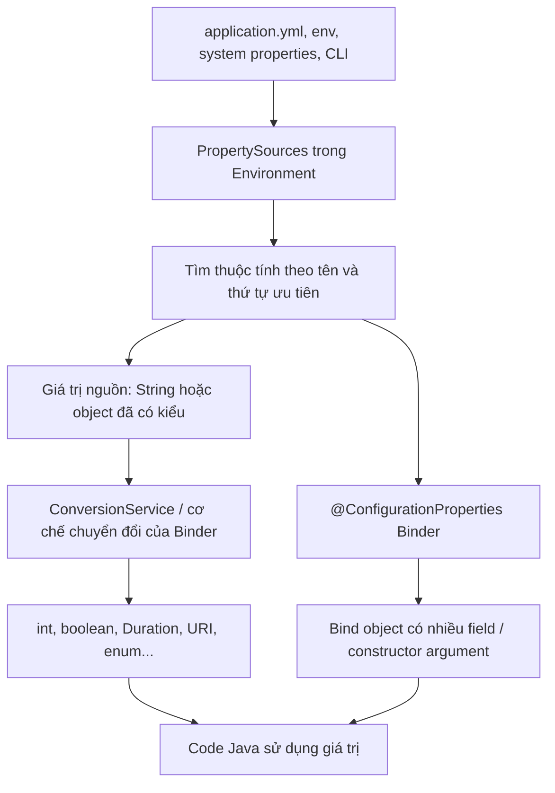

# Environment, ConversionService và chuyển đổi giá trị sang kiểu đích

> **Spring Boot Fundamentals · Tài nguyên và dữ liệu**  
> Trong ứng dụng Spring Boot, dữ liệu cấu hình thường bắt đầu dưới dạng text: `server.port=8080`, `app.retry.delay=2s` hoặc `app.features.enabled=true`. Nhưng code Java muốn sử dụng `int`, `Duration`, `boolean`, `URI`, enum hay những object cấu hình phức tạp. **`Environment` giúp tìm giá trị từ các nguồn cấu hình; `ConversionService` chuyển một giá trị sang kiểu đích; Spring Boot Binder sử dụng cơ chế binding để kết hợp dữ liệu thành object `@ConfigurationProperties`.** Hiểu từng vai trò giúp bạn viết cấu hình rõ ràng, xử lý lỗi đúng chỗ và tự mở rộng khả năng chuyển kiểu khi cần.

## 1. Bức tranh tổng thể: từ text cấu hình tới kiểu Java

Xem một file `application.yml`:

```yaml
app:
  worker:
    enabled: true
    max-jobs: 12
    poll-interval: 750ms
    endpoint: https://jobs.example.test
```

Những giá trị trên được đọc từ tài liệu YAML rồi đưa vào hệ thống cấu hình. Code lại có thể cần:

- `enabled` là `boolean`.
- `maxJobs` là `int`.
- `pollInterval` là `Duration`.
- `endpoint` là `URI`.

Ở mức khái niệm, quá trình diễn ra như sau:



Cần phân biệt:

1. **Tìm ở đâu:** nguồn nào đang chứa property và nguồn nào được ưu tiên?
2. **Chuyển sang kiểu nào:** dữ liệu lấy được có chuyển được thành `Integer`, `Duration` hoặc type tùy chỉnh không?
3. **Gắn vào đâu:** giá trị được trả về trực tiếp, inject qua `@Value` hay bind thành một properties object?

Ba câu hỏi liên quan nhau nhưng không đồng nhất.

## 2. `Environment` có trách nhiệm gì?

Trong Spring Framework, `Environment` cung cấp cách truy cập các property và profile của ứng dụng. Nó được Spring đưa vào những component cần đọc cấu hình.

Ví dụ:

```java
package com.example.jobs;

import org.springframework.core.env.Environment;
import org.springframework.stereotype.Component;

@Component
public class RuntimeSettings {

    private final Environment environment;

    public RuntimeSettings(Environment environment) {
        this.environment = environment;
    }

    public String workerEndpoint() {
        return environment.getProperty("app.worker.endpoint");
    }

    public boolean workerEnabled() {
        return environment.getProperty(
                "app.worker.enabled", Boolean.class, false);
    }

    public int maxJobs() {
        return environment.getProperty(
                "app.worker.max-jobs", Integer.class, 4);
    }
}
```

Ở đây Spring inject `Environment` vào constructor. Lệnh `getProperty` có thể đọc giá trị và, với overload nhận `Class<T>`, yêu cầu chuyển sang kiểu Java tương ứng.

### 2.1. Các cách truy cập property thường gặp

| Cách gọi | Ý nghĩa |
| --- | --- |
| `getProperty("app.name")` | Lấy giá trị dưới dạng `String`; có thể trả `null` |
| `getProperty("app.name", "default")` | Lấy String, nếu không có thì dùng default |
| `getProperty("app.worker.max-jobs", Integer.class)` | Yêu cầu giá trị kiểu `Integer` |
| `getProperty("app.worker.max-jobs", Integer.class, 4)` | Yêu cầu `Integer` với default khi thiếu |
| `getRequiredProperty("app.name")` | Yêu cầu property phải có, nếu thiếu thì báo lỗi |
| `getRequiredProperty("app.worker.max-jobs", Integer.class)` | Yêu cầu tồn tại và chuyển được kiểu |

Giá trị mặc định trong overload `getProperty` không phải một PropertySource mới. Nó là fallback khi không tìm được giá trị phù hợp.

### 2.2. PropertySource là nguồn dữ liệu của Environment

`Environment` có thể chứa nhiều `PropertySource`:

- File `application.properties` hoặc `application.yml`.
- File cấu hình ngoài JAR.
- OS environment variables.
- Java system properties.
- Command-line arguments.
- Thuộc tính từ test.
- Nguồn do thư viện hoặc ứng dụng thêm vào.

`PropertySource` có thể cung cấp String hoặc object đã có kiểu. Chẳng hạn system properties thường chứa String, nhưng một nguồn cấu hình lập trình có thể cung cấp object khác. Vì vậy “chuyển từ String” là trường hợp thường gặp, không phải quy tắc cho mọi nguồn.

### 2.3. Giá trị nào được chọn khi nhiều nguồn trùng khóa?

Giả sử:

```yaml
# application.yml
app:
  worker:
    max-jobs: 8
```

Môi trường có:

```bash
export APP_WORKER_MAXJOBS=16
```

Lệnh chạy có:

```bash
java -jar jobs.jar --app.worker.max-jobs=20
```

Theo thứ tự ưu tiên mặc định của Spring Boot, command-line property thắng các nguồn trên, nên giá trị hiệu lực là `20`. Khi gọi:

```java
Integer value = environment.getProperty(
        "app.worker.max-jobs", Integer.class);
```

Spring trước tiên resolve giá trị theo các property sources, sau đó chuyển kết quả sang `Integer` nếu cần.

**Độ ưu tiên nguồn không thay thế việc chuyển kiểu.** Nguồn có giá trị thắng nhưng dữ liệu không phù hợp vẫn có thể khiến bước chuyển kiểu thất bại.

### 2.4. Environment còn quản lý profile

`Environment` cũng cho biết profile đang active:

```java
String[] profiles = environment.getActiveProfiles();
```

Có thể kiểm tra biểu thức profile qua API thích hợp:

```java
boolean production = environment.acceptsProfiles(
        Profiles.of("prod"));
```

Profile ảnh hưởng việc tải config data theo profile hoặc kích hoạt `@Profile`. Tuy nhiên, profile không phải một kiểu chuyển đổi; nó là thông tin lựa chọn cấu hình.

## 3. `ConversionService` là gì?

`ConversionService` là một abstraction của Spring Framework dùng để chuyển một object từ **kiểu nguồn** sang **kiểu đích**.

Interface có những phương thức tiêu biểu:

```java
<T> T convert(Object source, Class<T> targetType);

boolean canConvert(Class<?> sourceType, Class<?> targetType);
```

Ví dụ đơn giản:

```java
ConversionService conversionService =
        new DefaultConversionService();

Integer jobs = conversionService.convert("12", Integer.class);
Boolean enabled = conversionService.convert("true", Boolean.class);
```

`"12"` là String, còn `jobs` là Integer. `ConversionService` tìm một converter thích hợp với cặp kiểu nguồn/đích, thực hiện chuyển đổi và trả về kết quả.

### 3.1. Không nên tự parse cùng một kiểu ở nhiều nơi

Nếu không có abstraction chung, nhiều component sẽ tự viết:

```java
int jobs = Integer.parseInt(rawJobs);
boolean enabled = Boolean.parseBoolean(rawEnabled);
Duration delay = Duration.parse(rawDelay);
```

Với kiểu đơn giản, cách này có thể hoạt động. Nhưng khi nhiều chỗ cần chuyển enum, thời gian, kích thước dữ liệu hoặc domain type, logic chuyển đổi sẽ dễ bị lặp và có quy tắc không thống nhất.

`ConversionService` tạo một nơi tập trung cho những quy tắc chuyển kiểu dùng chung; các framework component có thể tận dụng registry đó theo ngữ cảnh phù hợp.

### 3.2. `Converter<S, T>`

Đơn vị mở rộng cơ bản là:

```java
public interface Converter<S, T> {
    T convert(S source);
}
```

Trong đó:

- `S` là kiểu nguồn.
- `T` là kiểu đích.
- Method `convert` định nghĩa cách chuyển.

Ví dụ một converter `String → Integer` có ý nghĩa tương tự:

```java
class PositiveIntegerConverter
        implements Converter<String, Integer> {

    @Override
    public Integer convert(String source) {
        int value = Integer.parseInt(source.trim());

        if (value <= 0) {
            throw new IllegalArgumentException(
                    "Value must be positive");
        }

        return value;
    }
}
```

Đây là ví dụ minh họa, **không nên đăng ký converter String → Integer toàn cục chỉ để validate một property cụ thể**. Điều đó sẽ ảnh hưởng các chuyển đổi Integer khác đang hợp lệ, ví dụ một cấu hình cho phép `0`. Validation cho một property riêng thường nên đặt gần properties model hoặc nghiệp vụ.

## 4. Spring Framework `DefaultConversionService` và Spring Boot `ApplicationConversionService`

Spring có nhiều implementation và registry chuyển đổi. Hai tên thường gặp:

| Thành phần | Vai trò |
| --- | --- |
| `DefaultConversionService` | Cung cấp nhóm converter phổ biến của Spring Framework |
| `ApplicationConversionService` | Conversion service của Spring Boot, bổ sung các converter/formatter phù hợp với cấu hình ứng dụng Boot |
| `FormattingConversionService` | Kết hợp conversion với formatting có thể phụ thuộc định dạng hoặc annotation |
| `Converter<S,T>` | Chuyển một cặp kiểu nguồn/đích |
| `ConverterFactory<S,R>` | Tạo converter cho nhiều kiểu đích cùng một họ |
| `GenericConverter` | Hỗ trợ chuyển đổi linh hoạt dựa trên metadata và nhiều cặp kiểu |

Ví dụ chuyển đổi cơ bản:

```java
ConversionService springConversion =
        new DefaultConversionService();

Integer count = springConversion.convert("42", Integer.class);
Boolean active = springConversion.convert("true", Boolean.class);
```

Với định dạng thời gian quen thuộc của Spring Boot:

```java
ConversionService bootConversion =
        ApplicationConversionService.getSharedInstance();

Duration interval = bootConversion.convert(
        "750ms", Duration.class);

DataSize buffer = bootConversion.convert(
        "16MB", DataSize.class);
```

Ví dụ sử dụng:

- `org.springframework.boot.convert.ApplicationConversionService`.
- `org.springframework.util.unit.DataSize`.
- `java.time.Duration`.

Khả năng đọc các cú pháp như `750ms` hoặc `16MB` đến từ các converter/formatter của Spring Boot. Không nên giả định mọi instance `DefaultConversionService` thuần của Spring Framework đều có đúng các quy tắc mở rộng đó.

### 4.1. ConversionService là API chung, registry quyết định các phép chuyển đổi

Hai object cùng triển khai `ConversionService` không nhất thiết hỗ trợ cùng một tập chuyển kiểu. Ví dụ conversion service tự tạo chỉ thêm converter riêng có thể thiếu những converter mặc định của Boot.

Trước khi dùng một converter cụ thể, cần xác định **ConversionService nào đang thực hiện chuyển đổi** và những converter nào đã được đăng ký vào nó.

### 4.2. `canConvert` giúp kiểm tra khả năng

```java
ConversionService service =
        ApplicationConversionService.getSharedInstance();

boolean supported = service.canConvert(
        String.class, Duration.class);
```

`canConvert` kiểm tra có đường chuyển đổi phù hợp đã được đăng ký hay không. Nó không chứng minh **mọi giá trị cụ thể** đều hợp lệ. Converter có thể nhận String nhưng vẫn ném lỗi khi gặp nội dung sai, ví dụ `"abc-seconds"`.

### 4.3. ConversionService không chọn nguồn cấu hình

`ConversionService` nhận một object và một target type. Nó không tự quyết định property nào trong file YAML được ưu tiên hơn biến môi trường. Công việc đó thuộc `Environment`, `PropertySource` và cơ chế config data.

## 5. Trình tự resolve rồi convert khi dùng Environment

Giả sử file cấu hình:

```properties
app.worker.max-jobs=12
app.worker.enabled=true
app.worker.poll-interval=750ms
```

Code:

```java
Integer maxJobs = environment.getProperty(
        "app.worker.max-jobs", Integer.class);

Boolean enabled = environment.getProperty(
        "app.worker.enabled", Boolean.class);

Duration pollInterval = environment.getProperty(
        "app.worker.poll-interval", Duration.class);
```

Trong một ứng dụng Spring Boot có conversion service phù hợp cho Environment:

1. `Environment` tìm khóa trong các property source.
2. Nguồn ưu tiên cao nhất có giá trị phù hợp được chọn.
3. Nếu giá trị đã là kiểu đích, có thể không cần chuyển đổi.
4. Nếu cần, property resolver dùng conversion service đã cấu hình.
5. Giá trị được trả về hoặc lỗi chuyển kiểu được phát sinh.

### 5.1. Phân biệt “không tồn tại” và “không chuyển được”

Ví dụ:

```java
Integer count = environment.getProperty(
        "app.worker.max-jobs", Integer.class, 4);
```

Nếu property **không tồn tại**, default `4` được dùng.

Nếu property **có tồn tại** với nội dung không hợp lệ như:

```properties
app.worker.max-jobs=many
```

fallback `4` không nên được hiểu là cơ chế nuốt lỗi chuyển kiểu. Việc convert `"many"` sang `Integer` có thể ném exception. Cấu hình sai cần được phát hiện, thay vì tự động chạy với một giá trị không rõ chủ đích.

### 5.2. Đọc bắt buộc bằng `getRequiredProperty`

```java
URI endpoint = environment.getRequiredProperty(
        "app.worker.endpoint", URI.class);
```

Nếu khóa không có, resolver báo lỗi vì thuộc tính bắt buộc bị thiếu. Nếu có nhưng không thể chuyển sang URI hợp lệ theo converter được dùng, bước chuyển đổi có thể báo lỗi tương ứng.

Điều này vẫn chưa thay thế validation nghiệp vụ: một URI cú pháp hợp lệ chưa chắc là endpoint được phép gọi.

### 5.3. Luồng lỗi ví dụ

```text
app.worker.max-jobs = "twelve"
        |
        v
Environment tìm được giá trị
        |
        v
ConversionService muốn tạo Integer
        |
        v
Không parse được "twelve"
        |
        v
Lỗi chuyển đổi (không phải lỗi tìm property)
```

Khi debug, hãy tự hỏi **đã chọn sai nguồn, chưa có khóa, hay đã chọn đúng nhưng chuyển kiểu thất bại?** Ba tình huống cần cách xử lý khác nhau.

## 6. Chuyển đổi những kiểu phổ biến

### 6.1. String và số

```properties
app.worker.max-jobs=12
app.worker.rate=0.75
```

Code:

```java
Integer maxJobs = environment.getProperty(
        "app.worker.max-jobs", Integer.class);

Double rate = environment.getProperty(
        "app.worker.rate", Double.class);
```

Giá trị `"12"` cần chuyển được thành integer. Giá trị như `"twelve"` không phù hợp. Một số parser có thể xử lý khoảng trắng hoặc dạng số đặc biệt khác nhau; đừng dựa vào chi tiết chưa được ghi rõ trong contract của cấu hình.

Nếu property có giới hạn, ví dụ `max-jobs` từ 1 đến 100, cần validation riêng.

### 6.2. Boolean

```properties
app.worker.enabled=true
```

```java
Boolean enabled = environment.getProperty(
        "app.worker.enabled", Boolean.class);
```

Spring có các converter boolean hỗ trợ những biểu diễn text phổ biến. Tuy nhiên, trong cấu hình public nên khuyến khích `true` hoặc `false` tường minh thay vì phụ thuộc người đọc hiểu mọi dạng alias có thể được converter chấp nhận.

### 6.3. Duration

```yaml
app:
  worker:
    poll-interval: 750ms
    shutdown-timeout: 5s
```

```java
Duration pollInterval = environment.getProperty(
        "app.worker.poll-interval", Duration.class);

Duration shutdownTimeout = environment.getProperty(
        "app.worker.shutdown-timeout", Duration.class);
```

Các cú pháp `750ms` và `5s` là kiểu cấu hình thời lượng quen thuộc của Spring Boot. Khi dùng `@ConfigurationProperties`, Boot có hỗ trợ Duration binding và annotation `@DurationUnit` để chỉ định đơn vị mặc định cho giá trị không ghi đơn vị.

Ví dụ:

```java
@DurationUnit(ChronoUnit.SECONDS)
private Duration shutdownTimeout = Duration.ofSeconds(5);
```

Đoạn trên minh họa field trong properties class; cần import `org.springframework.boot.convert.DurationUnit` và `java.time.temporal.ChronoUnit`. Với value `5` không có suffix, đơn vị có thể được hiểu theo annotation tương ứng trong luồng binding hỗ trợ nó. Cách an toàn nhất cho file cấu hình là ghi `5s` hoặc `750ms` rõ đơn vị.

### 6.4. DataSize

```yaml
app:
  worker:
    buffer-size: 16MB
```

Nếu dùng `@ConfigurationProperties` có field `DataSize`, Boot có thể chuyển text `16MB` thành `DataSize`. Có thể dùng `@DataSizeUnit` để điều khiển đơn vị mặc định khi giá trị được viết dưới dạng số không có suffix.

Ví dụ:

```java
private DataSize bufferSize = DataSize.ofMegabytes(16);
```

`DataSize` dùng để biểu diễn kích thước dữ liệu, khác với `Duration` dùng để biểu diễn thời gian. Tránh biểu diễn cả hai thành `long` không có đơn vị nếu điều đó làm người đọc dễ nhầm.

### 6.5. Enum

```java
public enum ProcessingMode {
    INLINE,
    QUEUED
}
```

Và:

```yaml
app:
  worker:
    mode: queued
```

Với binder của Boot, enum có thể được bind từ biểu diễn text phù hợp. Nếu người dùng nhập giá trị không tồn tại như `unknown`, việc bind sẽ lỗi trừ khi có converter riêng xử lý.

Enum hữu ích khi tập giá trị cố định và bạn muốn compiler hỗ trợ các nhánh nghiệp vụ đầy đủ.

### 6.6. URI, URL và kiểu khác

```yaml
app:
  worker:
    endpoint: https://jobs.example.test/api
```

```java
URI endpoint = environment.getProperty(
        "app.worker.endpoint", URI.class);
```

Khả năng chuyển đổi URI mô tả cấu trúc địa chỉ. Nó không kiểm tra service có thật, certificate hợp lệ, DNS trả lời hay domain có được phép sử dụng không. Những kiểm tra đó thuộc validation nghiệp vụ và logic kết nối.

## 7. `@ConfigurationProperties`: khi cần nhiều giá trị có kiểu

Đọc từng property bằng `Environment` rất tiện cho một vài khóa. Nhưng nếu một nhóm cấu hình có hàng chục giá trị, nên dùng `@ConfigurationProperties`.

### 7.1. Properties object

```java
package com.example.jobs.config;

import java.net.URI;
import java.time.Duration;

import org.springframework.boot.context.properties.ConfigurationProperties;

@ConfigurationProperties(prefix = "app.worker")
public class WorkerProperties {

    private boolean enabled = true;
    private int maxJobs = 4;
    private Duration pollInterval = Duration.ofSeconds(1);
    private URI endpoint;

    public boolean isEnabled() {
        return enabled;
    }

    public void setEnabled(boolean enabled) {
        this.enabled = enabled;
    }

    public int getMaxJobs() {
        return maxJobs;
    }

    public void setMaxJobs(int maxJobs) {
        this.maxJobs = maxJobs;
    }

    public Duration getPollInterval() {
        return pollInterval;
    }

    public void setPollInterval(Duration pollInterval) {
        this.pollInterval = pollInterval;
    }

    public URI getEndpoint() {
        return endpoint;
    }

    public void setEndpoint(URI endpoint) {
        this.endpoint = endpoint;
    }
}
```

Đăng ký properties bean:

```java
@SpringBootApplication
@ConfigurationPropertiesScan
public class JobsApplication {

    public static void main(String[] args) {
        SpringApplication.run(JobsApplication.class, args);
    }
}
```

Hoặc trong một cấu hình cụ thể:

```java
@Configuration(proxyBeanMethods = false)
@EnableConfigurationProperties(WorkerProperties.class)
class WorkerConfiguration {
}
```

Cả hai cách cho phép Spring Boot đăng ký object cấu hình và bind các khóa tương ứng. Không phải chỉ gắn `@ConfigurationProperties` lên một class là bean đó luôn xuất hiện trong context.

### 7.2. Dùng trong service

```java
@Service
public class WorkerService {

    private final WorkerProperties properties;

    public WorkerService(WorkerProperties properties) {
        this.properties = properties;
    }

    public int concurrencyLimit() {
        return properties.getMaxJobs();
    }
}
```

Code service không cần biết property được lấy từ YAML, biến môi trường hay system property. Nó phụ thuộc vào một object có kiểu rõ ràng.

### 7.3. So sánh Environment với Binder

| Cách làm | Thích hợp khi | Giới hạn |
| --- | --- | --- |
| `Environment.getProperty("key")` | Đọc một vài khóa hoặc kiểm tra sự tồn tại | Chuỗi key lặp trong nhiều vị trí, phải quản lý từng lần đọc |
| `Environment.getProperty("key", Type.class)` | Cần vài giá trị đã chuyển kiểu | Không tự gom nhiều field thành object |
| `@Value("${key}")` | Inject một property đơn lẻ | Dễ phân tán cấu hình trong nhiều bean |
| `@ConfigurationProperties` | Một nhóm cấu hình có cấu trúc | Cần lớp model và đăng ký bean |
| `Binder` API | Bind programmatically khi không muốn hoặc chưa thể dùng properties bean | Cần hiểu bind lifecycle, nguồn và conversion service |

Khi thiết kế module hoặc starter, `@ConfigurationProperties` thường là lựa chọn dễ kiểm thử, dễ tài liệu hóa và có metadata cho IDE hơn so với việc tự đọc hàng chục giá trị.

## 8. Spring Boot `Binder` phối hợp với ConversionService như thế nào?

`Binder` không chỉ parse một giá trị độc lập. Nó còn:

1. Nhận nhiều nguồn cấu hình có thứ tự ưu tiên.
2. Xác định các key thuộc một prefix.
3. Ánh xạ tên cấu hình sang property Java theo quy tắc relaxed binding.
4. Chuyển từng giá trị sang kiểu field/constructor argument.
5. Khởi tạo hoặc điền object đích.
6. Báo lỗi bind và áp dụng validation nếu được cấu hình.

Ví dụ YAML:

```yaml
app:
  worker:
    max-jobs: 12
    poll-interval: 750ms
```

Với class `WorkerProperties`:

- `max-jobs` được ánh xạ tới `maxJobs`.
- `"12"` được convert sang int.
- `poll-interval` được ánh xạ tới `pollInterval`.
- `"750ms"` được convert sang Duration.

Nếu một cấu hình có `List<URI>` hoặc `Map<String, Duration>`, Binder còn cần chuyển đổi phần tử và quản lý cấu trúc dữ liệu.

### 8.1. Đừng xem Binder và ConversionService là một

`ConversionService` giải quyết **phép đổi từ kiểu S sang kiểu T**. `Binder` giải quyết **cách rải nhiều giá trị trong cấu hình vào các field, list, map và constructor argument của một object**.

`Binder` có thể dùng các conversion service hoặc converter được đăng ký cho quá trình bind, nhưng nó còn thực hiện nhiều công việc không thuộc API `ConversionService`.

### 8.2. Relaxed binding

Với prefix `app.worker` và field `maxJobs`, Boot Binder có thể nhận một số biến thể tên property tương ứng.

Ví dụ tên canonical:

```properties
app.worker.max-jobs=12
```

Tên biến môi trường thường dùng:

```bash
export APP_WORKER_MAXJOBS=12
```

Khi chuyển từ property name canonical sang env variable thường viết hoa, thay dấu chấm bằng gạch dưới và bỏ dấu gạch ngang trong từ ghép. Không nên suy luận tùy tiện rằng mọi biến thể ký tự đều tương đương trong mọi API. `@ConfigurationProperties` có mô hình relaxed binding rõ ràng hơn so với việc dùng raw String key ở những API khác.

### 8.3. List và map có quy tắc kết hợp nguồn riêng

Khi nhiều property sources định nghĩa list, Binder thường dùng list từ nguồn ưu tiên cao hơn thay vì nối mọi phần tử. Map có thể kết hợp các key từ nhiều nguồn, với key trùng nhau bị nguồn ưu tiên cao hơn ghi đè.

Đây là **quy tắc bind cấu trúc**, không phải một phép converter String → T thông thường. Nếu list bị mất phần tử khi chuyển profile, đừng vội sửa `ConversionService`; hãy kiểm tra nguồn cấu hình và quy tắc Binder.

## 9. Dùng `@Value` và phân biệt các đường chuyển đổi

Một cách truy cập khác là `@Value`:

```java
@Component
public class QueueClient {

    private final int maxJobs;

    public QueueClient(
            @Value("${app.worker.max-jobs:4}") int maxJobs) {
        this.maxJobs = maxJobs;
    }
}
```

Spring resolve placeholder và chuyển giá trị sang kiểu tham số constructor khi có converter thích hợp.

### 9.1. `@Value` không tương đương mọi mặt với `@ConfigurationProperties`

`@ConfigurationProperties` được thiết kế cho externalized configuration, relaxed binding, cấu trúc lồng nhau và nhiều phép chuyển đổi đặc thù của Boot.

`@Value` là cơ chế injection tổng quát của Spring, có thể hỗ trợ placeholder và SpEL:

```java
@Value("${app.worker.enabled:true}")
private boolean enabled;
```

```java
@Value("#{2 * 4}")
private int calculated;
```

Hai biểu thức trên không cùng một cơ chế: `${...}` là placeholder lấy property, còn `#{...}` là Spring Expression Language.

Không nên giả định mọi gợi ý relaxed binding hoặc mọi converter được đánh dấu `@ConfigurationPropertiesBinding` đều tự áp dụng y hệt cho tất cả các vị trí `@Value`.

### 9.2. Dùng tên canonical trong placeholder

Nên dùng:

```java
@Value("${app.worker.max-jobs:4}")
private int maxJobs;
```

thay vì tự đặt tên biến thể khó theo dõi. Cú pháp kebab-case canonical giúp Spring Boot xử lý nhất quán hơn với hệ thống property name và một số alias từ Environment.

### 9.3. Khi nào `@Value` là đủ?

Một bean chỉ cần một property ngắn, độc lập có thể dùng `@Value`. Nếu có các thuộc tính liên quan như timeout, retry, endpoint, credential, mode và buffer-size, nên gom vào `@ConfigurationProperties` để dễ kiểm thử, validate và quản lý hơn.

## 10. Tự tạo kiểu cấu hình domain-specific

Có lúc kiểu Java chuẩn không mô tả rõ nghiệp vụ. Ví dụ một ứng dụng triển khai trên ba vùng:

- `APAC`.
- `EMEA`.
- `AMER`.

Ta muốn property:

```yaml
client:
  region: apac
  connect-timeout: 2s
```

được bind thành `RegionCode` thay vì String tự do.

### 10.1. Domain type

```java
package com.example.jobs.config;

import java.util.Locale;
import java.util.Set;

public record RegionCode(String value) {

    private static final Set<String> ALLOWED =
            Set.of("APAC", "EMEA", "AMER");

    public static RegionCode parse(String raw) {
        if (raw == null || raw.isBlank()) {
            throw new IllegalArgumentException(
                    "Region must not be blank");
        }

        String normalized = raw.trim()
                .toUpperCase(Locale.ROOT);

        if (!ALLOWED.contains(normalized)) {
            throw new IllegalArgumentException(
                    "Unsupported region: " + raw);
        }

        return new RegionCode(normalized);
    }
}
```

Type này cung cấp một invariant: nếu được tạo qua `parse`, giá trị luôn thuộc tập vùng hợp lệ. Trong ứng dụng thực tế, cũng có thể dùng enum nếu tập giá trị không cần một domain type riêng.

### 10.2. Converter từ String sang RegionCode

```java
package com.example.jobs.config;

import org.springframework.core.convert.converter.Converter;

public final class RegionCodeConverter
        implements Converter<String, RegionCode> {

    @Override
    public RegionCode convert(String source) {
        return RegionCode.parse(source);
    }
}
```

Converter chỉ làm một việc: đổi giá trị String thành `RegionCode`. Nó không tự biết `client.region` nằm trong file nào hay giá trị đó thuộc profile nào.

### 10.3. Đăng ký converter dành cho `@ConfigurationProperties`

Trong Spring Boot, có thể đăng ký converter dành cho property binding bằng `@ConfigurationPropertiesBinding`:

```java
package com.example.jobs.config;

import org.springframework.boot.context.properties.ConfigurationPropertiesBinding;
import org.springframework.context.annotation.Bean;
import org.springframework.context.annotation.Configuration;
import org.springframework.core.convert.converter.Converter;

@Configuration(proxyBeanMethods = false)
public class RegionConversionConfiguration {

    @Bean
    @ConfigurationPropertiesBinding
    static Converter<String, RegionCode> regionCodeConverter() {
        return new RegionCodeConverter();
    }
}
```

Điểm cần hiểu:

- `@Bean` đăng ký converter như một Spring bean.
- `@ConfigurationPropertiesBinding` đánh dấu converter phục vụ cơ chế bind của Boot.
- `static` cho phép tạo bean converter mà không buộc Spring khởi tạo configuration instance sớm; đây là cách thường được khuyến nghị trong trường hợp binder cần converter rất sớm.
- Converter có phạm vi sử dụng theo cơ chế property binding, không tự trở thành quy tắc global của mọi `ConversionService` trong mọi ngữ cảnh.

Đừng inject service có dependency phức tạp, database hoặc HTTP client vào converter dùng khi bind properties. Quá trình bind có thể diễn ra rất sớm, trước khi toàn bộ bean graph sẵn sàng.

### 10.4. Properties record sử dụng domain type

```java
package com.example.jobs.config;

import java.time.Duration;

import org.springframework.boot.context.properties.ConfigurationProperties;
import org.springframework.boot.context.properties.bind.DefaultValue;

@ConfigurationProperties(prefix = "client")
public record ClientSettings(
        RegionCode region,
        @DefaultValue("3s") Duration connectTimeout
) {
}
```

Đăng ký:

```java
@Configuration(proxyBeanMethods = false)
@EnableConfigurationProperties(ClientSettings.class)
public class ClientConfiguration {
}
```

Với `client.region=apac`, Binder có thể chọn converter `String → RegionCode` và tạo `RegionCode("APAC")`. Với `client.connect-timeout=2s`, Boot có thể bind Duration tương ứng.

Trong record, nếu không có `region` và không có validation/logic kiểm tra bổ sung, giá trị có thể là null tùy cơ chế bind và cấu hình. Nếu region bắt buộc, cần thể hiện điều đó qua validation hoặc constructor invariant thích hợp.

### 10.5. Khi conversion thất bại

Nếu YAML chứa:

```yaml
client:
  region: mars
```

`RegionCode.parse("mars")` ném `IllegalArgumentException`. Khi lỗi xảy ra trong property binding, Spring Boot thường bọc thông tin trong lỗi bind có ngữ cảnh về property và target type. Thông báo chi tiết phụ thuộc phiên bản Boot và chain exception.

Đây là hành vi nên có khi giá trị sai. Không nên âm thầm chuyển `mars` thành `APAC` vì như vậy application có thể chạy ở vùng không đúng dự định.

## 11. Các chiến lược đăng ký Converter khác nhau

Không chỉ có một đường đăng ký converter. Cần chọn đúng **ngữ cảnh sử dụng**.

### 11.1. Converter chỉ phục vụ `@ConfigurationProperties`

Dùng `@ConfigurationPropertiesBinding` trên bean hoặc component được đăng ký phù hợp. Đây là cách đơn giản để bổ sung domain conversion cho Boot Binder mà không thay mọi conversion service của framework.

### 11.2. Converter cho Spring MVC hoặc web data binding

Trong ứng dụng Spring MVC, có thể thêm converter cho request parameter/path variable/form binding qua `WebMvcConfigurer`:

```java
@Configuration(proxyBeanMethods = false)
public class WebConversionConfiguration
        implements WebMvcConfigurer {

    @Override
    public void addFormatters(FormatterRegistry registry) {
        registry.addConverter(new RegionCodeConverter());
    }
}
```

Cách này phục vụ conversion/formatting trong ngữ cảnh web MVC. Nó không tự bảo đảm converter cũng được đăng ký cho Boot `@ConfigurationProperties` Binder.

Ví dụ converter dùng cho tham số controller và converter dùng cho external configuration có thể cùng tái sử dụng class `RegionCodeConverter`, nhưng **đăng ký trong một registry không đồng nghĩa mọi registry đều nhìn thấy nó**.

### 11.3. Converter cho một ConversionService riêng

```java
DefaultConversionService service =
        new DefaultConversionService();

service.addConverter(new RegionCodeConverter());

RegionCode code = service.convert(
        "emea", RegionCode.class);
```

Đây là registry được tạo cục bộ. Nó không tự thay đổi `Environment` hoặc Binder của ApplicationContext.

Cách này hữu ích khi một thư viện xử lý dữ liệu độc lập và bạn muốn chủ động quản lý các phép chuyển đổi mà thư viện đó sử dụng.

### 11.4. Bean tên `conversionService`

Spring Boot cho phép cung cấp một bean `ConversionService` có tên `conversionService` để tùy biến một số cơ chế chuyển đổi cấu hình. Nhưng conversion service này có thể được yêu cầu **rất sớm** trong lifecycle. Nếu định nghĩa tùy tiện, bạn có thể:

- Làm mất những converter/formatter mặc định mà Boot hỗ trợ.
- Gây lỗi dependency chưa sẵn sàng.
- Thay đổi behavior chuyển kiểu của nhiều properties cùng lúc.
- Làm một custom converter ảnh hưởng ngoài phạm vi tính năng của nó.

Với một domain type riêng cho `@ConfigurationProperties`, ưu tiên converter được đánh dấu `@ConfigurationPropertiesBinding`. Chỉ thay conversion service chung khi có mục tiêu và phạm vi rõ ràng.

### 11.5. Đừng nhầm bean Converter và phạm vi được áp dụng

Một `Converter<String, RegionCode>` có thể là bean trong context, nhưng điều đó không có nghĩa mọi chương trình dùng `ConversionService` đều tự động lấy bean này vào registry.

Cần kiểm tra cách framework cụ thể phát hiện các converter bean và cách bạn đã đăng ký nó. Việc đánh dấu `@ConfigurationPropertiesBinding` có ý nghĩa đặc biệt với Boot Binder; `WebMvcConfigurer.addFormatters` có ý nghĩa với MVC.

## 12. Formatting và Conversion có khác nhau không?

Có liên quan, nhưng nên phân biệt.

**Conversion**: đổi từ một kiểu dữ liệu sang kiểu khác, ví dụ `String → Integer` hoặc `String → RegionCode`.

**Formatting**: biểu diễn một object thành text hoặc parse text theo quy tắc định dạng, đôi khi phụ thuộc locale, annotation hoặc pattern. Ví dụ ngày tháng, tiền tệ, số ở các vùng ngôn ngữ khác nhau.

Trong Spring Framework:

- `Converter` phù hợp cho phép chuyển đổi kiểu tổng quát.
- `Formatter<T>` có thể hỗ trợ parse/print với `Locale`.
- `FormattingConversionService` kết hợp converter và formatter.
- Các annotation như `@DateTimeFormat` và `@NumberFormat` có thể tham gia vào formatting ở những ngữ cảnh framework hỗ trợ.

### 12.1. Vì sao không parse ngày theo Locale tùy ý trong config?

Giả sử cấu hình cần ngày hết hạn:

```properties
app.campaign.end-date=2026-12-31
```

Dùng định dạng ngày ISO rõ ràng thường dễ vận hành hơn một định dạng phụ thuộc locale như `31/12/26`. Trong external configuration, quy ước có thể được máy kiểm tra sẽ giảm nguy cơ hiểu nhầm ngày/tháng.

Nếu thực sự cần định dạng custom, hãy ghi rõ format và bổ sung converter/validation phù hợp; không giả định IDE hay Binder hiểu mọi định dạng do người dùng nghĩ ra.

## 13. Validation khác conversion như thế nào?

Conversion trả lời: “Giá trị này có chuyển được sang kiểu đích không?”

Validation trả lời: “Giá trị đã chuyển có hợp lệ với nghiệp vụ không?”

Ví dụ:

```properties
app.worker.max-jobs=-5
```

`-5` hoàn toàn có thể chuyển sang `Integer`. Nhưng `-5` không hợp lệ nếu số job tối đa phải ít nhất là 1.

### 13.1. Bean Validation với `@ConfigurationProperties`

```java
package com.example.jobs.config;

import jakarta.validation.constraints.Max;
import jakarta.validation.constraints.Min;

import org.springframework.boot.context.properties.ConfigurationProperties;
import org.springframework.validation.annotation.Validated;

@Validated
@ConfigurationProperties(prefix = "app.worker")
public class WorkerLimits {

    @Min(1)
    @Max(100)
    private int maxJobs = 4;

    public int getMaxJobs() {
        return maxJobs;
    }

    public void setMaxJobs(int maxJobs) {
        this.maxJobs = maxJobs;
    }
}
```

Khi project có Bean Validation implementation phù hợp và properties được đăng ký/bind theo cơ chế Boot, validation có thể phát hiện `max-jobs=-5`.

Quá trình diễn ra theo thứ tự khái niệm:

1. Resolve property.
2. Chuyển thành `int`.
3. Bind vào `maxJobs`.
4. Kiểm tra `@Min` và `@Max`.

Nếu giá trị là `"many"`, conversion đã thất bại trước khi validation số học có thể thực hiện. Nếu giá trị là `-5`, conversion thành công nhưng validation không đạt.

### 13.2. Chọn nơi đặt quy tắc

| Quy tắc | Cơ chế nên cân nhắc |
| --- | --- |
| `"12"` thành Integer | Converter có sẵn |
| `"2s"` thành Duration | Converter/formatter của Boot |
| `"apac"` thành RegionCode | Custom Converter |
| Integer phải từ 1 đến 100 | Validation |
| URI phải dùng HTTPS | Validation hoặc logic nghiệp vụ |
| Có server endpoint nhưng thiếu credential | Validation liên trường hoặc kiểm tra khi khởi tạo |
| Một property có bị nguồn khác ghi đè không | Environment/PropertySources, không phải Converter |

Tách bạch trách nhiệm giúp lỗi dễ chẩn đoán và code ít phụ thuộc lẫn nhau.

## 14. Chuyển đổi list, map và kiểu tổng quát

`ConversionService.convert(Object, Class<T>)` phù hợp với target type đơn giản. Nhưng với generics như `List<URI>` hoặc `Map<String, Duration>`, chỉ truyền `List.class` không mô tả được kiểu phần tử.

Spring cung cấp `TypeDescriptor` và những API nâng cao để mô tả nguồn/đích có generics khi cần:

```java
List<String> values =
        List.of("1", "2", "3");

TypeDescriptor sourceType = TypeDescriptor
        .collection(List.class, TypeDescriptor.valueOf(String.class));

TypeDescriptor targetType = TypeDescriptor
        .collection(List.class, TypeDescriptor.valueOf(Integer.class));

Object result = conversionService.convert(
        values, sourceType, targetType);
```

Đây là minh họa khả năng chuyển đổi collection của một conversion service có converter phù hợp. Muốn dùng kết quả theo `List<Integer>`, code cần kiểm tra/cast đúng type trong trường hợp cần thiết.

Với external configuration, `@ConfigurationProperties` Binder thường là lựa chọn tốt hơn vì nó đã biết field type, nested object và generic element type từ properties class.

### 14.1. Không gọi `getProperty("app.items", List.class)` rồi kỳ vọng tự bind toàn bộ cấu trúc

Một khóa có thể là list trong YAML, nhưng cách YAML được biểu diễn thành config property names và cách một property resolver resolve trực tiếp không tương đương Binder xây dựng `List<T>` từ nhiều indexed keys.

Ví dụ:

```yaml
app:
  endpoints:
    - https://one.example
    - https://two.example
```

Nên dùng properties class:

```java
@ConfigurationProperties(prefix = "app")
public class AppEndpoints {

    private List<URI> endpoints = new ArrayList<>();

    public List<URI> getEndpoints() {
        return endpoints;
    }

    public void setEndpoints(List<URI> endpoints) {
        this.endpoints = endpoints;
    }
}
```

Binder đảm nhiệm indexed names và chuyển từng phần tử sang URI. Đừng biến một phép conversion đơn lẻ thành một bộ binder tự chế.

### 14.2. Converter tập trung trên một giá trị, Binder tập trung trên cấu trúc

Nếu cần chuyển `String → RegionCode` cho mỗi phần tử `List<RegionCode>`, bạn có thể đăng ký converter phần tử. Binder dùng metadata kiểu của collection để xử lý các phần tử theo cơ chế binding phù hợp.

Đây là lý do kết hợp `@ConfigurationProperties` với converter có kiểu rõ ràng thường gọn hơn so với tự split chuỗi rồi parse nhiều lần.

## 15. Khi nào sử dụng `Environment` trực tiếp?

Đọc `Environment` không sai. Nó phù hợp trong những trường hợp:

- Framework code hoặc infrastructure cần truy cập một vài khóa động.
- Một custom `Condition` cần kiểm tra property ở giai đoạn xử lý cấu hình.
- Một integration cần fallback key khi khởi động.
- Debug cần biết giá trị đang được resolve.
- Không có object cấu hình đủ ổn định để định nghĩa một properties model.

Ví dụ trong condition:

```java
public final class RegionEnabledCondition implements Condition {

    @Override
    public boolean matches(
            ConditionContext context,
            AnnotatedTypeMetadata metadata) {

        return "apac".equalsIgnoreCase(
                context.getEnvironment()
                        .getProperty("app.region"));
    }
}
```

Lưu ý: một Condition chạy sớm, không nên tự gọi database, tạo HTTP client hoặc yêu cầu một bean chưa sẵn sàng. Nếu chỉ kiểm tra property boolean, dùng `@ConditionalOnProperty` thường rõ hơn custom Condition.

### 15.1. Đọc từ Environment trong business service có nhược điểm gì?

Khi `Environment.getProperty` xuất hiện ở hàng chục service:

- Tên khóa bị lặp, khó đổi đồng bộ.
- Giá trị default được định nghĩa rải rác.
- Test phải thiết lập nhiều key nhỏ.
- Validation không có một nơi tập trung.
- IDE khó theo dõi contract cấu hình như với `@ConfigurationProperties`.

Nếu thuộc tính là cấu hình nghiệp vụ có schema ổn định, gom chúng vào một properties object sẽ dễ bảo trì hơn.

## 16. Quan sát ConversionService đang được dùng

Một lỗi debug phổ biến là tạo một converter nhưng ứng dụng vẫn báo không chuyển được giá trị.

Trước tiên xác định luồng dữ liệu:

| Vị trí cần chuyển đổi | Cơ chế cần kiểm tra |
| --- | --- |
| `Environment.getProperty(key, Type.class)` | Property resolver và conversion service của Environment |
| `@ConfigurationProperties` | Boot Binder và converter dành cho configuration properties |
| `@Value` | Placeholder resolution và cơ chế type conversion của bean factory |
| Spring MVC `@RequestParam` / `@PathVariable` | Web MVC conversion/formatting registry |
| WebFlux request binding | Conversion/binding stack của WebFlux |
| Tự gọi `conversionService.convert(...)` | Đúng instance ConversionService được truyền vào |

Đừng cho rằng đăng ký converter ở MVC sẽ sửa lỗi Binder, hoặc đăng ký converter cho Binder sẽ tự sửa tất cả `@Value`. Dù cùng dùng abstraction chuyển đổi của Spring, mỗi subsystem có thể dùng registry riêng.

### 16.1. Log lỗi đúng mức

Khi khởi động thất bại, thông báo có thể chứa:

- Tên property đang bind.
- Giá trị nguồn (có thể đã bị che nếu là secret).
- Kiểu Java mong đợi.
- Tên properties class.
- Nguyên nhân sâu hơn như `NumberFormatException` hoặc `IllegalArgumentException`.

Các exception liên quan có thể bao gồm `ConversionFailedException`, `ConverterNotFoundException` và lỗi `BindException` của Spring Boot, tùy đường đi thực tế.

Không dựa vào tên exception top-level duy nhất để kết luận. Hãy đọc cause chain và ngữ cảnh: lỗi ở property source, conversion, bind cấu trúc hay validation?

### 16.2. Không log secret để xem nguồn

Ví dụ property `payment.api-key` hoặc `spring.datasource.password` có thể đến từ biến môi trường hoặc secret manager. Không in raw value để debug Converter. Nếu cần quan sát, log tên property, nguồn tổng quát và class đích; che giá trị nhạy cảm.

Spring Boot Actuator cung cấp `env` và `configprops` ở môi trường có Actuator và endpoint được enable/expose, nhưng cần bảo vệ truy cập và kiểm soát cách hiện giá trị nhạy cảm.

## 17. Kiểm thử chuyển kiểu trong Spring Boot

Có thể test converter đơn lẻ và test tích hợp binder; hai loại kiểm thử chứng minh hai điều khác nhau.

### 17.1. Unit test một Converter

```java
import static org.assertj.core.api.Assertions.assertThat;
import static org.assertj.core.api.Assertions.assertThatThrownBy;

import org.junit.jupiter.api.Test;

class RegionCodeConverterTest {

    private final RegionCodeConverter converter =
            new RegionCodeConverter();

    @Test
    void parsesRegionCaseInsensitively() {
        RegionCode result = converter.convert("apac");

        assertThat(result.value()).isEqualTo("APAC");
    }

    @Test
    void rejectsUnsupportedRegion() {
        assertThatThrownBy(() -> converter.convert("mars"))
                .isInstanceOf(IllegalArgumentException.class)
                .hasMessageContaining("Unsupported region");
    }
}
```

Test này chứng minh logic `String → RegionCode` của class converter, nhưng **chưa chứng minh** converter đã được Spring Boot Binder đăng ký.

### 17.2. Test binder bằng `ApplicationContextRunner`

```java
import static org.assertj.core.api.Assertions.assertThat;

import org.junit.jupiter.api.Test;
import org.springframework.boot.test.context.runner.ApplicationContextRunner;

class ClientSettingsBindingTest {

    private final ApplicationContextRunner runner =
            new ApplicationContextRunner()
                    .withUserConfiguration(
                            RegionConversionConfiguration.class,
                            ClientConfiguration.class);

    @Test
    void bindsCustomRegionAndDuration() {
        runner.withPropertyValues(
                "client.region=apac",
                "client.connect-timeout=2s"
        ).run(context -> {
            assertThat(context).hasNotFailed();

            ClientSettings settings =
                    context.getBean(ClientSettings.class);

            assertThat(settings.region().value()).isEqualTo("APAC");
            assertThat(settings.connectTimeout())
                    .isEqualTo(Duration.ofSeconds(2));
        });
    }
}
```

Test mô phỏng một context nhỏ với cấu hình converter và properties bean. Nếu converter không được nhận diện đúng, test sẽ giúp phát hiện vấn đề cấu hình integration.

### 17.3. Test trường hợp sai kiểu

```java
@Test
void failsWhenRegionCannotBeConverted() {
    runner.withPropertyValues(
            "client.region=mars",
            "client.connect-timeout=2s"
    ).run(context -> {
        assertThat(context).hasFailed();
    });
}
```

Test cho biết context không thể tạo thành công khi property không hợp lệ. Trong một bộ test thực tế, có thể kiểm tra root cause hoặc thông báo binding ở mức phù hợp để test không quá phụ thuộc wording của framework giữa các phiên bản.

### 17.4. Test với nguồn ghi đè

Thử một properties class nhận giá trị từ default config data và test property:

```java
runner.withPropertyValues(
        "client.region=emea",
        "client.connect-timeout=5s"
)
```

Xác nhận giá trị bind thay đổi theo nguồn được cung cấp cho test context. Điều này giúp phân biệt lỗi precedence với lỗi converter.

## 18. Những lỗi thường gặp và hướng xử lý

| Hiện tượng | Nguyên nhân có thể | Cách điều tra |
| --- | --- | --- |
| `getProperty(key)` trả `null` | Không có khóa, tên chưa phù hợp hoặc nguồn không được nạp | Kiểm tra key và PropertySources |
| `getProperty(key, Integer.class)` ném lỗi | Giá trị không thể chuyển sang Integer | Xem raw value và converter |
| Giá trị convert được nhưng sai nghiệp vụ | Conversion không phải validation | Thêm validation rõ ràng |
| `Duration` không nhận `750ms` | Dùng ConversionService không có converter Boot phù hợp | Kiểm tra instance/registry và ApplicationConversionService |
| Custom converter chạy khi tự gọi nhưng không chạy với `@ConfigurationProperties` | Chưa đăng ký converter cho Binder | Xem `@ConfigurationPropertiesBinding` và lifecycle |
| Converter chỉ chạy cho controller | Đăng ký ở MVC registry chứ không phải Binder | Tách đúng ngữ cảnh |
| Bean `conversionService` gây lỗi startup | Được khởi tạo quá sớm hoặc thiếu built-in converters | Tránh bean toàn cục khi chỉ cần một converter riêng |
| `@Value` không bind giống `@ConfigurationProperties` | Hai API có semantics khác nhau | Dùng Binder cho nhóm config phức tạp |
| `List<URI>` không thể lấy từ một `getProperty(..., List.class)` đơn giản | Resolver không bind indexed structure như Binder | Dùng `@ConfigurationProperties` |
| Gõ property đúng nhưng nhận giá trị từ nguồn khác | Nguồn ưu tiên cao hơn đang ghi đè | Kiểm tra Environment/Actuator |
| String hợp lệ nhưng URI không dùng được | Type conversion không xác thực kết nối | Kiểm tra endpoint và networking riêng |
| Giá trị âm vẫn bind vào int | Chuyển kiểu thành công, thiếu validation | Thêm `@Min` hoặc invariant |
| Bean properties không tồn tại | Chưa đăng ký class `@ConfigurationProperties` | Dùng scan hoặc EnableConfigurationProperties |
| Converter tạo dependency cycle | Converter có dependency quá phức tạp trong giai đoạn bind sớm | Giảm dependency, dùng static bean |
| Config property có giá trị default nhưng vẫn lỗi | Có nguồn ưu tiên cao hơn ghi giá trị sai | Xem property source và lỗi conversion |

### 18.1. Không che lỗi chuyển kiểu bằng fallback tùy tiện

Nếu property cấu hình số job là `many`, app nên báo lỗi rõ ràng thay vì âm thầm chạy với default `4`. Việc fallback chỉ hợp lý khi property **vắng mặt** và ứng dụng đã quy định default hợp lệ.

Với cấu hình hệ thống quan trọng như endpoint, timeout, retry, vùng triển khai hoặc credential, fail fast thường an toàn hơn khi giá trị bị nhập sai.

### 18.2. Không làm custom converter xử lý quá nhiều nghiệp vụ

Một converter tốt thường:

- Có đầu vào và đầu ra rõ ràng.
- Không kết nối database hoặc HTTP.
- Không phụ thuộc trạng thái thay đổi liên tục.
- Không âm thầm nuốt lỗi dữ liệu không hợp lệ.
- Dễ unit test.
- Có thông báo lỗi hữu ích nhưng không tiết lộ secret.

Nếu cần kiểm tra cross-field, xem xét validation của properties object. Nếu cần tải dữ liệu từ hệ thống khác, hãy làm ở tầng service, không thực hiện công việc mạng trong converter được gọi khi bootstrap.

## 19. Bài thực hành: theo dõi và mở rộng quá trình chuyển kiểu

Mục tiêu: hoàn thành một ứng dụng nhỏ đọc cấu hình worker, chuyển giá trị sang kiểu phù hợp và dùng custom `RegionCode`.

### Bước 1 — Tạo cấu hình nguồn

```yaml
app:
  worker:
    enabled: true
    max-jobs: 8
    poll-interval: 750ms
    endpoint: https://jobs.example.test

client:
  region: apac
  connect-timeout: 2s
```

### Bước 2 — Đọc trực tiếp từ Environment

Inject `Environment` và đọc:

```java
Boolean enabled = environment.getProperty(
        "app.worker.enabled", Boolean.class);

Integer maxJobs = environment.getProperty(
        "app.worker.max-jobs", Integer.class);

Duration delay = environment.getProperty(
        "app.worker.poll-interval", Duration.class);
```

Quan sát kiểu Java thực tế và giá trị đọc được.

### Bước 3 — Ghi đè từ command line

Chạy:

```bash
java -jar jobs.jar \
  --app.worker.max-jobs=16 \
  --app.worker.poll-interval=2s
```

Kiểm tra `Environment` trả `16` và `Duration.ofSeconds(2)` khi conversion được cấu hình phù hợp.

### Bước 4 — Thử giá trị không chuyển được

Chạy với:

```bash
java -jar jobs.jar --app.worker.max-jobs=many
```

Quan sát lỗi chuyển kiểu. Phân biệt trường hợp property vắng mặt (có thể dùng default) và property có giá trị sai (conversion failure).

### Bước 5 — Gom thuộc tính vào `@ConfigurationProperties`

Tạo `WorkerProperties` như phần 7. Đăng ký bằng `@ConfigurationPropertiesScan` hoặc `@EnableConfigurationProperties`, sau đó inject vào service.

So sánh số chuỗi key phải duy trì khi dùng `Environment` trực tiếp với properties object.

### Bước 6 — Tạo Converter domain

Viết `RegionCode` và `RegionCodeConverter` như phần 10. Unit test cả `apac` và giá trị sai `mars`.

### Bước 7 — Đăng ký converter cho Binder

Tạo bean `Converter<String, RegionCode>` có `@ConfigurationPropertiesBinding`, dùng `static @Bean` để tránh khởi tạo sớm không cần thiết.

Viết `ClientSettings` với field hoặc record component `RegionCode region`.

### Bước 8 — Kiểm thử bằng `ApplicationContextRunner`

Xác nhận:

- `client.region=apac` bind thành `RegionCode("APAC")`.
- `client.connect-timeout=2s` bind thành Duration 2 giây.
- `client.region=mars` làm bind thất bại.
- Khi thiếu region bắt buộc và có validation phù hợp, lỗi được phát hiện.

### Bước 9 — Bổ sung validation

Thêm constraint cho `maxJobs` trong khoảng 1–100, sau đó so sánh:

- `max-jobs=many`: lỗi chuyển kiểu.
- `max-jobs=-5`: kiểu int hợp lệ nhưng validation lỗi.
- `max-jobs=10`: cả conversion và validation đều thành công.

### Bước 10 — So sánh các ngữ cảnh converter

Đăng ký `RegionCodeConverter` riêng vào một `DefaultConversionService` rồi gọi `convert("apac", RegionCode.class)`. Sau đó quan sát converter dành cho Binder được đăng ký qua cơ chế khác. Giải thích vì sao cả hai có thể dùng cùng class mà không tự chia sẻ registry.

### Câu hỏi tự kiểm tra

1. Environment có hai nhiệm vụ nào nổi bật ngoài việc đọc một file properties?
2. Khi cùng khóa xuất hiện ở env và CLI, ai quyết định giá trị thắng?
3. `ConversionService` nhận đầu vào và target type như thế nào?
4. `getProperty("key", Integer.class, 4)` trả `4` trong trường hợp nào?
5. Vì sao `"many"` không nên âm thầm chuyển thành default integer?
6. `DefaultConversionService` khác `ApplicationConversionService` ở điểm nào?
7. Vì sao không thể giả định mọi `DefaultConversionService` đều hiểu `750ms`?
8. `@ConfigurationProperties` Binder làm gì ngoài chuyển một String thành kiểu đích?
9. `@Value` và `@ConfigurationProperties` có cùng semantics về relaxed binding không?
10. Một bean `Converter<String, RegionCode>` cần được đăng ký thế nào để Boot Binder nhìn thấy?
11. Vì sao `@ConfigurationPropertiesBinding` có ý nghĩa khác `WebMvcConfigurer.addFormatters`?
12. Lý do gì khiến converter dùng khi bind được tạo rất sớm?
13. Vì sao không nên đưa HTTP client hoặc database vào custom Converter?
14. `@Min(1)` kiểm tra kiểu dữ liệu hay quy tắc nghiệp vụ?
15. Vì sao `List.class` không đủ để mô tả kiểu `List<URI>`?
16. Nếu một URI parse thành công nhưng endpoint trả lỗi DNS, đó là lỗi conversion hay networking?
17. Nếu property tồn tại nhưng lấy ra giá trị khác dự kiến, cần xem PropertySources hay converter trước?
18. Khi nào nên inject Environment trực tiếp và khi nào nên tạo properties model?

## 20. Bảng ghi nhớ nhanh

| Tình huống | Thành phần phù hợp |
| --- | --- |
| Xác định nguồn cấu hình và profile | `Environment` |
| Quản lý nhiều nguồn và thứ tự ưu tiên | `PropertySources` |
| Lấy một String từ cấu hình | `Environment.getProperty(key)` |
| Lấy một giá trị typed | `Environment.getProperty(key, Type.class)` |
| Chuyển object kiểu nguồn sang kiểu đích | `ConversionService` |
| Chuyển String sang Integer/Boolean thông thường | `DefaultConversionService` hoặc converter mặc định phù hợp |
| Chuyển String theo cú pháp `750ms`, `16MB` của Boot | `ApplicationConversionService` / Boot Binder |
| Bind nhiều key vào object có field/constructor | `@ConfigurationProperties` và Binder |
| Chuyển giá trị thành domain type | `Converter<String, DomainType>` |
| Converter dành riêng cho Boot properties binding | `@ConfigurationPropertiesBinding` |
| Converter cho Spring MVC request values | `WebMvcConfigurer.addFormatters` |
| Cần chuyển đổi có formatting/locale | `FormattingConversionService` hoặc `Formatter` |
| Kiểm tra số phải nằm trong khoảng hợp lệ | Bean Validation / invariant |
| Property bị ghi đè bởi nguồn khác | Environment và thứ tự PropertySource |
| Bean properties không được tạo | Kiểm tra scan/registration |
| Kiểm thử riêng logic custom converter | Unit test |
| Kiểm thử binding tích hợp | `ApplicationContextRunner` |

**Điểm cốt lõi:** `Environment` giúp tìm và resolve cấu hình; `ConversionService` cung cấp những phép chuyển kiểu; Binder của Spring Boot gắn nhiều giá trị đã chuyển vào object `@ConfigurationProperties`. Khi một giá trị sai, hãy xác định lỗi xuất phát từ **nguồn dữ liệu**, **quy tắc chuyển đổi**, **cấu trúc binding** hay **validation nghiệp vụ**. Đặt đúng trách nhiệm vào đúng lớp sẽ giúp ứng dụng có cấu hình dễ đọc, dễ mở rộng và ít bất ngờ khi triển khai.
