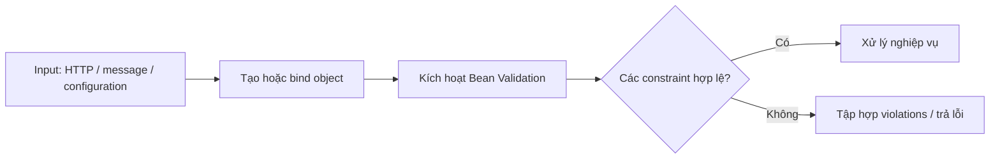

# Bean Validation, constraint annotation và đối tượng cần kiểm tra

Trong ứng dụng Spring Boot, dữ liệu có thể đi vào hệ thống từ HTTP request, message, file, configuration property hoặc lời gọi giữa các service. Trước khi xử lý nghiệp vụ và lưu dữ liệu, ứng dụng cần xác nhận rằng dữ liệu **đáp ứng những quy tắc tối thiểu**: tên không rỗng, email có định dạng phù hợp, số lượng lớn hơn 0, ngày kết thúc không đứng trước ngày bắt đầu, hoặc từng phần tử trong danh sách đều hợp lệ.

Việc viết thủ công nhiều câu lệnh `if` trong controller khiến logic lặp lại và khó bảo trì. **Jakarta Bean Validation** cung cấp mô hình khai báo quy tắc bằng annotation, còn Spring Boot tích hợp cơ chế này với request binding, bean và nhiều thành phần khác.

Bài học tập trung vào ba câu hỏi:

1. **Đối tượng nào cần được kiểm tra?** DTO, form, đối tượng lồng nhau, phần tử collection, input của service hay cấu hình ứng dụng?
2. **Constraint annotation biểu diễn điều kiện gì?** Khi nào dùng `@NotNull`, `@NotBlank`, `@Size`, `@Positive`, `@Email` và các ràng buộc khác?
3. **Khi nào validation thực sự chạy?** Chỉ khai báo annotation không đủ; phải có điểm kích hoạt như `@Valid`, `@Validated`, method validation hoặc lời gọi `Validator`.

## 1. Bean Validation là gì?

Bean Validation là một chuẩn Java để khai báo và thực thi các **constraint** trên dữ liệu object. Trong Spring Boot hiện đại, API nằm ở namespace `jakarta.validation`.

Một constraint thường gồm:

- **Annotation:** mô tả điều kiện phải thỏa mãn, ví dụ `@NotBlank`.
- **Validator:** thực thi logic kiểm tra cho constraint.
- **Violation:** thông tin về ràng buộc bị vi phạm, đường dẫn thuộc tính và thông điệp lỗi.
- **Điểm kích hoạt:** nơi validation được yêu cầu thực thi.

Ví dụ:

```java
import jakarta.validation.constraints.Email;
import jakarta.validation.constraints.NotBlank;

public record RegisterUserRequest(
        @NotBlank String username,
        @Email @NotBlank String email
) {
}
```

Annotation mô tả hợp đồng:

- `username` không được `null`, rỗng hoặc chỉ chứa whitespace.
- `email` không được rỗng và phải thỏa quy tắc email của validator.

Tuy nhiên, một object Java được tạo thủ công như `new RegisterUserRequest("", "invalid")` **không tự động ném lỗi chỉ vì có annotation**. Constraint chỉ được kiểm tra khi hệ thống gọi validator hoặc một tích hợp của Spring kích hoạt validation.

### 1.1. Kiến trúc tổng quát



Validation giúp giữ dữ liệu đầu vào ở trạng thái hợp lệ theo một hợp đồng xác định. Nó không thay thế authentication, authorization, transaction, kiểm tra database uniqueness hay các quy tắc nghiệp vụ phức tạp cần truy cập trạng thái bên ngoài.

## 2. Thêm dependency trong Spring Boot

Với các dự án Spring Boot hiện đại, dependency thường dùng là `spring-boot-starter-validation`.

Gradle Groovy DSL:

```groovy
dependencies {
    implementation 'org.springframework.boot:spring-boot-starter-validation'
}
```

Gradle Kotlin DSL:

```kotlin
dependencies {
    implementation("org.springframework.boot:spring-boot-starter-validation")
}
```

Maven:

```xml
<dependency>
    <groupId>org.springframework.boot</groupId>
    <artifactId>spring-boot-starter-validation</artifactId>
</dependency>
```

Starter đưa vào một implementation Bean Validation phù hợp với hệ sinh thái Spring Boot, thường là **Hibernate Validator**. Không nhầm Hibernate Validator với Hibernate ORM: Hibernate Validator thực thi Bean Validation; Hibernate ORM quản lý entity persistence.

Các import thông dụng:

```java
import jakarta.validation.Valid;
import jakarta.validation.constraints.NotBlank;
import jakarta.validation.constraints.NotNull;
import jakarta.validation.constraints.Size;
```

### 2.1. jakarta.validation và javax.validation

Nhiều tài liệu cũ dùng `javax.validation.*`. Dòng Spring Boot 3 trở đi sử dụng Jakarta APIs, bao gồm `jakarta.validation.*`. Khi viết mã cho project hiện đại, hãy sử dụng import tương ứng với phiên bản và dependency mà project thực sự dùng.

Không phối hợp ngẫu nhiên hai namespace trong một ứng dụng vì annotation và provider có thể không tương thích như bạn mong đợi.

### 2.2. API và provider khác nhau

`jakarta.validation` định nghĩa contract như `Validator`, `ConstraintViolation` và các annotation chuẩn. Provider thực thi những contract đó.

Spring Boot thường cấu hình một `Validator` bean khi có dependency phù hợp. Nếu thiếu provider hoặc thiếu integration, việc đặt annotation trên DTO có thể không dẫn tới hành vi kiểm tra như dự kiến.

## 3. Constraint annotation áp dụng vào đâu?

Có thể đặt constraint ở nhiều vị trí theo Bean Validation và khả năng hỗ trợ của provider:

- Field của class.
- Property theo getter.
- Record component.
- Tham số method hoặc constructor.
- Giá trị trả về của method.
- Phần tử của generic container như `List<@NotBlank String>`.
- Cấp class khi quy tắc liên quan nhiều field.

Ví dụ bean class:

```java
public class CreateProductRequest {

    @NotBlank
    private String name;

    @NotNull
    @Positive
    private Integer quantity;

    // Getters/setters dùng cho binding khi phù hợp
}
```

Ví dụ record:

```java
public record CreateProductRequest(
        @NotBlank String name,
        @NotNull @Positive Integer quantity
) {
}
```

Record thuận tiện cho DTO bất biến. Java Bean truyền thống phù hợp trong các tình huống binding hoặc framework yêu cầu constructor và setter theo cơ chế riêng.

**Quy tắc quan trọng:** Constraint đặt trên kiểu dữ liệu phải tương thích. Ví dụ `@NotBlank` dành cho `CharSequence`, không phải annotation thích hợp cho một `Integer` hoặc `LocalDate`.

## 4. Nhóm constraint cho chuỗi

Đây là nhóm annotation thường gặp khi nhận input từ form hoặc JSON.

### 4.1. @NotNull

`@NotNull` chỉ yêu cầu giá trị không phải `null`:

```java
@NotNull
private String displayName;
```

Các giá trị sau **không vi phạm** `@NotNull`:

```text
""
"   "
```

Do đó, `@NotNull` chưa đủ để yêu cầu tên có nội dung thực tế.

### 4.2. @NotEmpty

`@NotEmpty` yêu cầu giá trị không `null` và không rỗng. Nó áp dụng cho những kiểu hỗ trợ như chuỗi, collection, map và array.

```java
@NotEmpty
private String productCode;
```

Với chuỗi, `""` không hợp lệ nhưng `"   "` vẫn có ký tự, nên có thể thỏa `@NotEmpty`.

### 4.3. @NotBlank

`@NotBlank` yêu cầu `CharSequence` không `null` và sau khi xét whitespace vẫn có nội dung.

```java
@NotBlank
private String username;
```

So sánh:

| Giá trị | `@NotNull` | `@NotEmpty` | `@NotBlank` |
|---|---|---|---|
| `null` | Sai | Sai | Sai |
| `""` | Đúng | Sai | Sai |
| `"   "` | Đúng | Đúng | Sai |
| `"Alice"` | Đúng | Đúng | Đúng |

Trong bảng này, “Đúng” nghĩa là giá trị thỏa constraint; “Sai” nghĩa là giá trị vi phạm.

Nếu cần một chuỗi có nội dung thay vì chỉ không null, `@NotBlank` thường dễ diễn đạt ý định hơn.

### 4.4. @Size

`@Size` giới hạn độ dài chuỗi hoặc kích thước collection/map/array:

```java
@NotBlank
@Size(min = 3, max = 50)
private String username;
```

Đối với String, giới hạn mô tả độ dài theo cơ chế Bean Validation tương ứng; không nên mặc định nó tương đương số ký tự người dùng nhìn thấy trong mọi trường hợp Unicode phức tạp.

Lưu ý: `@Size` không tự cấm `null`. Nếu field bắt buộc, kết hợp với `@NotNull` hoặc `@NotBlank`.

### 4.5. @Pattern

`@Pattern` kiểm tra chuỗi theo regular expression:

```java
@Pattern(
        regexp = "^[A-Z]{2}-[0-9]{4}$",
        message = "Mã sản phẩm phải có dạng AB-1234"
)
private String productCode;
```

Các giá trị hợp lệ theo ví dụ: `AB-1234`, `XY-0001`.

Không nên sử dụng regex quá phức tạp để biểu diễn logic nghiệp vụ vốn thuộc service hoặc domain policy. Đồng thời, nếu pattern phải chặn trường rỗng, cần kết hợp constraint tương ứng vì phần lớn format constraint cho phép null.

### 4.6. @Email

`@Email` kiểm tra định dạng email theo khả năng của provider:

```java
@NotBlank
@Email
private String email;
```

`@Email` **không xác minh mailbox tồn tại**, người dùng sở hữu địa chỉ, hoặc domain có thể nhận email. Đây chỉ là kiểm tra cú pháp. Để xác nhận quyền sở hữu, cần cơ chế gửi email xác thực riêng.

## 5. Constraint cho số, thời gian và boolean

### 5.1. @Min và @Max

```java
@NotNull
@Min(1)
@Max(500)
private Integer pageSize;
```

`@Min` và `@Max` phù hợp cho giới hạn nguyên hoặc giá trị số hỗ trợ. Nếu field có thể `null`, các constraint về phạm vi thường không tự yêu cầu giá trị hiện diện.

### 5.2. @Positive, @PositiveOrZero, @Negative

```java
@NotNull
@Positive
private Integer quantity;

@PositiveOrZero
private BigDecimal discountAmount;
```

Đọc đúng ý nghĩa:

- `@Positive`: lớn hơn 0.
- `@PositiveOrZero`: lớn hơn hoặc bằng 0.
- `@Negative`: nhỏ hơn 0.
- `@NegativeOrZero`: nhỏ hơn hoặc bằng 0.

Đối với số lượng bắt buộc, kết hợp `@NotNull` và `@Positive`. Đối với tiền tệ, nên dùng `BigDecimal` và quy tắc làm tròn rõ ràng ở nghiệp vụ.

### 5.3. @DecimalMin, @DecimalMax và @Digits

```java
@NotNull
@DecimalMin(value = "0.01")
@DecimalMax(value = "999999.99")
@Digits(integer = 6, fraction = 2)
private BigDecimal unitPrice;
```

`@Digits(integer = 6, fraction = 2)` giới hạn số chữ số nguyên và phần thập phân. Nó không tự bảo đảm giá trị lớn hơn 0; vì vậy thường kết hợp với `@DecimalMin`.

`@DecimalMin` còn có thuộc tính `inclusive`; đặt `inclusive = false` nếu muốn giá trị phải lớn hơn ngưỡng, không được bằng.

### 5.4. @Past và @Future

```java
@Past
private LocalDate birthDate;

@Future
private LocalDate appointmentDate;

@FutureOrPresent
private LocalDate scheduledDate;
```

Các constraint thời gian sử dụng clock do provider/validation context cung cấp. Khi test logic phụ thuộc “hôm nay”, nên kiểm soát clock hoặc dùng giá trị đủ xa để tránh test không ổn định quanh nửa đêm và timezone.

### 5.5. @AssertTrue và @AssertFalse

```java
@AssertTrue
private Boolean acceptedTerms;
```

Đây là một lựa chọn khi cần một cờ phải là true. Nhưng `null` có thể được xem là hợp lệ theo nhiều constraint chuẩn, nên nếu người dùng bắt buộc phải gửi giá trị, kết hợp thêm `@NotNull`.

Ví dụ:

```java
@NotNull
@AssertTrue(message = "Phải đồng ý với điều khoản")
private Boolean acceptedTerms;
```

Không nên dùng `@AssertTrue` để thay thế mọi quy tắc phức tạp giữa nhiều field; khi đó một class-level constraint hoặc validator nghiệp vụ có thể rõ ràng hơn.

## 6. Bảng chọn constraint phù hợp

| Nhu cầu | Constraint thường dùng | Lưu ý |
|---|---|---|
| Field phải hiện diện | `@NotNull` | Không cấm chuỗi rỗng |
| Chuỗi phải có nội dung | `@NotBlank` | Áp dụng cho `CharSequence` |
| Collection phải có phần tử | `@NotEmpty` | Không kiểm tra mỗi phần tử |
| Chuỗi/collection có giới hạn độ dài | `@Size` | Thường cho phép null |
| Email có định dạng hợp lệ | `@Email` | Không xác nhận mailbox tồn tại |
| Mã theo regex | `@Pattern` | Cần phối hợp constraint bắt buộc |
| Số nguyên nằm trong khoảng | `@Min`, `@Max` | Không thay thế `@NotNull` |
| Giá trị lớn hơn 0 | `@Positive` | Phù hợp số lượng, giá trị dương |
| Tiền và số thập phân | `@DecimalMin`, `@DecimalMax`, `@Digits` | Dùng `BigDecimal` khi phù hợp |
| Ngày trong quá khứ/tương lai | `@Past`, `@Future` | Quan tâm clock/timezone |
| Flag phải được xác nhận | `@AssertTrue` | Kết hợp `@NotNull` nếu bắt buộc |
| Đối tượng con phải được validate | `@Valid` | Kích hoạt cascading, không tự cấm null |

Điểm cuối cùng rất quan trọng: **`@Valid` không phải constraint yêu cầu giá trị hợp lệ theo một format cụ thể; nó yêu cầu thực hiện validation xuống object liên quan.**

## 7. @Valid kích hoạt validation trên đối tượng như thế nào?

Trong Spring MVC, annotation `@Valid` thường được đặt trên tham số controller để yêu cầu validate object sau khi binding.

Ví dụ:

```java
import jakarta.validation.Valid;
import org.springframework.http.HttpStatus;
import org.springframework.web.bind.annotation.*;

@RestController
@RequestMapping("/products")
public class ProductController {

    private final ProductService productService;

    public ProductController(ProductService productService) {
        this.productService = productService;
    }

    @PostMapping
    @ResponseStatus(HttpStatus.CREATED)
    public ProductResponse create(
            @Valid @RequestBody CreateProductRequest request
    ) {
        return productService.create(request);
    }
}
```

DTO:

```java
public record CreateProductRequest(
        @NotBlank String name,
        @NotNull @Positive Integer quantity,
        @NotNull @DecimalMin("0.01") BigDecimal price
) {
}
```

Nếu client gửi:

```json
{
  "name": "",
  "quantity": -2,
  "price": 0
}
```

các constraint tương ứng bị vi phạm. Spring MVC thường phát sinh `MethodArgumentNotValidException` cho lỗi validation của một tham số `@RequestBody` được bind và validate theo cơ chế argument-level thông thường.

**Đừng nhầm các giai đoạn:**

1. JSON được parse.
2. Spring/Jackson tạo object DTO.
3. Bean Validation kiểm tra object do `@Valid` kích hoạt.
4. Nếu hợp lệ, controller chuyển sang service.
5. Nếu không hợp lệ, Spring tạo lỗi để xử lý ở tầng web.

Nếu JSON sai cú pháp hoặc kiểu dữ liệu không thể deserialize, lỗi có thể xảy ra **trước validation** và không nhất thiết là `MethodArgumentNotValidException`.

### 7.1. @Valid không tự chạy trên mọi lời gọi Java

Ví dụ:

```java
CreateProductRequest request =
        new CreateProductRequest("", -1, BigDecimal.ZERO);
```

Lệnh này có thể tạo object với dữ liệu không hợp lệ. Bean Validation không tự động chạy trên mọi constructor invocation khi chỉ có constraint trên field/record component.

Để validation diễn ra, cần một integration point hoặc gọi `Validator` thủ công.

### 7.2. Đặt @Valid ở đúng vị trí

Ví dụ hai tham số controller:

```java
@PostMapping
public ProductResponse create(
        @Valid @RequestBody CreateProductRequest request
) {
    return service.create(request);
}
```

`@RequestBody` yêu cầu đọc dữ liệu HTTP vào DTO. `@Valid` yêu cầu kiểm tra DTO. Hai annotation có trách nhiệm khác nhau.

## 8. Đối tượng lồng nhau và cascading validation

Giả sử thông tin đặt hàng chứa địa chỉ giao hàng. Constraint trên `ShippingAddress` chỉ được kiểm tra khi validation đi xuống object con.

DTO:

```java
public record ShippingAddress(
        @NotBlank String street,
        @NotBlank String city,
        @NotBlank String postalCode
) {
}
```

DTO cha:

```java
public record CreateOrderRequest(
        @NotBlank String customerName,
        @NotNull @Valid ShippingAddress shippingAddress
) {
}
```

Ý nghĩa:

- `@NotNull` yêu cầu `shippingAddress` hiện diện.
- `@Valid` yêu cầu validate các constraint bên trong `ShippingAddress`.

Nếu chỉ khai báo:

```java
public record CreateOrderRequest(
        @NotBlank String customerName,
        ShippingAddress shippingAddress
) {
}
```

thì việc validate `CreateOrderRequest` không tự bảo đảm các constraint bên trong `ShippingAddress` được duyệt.

### 8.1. Vì sao cần cả @NotNull và @Valid?

`@Valid` thực hiện cascading nếu có object con; nó **không tự cấm null**. Nếu đối tượng con bắt buộc, kết hợp:

```java
@NotNull @Valid ShippingAddress shippingAddress
```

Nếu đối tượng con là tùy chọn, có thể chỉ dùng `@Valid`:

```java
@Valid ShippingAddress shippingAddress
```

Khi giá trị null, cascading không xảy ra; khi có object, constraint bên trong được kiểm tra.

### 8.2. Validation nhiều cấp

```java
public record OrderRequest(
        @NotNull @Valid CustomerDto customer
) {
}

public record CustomerDto(
        @NotBlank String name,
        @NotNull @Valid AddressDto address
) {
}

public record AddressDto(
        @NotBlank String city
) {
}
```

Validation có thể đi theo đường:

```text
OrderRequest
    -> customer
        -> address
            -> city
```

Khi xây dựng response lỗi, property path giúp người dùng biết field nào trong cấu trúc lồng nhau bị vi phạm.

## 9. Validate List, Set, Map và phần tử collection

Một collection có thể có hai loại ràng buộc khác nhau:

1. **Collection-level:** collection không null, không rỗng, có kích thước phù hợp.
2. **Element-level:** từng phần tử bên trong phải hợp lệ.

Ví dụ:

```java
public record OrderItem(
        @NotBlank String sku,
        @NotNull @Positive Integer quantity
) {
}

public record CreateOrderRequest(
        @NotEmpty
        List<@NotNull @Valid OrderItem> items
) {
}
```

Ở đây:

- `@NotEmpty` yêu cầu danh sách có ít nhất một phần tử.
- `@NotNull` trong generic type yêu cầu từng phần tử không null.
- `@Valid` kích hoạt validation với từng `OrderItem`.

Nếu chỉ viết `@NotEmpty List<OrderItem> items`, danh sách có phần tử không hợp lệ vẫn có thể qua được kiểm tra size vì constraint không tự đi vào phần tử.

### 9.1. Collection chứa scalar

```java
public record NotificationRequest(
        @NotEmpty
        List<@NotBlank @Email String> recipients
) {
}
```

Validation sẽ kiểm tra từng email trong danh sách, bên cạnh điều kiện danh sách không rỗng.

Ví dụ vi phạm:

```json
{
  "recipients": [
    "alice@example.com",
    "",
    "not-an-email"
  ]
}
```

### 9.2. Map với constraint trên key và value

```java
public record LocalizedLabels(
        @NotEmpty
        Map<@NotBlank String, @NotBlank String> labels
) {
}
```

Constraint có thể áp dụng cho key và value nếu provider hỗ trợ container element validation tương ứng.

### 9.3. Optional và null

Container element validation có thể áp dụng với các container được Bean Validation hỗ trợ. Tuy nhiên, một `Optional` trống, một object con null và một field bắt buộc là ba khái niệm khác nhau.

Nếu hợp đồng HTTP yêu cầu thuộc tính luôn phải có, đừng cho rằng chỉ đặt `@Valid` trên container hoặc element sẽ kiểm tra được sự hiện diện của field. Hãy thiết kế kiểu DTO và constraint ở đúng cấp.

## 10. BindingResult: xử lý lỗi ngay trong controller

Spring MVC cho phép nhận `BindingResult` để xử lý lỗi binding/validation tại controller trong những trường hợp được hỗ trợ.

Ví dụ với form:

```java
@PostMapping("/register")
public String register(
        @Valid @ModelAttribute RegistrationForm form,
        BindingResult bindingResult
) {
    if (bindingResult.hasErrors()) {
        return "registration-form";
    }

    registrationService.register(form);
    return "registration-success";
}
```

**`BindingResult` phải đứng ngay sau tham số model/validated argument liên quan** để Spring gắn kết kết quả đúng cách.

Không nên:

```java
public String register(
        @Valid @ModelAttribute RegistrationForm form,
        HttpServletRequest request,
        BindingResult bindingResult
) {
    // Vị trí BindingResult không đúng cho form này.
}
```

### 10.1. Khi nào dùng BindingResult?

Nó phù hợp khi:

- Controller muốn trả lại giao diện form cùng thông báo lỗi.
- Một endpoint cần tự quyết định nội dung phản hồi dựa trên lỗi binding.
- Bạn muốn xử lý lỗi ở ngay method thay vì để exception handler chung xử lý.

Trong REST API, nhiều project ưu tiên để Spring phát sinh exception rồi dùng `@RestControllerAdvice` tạo định dạng lỗi thống nhất.

### 10.2. Binding error không hoàn toàn giống constraint violation

Một field có thể bị lỗi vì:

- Không convert được `"abc"` sang `Integer`.
- JSON parse thất bại.
- Constraint `@Positive` bị vi phạm.
- Thiếu thuộc tính bắt buộc theo quy tắc riêng.

Vì vậy, hãy phân biệt lỗi binding/deserialization với lỗi Bean Validation khi thiết kế response HTTP.

## 11. @Validated khác @Valid như thế nào?

`@Valid` là annotation chuẩn Jakarta dùng cho cascading và nhiều tích hợp validation. `@Validated` là annotation của Spring hỗ trợ một số tình huống như **validation groups** và kích hoạt method validation qua Spring infrastructure.

Ví dụ DTO:

```java
public interface CreateGroup {
}

public interface UpdateGroup {
}
```

```java
public record UserRequest(
        @Null(groups = CreateGroup.class)
        @NotNull(groups = UpdateGroup.class)
        Long id,

        @NotBlank(groups = {CreateGroup.class, UpdateGroup.class})
        String name
) {
}
```

Controller:

```java
@PostMapping
public void create(
        @Validated(CreateGroup.class) @RequestBody UserRequest request
) {
    // ...
}
```

```java
@PutMapping
public void update(
        @Validated(UpdateGroup.class) @RequestBody UserRequest request
) {
    // ...
}
```

Ở ví dụ này:

- Nhóm create yêu cầu ID null.
- Nhóm update yêu cầu ID không null.
- Tên phải có nội dung ở cả hai nhóm.

### 11.1. Chú ý nhóm mặc định

Constraint không chỉ định `groups` thuộc nhóm `Default`. Khi validate bằng một nhóm riêng, các constraint chỉ nằm trong `Default` có thể **không được kiểm tra**, trừ khi nhóm Default được yêu cầu/bao gồm theo thiết kế.

Đây là lỗi phổ biến:

```java
@NotBlank
String name
```

nhưng controller lại dùng `@Validated(UpdateGroup.class)`. Nếu không thiết kế group đúng, constraint trên `name` có thể không chạy trong nhóm update.

### 11.2. Không lạm dụng validation groups

Nếu create và update có input contract khác nhau đáng kể, hai DTO riêng thường dễ đọc hơn:

```java
public record CreateUserRequest(
        @NotBlank String name
) {
}

public record UpdateUserRequest(
        @NotNull Long id,
        @NotBlank String name
) {
}
```

Validation groups hữu ích khi nhiều nhóm chia sẻ phần lớn cấu trúc và ràng buộc. Nhưng nếu có quá nhiều group, interface và quy tắc tổ hợp có thể khó kiểm soát hơn việc tách DTO.

## 12. Validation trong Spring MVC: field và method

Khi validate `@RequestBody` DTO, bạn thường quan sát lỗi đối tượng qua `MethodArgumentNotValidException`. Nhưng Spring MVC hiện đại còn hỗ trợ **method validation** cho constraint trực tiếp trên tham số controller.

Ví dụ:

```java
@GetMapping("/products/{id}")
public ProductResponse findById(
        @PathVariable @Positive Long id
) {
    return service.findById(id);
}
```

Ràng buộc `@Positive` nằm trực tiếp trên method parameter, không phải field của DTO.

Trong các phiên bản Spring Framework hiện đại, MVC có cơ chế method validation và có thể phát sinh `HandlerMethodValidationException` đối với lỗi method-level. Ở những phiên bản/cấu hình khác hoặc khi dùng proxy method validation, exception có thể khác.

**Đừng giả định tất cả validation failure đều là `MethodArgumentNotValidException`.** Hãy kiểm tra loại argument và cơ chế validation đang được sử dụng.

### 12.1. @Validated trên controller và thay đổi ở Spring MVC hiện đại

Một số tài liệu cũ hướng dẫn đặt `@Validated` ở cấp controller class để kích hoạt method validation qua proxy AOP.

Ở các phiên bản Spring Framework có built-in MVC method validation, method validation của controller có thể hoạt động trực tiếp mà không cần class-level `@Validated`. Đặt `@Validated` cấp class có thể chuyển việc xử lý sang cơ chế proxy trong một số cấu hình.

Khi nâng cấp framework, cần đối chiếu tài liệu phiên bản để tránh hai cơ chế xử lý validation chồng lấn ngoài mong muốn.

## 13. Xử lý lỗi thống nhất cho REST API

Trong REST API, client thường cần biết:

- Request sai ở field nào.
- Quy tắc nào bị vi phạm.
- Mã HTTP phù hợp.
- Một cấu trúc lỗi ổn định để hiển thị hoặc log.

Ví dụ response do ứng dụng tự định nghĩa:

```json
{
  "code": "VALIDATION_FAILED",
  "message": "Dữ liệu không hợp lệ",
  "errors": [
    {
      "field": "name",
      "message": "must not be blank"
    },
    {
      "field": "quantity",
      "message": "must be greater than 0"
    }
  ]
}
```

### 13.1. Controller advice cho @RequestBody validation

```java
import java.util.List;

import org.springframework.http.HttpStatus;
import org.springframework.http.ResponseEntity;
import org.springframework.web.bind.MethodArgumentNotValidException;
import org.springframework.web.bind.annotation.ExceptionHandler;
import org.springframework.web.bind.annotation.RestControllerAdvice;

@RestControllerAdvice
public class ValidationExceptionHandler {

    @ExceptionHandler(MethodArgumentNotValidException.class)
    public ResponseEntity<ValidationErrorResponse> handleInvalidArgument(
            MethodArgumentNotValidException exception
    ) {
        List<FieldValidationError> fields =
                exception.getBindingResult()
                        .getFieldErrors()
                        .stream()
                        .map(error -> new FieldValidationError(
                                error.getField(),
                                error.getDefaultMessage()
                        ))
                        .toList();

        ValidationErrorResponse body =
                new ValidationErrorResponse(
                        "VALIDATION_FAILED",
                        "Dữ liệu không hợp lệ",
                        fields
                );

        return ResponseEntity.status(HttpStatus.BAD_REQUEST).body(body);
    }

    public record FieldValidationError(
            String field,
            String message
    ) {
    }

    public record ValidationErrorResponse(
            String code,
            String message,
            List<FieldValidationError> errors
    ) {
    }
}
```

Đây là handler minh họa cho một loại exception. Trong ứng dụng thực, nên cân nhắc thêm lỗi deserialization, method-level validation và các lỗi input khác theo hợp đồng API.

### 13.2. Tránh trả thông tin nhạy cảm

Thông báo validation nên giúp người dùng sửa input. Nhưng không nên đưa:

- Mật khẩu hoặc token đã gửi.
- Stack trace nội bộ.
- Tên bảng database hoặc cấu trúc hệ thống không cần thiết.
- Giá trị bí mật bị từ chối.

Trong log cũng nên giới hạn việc ghi nguyên request body, đặc biệt với dữ liệu cá nhân hoặc thông tin xác thực.

### 13.3. Thống nhất với Problem Details

Spring hỗ trợ biểu diễn lỗi HTTP theo mô hình Problem Details trong các phiên bản phù hợp. Ứng dụng có thể chọn hợp đồng lỗi riêng hoặc tích hợp Problem Details.

Điểm quan trọng không phải JSON nào “đẹp nhất”, mà là **tính nhất quán**, khả năng định danh field, status code chính xác và không làm lộ dữ liệu nhạy cảm.

## 14. Method validation ở tầng service

Không phải mọi input đều đi qua HTTP controller. Một service có thể được gọi từ message listener, scheduler, batch job hoặc một service khác.

Ví dụ:

```java
import jakarta.validation.constraints.NotBlank;
import jakarta.validation.constraints.Positive;
import org.springframework.stereotype.Service;
import org.springframework.validation.annotation.Validated;

@Service
@Validated
public class TransferService {

    public void transfer(
            @NotBlank String accountId,
            @Positive long amount
    ) {
        // Xử lý chuyển tiền
    }
}
```

Với method validation integration của Spring được cấu hình phù hợp, các constraint trên tham số method có thể được kiểm tra khi method được gọi thông qua proxy của container.

### 14.1. Self-invocation và proxy

Nếu một method trong cùng instance gọi method khác có constraint, lời gọi nội bộ có thể không đi qua Spring proxy. Vì vậy method validation dựa trên proxy có thể **không được thực thi**.

Ví dụ:

```java
@Service
@Validated
public class TransferService {

    public void runInternalJob() {
        transfer("", -1); // Lời gọi nội bộ qua this
    }

    public void transfer(
            @NotBlank String accountId,
            @Positive long amount
    ) {
        // ...
    }
}
```

Không nên phụ thuộc vào proxy validation như bảo vệ duy nhất cho invariant nghiệp vụ. Với quy tắc quan trọng, hãy đặt kiểm tra ở tầng domain hoặc service contract phù hợp.

### 14.2. Validation khác business rule

`@Positive` giúp bảo đảm amount lớn hơn 0. Nhưng nó không xác nhận:

- Tài khoản tồn tại.
- Người dùng có quyền chuyển từ tài khoản.
- Số dư đủ.
- Giao dịch không vượt hạn mức theo thời điểm.
- Transaction có được ghi thành công không.

Những điều này thuộc logic nghiệp vụ và authorization, có thể cần repository, policy và transaction.

## 15. Validation cho @ConfigurationProperties

Cấu hình ứng dụng cũng là dữ liệu đầu vào. URL, timeout, kích thước pool và các thông số kết nối nếu sai có thể khiến ứng dụng khởi động trong trạng thái nguy hiểm.

Ví dụ:

```java
import java.time.Duration;

import jakarta.validation.constraints.Min;
import jakarta.validation.constraints.NotBlank;
import jakarta.validation.constraints.NotNull;

import org.springframework.boot.context.properties.ConfigurationProperties;
import org.springframework.validation.annotation.Validated;

@Validated
@ConfigurationProperties(prefix = "app.client")
public class ClientProperties {

    @NotBlank
    private String baseUrl;

    @NotNull
    private Duration timeout = Duration.ofSeconds(3);

    @Min(1)
    private int maxConnections = 20;

    // Getters và setters
}
```

Đăng ký:

```java
@Configuration
@EnableConfigurationProperties(ClientProperties.class)
public class ClientConfiguration {
}
```

Cấu hình YAML:

```yaml
app:
  client:
    base-url: https://api.example.test
    timeout: 5s
    max-connections: 30
```

Với validation integration phù hợp, Spring Boot có thể validate configuration properties trong quá trình binding/startup. Nếu property bắt buộc bị thiếu hoặc giá trị không hợp lệ, ứng dụng có thể thất bại sớm với thông tin cấu hình.

### 15.1. Validate cấu hình lồng nhau

```java
public class ClientProperties {

    @NotNull
    @Valid
    private Security security = new Security();

    public static class Security {
        @NotBlank
        private String mode;

        // Getters và setters
    }

    // Getters và setters
}
```

`@Valid` giúp validate đối tượng cấu hình con. Tùy thiết kế, cần tránh sử dụng object cấu hình mặc định khiến constraint bị bỏ qua hoặc che khuất giá trị thực sự chưa được khai báo.

### 15.2. Không nhầm configuration validation với kiểm tra kết nối

`@NotBlank` trên URL chỉ xác nhận property có nội dung. Nó không bảo đảm host tồn tại hoặc service đích đang hoạt động. Để kiểm tra connectivity/readiness, cần health indicator và chính sách retry/timeout phù hợp.

## 16. Validate entity JPA hay DTO?

Một câu hỏi thường gặp là nên đặt constraint lên entity, DTO hay cả hai.

### 16.1. DTO bảo vệ hợp đồng đầu vào

```java
public record CreateCustomerRequest(
        @NotBlank String name,
        @NotBlank @Email String email
) {
}
```

DTO giúp nói rõ API nhận dữ liệu gì. Bạn có thể dùng DTO riêng cho create, update hoặc partial update.

### 16.2. Entity bảo vệ một phần invariant dữ liệu

```java
@Entity
public class Customer {

    @Id
    @GeneratedValue
    private Long id;

    @NotBlank
    private String name;

    @Column(nullable = false)
    private String email;

    // ...
}
```

Entity có thể chứa constraint phù hợp với invariant luôn đúng. Nhưng persistence lifecycle validation và cách nó được kích hoạt phụ thuộc provider/integration.

**Không nên coi `@NotNull` và `@Column(nullable = false)` là hoàn toàn tương đương:**

- `@NotNull` là constraint của Bean Validation.
- `@Column(nullable = false)` mô tả mapping/schema/persistence metadata cho column.
- Ràng buộc `NOT NULL` trong database là cơ chế đảm bảo ở lớp dữ liệu.

Một ứng dụng có thể cần cả input validation, domain invariant và database constraint. Chúng bảo vệ ở các lớp khác nhau.

### 16.3. Vì sao thường tránh đưa JPA entity trực tiếp vào @RequestBody?

Nếu bind request thẳng vào entity, client có thể gửi những field nội bộ không nên chỉnh sửa, như ID, trạng thái phê duyệt hoặc audit fields.

DTO giúp kiểm soát trường nào là đầu vào hợp lệ và đưa lỗi validation về đúng hợp đồng API.

## 17. Partial update và câu chuyện null

Với HTTP PATCH, field vắng mặt có thể có nghĩa “không thay đổi”, còn field có mặt với `null` có thể có nghĩa “xóa giá trị”. Nếu dùng DTO chỉ chứa các field nullable:

```java
public record UpdateProfileRequest(
        String displayName,
        String phoneNumber
) {
}
```

thì sau deserialization thường khó phân biệt field vắng mặt và field có `null` chỉ qua object này.

Không nên giải quyết bằng cách bỏ hết constraint mà không xác định hợp đồng. Các lựa chọn gồm:

- DTO PATCH chuyên biệt kèm cơ chế biểu diễn presence.
- JSON Merge Patch hoặc JSON Patch nếu phù hợp.
- Command object chứa thông tin field đã được gửi.
- API PUT yêu cầu dữ liệu đầy đủ và dùng validation rõ ràng.

Nếu quy tắc update khác create, DTO riêng thường đơn giản hơn nhiều nhóm validation phức tạp.

## 18. Custom constraint annotation khi rule chuẩn chưa đủ

Giả sử mã kho hàng phải có định dạng riêng và một số prefix không được sử dụng. Nếu regex quá phức tạp hoặc quy tắc được tái sử dụng ở nhiều DTO, có thể tạo custom constraint.

### 18.1. Định nghĩa annotation

```java
package com.example.validation;

import jakarta.validation.Constraint;
import jakarta.validation.Payload;

import java.lang.annotation.ElementType;
import java.lang.annotation.Retention;
import java.lang.annotation.RetentionPolicy;
import java.lang.annotation.Target;

@Target({
        ElementType.FIELD,
        ElementType.PARAMETER,
        ElementType.RECORD_COMPONENT,
        ElementType.ANNOTATION_TYPE
})
@Retention(RetentionPolicy.RUNTIME)
@Constraint(validatedBy = WarehouseCodeValidator.class)
public @interface ValidWarehouseCode {

    String message() default "Mã kho không hợp lệ";

    Class<?>[] groups() default {};

    Class<? extends Payload>[] payload() default {};
}
```

Ba thuộc tính `message`, `groups` và `payload` là một phần contract chuẩn của custom constraint annotation.

### 18.2. Viết ConstraintValidator

```java
package com.example.validation;

import jakarta.validation.ConstraintValidator;
import jakarta.validation.ConstraintValidatorContext;

public class WarehouseCodeValidator
        implements ConstraintValidator<ValidWarehouseCode, String> {

    @Override
    public boolean isValid(
            String value,
            ConstraintValidatorContext context
    ) {
        if (value == null) {
            return true; // Để @NotNull/@NotBlank xử lý việc bắt buộc.
        }

        return value.matches("WH-[A-Z]{2}-[0-9]{3}")
                && !value.startsWith("WH-XX-");
    }
}
```

Ở đây validator coi null là hợp lệ vì việc bắt buộc giá trị được biểu diễn bằng constraint khác. Đây là pattern thường dùng để constraint format và constraint presence độc lập với nhau.

Sử dụng:

```java
public record CreateWarehouseRequest(
        @NotBlank
        @ValidWarehouseCode
        String code
) {
}
```

Ví dụ hợp lệ: `WH-HN-123`. Ví dụ không hợp lệ: `WH-XX-123` hoặc `INVALID`.

### 18.3. Custom validator không nên gọi dịch vụ bên ngoài tùy tiện

Về mặt kỹ thuật, validator có thể phụ thuộc service thông qua integration với Spring. Nhưng gọi database hoặc API từ xa cho mỗi validation có thể:

- Làm latency request tăng.
- Khiến validation không xác định theo thời điểm.
- Gây khó khi test.
- Tạo race condition nếu dùng nó để đảm bảo uniqueness.
- Gây coupling giữa DTO và tầng infrastructure.

Những rule như “email chưa tồn tại trong database” thường cần xử lý ở service với database unique constraint phù hợp, không chỉ bằng một validator gọi repository.

## 19. Class-level constraint cho quan hệ giữa nhiều field

Giả sử request đặt lịch có `startAt` và `endAt`. Constraint riêng trên từng field chưa nói được rằng thời gian kết thúc phải sau thời gian bắt đầu.

Một class-level constraint biểu diễn quan hệ đó:

```java
@ValidDateRange
public record ScheduleRequest(
        @NotNull LocalDateTime startAt,
        @NotNull LocalDateTime endAt
) {
}
```

Annotation:

```java
@Target(ElementType.TYPE)
@Retention(RetentionPolicy.RUNTIME)
@Constraint(validatedBy = DateRangeValidator.class)
public @interface ValidDateRange {
    String message() default "Thời gian kết thúc phải sau bắt đầu";
    Class<?>[] groups() default {};
    Class<? extends Payload>[] payload() default {};
}
```

Validator:

```java
public class DateRangeValidator
        implements ConstraintValidator<ValidDateRange, ScheduleRequest> {

    @Override
    public boolean isValid(
            ScheduleRequest value,
            ConstraintValidatorContext context
    ) {
        if (value == null) {
            return true;
        }

        if (value.startAt() == null || value.endAt() == null) {
            return true; // @NotNull báo lỗi trên từng field.
        }

        return value.endAt().isAfter(value.startAt());
    }
}
```

Class-level constraint phù hợp khi một rule liên quan toàn bộ object. Bạn có thể tùy biến `ConstraintValidatorContext` để gắn violation vào một property cụ thể thay vì object-level nếu hợp đồng API cần hiển thị lỗi cạnh field.

## 20. Validation groups: cách tổ chức và giới hạn

Groups cho phép một constraint chỉ chạy ở những bối cảnh nhất định.

Ví dụ:

```java
public interface OnCreate {
}

public interface OnUpdate {
}
```

```java
public record CustomerCommand(
        @Null(groups = OnCreate.class)
        @NotNull(groups = OnUpdate.class)
        Long id,

        @NotBlank(groups = {OnCreate.class, OnUpdate.class})
        String name
) {
}
```

Sử dụng:

```java
@PostMapping
public void create(
        @Validated(OnCreate.class) @RequestBody CustomerCommand command
) {
}
```

```java
@PutMapping
public void update(
        @Validated(OnUpdate.class) @RequestBody CustomerCommand command
) {
}
```

Khi thiết kế groups, cần xác định:

- Constraint nào thuộc nhóm nào.
- Có cần kiểm tra `Default` cùng lúc không.
- Object lồng nhau có cùng group hay cần group conversion.
- Thứ tự các nhóm có ảnh hưởng nghiệp vụ không.

Bean Validation còn hỗ trợ `@GroupSequence` và `@ConvertGroup` cho tình huống nâng cao. Nhưng trước khi thêm nhiều lớp groups, hãy cân nhắc DTO chuyên biệt; chúng thường dễ hiểu và an toàn hơn.

## 21. Gọi Validator bằng code khi không có integration tự động

Không phải mọi entry point đều là HTTP controller. Một batch job có thể đọc CSV, tạo DTO và cần kiểm tra trước khi xử lý.

Bạn có thể inject `jakarta.validation.Validator`:

```java
import jakarta.validation.ConstraintViolation;
import jakarta.validation.Validator;

import java.util.Set;

@Service
public class ImportService {

    private final Validator validator;

    public ImportService(Validator validator) {
        this.validator = validator;
    }

    public void importProduct(CreateProductRequest request) {
        Set<ConstraintViolation<CreateProductRequest>> violations =
                validator.validate(request);

        if (!violations.isEmpty()) {
            throw new IllegalArgumentException(
                    "Dữ liệu sản phẩm không hợp lệ"
            );
        }

        // Xử lý import
    }
}
```

`validator.validate(request)` trả về tập violations. Từ mỗi violation có thể lấy:

- `getPropertyPath()`: đường dẫn field/property vi phạm.
- `getMessage()`: thông báo.
- `getInvalidValue()`: giá trị không hợp lệ — **cẩn thận không log giá trị nhạy cảm**.
- `getConstraintDescriptor()`: metadata constraint.

Nếu cần API import trả lỗi theo từng dòng, bạn có thể ánh xạ violations thành kết quả import có cấu trúc thay vì dừng toàn bộ job ở dòng đầu tiên.

### 21.1. Test trực tiếp một DTO bằng Validator

```java
@Test
void rejectsInvalidProductRequest() {
    CreateProductRequest request =
            new CreateProductRequest(
                    "",
                    -2,
                    BigDecimal.ZERO
            );

    Set<ConstraintViolation<CreateProductRequest>> violations =
            validator.validate(request);

    assertThat(violations).isNotEmpty();
}
```

Kiểu test này xác nhận constraint hoạt động ở mức DTO, nhưng chưa chứng minh Spring MVC hoặc message listener đã kích hoạt validation ở entry point tương ứng.

## 22. Kiểm thử validation ở tầng HTTP

Với REST controller, kiểm thử nên bao gồm:

1. Request hợp lệ được chấp nhận.
2. Request có field rỗng bị từ chối.
3. Nested DTO không hợp lệ bị từ chối.
4. Phần tử collection không hợp lệ bị từ chối.
5. Response lỗi có cấu trúc mà API đã công bố.
6. JSON malformed được xử lý riêng với lỗi constraint.

Ví dụ MockMvc:

```java
@WebMvcTest(ProductController.class)
class ProductControllerValidationTests {

    @Autowired
    private MockMvc mockMvc;

    @MockitoBean
    private ProductService productService;

    @Test
    void rejectsInvalidProduct() throws Exception {
        mockMvc.perform(
                post("/products")
                        .contentType(MediaType.APPLICATION_JSON)
                        .content("""
                                {
                                  "name": "",
                                  "quantity": -1,
                                  "price": 0
                                }
                                """)
        )
        .andExpect(status().isBadRequest());
    }
}
```

Ví dụ dùng `@MockitoBean` phù hợp với các dòng Spring Boot/Spring Framework hiện đại hỗ trợ annotation này; codebase cũ có thể dùng cơ chế mock bean khác. Test thực tế cần imports và cấu hình test phù hợp.

### 22.1. Đừng chỉ kiểm tra HTTP 400

Một response 400 cũng có thể xuất phát từ JSON lỗi cú pháp, endpoint mismatch hoặc cấu hình exception handler. Vì vậy nên assert cả nội dung lỗi:

```java
.andExpect(jsonPath("$.code").value("VALIDATION_FAILED"))
.andExpect(jsonPath("$.errors").isArray());
```

Nếu API trả Problem Details hoặc cấu trúc khác, hãy test theo hợp đồng thực tế, không áp đặt một JSON shape tùy ý.

### 22.2. Kiểm tra Bean Validation provider trong test

Một test slice cần dependency validation provider và cấu hình thích hợp. Nếu test không kích hoạt validator, request sai có thể đi qua controller mà không bị từ chối.

Trước khi sửa DTO, xác nhận starter validation có trong test classpath và Spring MVC argument validation đang hoạt động.

## 23. Validation không thay thế database constraint

Xét trường hợp đăng ký email duy nhất:

```java
public record RegisterRequest(
        @NotBlank @Email String email
) {
}
```

Constraint chỉ kiểm tra email có hình thức phù hợp. Nó không bảo đảm uniqueness.

Giả sử hai request đồng thời cùng đăng ký `alice@example.com`:

1. Request A kiểm tra email chưa tồn tại.
2. Request B cũng kiểm tra email chưa tồn tại.
3. Cả hai cùng cố ghi database.

Nếu database không có unique constraint, có thể có dữ liệu trùng dù application đã kiểm tra trước.

Cách tiếp cận đáng tin cậy hơn:

- DTO validation cho format.
- Business service kiểm tra quy tắc và tạo phản hồi phù hợp.
- Unique constraint ở database bảo đảm tính toàn vẹn dưới concurrent requests.
- Xử lý exception vi phạm constraint để trả API error an toàn.

Tương tự, `@Positive` trên số lượng input không thay thế transaction và invariant khi trừ tồn kho.

## 24. Security và tính đúng đắn khi validate

Input validation là một lớp bảo vệ, nhưng không đủ để bảo mật hệ thống.

### 24.1. Authorization tách biệt validation

Một request có `orderId` dương không có nghĩa người gọi được phép xem đơn hàng đó.

```java
@GetMapping("/orders/{id}")
public OrderResponse getOrder(@PathVariable @Positive Long id) {
    return orderService.getForCurrentUser(id);
}
```

`@Positive` chỉ kiểm tra hình thức giá trị. Authorization phải kiểm tra quyền truy cập tới resource.

### 24.2. Không coi email/URL hợp lệ là an toàn

`@Email` không xác minh mailbox. Một URL có cú pháp hợp lệ có thể vẫn trỏ đến địa chỉ nội bộ không nên gọi từ server. Nếu hệ thống fetch URL do user cung cấp, cần bảo vệ SSRF theo allowlist và network policy chứ không chỉ dùng format validation.

### 24.3. Giới hạn dữ liệu lớn

Một danh sách có 100.000 phần tử có thể hợp lệ theo từng element nhưng gây tải lớn. Hãy dùng `@Size(max = ...)` ở collection-level và giới hạn payload ở tầng web/server.

```java
public record BulkRequest(
        @NotEmpty
        @Size(max = 100)
        List<@Valid BulkItem> items
) {
}
```

### 24.4. Không đưa secret vào error

Một `ConstraintViolation` có thể chứa invalid value. Không serialize trực tiếp object violation ra API hoặc log toàn bộ giá trị nhận được, đặc biệt với mật khẩu, token, dữ liệu thanh toán hoặc thông tin cá nhân.

## 25. Những lỗi hay gặp và cách xác định nguyên nhân

| Hiện tượng | Nguyên nhân thường gặp | Hướng xử lý |
|---|---|---|
| Constraint annotation không có tác dụng | Chưa kích hoạt validation hoặc thiếu provider | Thêm starter và dùng `@Valid`/`@Validated` đúng chỗ |
| Field String chỉ chứa dấu cách vẫn được chấp nhận | Dùng `@NotEmpty` thay vì `@NotBlank` | Chọn constraint phù hợp |
| Field null vẫn qua `@Size` hoặc `@Email` | Các constraint này thường không cấm null | Kết hợp `@NotNull`/`@NotBlank` |
| Nested DTO sai nhưng không báo lỗi | Thiếu `@Valid` trên object con | Bật cascading validation |
| List không rỗng nhưng element sai | Chỉ có `@NotEmpty` ở collection | Thêm element constraints hoặc `@Valid` |
| Method service gọi nội bộ không validate | Self-invocation không qua proxy method validation | Chuyển ranh giới gọi, kiểm tra invariant trực tiếp |
| Đã dùng group nhưng constraint không chạy | Constraint thuộc nhóm `Default` chứ không thuộc group đang xét | Thiết kế lại groups/DTO |
| Controller trả 400 nhưng handler validation không chạy | Lỗi JSON parsing hoặc method validation khác | Kiểm tra exception thực tế |
| URL cấu hình sai nhưng startup vẫn thành công | Chưa bật properties validation hoặc không có constraint | Dùng `@Validated` và constraint |
| Dữ liệu trùng vẫn lọt qua | Validation format không bảo đảm uniqueness | Database unique constraint và transaction |
| Error response lộ dữ liệu | Serialize nguyên violation/exception | Chỉ chọn field và message an toàn |
| Record DTO không bind được | Constructor/Jackson/configuration không phù hợp | Kiểm tra phiên bản và binding mechanism |

## 26. Quy trình thiết kế validation cho một endpoint

Khi nhận một yêu cầu mới, bạn có thể theo trình tự sau:

### Bước 1. Xác định boundary

Dữ liệu đến từ request, message, file hay configuration? Ai là người dùng hoặc hệ thống gửi dữ liệu đó?

### Bước 2. Định nghĩa input contract

Tạo DTO hoặc command object tách khỏi entity persistence. Chỉ đưa những field mà caller được phép đặt.

### Bước 3. Chọn constraint đúng kiểu

Ví dụ:

- Tên: `@NotBlank` và `@Size`.
- Số lượng: `@NotNull` và `@Positive`.
- Email: `@NotBlank` và `@Email`.
- Danh sách: `@NotEmpty` và `List<@Valid ...>`.
- Thời gian: `@Future` hoặc class-level range validation.

### Bước 4. Kích hoạt validation

- HTTP DTO: `@Valid @RequestBody` hoặc `@Validated` theo nhóm.
- Method validation: integration phù hợp của Spring.
- Import/batch: gọi `Validator` nếu cần.
- Configuration properties: `@Validated` và properties validation.

### Bước 5. Thiết kế lỗi

Đưa field path và message hữu ích về client; không làm lộ dữ liệu nhạy cảm. Phân biệt validation failure với lỗi parse và lỗi nghiệp vụ.

### Bước 6. Kiểm chứng hành vi

Viết test valid, invalid, nested, collection, null, boundary và method-level khi cần. Test response contract, không chỉ status code.

### Bước 7. Bổ sung invariant ở tầng dưới

Với uniqueness, authorization, transaction và consistency, dùng business rule và database constraint phù hợp. Không giao toàn bộ trách nhiệm cho DTO annotations.

## 27. Bài tập thực hành

### Bài 1. Tạo DTO sản phẩm

Yêu cầu:

- `name` không được blank và tối đa 100 ký tự.
- `sku` theo dạng `AB-1234`.
- `quantity` bắt buộc và dương.
- `price` bắt buộc, tối thiểu 0.01 và tối đa 2 chữ số thập phân.

Một lời giải:

```java
public record CreateProductRequest(
        @NotBlank @Size(max = 100) String name,
        @NotBlank @Pattern(regexp = "^[A-Z]{2}-[0-9]{4}$")
        String sku,
        @NotNull @Positive Integer quantity,
        @NotNull
        @DecimalMin("0.01")
        @Digits(integer = 8, fraction = 2)
        BigDecimal price
) {
}
```

**Câu hỏi:** Tại sao `@DecimalMin` vẫn nên đi cùng `@NotNull`?

**Đáp án:** Constraint về khoảng giá trị thường không cấm null, trong khi hợp đồng yêu cầu giá bắt buộc.

### Bài 2. Validate địa chỉ lồng nhau

```java
public record Address(
        @NotBlank String street,
        @NotBlank String city
) {
}

public record PlaceOrderRequest(
        @NotNull @Valid Address address
) {
}
```

**Câu hỏi:** Nếu bỏ `@Valid`, điều gì xảy ra?

**Đáp án:** Validator của object cha không tự đi vào các constraint bên trong `Address` chỉ vì field có kiểu `Address`.

### Bài 3. Danh sách item

```java
public record OrderItem(
        @NotBlank String productCode,
        @Positive int quantity
) {
}

public record PlaceOrderRequest(
        @NotEmpty
        List<@NotNull @Valid OrderItem> items
) {
}
```

**Câu hỏi:** Vai trò của `@NotEmpty` khác `@Valid` thế nào?

**Đáp án:** `@NotEmpty` kiểm tra collection có phần tử; `@Valid` kích hoạt validation của từng object item. `@NotNull` ở element ngăn phần tử null.

### Bài 4. Nhóm Create và Update

Một field ID phải null khi create và không null khi update.

**Gợi ý:** Dùng `@Null(groups = OnCreate.class)` và `@NotNull(groups = OnUpdate.class)` hoặc tách hai DTO theo endpoint.

### Bài 5. Tình huống concurrency

Ứng dụng dùng custom validator truy vấn database để bảo đảm email chưa tồn tại.

**Câu hỏi:** Vì sao cách này không bảo đảm uniqueness hoàn toàn?

**Đáp án:** Hai request đồng thời có thể cùng vượt qua bước kiểm tra trước khi ghi. Cần unique constraint trong database và xử lý transaction/exception phù hợp.

### Bài 6. @Valid và @Validated

**Câu hỏi:** Khi nào dùng `@Validated(Group.class)` thay vì `@Valid`?

**Đáp án:** Khi cần chọn một validation group trong những integration Spring hỗ trợ. Nếu không cần group, `@Valid` thường đủ cho object graph validation.

### Bài 7. Method validation

Một method trong service dùng `@Validated` được gọi thông qua `this.otherMethod()`.

**Câu hỏi:** Constraint method parameter có chắc chắn chạy không?

**Đáp án:** Không nếu cơ chế đang dùng dựa trên Spring proxy và lời gọi nội bộ không đi qua proxy. Cần kiểm tra invariant ở đúng tầng và thiết kế method boundary phù hợp.

## 28. Ghi nhớ

- Bean Validation là mô hình **khai báo constraint**; validation chỉ chạy khi có điểm kích hoạt.
- Spring Boot hiện đại dùng `jakarta.validation` và thường tích hợp qua `spring-boot-starter-validation`.
- `@NotNull`, `@NotEmpty` và `@NotBlank` có ý nghĩa khác nhau; chọn theo kiểu dữ liệu và yêu cầu.
- Các constraint định dạng/phạm vi như `@Size`, `@Email`, `@Positive` thường không tự cấm null.
- `@Valid` kích hoạt cascading validation; nếu object con bắt buộc, kết hợp `@NotNull`.
- Collection có constraint ở **mức container** và **mức phần tử**; cần kiểm tra cả hai.
- `@Validated` hỗ trợ nhóm và các kịch bản method validation của Spring.
- Lỗi `@RequestBody` DTO có thể là `MethodArgumentNotValidException`; direct method constraints và lỗi parsing có thể dùng loại exception khác.
- Validation cũng hữu ích với service method, configuration properties và các tác vụ import chạy ngoài HTTP.
- DTO validation, business rule, authorization và database constraint là các lớp bảo vệ bổ sung cho nhau, không thay thế lẫn nhau.
- Test cần kiểm tra boundary case, nested object, collection, response lỗi và integration point thực sự kích hoạt validation.

Khi thiết kế một API hoặc luồng nhập dữ liệu, hãy tự hỏi: **“Đối tượng nào chứa dữ liệu không đáng tin cậy, constraint nào diễn đạt điều kiện cơ bản, ai kích hoạt validator, và quy tắc nào cần được bảo đảm tiếp ở tầng nghiệp vụ hoặc database?”** Trả lời được bốn câu hỏi này sẽ giúp hệ thống từ chối dữ liệu sai đúng nơi và giữ hợp đồng đầu vào dễ bảo trì.
