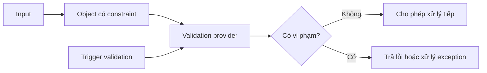
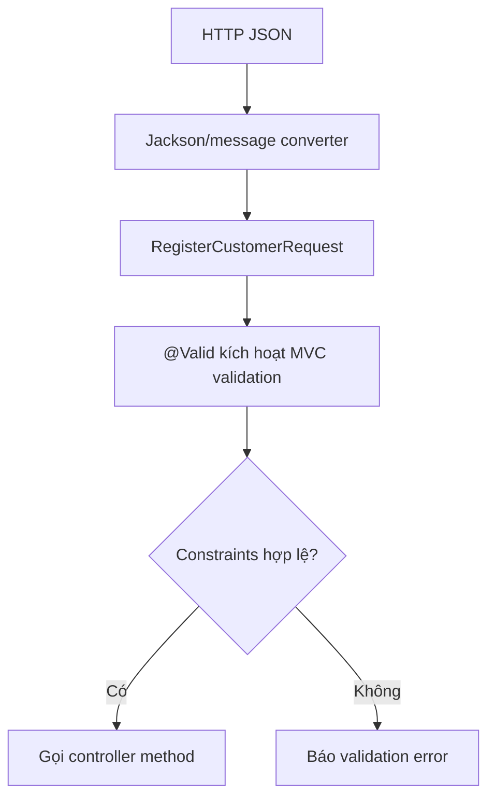
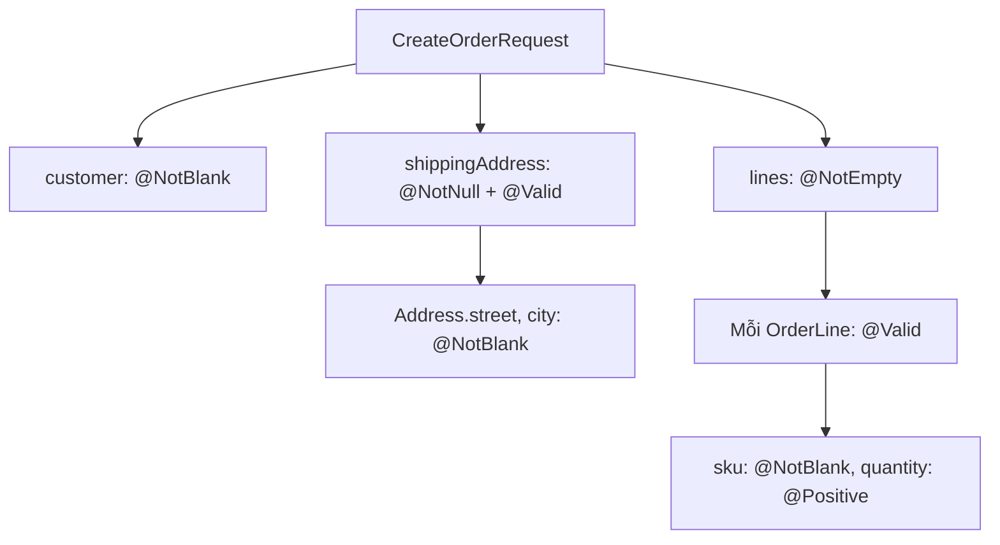
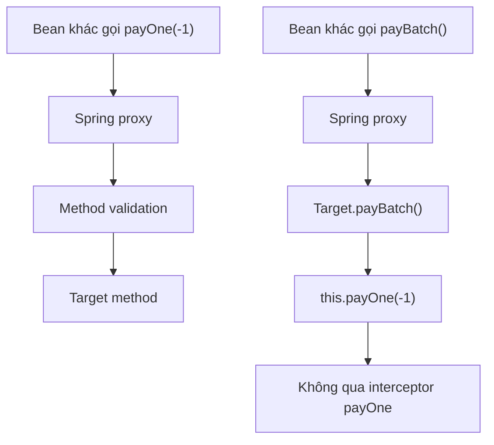
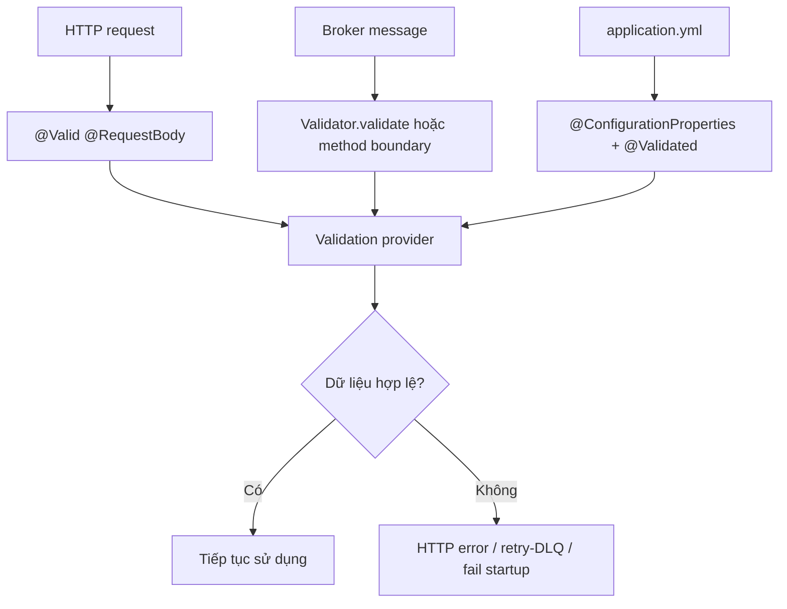

# @Valid, @Validated và điều kiện để kiểm tra dữ liệu được thực thi

Một ứng dụng Spring Boot nhận dữ liệu từ nhiều nguồn: HTTP request, form, file cấu hình, message từ broker hoặc lời gọi giữa các service. Trước khi sử dụng dữ liệu đó, ứng dụng cần kiểm tra những quy tắc như tên không được rỗng, số lượng phải dương, email đúng định dạng hoặc một object con có đủ thông tin bắt buộc.

Spring tích hợp **Jakarta Bean Validation** để diễn đạt ràng buộc bằng annotation. Hai annotation thường xuất hiện là `@Valid` và `@Validated`. Chúng có liên quan nhưng không đồng nghĩa, và **chỉ thêm annotation vào một class chưa đủ để bảo đảm validation thực thi**.

Ví dụ:

```java
public record CreateOrderRequest(
        @NotBlank String customerName,
        @Positive int quantity
) {}
```

Nếu chỉ viết:

```java
CreateOrderRequest request =
        new CreateOrderRequest("", -5);
```

Java vẫn tạo được object. Constraint metadata đã có nhưng không có validator nào được gọi. Để kiểm tra thực sự diễn ra, hệ thống cần ba điều kiện: **ràng buộc**, **validation provider**, và **một điểm kích hoạt việc kiểm tra**.

Trong bài này, ta sẽ phân biệt `@Valid` với `@Validated`, tìm hiểu validation ở các boundary của Spring Boot, cách validate object lồng nhau, validation groups, service method, `@ConfigurationProperties` và các lý do phổ biến khiến constraint có vẻ bị bỏ qua.

## 1. Ba thành phần tạo nên một lượt validation

| Thành phần | Vai trò | Ví dụ |
|---|---|---|
| Constraint | Mô tả điều kiện hợp lệ | `@NotBlank`, `@Min`, `@Email` |
| Provider | Thực thi constraint theo Jakarta Validation | Hibernate Validator |
| Trigger | Yêu cầu chạy validator tại một boundary | MVC argument resolver, method-validation proxy, configuration binder hoặc `Validator.validate(...)` |



Các constraint là **metadata**. Chúng không phải code kiểm tra tự chạy mỗi khi setter được gọi hoặc một constructor tạo object. Chúng được provider đánh giá khi có thao tác validation hợp lệ.

Một đối tượng có thể được tạo ở nhiều đường khác nhau: bởi Jackson khi nhận JSON, bởi `@ConfigurationProperties` binder, bởi JPA, hoặc bởi lệnh `new` của Java thuần. Cùng một class nhưng validation có thể chạy hoặc không tùy đường tạo/sử dụng object và cơ chế tích hợp đang được kích hoạt.

## 2. Có dependency validation là điều kiện nền tảng

Trong ứng dụng Spring Boot 3.x dùng Spring MVC, Gradle Groovy DSL có thể khai báo:

```groovy
dependencies {
    implementation 'org.springframework.boot:spring-boot-starter-web'
    implementation 'org.springframework.boot:spring-boot-starter-validation'
}
```

Với Maven:

```xml
<dependency>
    <groupId>org.springframework.boot</groupId>
    <artifactId>spring-boot-starter-validation</artifactId>
</dependency>
```

Starter validation thông thường bổ sung Jakarta Validation API và Hibernate Validator để các tích hợp của Spring có provider thực thi constraint.

**Lưu ý phiên bản:** kể từ các dòng Spring Boot hiện đại, không nên giả định chỉ có web starter đã đồng nghĩa provider validation được cài. Hãy kiểm tra dependency runtime của project. Với Spring Boot 3.x/Spring Framework 6.x, import các annotation từ `jakarta.validation`; dự án cũ có thể dùng `javax.validation` và cần nâng cấp namespace khi chuyển dòng framework.

Ví dụ import:

```java
import jakarta.validation.Valid;
import jakarta.validation.constraints.Email;
import jakarta.validation.constraints.NotBlank;
import jakarta.validation.constraints.Positive;
```

Đồng thời, **có dependency không tạo trigger**. Ngay cả sau khi thêm starter, `new CreateOrderRequest("", -5)` vẫn không tự ném lỗi. Bạn phải đặt validation vào đúng boundary hoặc chủ động gọi Validator API.

## 3. Những constraint cơ bản và ý nghĩa thực tế

| Annotation | Kiểm tra | Điểm cần nhớ |
|---|---|---|
| `@NotNull` | Giá trị không được null | Không cấm `""` hoặc `"   "` |
| `@NotEmpty` | Không null và không rỗng | Hữu ích cho string, collection, map và array |
| `@NotBlank` | Chuỗi có ít nhất một ký tự không phải khoảng trắng | Thường dùng cho tên/tiêu đề bắt buộc |
| `@Size(min, max)` | Độ dài/kích thước | Không phải khoảng giá trị số |
| `@Min` / `@Max` | Ngưỡng của số | Giá trị null thường được coi hợp lệ bởi constraint này |
| `@Positive` / `@PositiveOrZero` | Số dương / số không âm | Nếu field wrapper bắt buộc, kết hợp `@NotNull` |
| `@Email` | Định dạng email theo provider | Không chứng minh email tồn tại hoặc inbox hoạt động |
| `@Pattern` | Chuỗi khớp regular expression | Không tự cấm null |
| `@Past` / `@Future` | Ngày/giờ ở quá khứ hoặc tương lai | Chọn kiểu thời gian và múi giờ/clock phù hợp |
| `@AssertTrue` / `@AssertFalse` | Giá trị boolean thỏa điều kiện | Hữu ích cho một số quy tắc đơn giản |

Ví dụ DTO:

```java
import jakarta.validation.constraints.*;

public record RegisterCustomerRequest(
        @NotBlank
        @Size(max = 100)
        String displayName,

        @NotBlank
        @Email
        String email,

        @NotNull
        @Min(18)
        @Max(120)
        Integer age
) {}
```

Các trường hợp dễ nhầm:

- `@Email` không có nghĩa email bắt buộc. Kết hợp `@NotBlank` nếu thiếu email là lỗi.
- `@Min(18)` không tự làm null thành lỗi. Với `Integer`, kết hợp `@NotNull` nếu phải có giá trị.
- `@NotNull` trên string cho phép giá trị rỗng hoặc toàn khoảng trắng; dùng `@NotBlank` khi muốn cấm.
- `@Size` kiểm tra kích thước collection hoặc chuỗi, không thay `@Min` cho một biến số nguyên.
- Với JSON input, primitive `int` không biểu đạt được sự khác nhau giữa “không gửi trường” và số 0 sau một số kiểu binding. Dùng `Integer` nếu cần phân biệt thiếu và có giá trị.

Các constraint cấu trúc không thay thế business rule như quyền truy cập, số dư, tồn kho hoặc trạng thái đơn hàng.

## 4. @Valid là gì?

`@Valid` là annotation của Jakarta Validation:

```java
import jakarta.validation.Valid;
```

Nó thường được dùng theo hai cách:

1. Đặt trên tham số của một điểm tích hợp như Spring MVC để yêu cầu kiểm tra object sau khi binding.
2. Đặt trên field/property/record component để yêu cầu **cascade validation**, tức kiểm tra sâu xuống object lồng nhau khi object cha được validate.

Ví dụ trong controller:

```java
@PostMapping("/customers")
public ResponseEntity<Void> register(
        @Valid @RequestBody RegisterCustomerRequest request) {
    customerService.register(request);
    return ResponseEntity.status(HttpStatus.CREATED).build();
}
```

Luồng xử lý tổng quát:



`@Valid` **không phải một constraint tự thân**. Nếu object không có constraint nào, validation có thể chạy nhưng không tìm thấy lỗi. `@Valid` trên một object con cũng không tự yêu cầu object con khác null; nếu object con bắt buộc, cần thêm `@NotNull`.

## 5. @Validated khác @Valid thế nào?

`@Validated` thuộc Spring Framework:

```java
import org.springframework.validation.annotation.Validated;
```

Annotation này được Spring dùng để chọn validation groups và trong các cơ chế tích hợp của Spring, đặc biệt:

- `@Validated(OnCreate.class)` trên tham số/controller để chọn group.
- `@Validated` trên service class để đánh dấu ứng viên cho **method validation qua AOP** khi cơ chế đó được cấu hình.
- `@Validated` trên một class `@ConfigurationProperties` để yêu cầu validation khi binding cấu hình.

| Tiêu chí | `@Valid` | `@Validated` |
|---|---|---|
| Thư viện | Jakarta Validation | Spring |
| Trigger validation request body trong MVC | Có | Có |
| Chỉ định group qua annotation | Không có thuộc tính group | Có |
| Cascade validation xuống object con | Có | Không tự thay thế `@Valid` trên property con |
| Dấu hiệu thông dụng cho AOP method validation ở service | Không chỉ bằng cách đặt annotation lên class | Class-level `@Validated` |
| Áp dụng cho binding `@ConfigurationProperties` | Dùng cho các giá trị nested | Thường dùng ở class properties |

Với một request body chỉ cần default group, cách viết phổ biến là:

```java
@Valid @RequestBody RegisterCustomerRequest request
```

Khi cần quy tắc khác cho create/update:

```java
@Validated(OnCreate.class) @RequestBody CustomerPayload request
```

Không cần luôn thêm cả hai annotation trên cùng tham số. Chọn theo mục tiêu; nếu cần kiểm tra field nested, thêm `@Valid` trên field nested.

## 6. @Valid với @RequestBody trong Spring MVC

Ta xây một REST endpoint nhận dữ liệu tạo sách:

```java
package com.example.books;

import jakarta.validation.constraints.NotBlank;
import jakarta.validation.constraints.Positive;
import jakarta.validation.constraints.Size;

public record CreateBookRequest(
        @NotBlank(message = "Title is required")
        @Size(max = 150)
        String title,

        @NotBlank(message = "Author is required")
        String author,

        @Positive(message = "Page count must be positive")
        int pages
) {}
```

Controller:

```java
package com.example.books;

import jakarta.validation.Valid;
import org.springframework.http.HttpStatus;
import org.springframework.http.ResponseEntity;
import org.springframework.web.bind.annotation.*;

@RestController
@RequestMapping("/books")
public class BookController {

    @PostMapping
    public ResponseEntity<String> create(
            @Valid @RequestBody CreateBookRequest request) {
        return ResponseEntity.status(HttpStatus.CREATED)
                .body("Created: " + request.title());
    }
}
```

JSON hợp lệ:

```json
{
  "title": "Spring Boot Fundamentals",
  "author": "Lan",
  "pages": 240
}
```

JSON vi phạm constraint:

```json
{
  "title": " ",
  "author": "",
  "pages": -2
}
```

Khi provider và MVC validation hoạt động, request thứ hai bị phát hiện trước khi body của controller method chạy. Nếu không có tham số `BindingResult` xử lý lỗi tại chỗ, Spring MVC thông thường báo lỗi validation và trả HTTP 400 qua exception-handling infrastructure.

### Lỗi parse JSON khác lỗi constraint

Nếu gửi:

```json
{
  "title": "Java",
  "author": "Lan",
  "pages": "not-a-number"
}
```

JSON không thể chuyển trường `pages` thành `int`. Lỗi thường xảy ra ở tầng **message conversion** trước validation, chẳng hạn `HttpMessageNotReadableException`. Vì vậy không phải mọi lỗi HTTP 400 đều do `@Valid` tìm thấy constraint violation.

Tương tự, thiếu tham số HTTP bắt buộc, media type không được hỗ trợ và validation sai là những nhóm lỗi khác nhau. Cần phân biệt chúng khi thiết kế API error responses.

## 7. Cascade validation cho object lồng nhau

Một DTO thường chứa dữ liệu con:

```java
import jakarta.validation.Valid;
import jakarta.validation.constraints.*;
import java.util.List;

public record Address(
        @NotBlank String street,
        @NotBlank String city
) {}

public record OrderLine(
        @NotBlank String sku,
        @Positive int quantity
) {}

public record CreateOrderRequest(
        @NotBlank String customer,

        @NotNull
        @Valid
        Address shippingAddress,

        @NotEmpty
        List<@Valid OrderLine> lines
) {}
```

Khi controller khai báo:

```java
@PostMapping("/orders")
public void createOrder(
        @Valid @RequestBody CreateOrderRequest request) {
    orderService.place(request);
}
```

Validator kiểm tra:



Tại sao cần cả `@NotNull` và `@Valid`?

- `@NotNull` bảo đảm `shippingAddress` hiện diện.
- `@Valid` yêu cầu cascade để kiểm tra constraint bên trong `Address`.
- `@NotEmpty` bảo đảm list `lines` có phần tử, **không** tự kiểm tra `sku` hay `quantity` của từng phần tử.
- `List<@Valid OrderLine>` yêu cầu validate từng object trong list.

Nếu quên `@Valid` ở object con, field bên trong có thể không được kiểm tra dù object cha được validate. Nếu chỉ đặt `@Valid` mà không có `@NotNull`, một object con null không mặc nhiên bị coi là vi phạm.

### Constraint trên phần tử collection

Bean Validation cũng hỗ trợ đặt constraint trên phần tử:

```java
public record TagRequest(
        @NotEmpty List<@NotBlank String> tags
) {}
```

`@NotEmpty` kiểm tra list không rỗng, còn `@NotBlank` kiểm tra từng tag. Cách viết này cần provider hỗ trợ container-element validation của Jakarta Validation.

## 8. Validation khi bind @ModelAttribute và form

Spring MVC cũng có thể bind form/query input vào object:

```java
public class ProductSearchForm {
    @NotBlank
    private String keyword;

    @Min(1)
    private int page = 1;

    public String getKeyword() {
        return keyword;
    }

    public void setKeyword(String keyword) {
        this.keyword = keyword;
    }

    public int getPage() {
        return page;
    }

    public void setPage(int page) {
        this.page = page;
    }
}
```

Controller:

```java
@GetMapping("/products/search")
public List<Product> search(
        @Valid @ModelAttribute ProductSearchForm form) {
    return productService.search(form.getKeyword(), form.getPage());
}
```

Với form HTML, bạn có thể xử lý lỗi tại chỗ bằng `BindingResult`:

```java
@PostMapping("/products/search")
public String searchForm(
        @Valid @ModelAttribute("form") ProductSearchForm form,
        BindingResult bindingResult,
        Model model) {

    if (bindingResult.hasErrors()) {
        return "product-search";
    }

    model.addAttribute("products",
            productService.search(form.getKeyword(), form.getPage()));
    return "search-results";
}
```

**BindingResult phải được đặt ngay sau tham số được bind/validate** mà nó đại diện. Nếu dùng nó để tiếp nhận lỗi, application code phải kiểm tra `hasErrors()` và không tiếp tục xử lý dữ liệu sai như thể hợp lệ.

Đừng nhầm lỗi binding (ví dụ không chuyển được chuỗi sang số) với lỗi constraint: cả hai có thể xuất hiện trong binding result, nhưng được phát hiện ở những bước khác nhau.

## 9. Constraint trực tiếp trên @RequestParam và @PathVariable

Ngoài validation DTO, Spring MVC có thể kiểm tra constraint ở **method parameter**:

```java
@GetMapping("/books")
public List<Book> findBooks(
        @RequestParam @Min(1) int page,
        @RequestParam @Max(100) int size) {
    return bookService.find(page, size);
}
```

```java
@GetMapping("/books/{id}")
public Book getBook(@PathVariable @Positive long id) {
    return bookService.get(id);
}
```

Ở đây `@Min`, `@Max`, `@Positive` mới là những constraint; đặt `@Valid` vào một biến `long` không tự tạo yêu cầu số dương.

### Khác biệt theo phiên bản Spring MVC

- Với **Spring Framework 6.1 trở lên**, Spring MVC hỗ trợ **method validation tích hợp** cho controller method khi có provider phù hợp. Constraint trực tiếp trên handler argument hoặc return value có thể kích hoạt luồng này.
- Với các phiên bản/cấu hình khác, method validation có thể được thực hiện qua Spring AOP khi có class-level `@Validated` và processor tương ứng.
- Trong Spring MVC 6.1+, muốn dùng cơ chế method validation **tích hợp của MVC**, thường nên **bỏ class-level `@Validated` khỏi controller**. Giữ annotation này có thể khiến validation đi theo đường AOP proxy thay vì đường xử lý MVC.

Hai loại lỗi hay gặp trong MVC hiện đại:

| Luồng | Khi nào thường xảy ra? | Exception tiêu biểu |
|---|---|---|
| Argument validation | DTO được bind từ request và có `@Valid` hoặc `@Validated` | `MethodArgumentNotValidException` |
| MVC method validation | Constraint trực tiếp trên method parameter/return value | `HandlerMethodValidationException` |

Việc phân loại thực tế phụ thuộc method signature, các annotation và phiên bản Spring. Nếu method validation được kích hoạt, nó cũng có thể thực hiện cascade validation cho tham số object; không nên giả định một handler nhất định lúc nào cũng chỉ tạo một loại exception.

## 10. Method validation ở tầng service với @Validated

Service không chỉ được gọi từ HTTP. Nó có thể được sử dụng bởi scheduler, message consumer, batch job và các service khác. Vì vậy đôi khi cần kiểm tra ngay ở service boundary.

```java
import jakarta.validation.Valid;
import jakarta.validation.constraints.NotNull;
import jakarta.validation.constraints.Positive;
import org.springframework.stereotype.Service;
import org.springframework.validation.annotation.Validated;

@Service
@Validated
public class ReservationService {

    public Reservation reserve(
            @NotNull @Positive Long productId,
            @Valid @NotNull ReservationCommand command) {

        return new Reservation(productId, command.quantity());
    }
}
```

Các kiểu dữ liệu dùng trong ví dụ:

```java
public record ReservationCommand(@Positive int quantity) {}

public record Reservation(Long productId, int quantity) {}
```

Khi `ReservationService` được Spring quản lý và method validation qua AOP đã được cấu hình, lời gọi từ Bean khác đi qua proxy có thể được validate trước khi method thực thi.

### Các điều kiện bắt buộc để AOP method validation hoạt động

1. Có Bean Validation provider trên classpath.
2. Có method validation infrastructure, thường là `MethodValidationPostProcessor` (Boot có thể auto-configure khi điều kiện phù hợp).
3. Service được đăng ký thành Spring Bean, không phải object tự `new`.
4. Class được đánh dấu `@Validated` để tham gia cơ chế method validation AOP thông thường.
5. Method được gọi **qua Spring proxy**, không phải lời gọi nội bộ bỏ qua proxy.
6. Tham số, return value hoặc object cascade thực sự có constraint cần kiểm tra.

Một lời gọi qua Bean khác:

```java
@Component
public class ReservationRunner implements ApplicationRunner {
    private final ReservationService service;

    public ReservationRunner(ReservationService service) {
        this.service = service;
    }

    @Override
    public void run(ApplicationArguments args) {
        service.reserve(42L, new ReservationCommand(2));
    }
}
```

Ở đây `ReservationService` được inject từ container nên có thể là proxy. Input hợp lệ được xử lý bình thường. Nếu đổi `42L` thành số âm và method validation đang hoạt động, có thể nhận một exception dạng constraint violation.

### Exception service khác lỗi controller

AOP method validation thường có thể ném `ConstraintViolationException` theo cấu hình mặc định. Một số tùy chọn có thể thích ứng lỗi sang exception của Spring.

Nó không mặc nhiên giống `MethodArgumentNotValidException` do `@Valid @RequestBody` tạo ra. Nếu service exception truyền ra REST API, cần có chiến lược map lỗi ở tầng HTTP phù hợp.

## 11. Bẫy self-invocation: gọi trong cùng class có thể bỏ qua proxy

Ví dụ:

```java
@Service
@Validated
public class PaymentService {

    public void payBatch() {
        payOne(-1L);
    }

    public void payOne(@Positive Long paymentId) {
        // Thực hiện thanh toán.
    }
}
```

Nếu Bean khác gọi `payOne(-1L)` qua Spring proxy, method validation interceptor có thể chặn tham số không hợp lệ. Nhưng `payBatch()` gọi `this.payOne(...)` trực tiếp trên target object; lời gọi nội bộ **không đi qua proxy thêm một lần nữa**, nên constraint trên `payOne` có thể không được kiểm tra bởi AOP.



Tự tạo object:

```java
PaymentService service = new PaymentService();
service.payOne(-1L);
```

cũng không có Spring proxy, nên không có AOP method validation.

Khi một validation rule phải được bảo đảm ngay cả trong Java code thuần, có thể gọi `Validator` tường minh hoặc đặt rule ở boundary dịch vụ có hợp đồng rõ ràng. Đừng dựa vào proxy nếu luồng gọi thường xuyên đi qua self-invocation.

**Các giới hạn proxy:** private method, final method hoặc cách dispatch qua JDK interface/class-based proxy có thể ảnh hưởng việc interception. Ưu tiên public service boundary và hiểu kiểu proxy của dự án khi dùng method validation AOP.

## 12. Validation groups với @Validated

Tạo và cập nhật dữ liệu có thể có các quy tắc khác nhau:

- Khi **tạo** khách hàng, id phải vắng mặt.
- Khi **cập nhật**, id phải được cung cấp.
- Tên phải hợp lệ trong cả hai trường hợp.

Jakarta Validation hỗ trợ nhóm kiểm tra qua marker interface:

```java
public interface OnCreate {}
public interface OnUpdate {}
```

DTO:

```java
import jakarta.validation.constraints.NotBlank;
import jakarta.validation.constraints.NotNull;
import jakarta.validation.constraints.Null;

public record CustomerPayload(
        @Null(groups = OnCreate.class)
        @NotNull(groups = OnUpdate.class)
        Long id,

        @NotBlank(groups = {OnCreate.class, OnUpdate.class})
        String name
) {}
```

Controller:

```java
@RestController
@RequestMapping("/customers")
public class CustomerController {

    @PostMapping
    public void create(
            @Validated(OnCreate.class)
            @RequestBody CustomerPayload payload) {
        // Tạo khách hàng.
    }

    @PutMapping
    public void update(
            @Validated(OnUpdate.class)
            @RequestBody CustomerPayload payload) {
        // Cập nhật khách hàng.
    }
}
```

Ở POST, Spring kiểm tra group `OnCreate`. Ở PUT, Spring kiểm tra group `OnUpdate`. Đây là một cách tái sử dụng DTO, nhưng nếu hai contract quá khác nhau, tạo hai request DTO riêng đôi khi đơn giản hơn.

### Default group không tự động đi cùng custom group

Constraint không khai báo groups thuộc nhóm mặc định `Default`:

```java
@NotBlank
String name;
```

Nếu chỉ validate group `OnCreate`, không nên mặc định constraint thuộc `Default` cũng chạy. Muốn nó áp dụng cả ba group, có thể khai báo:

```java
@NotBlank(groups = {Default.class, OnCreate.class, OnUpdate.class})
String name;
```

Trong trường hợp có nhiều group phức tạp, có thể dùng group inheritance/sequence của Jakarta Validation. Với CRUD thông thường, các DTO riêng cho create/update thường dễ hiểu hơn một hệ thống groups chồng chéo.

**`@Valid` không có thuộc tính chọn group.** Nó thường kích hoạt default group tại điểm gọi, hoặc cascade group của ngữ cảnh cha. Dùng `@Validated(Group.class)` khi cần chọn group qua tích hợp Spring.

## 13. @Validated trên @ConfigurationProperties

Dữ liệu cấu hình cũng phải hợp lệ trước khi ứng dụng sử dụng. Ví dụ cấu hình mail:

```java
package com.example.config;

import jakarta.validation.Valid;
import jakarta.validation.constraints.Min;
import jakarta.validation.constraints.NotBlank;
import jakarta.validation.constraints.NotNull;
import org.springframework.boot.context.properties.ConfigurationProperties;
import org.springframework.validation.annotation.Validated;

@Validated
@ConfigurationProperties(prefix = "app.mail")
public record MailProperties(
        @NotBlank String host,
        @Min(1) int port,
        @Valid @NotNull Credentials credentials
) {
    public record Credentials(
            @NotBlank String username,
            @NotBlank String password
    ) {}
}
```

Đăng ký class properties bằng scan:

```java
@SpringBootApplication
@ConfigurationPropertiesScan
public class MailApplication {
    public static void main(String[] args) {
        SpringApplication.run(MailApplication.class, args);
    }
}
```

Hoặc đăng ký qua `@EnableConfigurationProperties(MailProperties.class)` khi phù hợp. Giả định `MailProperties` nằm trong package được scan.

File `application.yml`:

```yaml
app:
  mail:
    host: smtp.example.test
    port: 2525
    credentials:
      username: app-user
      password: ${MAIL_PASSWORD}
```

Khi binder tạo Bean và gán giá trị, `@Validated` yêu cầu kiểm tra ràng buộc. Nếu host trống, port không dương hoặc credentials bắt buộc thiếu, quá trình startup có thể báo lỗi binding/validation thay vì tiếp tục với cấu hình sai.

**Vì sao cần cả `@NotNull` và `@Valid` ở credentials?** `@NotNull` buộc object tồn tại; `@Valid` yêu cầu kiểm tra `username` và `password` bên trong.

**Lưu ý bảo mật:** biến môi trường `MAIL_PASSWORD` cần được hệ thống triển khai cung cấp; không commit secret thật trong YAML. Tránh ghi lại giá trị bí mật trong log khi xử lý lỗi cấu hình.

### Chỉ có @ConfigurationProperties chưa đủ

`@ConfigurationProperties` mô tả việc binding, không tự thay thế mọi điều kiện để validation xảy ra. Class properties còn phải **được đăng ký thành Bean**, có provider, và được tích hợp validation qua `@Validated` hoặc cơ chế phù hợp.

Một cấu hình đúng cấu trúc cũng chưa chắc kết nối thành công. Hostname có thể hợp lệ về cú pháp nhưng không resolve; credential có thể có dữ liệu nhưng bị remote service từ chối. Bean Validation không thay thế readiness/connection check của hệ thống ngoài.

## 14. Gọi Validator API trực tiếp

Nếu dữ liệu đến từ file hoặc broker, không có MVC request binder để tự gọi validator. Bạn vẫn có thể validate bằng Jakarta API:

```java
import jakarta.validation.ConstraintViolation;
import jakarta.validation.Validation;
import jakarta.validation.Validator;
import java.util.Set;

Validator validator = Validation
        .buildDefaultValidatorFactory()
        .getValidator();

CreateBookRequest input =
        new CreateBookRequest("", "Lan", -1);

Set<ConstraintViolation<CreateBookRequest>> errors =
        validator.validate(input);

for (ConstraintViolation<CreateBookRequest> error : errors) {
    System.out.println(
            error.getPropertyPath() + ": " + error.getMessage());
}
```

Đoạn code minh họa API. Với ứng dụng Spring Boot, thông thường nên inject Bean `jakarta.validation.Validator` do container cấu hình thay vì tự tạo nhiều `ValidatorFactory` độc lập; nếu bạn tự tạo factory, phải quản lý việc đóng factory/tài nguyên của nó khi thích hợp.

Ví dụ consumer kiểm tra message trước khi xử lý:

```java
@Component
public class OrderMessageHandler {
    private final jakarta.validation.Validator validator;
    private final OrderProcessor processor;

    public OrderMessageHandler(
            jakarta.validation.Validator validator,
            OrderProcessor processor) {
        this.validator = validator;
        this.processor = processor;
    }

    public void onMessage(CreateOrderRequest message) {
        var violations = validator.validate(message);
        if (!violations.isEmpty()) {
            throw new IllegalArgumentException(
                    "Invalid order: " + violations.size()
                            + " constraint violations");
        }
        processor.process(message);
    }
}
```

Ví dụ giả định `OrderProcessor` tồn tại. Với message broker thật, cần phối hợp với retry, dead-letter queue và acknowledgment, không nên ném exception mà không hiểu cơ chế giao lại message.

Điều quan trọng của manual validation: **bạn phải chủ động gọi `validate` và xử lý tập violation**. Nếu bỏ qua một trong hai, metadata ràng buộc không giúp chặn dữ liệu sai.

## 15. Phản hồi HTTP và các loại validation exception

Trong REST API, các trường hợp lỗi có thể khác nhau:

| Tình huống | Exception thường gặp | Tầng |
|---|---|---|
| DTO `@Valid @RequestBody` sai | `MethodArgumentNotValidException` | MVC argument validation |
| Constraint trực tiếp trên tham số controller Spring MVC 6.1+ | `HandlerMethodValidationException` | MVC method validation |
| Service `@Validated` qua AOP có constraint sai | `ConstraintViolationException` trong cấu hình phổ biến | AOP method validation |
| JSON không parse/convert được | `HttpMessageNotReadableException` | Message conversion |
| Form/query binding không thành công | Exception hoặc `BindingResult` tùy signature | MVC binding |
| Configuration properties sai | Lỗi binding/validation, thường làm Bean creation fail | Startup configuration |

Với API cần cấu trúc lỗi thống nhất, có thể dùng `@RestControllerAdvice`. Ví dụ cho Spring MVC 6.1+:

```java
import java.util.List;
import java.util.Map;
import org.springframework.http.HttpStatus;
import org.springframework.http.ResponseEntity;
import org.springframework.web.bind.MethodArgumentNotValidException;
import org.springframework.web.bind.annotation.ExceptionHandler;
import org.springframework.web.bind.annotation.RestControllerAdvice;
import org.springframework.web.method.annotation.HandlerMethodValidationException;

@RestControllerAdvice
public class ValidationErrorAdvice {

    @ExceptionHandler(MethodArgumentNotValidException.class)
    public ResponseEntity<Map<String, Object>> invalidBody(
            MethodArgumentNotValidException ex) {
        List<String> messages = ex.getBindingResult()
                .getFieldErrors().stream()
                .map(error -> error.getField() + ": "
                        + error.getDefaultMessage())
                .toList();

        return ResponseEntity.status(HttpStatus.BAD_REQUEST)
                .body(Map.of("errors", messages));
    }

    @ExceptionHandler(HandlerMethodValidationException.class)
    public ResponseEntity<Map<String, Object>> invalidMethod(
            HandlerMethodValidationException ex) {
        List<String> messages = ex.getAllValidationResults()
                .stream()
                .flatMap(result -> result.getResolvableErrors().stream())
                .map(error -> error.getDefaultMessage())
                .toList();

        HttpStatus status = ex.isForReturnValue()
                ? HttpStatus.INTERNAL_SERVER_ERROR
                : HttpStatus.BAD_REQUEST;

        return ResponseEntity.status(status)
                .body(Map.of("errors", messages));
    }
}
```

Đây là ví dụ minh họa, không phải error contract hoàn chỉnh. Vi phạm input là lỗi dữ liệu phía client, còn **vi phạm constraint trên return value** của controller là lỗi phía server. Vì vậy không nên mặc định mọi `HandlerMethodValidationException` đều thành HTTP 400 mà không xem bối cảnh.

Trong production, cân nhắc response theo Problem Details hoặc mã lỗi nội bộ. Không trả trực tiếp password, token, giá trị đầu vào nhạy cảm hay thông tin không cần thiết từ exception vào response/log.

## 16. Kiểm thử ở đúng boundary

Nên phân biệt ba loại test:

- **DTO validation test:** xác nhận constraint metadata + provider.
- **MVC validation test:** xác nhận request binding gọi validator và chuyển lỗi thành HTTP response.
- **Service method validation test:** xác nhận Spring AOP proxy thực sự chặn method invocation.

### Test DTO bằng Jakarta Validator

```java
import static org.assertj.core.api.Assertions.assertThat;

import jakarta.validation.Validation;
import jakarta.validation.Validator;
import org.junit.jupiter.api.Test;

class CreateBookRequestValidationTest {
    private final Validator validator = Validation
            .buildDefaultValidatorFactory()
            .getValidator();

    @Test
    void rejectsInvalidTitleAndPageCount() {
        var request = new CreateBookRequest("", "Lan", -3);

        var violations = validator.validate(request);

        assertThat(violations).hasSize(2);
    }
}
```

Test này kiểm tra constraint và provider, **không chứng minh controller/service đã kích hoạt validation**. Trong code thật có thể sử dụng chung factory thay vì tạo factory mới cho từng test instance.

### Test MVC với MockMvc

```java
import static org.springframework.test.web.servlet.request.MockMvcRequestBuilders.post;
import static org.springframework.test.web.servlet.result.MockMvcResultMatchers.status;

import org.junit.jupiter.api.Test;
import org.springframework.beans.factory.annotation.Autowired;
import org.springframework.boot.test.autoconfigure.web.servlet.AutoConfigureMockMvc;
import org.springframework.boot.test.context.SpringBootTest;
import org.springframework.http.MediaType;
import org.springframework.test.web.servlet.MockMvc;

@SpringBootTest
@AutoConfigureMockMvc
class BookControllerValidationTest {

    @Autowired
    MockMvc mockMvc;

    @Test
    void rejectsInvalidRequest() throws Exception {
        mockMvc.perform(post("/books")
                        .contentType(MediaType.APPLICATION_JSON)
                        .content("""
                                {
                                  "title": "",
                                  "author": "",
                                  "pages": -1
                                }
                                """))
                .andExpect(status().isBadRequest());
    }
}
```

Đoạn này dùng Java text blocks và ví dụ import dành cho Spring Boot 3.x. Test cần starter test và application context/Bean thực tế khởi động được. Nếu ứng dụng cần database hay dịch vụ ngoài, có thể cô lập bằng test slice/configuration phù hợp.

### Test service qua Spring Bean

```java
@SpringBootTest
class ReservationServiceValidationTest {

    @Autowired
    ReservationService reservationService;

    @Test
    void invalidArgumentsAreRejectedByProxy() {
        assertThatThrownBy(() ->
                reservationService.reserve(
                        -1L, new ReservationCommand(0)))
                .isInstanceOf(ConstraintViolationException.class);
    }
}
```

Ví dụ giả định cấu hình method validation AOP trả exception `ConstraintViolationException`. Một cấu hình thích ứng exception khác cần assertion theo contract riêng.

Thay Spring Bean bằng `new ReservationService()` không còn proxy, vì vậy test tự tạo object không thể chứng minh AOP method validation đang hoạt động.

## 17. Vì sao @Valid/@Validated có vẻ không chạy?

| Triệu chứng | Nguyên nhân có thể | Hướng xử lý |
|---|---|---|
| DTO có constraint nhưng request sai đi qua | Controller thiếu trigger | Thêm `@Valid`/`@Validated` trên tham số phù hợp |
| Không có validation dù annotation đúng | Thiếu validation provider | Kiểm tra starter và runtime classpath |
| Object con sai vẫn được chấp nhận | Thiếu cascade `@Valid` | Đánh dấu property con và kiểm tra constraint bên trong |
| Nested object null vẫn hợp lệ | `@Valid` không cấm null | Thêm `@NotNull` nếu bắt buộc |
| Service method không ném lỗi | Không có AOP method validation hoặc class chưa `@Validated` | Kiểm tra Bean/proxy/MethodValidationPostProcessor |
| Gọi service nội bộ bỏ qua kiểm tra | Self-invocation | Gọi qua service boundary phù hợp hoặc validate tường minh |
| Tự `new Service()` không kiểm tra | Object ngoài Spring container | Dùng Spring-managed Bean hoặc Validator API |
| `@Min` không chặn null | Constraint số không cấm null | Kết hợp `@NotNull` |
| `@Email` không bắt buộc trường | Constraint cho phép null | Kết hợp `@NotBlank` |
| Một số constraint mất tác dụng khi dùng groups | Chỉ chạy group tùy chỉnh, bỏ Default | Khai báo groups đúng hoặc tách DTO |
| Configuration properties không fail | Properties bean chưa đăng ký, thiếu `@Validated`/provider | Kiểm tra scan, bind, nested `@Valid` |
| JSON sai trả lỗi khác mong đợi | Deserialization thất bại trước validation | Xử lý converter error riêng |
| `BindingResult` không nhận lỗi | Đặt sai vị trí | Đặt ngay sau tham số được validate |
| Constraint `@RequestParam` không chạy theo kỳ vọng | Khác biệt method-validation MVC/AOP theo version | Kiểm tra provider, class-level `@Validated` và signature |

Ba câu hỏi hữu ích khi chẩn đoán:

1. **Rule đã có chưa?** Field có constraint đúng kiểu, đúng group không?
2. **Ai sẽ gọi validator?** MVC argument resolver, MVC method validation, AOP proxy, configuration binder hay code tường minh?
3. **Luồng dữ liệu có đi qua trigger đó không?** Object do Spring MVC bind hay tự tạo? Method được gọi qua proxy? Nested field có cascade?

Nếu không trả lời được câu hỏi thứ hai, rất có thể annotation chỉ đang nằm trong source code mà không được thực thi.

## 18. Validation không thay thế business rule và bảo mật

Bean Validation rất hợp với các quy tắc cấu trúc:

- Chuỗi bắt buộc, độ dài hợp lệ.
- Số dương, giới hạn giá trị.
- Ngày trước/sau một mốc.
- Object lồng nhau có các trường bắt buộc.
- Pattern hoặc điều kiện liên trường đơn giản.

Nhưng nhiều quy tắc phụ thuộc vào trạng thái hệ thống:

- Username chưa trùng trong database.
- Số dư đủ để thanh toán khi commit.
- Người dùng có quyền sửa tài nguyên cụ thể.
- Kho còn hàng khi hai request đồng thời đặt mua.
- Trạng thái đơn hàng cho phép chuyển sang trạng thái mới.

Các điều kiện đó cần service logic, transaction, concurrency control hoặc ràng buộc database. Một custom validation annotation có thể hữu ích nhưng không nên thay thế toàn bộ mô hình nghiệp vụ bằng validator.

Ngoài ra validation không thay thế authentication/authorization, parameterized SQL, output encoding, rate limiting hay giới hạn kích thước payload. Dữ liệu hợp lệ theo `@Size` vẫn có thể gây lỗ hổng nếu được nối trực tiếp vào SQL.

## 19. Ba nguồn dữ liệu, ba cách kích hoạt

Giả sử hệ thống có ba đầu vào:

1. HTTP JSON tạo đơn hàng.
2. Message từ broker cập nhật trạng thái.
3. Cấu hình kết nối mail khi khởi động.



Cùng sử dụng Jakarta Validation, nhưng kết quả phải được xử lý đúng tầng. HTTP request sai có thể trả 400. Message không hợp lệ có thể vào dead-letter queue hoặc retry có kiểm soát. Cấu hình thiếu trường bắt buộc có thể chặn startup. Không nên dùng chung một cách xử lý exception cho mọi boundary.

## 20. Bài thực hành

Hãy thực hiện lần lượt với một project Spring Boot nhỏ:

1. Tạo `CreateBookRequest` có `@NotBlank` và `@Positive`. Gửi JSON sai trước khi thêm `@Valid`; so sánh sau khi bật validation.
2. Kiểm tra project có `spring-boot-starter-validation` và provider hoạt động.
3. Đổi `pages` thành `Integer`. Gửi null với `@Positive`, sau đó thêm `@NotNull`.
4. Thêm object `Publisher` nested. Thử bỏ rồi thêm `@Valid` trên property con.
5. Thêm `@RequestParam @Min(1)` và tìm hiểu cách Spring MVC version hiện tại xử lý method validation.
6. Tạo `@Validated` service với `@Positive` trên tham số. Gọi qua Bean được inject rồi so sánh với object tự `new`.
7. Thử self-invocation giữa hai method trong cùng service và quan sát tác dụng của AOP proxy.
8. Định nghĩa groups `OnCreate`, `OnUpdate` và kiểm tra constraint thuộc `Default`.
9. Tạo `@ConfigurationProperties` có `@Validated` và nested `@Valid`. Chạy với cấu hình thiếu trường bắt buộc.
10. Viết unit test bằng `Validator` và HTTP test bằng `MockMvc`. Nêu rõ hai test đang xác nhận hai boundary khác nhau.

Đối với mỗi case, phân biệt ba khả năng: lỗi bị chặn trong binding/deserialization, lỗi được Bean Validation phát hiện, hoặc dữ liệu đi qua do validator không được gọi. Đó là cách nhận diện một tích hợp validation đúng thực tế.

## 21. Bảng ghi nhớ

| Đối tượng cần kiểm tra | Trigger/annotation | Điều kiện chính |
|---|---|---|
| HTTP JSON body | `@Valid @RequestBody` hoặc `@Validated(Group.class)` | Có provider, binding thành công và constraint phù hợp |
| Nested DTO | `@Valid` trên field/property con | Validation của object cha đã kích hoạt |
| HTML form/query DTO | `@Valid @ModelAttribute` | MVC binding; `BindingResult` đúng vị trí nếu xử lý thủ công |
| Scalar controller parameter | `@Min`, `@Positive`, ... | MVC method validation/AOP phù hợp phiên bản |
| Service method | Class-level `@Validated` và constraint ở method | Có method validation post-processor và lời gọi qua proxy |
| Application configuration | `@ConfigurationProperties`, `@Validated` và nested `@Valid` | Bean được đăng ký/bind, provider có mặt |
| Object Java thuần, file, message | `Validator.validate(...)` | Có lời gọi tường minh và xử lý violations |

**`@Valid` chủ yếu báo cho cơ chế tích hợp kiểm tra object và hỗ trợ cascade xuống object con. `@Validated` là annotation Spring giúp chọn group và kích hoạt một số điểm tích hợp như AOP method validation hoặc validation cấu hình.**

Một hệ thống chỉ kiểm tra dữ liệu đáng tin cậy khi có đủ **constraint đúng, validation provider và trigger thực sự được thực thi**. Sau khi tìm thấy vi phạm, ứng dụng còn phải xử lý đúng theo nguồn dữ liệu: phản hồi request, từ chối message, hoặc thất bại startup. Hiểu ba điều kiện đó giúp bạn quyết định annotation nào nên đặt ở đâu, và vì sao annotation xuất hiện trong source không tự bảo đảm dữ liệu luôn được kiểm tra.
