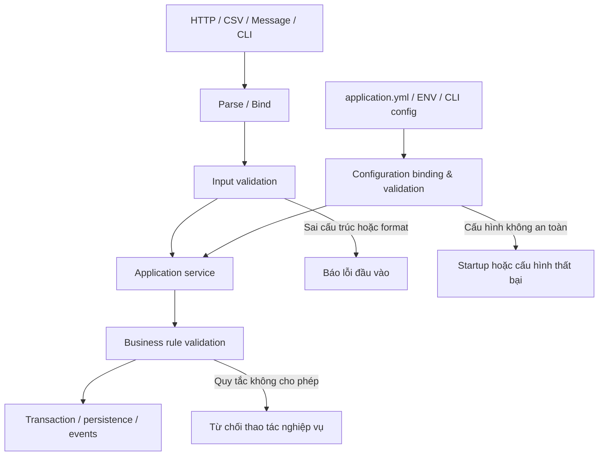
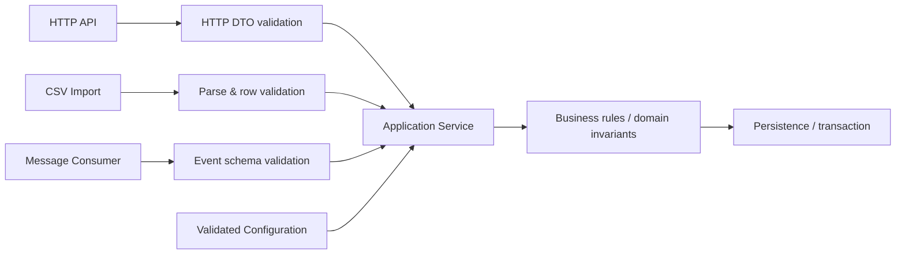

# Phân biệt kiểm tra dữ liệu đầu vào, cấu hình và quy tắc nghiệp vụ

Một ứng dụng Spring Boot nhận dữ liệu từ nhiều nguồn: HTTP request, file CSV hoặc JSON, message broker, biến môi trường, file `application.yml` và database. Trước khi sử dụng, ứng dụng cần kiểm tra dữ liệu có phù hợp hay không. Tuy nhiên, câu “cần validate dữ liệu” chưa đủ để xác định **đang kiểm tra loại dữ liệu nào, nhằm bảo vệ điều gì và nên đặt logic kiểm tra ở đâu**.

Ba nhóm kiểm tra thường gặp có trách nhiệm khác nhau:

1. **Kiểm tra dữ liệu đầu vào (input validation):** dữ liệu từ bên ngoài có đúng hình dạng, kiểu, định dạng và ràng buộc cơ bản để xử lý không?
2. **Kiểm tra cấu hình (configuration validation):** các property điều khiển hành vi ứng dụng có đầy đủ, hợp lệ và nhất quán để hệ thống khởi động hoặc hoạt động an toàn không?
3. **Kiểm tra quy tắc nghiệp vụ (business rule validation):** một thao tác có được phép xảy ra theo trạng thái và chính sách của miền nghiệp vụ hay không?

Ví dụ, một API tạo đơn hàng có thể nhận một yêu cầu chứa `quantity = 3`. Đây là số nguyên dương nên **hợp lệ về cấu trúc đầu vào**. Ứng dụng có thể đã đọc `app.order.max-items=100` nên **cấu hình hợp lệ**. Nhưng nếu kho chỉ còn một sản phẩm, việc tạo đơn ba sản phẩm vẫn **vi phạm quy tắc nghiệp vụ**.

Trong chương **Tài nguyên và dữ liệu** của *Spring Boot Fundamentals*, bài học này chỉ ra cách nhận diện ba tầng kiểm tra, áp dụng Bean Validation và `@ConfigurationProperties` đúng trách nhiệm, tổ chức service/domain validation, phân biệt các loại lỗi và thiết kế hệ thống chịu được dữ liệu không hợp lệ từ API, file và nguồn dữ liệu bên ngoài.

## 1. Bức tranh tổng thể: ba tầng, ba câu hỏi

Hãy xem một ứng dụng đặt hàng có endpoint:

```http
POST /api/orders
Content-Type: application/json

{
  "productId": "P-100",
  "quantity": 3,
  "customerEmail": "customer@example.com"
}
```

Ứng dụng có cấu hình:

```yaml
app:
  order:
    max-quantity-per-line: 20
    reservation-timeout: 30s
```

Service cần kiểm tra sản phẩm `P-100` có tồn tại, còn hàng, có được bán và khách hàng có quyền đặt không.

| Nhóm | Câu hỏi tiêu biểu | Dữ liệu cần xem | Nơi xử lý thường gặp |
| --- | --- | --- | --- |
| Đầu vào | `productId` có rỗng không? `quantity` có là số nguyên dương không? Email có đúng định dạng cơ bản không? | HTTP JSON, query, path, form, file, message | DTO, parser, controller boundary, import adapter |
| Cấu hình | Timeout có dương không? Giới hạn số lượng có hợp lệ không? URL đối tác có được cung cấp không? | `application.yml`, environment, CLI, secret source | `@ConfigurationProperties`, startup validation |
| Nghiệp vụ | Còn đủ hàng không? Sản phẩm có đang bán không? Đơn có vượt chính sách mua hàng không? | Trạng thái domain, repository, actor, thời gian, policy | Application service, domain service, aggregate |

Sơ đồ trách nhiệm:



Các bước này phối hợp nhưng không thay thế nhau. Một DTO vượt qua `@Valid` **chưa được coi là một lệnh nghiệp vụ hợp lệ**. Một ứng dụng khởi động được với `@ConfigurationProperties` hợp lệ **chưa có nghĩa mọi request sẽ được chấp nhận**. Và một domain service biết quy tắc nghiệp vụ **không nên bị buộc hiểu cú pháp JSON hay tên biến môi trường**.

## 2. Input validation là gì?

Input validation kiểm tra dữ liệu ở **ranh giới nhận dữ liệu không đáng tin cậy**. Mục tiêu là bảo đảm dữ liệu có thể được diễn giải an toàn theo contract đã công bố.

Các kiểm tra điển hình:

- Trường bắt buộc có hiện diện không?
- Chuỗi có rỗng hoặc chỉ gồm khoảng trắng không?
- Giá trị có đúng kiểu số, boolean hoặc enum không?
- Số lượng có nằm trong khoảng cho phép về mặt contract không?
- Chuỗi email/URL có định dạng cơ bản phù hợp không?
- Danh sách có quá dài, file có vượt kích thước được phép không?
- Tên trường, encoding, cấu trúc JSON/CSV hoặc schema có đúng không?

Input validation thường xảy ra **sau khi dữ liệu được parse/bind**, nhưng một số lỗi đã xuất hiện trước khi đến validator: JSON sai cú pháp, giá trị không chuyển được sang kiểu Java, multipart upload thiếu phần hoặc content type không phù hợp.

### 2.1. Ví dụ DTO cho HTTP API

Đặt một request DTO riêng:

```java
package com.example.orders.api;

import jakarta.validation.constraints.Email;
import jakarta.validation.constraints.Max;
import jakarta.validation.constraints.Min;
import jakarta.validation.constraints.NotBlank;
import jakarta.validation.constraints.NotNull;

public record CreateOrderRequest(
        @NotBlank String productId,
        @NotNull @Min(1) @Max(100) Integer quantity,
        @NotBlank @Email String customerEmail
) {
}
```

Ý nghĩa:

- `@NotBlank` yêu cầu chuỗi không `null` và có ít nhất một ký tự không phải whitespace.
- `@NotNull` yêu cầu giá trị tồn tại.
- `@Min(1)` và `@Max(100)` giới hạn số lượng theo contract HTTP.
- `@Email` kiểm tra cú pháp email ở mức Bean Validation; nó **không chứng minh địa chỉ email tồn tại hoặc thuộc quyền sở hữu của người gửi**.

Controller:

```java
package com.example.orders.api;

import com.example.orders.application.OrderApplicationService;
import jakarta.validation.Valid;
import org.springframework.http.HttpStatus;
import org.springframework.web.bind.annotation.PostMapping;
import org.springframework.web.bind.annotation.RequestBody;
import org.springframework.web.bind.annotation.RequestMapping;
import org.springframework.web.bind.annotation.ResponseStatus;
import org.springframework.web.bind.annotation.RestController;

@RestController
@RequestMapping("/api/orders")
public class OrderController {

    private final OrderApplicationService orders;

    public OrderController(OrderApplicationService orders) {
        this.orders = orders;
    }

    @PostMapping
    @ResponseStatus(HttpStatus.CREATED)
    public void create(@Valid @RequestBody CreateOrderRequest request) {
        orders.create(
                request.productId(),
                request.quantity(),
                request.customerEmail()
        );
    }
}
```

Trong Spring MVC, `@RequestBody` yêu cầu đọc HTTP body và map thành record. `@Valid` kích hoạt validation đối với object đã bind, với điều kiện có Bean Validation provider và cơ chế tích hợp phù hợp.

Trong project Spring Boot thông thường dùng Jakarta Bean Validation, hãy khai báo starter:

```xml
<dependency>
    <groupId>org.springframework.boot</groupId>
    <artifactId>spring-boot-starter-validation</artifactId>
</dependency>
```

Gradle:

```groovy
implementation 'org.springframework.boot:spring-boot-starter-validation'
```

Các ví dụ trong bài dùng namespace `jakarta.validation`, phù hợp với các dòng Spring Boot hiện đại sử dụng Jakarta EE. Dự án cũ dùng `javax.validation` cần đối chiếu phiên bản dependency trước khi chuyển đổi.

### 2.2. @NotNull, @NotEmpty và @NotBlank không giống nhau

| Constraint | Giá trị `null` | Chuỗi `""` | Chuỗi `"   "` |
| --- | --- | --- | --- |
| `@NotNull` | Không hợp lệ | Hợp lệ | Hợp lệ |
| `@NotEmpty` | Không hợp lệ | Không hợp lệ | Hợp lệ |
| `@NotBlank` | Không hợp lệ | Không hợp lệ | Không hợp lệ |

`@NotEmpty` áp dụng cho các kiểu được hỗ trợ như chuỗi, collection, map, array. `@NotBlank` dành cho `CharSequence`. Hãy chọn constraint dựa trên hợp đồng đầu vào, không sử dụng ngẫu nhiên.

### 2.3. Primitive và wrapper type

Nếu dùng:

```java
public record CreateOrderRequest(int quantity) {
}
```

thì một số tình huống giá trị thiếu hoặc chuyển đổi không rõ có thể bị xử lý ở bước deserialization trước khi Bean Validation chạy; primitive không thể chứa `null`. Khi muốn phân biệt “không gửi trường” với “gửi giá trị 0”, kiểu `Integer` kết hợp `@NotNull` thường diễn đạt contract rõ hơn:

```java
public record CreateOrderRequest(
        @NotNull @Min(1) Integer quantity
) {
}
```

### 2.4. Không nhập nhằng parse error với validation error

Nếu client gửi:

```json
{
  "productId": "P-100",
  "quantity": "many",
  "customerEmail": "customer@example.com"
}
```

thì lỗi có thể xảy ra ngay ở bước Jackson chuyển JSON thành `Integer`. Controller chưa chắc đã nhận được DTO để chạy `@Min`.

Phân biệt:

- **Parse/binding:** không tạo được object hoặc tham số đúng type.
- **Bean Validation:** tạo được object nhưng một hoặc nhiều constraint không thỏa.
- **Business validation:** object đầu vào hợp lệ nhưng thao tác không được phép.

Ba loại lỗi nên có thông điệp và cách phản hồi phù hợp; không gộp thành một dòng “dữ liệu sai” khó chẩn đoán.

## 3. Input validation không chỉ dành cho HTTP request

Tên chương **Tài nguyên và dữ liệu** nhắc rằng ứng dụng còn nhận dữ liệu từ file, resource, môi trường và các hệ thống khác. Mỗi nguồn phải được kiểm tra ở ranh giới phù hợp.

### 3.1. Đọc file CSV

Giả sử import catalog:

```csv
sku,name,price
P-100,Notebook,45000
P-101,Pen,12000
```

Một hàng có thể sai:

```csv
P-102,,not-a-number
```

Đây là lỗi đầu vào: tên trống và giá không parse được. Bộ đọc CSV nên phân biệt việc giải mã/parse với việc chuyển thành command/DTO:

```java
public record ImportProductRow(
        @NotBlank String sku,
        @NotBlank String name,
        @NotNull @DecimalMin("0.00") BigDecimal price
) {
}
```

Một adapter đọc file có thể parse cột `price` thành `BigDecimal`, sau đó gọi `Validator.validate(row)`. Nếu parse thất bại, ghi lỗi có số dòng; nếu constraint thất bại, báo field và constraint.

Không nên dùng `Double` cho các số tiền cần tính chính xác bằng thập phân khi `BigDecimal` phù hợp hơn.

### 3.2. Kiểm tra nội dung và giới hạn tài nguyên

Input validation cho file không dừng ở Bean Validation:

- Giới hạn kích thước file và số dòng.
- Kiểm tra encoding/charset.
- Kiểm tra header/schema và số cột.
- Giới hạn độ dài trường để tránh tiêu tốn bộ nhớ quá mức.
- Xử lý CSV quoting theo parser đáng tin cậy thay vì tự `split(",")` cho dữ liệu phức tạp.
- Chỉ chấp nhận định dạng đúng contract; không tin hoàn toàn vào phần mở rộng file.
- Kiểm tra đường dẫn, quyền truy cập và chính sách lưu file.

Nếu có upload file, `MultipartFile.getOriginalFilename()` là dữ liệu do client cung cấp, **không phải đường dẫn an toàn để ghi trực tiếp**. Nếu dùng làm tên file trong storage, cần chuẩn hóa, tạo tên do server kiểm soát và ngăn path traversal. Việc upload thành công không chứng minh file là loại nội dung mà hệ thống cho phép.

### 3.3. Message broker và các integration boundary

Một message từ Kafka/RabbitMQ hoặc webhook cũng là dữ liệu đầu vào. Dù đến từ service nội bộ, nó có thể bị lỗi schema hoặc do producer khác phiên bản.

Ví dụ event:

```java
public record StockReceivedEvent(
        @NotBlank String sku,
        @NotNull @Min(1) Integer quantity,
        @NotBlank String eventId
) {
}
```

Adapter nhận message cần parse, kiểm tra schema, xác minh nguồn gửi nếu cần và xử lý message lỗi theo chính sách retry/dead-letter. **Valid message schema chưa chứng minh sự kiện chưa từng được xử lý**; kiểm tra trùng `eventId` là một yêu cầu nhất quán/nghiệp vụ hoặc hạ tầng idempotency riêng.

### 3.4. Không tin dữ liệu chỉ vì nguồn “nội bộ”

HTTP request, file từ batch, dữ liệu trong database cũ và message của service khác đều có thể chứa giá trị bất ngờ. Mức độ kiểm tra có thể khác nhau theo trust boundary, nhưng nguồn dữ liệu nội bộ không phải lý do bỏ qua mọi guard.

## 4. Configuration validation là gì?

Configuration validation kiểm tra **dữ liệu điều khiển hành vi của ứng dụng**. Những giá trị này thường đến từ:

- `application.properties` hoặc `application.yml`.
- `application-{profile}.properties` / YAML tương ứng.
- Biến môi trường.
- Command-line arguments.
- JVM system properties.
- Secret manager hoặc nguồn Config Data khác.

Ví dụ:

```yaml
app:
  import:
    max-rows: 5000
    batch-size: 200
    timeout: 30s
    archive-directory: "/var/lib/catalog/archive"
```

Các property cần có điều kiện hợp lệ:

- `max-rows` phải dương.
- `batch-size` phải dương và không vượt giới hạn hệ thống.
- `timeout` phải lớn hơn 0.
- `archive-directory` phải có giá trị phù hợp.

Đây là **ràng buộc cấu hình** vì chúng kiểm soát cách ứng dụng làm việc, không phải dữ liệu của một đơn hàng cụ thể.

### 4.1. Vì sao kiểm tra ở startup?

Giả sử ứng dụng dùng `batch-size=0`. Nếu không kiểm tra lúc khởi động, lỗi có thể chỉ xuất hiện khi tác vụ import đầu tiên chạy hoặc chương trình gặp vòng lặp vô hạn.

Configuration validation giúp **fail fast**: phát hiện điều kiện không thể hoạt động an toàn ngay khi tạo các bean cấu hình hoặc khởi động context.

Lợi ích:

- Triển khai sai được phát hiện sớm.
- Hệ thống không âm thầm dùng giá trị ngoài phạm vi hợp lệ.
- Lỗi có thể chỉ rõ tên property và nguồn cần sửa.
- Service nghiệp vụ không phải lặp lại guard cho những cấu hình bất biến.

### 4.2. Cấu hình hợp lệ không chỉ là định dạng

`timeout: 30s` có thể parse thành `Duration`, nhưng `timeout: 0s` vẫn có thể vi phạm yêu cầu hệ thống. `batch-size: -1` có thể parse thành số nguyên nhưng không có ý nghĩa vận hành.

Nghĩa là cần phân biệt:

1. **Binding/type conversion:** chuyển chuỗi cấu hình sang kiểu Java.
2. **Constraint validation:** kiểm tra giới hạn và trường bắt buộc.
3. **Cross-field validation:** kiểm tra quan hệ giữa nhiều property.
4. **Runtime dependency verification:** kiểm tra dịch vụ ngoài có thể truy cập không nếu việc đó là điều kiện cần ở startup.

Ví dụ endpoint là một URL hợp lệ chưa đồng nghĩa dịch vụ bên ngoài đang hoạt động. Việc kiểm tra network connectivity là một bước runtime readiness/startup verification riêng, không thể thay bằng annotation `@NotBlank`.

## 5. Viết cấu hình có type bằng @ConfigurationProperties

Spring Boot khuyến khích gom một nhóm property thành một object có type rõ.

### 5.1. Cấu hình trong application.yml

```yaml
app:
  import:
    max-rows: 5000
    batch-size: 200
    timeout: 30s
    archive-directory: "/var/lib/catalog/archive"
```

### 5.2. Class cấu hình với Bean Validation

Ví dụ dùng record:

```java
package com.example.catalog.config;

import jakarta.validation.constraints.Min;
import jakarta.validation.constraints.NotBlank;
import jakarta.validation.constraints.NotNull;
import jakarta.validation.constraints.Positive;
import java.time.Duration;
import org.springframework.boot.context.properties.ConfigurationProperties;
import org.springframework.validation.annotation.Validated;

@Validated
@ConfigurationProperties(prefix = "app.import")
public record ImportProperties(
        @Min(1) int maxRows,
        @Min(1) int batchSize,
        @NotNull Duration timeout,
        @NotBlank String archiveDirectory
) {
    public ImportProperties {
        if (timeout != null && (timeout.isZero() || timeout.isNegative())) {
            throw new IllegalArgumentException(
                    "app.import.timeout must be positive"
            );
        }
    }
}
```

Giải thích:

- `@ConfigurationProperties` gắn nhóm `app.import` với record.
- `@Validated` cho phép validation đối với bean cấu hình khi có validator phù hợp.
- `@Min(1)` không cho phép số nhỏ hơn 1.
- `@NotNull` ngăn thiếu `timeout`.
- `@NotBlank` ngăn `archiveDirectory` rỗng/whitespace.
- Constructor của record kiểm tra điều kiện của `Duration`, ở đây timeout phải dương.

Ví dụ trên là một cách tổ chức cho Spring Boot dùng constructor binding của record. Trong project thực tế có thể tách cross-field checks sang custom validator hoặc `@AssertTrue`/custom class-level constraint nếu muốn tất cả lỗi đi qua cùng hệ thống Bean Validation.

### 5.3. Đăng ký configuration properties

Trong Spring Boot, có thể bật scan:

```java
package com.example.catalog;

import org.springframework.boot.SpringApplication;
import org.springframework.boot.autoconfigure.SpringBootApplication;
import org.springframework.boot.context.properties.ConfigurationPropertiesScan;

@SpringBootApplication
@ConfigurationPropertiesScan
public class CatalogApplication {

    public static void main(String[] args) {
        SpringApplication.run(CatalogApplication.class, args);
    }
}
```

Hoặc chọn đăng ký tường minh:

```java
@Configuration(proxyBeanMethods = false)
@EnableConfigurationProperties(ImportProperties.class)
class ImportConfiguration {
}
```

Không cần dùng đồng thời mọi cơ chế đăng ký cho cùng một class. Chọn convention nhất quán theo cấu trúc project.

### 5.4. Sử dụng cấu hình trong service

```java
package com.example.catalog.application;

import com.example.catalog.config.ImportProperties;
import org.springframework.stereotype.Service;

@Service
public class CatalogImportCoordinator {

    private final ImportProperties properties;

    public CatalogImportCoordinator(ImportProperties properties) {
        this.properties = properties;
    }

    public int configuredBatchSize() {
        return properties.batchSize();
    }
}
```

Service nhận một object đã được bind và validate. Nó không cần gọi `Environment.getProperty("app.import.batch-size")` ở mọi method.

### 5.5. Cần phân biệt @Validated trên cấu hình với trên method

`@Validated` có thể được dùng ở các ngữ cảnh khác nhau:

- Trên `@ConfigurationProperties`: kiểm tra object cấu hình khi bind.
- Trên bean/service hỗ trợ method validation: kích hoạt kiểm tra constraints trên arguments/return value theo cơ chế method validation.

Trùng annotation nhưng **thời điểm và đối tượng được kiểm tra khác nhau**. Không nên suy luận cứ đặt `@Validated` lên một service là toàn bộ business rules được thực thi tự động.

## 6. Cấu hình có quan hệ giữa nhiều trường

Không phải mọi ràng buộc có thể viết bằng `@Min` hoặc `@NotBlank` trên từng field.

Ví dụ cấu hình:

```yaml
app:
  import:
    batch-size: 500
    max-rows: 200
```

Mỗi số đều dương nhưng **batch size lớn hơn số dòng tối đa**. Đây có thể là cấu hình không hợp lệ nếu hệ thống muốn giới hạn một batch không vượt tổng số dòng cho phép.

Cách diễn đạt bằng class:

```java
@Validated
@ConfigurationProperties(prefix = "app.import")
public record ImportLimits(
        @Min(1) int maxRows,
        @Min(1) int batchSize
) {

    @AssertTrue(message = "batch-size must not exceed max-rows")
    public boolean isBatchSizeWithinLimit() {
        return batchSize <= maxRows;
    }
}
```

Ví dụ minh họa Bean Validation constraint `@AssertTrue` trên method dạng getter/property được validator hỗ trợ. Cần import `jakarta.validation.constraints.AssertTrue`. Cũng có thể tạo custom class-level constraint nếu logic phức tạp hoặc muốn đặt lỗi vào nhiều field.

### 6.1. Khi nào dùng custom constraint?

Giả sử cấu hình có `minPoolSize`, `maxPoolSize`, `idleTimeout`, `connectionTimeout` và mỗi tổ hợp có quy tắc khác nhau. Một class-level validator có thể diễn đạt rõ hơn việc nhồi tất cả logic vào constructor.

Nhưng đừng thiết kế một framework validation tự chế cho ba property đơn giản. Ưu tiên constraints phổ biến, typed config và custom validator chỉ khi thực sự cần.

### 6.2. Cấu hình theo profile

Ví dụ:

```yaml
# application-dev.yml
app:
  import:
    max-rows: 1000
    batch-size: 50
    timeout: 10s
    archive-directory: "./build/local-archive"
```

```yaml
# application-prod.yml
app:
  import:
    max-rows: 100000
    batch-size: 1000
    timeout: 2m
    archive-directory: "/data/catalog/archive"
```

Cả hai profile đều cần qua validation theo contract cấu hình. Không nên bỏ qua kiểm tra chỉ vì `prod` được cấu hình bởi pipeline triển khai.

### 6.3. Secrets và cấu hình bắt buộc

Mật khẩu, API keys và tokens thường đến từ environment hoặc secret manager. Có thể tham chiếu:

```yaml
app:
  partner:
    api-key: "${PARTNER_API_KEY}"
```

Nếu secret là bắt buộc, cấu hình nên fail rõ khi không có giá trị hợp lệ. Không hard-code secret thật trong repository hoặc đưa vào exception/log một cách vô tình.

`@NotBlank` có thể bảo vệ việc rỗng, nhưng không xác minh key có quyền truy cập tại hệ thống đối tác. Đó là một kiểm tra runtime riêng.

## 7. Business rule validation là gì?

Business rule validation kiểm tra **một quyết định hoặc thao tác có được phép theo miền nghiệp vụ** hay không. Nó dựa trên ngữ cảnh, trạng thái hiện tại và chính sách của tổ chức, chứ không chỉ hình dạng dữ liệu.

Ví dụ với đơn hàng:

- Sản phẩm phải tồn tại và đang được bán.
- Khách hàng có quyền mua sản phẩm.
- Số lượng đặt không vượt tồn kho khả dụng.
- Đơn đã thanh toán không được sửa bằng một API dành cho đơn nháp.
- Mã giảm giá phải còn hiệu lực tại thời điểm sử dụng.
- Khách không được sử dụng cùng một mã khuyến mãi quá số lần cho phép.

Những quy tắc này có thể phụ thuộc vào database, thời gian, identity/authorization hoặc trạng thái của nhiều aggregate.

### 7.1. Vì sao không đặt mọi business rule vào DTO?

DTO không nên cần repository để biết sản phẩm còn hàng. Ràng buộc như `@NotBlank` chỉ kiểm tra chuỗi không rỗng; nó không thể bảo đảm `productId` đang được bán và có đủ tồn kho.

Ví dụ:

```json
{
  "productId": "P-100",
  "quantity": 3,
  "customerEmail": "customer@example.com"
}
```

Request này có thể vượt qua tất cả các constraints của `CreateOrderRequest`. Nhưng nếu `P-100` ngừng bán, service vẫn phải từ chối nghiệp vụ.

### 7.2. Vì sao không đặt business rule vào application.yml?

File cấu hình có thể cung cấp **tham số chính sách**, ví dụ `max-quantity-per-line=20`. Nhưng quyết định “khách hàng này có được mua 3 sản phẩm tại thời điểm này không?” phải được thực hiện bởi code nghiệp vụ có ngữ cảnh.

**Config cung cấp giá trị điều khiển policy; business service thực thi policy.**

Ví dụ:

```yaml
app:
  order:
    max-quantity-per-line: 20
```

```java
@Service
public class OrderPolicy {

    private final OrderProperties properties;

    public OrderPolicy(OrderProperties properties) {
        this.properties = properties;
    }

    public void verifyLineLimit(int quantity) {
        if (quantity > properties.maxQuantityPerLine()) {
            throw new OrderPolicyViolation(
                    "Order quantity exceeds configured line limit"
            );
        }
    }
}
```

Ở đây:

- Việc `maxQuantityPerLine` là số nguyên dương thuộc **configuration validation**.
- Việc request có `quantity` nguyên dương thuộc **input validation**.
- Việc đơn hàng cụ thể vượt chính sách hạn mức thuộc **business rule validation**.

Giá trị `quantity=25` có thể hợp lệ về mặt API contract chung `1..100`, nhưng bị policy từ chối do giới hạn hiện tại bằng 20.

## 8. Ví dụ nghiệp vụ: đặt hàng theo tồn kho

Giả sử domain có sản phẩm và tồn kho.

### 8.1. Repository và domain service

Một application service minh họa:

```java
package com.example.orders.application;

import com.example.orders.domain.OrderPolicyViolation;
import com.example.orders.domain.Product;
import com.example.orders.domain.ProductRepository;
import com.example.orders.domain.OrderRepository;
import org.springframework.stereotype.Service;
import org.springframework.transaction.annotation.Transactional;

@Service
public class OrderApplicationService {

    private final ProductRepository products;
    private final OrderRepository orders;
    private final OrderPolicy policy;

    public OrderApplicationService(
            ProductRepository products,
            OrderRepository orders,
            OrderPolicy policy
    ) {
        this.products = products;
        this.orders = orders;
        this.policy = policy;
    }

    @Transactional
    public void create(
            String productId,
            int quantity,
            String customerEmail
    ) {
        Product product = products.findById(productId)
                .orElseThrow(() ->
                        new OrderPolicyViolation("Product not found")
                );

        policy.verifyLineLimit(quantity);

        if (!product.isAvailableForSale()) {
            throw new OrderPolicyViolation(
                    "Product is not available for sale"
            );
        }

        product.reserve(quantity);
        orders.saveNewOrder(product, quantity, customerEmail);
    }
}
```

Đây là ví dụ **kiến trúc**: `ProductRepository`, `OrderRepository`, `Product` và `OrderPolicyViolation` là các kiểu giả định của dự án. Một implementation hoàn chỉnh cần định nghĩa các kiểu này cùng cơ chế persistence cụ thể.

Controller thực hiện input validation. Service thực hiện workflow. Domain entity `Product` có thể bảo vệ invariant của chính nó:

```java
public void reserve(int quantity) {
    if (quantity <= 0) {
        throw new IllegalArgumentException(
                "Quantity must be positive"
        );
    }

    if (availableStock < quantity) {
        throw new OrderPolicyViolation(
                "Insufficient stock"
        );
    }

    availableStock -= quantity;
}
```

### 8.2. Guard ở domain không thay thế input validation

Tại sao `reserve` vẫn kiểm tra quantity dương dù controller đã có `@Min(1)`?

Vì domain method có thể được gọi từ nơi khác:

- Scheduled job.
- Message consumer.
- Admin CLI.
- Batch import.
- Unit test hoặc một service khác.

Một invariant quan trọng của domain không nên phụ thuộc vào việc **mọi lời gọi đều đi qua một controller cụ thể**. DTO validation nâng cao chất lượng feedback ở ranh giới HTTP; domain guard bảo vệ tính đúng của object trong mọi đường thực thi.

Đây là một trường hợp lặp kiểm tra có chủ đích nhưng **khác mục tiêu**, không phải copy-paste vô nghĩa.

### 8.3. Cạnh tranh đồng thời và tồn kho

Giả sử kho còn 5 sản phẩm. Hai request cùng lúc, mỗi request đặt 4 sản phẩm:

```text
Request A đọc tồn kho = 5
Request B đọc tồn kho = 5
Request A kiểm tra 4 <= 5: đúng
Request B kiểm tra 4 <= 5: đúng
Request A trừ 4
Request B trừ 4
```

Nếu không có concurrency control, cả hai có thể vượt quá tồn kho cho phép mặc dù từng lần validation riêng đều “đúng”.

Với những invariant phụ thuộc dữ liệu đồng thời, cần bổ sung bảo đảm ở tầng persistence/transaction:

- Optimistic locking qua version.
- Pessimistic locking khi phù hợp.
- Atomic conditional update, ví dụ cập nhật tồn kho chỉ khi đủ số lượng.
- Unique constraints cho những invariant về uniqueness.
- Transaction boundaries rõ ràng.

**Business validation chỉ đọc rồi kiểm tra không đủ để bảo đảm invariant dưới concurrent requests.** Đây là khác biệt lớn giữa một ví dụ `if` đơn giản và hệ thống production.

## 9. Ranh giới giữa input constraint và business rule không phải lúc nào cũng tuyệt đối

Một số điều kiện có vẻ thuộc cả hai nhóm. Ví dụ `quantity <= 100`:

- Nếu API contract công bố rằng mọi request chỉ nhận số lượng từ 1 đến 100 bất kể trạng thái hệ thống, nó là **input constraint**.
- Nếu giới hạn 100 do chính sách kinh doanh tùy theo loại khách hàng, chương trình khuyến mãi hoặc thời gian, nó là **business rule**.
- Nếu 100 được cấu hình bằng property và phải dương, giá trị cấu hình đó còn phải qua **configuration validation**.

Vì vậy, không nên phân loại chỉ dựa vào toán tử `<=` hoặc annotation dùng trong code. Hãy hỏi **nguồn của quy tắc, đối tượng quy tắc bảo vệ và lúc nào quy tắc có thể thay đổi**.

### 9.1. Quy tắc “email hợp lệ” cũng có nhiều tầng

| Kiểm tra | Nhóm |
| --- | --- |
| Chuỗi không rỗng, cú pháp email cơ bản | Input |
| Ứng dụng có cấu hình domain gửi mail hoặc SMTP hợp lệ | Configuration |
| Khách hàng đã xác minh email trước khi nhận một quyền lợi | Business |
| Mail server thật sự chấp nhận địa chỉ | Xác minh tích hợp/runtime |

`@Email` không chứng minh người dùng kiểm soát hộp thư. Thường cần quy trình xác minh qua token hoặc link để đáp ứng business rule “email đã xác thực”.

### 9.2. Quy tắc “mã SKU duy nhất”

`@NotBlank` kiểm tra SKU có giá trị. Một regex có thể kiểm tra định dạng `P-100`. Nhưng **SKU chưa tồn tại trong catalog** là một invariant nghiệp vụ/persistence. Để bảo đảm uniqueness dưới concurrent writes, hãy dùng unique constraint ở database và xử lý xung đột thích hợp.

Không nên chỉ viết `repository.existsBySku(...)` rồi tin rằng không bao giờ có race condition.

## 10. Phân biệt validation, authentication và authorization

Ba nhóm validation ở trên không được dùng để thay thế bảo mật.

Ví dụ request:

```http
DELETE /api/orders/123
Authorization: Bearer ...
```

Các bước khác nhau:

- **Parsing/input validation:** ID `123` có đúng kiểu và format không?
- **Authentication:** ai đang thực hiện request?
- **Authorization:** người đó có quyền xóa đơn này không?
- **Business rule:** đơn hiện ở trạng thái cho phép hủy/xóa không?

Một người có thể được xác thực và có quyền truy cập endpoint nhưng vẫn không được hủy một đơn đã giao hàng vì chính sách nghiệp vụ. Ngược lại, một request hợp lệ về dữ liệu không chứng minh người gửi có quyền thao tác.

Spring Security xử lý authentication/authorization ở những điểm phù hợp; domain/application service vẫn phải bảo vệ invariant nghiệp vụ. Đừng xem `@Valid` là lớp bảo mật tổng quát.

### 10.1. Input validation không thay thế cơ chế chống injection

Kiểm tra dữ liệu không rỗng hoặc giới hạn độ dài là hữu ích, nhưng không thay thế parameterized SQL queries, output encoding, hạn chế quyền tài nguyên và chính sách truy cập file.

Ví dụ, tránh nối chuỗi trực tiếp vào SQL:

```java
// Không nên:
String sql = "SELECT * FROM products WHERE sku = '" + sku + "'";
```

Nên dùng API parameter binding của JDBC, JPA hoặc repository phù hợp. Input validation và security controls giải quyết những nguy cơ khác nhau.

## 11. Phân biệt “dữ liệu tồn tại” với “dữ liệu hợp lệ”

Trong chương Tài nguyên và dữ liệu, vấn đề này xuất hiện khi đọc resource:

```java
Resource resource =
        new ClassPathResource("catalog/default-products.csv");

if (!resource.exists()) {
    throw new IllegalStateException(
            "Required catalog resource is missing"
    );
}
```

Đoạn này chỉ kiểm tra resource có tồn tại theo abstraction Spring. Nó **không chứng minh file có cấu trúc đúng, encoding đúng hoặc các bản ghi hợp lệ**.

Để dùng tài nguyên an toàn, thường cần nhiều bước:

```text
Resource path
   |
   v
Exists / readable?
   |
   v
Open stream
   |
   v
Parse format
   |
   v
Validate rows/schema
   |
   v
Apply business rules
   |
   v
Persist / process
```

### 11.1. Resource và File không luôn giống nhau

Một tài nguyên `classpath:catalog/default-products.csv` có thể nằm bên trong executable JAR. Không nên giả định luôn chuyển được nó thành `java.io.File` trên filesystem.

Ví dụ đọc qua stream:

```java
Resource resource =
        new ClassPathResource("catalog/default-products.csv");

try (InputStream input = resource.getInputStream()) {
    // Đọc dữ liệu bằng parser phù hợp với định dạng và encoding.
}
```

Đây là kiểm tra khả năng đọc tài nguyên, khác với validation từng dòng và business rule. Với file cấu hình bắt buộc, việc không mở được resource có thể khiến ứng dụng không khởi động được; với file upload do người dùng gửi, đó thường là lỗi input/request.

### 11.2. Phân loại lỗi theo trách nhiệm, không chỉ theo định dạng file

Cùng là file YAML nhưng có thể thuộc nhiều ngữ cảnh:

- `application.yml`: **configuration input** của ứng dụng, cần configuration validation.
- Một file YAML do người dùng upload để tạo workflow: **input data**, cần kiểm tra cấu trúc/schema.
- Nội dung YAML biểu diễn một policy tác động tới đơn hàng: sau khi parse và kiểm tra cấu hình/contract, **business policy** vẫn phải được thực thi ở domain.

Đừng nói “YAML luôn là config validation” hoặc “JSON luôn là input validation” vì định dạng không quyết định tầng trách nhiệm.

## 12. Xử lý lỗi HTTP: phản hồi đúng loại vấn đề

Một API nên trả lỗi có cấu trúc để client biết cần sửa request hay điều kiện nghiệp vụ.

### 12.1. Input validation thường là 400

Với Spring MVC, một `@Valid @RequestBody` không hợp lệ thường dẫn tới lỗi `MethodArgumentNotValidException` và HTTP 400 theo cơ chế mặc định, trừ khi ứng dụng tùy biến.

Ví dụ response minh họa:

```json
{
  "type": "https://example.invalid/problems/invalid-input",
  "title": "Invalid request",
  "status": 400,
  "detail": "Request body contains invalid fields"
}
```

Ở đây tên trường lỗi có thể được thêm vào response riêng. Không nên trả stack trace hoặc dữ liệu bí mật cho client.

### 12.2. Business rule không có một status code cố định cho mọi trường hợp

Ví dụ:

- Sản phẩm không tồn tại: có thể dùng `404 Not Found`, tùy semantics API.
- Phiên bản đơn hàng đã thay đổi hoặc trạng thái xung đột: `409 Conflict` có thể phù hợp.
- Giá trị hợp lệ về cú pháp nhưng không được xử lý theo chính sách: một số API dùng `422 Unprocessable Content` nếu contract chọn như vậy.
- Người gọi không có quyền: `403 Forbidden` theo quy tắc authorization.

Không tồn tại một quy tắc “mọi lỗi nghiệp vụ đều trả 422” cho tất cả API. Quan trọng là nhất quán với semantics của HTTP contract và có mã lỗi ứng dụng ổn định.

### 12.3. Lỗi configuration thường không phải 400 cho client

Nếu hệ thống không thể tạo bean vì `app.import.batch-size=-1`, đó là lỗi cấu hình triển khai và cần được phát hiện sớm khi startup. Client không thể sửa file `application.yml` bằng cách gửi request khác.

Khi cấu hình bị lỗi trong runtime, hệ thống có thể không sẵn sàng hoặc gặp lỗi server. Cần ghi log chẩn đoán phù hợp và sửa nguồn cấu hình thay vì trả field validation response của API cho người dùng.

## 13. Xử lý input validation bằng @RestControllerAdvice

Spring MVC có thể gom cách phản hồi lỗi đầu vào vào một exception handler.

```java
package com.example.orders.api;

import java.util.List;
import org.springframework.http.HttpStatus;
import org.springframework.http.ProblemDetail;
import org.springframework.web.bind.MethodArgumentNotValidException;
import org.springframework.web.bind.annotation.ExceptionHandler;
import org.springframework.web.bind.annotation.RestControllerAdvice;

@RestControllerAdvice
public class ApiValidationHandler {

    @ExceptionHandler(MethodArgumentNotValidException.class)
    public ProblemDetail handleInvalidBody(
            MethodArgumentNotValidException ex
    ) {
        ProblemDetail problem = ProblemDetail.forStatus(
                HttpStatus.BAD_REQUEST
        );
        problem.setTitle("Invalid request body");
        problem.setDetail(
                "One or more request fields failed validation"
        );

        List<String> fields = ex.getBindingResult()
                .getFieldErrors()
                .stream()
                .map(error -> error.getField())
                .distinct()
                .toList();

        problem.setProperty("invalidFields", fields);
        return problem;
    }
}
```

Đây là một handler minh họa. Với Spring MVC hiện đại, method validation ở `@RequestParam`, `@PathVariable` hoặc các method-level constraints có thể phát sinh loại exception khác, chẳng hạn `HandlerMethodValidationException` ở những phiên bản hỗ trợ. Lỗi JSON parse còn có thể dẫn tới `HttpMessageNotReadableException`. Ứng dụng cần map những tình huống liên quan theo API contract và phiên bản Spring đang dùng.

### 13.1. Không trả nguyên giá trị nhạy cảm trong message

Nếu field lỗi là mật khẩu, token hay số định danh nhạy cảm, tránh trả trực tiếp `rejectedValue` hoặc in toàn bộ DTO vào log. Có thể trả tên trường, mã lỗi và mô tả an toàn.

### 13.2. Mã lỗi ổn định hơn text

Client không nên dựa vào văn bản exception để quyết định hành vi. Có thể thiết kế:

```json
{
  "code": "INPUT_INVALID",
  "message": "Request contains invalid fields",
  "fields": [
    {"field": "quantity", "code": "MIN_VALUE"}
  ]
}
```

Đây là response contract tùy chọn của ứng dụng. Nội dung thông điệp có thể được bản địa hóa; `code` nên ổn định để client xử lý.

## 14. Business rule exception nên có ý nghĩa riêng

Nếu một sản phẩm đã ngừng bán, service nên báo một tình huống nghiệp vụ có tên rõ thay vì cố tái sử dụng `MethodArgumentNotValidException` của HTTP.

Ví dụ:

```java
package com.example.orders.domain;

public class OrderPolicyViolation extends RuntimeException {

    private final String code;

    public OrderPolicyViolation(String code, String message) {
        super(message);
        this.code = code;
    }

    public String code() {
        return code;
    }
}
```

Service:

```java
if (!product.isAvailableForSale()) {
    throw new OrderPolicyViolation(
            "PRODUCT_NOT_FOR_SALE",
            "Product is not available for sale"
    );
}
```

HTTP adapter có thể map thành response phù hợp:

```java
@ExceptionHandler(OrderPolicyViolation.class)
ResponseEntity<ProblemDetail> handlePolicy(
        OrderPolicyViolation ex
) {
    ProblemDetail detail =
            ProblemDetail.forStatus(HttpStatus.CONFLICT);
    detail.setTitle("Order cannot be created");
    detail.setDetail(ex.getMessage());
    detail.setProperty("code", ex.code());
    return ResponseEntity.status(HttpStatus.CONFLICT).body(detail);
}
```

Đây là một lựa chọn contract cho tình huống conflict, không có nghĩa mọi `OrderPolicyViolation` phải map 409. Trong ứng dụng thật, các mã như `PRODUCT_NOT_FOUND`, `OUT_OF_STOCK` và `ORDER_ALREADY_PAID` có thể có HTTP mapping khác nhau.

### 14.1. Domain không nên phụ thuộc trực tiếp vào HTTP

Tránh cho domain service ném `ResponseStatusException` chỉ để mô tả nghiệp vụ. Domain có thể được gọi từ batch, message consumer hoặc CLI; những nơi này không có HTTP status.

Tầng API chuyển domain errors thành HTTP response. Tầng message consumer có thể chuyển cùng domain errors thành acknowledge, retry hoặc dead-letter policy. Tách biệt như vậy giúp tái sử dụng logic nghiệp vụ.

## 15. Method validation trong service có vai trò gì?

Spring có thể áp dụng Bean Validation lên method parameters/return values của bean trong những cấu hình phù hợp.

Ví dụ:

```java
@Service
@Validated
public class PriceCalculator {

    public BigDecimal calculateDiscount(
            @NotNull @DecimalMin("0.00") BigDecimal amount
    ) {
        return amount.multiply(new BigDecimal("0.05"));
    }
}
```

Method validation hữu ích để bảo vệ precondition kỹ thuật hoặc hợp đồng gọi method, nhất là khi service có nhiều caller.

Nhưng:

- `@DecimalMin` không thể thay thế chính sách “khách này được giảm giá bao nhiêu”.
- Method validation thường dựa trên cơ chế interceptor/proxy; những lời gọi nội bộ `this.method()` có thể không đi qua proxy theo cấu hình AOP thông thường.
- Nếu service tự `new` ngoài Spring context, không thể mặc định những interceptor do Spring quản lý sẽ chạy.
- Business invariants quan trọng cần được bảo vệ ở nơi chúng có thể được thực thi đáng tin cậy, không chỉ phụ thuộc một annotation trên method.

Tùy phiên bản Spring Framework và loại controller, cách method validation được kích hoạt có thể khác nhau. Hãy phân biệt method validation ở service với validation của request DTO trong controller.

## 16. Kiểm tra dữ liệu ở nhiều ranh giới mà không làm trùng trách nhiệm

Ứng dụng có thể có nhiều đường vào cùng một business service:



Cần tránh hai cực đoan:

**Cực đoan 1 — Chỉ validate ở controller.** Một batch job hoặc message consumer bỏ qua controller có thể đưa dữ liệu sai vào domain.

**Cực đoan 2 — Nhồi mọi validation vào domain.** Domain phải biết JSON field names, file upload size, YAML path hoặc cú pháp CLI, khiến business logic phụ thuộc hạ tầng.

Thiết kế cân bằng:

1. Adapter kiểm tra cú pháp/schema/contract của nguồn dữ liệu.
2. Config binder kiểm tra các property điều khiển ứng dụng.
3. Application service điều phối use case và truy xuất state.
4. Domain bảo vệ invariants quan trọng.
5. Persistence bảo đảm constraints mà concurrency hoặc dữ liệu ngoài có thể phá vỡ.

### 16.1. DRY không có nghĩa bỏ mọi guard lặp lại

Một số điều kiện như `quantity > 0` có thể xuất hiện tại DTO và domain. DTO giúp API trả lỗi rõ trước khi gọi service; domain bảo vệ invariant khỏi các caller khác.

Điều cần tránh là **cùng một quy tắc nghiệp vụ phức tạp bị copy sang ba controller**. Hãy tập trung chính sách đó trong một domain/application service có trách nhiệm rõ ràng.

### 16.2. Phân chia trách nhiệm theo chủ sở hữu

| Loại rule | Chủ sở hữu tốt |
| --- | --- |
| JSON phải có trường `productId` | API contract / DTO |
| CSV tối đa N cột và đúng header | Import adapter |
| Cấu hình timeout phải dương | Configuration properties |
| Sản phẩm đã ngừng bán thì không được đặt | Domain/application policy |
| SKU phải duy nhất ngay cả khi request đồng thời | Domain rule + unique constraint |
| Người gọi có quyền sửa đơn không | Security authorization + application policy |
| File có đúng MIME/size và lưu an toàn không | Upload boundary / infrastructure |
| Hệ thống đối tác có reachable không | Runtime startup/readiness/integration health |

## 17. Ví dụ tổng hợp: nhập catalog bằng CSV

Xét một use case thực tế hơn: import sản phẩm từ file CSV khi quản trị viên yêu cầu.

Điều kiện:

- CSV phải có ba cột `sku,name,price`.
- `sku` và `name` không được trống.
- `price` không âm.
- Cấu hình import phải có `max-rows` và `batch-size` dương.
- Không cho phép import một SKU đang bị khóa bán hoặc cập nhật giá trái chính sách.
- SKU mới không được trùng SKU đã tồn tại.

### 17.1. Tầng cấu hình

```yaml
app:
  import:
    max-rows: 10000
    batch-size: 250
    timeout: 60s
    archive-directory: "./archive"
```

`ImportProperties` bind và validate các giá trị này khi tạo bean.

### 17.2. Tầng input

Một DTO dòng import:

```java
public record ProductImportRow(
        @NotBlank String sku,
        @NotBlank String name,
        @NotNull @DecimalMin("0.00") BigDecimal price
) {
}
```

Adapter:

```java
public class ProductCsvAdapter {

    private final Validator validator;

    public ProductCsvAdapter(Validator validator) {
        this.validator = validator;
    }

    public void validateRow(
            ProductImportRow row,
            int lineNumber
    ) {
        Set<ConstraintViolation<ProductImportRow>> errors =
                validator.validate(row);

        if (!errors.isEmpty()) {
            throw new InvalidImportRowException(
                    lineNumber, errors.size()
            );
        }
    }
}
```

Trong ví dụ này, `Validator` là `jakarta.validation.Validator`. `InvalidImportRowException` là exception riêng của ứng dụng. Adapter thật còn chịu trách nhiệm parse CSV, giới hạn kích thước, ghi số dòng và không lưu file vào nơi không an toàn.

### 17.3. Tầng nghiệp vụ

Sau khi row hợp lệ về schema, service kiểm tra state:

```java
@Service
public class CatalogImportService {

    private final ProductRepository products;

    public CatalogImportService(ProductRepository products) {
        this.products = products;
    }

    @Transactional
    public void importProduct(ProductImportRow row) {
        if (products.existsBySku(row.sku())) {
            throw new CatalogPolicyViolation(
                    "SKU_ALREADY_EXISTS"
            );
        }

        products.save(
                Product.create(
                        row.sku(), row.name(), row.price()
                )
        );
    }
}
```

Các kiểu `ProductRepository`, `Product` và `CatalogPolicyViolation` trong ví dụ là abstraction minh họa. Database vẫn nên có unique constraint trên SKU để chống race condition; kiểm tra `existsBySku` chủ yếu để trả thông điệp dễ hiểu.

### 17.4. Error report cho import

Một import nhiều dòng có thể phân loại lỗi:

```text
Line 2: INPUT_INVALID
  price: cannot parse "not-a-number"

Line 7: INPUT_INVALID
  name: must not be blank

Line 12: BUSINESS_REJECTED
  sku: SKU_ALREADY_EXISTS

Startup: CONFIGURATION_INVALID
  app.import.batch-size: must be greater than zero
```

Các lỗi input ở từng dòng có thể được gom để người dùng sửa file một lần. Nhưng lỗi cấu hình của toàn ứng dụng có thể ngăn job bắt đầu. Lỗi nghiệp vụ cần chính sách rõ: bỏ qua dòng, fail toàn bộ batch hay rollback transaction.

### 17.5. Atomic import hay partial success?

Đây là quyết định nghiệp vụ, không phải nhiệm vụ của Bean Validation:

- **Atomic import:** một dòng lỗi làm toàn bộ lô thất bại và rollback theo transaction phù hợp.
- **Partial success:** chỉ dòng hợp lệ được lưu; dòng lỗi được báo riêng.
- **Dry-run:** validate và kiểm tra chính sách mà không commit dữ liệu.

Chọn chiến lược theo quy tắc nghiệp vụ và contract import. Một file “hợp lệ về format” chưa trả lời được nên xử lý partial success hay atomic.

## 18. Dữ liệu không hợp lệ có thể được xử lý theo nhiều chính sách

Không phải mọi lỗi đều có cùng hậu quả.

### 18.1. Input sai trong HTTP

Thường từ chối request và trả mã lỗi thuộc họ 4xx cùng mô tả dễ hiểu. Không nên để một field sai format gây 500 với stack trace cho client.

### 18.2. Input sai trong CSV

Có thể trả báo cáo theo dòng hoặc fail fast ở dòng đầu tiên. Nếu file có hàng triệu dòng, cần hạn chế số lỗi được lưu để tránh tiêu thụ quá nhiều RAM.

### 18.3. Input sai trong message

Có thể đưa vào dead-letter queue, ghi metric, alert hoặc từ chối message theo chính sách của broker. Nếu cứ retry vô hạn một message sai schema, hàng đợi có thể bị tắc.

### 18.4. Cấu hình sai

Nếu ảnh hưởng tính an toàn/correctness, thường nên fail startup sớm. Không nên tiếp tục với default nguy hiểm và chỉ ghi log WARNING.

### 18.5. Business rule không thỏa

Từ chối thao tác có kiểm soát, có mã nghiệp vụ rõ. Một số tình huống có thể được retry sau khi state thay đổi, như hết hàng tạm thời; tình huống khác không bao giờ hợp lệ, như đơn đã hủy không thể thanh toán qua workflow cũ.

**Chọn cách xử lý lỗi theo bản chất và khả năng phục hồi, không chỉ theo exception class hiện tại.**

## 19. Kiểm thử ba tầng validation độc lập

Một bộ test tốt cần xác minh đúng trách nhiệm của từng tầng.

### 19.1. Kiểm thử input DTO bằng Validator

```java
import static org.assertj.core.api.Assertions.assertThat;

import jakarta.validation.Validation;
import jakarta.validation.Validator;
import org.junit.jupiter.api.Test;

class CreateOrderRequestValidationTest {

    private final Validator validator =
            Validation.buildDefaultValidatorFactory()
                    .getValidator();

    @Test
    void rejectsInvalidQuantity() {
        CreateOrderRequest request = new CreateOrderRequest(
                "P-100",
                0,
                "customer@example.com"
        );

        assertThat(validator.validate(request)).isNotEmpty();
    }
}
```

Trong test thật, cần quản lý vòng đời `ValidatorFactory` phù hợp, đặc biệt khi tạo nhiều lần; có thể dùng validator do Spring cung cấp trong integration test.

### 19.2. Kiểm thử cấu hình

Có thể dùng `ApplicationContextRunner` để tạo context nhỏ và nạp cấu hình với property values được kiểm soát. Mục tiêu là xác nhận:

- Cấu hình hợp lệ bind thành bean đúng.
- Thiếu property bắt buộc khiến context tạo bean cấu hình thất bại.
- Giá trị âm hoặc quan hệ field sai bị từ chối.

Ví dụ minh họa:

```java
private final ApplicationContextRunner contextRunner =
        new ApplicationContextRunner()
                .withUserConfiguration(ImportConfiguration.class);

@Test
void rejectsInvalidImportBatchSize() {
    contextRunner
            .withPropertyValues(
                    "app.import.max-rows=100",
                    "app.import.batch-size=0",
                    "app.import.timeout=30s",
                    "app.import.archive-directory=./archive"
            )
            .run(context ->
                    assertThat(context).hasFailed()
            );
}
```

Ví dụ giả định `ImportConfiguration` đã đăng ký `ImportProperties` bằng `@EnableConfigurationProperties` hoặc cơ chế tương đương và test có các dependency validation cần thiết. Nó kiểm tra **startup binding**, không cần gọi HTTP endpoint.

### 19.3. Kiểm thử quy tắc nghiệp vụ

Tạo test cho domain/service:

```java
@Test
void rejectsReservationWhenStockIsInsufficient() {
    Product product = Product.withAvailableStock("P-100", 2);

    assertThatThrownBy(() -> product.reserve(3))
            .isInstanceOf(OrderPolicyViolation.class);
}
```

`Product.withAvailableStock(...)` là factory minh họa của domain trong project demo. Test này xác nhận invariant tồn kho ngay cả khi không có Spring MVC hoặc `@Valid`.

### 19.4. Kiểm thử concurrency và database constraints

Nếu business rule là uniqueness hay tránh tồn kho âm dưới concurrent requests, unit test `if` không đủ. Cần integration test có database thật hoặc môi trường đủ gần production để kiểm tra transaction isolation, optimistic version, unique constraint và cách ứng dụng xử lý race condition.

Không nên tuyên bố “đã chống double booking” chỉ vì hai request tuần tự trong unit test đều chạy đúng.

### 19.5. Test API response mapping

Với Spring MVC, `@WebMvcTest` hoặc integration test phù hợp có thể kiểm tra:

- JSON sai định dạng trả lỗi client phù hợp.
- DTO vi phạm `@NotBlank`/`@Min` không được đưa vào service.
- Domain exception được map thành mã lỗi/API status theo contract.
- Response không tiết lộ stack trace hoặc secret.

Chọn test slice theo lớp cần kiểm tra; không cần khởi động cả hệ thống để test một constraint `@NotBlank` đơn giản.

## 20. Những sai lầm phổ biến

| Sai lầm | Vấn đề | Cách cải thiện |
| --- | --- | --- |
| Dùng `@Valid` và coi như nghiệp vụ đã hợp lệ | Annotation không biết state trong DB hay chính sách từng khách | Kiểm tra business rules trong service/domain |
| Dùng `@NotNull` cho chuỗi bắt buộc không được trống | Chuỗi `""` và whitespace vẫn có thể lọt | Dùng `@NotBlank` nếu contract yêu cầu |
| Nhồi logic tồn kho vào DTO validator | DTO phụ thuộc repository, khó test và tái sử dụng | Đưa quyết định vào application/domain |
| Đọc `Environment` rải rác trong service | Property key bị lặp, khó validate thống nhất | Gom bằng `@ConfigurationProperties` |
| Config bind được là coi như an toàn | `batch-size=0` vẫn có thể hợp lệ về type | Thêm constraints/cross-field checks |
| Dùng default secret yếu khi thiếu ENV | Deploy sai nhưng vẫn khởi động | Fail fast, dùng secret manager và validation |
| Kiểm tra uniqueness bằng `existsBy...` là đủ | Concurrent requests có thể vượt điều kiện | Unique constraint/transaction và xử lý conflict |
| Áp dụng mọi exception thành HTTP 400 | Che giấu business conflicts và lỗi server | Map lỗi theo API semantics |
| Coi file tồn tại là dữ liệu hợp lệ | File có thể sai schema, encoding, quá lớn | Parse, validate và giới hạn tài nguyên |
| Chỉ kiểm tra ở HTTP controller | Batch và message có thể bỏ qua controller | Bảo vệ từng input boundary và domain invariant |
| Trộn business exception với HTTP exception | Domain bị gắn chặt vào REST | Tách domain errors và adapter mapping |
| Validation input được xem là bảo mật đầy đủ | Không chống injection/authorization | Dùng security controls, parameter binding, output encoding |

## 21. Quy trình xác định một quy tắc nên đặt ở đâu

Khi gặp yêu cầu “thêm validation”, hãy đặt các câu hỏi:

**Câu hỏi 1 — Dữ liệu đến từ đâu?**

Nếu là JSON, CSV, upload hay message, trước hết xác định parser/schema và contract của nguồn.

**Câu hỏi 2 — Quy tắc kiểm tra hình dạng dữ liệu hay ý nghĩa thao tác?**

- Hình dạng/format/giới hạn chung: input validation.
- Tham số vận hành/khởi động: configuration validation.
- Quyết định dựa trên domain state/policy: business validation.

**Câu hỏi 3 — Có cần truy cập database, identity hoặc thời gian hiện tại không?**

Nếu cần, nhiều khả năng đó là business rule hoặc runtime integrity check, không phải một ràng buộc field đơn giản trên DTO.

**Câu hỏi 4 — Quy tắc phải đúng ở mọi entry point không?**

Nếu có, đặt invariant ở domain/application service được tất cả adapter dùng chung. Adapter vẫn có thể validate request để trả lỗi sớm.

**Câu hỏi 5 — Quy tắc có thể bị phá bởi concurrent writes không?**

Nếu có, cần database constraint, locking hoặc atomic update phù hợp.

**Câu hỏi 6 — Nếu kiểm tra thất bại thì ai có khả năng sửa?**

- Client sửa request.
- Operator sửa cấu hình/deployment.
- Người dùng chờ trạng thái nghiệp vụ thay đổi hoặc chọn thao tác khác.
- Developer sửa bug hoặc lỗi tích hợp.

Đáp án giúp xác định loại lỗi, nơi log, HTTP response và chính sách retry.

## 22. Bài tập thực hành

### Bài tập 1 — Phân loại ràng buộc

Với một API tạo đơn hàng, hãy phân loại những điều kiện sau:

1. `productId` không được trống.
2. `quantity` phải là số nguyên từ 1 đến 100 theo contract API.
3. `app.order.max-quantity-per-line` phải dương.
4. Khách hàng không được mua quá hạn mức theo hạng thành viên.
5. Sản phẩm phải còn hàng lúc giữ tồn kho.
6. Endpoint kết nối tới dịch vụ thanh toán phải có URL hợp lệ.
7. Mã giảm giá phải còn hiệu lực và chưa dùng quá số lần.

Với mỗi điều kiện, nêu đối tượng dữ liệu, điểm kiểm tra và cách phản hồi khi thất bại.

### Bài tập 2 — DTO và @Valid

Viết `CreateOrderRequest` chứa `productId`, `quantity` và `customerEmail`. Dùng `@NotBlank`, `@NotNull`, `@Min` và `@Email` đúng mục đích. Tạo controller nhận `@Valid @RequestBody`.

Thử dữ liệu rỗng, số lượng 0, email sai và JSON không chuyển được thành DTO. So sánh validation error với deserialization error.

### Bài tập 3 — @ConfigurationProperties

Tạo nhóm `app.import` có `batch-size`, `max-rows`, `timeout` và `archive-directory`. Dùng typed properties, thêm constraints và cross-field rule không cho batch-size vượt max-rows. Viết test xác nhận cấu hình sai làm context thất bại.

### Bài tập 4 — Domain invariant

Tạo class `Product` có `availableStock` và method `reserve(int quantity)`. Bảo đảm không thể giữ tồn kho âm, kể cả khi method được gọi trực tiếp từ unit test mà không qua HTTP controller.

### Bài tập 5 — Import CSV

Thiết kế adapter đọc `sku,name,price`. Với từng hàng, phân biệt parse error, constraint violation và business rule “SKU trùng”. Kết quả import phải ghi số dòng và mã lỗi nhưng không in dữ liệu nhạy cảm.

### Bài tập 6 — Cấu hình an toàn

Chuyển `app.partner.api-key` sang environment/secret manager và yêu cầu ứng dụng báo lỗi khi thiếu. Phân biệt việc property có giá trị không rỗng với việc API key được đối tác chấp nhận.

### Bài tập 7 — Kiểm tra concurrency

Giả sử tồn kho bằng 5. Hai request đồng thời đặt mỗi request 4 sản phẩm. Chỉ ra vì sao kiểm tra `availableStock >= quantity` trước khi ghi có thể không đủ. Đề xuất optimistic locking hoặc atomic conditional update để giữ invariant.

### Bài tập 8 — HTTP error mapping

Tạo hai lỗi: request `quantity=0` và sản phẩm đã ngừng bán. Thiết kế response JSON có mã lỗi ổn định, HTTP status phù hợp và không chứa stack trace. Giải thích vì sao hai lỗi không nên bị xử lý như cùng một loại.

### Bài tập 9 — Nhiều entry points

Cho cùng một service tạo đơn hàng được gọi từ REST API, message consumer và admin CLI. Xác định input validation riêng cho từng adapter và business invariants dùng chung.

### Bài tập 10 — Resource validation

Đọc một file `classpath:catalog/default-products.csv` từ executable JAR bằng `Resource.getInputStream()`. Kiểm tra sự tồn tại, khả năng đọc, header, kích thước và các dòng dữ liệu. Giải thích tại sao `resource.exists()` không đủ để khẳng định dữ liệu hợp lệ.

## 23. Tổng kết

Trong Spring Boot, **kiểm tra dữ liệu đầu vào**, **kiểm tra cấu hình** và **kiểm tra quy tắc nghiệp vụ** cùng phục vụ tính đúng đắn, nhưng giải quyết ba câu hỏi khác nhau:

- **Input validation:** “Dữ liệu nhận được có đúng contract và có thể xử lý không?” Thường đặt tại controller, DTO, parser hoặc integration adapter; dùng Bean Validation, schema validation và giới hạn tài nguyên.
- **Configuration validation:** “Hệ thống đã được cấu hình đủ và an toàn để vận hành chưa?” Thường đặt tại `@ConfigurationProperties` và startup validation; cần fail fast nếu giá trị vận hành quan trọng không hợp lệ.
- **Business rule validation:** “Với trạng thái và chính sách hiện tại, hành động này có được phép không?” Thường nằm tại application/domain service và được củng cố bởi transaction, locking hoặc database constraints khi cần.

Một request đúng cú pháp có thể bị từ chối vì nghiệp vụ. Một cấu hình parse được vẫn có thể không an toàn. Một file resource tồn tại chưa chắc chứa dữ liệu hợp lệ. Và một business rule kiểm tra đúng ở một thời điểm chưa chắc giữ được invariant khi nhiều request chạy đồng thời.

Thiết kế tốt không cố dồn mọi validation vào một annotation hay một lớp duy nhất. Thay vào đó, hãy xác định **ranh giới nhận dữ liệu → cấu hình được validate → use case được điều phối → domain bảo vệ invariant → persistence bảo đảm nhất quán**. Khi những trách nhiệm này được tách rõ, Spring Boot application sẽ dễ kiểm thử, trả lỗi có ý nghĩa, dễ vận hành và an toàn hơn trước dữ liệu bất ngờ.
