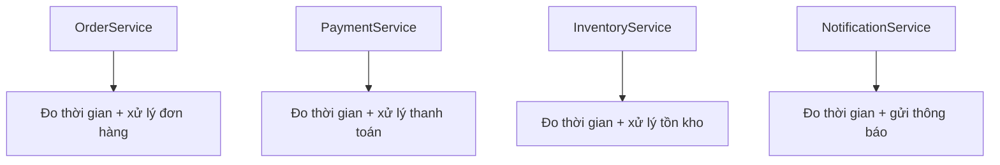
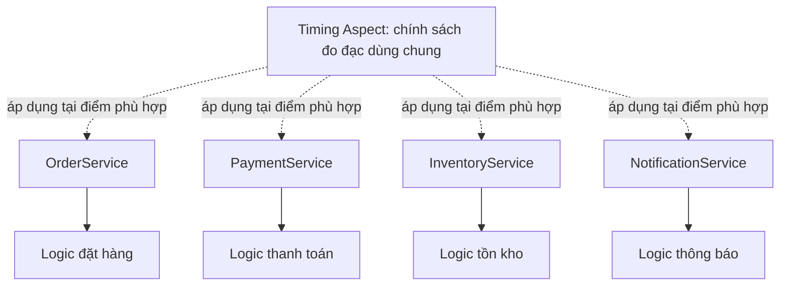
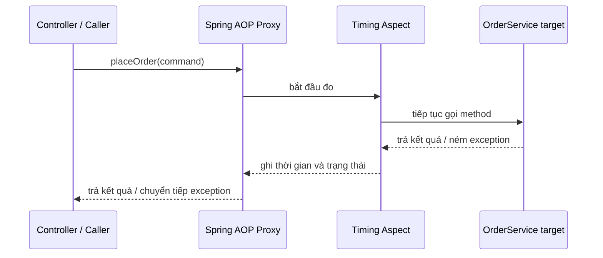
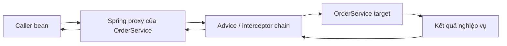
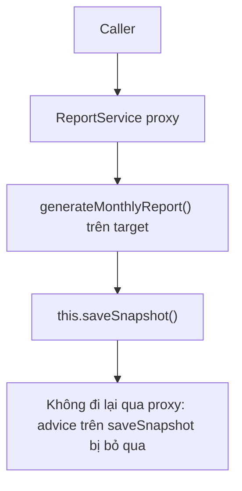
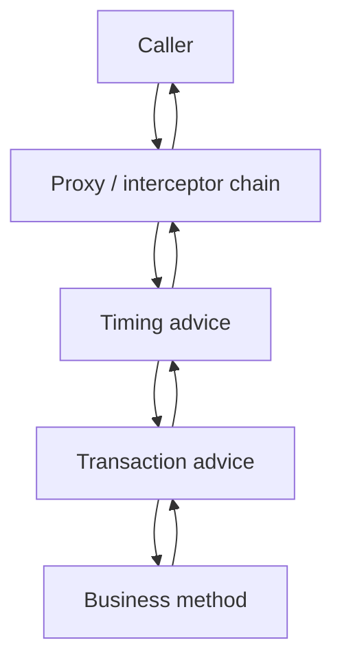

# Bài toán hành vi dùng chung và lý do có AOP

Trong một ứng dụng Spring Boot, nhiều phương thức nghiệp vụ có thể cần cùng một số hành vi phụ trợ: ghi log, đo thời gian thực thi, kiểm tra quyền, mở và đóng giao dịch, ghi audit, hoặc xử lý cache. Những hành vi đó không phải logic nghiệp vụ cốt lõi của từng phương thức, nhưng chúng phải được áp dụng **đúng chỗ, nhất quán và có thể bảo trì**.

Ví dụ, một phương thức đặt hàng có trách nhiệm kiểm tra sản phẩm, tính tiền và lưu đơn hàng. Một phương thức thanh toán xử lý yêu cầu thanh toán. Cả hai đều có thể cần ghi nhận thời gian thực thi, nhưng **đo thời gian không phải nhiệm vụ chính của nghiệp vụ đặt hàng hay thanh toán**.

Nếu sao chép code đo thời gian vào hàng chục service method, code nghiệp vụ bị trộn lẫn với code hạ tầng. Nếu quên một nơi hoặc thay đổi cách đo không đồng bộ, kết quả logging/metrics sẽ thiếu nhất quán. **Aspect-Oriented Programming (AOP)** ra đời để giúp tách những hành vi dùng chung như vậy ra khỏi logic chính và áp dụng chúng theo quy tắc rõ ràng.

Bài học thuộc chương **AOP và proxy** của *Spring Boot Fundamentals*. Trọng tâm là **bài toán dẫn tới nhu cầu AOP**, không chỉ cách nhớ annotation. Ta sẽ thấy vấn đề code lặp, những giới hạn của các phương án thông thường, khái niệm cross-cutting concern, cách Spring AOP dùng proxy và một ví dụ Spring Boot có thể tự thực hành.

Các ví dụ dựa trên Spring Boot 3.x, Java 17 trở lên và kiểu cấu hình Spring AOP phổ biến. Spring Boot và Spring Framework có thể thay đổi một số chi tiết triển khai theo phiên bản; các nguyên tắc giải thích ở đây tập trung vào cơ chế proxy-based Spring AOP.

## 1. Từ một phương thức nghiệp vụ đơn giản

Giả sử ứng dụng có service xử lý việc đặt hàng:

```java
package com.example.shop.order;

import org.springframework.stereotype.Service;

@Service
public class OrderService {

    private final OrderRepository orderRepository;

    public OrderService(OrderRepository orderRepository) {
        this.orderRepository = orderRepository;
    }

    public OrderReceipt placeOrder(CreateOrderCommand command) {
        validate(command);
        Order order = Order.from(command);
        orderRepository.save(order);
        return new OrderReceipt(order.getId());
    }

    private void validate(CreateOrderCommand command) {
        // Kiểm tra dữ liệu nghiệp vụ.
    }
}
```

`OrderRepository`, `CreateOrderCommand`, `Order` và `OrderReceipt` là những kiểu minh họa cho domain đặt hàng; muốn biên dịch ví dụ này cần triển khai chúng trong project. Phần đáng chú ý là `placeOrder` mô tả một chuỗi bước nghiệp vụ rõ ràng.

Giờ có yêu cầu mới: **ghi nhận thời gian xử lý mọi thao tác nghiệp vụ quan trọng**.

Một cách trực tiếp là thêm code vào service:

```java
public OrderReceipt placeOrder(CreateOrderCommand command) {
    long startedAt = System.nanoTime();
    try {
        validate(command);
        Order order = Order.from(command);
        orderRepository.save(order);
        return new OrderReceipt(order.getId());
    } finally {
        long elapsedNanos = System.nanoTime() - startedAt;
        log.info("placeOrder took {} ms",
                TimeUnit.NANOSECONDS.toMillis(elapsedNanos));
    }
}
```

Giải pháp hoạt động, nhưng không giải quyết được **bài toán ở quy mô toàn ứng dụng**.

Nếu có thêm `PaymentService.pay()`, `InventoryService.reserve()`, `CustomerService.register()` và nhiều method khác, ta phải thêm cùng một cấu trúc `startedAt → try/finally → log` ở từng nơi.

## 2. Vấn đề thứ nhất: logic nghiệp vụ và hành vi dùng chung bị trộn

Để thấy sự lặp lại, xét ba service:

```java
public void reserveInventory(String productCode) {
    long start = System.nanoTime();
    try {
        inventoryRepository.reserve(productCode);
    } finally {
        logDuration("reserveInventory", start);
    }
}

public PaymentResult charge(PaymentRequest request) {
    long start = System.nanoTime();
    try {
        return paymentClient.charge(request);
    } finally {
        logDuration("charge", start);
    }
}

public void sendConfirmation(long orderId) {
    long start = System.nanoTime();
    try {
        notificationClient.sendOrderConfirmation(orderId);
    } finally {
        logDuration("sendConfirmation", start);
    }
}
```

Có thể trích `logDuration()` thành utility dùng chung. Điều đó giảm một phần lặp lại, nhưng **mọi method vẫn phải tự nhớ gọi utility và tự bao quanh phần nghiệp vụ bằng try/finally**.

Vấn đề không chỉ là số dòng code:

| Vấn đề | Hệ quả khi dự án phát triển |
|---|---|
| Phân tán code hạ tầng | Khó đọc luồng nghiệp vụ chính. |
| Sao chép cấu trúc try/finally | Có nguy cơ thiếu nhánh exception, thiếu log hoặc ghi sai tên operation. |
| Thay đổi chính sách đo đạc | Phải sửa nhiều service, dễ bỏ sót. |
| Thêm một method mới | Lập trình viên phải nhớ áp dụng quy tắc thủ công. |
| Unit test nghiệp vụ | Có thể bị nhiễu bởi phụ thuộc logging, tracing, security hoặc transaction. |
| Quy chuẩn toàn hệ thống | Khó đảm bảo các module sử dụng chung một cách đo và ghi nhận kết quả. |

Giải pháp mong muốn không phải là “bỏ logging”. Ta muốn **giữ logging**, nhưng tách việc áp dụng nó khỏi code nghiệp vụ.

## 3. Cross-cutting concern là gì?

Một **concern** là một khía cạnh trách nhiệm của phần mềm. Logic tính tổng đơn hàng là một concern. Kết nối database là một concern. Ghi log thời gian thực thi cũng là một concern.

Một concern được gọi là **cross-cutting** khi cùng một chính sách/hành vi của nó xuất hiện **xuyên qua nhiều phần của hệ thống**, thay vì thuộc riêng một module nghiệp vụ.

Ví dụ:

| Concern | Vùng áp dụng | Hành vi dùng chung |
|---|---|---|
| Logging/observability | Nhiều service method | Ghi thông tin operation, trạng thái và thời gian. |
| Transaction | Những thao tác dữ liệu cần tính nguyên tử | Bắt đầu, commit hoặc rollback giao dịch. |
| Authorization | Những thao tác yêu cầu quyền | Kiểm tra principal có được phép thực hiện hành động không. |
| Cache | Những phép đọc có thể cache | Trả từ cache hoặc gọi method và lưu kết quả. |
| Auditing | Những thay đổi dữ liệu quan trọng | Ghi actor, action và kết quả theo chính sách. |
| Retry | Các lời gọi có lỗi tạm thời | Thử lại theo số lần và điều kiện được kiểm soát. |
| Tracing/metrics | Các operation cần đo | Tạo span, bộ đếm hoặc timer. |

Không phải mọi concern dùng ở nhiều nơi đều nên dùng AOP. Ví dụ, kiểm tra một quy tắc kinh doanh “đơn hàng không được vượt hạn mức” là **business rule**. Dù nhiều use case cần cùng rule, rule đó thường nên nằm trong domain service hoặc validation component rõ ràng, không nhất thiết ẩn sau một aspect.

**Tiêu chí cốt lõi:** hành vi cần áp dụng đồng nhất quanh nhiều điểm thực thi, nhưng không phải nội dung chính mà từng method muốn diễn đạt.

## 4. Từ scattered code tới một quy tắc tập trung

Hãy hình dung trước và sau khi tách concern.

**Không tách concern:**



**Khi áp dụng một aspect đo thời gian:**



Service tập trung diễn đạt nghiệp vụ. Aspect tập trung diễn đạt một chính sách dùng chung. Khi thay đổi cách đo hoặc tên metric, chúng ta sửa nơi định nghĩa concern thay vì đi sửa từng service.

Điều này thường được gọi là **separation of concerns**: phân tách trách nhiệm để từng phần có lý do thay đổi riêng.

## 5. Vì sao utility method chưa đủ?

Một utility như:

```java
public final class PerformanceUtils {

    public static void measure(String name, Runnable action) {
        long start = System.nanoTime();
        try {
            action.run();
        } finally {
            long millis = TimeUnit.NANOSECONDS.toMillis(
                    System.nanoTime() - start);
            System.out.println(name + " took " + millis + "ms");
        }
    }
}
```

đã gom được thuật toán đo thời gian. Nhưng nơi gọi vẫn phải chủ động viết:

```java
PerformanceUtils.measure(
        "reserveInventory",
        () -> inventoryRepository.reserve(productCode));
```

Với method có return value, checked exception, nested transaction hoặc lời gọi async, wrapper tự viết sẽ phức tạp hơn.

**Sự khác nhau quan trọng:**

- Utility chỉ cung cấp **hàm thực hiện hành vi chung**; lập trình viên phải gọi nó.
- AOP cho phép khai báo **quy tắc áp dụng hành vi chung** tại những điểm phù hợp mà không phải gọi thủ công từ từng method nghiệp vụ.

Điều này không có nghĩa utility là sai. Nếu hành vi chỉ được dùng ở hai chỗ hoặc cần được gọi tường minh để biểu đạt nghiệp vụ, utility có thể đơn giản và dễ hiểu hơn AOP.

## 6. Vì sao decorator hoặc wrapper thủ công cũng có giới hạn?

Một phương án khác là bọc một implementation bằng decorator:

```java
public interface PaymentService {
    PaymentResult pay(PaymentRequest request);
}

public final class LoggingPaymentService implements PaymentService {

    private final PaymentService delegate;

    public LoggingPaymentService(PaymentService delegate) {
        this.delegate = delegate;
    }

    @Override
    public PaymentResult pay(PaymentRequest request) {
        long start = System.nanoTime();
        try {
            return delegate.pay(request);
        } finally {
            logDuration("pay", start);
        }
    }
}
```

Decorator là một design pattern hữu ích: consumer nhận wrapper và wrapper ủy quyền cho implementation thật. Cách này minh bạch về luồng thực thi và có thể hoạt động mà không cần Spring.

Nhưng nếu mỗi loại service phải có một decorator riêng để thêm chính sách giống nhau, bạn lại phải viết nhiều wrapper và quản lý chúng qua Dependency Injection. **Spring AOP tự động hóa mô hình giao thoa giữa proxy/decorator và các quy tắc chọn method**, giảm nhu cầu tạo wrapper bằng tay cho từng service.

Tùy yêu cầu kiến trúc, decorator thủ công vẫn là lựa chọn tốt khi cần kiểm soát rõ ràng từng interface hoặc khi không muốn hành vi ẩn trong infrastructure.

## 7. AOP giải quyết bài toán bằng cách nào?

**Aspect-Oriented Programming** tổ chức hành vi dùng chung thành những khối riêng, rồi áp dụng chúng tại các điểm thực thi phù hợp.

Ở mức khái niệm:

1. Bạn viết business method như bình thường.
2. Bạn mô tả **điểm nào** cần được áp dụng hành vi chung.
3. Bạn viết **hành vi sẽ chạy trước, sau hoặc bao quanh** điểm đó.
4. Framework kết hợp hành vi dùng chung với lời gọi nghiệp vụ theo cơ chế AOP của nó.

Spring AOP thường dùng **proxy object**: consumer gọi proxy, proxy thực hiện advice rồi mới gọi method thật ở target.



Đây là mô hình cho một advice kiểu `@Around`. Với nhiều advisor, lời gọi có thể đi qua một chuỗi interceptor trước khi đến method đích.

### 7.1. Business code không trực tiếp gọi aspect

Điểm hữu ích của AOP:

```java
public OrderReceipt placeOrder(CreateOrderCommand command) {
    validate(command);
    Order order = Order.from(command);
    orderRepository.save(order);
    return new OrderReceipt(order.getId());
}
```

Method vẫn chỉ thể hiện nghiệp vụ. Bạn không phải chèn `logDuration(...)` vào đây nếu chính sách timing đã được aspect xử lý và lời gọi đi qua proxy.

### 7.2. AOP không tự hiểu mọi ý định nghiệp vụ

AOP không thể đoán “method này cần audit, method kia không”. Tác giả hệ thống phải khai báo quy tắc áp dụng, ví dụ:

- Chỉ những method có `@TimedOperation`.
- Những public method trong package `service`.
- Những method phù hợp với một pointcut expression cụ thể.

Quy tắc càng rộng thì rủi ro áp dụng ngoài ý muốn càng cao. Đối với tác vụ có side effect, nên chọn ranh giới chính xác và kiểm thử rõ ràng.

## 8. Thuật ngữ AOP cần nắm

| Thuật ngữ | Ý nghĩa trong ngữ cảnh Spring AOP |
|---|---|
| **Aspect** | Một module mô tả concern dùng chung, ví dụ timing hoặc audit. |
| **Join point** | Điểm trong quá trình thực thi mà advice có thể tham gia; Spring AOP chủ yếu hỗ trợ method execution join points. |
| **Pointcut** | Quy tắc xác định những join point nào được áp dụng. |
| **Advice** | Code chạy tại join point đã được chọn, ví dụ trước/sau/bao quanh method. |
| **Target object** | Object chứa logic nghiệp vụ thật. |
| **Proxy** | Object trung gian nhận lời gọi từ consumer và cho phép advisor can thiệp. |
| **Advisor** | Trong Spring, cấu trúc kết hợp advice với pointcut/điều kiện áp dụng phù hợp. |
| **Weaving** | Khái niệm kết hợp aspect với code mục tiêu; Spring AOP thường thực hiện qua proxy tại runtime, khác với AspectJ bytecode weaving. |

### 8.1. Ví dụ đối chiếu thuật ngữ

Giả sử:

```java
@TimedOperation("order.place")
public OrderReceipt placeOrder(CreateOrderCommand command) {
    // Business logic
}
```

- **Target:** instance `OrderService` chứa `placeOrder`.
- **Join point:** lần thực thi method `placeOrder` qua lời gọi được intercept.
- **Pointcut:** quy tắc chọn các method gắn `@TimedOperation`.
- **Advice:** code đo thời gian trước và sau lần gọi.
- **Aspect:** class định nghĩa pointcut/advice cho timing.
- **Proxy:** object được inject cho caller và điều phối advice quanh target.

Bạn không cần nhớ mọi thuật ngữ trước khi lập trình. Nhưng khi đọc tài liệu Spring AOP, hãy liên hệ từng từ với “chọn ở đâu” và “làm gì” để tránh nhầm.

## 9. Các loại advice và trách nhiệm của chúng

Spring hỗ trợ nhiều kiểu advice trong phong cách `@AspectJ`:

| Annotation | Khi chạy | Tình huống phù hợp |
|---|---|---|
| `@Before` | Trước khi method đích được thực hiện | Ghi sự kiện bắt đầu, kiểm tra metadata đơn giản. |
| `@AfterReturning` | Sau khi method trả về bình thường | Ghi nhận thành công hoặc kết quả được phép quan sát. |
| `@AfterThrowing` | Khi method kết thúc bằng exception khớp | Quan sát hoặc audit lỗi. |
| `@After` | Sau khi method kết thúc, dù thành công hay lỗi | Dọn dẹp hoặc ghi thông tin kết thúc. |
| `@Around` | Bao quanh toàn bộ lời gọi | Đo thời gian, điều khiển tiếp tục lời gọi, ghi cả thành công và lỗi. |

Ví dụ ở dạng phương thức minh họa:

```java
@Before("execution(* com.example.demo.service..*(..))")
public void beforeServiceCall() {
    log.debug("Calling a service method");
}
```

Điểm `execution(* com.example.demo.service..*(..))` là một pointcut expression phù hợp với các method trong vùng package được chỉ định. Đây là ví dụ nhận diện cú pháp; trong dự án thật cần tránh ghi log quá rộng nếu các method mang dữ liệu nhạy cảm hoặc có tần suất cao.

### 9.1. Vì sao đo thời gian thường dùng @Around?

Muốn đo **khoảng thời gian từ lúc gọi đến lúc method trả về hoặc ném lỗi**, advice phải chạy ở hai phía của lần gọi. `@Around` cho phép bắt đầu đo trước `proceed()` và kết thúc đo trong `finally`.

```java
@Around("execution(* com.example.demo.service..*(..))")
public Object measure(ProceedingJoinPoint joinPoint) throws Throwable {
    long start = System.nanoTime();
    try {
        return joinPoint.proceed();
    } finally {
        long elapsed = System.nanoTime() - start;
        // Ghi metric hoặc log an toàn.
    }
}
```

**`joinPoint.proceed()` là bước tiếp tục lời gọi.** Nếu một advice kiểu Around không gọi `proceed()`, method nghiệp vụ có thể không được thực hiện. Đây là khả năng mạnh nhưng cũng là nguồn bug khi dùng AOP không đúng mục đích.

## 10. Ví dụ hoàn chỉnh: đo thời gian qua annotation riêng

Ta sẽ tạo một cơ chế AOP nhỏ để đánh dấu các operation cần đo thời gian mà không phải chèn code timing vào từng method. Ví dụ có bốn phần:

1. Dependency AOP.
2. Annotation `@TimedOperation`.
3. Aspect xử lý annotation.
4. Service sử dụng annotation và một runner để gọi từ bên ngoài bean.

### 10.1. Thêm Spring Boot AOP starter

Với Gradle:

```groovy
dependencies {
    implementation 'org.springframework.boot:spring-boot-starter'
    implementation 'org.springframework.boot:spring-boot-starter-aop'
}
```

Với Maven, thêm dependency tương ứng trong `pom.xml`:

```xml
<dependency>
    <groupId>org.springframework.boot</groupId>
    <artifactId>spring-boot-starter-aop</artifactId>
</dependency>
```

Các ví dụ giả định project đã có cấu hình quản lý phiên bản dependency của Spring Boot. Starter AOP cung cấp hạ tầng cần thiết cho AOP theo cơ chế Boot; trong cấu hình Boot thông thường, AOP auto-configuration có thể kích hoạt proxy support khi dependency phù hợp có mặt.

### 10.2. Định nghĩa annotation @TimedOperation

```java
package com.example.demo.aop;

import java.lang.annotation.ElementType;
import java.lang.annotation.Retention;
import java.lang.annotation.RetentionPolicy;
import java.lang.annotation.Target;

@Target(ElementType.METHOD)
@Retention(RetentionPolicy.RUNTIME)
public @interface TimedOperation {
    String value();
}
```

Annotation này chỉ là metadata. Nếu không có aspect đọc nó, gắn `@TimedOperation` vào method **không tự tạo log hoặc metric**.

### 10.3. Viết aspect xử lý thời gian

```java
package com.example.demo.aop;

import java.util.concurrent.TimeUnit;

import org.aspectj.lang.ProceedingJoinPoint;
import org.aspectj.lang.annotation.Around;
import org.aspectj.lang.annotation.Aspect;
import org.slf4j.Logger;
import org.slf4j.LoggerFactory;
import org.springframework.stereotype.Component;

@Aspect
@Component
public class TimedOperationAspect {

    private static final Logger log =
            LoggerFactory.getLogger(TimedOperationAspect.class);

    @Around("@annotation(timedOperation)")
    public Object measure(
            ProceedingJoinPoint joinPoint,
            TimedOperation timedOperation) throws Throwable {

        long startNanos = System.nanoTime();
        boolean succeeded = false;

        try {
            Object result = joinPoint.proceed();
            succeeded = true;
            return result;
        } finally {
            long elapsedMillis = TimeUnit.NANOSECONDS.toMillis(
                    System.nanoTime() - startNanos);

            log.info(
                    "operation={}, success={}, elapsedMs={}",
                    timedOperation.value(),
                    succeeded,
                    elapsedMillis);
        }
    }
}
```

Giải thích:

- `@Aspect` đánh dấu class chứa advice/pointcut.
- `@Component` giúp Spring quản lý instance aspect dưới dạng bean trong phạm vi component scan.
- `@Around("@annotation(timedOperation)")` chọn method có annotation `@TimedOperation` và bind annotation đó vào tham số advice.
- `System.nanoTime()` phù hợp để đo khoảng thời gian trôi qua, không dùng để hiển thị giờ lịch.
- `joinPoint.proceed()` chuyển điều khiển tới bước kế tiếp trong advice chain hoặc tới method đích.
- `finally` ghi thời gian kể cả khi method ném exception.
- `throws Throwable` cho phép advice chuyển tiếp exception từ method đích.

Advice không tự nuốt exception: `finally` chạy rồi exception tiếp tục được ném ra cho caller. Biến `succeeded` là `true` chỉ khi `proceed()` trả về bình thường.

**Bảo mật và observability:** đoạn code chỉ log tên operation cố định và thời gian, không log tham số hoặc return value. Trong dự án thật, không nên đưa password, access token, PII hoặc các giá trị có độ cardinality rất cao vào metric/log chỉ vì có AOP.

### 10.4. Dùng annotation ở service

```java
package com.example.demo.order;

import com.example.demo.aop.TimedOperation;
import org.springframework.stereotype.Service;

@Service
public class OrderService {

    @TimedOperation("order.place")
    public String placeOrder(String productCode) {
        // Thực hiện nghiệp vụ; đây chỉ là ví dụ tối giản.
        return "Order accepted for " + productCode;
    }
}
```

Logic nghiệp vụ không cần biết `TimedOperationAspect` sử dụng Logger nào hoặc đo elapsed time thế nào. Nó chỉ đánh dấu operation quan trọng bằng annotation.

### 10.5. Gọi service từ một bean khác

```java
package com.example.demo;

import com.example.demo.order.OrderService;
import org.springframework.boot.ApplicationRunner;
import org.springframework.context.annotation.Bean;
import org.springframework.context.annotation.Configuration;

@Configuration(proxyBeanMethods = false)
public class DemoRunnerConfiguration {

    @Bean
    ApplicationRunner demoRunner(OrderService orderService) {
        return args -> {
            String result = orderService.placeOrder("BOOK-123");
            System.out.println(result);
        };
    }
}
```

Ở đây `OrderService` được inject từ container, vì vậy lời gọi từ runner thông thường đi qua Spring bean reference. Nếu service được proxy, aspect có cơ hội intercept method.

Log minh họa có thể là:

```text
Order accepted for BOOK-123
operation=order.place, success=true, elapsedMs=0
```

Thứ tự hiển thị giữa log và `System.out` có thể khác do các luồng output và logger. Thời gian `elapsedMs` phụ thuộc thời gian thực thi; giá trị 0 ms chỉ minh họa một method chạy rất nhanh.

### 10.6. Điều kiện để ví dụ có hiệu lực

Trong ứng dụng thực tế, hãy bảo đảm:

- `spring-boot-starter-aop` hoặc hạ tầng Spring AOP phù hợp có mặt.
- `TimedOperationAspect` được đăng ký làm bean.
- `OrderService` được đăng ký làm bean.
- Lời gọi đi qua bean proxy mà Spring công bố.
- Method phù hợp pointcut và có thể được intercept theo cơ chế proxy.

Chỉ tạo annotation nhưng quên aspect hoặc gọi trực tiếp một object bằng `new OrderService()` không làm AOP tự hoạt động.

## 11. Proxy là chìa khóa của Spring AOP

Spring AOP thường hoạt động qua proxy thay vì sửa trực tiếp source code của `OrderService`.



Container có thể tạo target object rồi công bố một bean reference là proxy. Những thành phần khác inject bean sẽ nhận object phù hợp cho lời gọi có advice.

### 11.1. JDK dynamic proxy và class-based proxy

Hai cơ chế proxy phổ biến:

| Cơ chế | Cách hoạt động | Điểm cần biết |
|---|---|---|
| **JDK dynamic proxy** | Tạo proxy cho interface do target triển khai. | Consumer thường nên phụ thuộc interface. |
| **Class-based proxy (CGLIB)** | Tạo subclass proxy của target class. | Final class/final method không thể được override theo cách thông thường. |

Trong cấu hình Spring Boot phổ biến, class-based proxy là mặc định cho AOP; có thể điều chỉnh bằng `spring.aop.proxy-target-class` trong trường hợp được hỗ trợ.

```properties
spring.aop.proxy-target-class=false
```

Khi chuyển sang interface-based proxy, kiểu được inject và việc target có interface hay không đều cần được xem xét. Không nên đổi cấu hình proxy chỉ để “làm cho aspect chạy” mà chưa xác định điểm gọi, điều kiện pointcut và kiểu bean.

### 11.2. Proxy không phải “mọi lời gọi method đều được intercept”

Spring AOP dựa trên lời gọi **đi qua proxy**. Nếu method trong một object gọi method khác của chính object đó, lời gọi nội bộ thường không đi qua proxy.

Đây là nguồn nhầm lẫn quan trọng nhất khi bắt đầu học AOP.

## 12. Giới hạn self-invocation: gọi method nội bộ không qua proxy

Xét service:

```java
@Service
public class ReportService {

    public void generateMonthlyReport() {
        saveSnapshot();
    }

    @TimedOperation("report.save-snapshot")
    public void saveSnapshot() {
        // Lưu dữ liệu báo cáo.
    }
}
```

Khi một caller bên ngoài bean gọi `reportService.generateMonthlyReport()` qua proxy, advice chỉ chạy nếu method `generateMonthlyReport` khớp pointcut. Lời gọi `saveSnapshot()` **bên trong cùng target object** tương đương `this.saveSnapshot()` và không đi lại qua proxy, nên advice trên `saveSnapshot` có thể không được thực hiện.

Ngược lại, nếu một bean khác gọi trực tiếp `reportService.saveSnapshot()` qua reference do Spring inject, advice có thể chạy theo đúng pointcut.



### 12.1. Cách tổ chức lại theo trách nhiệm

Một hướng giải quyết tốt là tách phần cần advice thành một Spring bean khác:

```java
@Service
public class SnapshotService {

    @TimedOperation("report.save-snapshot")
    public void saveSnapshot() {
        // Lưu dữ liệu.
    }
}

@Service
public class ReportService {

    private final SnapshotService snapshotService;

    public ReportService(SnapshotService snapshotService) {
        this.snapshotService = snapshotService;
    }

    public void generateMonthlyReport() {
        snapshotService.saveSnapshot();
    }
}
```

Giờ `ReportService` gọi `SnapshotService` qua dependency được inject, giúp lời gọi đi qua proxy của snapshot service nếu bean đó được AOP proxy.

Việc tách bean nên dựa trên ranh giới trách nhiệm hợp lý, không chỉ để né một lỗi kỹ thuật. Các cách như lấy self-reference proxy hoặc dùng `AopContext.currentProxy()` tồn tại nhưng làm code gắn chặt với hạ tầng AOP và thường không phải lựa chọn đầu tiên.

## 13. Scope và giới hạn khác của proxy-based AOP

Spring AOP không phải bytecode instrumentation tổng quát cho mọi thao tác Java. Một số giới hạn quan trọng:

1. **Đối tượng cần là Spring-managed bean.** Object tạo trực tiếp bằng `new` ngoài container không tự có proxy của Spring.
2. **Điểm gọi cần đi qua proxy.** Self-invocation thường bỏ qua advice.
3. **Spring AOP tập trung vào method execution.** Không hỗ trợ trực tiếp mọi loại join point như field read/write, constructor execution hoặc static initialization của AspectJ weaving.
4. **Method private không thể được advice theo cơ chế proxy thông thường.** Nó không phải một lời gọi public/override được proxy intercept.
5. **Final method hoặc final class có hạn chế đối với class-based proxy.** Subclass proxy không override được final method/class.
6. **Method ở thời điểm object initialization cần thận trọng.** Đừng dựa vào advice trên method được gọi trong constructor hoặc `@PostConstruct` để giả định proxy đã sẵn sàng theo mọi đường gọi.
7. **Asynchronous/reactive behavior cần hiểu riêng.** Timer quanh một method trả `CompletableFuture` hoặc `Mono` có thể chỉ đo thời gian tạo object bất đồng bộ, không nhất thiết là thời gian hoàn tất toàn bộ công việc.

Ví dụ:

```java
OrderService service = new OrderService();
service.placeOrder("BOOK-123");
```

Giả sử `OrderService` trong ví dụ này có constructor không đối số, `new` tạo object Java thuần; nó không phải Spring bean proxy nên aspect của Spring không tự chạy. Với ví dụ `OrderService` ở mục 10, constructor mặc định của Java phù hợp vì không khai báo constructor khác.

### 13.1. @Transactional cũng có thể gặp self-invocation

Một tình huống thường gặp:

```java
@Service
public class OrderManagementService {

    public void process() {
        saveInTransaction();
    }

    @Transactional
    public void saveInTransaction() {
        // Thao tác database.
    }
}
```

Nếu lời gọi `saveInTransaction()` chỉ xuất phát từ `process()` trên cùng object, nó có thể bỏ qua transaction interceptor proxy. Vì vậy annotation có mặt trong source **không bảo đảm hành vi luôn được áp dụng** nếu đường gọi không đi qua proxy.

Cần nhớ `@Transactional` còn yêu cầu transaction management và `PlatformTransactionManager` phù hợp. Nó không tự tạo ra giao dịch hữu ích chỉ vì có annotation.

## 14. Spring AOP và AspectJ weaving khác nhau

Spring AOP và AspectJ đều liên quan AOP nhưng có cơ chế và phạm vi khác nhau:

| Tiêu chí | Spring AOP | AspectJ weaving |
|---|---|---|
| Cơ chế thường gặp | Proxy-based, Spring container quản lý. | Compile-time/post-compile/load-time weaving vào bytecode. |
| Join point chủ yếu | Method execution trên Spring bean. | Có thể hỗ trợ nhiều loại join point hơn. |
| Object tạo ngoài Spring | Không được proxy tự động bởi Spring AOP. | Tùy cơ chế weaving và phạm vi được weave. |
| Self-invocation | Thường bỏ qua proxy advice. | Có thể intercept nếu join point đã được weave phù hợp. |
| Độ phức tạp triển khai | Thường dễ tích hợp vào Spring Boot. | Cần cấu hình weaving và build/runtime phù hợp. |

Annotation `@Aspect` và cú pháp pointcut kiểu AspectJ mà Spring AOP dùng **không có nghĩa ứng dụng đang dùng AspectJ bytecode weaving**.

Với logging, metrics, transactions, caching và các concern phổ biến quanh lời gọi Spring bean, proxy-based AOP thường đủ. Chỉ cân nhắc weaving khi có yêu cầu thực sự vượt phạm vi proxy, sau khi đánh giá độ phức tạp và chi phí vận hành.

## 15. Ba ví dụ quen thuộc trong Spring Boot

Không cần tự viết aspect cho mọi concern. Spring ecosystem đã cung cấp nhiều tính năng dùng cơ chế proxy/interceptor tương tự.

### 15.1. Transaction: @Transactional

```java
@Service
public class TransferService {

    private final AccountRepository repository;

    public TransferService(AccountRepository repository) {
        this.repository = repository;
    }

    @Transactional
    public void transfer(long fromId, long toId, long amount) {
        repository.debit(fromId, amount);
        repository.credit(toId, amount);
    }
}
```

Ý tưởng:

- Consumer gọi method qua bean proxy phù hợp.
- Transaction interceptor bắt đầu hoặc tham gia giao dịch theo cấu hình.
- Method nghiệp vụ thực hiện debit/credit.
- Interceptor xử lý commit hoặc rollback theo chính sách.

Ứng dụng không cần chèn mã quản lý transaction thủ công vào từng method nghiệp vụ. Nhưng điều này **không** bảo đảm mọi lỗi đều rollback: quy tắc rollback mặc định và cấu hình transaction cần được hiểu đúng, chẳng hạn mặc định thường rollback với unchecked exceptions.

### 15.2. Cache: @Cacheable

```java
@Service
public class ProductCatalogService {

    @Cacheable(cacheNames = "products", key = "#productId")
    public ProductView getProduct(long productId) {
        return loadFromDatabase(productId);
    }
}
```

Nếu caching đã được bật và có cache manager phù hợp, proxy/interceptor có thể kiểm tra cache trước khi thực thi method, rồi lưu kết quả khi phù hợp. Caching có thể **bỏ qua việc gọi target method** khi đã có cache hit.

Cần kích hoạt caching theo cấu hình thích hợp, thường bằng `@EnableCaching`. Không nên giả định chỉ thêm `@Cacheable` là cache sẽ có hiệu lực trong mọi project.

### 15.3. Method authorization: @PreAuthorize

```java
@Service
public class AccountAdministrationService {

    @PreAuthorize("hasAuthority('ACCOUNT_ADMIN')")
    public void deactivateAccount(long accountId) {
        // Thực hiện thay đổi trạng thái tài khoản.
    }
}
```

Khi Spring Security method security được cấu hình và bật (chẳng hạn qua `@EnableMethodSecurity`), interceptor có thể kiểm tra quyền trước khi cho phương thức thực thi.

Security là một ví dụ mạnh cho cross-cutting concern, nhưng cần thiết kế policy cẩn thận. Không được coi AOP aspect ghi log tùy biến là một giải pháp thay thế các cơ chế authorization đáng tin cậy của Spring Security.

### 15.4. Điểm chung và điểm khác

Transaction, caching và method security đều có thể dựa trên interception quanh lời gọi method. Tuy vậy:

- Mỗi tính năng có hạ tầng và dependency riêng.
- Không phải mọi tính năng đều được bật bởi `spring-boot-starter-aop`.
- Annotation chỉ có hiệu lực khi cấu hình, advisor và đường gọi phù hợp.
- Thứ tự interceptor có thể ảnh hưởng semantics, ví dụ cache nằm ngoài hay trong transaction.

## 16. Khi AOP đem lại lợi ích lớn nhất

AOP đáng cân nhắc khi hội đủ các đặc điểm:

1. **Concern xuất hiện ở nhiều nơi.** Không phải một hành vi chỉ có ở một method.
2. **Quy tắc áp dụng có thể diễn đạt rõ.** Chẳng hạn một annotation hoặc một package/service boundary.
3. **Hành vi thuộc infrastructure/policy chung.** Không chứa quyết định nghiệp vụ quan trọng cần nhìn thấy trực tiếp trong code.
4. **Áp dụng nhất quán có giá trị.** Quên một nơi sẽ ảnh hưởng logging, audit hoặc bảo đảm vận hành.
5. **Có cách kiểm thử tác dụng.** Đội ngũ kiểm tra được advice đã chạy khi cần và không chạy khi không cần.

Một ví dụ thích hợp là đo thời gian cho những operation quan trọng bằng `@TimedOperation`. Policy timing có thể được thay đổi tập trung mà không ảnh hưởng tới triển khai nghiệp vụ.

### 16.1. Những lợi ích thực chất

| Lợi ích | Giải thích |
|---|---|
| Giảm lặp code hạ tầng | Một advice được tái sử dụng ở nhiều join point. |
| Tách trách nhiệm | Service tập trung nghiệp vụ, aspect tập trung policy. |
| Dễ đổi policy dùng chung | Sửa một aspect hoặc pointcut để thay đổi cách áp dụng. |
| Nhất quán quan sát | Các operation được chọn có cùng format/log/metric policy. |
| Giữ code nghiệp vụ đơn giản | Không cần bao quanh mỗi method bằng mã đo/kiểm tra lặp lại. |
| Gắn quy tắc với metadata | Có thể dùng annotation để biểu đạt method cần concern nào. |

Những lợi ích này chỉ tồn tại khi pointcut hợp lý và đội ngũ hiểu được hành vi ngầm do proxy bổ sung.

## 17. Khi nào không nên dùng AOP?

AOP có trade-off: nó làm hành vi runtime **không hiển thị hoàn toàn trong thân method**. Người đọc cần biết có advisor nào có thể tác động tới lời gọi.

Không nên tự động chọn AOP trong những tình huống:

- Hành vi dùng chung chỉ có vài chỗ, gọi utility tường minh đơn giản hơn.
- Đây là **business workflow** phải được đọc theo thứ tự rõ ràng, ví dụ tính phí, xác nhận đơn, trừ tồn kho và gửi sự kiện.
- Cần chặn HTTP request/response ở ranh giới web; `Filter` hoặc `HandlerInterceptor` có thể phù hợp hơn.
- Cần xử lý mọi exception API theo contract HTTP; `@ControllerAdvice`/`@ExceptionHandler` thường rõ ràng hơn aspect bắt mọi exception.
- Cần intercept internal calls, constructor hoặc field access ngoài phạm vi Spring proxy; Spring AOP không đáp ứng trực tiếp.
- Cần thao tác dữ liệu nhạy cảm tại một ranh giới có yêu cầu security đặc thù; dùng extension point đáng tin cậy của framework.
- Concern có quá nhiều nhánh tùy theo ngữ cảnh nghiệp vụ, khiến pointcut/advice khó dự đoán.

### 17.1. So sánh công cụ cho từng ranh giới

| Mục tiêu | Công cụ nên cân nhắc trước |
|---|---|
| Đo thời gian của một nhóm service method | AOP hoặc observability instrumentation phù hợp. |
| Logging metadata của HTTP request | Servlet `Filter`, WebFlux `WebFilter` hoặc interceptor phù hợp. |
| Gắn dữ liệu vào response REST | Spring MVC `ResponseBodyAdvice` hoặc thiết kế response layer. |
| Xử lý lỗi API đồng nhất | `@ControllerAdvice`. |
| Kiểm tra transaction boundary | `@Transactional` và transaction infrastructure. |
| Tái sử dụng một công thức nghiệp vụ | Domain service, utility hoặc strategy rõ ràng. |
| Thêm hành vi quanh một interface cụ thể | Decorator có thể đơn giản hơn AOP. |
| Áp chính sách phân quyền method | Spring Security method authorization. |

Chọn công cụ theo **ranh giới cần can thiệp**, không chỉ theo cảm giác “đây là code chung nên chắc phải dùng aspect”.

## 18. Vấn đề pointcut quá rộng

Một pointcut như:

```java
@Around("execution(* com.example..*(..))")
```

có thể match rất nhiều method trong ứng dụng. Khi phạm vi quá rộng:

- Logging có thể tăng mạnh và ảnh hưởng hiệu năng.
- Những method không liên quan cũng bị intercept.
- Có nguy cơ ghi log dữ liệu nhạy cảm nếu advice không được thiết kế an toàn.
- Code hạ tầng có thể bị gọi lồng nhau, tạo log khó đọc.
- Khi package hoặc tên class thay đổi, phạm vi matching có thể thay đổi ngoài dự kiến.

Một lựa chọn thường dễ kiểm soát hơn là marker annotation:

```java
@TimedOperation("inventory.reserve")
public void reserve(String productCode) {
    // ...
}
```

Khi đó chỉ các method được đánh dấu theo policy mới được đo. Dù vậy, annotation-driven AOP vẫn cần code review và test để bảo đảm không bỏ sót các điểm cần quan sát.

### 18.1. Nên tránh “ẩn” thay đổi nghiệp vụ trong aspect

Đo thời gian và ghi metric là hành vi quan sát. Trái lại, một aspect tự đổi số tiền thanh toán hoặc âm thầm bỏ qua giao dịch dựa trên logic nghiệp vụ sẽ khiến đường thực thi khó hiểu.

Advice kiểu `@Around` có thể thay đổi return value, ném exception hoặc bỏ qua `proceed()`, nhưng **có khả năng làm được không có nghĩa nên làm**. Với logic quyết định nghiệp vụ, ưu tiên thiết kế rõ ràng bằng service/domain model.

## 19. Advice và exception: điều gì cần giữ nguyên?

Một concern như logging hoặc timing nên giữ được semantics của method nghiệp vụ:

```java
@Around("@annotation(timedOperation)")
public Object measure(ProceedingJoinPoint pjp,
                      TimedOperation timedOperation) throws Throwable {
    long start = System.nanoTime();
    try {
        return pjp.proceed();
    } finally {
        logDuration(timedOperation.value(), System.nanoTime() - start);
    }
}
```

Khi target trả kết quả, advice chuyển tiếp kết quả đó. Khi target ném exception, `finally` ghi duration nhưng exception vẫn đi lên caller.

Một lỗi dễ gặp là vô tình nuốt exception:

```java
try {
    return pjp.proceed();
} catch (Throwable ex) {
    log.warn("Business call failed", ex);
    return null; // Có thể phá vỡ contract của method.
}
```

Đối với một timing aspect chỉ có trách nhiệm quan sát, việc trả `null` thay vì ném exception thường là sai: caller không còn nhận được tín hiệu lỗi gốc, transaction hoặc retry policy phía trên cũng có thể bị ảnh hưởng.

Nếu thực sự muốn fallback, retry hoặc exception translation, hãy xem đó là **một policy riêng có contract rõ ràng**, không âm thầm thêm vào aspect đo thời gian.

## 20. AOP có chi phí và cần quan sát chính nó

Thêm proxy và interceptor chain làm phát sinh một phần chi phí runtime. Trong nhiều ứng dụng business, overhead trực tiếp của một advice nhỏ là thấp so với I/O mạng/database; nhưng chi phí logging, serialization, metric tag cardinality hoặc việc ghi log quá thường xuyên có thể đáng kể.

Một số nguyên tắc:

1. **Không ghi mọi argument mặc định.** Chúng có thể chứa token, thông tin cá nhân, payload lớn hoặc object có `toString()` đắt.
2. **Chọn operation name ổn định.** Không dùng ID người dùng/đơn hàng làm tên metric động.
3. **Không phát log trùng nhiều tầng mà không có mục đích.** Controller, service và repository cùng bị log có thể tạo lượng dữ liệu lớn.
4. **Không biến advice thành nơi gọi mạng đồng bộ không timeout.** Việc ghi audit/metric có thể làm chậm hoặc thất bại request nghiệp vụ.
5. **Hiểu phương thức async/reactive.** Thời điểm method trả `Mono`/`CompletableFuture` không chắc là thời điểm tác vụ kết thúc.
6. **Đo ở ranh giới đúng.** Đo mỗi method nhỏ không nhất thiết giúp hiểu latency của toàn request.
7. **Tránh side effect ngoài ý muốn.** Concern quan sát nên có tác động tối thiểu tới nghiệp vụ.

Spring Boot có hệ sinh thái observability, metrics và tracing; với mục đích đo lường tiêu chuẩn, nên cân nhắc instrumentation có sẵn trước khi tự xây dựng một hệ thống AOP phức tạp.

## 21. Thứ tự nhiều advice và khả năng kết hợp

Một service có thể đồng thời được áp dụng nhiều concern:

```java
@TimedOperation("order.place")
@Transactional
public OrderReceipt placeOrder(CreateOrderCommand command) {
    // ...
}
```

Lời gọi có thể đi qua chuỗi advisor:



Sơ đồ chỉ minh họa **một thứ tự có thể xảy ra**. Thứ tự thực tế phụ thuộc cấu hình advisor ordering và những infrastructure advisor đang có. Nếu timing nằm ngoài transaction, thời gian đo có thể bao gồm phần thiết lập/hoàn tất giao dịch; nếu nằm trong, phạm vi đo có thể khác.

Khi thứ tự có ý nghĩa, có thể sử dụng `@Order`/`Ordered` ở những aspect tự viết, đồng thời phải xét thứ tự của các infrastructure advisor. Đừng giả định tất cả advisor luôn chạy theo thứ tự annotation xuất hiện trên source.

### 21.1. Vì sao thứ tự ảnh hưởng kết quả?

Một số câu hỏi cần trả lời:

- Audit nên ghi trước hay sau khi transaction commit?
- Retry có nên bao quanh transaction mới cho mỗi lần thử không?
- Cache hit có nên được tính vào timing của business method không?
- Authorization phải diễn ra trước khi method thực hiện side effect chứ?

Đây là những quyết định kiến trúc. AOP cung cấp cơ chế để phối hợp nhiều concern, nhưng không tự định nghĩa được policy đúng cho mọi hệ thống.

## 22. Kiểm thử: xác nhận advice thực sự chạy

Một unit test chỉ tạo target bằng `new` không chứng minh Spring AOP đang hoạt động. Nếu muốn xác nhận lời gọi qua proxy, cần tạo Spring application context có aspect và target bean.

Một cách đơn giản là dùng `@SpringBootTest`:

```java
package com.example.demo;

import static org.assertj.core.api.Assertions.assertThat;

import com.example.demo.order.OrderService;
import org.junit.jupiter.api.Test;
import org.springframework.aop.support.AopUtils;
import org.springframework.beans.factory.annotation.Autowired;
import org.springframework.boot.test.context.SpringBootTest;

@SpringBootTest
class AopProxyPresenceTest {

    @Autowired
    OrderService orderService;

    @Test
    void orderServiceIsProxied() {
        assertThat(AopUtils.isAopProxy(orderService)).isTrue();
    }
}
```

Test này chỉ xác nhận Spring bean reference là AOP proxy khi aspect và hạ tầng AOP đã được cấu hình phù hợp. Nó **không tự chứng minh timing log có nội dung đúng**.

Để kiểm thử hành vi advice, nên thay hoặc trừu tượng hóa nơi ghi nhận metric/timing bằng một recorder có thể quan sát trong test, rồi:

1. Gọi method annotated qua bean reference do Spring inject.
2. Xác nhận method nghiệp vụ vẫn trả đúng kết quả.
3. Xác nhận recorder ghi đúng operation name.
4. Kiểm thử trường hợp method ném exception: advice vẫn ghi thời gian và exception vẫn được chuyển tiếp.
5. Kiểm thử method không có annotation: recorder không ghi operation ngoài mong đợi.

### 22.1. Kiểm tra self-invocation

Tạo một bean có hai method: `outer()` gọi `inner()`, chỉ `inner()` được đánh dấu. Gọi `outer()` từ bean khác và quan sát advice trên `inner()` có được chạy không. Sau đó tách `inner()` sang bean riêng để thấy sự khác biệt khi lời gọi đi qua proxy.

### 22.2. Kiểm tra method không có annotation

Nếu aspect dùng `@annotation(TimedOperation)`, method không gắn annotation không nên bị áp dụng. Một test như vậy bảo vệ against pointcut matching quá rộng sau khi refactor.

### 22.3. Đừng chỉ assert proxy tồn tại

Proxy có thể tồn tại vì advisor khác như transaction hoặc security, ngay cả khi pointcut timing của bạn không match. Vì vậy, nếu cần xác nhận concern cụ thể, hãy assert hành vi cụ thể hoặc thông tin interceptor phù hợp, không chỉ gọi `AopUtils.isAopProxy`.

## 23. Debug khi @Aspect không chạy

Khi một aspect “không có tác dụng”, hãy kiểm tra theo thứ tự:

1. **Dependency AOP có mặt không?** Với ví dụ aspect tự viết, project có `spring-boot-starter-aop` hoặc cấu hình proxy support phù hợp không?
2. **Aspect có được đăng ký làm Spring bean không?** `@Aspect` không tự thay thế `@Component` hoặc `@Bean`.
3. **Target có là Spring-managed bean không?** Code có gọi `new` trực tiếp không?
4. **Lời gọi có đi qua proxy không?** Có phải self-invocation trong cùng target?
5. **Pointcut có match không?** Annotation có runtime retention không, package/method signature có phù hợp không?
6. **Method có thể proxy không?** Có private/final hay vấn đề proxy interface/class không?
7. **Có nested/async execution không?** Advice đo thời gian synchronous method hay công việc diễn ra sau khi method trả?
8. **Có advisor khác tác động không?** Ordering và exception translation có làm kết quả khác kỳ vọng không?
9. **Test có gọi Spring bean reference thật không?** Test dùng `new Target()` thường không đi qua Spring proxy.

Một số dấu hiệu:

| Hiện tượng | Hướng điều tra |
|---|---|
| Annotation có trên method nhưng không log | Aspect chưa đăng ký, pointcut không khớp hoặc lời gọi không qua proxy. |
| Gọi từ controller có advice, gọi từ method khác cùng service thì không | Self-invocation. |
| `new OrderService()` không kích hoạt aspect | Object không do Spring quản lý. |
| Final method trên class-based proxy không được intercept | Giới hạn subclass proxy. |
| Có proxy nhưng timing advice không chạy | Proxy có thể do advisor khác; kiểm tra pointcut timing. |
| Method trả `CompletableFuture` rất nhanh, timer luôn nhỏ | Advice đo thời gian tạo future, không nhất thiết thời gian future hoàn tất. |
| Method ném exception nhưng log “success” | Advice ghi trạng thái sai hoặc catch làm thay đổi luồng exception. |

## 24. Những hiểu lầm thường gặp

### “AOP chỉ để ghi log”

Sai. Logging là ví dụ dễ thấy, nhưng AOP còn hữu ích với transaction, security, caching, audit và những chính sách thực thi dùng chung phù hợp.

### “@Aspect trên class bất kỳ là Spring tự áp dụng”

Chưa đủ. Aspect cần được container phát hiện/đăng ký, hạ tầng AOP cần có và lời gọi phải match pointcut qua proxy.

### “Có annotation thì mọi lời gọi đều được intercept”

Không. Spring AOP dựa trên proxy. Self-invocation, object `new` ngoài Spring và những method không thể proxy là các trường hợp có thể bỏ qua advice.

### “Aspect tốt hơn service helper trong mọi trường hợp”

Không. Với logic nghiệp vụ hoặc ít điểm dùng, code tường minh thường đơn giản hơn. AOP hữu ích khi sự nhất quán của một concern cắt ngang nhiều service đủ quan trọng để biện minh cho abstraction bổ sung.

### “Spring AOP chính là AspectJ weaving”

Không. Spring dùng cú pháp annotation và pointcut kiểu AspectJ nhưng proxy-based Spring AOP có phạm vi khác với AspectJ weaving.

### “@Around chỉ để log, không ảnh hưởng kết quả”

Không. Advice Around có thể kiểm soát việc gọi `proceed()`, return value và exception. Vì quyền lực đó, phải thiết kế cẩn thận để không làm sai hợp đồng nghiệp vụ.

## 25. Bài thực hành tổng hợp

Hãy tạo một ứng dụng Spring Boot có `spring-boot-starter-aop` và thực hiện:

**Bước A — Nhận diện code lặp.** Viết hai service method, mỗi method tự đo elapsed time bằng `System.nanoTime()` và `try/finally`.

**Bước B — Trích xuất utility.** Tạo `PerformanceUtils.measure` rồi so sánh xem service còn phải gọi wrapper thủ công ở bao nhiêu nơi.

**Bước C — Tạo annotation.** Viết `@TimedOperation` có `@Retention(RUNTIME)` và `@Target(METHOD)`.

**Bước D — Tạo aspect.** Dùng `@Aspect` và `@Around("@annotation(timedOperation)")`; ghi operation name, elapsed time và success flag.

**Bước E — Chọn method.** Đánh dấu hai method nghiệp vụ bằng annotation; giữ một method thứ ba không có annotation để so sánh.

**Bước F — Gọi qua Spring bean.** Tạo `ApplicationRunner` inject service và gọi các method. Xác nhận advice chỉ chạy cho method được đánh dấu.

**Bước G — Thử lỗi.** Cho một method ném `IllegalStateException`; quan sát log elapsed time xuất hiện nhưng exception vẫn đến caller.

**Bước H — Thử new.** Tạo một instance thủ công và gọi method; so sánh với bean do Spring inject.

**Bước I — Thử self-invocation.** Tạo `outer()` gọi `inner()` trong cùng bean, chỉ `inner()` được đánh dấu. So sánh với cách tách `inner()` sang một service khác.

**Bước J — Thử @Transactional.** Nếu project có database và transaction manager phù hợp, thêm `@Transactional` rồi xem lý do transaction cũng có thể phụ thuộc ranh giới proxy.

**Bước K — Quan sát proxy.** Trong integration test, dùng `AopUtils.isAopProxy` để kiểm tra bean reference, rồi xác nhận hành vi advice bằng recorder/test double thay vì chỉ xem log thủ công.

**Bước L — Đánh giá trade-off.** Trả lời: nếu concern chỉ dùng ở hai method, bạn sẽ giữ utility, dùng decorator hay dùng aspect? Vì sao?

Sau mỗi bước, hãy ghi rõ: **logic dùng chung ở đâu, điểm nào được advice, lời gọi có đi qua proxy không và hành vi nghiệp vụ có giữ nguyên không**.

## 26. Câu hỏi tự đánh giá

1. Thế nào là một cross-cutting concern? Nêu ba ví dụ trong Spring Boot.
2. Vì sao sao chép `try/finally` đo thời gian vào nhiều service không phải giải pháp tốt khi hệ thống lớn lên?
3. Utility giảm lặp logic ở điểm nào nhưng vẫn cần caller làm gì?
4. Decorator thủ công và Spring AOP proxy có quan hệ gì?
5. Aspect, advice, pointcut và join point khác nhau thế nào?
6. Spring AOP hỗ trợ loại join point nào là chủ yếu?
7. Vì sao một lời gọi từ controller tới service có thể được intercept nhưng lời gọi từ `this.outer()` tới `this.inner()` thì không?
8. Tại sao `@Aspect` không tự bảo đảm aspect được dùng trong ứng dụng?
9. `@Around` cần gọi `proceed()` khi nào? Chuyện gì có thể xảy ra nếu bỏ qua?
10. Vì sao một timing advice nên truyền tiếp exception thay vì trả `null`?
11. Final method và private method tạo ra giới hạn gì cho proxy?
12. Spring AOP khác AspectJ bytecode weaving như thế nào?
13. `@Transactional`, `@Cacheable` và `@PreAuthorize` minh họa cross-cutting concern ra sao?
14. Tại sao việc dùng nhiều advisor có thể làm thứ tự transaction/timing trở nên quan trọng?
15. AOP có phù hợp để thực hiện các bước workflow nghiệp vụ như tính tiền, trừ kho và gửi email không?
16. Một test chỉ xác nhận `AopUtils.isAopProxy` có đủ để kết luận timing aspect chạy đúng không?
17. Khi nào `Filter` hoặc `@ControllerAdvice` phù hợp hơn AOP ở service layer?
18. Với một method reactive trả `Mono`, đo từ trước tới sau `proceed()` có chắc phản ánh thời gian hoàn tất tác vụ không?

### Mẫu giải thích hoàn chỉnh

> Nhiều method trong ứng dụng Spring Boot cần cùng những hành vi hạ tầng như logging, timing, transaction, authorization hoặc caching. Đây là những cross-cutting concerns vì cùng một chính sách xuất hiện xuyên qua các vùng nghiệp vụ khác nhau. Nếu sao chép code liên quan vào từng service, code sẽ phân tán, dễ bỏ sót và khó bảo trì. Utility và decorator giúp tái sử dụng nhưng vẫn cần gọi hoặc bọc thủ công ở nhiều nơi. AOP giải quyết bằng cách tách chính sách thành aspect, dùng pointcut chọn method và advice xử lý hành vi trước, sau hoặc bao quanh method. Spring AOP chủ yếu dùng proxy: caller gọi bean proxy, advice được áp dụng rồi target method mới chạy. Vì vậy AOP đặc biệt hữu ích cho hành vi dùng chung quanh lời gọi Spring bean, nhưng nó có giới hạn: object tạo ngoài Spring, self-invocation và những method không thể proxy có thể không được advice. AOP cũng không thay thế thiết kế nghiệp vụ rõ ràng; chỉ nên dùng khi ranh giới áp dụng concern có ý nghĩa và có thể kiểm thử.

Khi nhìn thấy một hành vi lặp lại ở nhiều service, hãy hỏi ba câu: **Đây có thực sự là cross-cutting concern? Có một quy tắc rõ ràng để chọn chỗ áp dụng không? Lời gọi thực tế có đi qua Spring proxy không?** Trả lời được ba câu hỏi này là bạn đã hiểu **bài toán hành vi dùng chung và lý do có AOP**.
