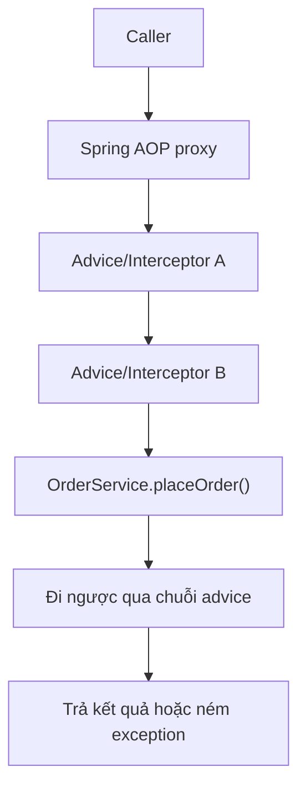
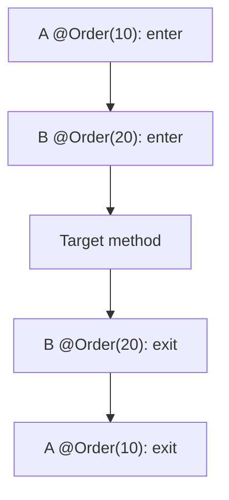

# Thứ tự advice và giới hạn của việc suy luận từ annotation đơn lẻ

> **Spring Boot Fundamentals · AOP và proxy**  
> Khi nhiều advice cùng áp dụng lên một phương thức, Spring AOP cần quyết định advice nào chạy trước, advice nào chạy sau và advice nào bao quanh lời gọi tiếp theo. Annotation như `@Before`, `@AfterReturning`, `@Around` và `@Order` cung cấp những manh mối quan trọng, nhưng **chỉ nhìn vào annotation trên một method hoặc một class chưa đủ để kết luận toàn bộ thứ tự chạy ở runtime**. Kết quả còn phụ thuộc pointcut có khớp không, bean có đi qua proxy không, số lượng advisor trong chuỗi, thứ tự ưu tiên và hành vi của các interceptor hạ tầng như transaction hay cache.

## 1. Bối cảnh: một lời gọi có thể đi qua nhiều advice

Giả sử một ứng dụng có service xử lý đơn hàng:

```java
@Service
public class OrderService {

    public String placeOrder(String orderId) {
        // Lưu đơn hàng và thực hiện nghiệp vụ.
        return "PLACED:" + orderId;
    }
}
```

Đội phát triển muốn:

- Ghi log lúc bắt đầu và kết thúc.
- Đo thời gian xử lý.
- Kiểm tra audit.
- Quản lý transaction khi thao tác dữ liệu.
- Có thể kiểm tra quyền truy cập và cache ở những điểm gọi phù hợp.

Một lời gọi tưởng chừng đơn giản:

```java
orderService.placeOrder("O-100");
```

có thể đi qua một hay nhiều proxy/interceptor trước khi thân method `placeOrder` thật được gọi.



Vấn đề đặt ra không chỉ là “có `@Around` hay không”, mà còn là:

1. Advice có thực sự được áp dụng cho lời gọi này không?
2. Advice nằm ở đâu trong advisor chain?
3. Nó chạy **trước** khi gọi method, **sau khi trả về**, **sau khi ném lỗi**, hay **bao quanh** lần gọi?
4. Có advice nào chặn không cho method chạy không?
5. Có proxy khác, transaction advisor hoặc cache advisor tham gia không?

Bài học này tách các yếu tố đó để bạn suy luận đúng.

## 2. Phân biệt aspect, pointcut, advice, advisor và proxy

Trước khi xét thứ tự, cần phân biệt các khái niệm.

| Khái niệm | Ý nghĩa |
| --- | --- |
| **Join point** | Vị trí có thể áp dụng hành vi cắt ngang; Spring AOP proxy chủ yếu hỗ trợ **method execution** |
| **Pointcut** | Điều kiện lựa chọn join point nào phù hợp |
| **Advice** | Hành vi thực thi trước/sau/bao quanh join point |
| **Aspect** | Nhóm pointcut và advice theo một concern, ví dụ auditing |
| **Advisor** | Kết hợp advice/interceptor với thông tin pointcut để Spring quyết định áp dụng |
| **Proxy** | Object trung gian nhận lời gọi, chạy interceptor chain rồi gọi target |

Một class có `@Aspect` chưa chắc trở thành aspect hoạt động. Nó còn phải được Spring quản lý như một bean, và AOP infrastructure phải có khả năng phát hiện các advice của nó.

Ví dụ Spring Boot 3.x thường thêm dependency:

```xml
<dependency>
    <groupId>org.springframework.boot</groupId>
    <artifactId>spring-boot-starter-aop</artifactId>
</dependency>
```

Khi auto-configuration AOP phù hợp được kích hoạt, Spring Boot có thể tự cấu hình proxy infrastructure; với một ứng dụng Spring Framework không dùng hỗ trợ auto-configuration đó, có thể cần `@EnableAspectJAutoProxy`.

Lưu ý: ví dụ trong bài mô tả **Spring AOP dựa trên proxy**, không phải toàn bộ khả năng AspectJ compile-time weaving hoặc load-time weaving.

### 2.1. Có annotation không có nghĩa lời gọi đã bị intercept

Ví dụ class:

```java
@Aspect
public class LoggingAspect {

    @Before("execution(* com.example.orders.OrderService.placeOrder(..))")
    public void beforeOrder() {
        System.out.println("before order");
    }
}
```

Nếu `LoggingAspect` không được đăng ký làm Spring bean hoặc AOP chưa được cấu hình, advice có thể không hoạt động. Nếu lời gọi không đi qua proxy hoặc pointcut không khớp, annotation vẫn hiện diện trong source nhưng không có log.

**Muốn suy luận thứ tự advice, trước hết phải xác nhận những advice nào thực sự có mặt trong chuỗi.**

## 3. Năm loại advice phổ biến và thời điểm kích hoạt

Spring AOP hỗ trợ những dạng advice theo phong cách annotation:

| Advice annotation | Thời điểm và ý nghĩa |
| --- | --- |
| `@Before` | Trước khi thực hiện join point, khi luồng đã đi đến advice này |
| `@AfterReturning` | Sau khi join point hoàn thành bình thường và trả về |
| `@AfterThrowing` | Khi luồng đi qua advice này với exception phù hợp |
| `@After` | Tương tự `finally`: thực hiện khi luồng thoát khỏi phần được advice bao quanh |
| `@Around` | Bao quanh bước kế tiếp của chain; quyết định có gọi `proceed()` hay không |

Điểm quan trọng: “trước” và “sau” là **so với phần lời gọi mà advice đang bao quanh**, không nhất thiết so với mọi thao tác của toàn hệ thống.

### 3.1. `@Before`

```java
@Aspect
@Component
public class TraceAspect {

    @Before("execution(* com.example.orders.OrderService.placeOrder(..))")
    public void beforeOrder() {
        System.out.println("BEFORE: place order");
    }
}
```

Advice này chạy khi lời gọi được proxy xử lý, pointcut khớp và luồng đi đến nó. Nó thường hữu ích cho log, audit nhẹ hoặc kiểm tra điều kiện trước lời gọi.

Nếu `@Before` ném exception, bước tiếp theo của chuỗi và target có thể không được thực thi.

### 3.2. `@AfterReturning`

```java
@AfterReturning(
        pointcut = "execution(* com.example.orders.OrderService.placeOrder(..))",
        returning = "result")
public void afterSuccess(Object result) {
    System.out.println("RETURNED: " + result);
}
```

Advice này chỉ áp dụng khi phần lời gọi tương ứng hoàn thành bình thường. Nó **không** chạy cho một exception thoát ra qua advisor chain.

Gán lại biến `result` trong advice không phải cách để thay return value của target. Nếu muốn thay kết quả trả về cho caller, thường cần `@Around` và trả object thay thế.

### 3.3. `@AfterThrowing`

```java
@AfterThrowing(
        pointcut = "execution(* com.example.orders.OrderService.placeOrder(..))",
        throwing = "error")
public void afterFailure(Throwable error) {
    System.out.println("THREW: " + error.getClass().getSimpleName());
}
```

Advice này chạy khi một exception phù hợp được truyền ra qua nó. Nếu tham số được khai báo cụ thể hơn, chẳng hạn `IllegalArgumentException`, nó chỉ nhận những exception phù hợp với type đó.

`@AfterThrowing` thích hợp cho ghi nhận lỗi, không phải cơ chế tự nuốt lỗi chỉ bằng cách trả về `void`. Nếu muốn xử lý exception và trả một giá trị fallback, dùng `@Around` với code bắt lỗi có chủ đích.

### 3.4. `@After`

```java
@After("execution(* com.example.orders.OrderService.placeOrder(..))")
public void afterOrder() {
    System.out.println("AFTER: cleanup");
}
```

`@After` có semantics giống `finally`: thực hiện khi phần lời gọi được bao quanh kết thúc, kể cả khi trả về bình thường hoặc ném exception.

Tuy nhiên, gọi nó là “sau mọi advice khác trong ứng dụng” là không đúng. Thứ tự giữa nhiều aspect phụ thuộc precedence và cấu trúc lồng nhau.

### 3.5. `@Around`

```java
@Around("execution(* com.example.orders.OrderService.placeOrder(..))")
public Object measure(ProceedingJoinPoint joinPoint)
        throws Throwable {

    long started = System.nanoTime();

    try {
        return joinPoint.proceed();
    } finally {
        long elapsed = System.nanoTime() - started;
        System.out.println("Elapsed ns: " + elapsed);
    }
}
```

`@Around` có khả năng kiểm soát mạnh nhất. `proceed()` gọi bước tiếp theo trong interceptor chain, và cuối chuỗi sẽ đến target nếu không bị chặn.

Advice này có thể:

- Gọi `proceed()` đúng một lần.
- Bỏ qua `proceed()` để không thực hiện bước tiếp theo.
- Thay thế kết quả trả về.
- Bắt hoặc chuyển đổi exception.
- Trong những ngữ cảnh hợp lệ, gọi `proceed()` nhiều lần, dẫn tới thực thi phần bên trong nhiều lần.

Do đó, chỉ thấy `@Around` không đủ để kết luận target chắc chắn được thực thi đúng một lần.

## 4. `@Order` quy định precedence như thế nào?

Khi nhiều aspect cùng khớp một join point, Spring có thể dùng `@Order` hoặc cơ chế `Ordered` để xác định **độ ưu tiên**.

Ví dụ:

```java
@Aspect
@Component
@Order(10)
public class SecurityTraceAspect {
    // Advice cho các method được chọn.
}
```

```java
@Aspect
@Component
@Order(20)
public class LatencyTraceAspect {
    // Advice cho cùng các method.
}
```

Quy tắc nền tảng:

- **Giá trị order càng nhỏ thì precedence càng cao.**
- `@Order(10)` có precedence cao hơn `@Order(20)`.
- Với advice cùng match và cùng thuộc một chuỗi, advice có precedence cao **chạy trước trên đường vào**.
- Trên đường ra, advice có precedence cao thường **hoàn thành sau**, vì nó bao quanh phần advice có precedence thấp hơn.

### 4.1. Thứ tự vào và ra khác nhau

Ví dụ có hai `@Around`:

```text
Order(10)  A: before proceed()
Order(20)  B: before proceed()
           Target method
Order(20)  B: after proceed()
Order(10)  A: after proceed()
```

Biểu diễn:



Người học dễ nhầm rằng “order nhỏ chạy trước” đồng nghĩa **mọi log của aspect đó** luôn xuất hiện trước. Thực tế nó chạy trước ở đường vào, nhưng thường chạy sau ở đường ra.

### 4.2. Vì sao có hiện tượng đảo chiều?

Có thể hình dung mỗi `@Around` như một lớp bao:

```text
A(
    B(
        target()
    )
)
```

Khi gọi hàm lồng nhau:

1. Đi vào A.
2. Đi vào B.
3. Chạy target.
4. Trở ra B.
5. Trở ra A.

Đây là bản chất của interceptor chain, không phải một trường hợp ngoại lệ của `@Order`.

### 4.3. Giá trị âm, số 0 và `LOWEST_PRECEDENCE`

`@Order` nhận số nguyên. Giá trị nhỏ hơn có ưu tiên cao hơn, kể cả số âm:

```java
@Order(-10)
@Aspect
@Component
class CriticalTraceAspect {
}
```

Hằng `Ordered.HIGHEST_PRECEDENCE` biểu thị độ ưu tiên rất cao; `Ordered.LOWEST_PRECEDENCE` biểu thị độ ưu tiên rất thấp.

Không nên tùy ý dùng `HIGHEST_PRECEDENCE` cho mọi aspect vì sẽ tạo cạnh tranh ở cùng mức ưu tiên. Hãy chọn các khoảng order có ý nghĩa, ví dụ 100 cho concern cần bao ngoài và 200 cho concern chạy phía trong, rồi tài liệu hóa quyết định đó.

### 4.4. Giá trị order bằng nhau không chứng minh thứ tự ổn định

Nếu hai aspect cùng `@Order(10)` hoặc cùng dùng precedence mặc định, không nên suy luận thứ tự chỉ từ tên class, thứ tự file Java hoặc vị trí `@Component`.

Chi tiết đăng ký và sorting có thể ảnh hưởng kết quả khi precedence bằng nhau. Nếu nghiệp vụ cần thứ tự cụ thể, hãy **đặt các precedence khác nhau**, không dựa vào thứ tự ngẫu nhiên được quan sát trong một lần chạy.

## 5. Ví dụ hoàn chỉnh: hai `@Around` aspect

Ví dụ này ghi lại thứ tự gọi bằng một recorder, không phụ thuộc vào việc so sánh thời điểm hiển thị log giữa các luồng.

### 5.1. Bộ ghi sự kiện

```java
package com.example.aop;

import java.util.List;
import java.util.concurrent.CopyOnWriteArrayList;

import org.springframework.stereotype.Component;

@Component
public class TraceRecorder {

    private final List<String> events =
            new CopyOnWriteArrayList<>();

    public void add(String event) {
        events.add(event);
    }

    public List<String> snapshot() {
        return List.copyOf(events);
    }

    public void clear() {
        events.clear();
    }
}
```

`CopyOnWriteArrayList` làm cho phép ghi từ nhiều thread an toàn ở mức collection, nhưng không biến thứ tự giữa các thread chạy song song thành một thứ tự tổng thể có ý nghĩa nghiệp vụ. Ví dụ này chỉ dùng một lời gọi đồng bộ.

### 5.2. Service đích

```java
package com.example.aop;

import org.springframework.stereotype.Service;

@Service
public class DemoService {

    private final TraceRecorder recorder;

    public DemoService(TraceRecorder recorder) {
        this.recorder = recorder;
    }

    public String execute() {
        recorder.add("TARGET");
        return "OK";
    }
}
```

### 5.3. Aspect bao ngoài

```java
package com.example.aop;

import org.aspectj.lang.ProceedingJoinPoint;
import org.aspectj.lang.annotation.Around;
import org.aspectj.lang.annotation.Aspect;
import org.springframework.core.annotation.Order;
import org.springframework.stereotype.Component;

@Aspect
@Component
@Order(10)
public class OuterAspect {

    private final TraceRecorder recorder;

    public OuterAspect(TraceRecorder recorder) {
        this.recorder = recorder;
    }

    @Around("execution(* com.example.aop.DemoService.execute(..))")
    public Object around(ProceedingJoinPoint pjp)
            throws Throwable {

        recorder.add("OUTER-IN");

        try {
            return pjp.proceed();
        } finally {
            recorder.add("OUTER-OUT");
        }
    }
}
```

### 5.4. Aspect bao trong

```java
package com.example.aop;

import org.aspectj.lang.ProceedingJoinPoint;
import org.aspectj.lang.annotation.Around;
import org.aspectj.lang.annotation.Aspect;
import org.springframework.core.annotation.Order;
import org.springframework.stereotype.Component;

@Aspect
@Component
@Order(20)
public class InnerAspect {

    private final TraceRecorder recorder;

    public InnerAspect(TraceRecorder recorder) {
        this.recorder = recorder;
    }

    @Around("execution(* com.example.aop.DemoService.execute(..))")
    public Object around(ProceedingJoinPoint pjp)
            throws Throwable {

        recorder.add("INNER-IN");

        try {
            return pjp.proceed();
        } finally {
            recorder.add("INNER-OUT");
        }
    }
}
```

### 5.5. Kết quả mong đợi

Khi caller gọi `demoService.execute()` **qua Spring proxy**, recorder ghi:

```text
OUTER-IN
INNER-IN
TARGET
INNER-OUT
OUTER-OUT
```

Đây là kết quả của hai around advisors có precedence rõ ràng. Thứ tự không phụ thuộc vào thứ tự file nguồn, tên class hay tên method advice.

### 5.6. Khi service ném exception

Nếu `execute()` ném exception, các khối `finally` vẫn chạy:

```text
OUTER-IN
INNER-IN
TARGET
INNER-OUT
OUTER-OUT
Exception trở về caller
```

Ngược lại, nếu inner aspect không gọi `proceed()`, `TARGET` sẽ không xuất hiện. Nếu một around advice bắt lỗi và trả fallback, caller có thể nhận kết quả bình thường thay vì exception ban đầu. Vì thế, một bảng order không thể tự giải thích toàn bộ đường đi nếu chưa biết nội dung advice.

## 6. Thứ tự của nhiều `@Before` và nhiều advice trên đường ra

`@Order` đặc biệt dễ hiểu khi so sánh các advice cùng loại nhưng thuộc **các aspect khác nhau**.

Giả sử:

```java
@Aspect
@Component
@Order(10)
class AAspect {

    @Before("execution(* com.example.aop.DemoService.execute(..))")
    void beforeA() {
        System.out.println("A-before");
    }
}
```

```java
@Aspect
@Component
@Order(20)
class BAspect {

    @Before("execution(* com.example.aop.DemoService.execute(..))")
    void beforeB() {
        System.out.println("B-before");
    }
}
```

Nếu cả hai advice cùng khớp một method, trên đường vào sẽ thấy:

```text
A-before
B-before
Target
```

Đối với advice chạy trên đường ra, precedence cao hơn thường được xử lý **sau** phần có precedence thấp hơn. Ví dụ hai advice `@AfterReturning` ở các aspect khác nhau thường cho thứ tự:

```text
Target returns normally
B-after-returning
A-after-returning
```

Đừng ghi nhớ một công thức “A luôn trước B”. Hãy hình dung aspect precedence cao đang bao ngoài phần có precedence thấp và xét hướng di chuyển qua chuỗi.

### 6.1. Advice loại khác nhau có cùng thời điểm không?

Không. `@Before` chạy trên đường vào; `@AfterReturning` chỉ chạy khi nhánh return bình thường; `@AfterThrowing` chỉ chạy khi có exception phù hợp; `@After` chạy theo kiểu finally; `@Around` định nghĩa cả phần vào và ra.

Do đó, muốn suy luận chính xác phải biết **loại advice, precedence và đường đi thành công/thất bại**.

## 7. Thứ tự nhiều advice trong cùng một `@Aspect`

Đây là giới hạn quan trọng của việc đọc annotation.

Ví dụ:

```java
@Aspect
@Component
public class AuditAspect {

    @Before("execution(* com.example.aop.DemoService.execute(..))")
    public void validateSomething() {
        // ...
    }

    @Before("execution(* com.example.aop.DemoService.execute(..))")
    public void recordSomething() {
        // ...
    }
}
```

Không thể khẳng định `validateSomething()` sẽ chạy trước `recordSomething()` **chỉ vì nó được viết ở trên trong source code**. Thứ tự khai báo method Java không phải contract dùng để sắp xếp các advice cùng loại trong một aspect.

### 7.1. Spring có precedence giữa các loại advice trong cùng aspect

Trong các phiên bản Spring Framework hiện đại, advice methods của cùng một `@Aspect` cần khớp cùng join point được gán precedence theo loại, từ cao xuống thấp:

1. `@Around`.
2. `@Before`.
3. `@After`.
4. `@AfterReturning`.
5. `@AfterThrowing`.

Đây là **thứ tự precedence nội bộ**, không phải một danh sách log chạy từ trên xuống dưới theo thời gian.

Một chi tiết quan trọng: `@After` có semantics giống `finally`, nên trên đường rời join point nó có thể **thực thi sau** `@AfterReturning` hoặc `@AfterThrowing` của cùng aspect, dù precedence kỹ thuật của `@After` được xếp cao hơn hai loại đó.

### 7.2. Vì sao precedence và thời điểm log khác nhau?

Giả sử một aspect chứa `@Around`, `@AfterReturning` và `@After`. `@Around` có thể bao ngoài. `@After` là finally advice, vì vậy khi lời gọi rời join point, nó có thể được thực thi sau phần after-returning tương ứng.

Phải xét:

- Advice nào bao quanh advice nào.
- Code chạy trước hay sau `proceed()`.
- Luồng kết thúc bình thường hay ném exception.

Không biến bảng precedence nội bộ thành khẳng định cứng rằng thứ tự log sẽ là `Around → Before → After → AfterReturning → AfterThrowing`. Trong một lần gọi bình thường, `@AfterThrowing` thậm chí không được kích hoạt.

### 7.3. Nếu hai advice cùng loại cần thứ tự chắc chắn

Ví dụ hai tác vụ phải chạy trước target theo thứ tự:

1. Chuẩn hóa context.
2. Ghi dấu bắt đầu audit.

Nên cân nhắc:

- **Gộp chúng vào cùng một advice** và gọi hai helper theo thứ tự tường minh.
- **Tách thành hai `@Aspect`** với `@Order` khác nhau.
- Nếu vấn đề là chuỗi nghiệp vụ chặt chẽ, **đưa logic vào service** thay vì dùng AOP cho mọi bước.

Không dựa vào vị trí hai method trong cùng class để biểu diễn dependency thứ tự bắt buộc.

### 7.4. `@Order` nên đặt ở đâu?

Với các aspect theo kiểu `@Aspect` của Spring AOP, cách diễn đạt rõ ràng là đặt `@Order` ở **cấp aspect class**:

```java
@Aspect
@Component
@Order(100)
public class MetricsAspect {
    // ...
}
```

Không nên tự gắn `@Order` lên mỗi advice method rồi giả định Spring sẽ dùng các giá trị đó để sắp xếp mọi advice trong cùng aspect theo ý muốn. Nếu cần order từng concern, tách concern thành các aspect riêng hoặc thiết kế lại điểm gọi.

## 8. Vì sao `@Around` khiến suy luận chỉ từ annotation thường sai?

Hai advice đều mang `@Around` có thể có hành vi hoàn toàn khác nhau.

### 8.1. Around gọi `proceed()` đúng một lần

```java
@Around("execution(* com.example.aop.DemoService.execute(..))")
public Object passThrough(ProceedingJoinPoint pjp)
        throws Throwable {
    return pjp.proceed();
}
```

Đây là mẫu truyền lời gọi tiếp theo. Nếu không có advice khác chặn, target có thể được thực thi một lần.

### 8.2. Around bỏ qua `proceed()`

```java
@Around("execution(* com.example.aop.DemoService.execute(..))")
public Object shortCircuit(ProceedingJoinPoint pjp) {
    return "CACHED";
}
```

Lời gọi không đi tiếp qua phần chain bên trong. Những advice nằm phía trong và target có thể không chạy.

Cần bảo đảm giá trị trả về phù hợp kiểu return của method đích. Nếu method trả `void` hoặc primitive, các quy tắc tương thích giá trị trả về cần được tôn trọng.

### 8.3. Around bắt exception

```java
@Around("execution(* com.example.aop.DemoService.execute(..))")
public Object withFallback(ProceedingJoinPoint pjp)
        throws Throwable {

    try {
        return pjp.proceed();
    } catch (IllegalStateException error) {
        return "FALLBACK";
    }
}
```

Khi exception bị bắt ở một around advice phía ngoài, những advice phía trong vẫn có thể đã nhìn thấy exception và chạy `@AfterThrowing`. Nhưng caller ở phía ngoài lại nhận `FALLBACK`.

Vì vậy, không thể chỉ thấy một advice `@AfterThrowing` và kết luận caller cuối cùng chắc chắn sẽ nhận exception.

### 8.4. Around gọi `proceed()` nhiều lần

Một around advice có thể triển khai retry theo thiết kế phù hợp. Khi đó phần chain bên trong và target có thể chạy nhiều lần.

Ví dụ khái niệm:

```java
@Around("execution(* com.example.aop.DemoService.execute(..))")
public Object retryOnce(ProceedingJoinPoint pjp)
        throws Throwable {

    try {
        return pjp.proceed();
    } catch (TransientFailure error) {
        return pjp.proceed();
    }
}
```

`TransientFailure` là exception minh họa của ứng dụng. Retry như vậy không phải một cơ chế retry production hoàn chỉnh: phải cân nhắc idempotency, transaction boundary, side effect, backoff, exception classification và số lần thử.

Điều quan trọng cho bài học: với cùng `@Around` và cùng `@Order`, **số lần target chạy có thể khác nhau tùy code bên trong advice**.

## 9. Thứ tự advice khi trả về bình thường và khi ném exception

Ta có thể nghĩ theo một số kịch bản.

### 9.1. Thành công bình thường

Giả sử advice khớp đầy đủ và không có short-circuit:

```text
Around: before proceed()
Before
Target
AfterReturning
After (finally)
Around: after proceed()/finally
Caller receives return value
```

Đây là trình tự khái niệm cho một chuỗi được thiết kế tương ứng, **không phải kết quả tự động của mọi tổ hợp aspect khác nhau**. Nếu advice thuộc nhiều aspect với precedence khác nhau, trình tự xen kẽ có thể thay đổi theo cấu trúc bao quanh.

### 9.2. Target ném exception

```text
Around: before proceed()
Before
Target throws
AfterThrowing (nếu exception phù hợp)
After (finally)
Around: catch/finally
Caller receives exception, trừ khi around xử lý nó
```

Như kịch bản thành công, đây là hình dung cơ chế, không thay cho việc kiểm tra advisor chain thực tế.

### 9.3. `@Before` tự ném exception

Nếu `@Before` ném lỗi trước khi đến target, những advice bao ngoài nó có thể nhìn thấy lỗi trong phần `catch`/`finally` của mình. Nhưng những advice nằm trong, chưa được gọi đến, sẽ không có cơ hội chạy.

Vì vậy, không thể nói “mọi `@AfterThrowing` sẽ chạy mỗi khi có exception ở bất kỳ chỗ nào” mà không biết exception xuất hiện ở vị trí nào trong chain.

### 9.4. `@AfterReturning` hoặc `@After` tự ném exception

Một advice trên đường ra cũng có thể ném lỗi. Khi đó kết quả cuối cùng có thể bị thay đổi hoặc exception ban đầu bị che mất.

Ví dụ target trả thành công, nhưng `@AfterReturning` ném exception: caller có thể thấy exception do advice, không phải kết quả target đã trả.

Do vậy logging/metrics advice thường nên có error-handling phù hợp và tránh phát sinh exception không cần thiết làm thay đổi nghiệp vụ.

## 10. Một method có `@Transactional`: thứ tự transaction so với custom aspect

`@Transactional` thường được thực thi bởi Spring transaction infrastructure qua interceptor/advisor trong proxy mode. Nó không tự mở transaction chỉ vì annotation tồn tại trên source.

Ví dụ:

```java
@Service
public class PaymentService {

    @Transactional
    public void processPayment() {
        // Thao tác dữ liệu.
    }
}
```

Một aspect đo thời gian:

```java
@Aspect
@Component
@Order(100)
public class PaymentTimingAspect {

    @Around("execution(* com.example.payment.PaymentService.processPayment(..))")
    public Object measure(ProceedingJoinPoint pjp)
            throws Throwable {
        long start = System.nanoTime();
        try {
            return pjp.proceed();
        } finally {
            System.out.println(
                    "Elapsed: " + (System.nanoTime() - start));
        }
    }
}
```

Bạn **không thể chỉ nhìn `@Order(100)` và `@Transactional`** rồi khẳng định log `measure` diễn ra trước hay sau transaction begin/commit. Cần biết order của transaction advisor và thứ tự thực tế của chain.

### 10.1. Transaction advisor cũng có order

Với annotation-driven transaction management, `@EnableTransactionManagement` có thuộc tính `order` để xác định precedence của advisor xử lý `@Transactional`. Mặc định thường là `Ordered.LOWEST_PRECEDENCE`.

Nếu một custom aspect có precedence cao hơn transaction advisor và cùng nằm trong chain, đường đi khái niệm có thể là:

```text
Custom aspect: ENTER
    Transaction interceptor: begin / join transaction
        Target method
    Transaction interceptor: commit / rollback
Custom aspect: EXIT
```

Khi đó phần trước `proceed()` của custom aspect chạy **trước khi** transaction interceptor bắt đầu transaction, và phần finally của custom aspect chạy **sau khi** interceptor hoàn tất công việc transaction đồng bộ.

Nhưng nếu custom aspect có precedence thấp hơn transaction advisor, nó có thể nằm **bên trong** transaction boundary.

### 10.2. Đo thời gian “trong transaction” và “toàn bộ lời gọi” khác nhau

Nếu aspect bao ngoài transaction interceptor, thời gian đo có thể bao gồm việc tạo/hoàn tất transaction cùng công việc của target.

Nếu aspect nằm phía trong transaction interceptor, thời gian đo có thể chỉ bao gồm target và các advice trong phạm vi của nó, không bao gồm toàn bộ commit/rollback ở phía ngoài.

Muốn khẳng định số đo là gì, hãy kiểm tra chain thực tế. Không mặc định timer nào có `@Order` cũng đo đúng thời gian giao dịch trong database.

### 10.3. Đừng đọc transaction state sai vị trí

Với transaction quản lý theo thread trong ứng dụng imperative, có thể quan sát:

```java
boolean active =
        TransactionSynchronizationManager.isActualTransactionActive();
```

Nếu kiểm tra ở aspect bao ngoài transaction interceptor, `active` ở phần trước `proceed()` có thể là false; bên trong service transactional nó có thể là true nếu transaction được tạo đúng.

Ngược lại, môi trường reactive dùng model context khác với thread-local imperative transaction. Không áp dụng máy móc một phép kiểm tra thread-local để suy luận transaction trong ứng dụng reactive.

### 10.4. Annotation cũng cần được hỗ trợ

Một method có `@Transactional` chưa chắc được intercept nếu:

- Transaction management chưa được cấu hình đúng.
- Bean không thuộc phạm vi proxy/bean factory phù hợp.
- Lời gọi không đi qua proxy, ví dụ self-invocation.
- Method không thể bị intercept theo kiểu proxy đang dùng.
- Không có transaction manager phù hợp.
- Annotation được đặt ở vị trí mà cơ chế nhận diện metadata thực tế không hỗ trợ như người viết kỳ vọng.

Thứ tự advisor chỉ có ý nghĩa sau khi các điều kiện để transaction advice thực sự tham gia đã được đáp ứng.

## 11. `@Cacheable`, `@Async` và các advisor hạ tầng khác

Spring có nhiều tính năng sử dụng AOP proxy hoặc cơ chế interception tương tự:

- `@Transactional`.
- `@Cacheable` và một số cache annotations.
- `@Async`.
- Một số security method interceptors.
- Retry hoặc custom advisor do thư viện đăng ký.

Điều này làm cho lời gọi có thể có nhiều interceptor hơn số `@Aspect` mà bạn tự viết.

### 11.1. Cache có thể ngăn gọi target

Ví dụ:

```java
@Cacheable("products")
public Product findProduct(String id) {
    return repository.findById(id).orElseThrow();
}
```

Khi cache hit và cấu hình caching phù hợp, cache interceptor có thể trả kết quả mà không gọi target method. Tùy vị trí của custom aspect trong advisor chain:

- Aspect bao ngoài cache interceptor vẫn có thể chạy.
- Aspect nằm phía trong cache interceptor có thể không chạy trên cache hit.

Vì vậy, một metric aspect đặt trên method có `@Cacheable` không nhất thiết đếm số lần repository được truy vấn. Nó có thể đếm số lần caller gọi method, hoặc một subset của các lần thực thi target, tùy chain.

### 11.2. Async khiến thời điểm log và thread thay đổi

`@Async` có thể chuyển phần công việc sang executor thread. Khi đó log trước/sau trên caller thread và log trong worker thread không còn thuộc một chuỗi đồng bộ đơn giản.

Hai dòng log có timestamp gần nhau không chứng minh order của chúng từ `@Order`. Cần phân biệt:

- Lúc caller gọi proxy.
- Lúc task được submit.
- Lúc worker thread bắt đầu.
- Lúc target hoàn thành.
- Lúc `Future` hoặc `CompletableFuture` được hoàn tất.

Nếu tính năng dùng nhiều proxy hoặc async interceptor, phải quan sát đúng ngữ cảnh thực thi.

### 11.3. Security và transaction có thể có boundary khác nhau

Một security method interceptor có thể từ chối lời gọi trước khi target chạy. Tùy precedence, transaction có thể chưa bắt đầu hoặc đã bắt đầu trước khi authorization được kiểm tra.

Đây là quyết định quan trọng về performance và an toàn, không nên đoán từ vị trí annotation `@PreAuthorize` hay `@Transactional` trong source. Cần kiểm tra advisor ordering theo framework/version và cấu hình bảo mật thực tế.

### 11.4. Không dùng một bảng order cho mọi tầng hệ thống

Servlet Filter, Spring MVC HandlerInterceptor, ControllerAdvice, Spring AOP Advisor, JPA entity callback và database trigger thuộc những tầng khác nhau. `@Order` trên một aspect không nhất thiết kiểm soát thứ tự của tất cả chúng.

Nếu yêu cầu là “security filter phải chạy trước AOP log” hoặc “transaction commit phải xong trước khi phát event”, cần xét lifecycle và mechanism của từng tầng riêng.

## 12. Tại sao annotation đơn lẻ chưa đủ để suy luận?

Một annotation chỉ cung cấp một phần dữ liệu. Để xác định advice có chạy và chạy theo thứ tự nào, cần thêm thông tin.

| Chỉ nhìn annotation | Điều còn thiếu |
| --- | --- |
| `@Aspect` | Class đã được đăng ký là Spring bean và AOP được bật chưa? |
| `@Before` | Pointcut có khớp join point thực tế không? |
| `@Around` | Code có gọi `proceed()` bao nhiêu lần, có bắt lỗi không? |
| `@AfterReturning` | Lời gọi có thật sự return bình thường qua advice đó không? |
| `@AfterThrowing` | Exception có phù hợp với tham số binding không? |
| `@After` | Advice thuộc vị trí nào trong chuỗi nested advisors? |
| `@Order(10)` | Những advisor khác có order bao nhiêu, có giá trị bằng nhau không? |
| `@Transactional` | Transaction advisor/manager có hoạt động, proxy path có được đi qua không? |
| `@Cacheable` | Cache hit hay miss, cache advisor nằm ở đâu? |
| `@Async` | Phần nào chạy trên caller thread và phần nào chạy trên executor? |
| `@annotation(...)` | Method nào được matcher xét, annotation hiện diện ở interface hay implementation? |
| `@Service` | Có thực sự là bean trong context và caller có lấy proxy từ Spring không? |

Nguyên tắc: **annotation là metadata khai báo; hành vi runtime là kết quả của metadata cộng hạ tầng và luồng thực thi thực tế**.

### 12.1. Order không được quyết định bởi vị trí annotation trong source

Viết:

```java
@Transactional
@Audited
public void process() {
}
```

hay:

```java
@Audited
@Transactional
public void process() {
}
```

không cho phép kết luận chỉ đổi thứ tự hai dòng annotation thì trình tự advisor thay đổi theo. `@Transactional` và custom `@Audited` được những thành phần khác nhau diễn giải. Order của advisor mới là một yếu tố có liên quan.

### 12.2. Tên method không phải order

Tên `beforeA`, `auditFirst` hoặc `logLast` không tác động trực tiếp tới precedence. Nếu yêu cầu thứ tự là một contract, hãy cấu hình nó tường minh và có test quan sát.

### 12.3. Chưa biết pointcut thì chưa biết aspect có tham gia

Một advice:

```java
@Before("execution(* com.example.orders.OrderService.placeOrder(..))")
```

không tự áp dụng cho `OrderService.cancelOrder()` chỉ vì hai method nằm trong cùng service.

Ngay cả khi pointcut dùng wildcard, điều kiện như `within`, `args`, `target` hoặc `@annotation` có thể làm tập join point khác với suy đoán ban đầu.

## 13. Proxy và self-invocation: annotation đúng nhưng advice không chạy

Spring AOP dựa trên proxy. Caller phải gọi qua object proxy để interceptor chain có cơ hội xử lý.

### 13.1. Lời gọi từ bên ngoài qua proxy

```java
@Service
public class BookingService {

    @Audited
    public void reserve() {
        // ...
    }
}
```

Nếu `bookingService` được inject từ Spring và có advisor khớp, lời gọi:

```java
bookingService.reserve();
```

có thể đi qua proxy rồi tới target.

### 13.2. Self-invocation bỏ qua proxy

```java
@Service
public class BookingService {

    public void submit() {
        reserve(); // this.reserve(): gọi nội bộ
    }

    @Audited
    public void reserve() {
        // ...
    }
}
```

Giả sử caller từ bên ngoài gọi `submit()` qua proxy. Bên trong target, `reserve()` được gọi trên `this`, không thông qua proxy ở bên ngoài object đó. Do đó advice gắn riêng vào `reserve()` có thể không chạy cho lần gọi nội bộ.

`@Order` không giải quyết vấn đề vì **không có advice chain của `reserve()` để sắp xếp** trong lời gọi self-invocation này.

### 13.3. Hướng sửa thường tốt hơn

Tách trách nhiệm sang một Spring bean khác:

```java
@Service
public class ReservationService {

    @Audited
    public void reserve() {
        // ...
    }
}
```

```java
@Service
public class BookingService {

    private final ReservationService reservations;

    public BookingService(ReservationService reservations) {
        this.reservations = reservations;
    }

    public void submit() {
        reservations.reserve();
    }
}
```

Khi `reservations` là bean proxy được Spring inject và advisor khớp, lời gọi đi qua proxy thích hợp.

Có những kỹ thuật lấy self-proxy hoặc dùng `AopContext.currentProxy()`, nhưng chúng làm code phụ thuộc mạnh vào AOP infrastructure và thường không nên là lựa chọn đầu tiên. Thiết kế tách bean rõ trách nhiệm dễ kiểm thử hơn.

## 14. JDK dynamic proxy và class-based proxy

Spring AOP có thể dùng JDK dynamic proxy hoặc proxy dựa trên subclass, thường gọi CGLIB.

| Loại proxy | Đặc điểm quan trọng |
| --- | --- |
| JDK dynamic proxy | Proxy expose các interface được proxy; caller thường làm việc qua interface |
| Class-based proxy (CGLIB) | Tạo subclass của class phù hợp để intercept method có thể override |
| Không đi qua proxy | Advice không được kích hoạt, dù annotation có trên method |

### 14.1. `final` và `private`

Với class-based proxy, method `final` không thể được override để intercept theo cách subclass proxy yêu cầu. Method `private` cũng không phải method có thể override từ subclass.

Do vậy không nên xem `@Before` hoặc `@Transactional` trên method `private`/`final` là đủ để đảm bảo interception theo Spring AOP proxy mode.

Ở các phiên bản Spring Framework hiện đại, một số method không public có thể được hỗ trợ với class-based proxy trong điều kiện phù hợp. Đừng áp dụng câu khẳng định tuyệt đối “AOP chỉ hỗ trợ public method” cho mọi phiên bản và mọi cấu hình; hãy kiểm tra proxy type và khả năng intercept thực tế.

### 14.2. Interface và implementation annotation

Trong JDK proxy, phương thức được expose qua interface có thể khác method implementation về metadata phản chiếu trực tiếp. Spring có các cơ chế tìm method cụ thể và metadata annotation, nhưng cách một custom pointcut hoặc tự viết reflection kiểm tra annotation có thể khác nhau tùy method được dùng.

Ví dụ trong `@Around`:

```java
Method method =
        ((MethodSignature) joinPoint.getSignature()).getMethod();
```

Với JDK proxy, `method` có thể phản ánh method trên interface. Nếu annotation chỉ đặt trên implementation, code tự gọi `method.getAnnotation(...)` có thể không tìm thấy annotation như mong đợi.

Có thể xét method cụ thể ở target class qua các utility thích hợp của Spring, sau đó tìm annotation bằng cơ chế hỗ trợ merged/meta-annotations khi cần. Không mặc định mọi cách lấy `Method` đều cùng cho một kết quả.

### 14.3. Pointcut cũng cần khớp kiểu method proxy hỗ trợ

Một class có nhiều method không có nghĩa Spring AOP proxy chặn mọi method. Spring AOP chủ yếu intercept method execution có thể được gọi qua proxy. Constructor call, truy cập field trực tiếp hoặc self-invocation không tự biến thành join point được advice bởi Spring AOP proxy.

Nếu yêu cầu interception sâu hơn các method call qua proxy, đó là một bài toán weaving khác.

## 15. Annotation tùy chỉnh không tự tạo advice

Giả sử khai báo annotation:

```java
package com.example.aop;

import java.lang.annotation.ElementType;
import java.lang.annotation.Retention;
import java.lang.annotation.RetentionPolicy;
import java.lang.annotation.Target;

@Target(ElementType.METHOD)
@Retention(RetentionPolicy.RUNTIME)
public @interface Audited {
}
```

Gắn trên service:

```java
@Audited
public void reserve() {
    // ...
}
```

Điều đó **chưa tự tạo logging/auditing behavior**. Cần aspect hoặc interceptor thực sự đọc annotation:

```java
@Aspect
@Component
public class AuditAspect {

    @Before("@annotation(com.example.aop.Audited)")
    public void audit(JoinPoint joinPoint) {
        System.out.println(
                "AUDIT " + joinPoint.getSignature().toShortString());
    }
}
```

Khi pointcut khớp và lời gọi đi qua proxy, advice mới chạy.

### 15.1. `@annotation` có giới hạn ngữ cảnh

Điều kiện `@annotation(...)` dựa trên việc annotation có mặt trên method phù hợp theo cơ chế matching. Đặt annotation trên interface, method implementation, class hoặc meta-annotation có thể cho kết quả khác nhau tùy biểu thức và cách annotation được định nghĩa.

Nếu annotation đặt trên class, một pointcut chỉ dùng `@annotation` để tìm annotation trên method không tự động đồng nghĩa với “mọi method của class này đều khớp”. Có thể cần `@within`, `@target` hoặc biểu thức khác phù hợp ý định.

Hãy xác định chính xác nơi annotation được gắn và nơi pointcut đang kiểm tra, thay vì suy luận từ tên annotation.

### 15.2. `@Order` trên annotation nghiệp vụ không tự sắp thứ tự AOP

Một annotation như `@Audited`, `@Monitored` hoặc `@Retryable` mang ý nghĩa cho framework/implementation tương ứng. Nếu bạn tự thêm một thuộc tính `order` vào annotation nghiệp vụ, Spring AOP sẽ không tự động dùng nó để sort advisors trừ khi code xử lý/đăng ký advisor của bạn thực sự đọc thuộc tính đó.

Muốn quản lý precedence giữa các aspect thông thường, cấu hình `@Order` ở aspect hoặc advisor theo contract của Spring.

## 16. Nhìn advisor chain thay vì chỉ đọc annotation

Khi hành vi phức tạp, có thể quan sát proxy được tạo trong context.

### 16.1. Xác nhận bean có phải proxy không

```java
Object bean = applicationContext.getBean(OrderService.class);

boolean aopProxy = AopUtils.isAopProxy(bean);
boolean jdkProxy = AopUtils.isJdkDynamicProxy(bean);
boolean classProxy = AopUtils.isCglibProxy(bean);

System.out.println("AOP proxy: " + aopProxy);
System.out.println("JDK proxy: " + jdkProxy);
System.out.println("Class proxy: " + classProxy);
```

`AopUtils` thuộc Spring AOP. Nếu bean là JDK proxy, lookup bằng concrete class như `OrderService.class` có thể không phù hợp khi proxy chỉ expose interface; hãy lookup qua interface được proxy hoặc bằng bean name.

### 16.2. Quan sát advisor list

Khi proxy triển khai `Advised`:

```java
Object bean = applicationContext.getBean("orderService");

if (bean instanceof Advised advised) {
    for (Advisor advisor : advised.getAdvisors()) {
        System.out.println(advisor);
    }
}
```

Các interface `Advised` và `Advisor` thuộc Spring AOP infrastructure.

Danh sách advisor cho biết những interceptor/advice đã được cài vào proxy. Đây là điểm khởi đầu quan sát tốt, nhưng không tự thay thế việc kiểm tra pointcut matching và flow `proceed()` khi phân tích một lời gọi cụ thể.

Không giả định mọi proxy trong hệ thống đều là object bạn có thể cast thẳng sang `Advised`; hãy kiểm tra type trước.

### 16.3. Log ở đúng điểm trước/sau `proceed()`

Khi cần xác nhận thứ tự thực thi, log hoặc record những event sau:

- Aspect A: trước `proceed()`.
- Aspect B: trước `proceed()`.
- Target method: bắt đầu và kết thúc.
- Aspect B: sau `proceed()` hoặc trong `finally`.
- Aspect A: sau `proceed()` hoặc trong `finally`.

Đặt tên event phân biệt “enter”, “exit”, “throw” thay vì chỉ ghi “aspect called”. Nếu chỉ có một dòng log mỗi aspect, bạn có thể bỏ lỡ cấu trúc bao quanh.

### 16.4. Log ở nhiều thread cần thêm ngữ cảnh

Với `@Async` hoặc thực thi song song, nên thêm thread name, trace ID hoặc correlation ID vào log. Thứ tự các dòng từ các thread khác nhau trong log aggregator không nhất thiết phản ánh một chuỗi call stack duy nhất.

Đừng so sánh hai timestamp gần nhau rồi kết luận thứ tự advice khi chúng thuộc hai lời gọi hoặc hai thread khác nhau.

## 17. Kiểm thử thứ tự advice theo hành vi quan sát được

Thứ tự là một yêu cầu cần được kiểm chứng khi nó ảnh hưởng tính đúng đắn, không chỉ bằng việc nhìn source.

### 17.1. Test hai around aspect

Sử dụng `TraceRecorder`, `DemoService`, `OuterAspect` và `InnerAspect` ở phần 5.

Để test trong một Spring test context đơn giản, bật proxy infrastructure:

```java
package com.example.aop;

import org.springframework.context.annotation.Configuration;
import org.springframework.context.annotation.EnableAspectJAutoProxy;

@Configuration(proxyBeanMethods = false)
@EnableAspectJAutoProxy(proxyTargetClass = true)
public class DemoAopConfiguration {
}
```

Test với JUnit 5, Spring Test và AssertJ:

```java
package com.example.aop;

import static org.assertj.core.api.Assertions.assertThat;

import org.junit.jupiter.api.Test;
import org.springframework.beans.factory.annotation.Autowired;
import org.springframework.test.context.junit.jupiter.SpringJUnitConfig;

@SpringJUnitConfig(classes = {
        DemoAopConfiguration.class,
        TraceRecorder.class,
        DemoService.class,
        OuterAspect.class,
        InnerAspect.class
})
class AopAdviceOrderTest {

    @Autowired
    DemoService service;

    @Autowired
    TraceRecorder recorder;

    @Test
    void highPrecedenceAspectWrapsLowerPrecedenceAspect() {
        recorder.clear();

        assertThat(service.execute()).isEqualTo("OK");

        assertThat(recorder.snapshot()).containsExactly(
                "OUTER-IN",
                "INNER-IN",
                "TARGET",
                "INNER-OUT",
                "OUTER-OUT"
        );
    }
}
```

Test này xác nhận chuỗi quan sát được trong một context mà cả hai aspect đều được đăng ký, cùng match và có order khác nhau. `proxyTargetClass = true` giúp class-based proxy để test inject `DemoService` theo concrete class; trong ứng dụng thực tế bạn có thể chọn JDK proxy tùy thiết kế và cấu hình.

### 17.2. Test exception path

Bổ sung một method target ném lỗi và sửa pointcut để khớp method đó, rồi kiểm tra:

- Các event `...-IN` đã xảy ra.
- Event target ghi nhận lỗi.
- Các `finally` chạy theo chiều ngược.
- Caller nhận đúng exception nếu không có around advice nào xử lý nó.

Không dùng một test thành công để suy luận tự động cho mọi nhánh ném exception.

### 17.3. Test self-invocation

Tạo service có method A gọi method B trên `this`, advice chỉ match method B. So sánh:

- Gọi B trực tiếp từ một bean khác thông qua proxy.
- Gọi A, trong A gọi B nội bộ.

Kết quả giúp minh họa rằng source annotation trên B không đủ để đảm bảo cả hai đường đi kích hoạt advice.

### 17.4. Test với transaction/cache theo nhu cầu

Nếu thứ tự so với transaction ảnh hưởng logic, viết test tích hợp có transaction manager và ghi nhận transaction active state tại các điểm trước, trong và sau lời gọi. Nếu aspect phối hợp với cache, test cả cache hit và miss để biết số lần target chạy.

Không nên thay thế test cơ chế thực bằng unit test chỉ gọi trực tiếp Java method của một aspect — cách gọi đó không tạo proxy hay advisor chain.

## 18. Quy trình chẩn đoán khi thứ tự log khác dự kiến

Khi thấy log không đúng thứ tự tưởng tượng, hãy kiểm tra lần lượt:

1. **Bean nào thực sự được gọi?** Caller có nhận bean từ Spring hay tạo bằng `new`?
2. **Bean có được proxy không?** Xác định JDK proxy hay class-based proxy.
3. **Lời gọi có đi qua proxy không?** Kiểm tra self-invocation và method visibility.
4. **Aspect có là Spring bean không?** `@Aspect` không tự đăng ký bean nếu thiếu component registration phù hợp.
5. **Pointcut có khớp không?** Xem package, method name, argument type, annotation position.
6. **Các advisor nào có trong chain?** Không chỉ custom `@Aspect`, còn transaction, cache, security, async.
7. **Precedence của từng aspect/advisor là bao nhiêu?** Xem `@Order`, `Ordered` và cấu hình infrastructure.
8. **Có order bằng nhau không?** Nếu có, đừng suy luận bằng thứ tự source.
9. **Advice có gọi `proceed()` không?** Có bỏ qua, retry hoặc chuyển exception thành kết quả không?
10. **Đây là nhánh return hay exception?** `@AfterReturning` và `@AfterThrowing` không cùng được kích hoạt trên cùng nhánh.
11. **Có nhiều thread hoặc nhiều lời gọi xen kẽ không?** Dùng trace ID hoặc event recorder để tách lời gọi.
12. **Đã kiểm tra bằng integration test chưa?** Sử dụng context/proxy thật khi order là yêu cầu cốt lõi.

### 18.1. Phân biệt “không có advice” và “advice chạy không đúng thứ tự”

Nếu không thấy log của một advice, chưa nên vội thay `@Order`. Cần kiểm tra pointcut và proxy path trước.

Nếu cả hai advice đều chạy nhưng thứ tự khác mong muốn, mới cần kiểm tra order, advisor type và cấu trúc bao quanh.

Nếu target chạy nhiều lần, cần kiểm tra retry/around code thay vì chỉ xem mức precedence.

### 18.2. Bảng triệu chứng

| Triệu chứng | Nguyên nhân có thể | Hướng điều tra |
| --- | --- | --- |
| `@Before` không chạy | Aspect chưa đăng ký, pointcut không khớp hoặc self-invocation | Kiểm tra bean/proxy/pointcut |
| `@Around` chỉ ghi enter, không thấy target | Advice không gọi `proceed()` hoặc ném lỗi trước đó | Xem thân advice |
| Log exit đảo thứ tự enter | Chuỗi interceptor lồng nhau | Hình dung cấu trúc A(B(target)) |
| Hai advice cùng `@Order` đổi thứ tự | Precedence bằng nhau, không có contract rõ | Đặt order khác nhau |
| Hai `@Before` cùng aspect chạy không như thứ tự code | Method declaration order không đảm bảo precedence | Tách aspect hoặc gộp logic |
| `@AfterReturning` không chạy khi lỗi | Target/inner chain ném exception | Dùng `@AfterThrowing`/`@After` đúng mục đích |
| `@AfterThrowing` chạy nhưng caller nhận kết quả | Outer around bắt lỗi và trả fallback | Xem chain và catch |
| Log metrics chạy cả khi cache hit | Metrics advisor bao ngoài cache interceptor | Xem advisor ordering |
| Metrics không chạy khi cache hit | Metrics advisor nằm trong phần bị cache short-circuit | Kiểm tra chain |
| Thấy `@Transactional` nhưng không có transaction | Không đi qua proxy hoặc transaction infrastructure thiếu | Kiểm tra transaction advisor/manager |
| `@Async` làm log xen kẽ | Thao tác chuyển sang thread khác | Gắn trace/thread context |
| Method `final` không được advice theo CGLIB | Proxy không override được method | Xem method/proxy type |
| Custom annotation có mặt mà advice không chạy | Chưa có advisor xử lý hoặc pointcut sai vị trí annotation | Xem `@annotation` và nơi gắn metadata |
| Bean concrete type lookup thất bại | JDK proxy expose interface, không phải target concrete type | Inject qua interface |
| Thêm `@Order` nhưng không đổi thứ tự | Aspect không match, order ở sai phạm vi hoặc infrastructure order khác | Quan sát advisor chain |

## 19. Thiết kế thứ tự advice dễ duy trì

Không phải mọi cross-cutting concern đều cần một precedence riêng. Nếu có nhiều aspect, hãy đặt quy tắc ngắn gọn cho team.

### 19.1. Một bảng phân bổ order có thể giúp

Ví dụ **quy ước nội bộ của dự án**, không phải quy tắc sẵn có của Spring:

| Khoảng order | Concern của dự án | Ý định |
| --- | --- | --- |
| 100–199 | Trace/correlation | Bao ngoài các concern đo đạc nội bộ |
| 200–299 | Audit bắt đầu/kết thúc | Ghi nhận luồng xử lý |
| 300–399 | Metrics | Đo phần bên trong theo định nghĩa của nhóm |
| 400–499 | Custom adapter advice | Áp dụng trước target theo nhu cầu tích hợp |

Bảng này chỉ quản lý **các custom aspect mà team sở hữu**. Nó không tự đặt transaction, cache hoặc security infrastructure vào cùng các khoảng order. Muốn có bảo đảm tương đối với hạ tầng, phải kiểm tra và cấu hình các advisor tương ứng.

### 19.2. Dùng order khi thứ tự là một yêu cầu thực sự

Không cần gắn số khác nhau lên mọi aspect nếu các concern độc lập. Gắn precedence chỉ vì muốn log “trông đẹp” có thể tạo coupling không cần thiết.

Ngược lại, khi:

- Trace phải bao ngoài metrics.
- Metrics phải đo đúng phạm vi có/không có transaction.
- Một kiểm tra cần xảy ra trước side effect.
- Một cleanup phải diễn ra kể cả khi advice khác ném lỗi.

thì precedence và semantics của advice phải được thiết kế rõ ràng và có test.

### 19.3. Không đưa chuỗi nghiệp vụ cốt lõi hoàn toàn vào AOP

Nếu nghiệp vụ bắt buộc “validate → reserve inventory → charge payment → emit event”, đó là một workflow business cần được diễn đạt trong application service hoặc orchestration component.

Dùng AOP cho những concern cắt ngang như logging, metrics, tracing, transaction boundary hoặc audit có phạm vi rõ. Không nên phân tán thứ tự nghiệp vụ quan trọng sang nhiều `@Aspect` rồi dựa vào các `@Order` khó quan sát.

### 19.4. Khi muốn chắc chắn thứ tự, gộp hoặc tách đúng ranh giới

Hai helper chạy theo thứ tự cố định trước target có thể nằm trong cùng một `@Before`:

```java
@Before("execution(* com.example.aop.DemoService.execute(..))")
public void before(JoinPoint joinPoint) {
    prepareContext(joinPoint);
    recordAuditStart(joinPoint);
}
```

Đây là một cách đơn giản để thể hiện thứ tự hai bước mà không phụ thuộc vào sorting của nhiều advice methods cùng loại trong một aspect.

Nếu hai concern cần độc lập và cùng áp dụng cho nhiều pointcut khác nhau, dùng hai aspect riêng với precedence khác nhau có thể phù hợp hơn.

## 20. Bài thực hành: chứng minh order và giới hạn annotation

### Bước 1 — Tạo một target service

Tạo `DemoService` có method `execute()` trả `"OK"`. Trong method, ghi sự kiện `TARGET` vào `TraceRecorder`.

### Bước 2 — Tạo hai aspect

Tạo:

- `OuterAspect` có `@Order(10)` và `@Around`.
- `InnerAspect` có `@Order(20)` và `@Around`.

Mỗi aspect ghi sự kiện trước và sau `proceed()`.

### Bước 3 — Gọi qua Spring context

Inject service từ Spring và gọi `execute()`. Ghi lại:

```text
OUTER-IN
INNER-IN
TARGET
INNER-OUT
OUTER-OUT
```

Giải thích vì sao thứ tự exit đảo chiều enter.

### Bước 4 — Đổi precedence

Đổi `OuterAspect` thành `@Order(30)`. Chạy lại và quan sát aspect trước đây nằm ngoài có thể chuyển vào trong nếu cả hai vẫn match và không có advisor khác làm thay đổi kịch bản.

### Bước 5 — Thử nhánh exception

Cho target ném exception. Chuyển log exit sang `finally` nếu chưa làm. Kiểm tra event exit vẫn được ghi theo chiều ngược, trong khi caller nhận exception.

### Bước 6 — Thử short-circuit

Cho một around advice trả `"CACHED"` mà không gọi `proceed()`. Xác nhận target và các advice bên trong có thể không chạy. Nêu lý do cùng một annotation `@Around` vẫn cho kết quả khác nhau.

### Bước 7 — Hai `@Before` trong cùng aspect

Viết hai before advice với cùng pointcut ở cùng một aspect. Đổi thứ tự khai báo method trong source rồi quan sát, nhưng **không coi kết quả quan sát trong một lần chạy là contract**.

Khi cần thứ tự bắt buộc, tách chúng thành hai aspect với `@Order` khác nhau hoặc gộp vào một advice.

### Bước 8 — Thử self-invocation

Trong service, tạo method `start()` gọi `execute()` nội bộ. So sánh lời gọi từ caller bên ngoài với lời gọi `this.execute()` bên trong target. Giải thích vì sao annotation/pointcut của `execute()` không đảm bảo interception cho lời gọi nội bộ.

### Bước 9 — Quan sát proxy/advisors

Sử dụng `AopUtils.isAopProxy` và, khi phù hợp, `Advised.getAdvisors()`. Ghi lại những advisor có trong chain thay vì chỉ liệt kê class `@Aspect`.

### Bước 10 — Thử cùng transaction hoặc cache

Nếu project có transaction manager hoặc caching phù hợp, thêm `@Transactional` hoặc `@Cacheable` vào target. Thực hiện test quan sát phạm vi advice; tránh suy luận chỉ từ thứ tự annotation trên method.

### Câu hỏi tự kiểm tra

1. Khác nhau giữa aspect, advice, pointcut, advisor và proxy là gì?
2. Một class có `@Aspect` nhưng không được Spring đăng ký có đủ để advice chạy không?
3. Vì sao `@Order(10)` có precedence cao hơn `@Order(20)`?
4. Khi hai around advice lồng nhau, tại sao exit đảo chiều enter?
5. `@AfterReturning` và `@AfterThrowing` kích hoạt trên những nhánh nào?
6. `@After` giống `finally` ở điểm nào?
7. `@Around` có bắt buộc gọi `proceed()` đúng một lần không?
8. Hai `@Before` cùng một aspect có được đảm bảo chạy theo thứ tự khai báo trong source không?
9. Nếu thứ tự hai bước trong cùng advice là bắt buộc, nên thiết kế thế nào?
10. Vì sao bảng precedence nội bộ giữa các loại advice không phải danh sách thứ tự log tuần tự?
11. Chỉ nhìn `@Transactional` có đủ biết transaction bắt đầu trước hay sau custom aspect không?
12. Khi cache hit, custom aspect có thể chạy trong khi target không chạy không?
13. Vì sao `@Async` khiến việc so sánh dòng log theo timestamp trở nên khó hơn?
14. Self-invocation ảnh hưởng thế nào tới lời gọi qua Spring AOP proxy?
15. Class-based proxy có thể intercept `final` method theo cơ chế override không?
16. Custom annotation `@Audited` có tự chạy log khi chưa có aspect xử lý không?
17. `@annotation` và `@within` có cùng ý nghĩa không?
18. `AopUtils` và `Advised` giúp chẩn đoán điều gì?
19. Khi hai advisor có cùng order, có nên dựa vào tên class để quyết định thứ tự không?
20. Tại sao business workflow quan trọng không nên bị chia rải rác vào nhiều advice chỉ dựa trên order?

## 21. Bảng ghi nhớ nhanh

| Chủ đề | Ghi nhớ |
| --- | --- |
| `@Order` | Số nhỏ hơn → precedence cao hơn |
| Đường vào | Precedence cao thường chạy trước |
| Đường ra | Precedence cao thường hoàn tất sau |
| `@Around` | Bao quanh chain, có quyền gọi hoặc không gọi `proceed()` |
| `@Before` | Chạy trước bước được advice; có thể chặn bằng exception |
| `@AfterReturning` | Chỉ khi nhánh normal return đi qua advice |
| `@AfterThrowing` | Chỉ khi exception phù hợp đi qua advice |
| `@After` | Finally semantics; không có nghĩa “cuối toàn hệ thống” |
| Nhiều advice cùng loại trong một aspect | Không dựa vào thứ tự khai báo method |
| `@Order` trên class aspect | Cách tường minh để quản lý precedence giữa các aspect |
| Hai aspect cùng order | Không giả định có thứ tự xác định theo source |
| `@Transactional` | Advisor hạ tầng có order và proxy conditions riêng |
| `@Cacheable` | Cache hit có thể short-circuit target |
| `@Async` | Cần xét ranh giới thread và async completion |
| Self-invocation | Gọi nội bộ không đi qua proxy của method được gọi |
| JDK proxy | Chú ý interface được expose và metadata trên method |
| CGLIB proxy | Không override được final/private method |
| Custom annotation | Cần advisor/pointcut xử lý để có behavior |
| Xác nhận runtime | Log enter/exit, `AopUtils`, `Advised` và integration test |

**Điểm cốt lõi:** `@Order` là cách quan trọng để khai báo precedence, nhưng **precedence không phải thứ tự log tuyến tính**, vì các advice bao quanh nhau và có đường vào/ra khác nhau. Một annotation chỉ có ý nghĩa khi pointcut khớp, proxy thực sự xử lý lời gọi và advisor chain đi đến advice đó. Để giải thích thứ tự chính xác trong Spring Boot, hãy kết hợp **loại advice + precedence + vị trí trong chain + nội dung `proceed()` + proxy path + nhánh thực thi**, rồi kiểm chứng bằng context và test thực tế.
