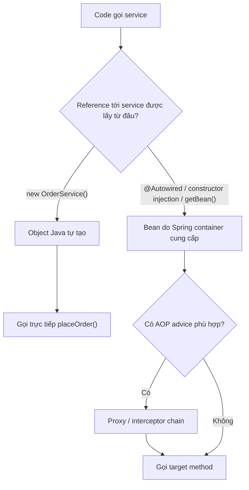
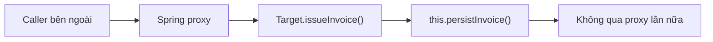

# Kiểm chứng lời gọi qua bean thật thay vì đối tượng tự tạo

Trong Spring Boot, nhiều tính năng như transaction, caching, asynchronous execution, logging advice hoặc method validation dựa trên **Spring AOP proxy**. Khi gọi một phương thức qua **bean được lấy từ Spring container**, lời gọi có cơ hội đi qua proxy và các interceptor tương ứng. Khi tự tạo object bằng `new` rồi gọi trực tiếp, object đó thường **không được Spring quản lý** và không có proxy của container bao quanh.

Đây là nguyên nhân phổ biến của các tình huống:

- `@Transactional` có trên method nhưng lời gọi không mở transaction.
- `@Cacheable` được khai báo nhưng method vẫn chạy mỗi lần gọi.
- `@Async` không chuyển công việc sang executor mà chạy ngay trong thread hiện tại.
- Một `@Aspect` có advice ghi log nhưng không bao giờ được kích hoạt.
- `@Validated` ở service không kiểm tra method argument khi gọi trên object tự tạo.
- Unit test chạy thành công nhưng ứng dụng thật có hành vi khác, hoặc ngược lại.

Bài học này tập trung vào việc **kiểm chứng đường đi của lời gọi**: lấy đúng bean từ `ApplicationContext`, xác định proxy khi cần, quan sát hiệu ứng của advice, phân biệt test unit với test tích hợp, và tránh những trường hợp lời gọi đi vòng qua proxy.

> **Cách hiểu chính xác của “bean thật”:** trong bài này, đó là **bean/reference do Spring container cung cấp**, không nhất thiết là instance target nằm bên trong proxy. Trong ứng dụng dùng AOP, reference do container cấp **có thể chính là proxy**. Chính reference đó thường phải được dùng để lời gọi qua advice.

## 1. Hiểu vấn đề qua hai đường gọi

Giả sử một service có phương thức được gắn `@Transactional`:

```java
@Service
public class OrderService {

    @Transactional
    public void placeOrder() {
        // Ghi đơn hàng và cập nhật tồn kho.
    }
}
```

Hai cách gọi nhìn qua rất giống nhau:

```java
OrderService service = new OrderService();
service.placeOrder();
```

và:

```java
OrderService service = context.getBean(OrderService.class);
service.placeOrder();
```

Nhưng bản chất rất khác:

- **`new OrderService()`:** tạo object Java thông thường. Spring không đưa nó vào bean lifecycle hoặc tự áp dụng advice AOP.
- **`context.getBean(OrderService.class)`:** lấy reference mà Spring đã quản lý. Nếu transaction infrastructure tạo proxy cho bean, lời gọi đi qua transaction interceptor trước khi tới method của target.

Sơ đồ:



Điều kiện “có advice phù hợp” rất quan trọng. **Không phải bean nào của Spring cũng là proxy.** Việc lấy bean từ context chỉ giúp có đúng đối tượng do framework quản lý; một proxy AOP chỉ xuất hiện khi có cơ chế tạo proxy và các advisor phù hợp.

## 2. Vì sao Spring sử dụng proxy?

Spring AOP thường áp dụng hành vi bổ sung bằng cách đặt một proxy trước target object:

```text
Controller / caller
       |
       v
Spring-managed reference
       |
       v
AOP proxy
       |
       +-- TransactionInterceptor
       +-- CacheInterceptor
       +-- Async interceptor
       +-- Custom @Aspect advice
       |
       v
Target service method
```

Đây là sơ đồ các dạng advice có thể có, không phải mọi bean đều chứa tất cả interceptor.

Proxy có thể:

1. Xử lý hành vi trước lời gọi.
2. Gọi method thật trên target.
3. Xử lý kết quả hoặc exception sau lời gọi.
4. Quyết định không gọi target trong một số trường hợp, ví dụ cache hit.
5. Điều phối thực thi trên executor khác, ví dụ `@Async`.

Object tạo bằng `new` không tự đi qua chuỗi này. Các annotation trên source code **không phải chỉ dẫn cho JVM tự chèn transaction, cache hay thread**. Chúng là metadata mà Spring infrastructure dùng khi xử lý bean và lời gọi phù hợp.

### 2.1. Phân biệt proxy và target

- **Target:** instance thực thi logic của service.
- **Proxy:** object đại diện mà caller nhận từ container khi AOP có hiệu lực.
- **Advice/interceptor:** logic cắt ngang lời gọi trước, sau hoặc quanh target method.
- **Advisor/pointcut:** thông tin xác định method nào phù hợp với advice.

Một bean có thể được tạo thành object ban đầu, sau đó được `BeanPostProcessor` xử lý và bọc bằng proxy. Vì vậy, việc xem class thực tế của bean có thể cho thấy tên lớp proxy do framework sinh ra.

Đừng kết luận proxy là object “giả” còn target mới là bean “thật”. **Đối với caller, reference do context cung cấp là đường truy cập hợp lệ để dùng các tính năng Spring AOP.**

## 3. Những cách lấy đúng bean từ container

Trong mã ứng dụng, cách ưu tiên thường là **constructor injection**:

```java
@RestController
@RequestMapping("/orders")
public class OrderController {

    private final OrderService orderService;

    public OrderController(OrderService orderService) {
        this.orderService = orderService;
    }

    @PostMapping
    public void createOrder() {
        orderService.placeOrder();
    }
}
```

`OrderService` ở đây do Spring resolve và inject. Nếu container tạo proxy cho `OrderService`, controller nhận proxy phù hợp.

Các cách khác:

```java
@Autowired
private OrderService orderService;
```

hoặc trong test / mã tích hợp với container:

```java
OrderService orderService =
        applicationContext.getBean(OrderService.class);
```

Hoặc lấy theo tên và kiểu khi cần:

```java
OrderService orderService =
        applicationContext.getBean("orderService", OrderService.class);
```

### 3.1. Ưu tiên constructor injection hơn lookup thủ công

Trong business code bình thường, không cần giữ `ApplicationContext` như một service locator để lấy từng bean. Constructor injection giúp:

- Thể hiện dependency rõ ràng.
- Dễ test với stub/mock khi chỉ kiểm tra nghiệp vụ.
- Tránh dependency ngầm vào container API.
- Đảm bảo caller nhận bean/reference mà Spring cung cấp.

`getBean()` đặc biệt hữu ích khi viết test để xác nhận Spring đã tạo đúng object hoặc khi xây dựng infrastructure có lý do rõ ràng để lookup động.

### 3.2. Không tự tạo object chỉ vì class có @Service

Annotation `@Service` không làm lệnh `new` đổi bản chất:

```java
OrderService service = new OrderService();
```

Đây vẫn là một object Java tự tạo. Container không tự biết hoặc quản lý instance này.

Tương tự, các annotation `@Component`, `@Repository` và `@Controller` không có tác dụng AOP tự động đối với object được tạo bên ngoài container.

## 4. Trường hợp @Bean có new lại là một ngoại lệ quan trọng

Không nên hiểu sai thành “hễ có `new` là Spring không quản lý object”.

Trong factory method `@Bean`:

```java
@Configuration(proxyBeanMethods = false)
public class OrderConfiguration {

    @Bean
    public OrderService orderService(OrderRepository repository) {
        return new OrderService(repository);
    }
}
```

Dù method sử dụng `new`, **object được trả về được đăng ký làm Spring bean**. Container có thể:

- Thiết lập lifecycle callbacks.
- Áp dụng `BeanPostProcessor`.
- Bọc object bằng AOP proxy nếu có advisor phù hợp.
- Cung cấp reference qua dependency injection hoặc `getBean()`.

Phân biệt ba tình huống:

| Tình huống | Spring quản lý instance được sử dụng? | Advice AOP có thể áp dụng? |
|---|---|---|
| `new OrderService(...)` trong method tùy ý rồi dùng trực tiếp | Không | Không qua Spring proxy |
| `@Bean OrderService service() { return new OrderService(...); }`; lấy bean từ context | Có | Có, nếu AOP được cấu hình và advice match |
| `@Service` được component scan; inject vào controller | Có | Có, nếu AOP được cấu hình và advice match |

Vấn đề cốt lõi không phải có hay không có từ khóa `new` trong source code, mà là **caller có sử dụng reference đã đi qua quá trình quản lý của Spring hay không**.

### 4.1. Tránh dùng reference cục bộ bên ngoài Spring sau khi đăng ký @Bean

Nếu một object được tạo thủ công rồi đăng ký thành bean bằng cách khác, reference cục bộ ban đầu vẫn có thể là target chưa được bọc proxy. Đừng giữ reference đó rồi dùng nó thay cho reference mà `ApplicationContext` cung cấp.

Ví dụ khi cần một service đã được quản lý:

```java
OrderService managed = context.getBean(OrderService.class);
managed.placeOrder();
```

Cách này rõ ràng hơn việc giả định mọi reference trỏ tới cùng một instance đều có hành vi AOP giống nhau.

## 5. Ví dụ thực hành đầy đủ: Một @Aspect đếm số lời gọi

Ta xây dựng một ví dụ có thể kiểm chứng rõ ràng rằng lời gọi qua Spring bean được advice xử lý, còn lời gọi qua object tự tạo không đi qua advice.

Mục tiêu:

- Tạo `GreetingService` có method `greet(...)`.
- Tạo custom aspect ghi nhận số lần advice chạy.
- Lấy bean từ Spring container để gọi.
- Tạo instance mới bằng `new` và gọi cùng method.
- So sánh bộ đếm.

### 5.1. Dependencies

Với Gradle Kotlin DSL:

```kotlin
dependencies {
    implementation("org.springframework.boot:spring-boot-starter")
    implementation("org.springframework.boot:spring-boot-starter-aop")
    testImplementation("org.springframework.boot:spring-boot-starter-test")
}

tasks.test {
    useJUnitPlatform()
}
```

Với Gradle Groovy DSL:

```groovy
dependencies {
    implementation 'org.springframework.boot:spring-boot-starter'
    implementation 'org.springframework.boot:spring-boot-starter-aop'
    testImplementation 'org.springframework.boot:spring-boot-starter-test'
}

tasks.named('test') {
    useJUnitPlatform()
}
```

`spring-boot-starter-aop` đưa các dependency cần thiết cho proxy-based AOP với `@Aspect`. Với auto-configuration phù hợp của Spring Boot, các aspect bean được phát hiện và cơ chế AOP được kích hoạt; không nhất thiết cần tự thêm `@EnableAspectJAutoProxy` trong project Boot chuẩn.

### 5.2. Application entry point

```java
package com.example.demo;

import org.springframework.boot.SpringApplication;
import org.springframework.boot.autoconfigure.SpringBootApplication;

@SpringBootApplication
public class DemoApplication {

    public static void main(String[] args) {
        SpringApplication.run(DemoApplication.class, args);
    }
}
```

Hãy để các class ví dụ bên dưới nằm trong `com.example.demo` hoặc package con để component scanning của `@SpringBootApplication` phát hiện.

### 5.3. Service cần kiểm chứng

```java
package com.example.demo;

import org.springframework.stereotype.Service;

@Service
public class GreetingService {

    public String greet(String name) {
        return "Xin chào " + name;
    }
}
```

Method này không tự gọi bộ đếm. Bộ đếm chỉ được tăng bởi advice, nhờ đó phép kiểm tra phân biệt được đường gọi có đi qua proxy hay không.

### 5.4. Bean ghi nhận số lần advice thực thi

```java
package com.example.demo;

import java.util.concurrent.atomic.AtomicInteger;
import org.springframework.stereotype.Component;

@Component
public class AdviceCallCounter {

    private final AtomicInteger count = new AtomicInteger();

    public void increment() {
        count.incrementAndGet();
    }

    public int value() {
        return count.get();
    }
}
```

`AtomicInteger` giúp phép đếm an toàn nếu service có thể được gọi từ nhiều thread.

### 5.5. Aspect áp dụng cho method

```java
package com.example.demo;

import org.aspectj.lang.annotation.Aspect;
import org.aspectj.lang.annotation.Before;
import org.springframework.stereotype.Component;

@Aspect
@Component
public class GreetingAspect {

    private final AdviceCallCounter counter;

    public GreetingAspect(AdviceCallCounter counter) {
        this.counter = counter;
    }

    @Before(
        "execution(* com.example.demo.GreetingService.greet(..))"
    )
    public void countInvocation() {
        counter.increment();
    }
}
```

Pointcut chọn method `greet(...)` của `GreetingService`. Khi một lời gọi phù hợp đi qua Spring AOP proxy, advice `countInvocation()` được kích hoạt trước method target.

Nếu chỉ có class `GreetingAspect` nhưng không đăng ký nó như Spring bean hoặc chưa cấu hình AOP infrastructure, advice có thể không hoạt động. Đây là lý do test cần khởi tạo Spring context phù hợp.

## 6. Kiểm thử trực tiếp sự khác nhau giữa bean và new

Test tích hợp:

```java
package com.example.demo;

import org.junit.jupiter.api.Test;
import org.springframework.aop.support.AopUtils;
import org.springframework.beans.factory.annotation.Autowired;
import org.springframework.boot.test.context.SpringBootTest;

import static org.assertj.core.api.Assertions.assertThat;

@SpringBootTest
class GreetingAopIntegrationTest {

    @Autowired
    private GreetingService greetingService;

    @Autowired
    private AdviceCallCounter counter;

    @Test
    void springManagedCallPassesThroughAdvice() {
        int before = counter.value();

        String result = greetingService.greet("Lan");

        assertThat(result).isEqualTo("Xin chào Lan");
        assertThat(counter.value()).isEqualTo(before + 1);
        assertThat(AopUtils.isAopProxy(greetingService)).isTrue();
    }

    @Test
    void manuallyCreatedObjectDoesNotPassThroughAdvice() {
        GreetingService manuallyCreated = new GreetingService();
        int before = counter.value();

        String result = manuallyCreated.greet("Minh");

        assertThat(result).isEqualTo("Xin chào Minh");
        assertThat(counter.value()).isEqualTo(before);
        assertThat(AopUtils.isAopProxy(manuallyCreated)).isFalse();
    }
}
```

Hai test chứng minh:

1. Method nghiệp vụ vẫn trả kết quả đúng trong cả hai trường hợp.
2. Counter chỉ tăng khi lời gọi qua bean đã được Spring xử lý với aspect phù hợp.
3. `AopUtils.isAopProxy(...)` giúp quan sát proxy trong ví dụ.
4. Việc gọi method bình thường thành công **không chứng minh advice đã chạy**; phải kiểm tra hiệu ứng AOP.

### 6.1. Vì sao lấy giá trị before thay vì giả định counter bằng 0?

Spring test context có thể được dùng lại trong cùng test suite hoặc các test khác có thể đã tương tác với bean. Nếu assert tuyệt đối `counter.value() == 1`, test có thể phụ thuộc thứ tự chạy.

Đo **delta trước/sau** lời gọi:

```java
int before = counter.value();
greetingService.greet("Lan");
assertThat(counter.value()).isEqualTo(before + 1);
```

Cách này thể hiện đúng điều cần kiểm chứng: một invocation qua proxy tạo thêm một lần thực thi advice.

### 6.2. Test “đối tượng tự tạo” không chứng minh cấu hình container sai

Test thủ công có thể pass hoặc fail theo kỳ vọng, nhưng nó không thay thế việc kiểm tra Spring wiring. Mục đích của nó là cho thấy **một object không thuộc container sẽ không có behavior AOP do container áp dụng**.

Nếu ứng dụng cần advice thật, test chính phải lấy bean từ context.

## 7. Ba cấp độ xác nhận lời gọi qua proxy

Khi phân tích một sự cố AOP, có thể kiểm tra ba cấp độ.

### Cấp 1: Object đến từ container

Ví dụ:

```java
GreetingService service =
        applicationContext.getBean(GreetingService.class);
```

Điều này xác nhận bạn nhận reference được container cung cấp thay vì tự tạo.

### Cấp 2: Object có phải proxy?

```java
boolean proxied = AopUtils.isAopProxy(service);
```

Có thể xem loại proxy:

```java
boolean jdkProxy = AopUtils.isJdkDynamicProxy(service);
boolean cglibProxy = AopUtils.isCglibProxy(service);
```

Nhưng **chỉ thấy proxy chưa chứng minh đúng advice đã áp dụng**. Một bean có thể bị proxy vì một advisor khác, hoặc pointcut không match method bạn đang gọi.

### Cấp 3: Hành vi cần thiết đã thực sự xảy ra

Ví dụ:

- Transaction đang active trong method.
- Cache hit khiến target method không chạy lại.
- Async task được dispatch qua executor.
- Aspect counter/log/audit event xuất hiện.
- Method argument violation được phát sinh như hợp đồng.

**Cấp 3 là bằng chứng mạnh nhất cho yêu cầu nghiệp vụ.** Hãy dùng `isAopProxy` để chẩn đoán, nhưng test nên tập trung vào hiệu ứng có thể quan sát của advice.

## 8. AopUtils và giới hạn khi kiểm tra proxy

Spring cung cấp `AopUtils` trong package:

```java
import org.springframework.aop.support.AopUtils;
```

Các method hữu ích:

| API | Ý nghĩa |
|---|---|
| `AopUtils.isAopProxy(bean)` | Kiểm tra object có phải proxy theo cơ chế Spring AOP không |
| `AopUtils.isJdkDynamicProxy(bean)` | Kiểm tra JDK dynamic proxy |
| `AopUtils.isCglibProxy(bean)` | Kiểm tra class-based/CGLIB proxy |
| `AopUtils.getTargetClass(bean)` | Lấy class target mà Spring có thể xác định |

Ví dụ:

```java
Object bean = applicationContext.getBean("greetingService");

System.out.println("Proxy: " + AopUtils.isAopProxy(bean));
System.out.println("JDK: " + AopUtils.isJdkDynamicProxy(bean));
System.out.println("CGLIB: " + AopUtils.isCglibProxy(bean));
System.out.println("Target: " + AopUtils.getTargetClass(bean));
```

Không nên viết code nghiệp vụ phụ thuộc vào tên class proxy kiểu `$$SpringCGLIB$$` hoặc các hậu tố implementation-specific. Tên class có thể thay đổi theo framework và không phải hợp đồng nghiệp vụ.

### 8.1. Không bóc target ra để gọi method trong test AOP

Spring test utilities có thể giúp truy cập target bên dưới proxy cho mục đích kiểm tra state. Nhưng nếu mục tiêu là xác minh advice, **đừng lấy target rồi gọi thẳng method**. Lời gọi đó có thể bỏ qua interceptor chain — chính điều bạn đang cần quan sát.

Cách nên làm:

```java
serviceFromContext.greet("Lan");
```

Không nên biến phép kiểm tra thành:

```java
targetObject.greet("Lan"); // Có thể bỏ qua advice
```

Chỉ truy cập target internals khi test thực sự cần và hiểu tác động tới AOP.

## 9. JDK dynamic proxy và CGLIB proxy

Spring AOP thường dùng hai chiến lược proxy.

### 9.1. JDK dynamic proxy

JDK proxy dựa trên interface. Caller có thể inject một interface:

```java
public interface PaymentService {
    void pay();
}

@Service
public class DefaultPaymentService implements PaymentService {
    @Override
    public void pay() {
        // ...
    }
}
```

Nếu Spring dùng JDK dynamic proxy, reference được cấp có thể implement `PaymentService` nhưng **không phải subclass của `DefaultPaymentService`**. Vì vậy, injection hoặc lookup bằng implementation concrete type có thể gặp vấn đề trong cấu hình kiểu proxy đó.

Một thiết kế linh hoạt là phụ thuộc interface:

```java
public class PaymentController {

    private final PaymentService paymentService;

    public PaymentController(PaymentService paymentService) {
        this.paymentService = paymentService;
    }
}
```

### 9.2. CGLIB/class-based proxy

Class-based proxy tạo subclass của target class trong những giới hạn JVM cho phép. Nó hữu ích khi cần proxy method trên class không có interface phù hợp.

Trong Spring Boot, lựa chọn proxy type phụ thuộc cấu hình và cơ chế đang dùng; với AOP auto-configuration của Boot, class-based proxy thường là mặc định ở nhiều phiên bản.

Có thể tìm thuộc tính liên quan như:

```properties
spring.aop.proxy-target-class=true
```

Không nên coi property này là cách “sửa mọi lỗi AOP”: thay đổi proxy type không làm self-invocation được intercept tự động, cũng không biến method private thành method có thể override.

### 9.3. Hệ quả khi test

Đừng viết test mặc định rằng:

```java
assertThat(bean.getClass()).isEqualTo(PaymentServiceImpl.class);
```

Khi AOP có hiệu lực, class runtime có thể là proxy.

Thay vào đó:

```java
assertThat(bean).isInstanceOf(PaymentService.class);
assertThat(AopUtils.isAopProxy(bean)).isTrue();
```

Cũng cần nhớ `isAopProxy` chỉ nên được assert true khi test đã cấu hình advisor hợp lệ và bean thực sự được proxy.

## 10. Self-invocation: object là Spring bean nhưng lời gọi vẫn bỏ qua advice

Đây là bẫy quan trọng nhất sau lỗi `new`.

Giả sử:

```java
@Service
public class InvoiceService {

    public void issueInvoice() {
        this.persistInvoice();
    }

    @Transactional
    public void persistInvoice() {
        // Ghi invoice vào database.
    }
}
```

Một caller bên ngoài inject `InvoiceService` và gọi `issueInvoice()` qua proxy. Nhưng bên trong method target:

```java
this.persistInvoice();
```

là lời gọi trực tiếp trên chính target object; trong mô hình Spring AOP proxy thông thường, lời gọi này **không đi ra ngoài để quay lại proxy**. Vì vậy advice gắn với `persistInvoice()` có thể không chạy.

Sơ đồ:



### 10.1. Dùng bean khác cho ranh giới advice

Một cách thiết kế rõ ràng là tách method có transactional boundary sang bean khác:

```java
@Service
public class InvoicePersistenceService {

    @Transactional
    public void persistInvoice() {
        // Lưu invoice.
    }
}
```

```java
@Service
public class InvoiceWorkflowService {

    private final InvoicePersistenceService persistence;

    public InvoiceWorkflowService(InvoicePersistenceService persistence) {
        this.persistence = persistence;
    }

    public void issueInvoice() {
        persistence.persistInvoice();
    }
}
```

`InvoiceWorkflowService` nhận reference do Spring cung cấp. Lời gọi `persistence.persistInvoice()` có thể đi qua transaction proxy.

### 10.2. Vì sao không mặc định inject chính mình?

Có một số kỹ thuật như self-injection, `AopContext.currentProxy()` hoặc lookup lại bean từ context. Nhưng chúng tạo thêm coupling tới proxy và có thể gây phức tạp lifecycle hoặc circular dependency.

Khi có thể, **tách trách nhiệm sang bean khác** thường dễ hiểu, dễ test và ít phụ thuộc chi tiết framework hơn.

### 10.3. Refactor code thay vì chỉ đổi annotation

Nếu bạn đặt `@Transactional` lên method nội bộ rồi thấy transaction không chạy, nguyên nhân không nhất thiết là annotation thiếu hoặc transaction manager lỗi. Hãy kiểm tra **đường gọi thực tế**.

Việc chuyển annotation sang một method được gọi từ ngoài proxy, hoặc tách method sang service khác, có thể là giải pháp đúng hơn.

## 11. Phương thức private, final và các giới hạn proxy

Spring AOP proxy-based không intercept mọi kiểu method call.

### 11.1. Private method

Ví dụ:

```java
@Service
public class BillingService {

    @Transactional
    private void savePayment() {
        // ...
    }
}
```

Một private method không thể được override bởi subclass proxy theo cách Spring AOP class-based proxy cần. Đặt `@Transactional` lên private method không tạo một transactional boundary có thể được gọi qua proxy như bạn mong đợi.

### 11.2. Final method và final class

Class-based proxy thường dựa vào subclassing. Method `final` không thể bị override; final class không thể subclass. Vì vậy có giới hạn với class-based proxy.

JDK dynamic proxy làm việc thông qua interface nên có các ràng buộc khác, nhưng cũng không cho phép advice tự xuất hiện trên các lời gọi nội bộ target.

### 11.3. Constructor và @PostConstruct

Constructor chạy trước khi bean hoàn tất quá trình bean post-processing; init callback như `@PostConstruct` thường xảy ra trước khi final AOP proxy được đưa ra cho caller.

Vì vậy, lời gọi method có `@Transactional` hoặc `@Cacheable` từ constructor hoặc `@PostConstruct` không nên được kỳ vọng sẽ đi qua proxy theo cơ chế thông thường.

### 11.4. Bảng tổng hợp

| Lời gọi | Có đi qua Spring proxy không? | Ghi chú |
|---|---|---|
| Bean A inject bean B rồi gọi public method phù hợp | Có thể có | Nếu B được proxy và advisor match |
| `context.getBean(...).method()` | Có thể có | Reference do context cung cấp |
| `new Service().method()` | Không | Object tự tạo ngoài container |
| Target gọi `this.otherMethod()` | Thường không | Self-invocation bypass proxy |
| Target gọi private method | Không qua proxy method đó | Private method không bị proxy intercept |
| Class-based proxy gọi final method | Không có advice override trên method đó | Final hạn chế subclass proxy |
| Constructor gọi method được annotate | Không nên trông đợi AOP | Proxy chưa hoàn tất |
| Gọi target object được bóc từ proxy | Thường bypass advice | Test hành vi AOP phải gọi reference do context cung cấp |

## 12. Kiểm chứng @Transactional bằng hành vi, không chỉ annotation

`@Transactional` là ví dụ phổ biến vì service chạy bình thường ngay cả khi transaction advice không hoạt động — trừ khi code hoặc database behavior cho thấy khác biệt.

Một probe nhỏ có thể dùng:

```java
package com.example.demo;

import org.springframework.stereotype.Service;
import org.springframework.transaction.annotation.Transactional;
import org.springframework.transaction.support.TransactionSynchronizationManager;

@Service
public class TransactionProbe {

    @Transactional
    public boolean hasActiveTransaction() {
        return TransactionSynchronizationManager
                .isActualTransactionActive();
    }
}
```

Trong ứng dụng có transaction manager được cấu hình phù hợp, gọi qua Spring-managed proxy có thể bắt đầu transaction:

```java
@SpringBootTest
class TransactionProbeTest {

    @Autowired
    private TransactionProbe transactionProbe;

    @Test
    void managedCallUsesTransactionInterceptor() {
        assertThat(transactionProbe.hasActiveTransaction()).isTrue();
    }

    @Test
    void manualObjectDoesNotStartTransaction() {
        TransactionProbe manual = new TransactionProbe();

        assertThat(manual.hasActiveTransaction()).isFalse();
    }
}
```

**Điều kiện của ví dụ:** test phải có `PlatformTransactionManager` và cấu hình transaction advice phù hợp; có thể dùng JDBC/JPA cùng database test. Chỉ thêm `@Transactional` vào service mà không có transaction infrastructure không bảo đảm test trả true.

### 12.1. Tránh @Transactional trên chính test khi đo trạng thái transaction

Nếu test method cũng được gắn `@Transactional`, test runner có thể đã mở transaction trước lời gọi service. Khi đó, một method được gọi trực tiếp qua object tự tạo vẫn nhìn thấy transaction đang active do test tạo sẵn.

Vì vậy, khi kiểm tra “proxy có khởi tạo transaction hay không”, hãy:

- Không bật transaction ở cấp test method/class cho phép đo đó.
- Gọi qua managed bean và qua manual object trong bối cảnh tách biệt.
- Kiểm tra transaction manager và cấu hình proxy thực sự hoạt động.
- Ưu tiên xác minh rollback/commit khi hợp đồng nghiệp vụ yêu cầu.

Một test tốt đo **hiệu ứng do lời gọi này tạo ra**, không phải trạng thái tồn tại vì một phần hạ tầng khác đã chuẩn bị sẵn.

### 12.2. Tránh xác nhận transaction chỉ bằng proxy class

`AopUtils.isAopProxy(service)` trả true không bảo đảm transaction interceptor match method cụ thể. Nếu bean bị proxy vì một aspect logging khác, test chỉ kiểm tra proxy vẫn có thể pass dù transaction không hoạt động.

Cần assert hành vi transaction thực tế.

## 13. Kiểm chứng @Cacheable qua số lần thực thi target

`@Cacheable` hữu ích để minh họa sự khác nhau vì cache hit có thể tránh gọi method target.

Service:

```java
import java.math.BigDecimal;
import java.util.concurrent.atomic.AtomicInteger;

import org.springframework.cache.annotation.Cacheable;
import org.springframework.stereotype.Service;

@Service
public class PriceLookupService {

    private final AtomicInteger databaseCalls =
            new AtomicInteger();

    @Cacheable(cacheNames = "prices", key = "#productId")
    public BigDecimal lookup(String productId) {
        databaseCalls.incrementAndGet();
        return new BigDecimal("125.00");
    }

    public int databaseCalls() {
        return databaseCalls.get();
    }
}
```

Bật caching:

```java
@Configuration(proxyBeanMethods = false)
@EnableCaching
public class CacheConfiguration {

    @Bean
    public CacheManager cacheManager() {
        return new ConcurrentMapCacheManager("prices");
    }
}
```

Ví dụ test:

```java
@SpringBootTest
class PriceCacheIntegrationTest {

    @Autowired
    PriceLookupService service;

    @Test
    void managedBeanUsesCacheAdvice() {
        String productId = "unique-product-for-this-test";
        int before = service.databaseCalls();

        BigDecimal first = service.lookup(productId);
        BigDecimal second = service.lookup(productId);

        assertThat(first).isEqualByComparingTo(second);
        assertThat(service.databaseCalls()).isEqualTo(before + 1);
    }
}
```

Trong một context có cache key chưa được dùng trước đó, method target thực thi một lần; lời gọi thứ hai được phục vụ từ cache.

### 13.1. Điều gì xảy ra với object tự tạo?

```java
PriceLookupService manual = new PriceLookupService();

manual.lookup("P-1");
manual.lookup("P-1");

assertThat(manual.databaseCalls()).isEqualTo(2);
```

Annotation `@Cacheable` vẫn có trong source code, nhưng lời gọi không đi qua cache interceptor do Spring tạo.

### 13.2. Giữ test cache độc lập

Cache có thể tồn tại xuyên suốt nhiều test khi context được tái sử dụng. Để test ổn định, bạn có thể:

- Dùng key riêng cho test.
- Clear cache trước test theo phạm vi cần thiết.
- Tạo context độc lập khi mục tiêu là integration isolation.
- Tránh hardcode giả định cache luôn rỗng nếu các test khác có thể đã ghi dữ liệu.

Điều cần assert là cache interceptor thật sự thay đổi hành vi, chứ không phải chỉ tồn tại `@Cacheable` trên method.

## 14. Kiểm chứng @Async bằng executor, thread và completion

`@Async` thường được thực thi qua proxy. Trong ví dụ đơn giản:

```java
@Configuration(proxyBeanMethods = false)
@EnableAsync
public class AsyncConfiguration {
}
```

```java
@Service
public class NotificationService {

    @Async
    public CompletableFuture<String> sendAsync() {
        return CompletableFuture.completedFuture(
                Thread.currentThread().getName()
        );
    }
}
```

Nếu gọi qua managed proxy và có async executor được cấu hình phù hợp, method được gửi tới executor. Nếu tự tạo object:

```java
NotificationService manual = new NotificationService();

String threadName = manual.sendAsync().join();
```

lời gọi method chạy trực tiếp trên thread của caller; `@Async` không tự tạo một thread mới chỉ nhờ annotation có mặt.

### 14.1. Đừng kiểm tra async chỉ bằng tên thread

Tên thread phụ thuộc executor. Khi test async trong ứng dụng thực, bạn có thể kiểm tra:

- Task được gửi đến executor đã cấu hình.
- Method thực thi ngoài caller thread khi contract đòi hỏi.
- `CompletableFuture` hoàn tất đúng giá trị hoặc báo exception phù hợp.
- Không có shared state race do giả định task luôn hoàn tất ngay.

Dùng `CountDownLatch` hoặc `CompletableFuture` để đồng bộ test; đừng dựa vào `Thread.sleep(...)` một khoảng cố định rồi kết luận async đã chạy.

### 14.2. Self-invocation cũng ảnh hưởng @Async

```java
@Service
public class NotificationService {

    public void createAndSend() {
        sendAsync(); // Gọi nội bộ trong cùng target.
    }

    @Async
    public void sendAsync() {
        // ...
    }
}
```

Khi gọi `sendAsync()` nội bộ, proxy-based async advice có thể bị bypass, giống tình huống `@Transactional`.

Hãy để caller gọi một async bean khác qua reference được Spring inject nếu bạn cần boundary bất đồng bộ rõ ràng.

## 15. Kiểm chứng method validation qua bean được quản lý

Validation cho method argument cũng có thể phụ thuộc proxy nếu service dùng Spring method validation infrastructure.

Ví dụ:

```java
@Service
@Validated
public class CustomerCommandService {

    public void createCustomer(@NotBlank String name) {
        // ...
    }
}
```

Nếu method validation được bật/cấu hình phù hợp, một lời gọi qua managed proxy với input rỗng có thể phát sinh exception validation.

Object tự tạo:

```java
CustomerCommandService service = new CustomerCommandService();
service.createCustomer("");
```

không tự gọi `jakarta.validation.Validator`.

Lưu ý:

- `@Valid` trên DTO request ở Spring MVC có thể được xử lý bởi argument resolver và không nhất thiết cùng cơ chế proxy service.
- Method validation ở Spring MVC mới có thể hoạt động theo cơ chế built-in riêng.
- Service method validation qua Spring infrastructure thường phụ thuộc bean/proxy.
- Vì vậy, cần xác định **điểm kích hoạt validation thực sự** trước khi viết test.

Không nên dùng một phép so sánh `new` duy nhất để kết luận mọi loại validation trong Spring đều do AOP proxy xử lý.

## 16. Unit test thuần Java và integration test kiểm chứng AOP

Một unit test thuần Java có giá trị để kiểm tra logic nghiệp vụ:

```java
@Test
void calculatesTotal() {
    OrderCalculator calculator = new OrderCalculator();

    BigDecimal total = calculator.calculate(
            new BigDecimal("100"),
            new BigDecimal("0.10")
    );

    assertThat(total).isEqualByComparingTo("110.00");
}
```

Trong test này không cần Spring context nếu logic không phụ thuộc infrastructure.

Nhưng nếu yêu cầu là:

- Transaction được mở.
- Cache chặn lời gọi lặp.
- Async được dispatch.
- Custom aspect chạy đúng.
- Method validation ở service được áp dụng qua Spring.

thì một object được tạo bằng `new` **không phải đối tượng thử nghiệm thích hợp** cho hành vi integration đó.

### 16.1. Phân chia mục đích test

| Loại test | Tạo object bằng cách nào? | Điều được kiểm tra |
|---|---|---|
| Unit test nghiệp vụ | `new` hoặc test fixture | Logic Java thuần, quy tắc tính toán |
| Unit test của aspect/advice | Object/mocks theo API advice | Logic advice độc lập nếu có |
| Test Spring wiring | `ApplicationContext` hoặc context runner | Bean registration, dependency injection |
| Test Spring AOP | Bean được inject/lấy từ context | Advice áp dụng trên lời gọi thật |
| Test tích hợp transaction/cache/async | Context có infrastructure liên quan | Hiệu ứng thực của tính năng |

Không nhất thiết mọi test phải dùng `@SpringBootTest`. Nhưng test AOP phải dùng **một ngữ cảnh có cơ chế proxy phù hợp** hoặc một proxy được cấu hình tường minh trong test.

### 16.2. Dùng @SpringBootTest khi cần hành vi framework đầy đủ

```java
@SpringBootTest
class PaymentServiceIntegrationTest {

    @Autowired
    PaymentService paymentService;

    @Test
    void usesSpringConfiguredService() {
        paymentService.pay();
        // Assert hiệu ứng của advice / transaction / cache.
    }
}
```

`@SpringBootTest` tạo một application context dựa trên cấu hình ứng dụng. Tuy vậy, nó chỉ là điều kiện cần cho những test này: **các dependency và annotation để bật AOP feature vẫn phải có mặt**.

### 16.3. Test slice có thể không load đầy đủ advice

Các annotation test slice như `@WebMvcTest` hoặc `@DataJpaTest` chỉ đưa một phần context vào test. Vì vậy:

- Controller slice có thể dùng mock service thay vì service thật.
- Transaction manager hoặc cache infrastructure có thể khác full app.
- Custom aspect có thể không được import vào test context.
- Test pass trong slice chưa chắc chứng minh tất cả AOP behavior của ứng dụng.

Khi nghi ngờ, xem rõ loại context test đang tạo và bean nào thực sự có trong context đó.

## 17. Mock và spy có thể làm test hiểu sai đường đi của lời gọi

Một test có thể dùng Mockito để thay thế bean service bằng mock. Điều đó phù hợp để cô lập controller, nhưng mock không nhất thiết giữ hành vi của target/advice như một bean tích hợp thật.

Ví dụ:

```java
@WebMvcTest(OrderController.class)
class OrderControllerTest {

    @MockitoBean
    OrderService orderService;

    // Kiểm tra controller gọi service đúng.
}
```

Trong các dòng Spring Framework/Boot mới hỗ trợ `@MockitoBean`, annotation này thay hoặc cung cấp test bean. Các codebase cũ có thể dùng `@MockBean` theo phiên bản tương ứng.

Test này có thể xác minh controller truyền tham số đúng. Nhưng **nó không chứng minh `@Transactional` trên `OrderService` đã hoạt động**, vì bạn đang gọi một mock thay cho service thật.

### 17.1. Spy không phải cách kiểm chứng AOP mặc định

Spy có thể ghi nhận lời gọi, nhưng cần hiểu spy được đặt trên proxy hay target và test context đang cấu hình thế nào. Nếu bạn chỉ đếm invocation của method, test vẫn có thể pass dù advice không match.

Để kiểm chứng AOP:

1. Ưu tiên assert hành vi do advice tạo ra.
2. Dùng một bean thật từ context khi cần.
3. Dùng spy chỉ khi có lý do cụ thể và hiểu interaction với proxy.
4. Không lẫn test orchestration Mockito với test transaction/caching infrastructure.

## 18. Khi có nhiều bean cùng interface

Nếu một interface có nhiều implementation, constructor injection có thể bị ambiguous:

```java
public interface PaymentGateway {
    void charge();
}
```

```java
@Component("primaryGateway")
public class PrimaryGateway implements PaymentGateway {
    public void charge() {
    }
}
```

```java
@Component("backupGateway")
public class BackupGateway implements PaymentGateway {
    public void charge() {
    }
}
```

Caller cần chỉ rõ bean:

```java
@Service
public class CheckoutService {

    private final PaymentGateway gateway;

    public CheckoutService(
            @Qualifier("primaryGateway") PaymentGateway gateway
    ) {
        this.gateway = gateway;
    }
}
```

Khi kiểm chứng AOP, phải bảo đảm test đang lấy **đúng bean** được ứng dụng dùng. Một aspect có pointcut theo package, annotation hoặc tên method có thể match bean A nhưng không match bean B.

`@Primary` và `@Qualifier` ảnh hưởng việc chọn bean; chúng không tự bật AOP hoặc làm method call đi qua advice.

## 19. Khi AopUtils.isAopProxy trả false thì kiểm tra gì?

Đừng vội kết luận framework bị lỗi. Một số câu hỏi:

1. Object có thật sự được lấy từ Spring context không?
2. Class có được component scan hoặc đăng ký bằng `@Bean` không?
3. Đã thêm dependency hỗ trợ AOP và bật cơ chế phù hợp chưa?
4. `@Aspect` có được đăng ký thành bean không?
5. Pointcut có match class và method đang gọi không?
6. Có yếu tố `final`/`private` hoặc cấu hình proxy type cản trở không?
7. Có self-invocation thay vì lời gọi từ bean khác không?
8. Test có thay bean thật bằng mock không?
9. Có lấy target object trực tiếp thay vì proxy không?
10. Có chạy code trước khi bean post-processing hoàn tất không?

### 19.1. Kiểm tra pointcut

Ví dụ:

```java
@Before("execution(* com.example.payment..*(..))")
```

Pointcut có thể không match như bạn dự kiến nếu biểu thức sai package, sai method visibility hoặc không tương ứng signature.

Hãy dùng một pointcut đơn giản, rõ ràng khi xây dựng ví dụ nhỏ; sau đó mới mở rộng khi có test bảo đảm matching.

### 19.2. Kiểm tra advice có được kích hoạt qua effect không

Proxy true chỉ xác nhận object có proxy AOP. Để chứng minh một aspect được kích hoạt, có thể:

- Tăng counter trong advice.
- Ghi event vào collector test.
- Dùng một collaborator giả lập nhận lời gọi từ advice.
- Kiểm tra thay đổi về transaction, cache hoặc async.

Không nên dựa vào log console làm assertion chính nếu có thể xác minh trạng thái rõ hơn.

## 20. Lỗi do gọi @Bean factory method thủ công

Một trường hợp dễ nhầm:

```java
@Configuration(proxyBeanMethods = false)
public class ClientConfiguration {

    @Bean
    public ExternalClient externalClient() {
        return new ExternalClient();
    }
}
```

Nếu bạn tự tạo `ClientConfiguration` bằng `new` rồi gọi `externalClient()`:

```java
ClientConfiguration config = new ClientConfiguration();
ExternalClient client = config.externalClient();
```

đó chỉ là lời gọi Java tới một factory method trên object cấu hình tự tạo; `ExternalClient` được trả về không tự động là managed bean.

Trong ứng dụng, hãy lấy client:

```java
ExternalClient client =
        applicationContext.getBean(ExternalClient.class);
```

Container là thành phần thực thi factory method theo bean definition và thực hiện toàn bộ lifecycle cho object trả về.

### 20.1. proxyBeanMethods không thay thế Spring AOP business proxy

`@Configuration(proxyBeanMethods = true/false)` liên quan tới cách Spring xử lý lời gọi giữa các `@Bean` method trong configuration class. Nó **không phải** switch bật/tắt Spring AOP cho `@Transactional`, `@Cacheable` hoặc custom aspect trên business service.

Đừng dùng `proxyBeanMethods` để sửa lỗi service method không đi qua advice. Hãy tập trung vào caller reference và AOP infrastructure.

## 21. Có thể kiểm thử proxy thủ công bằng ProxyFactory không?

Spring cung cấp `ProxyFactory` để tạo proxy có advice trong test hoặc infrastructure code:

```java
GreetingService target = new GreetingService();

ProxyFactory factory = new ProxyFactory(target);

factory.addAdvice((MethodInterceptor) invocation -> {
    System.out.println("Before: " + invocation.getMethod().getName());
    return invocation.proceed();
});

GreetingService proxied =
        (GreetingService) factory.getProxy();

proxied.greet("Lan");
```

Ví dụ cho thấy một proxy có thể chặn lời gọi tới target. Nhưng proxy được tạo thủ công ở đây **không chứng minh bean của ứng dụng đã được Spring Boot auto-configure đúng**.

Phân biệt:

- **Test `ProxyFactory`:** kiểm tra proxy/advice được cấu hình thủ công.
- **Test `ApplicationContext`:** kiểm tra bean thực tế do ứng dụng/Boot tạo, advisor registration và dependency injection.

Với mục tiêu của bài này — “lời gọi qua bean thật” — nên ưu tiên test thứ hai.

## 22. Kiểm chứng đường đi trong Controller, Scheduler và Listener

Không phải mọi caller đều là HTTP controller. Một method có thể được gọi từ scheduler, event listener, message consumer hoặc runner.

### 22.1. HTTP controller

```java
@RestController
public class PaymentController {

    private final PaymentService paymentService;

    public PaymentController(PaymentService paymentService) {
        this.paymentService = paymentService;
    }

    @PostMapping("/pay")
    public void pay() {
        paymentService.pay();
    }
}
```

Constructor injection bảo đảm caller dùng reference do container cung cấp. Test AOP có thể gọi `paymentService.pay()` trong một `@SpringBootTest`, không cần gửi HTTP request nếu chỉ muốn kiểm tra advice của service.

### 22.2. Scheduled job

```java
@Component
public class ReportingSchedule {

    private final ReportingService reportingService;

    public ReportingSchedule(ReportingService reportingService) {
        this.reportingService = reportingService;
    }

    @Scheduled(fixedDelay = 60000)
    public void runReport() {
        reportingService.generateReport();
    }
}
```

Nếu `generateReport()` có `@Transactional` hoặc `@Cacheable`, việc gọi qua injected `ReportingService` hỗ trợ đi qua proxy khi advice match.

Đừng nhầm cơ chế scheduling với proxy của method `generateReport()`: `@Scheduled` được framework xử lý theo lifecycle của scheduler và không phải bằng chứng rằng service method tự động được AOP intercept.

### 22.3. ApplicationRunner

```java
@Component
public class InitialDataRunner implements ApplicationRunner {

    private final InitialDataService service;

    public InitialDataRunner(InitialDataService service) {
        this.service = service;
    }

    @Override
    public void run(ApplicationArguments args) {
        service.importInitialData();
    }
}
```

Đây cũng là external bean-to-bean call. Tránh tự tạo `new InitialDataService()` trong runner nếu cần các advice của Spring.

### 22.4. Method gọi từ constructor hoặc init callback

Ngay cả khi caller là Spring bean, lời gọi tại constructor hoặc initialization callback có thể xảy ra khi bean/proxy chưa ở trạng thái cuối cùng. Đặc biệt không nên gọi method trên `this` rồi kỳ vọng advice áp dụng.

Nếu cần tác vụ sau startup, hãy chọn một lifecycle hook phù hợp, đồng thời gọi một bean khác qua reference do Spring inject khi cần transaction/caching/async boundary.

## 23. Đọc log proxy nhưng không phụ thuộc quá nhiều vào log

Khi debug, có thể xem log liên quan Spring AOP, transaction hoặc cache tùy phiên bản:

```properties
logging.level.org.springframework.aop=DEBUG
logging.level.org.springframework.transaction=TRACE
logging.level.org.springframework.cache=TRACE
```

Mức log và nội dung cụ thể phụ thuộc framework version. Bật log chi tiết trong môi trường phù hợp vì nó có thể tạo lượng output lớn hoặc chứa metadata nội bộ.

Một quy trình chẩn đoán hiệu quả:

1. Log tên bean và target class nếu cần.
2. Kiểm tra reference có proxy không.
3. Kiểm tra advisor/pointcut và annotation.
4. Gọi method từ một bean khác hoặc test qua context.
5. Quan sát hiệu ứng cần có.
6. So sánh với lời gọi trực tiếp chỉ để tái hiện cơ chế bypass.

Không nên dựa vào một dòng debug chứa từ `proxy` rồi kết luận giao dịch hoặc caching đã chạy đúng.

## 24. Bảng đối chiếu lỗi thường gặp

| Hiện tượng | Khả năng thường gặp | Cách kiểm chứng |
|---|---|---|
| `@Transactional` không mở transaction | Gọi `new`, self-invocation, thiếu transaction infrastructure | Lấy bean từ context và kiểm tra transaction behavior |
| `@Cacheable` vẫn gọi method mỗi lần | Không qua cache proxy hoặc cache chưa được bật | Đếm target executions qua managed bean |
| `@Async` chạy trên caller thread | Gọi trực tiếp hoặc async infrastructure chưa bật | Gọi qua injected bean và quan sát executor/completion |
| Custom `@Aspect` không chạy | Aspect chưa là bean, pointcut không match | Kiểm tra context, proxy và effect advice |
| Method validation bị bỏ qua | Không gọi qua method validation proxy | Test `@Validated` service qua context |
| AopUtils báo false trên manual instance | Object tạo bằng `new` | So sánh với context-managed reference |
| Bean từ context vẫn không có proxy | Không có advisor match hoặc AOP chưa bật | Kiểm tra annotations và infrastructure |
| Proxy true nhưng behavior sai | Advisor khác tạo proxy hoặc pointcut sai | Assert effect cụ thể, không chỉ proxy class |
| Test unit pass, runtime fail | Test không tạo Spring context | Bổ sung integration test cho wiring/AOP |
| MockMvc pass nhưng transaction chưa được kiểm tra | Mock service thay real service | Dùng `@SpringBootTest`/service integration test |
| Gọi method từ `this` bỏ qua advice | Self-invocation | Tách logic sang bean khác |
| Lời gọi trong `@PostConstruct` không có transaction | Proxy chưa hoàn tất | Điều phối qua bean khác ở phase phù hợp |
| Inject concrete class thất bại | Bean dùng JDK dynamic proxy interface | Inject interface hoặc xem proxy configuration |
| `@Bean` method tự gọi tạo object mới | Gọi factory method ngoài container | Lấy bean từ ApplicationContext |

## 25. Quy trình kiểm chứng từng bước trong dự án

Khi nghi ngờ một annotation AOP không có tác dụng, hãy đi theo các bước sau.

### Bước 1: Xác định method và hiệu ứng cần có

Ví dụ:

- `@Transactional`: transaction/rollback.
- `@Cacheable`: cache hit.
- `@Async`: chuyển thực thi sang executor.
- Custom aspect: audit/log/counter.
- `@Validated`: từ chối argument không hợp lệ.

Không bắt đầu bằng việc assert class proxy trước khi hiểu behavior nào cần đạt.

### Bước 2: Xác định nơi object được tạo

Tìm xem caller có:

```java
new SomeService(...)
```

hay dùng:

```java
@Autowired
SomeService service;
```

hoặc constructor injection / `ApplicationContext.getBean(...)`.

Nếu object tự tạo được dùng thay bean, sửa đường truyền dependency.

### Bước 3: Kiểm tra infrastructure

Ví dụ:

- Có `spring-boot-starter-aop` hoặc AOP configuration phù hợp không?
- Có transaction manager và transaction advice phù hợp không?
- Có `@EnableCaching` và `CacheManager` khi dùng `@Cacheable` không?
- Có `@EnableAsync` và executor phù hợp khi dùng `@Async` không?
- Có provider/method validation integration khi dùng `@Validated` không?

Một bean từ Spring context chỉ là điều kiện cần; infrastructure vẫn phải được bật.

### Bước 4: Kiểm tra invocation boundary

Caller bên ngoài gọi proxy hay code tự gọi `this.method()`? Method là public, có thể bị proxy intercept theo chiến lược đang dùng không?

Nếu method trong cùng bean cần một advice riêng, cân nhắc tách sang bean khác.

### Bước 5: Viết phép kiểm tra bằng Spring context

```java
@SpringBootTest
class SomeServiceAopTest {

    @Autowired
    SomeService service;

    @Test
    void adviceIsApplied() {
        // Gọi service qua Spring-managed reference.
        // Assert kết quả observable của advice.
    }
}
```

### Bước 6: Assert hiệu ứng

Ưu tiên test nghiệp vụ và hành vi:

- Có transaction hoặc rollback đúng.
- Không thực thi lại method khi cache hit.
- Có audit event/advice counter.
- Task async chạy theo executor contract.
- Validation exception được phát sinh đúng.

`AopUtils.isAopProxy(...)` là assertion phụ trợ hữu ích trong bài học AOP, nhưng không phải thay thế cho effect.

### Bước 7: Kiểm thử đường bypass để hiểu nguyên nhân

Tạo manual object ở một test riêng khi cần tái hiện lỗi; tránh đưa manual object vào test chính của Spring behavior.

### Bước 8: Giữ unit test cho logic Java thuần

Không biến mọi unit test thành `@SpringBootTest`. Logic tính toán không phụ thuộc proxy nên test trực tiếp để nhanh và rõ. Chỉ dùng Spring context ở nơi thực sự kiểm tra contract tích hợp của Spring.

## 26. Bài thực hành 1: Đo advice bằng bean thật

**Yêu cầu:** dùng `GreetingService` và `GreetingAspect` đã trình bày ở trên.

1. Chạy test gọi `greetingService.greet(...)` qua bean do Spring inject.
2. Assert bộ đếm advice tăng một lần.
3. Tạo `new GreetingService()` và gọi method.
4. Assert bộ đếm advice không tăng.
5. Dùng `AopUtils.isAopProxy(...)` để quan sát hai reference.

**Câu hỏi:** Vì sao cả hai lời gọi đều trả về “Xin chào ...” nhưng chỉ một lời gọi chạy aspect?

**Đáp án:** Business method là code Java bình thường nên cả hai object có thể thực thi. Advice chỉ được áp dụng khi lời gọi đi qua proxy đã được Spring cấu hình.

## 27. Bài thực hành 2: Tìm lỗi self-invocation

Code:

```java
@Service
public class StockService {

    public void reserve() {
        updateStock();
    }

    @Transactional
    public void updateStock() {
        // Update database.
    }
}
```

**Câu hỏi 1:** Nếu controller inject `StockService` rồi gọi `reserve()`, lời gọi `updateStock()` có đi qua transaction advice riêng của method đó không?

**Đáp án:** Không theo mô hình proxy-based thông thường, vì `reserve()` gọi `updateStock()` nội bộ trên target.

**Câu hỏi 2:** Sửa thế nào?

**Đáp án:** Di chuyển `updateStock()` sang một bean `StockPersistenceService` và inject bean này vào `StockService`; gọi qua dependency được Spring cấp. Hoặc thiết kế transaction boundary trên một method public bên ngoài thực sự được gọi qua proxy nếu phù hợp.

## 28. Bài thực hành 3: Kiểm chứng caching

Code:

```java
@Service
public class CatalogService {

    private final AtomicInteger calls = new AtomicInteger();

    @Cacheable("catalog")
    public String load(String id) {
        calls.incrementAndGet();
        return "Item-" + id;
    }

    public int calls() {
        return calls.get();
    }
}
```

Sau khi bật cache infrastructure:

**Câu hỏi:** Gọi hai lần `load("X")` qua injected bean và hai lần qua `new CatalogService()` có gì khác?

**Đáp án:** Qua proxy với cache hit và key chưa có trước đó, target có thể chỉ chạy một lần. Qua object tự tạo, method chạy cả hai lần vì không có cache interceptor.

**Lưu ý:** Test nên dùng một key chưa được cache và kiểm soát state của cache để không phụ thuộc test khác.

## 29. Bài thực hành 4: Phân loại loại test

Xem các yêu cầu:

1. Tính thuế trên đơn hàng.
2. Xác nhận controller gọi service với đúng ID.
3. Kiểm tra `@Transactional` có rollback khi service ném exception.
4. Kiểm tra `@Cacheable` chặn lời gọi lặp.
5. Kiểm tra pointcut của một custom `@Aspect`.
6. Kiểm tra `@Async` điều phối task đến executor.

**Gợi ý lựa chọn:**

| Yêu cầu | Test phù hợp |
|---|---|
| Tính thuế | Unit test Java thuần |
| Controller delegation | MVC slice với mock service |
| Transaction rollback | Integration test có Spring transaction infrastructure |
| Cache behavior | Spring context với caching enabled |
| Custom aspect applied | Spring AOP integration test với bean thật |
| Async dispatch | Spring context với async enabled và đồng bộ test hợp lý |

Không bắt buộc mọi test phải chạy full application, nhưng phải cung cấp đúng lớp infrastructure cho behavior đang được kiểm chứng.

## 30. Câu hỏi tự kiểm tra

**Câu 1.** Tại sao `new PaymentService()` không tự kích hoạt `@Transactional`?

**Đáp án:** Vì object không được Spring quản lý, không đi qua Spring AOP proxy/transaction interceptor.

**Câu 2.** Nếu `@Bean` factory method trả về `new PaymentService()`, bean đó có thể được proxy không?

**Đáp án:** Có. Container quản lý object trả về từ `@Bean` và có thể áp dụng post-processing/proxy khi infrastructure và pointcut phù hợp.

**Câu 3.** `AopUtils.isAopProxy(service) == true` có chứng minh `@Cacheable` đang hoạt động không?

**Đáp án:** Không. Proxy có thể được tạo vì advisor khác; cần kiểm tra cache hit hoặc số lần target thực thi.

**Câu 4.** Self-invocation là gì?

**Đáp án:** Method trong cùng target gọi method khác qua `this`. Lời gọi đó thường không đi qua proxy AOP, nên advice trên method được gọi nội bộ có thể bị bỏ qua.

**Câu 5.** Vì sao không nên gắn `@Transactional` lên private method rồi mong Spring proxy intercept?

**Đáp án:** Private method không thể được proxy intercept bằng cơ chế method override thông thường của Spring AOP.

**Câu 6.** Test controller với mock service có chứng minh transaction của service thật không?

**Đáp án:** Không. Mock service phù hợp để test controller wiring, nhưng không thực thi logic/advice của service thật.

**Câu 7.** Nếu service được inject từ Spring mà `@Async` vẫn chạy đồng bộ, cần kiểm tra gì?

**Đáp án:** Async infrastructure, `@EnableAsync`, executor, proxy/advisor, method eligibility và self-invocation.

**Câu 8.** Khi nào nên dùng `@SpringBootTest`?

**Đáp án:** Khi cần xác minh wiring và behavior Spring thực tế, chẳng hạn transaction, caching, async hoặc aspect, và context cần thiết không thể được mô phỏng đầy đủ bằng unit test thuần Java.

## 31. Ghi nhớ

- **Không đánh đồng annotation có mặt trên class với advice chắc chắn đã chạy.** Advice AOP chỉ áp dụng khi có infrastructure phù hợp và lời gọi đi qua proxy.
- **Bean được container cung cấp** là reference caller nên dùng. Nó có thể là proxy thay vì target object.
- `new Service()` bên ngoài container tạo object Java thường, bỏ qua các interceptor do Spring AOP thiết lập.
- `new` **bên trong factory method `@Bean`** vẫn có thể tạo managed bean được proxy sau đó.
- Constructor injection là cách ưu tiên để một bean gọi bean khác qua reference Spring cung cấp.
- `AopUtils.isAopProxy` hỗ trợ chẩn đoán; assertion về **hành vi advice** mới chứng minh tính năng đã hoạt động.
- JDK dynamic proxy và CGLIB có giới hạn khác nhau, nhưng cả hai không tự sửa được self-invocation.
- `this.otherMethod()`, private/final method và lời gọi trong constructor/init callback là những điểm dễ bypass proxy.
- `@Transactional`, `@Cacheable`, `@Async` và method validation có yêu cầu infrastructure và interception khác nhau; test theo effect tương ứng.
- Mock service trong test slice không thể chứng minh AOP của service thật.
- Dùng unit test thuần Java cho logic thuần; dùng Spring integration test khi yêu cầu là hành vi của Spring.

Khi một annotation AOP “không có tác dụng”, câu hỏi đầu tiên không phải **“annotation có viết đúng không?”** mà là: **“Ai tạo object này, caller có giữ reference do Spring cung cấp không, và lời gọi thực tế có đi qua proxy/advice phù hợp không?”** Kiểm chứng được đường đi đó sẽ giúp bạn phân biệt lỗi business logic với lỗi wiring, proxy và lifecycle trong Spring Boot.
