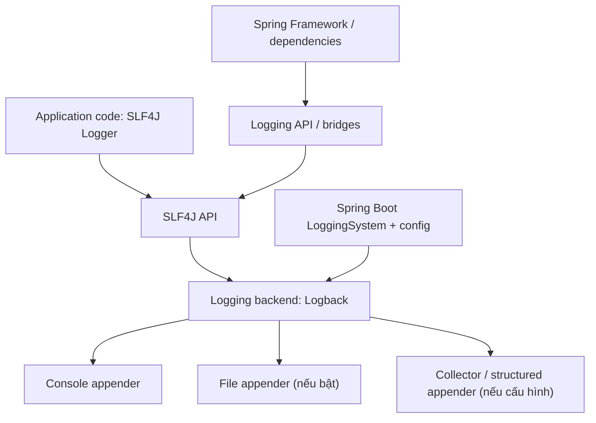

# Logging starter và cấu hình mặc định theo dòng Spring Boot

Khi khởi động một ứng dụng Spring Boot mới, dù chưa tự viết dòng `log.info(...)` nào, terminal thường đã hiển thị thông tin khởi động, tên ứng dụng, phiên bản Spring Boot, port của web server, active profiles và các lỗi nếu context không tạo được. Điều này không xảy ra vì `SpringApplication` tự in toàn bộ thông điệp bằng `System.out.println`, mà vì Spring Boot có một **hạ tầng logging được thiết lập sớm** cùng các dependency và cấu hình mặc định.

Trong chương **Logging** của *Spring Boot Fundamentals*, bài học **“Logging starter và cấu hình mặc định theo dòng Spring Boot”** tập trung vào bốn câu hỏi: logging starter cung cấp gì, Spring Boot chọn logging implementation như thế nào, ứng dụng có hành vi logging mặc định ra sao, và điều gì cần kiểm tra khi làm việc với các dòng Spring Boot khác nhau.

Những điểm nền tảng cần nhớ ngay từ đầu:

- **SLF4J là logging API/facade**, không phải nơi tự ghi log vào console hoặc file.
- **Logback** là backend logging mặc định phổ biến của các ứng dụng Spring Boot thông thường.
- **Logging starter** chủ yếu đưa vào classpath những dependency giúp logging hoạt động theo quy ước của dòng Boot đang dùng; nó không phải một lệnh bật logging phải gọi từ code Java.
- **Spring Boot cung cấp cấu hình mặc định và cơ chế externalized configuration** để điều chỉnh mức log, định dạng, đầu ra và behavior theo môi trường.
- **Tên starter, phiên bản thư viện và một số định dạng/thuộc tính có thể thay đổi theo dòng phiên bản**. Vì vậy phải xác nhận dependency graph và reference documentation của đúng Spring Boot release, không áp dụng nguyên xi mọi ví dụ cũ.

## 1. Logging trong ứng dụng Spring Boot là gì?

Logging là việc ghi nhận những sự kiện và trạng thái quan trọng trong quá trình ứng dụng chạy: startup, shutdown, request, lỗi kết nối, chuyển trạng thái nghiệp vụ hoặc cảnh báo vận hành. Log thường chứa:

- **Timestamp**: sự kiện được ghi khi nào.
- **Level**: mức độ nghiêm trọng hoặc mức chi tiết.
- **Logger name**: class/package hoặc tên logic phát sinh sự kiện.
- **Thread name**: thread thực hiện thao tác.
- **Message**: mô tả sự kiện.
- **Exception/stack trace**: chi tiết lỗi khi cần.
- **Context fields**: request ID, trace ID hoặc những thông tin tương quan khác nếu đã được cấu hình.

Ví dụ log minh họa, không phải mẫu byte-for-byte của mọi phiên bản:

```text
2026-11-13 09:20:31.420  INFO 12345 --- [main] c.e.catalog.CatalogApplication : Starting CatalogApplication
2026-11-13 09:20:32.105  INFO 12345 --- [main] o.s.b.w.e.tomcat.TomcatWebServer : Tomcat started on port 8080
2026-11-13 09:20:32.209  INFO 12345 --- [main] c.e.catalog.CatalogApplication : Started CatalogApplication
```

Một request nghiệp vụ có thể ghi:

```text
2026-11-13 09:22:01.070  INFO 12345 --- [http-nio-8080-exec-1] c.e.catalog.OrderService : Order created: id=ORD-42
```

**Lưu ý:** các dòng minh họa ở đây cho thấy ý nghĩa các trường. Spring Boot 2.x, 3.x và 4.x không nhất thiết có cùng layout; một số dòng mới có thêm tên ứng dụng, dấu phân cách khác, trường correlation hoặc cách hiển thị thread khác.

### 1.1. Log khác stdout tự in

`System.out.println("...")` ghi trực tiếp ra standard output. Nó không cung cấp đầy đủ:

- Kiểm soát mức độ theo package/logger.
- Filtering thống nhất.
- Pattern/layout và xử lý exception.
- Routing qua appender.
- Quản lý asynchronous logging nếu cấu hình.
- Tích hợp có cấu trúc với hệ thống thu thập log.

Trong ứng dụng Spring Boot, nên dùng logging API thay vì in thông tin vận hành bằng `System.out.println` ở mọi nơi.

### 1.2. Logging khác tracing và metrics

Log ghi sự kiện; metric tổng hợp số liệu như request count và latency; tracing mô tả hành trình một yêu cầu qua nhiều service. Ba loại tín hiệu hỗ trợ nhau nhưng không thay thế nhau.

Trace ID có thể được thêm vào log khi ứng dụng được cấu hình observability/tracing. **Không phải cứ thêm logging starter là tự có distributed tracing hoặc trace ID**.

## 2. Phân biệt API, backend, bridge và starter

Để hiểu default logging, cần phân biệt các lớp trong hệ sinh thái Java.

| Thành phần | Vai trò | Ví dụ |
| --- | --- | --- |
| Logging API / facade | API mà mã ứng dụng gọi | SLF4J `Logger` và `LoggerFactory` |
| Logging implementation/backend | Quyết định format, filter, appender và nơi ghi | Logback, Log4j 2 |
| Logging bridge/adapter | Chuyển log từ một API khác về đường logging đã chọn | JUL-to-SLF4J, Log4j-to-SLF4J, Spring JCL bridge |
| Spring Boot logging system | Khởi tạo và cấu hình backend theo quy tắc Spring Boot | `LoggingSystem` và cơ chế logging initialization |
| Starter | Tập dependency được quản lý bởi Spring Boot để dùng một tổ hợp mặc định | Logging starter phù hợp với dòng Boot |
| File cấu hình | Chọn logger levels, appenders, patterns và policy | `application.yml`, `logback-spring.xml`, `log4j2-spring.xml` |

Luồng điển hình:



Sơ đồ giả định backend Logback. Nếu chọn Log4j 2, các thành phần implementation và adapter sẽ khác. **Một facade không đồng nghĩa tất cả hệ thống logging đang ghi vào cùng backend** nếu classpath chứa nhiều binding/provider không tương thích.

### 2.1. SLF4J là gì?

SLF4J (*Simple Logging Facade for Java*) cung cấp API thống nhất để code không phụ thuộc trực tiếp vào một backend cụ thể.

```java
import org.slf4j.Logger;
import org.slf4j.LoggerFactory;

public class CatalogService {

    private static final Logger log =
            LoggerFactory.getLogger(CatalogService.class);

    public void createCatalog(String catalogId) {
        log.info("Creating catalog {}", catalogId);
    }
}
```

`LoggerFactory.getLogger(CatalogService.class)` tạo hoặc tìm logger mang tên gắn với class. Mã nguồn không cần import `ch.qos.logback.classic.Logger` hoặc class đặc thù của backend.

Khi chuyển backend từ Logback sang Log4j 2, những lời gọi SLF4J phổ biến của ứng dụng thường không cần sửa.

### 2.2. Logback làm gì?

Logback là backend có khả năng:

- Ghi ra console, file và các đích khác thông qua appender.
- Lọc message theo level.
- Định dạng nội dung bằng pattern hoặc encoder.
- Xử lý rolling file policy.
- Thêm structured fields qua cơ chế hỗ trợ.
- Cấu hình logger hierarchy.

Spring Boot thường cung cấp cấu hình mặc định cho Logback khi backend đó có trên classpath. Nhưng file log và appender đặc biệt chỉ tồn tại nếu ứng dụng hoặc nền tảng cấu hình tương ứng.

### 2.3. Bridge giải quyết vấn đề gì?

Không phải mọi thư viện Java gọi SLF4J. Một số dùng Java Util Logging (JUL), Log4j API hoặc Commons Logging. Các bridge phù hợp giúp chúng đi vào backend thống nhất.

Ví dụ về hướng định tuyến:

```text
My service (SLF4J) ------------+
                               |
Library using JUL -- bridge --+--> SLF4J --> Logback
                               |
Library using Log4j API ------+
        (qua adapter phù hợp)
```

Nếu cấu hình các bridge ngược chiều cùng lúc, có thể tạo vòng lặp định tuyến hoặc lỗi runtime. Vì vậy, khi đổi backend không chỉ thêm dependency mới, mà còn phải kiểm tra các bridge cũ.

## 3. Logging starter trong Spring Boot 2.x và 3.x

Trong phần lớn project sử dụng Spring Boot **2.x** hoặc **3.x**, starter logging mặc định có artifact:

```text
org.springframework.boot:spring-boot-starter-logging
```

Một starter thông dụng như `spring-boot-starter-web` thường phụ thuộc gián tiếp vào `spring-boot-starter`, và nhờ đó kéo vào cấu hình logging mặc định. Vì vậy, không phải project nào cũng cần khai báo logging starter thủ công.

Ví dụ Gradle cho dòng Boot tương ứng:

```groovy
dependencies {
    implementation 'org.springframework.boot:spring-boot-starter-web'
}
```

Maven:

```xml
<dependencies>
    <dependency>
        <groupId>org.springframework.boot</groupId>
        <artifactId>spring-boot-starter-web</artifactId>
    </dependency>
</dependencies>
```

Khi BOM/dependency management của Spring Boot quản lý versions, dependency graph thường bao gồm backend Logback và những adapter tương ứng. Nếu project không chủ động thay backend, ta thường đã có logging mặc định ngay khi khởi động.

### 3.1. Vì sao gọi là starter?

Starter là **một tập dependency được lựa chọn theo convention** chứ không phải một framework logging mới do Spring Boot tự viết từ đầu.

Vai trò của logging starter trong các dòng sử dụng artifact này:

- Cung cấp những thư viện backend phù hợp với SLF4J.
- Đưa các bridge/adapter cần thiết vào classpath để log tập trung hơn.
- Kết hợp với `LoggingSystem` của Spring Boot để áp dụng default configuration.
- Để Spring Boot quản lý versions tương thích.

Một dòng `implementation 'org.springframework.boot:spring-boot-starter-logging'` tự nó không cho biết Logback version nào đang chạy. Version còn phụ thuộc vào dòng Spring Boot/BOM, override trong build và dependency resolution.

### 3.2. Có thể khai báo logging starter trực tiếp không?

Có, nếu ứng dụng cần nó và dependency graph chưa cung cấp. Nhưng với starter ứng dụng tiêu chuẩn, khai báo thêm lần nữa thường không cần thiết.

Nếu project không dùng starter nào mà chỉ ghép các module Spring Boot riêng lẻ, phải kiểm tra dependency graph thực tế; không được mặc định rằng mọi project Spring Boot đều tự có `spring-boot-starter-logging`.

### 3.3. Cách kiểm tra dependency thực tế

Với Maven:

```bash
./mvnw dependency:tree
```

Với Gradle:

```bash
./gradlew dependencies --configuration runtimeClasspath
```

Muốn xem vì sao một module xuất hiện trong Gradle:

```bash
./gradlew dependencyInsight \
    --dependency logback-classic \
    --configuration runtimeClasspath
```

Đây là các lệnh tham khảo để **người học tự chạy trong dự án phù hợp**; không phải nhiệm vụ phải chạy trong quy trình viết tài liệu này. Trên Windows cần dùng wrapper tương ứng `mvnw.cmd` hoặc `gradlew.bat`.

Hãy tìm các dependency như `logback-classic`, `slf4j-api`, `log4j-to-slf4j` và những adapter liên quan, nhưng tên cụ thể có thể khác giữa các dòng Boot.

## 4. “Theo dòng Spring Boot” nghĩa là phải nhìn cả version family

Hệ sinh thái Spring Boot thay đổi giữa những major release. Điều quan trọng đối với logging không chỉ là cách viết `logging.level.root=INFO`, mà còn là **các version SLF4J/Logback/Log4j, starter dependency graph và Java baseline**.

| Dòng Spring Boot | Đặc điểm logging cần nắm | Điều cần kiểm chứng khi nâng cấp |
| --- | --- | --- |
| 2.x | Thông dụng với SLF4J 1.7 API và Logback 1.2 qua logging starter mặc định | Khác biệt API/bridge khi chuyển sang SLF4J 2.x; một số tên property cấu hình file/rolling policy cũ |
| 3.x | Chuyển sang nền tảng SLF4J 2.x và các dòng Logback mới hơn; vẫn ưu tiên SLF4J trong application code | Tương thích phiên bản binding/provider, custom Logback configuration, thay đổi pattern/structured logging ở các bản minor |
| 4.x | Dòng Boot mới hơn có nhiều thay đổi tổ chức module/starter và dependency management; logging cần được xem theo đúng bản phát hành cụ thể | Không mặc định giữ mọi tên starter, class nội bộ, pattern hoặc exclude rule từ 2.x/3.x; kiểm tra runtimeClasspath và tài liệu release đang dùng |

Bảng này mô tả **xu hướng chính giữa các dòng**, không phải bảng pin mọi version patch. Một số cải tiến về logging, định dạng hoặc structured output xuất hiện ở những minor release chứ không nhất thiết đợi tới major release.

### 4.1. Phân biệt hướng dẫn theo Boot 2 và Boot 3

Một ví dụ dùng SLF4J trong service:

```java
private static final Logger log =
        LoggerFactory.getLogger(OrderService.class);

log.info("Order {} created", orderId);
```

thường dùng được trên cả Boot 2.x và 3.x với dependency phù hợp. Nhưng config backend và artifacts dùng để chuyển provider có thể khác vì SLF4J 1.7 dùng cơ chế binding truyền thống, còn SLF4J 2.x dùng provider mechanism.

Do đó, việc copy một đoạn `pom.xml` cũ dùng artifact `log4j-slf4j-impl` sang project SLF4J 2.x có thể dẫn tới vấn đề tương thích. Dòng Boot 3.x với Log4j 2 thường liên quan tới adapter SLF4J 2 phù hợp, chẳng hạn `log4j-slf4j2-impl` được dependency management chọn.

### 4.2. Spring Boot 4.x không nên suy luận từ starter 3.x

Khi làm việc với Boot 4.x hoặc bản phát hành mới hơn, hãy xem dependency tree của **đúng project**: dòng Boot này có những thay đổi về tổ chức module và starter. Đừng sao chép máy móc việc exclude hoặc thêm một logging starter từ bài viết Boot 2.x. Mục tiêu là xác định **một backend thống nhất**, được framework hỗ trợ và được BOM của dòng Boot tương ứng quản lý.

Ngay cả khi tên starter thay đổi, ý tưởng kiến trúc vẫn tương tự:

```text
Application / libraries
       |
Logging facade(s)
       |
One compatible backend
       |
Spring Boot logging initialization
       |
Console / file / structured destination
```

### 4.3. “Mặc định theo dòng” không có nghĩa mặc định vĩnh viễn

Các chi tiết có thể thay đổi:

- Timestamp và timezone của pattern.
- Vị trí tên ứng dụng, PID, thread, logger và correlation IDs.
- ANSI colors và cách phát hiện terminal.
- Dependency versions và adapter compatibility.
- Những tính năng structured logging hoặc property mới.
- Cách classpath detection chọn backend.
- Cấu hình rolling policy khi bật file logging.

Nếu muốn so sánh log giữa hai bản Boot, hãy so sánh những **đầu ra thực tế trong môi trường kiểm soát**, không lấy một ví dụ log trong tài liệu làm đặc tả bất biến.

## 5. Spring Boot chọn backend logging thế nào?

Spring Boot khởi tạo logging rất sớm trong `SpringApplication` lifecycle thông qua cơ chế logging của framework. Nó có thể nhận diện implementation phù hợp trên classpath và áp dụng các thiết lập cấu hình.

Với project thông thường có default logging starter và không chủ động thay backend, **Logback** là lựa chọn phổ biến.

Một số lựa chọn khác:

- **Log4j 2:** thường được chọn khi project cấu hình starter/dependencies dành cho Log4j 2 và loại default backend không mong muốn.
- **Java Util Logging (JUL):** có thể được sử dụng trong một số môi trường, nhưng ứng dụng Spring Boot thông thường không ưu tiên sử dụng JUL làm backend chính khi có Logback.

Không nên đặt cả hai provider SLF4J độc lập vào runtime rồi mong Spring Boot tự “ghép cả hai” thành một hệ thống duy nhất.

### 5.1. Vì sao Boot phải thiết lập logging sớm?

Ngay khi ứng dụng chuẩn bị tạo context, framework đã có thể cần ghi lỗi:

- Đọc config data thất bại.
- Profile/config property không hợp lệ.
- Một class trên classpath thiếu dependency.
- Mô-đun khởi động thất bại.

Nếu chỉ khởi tạo logging sau khi toàn bộ `ApplicationContext` được refresh, những lỗi sớm sẽ thiếu thông tin. Vì vậy, logging được xử lý ngay trong quy trình startup, trước khi hầu hết bean ứng dụng được tạo.

### 5.2. Hệ quả đối với @PropertySource

Một `@PropertySource` được xử lý trong quá trình xử lý configuration class và có thể xuất hiện **quá muộn đối với những thiết lập logging được đọc từ rất sớm**.

Ví dụ:

```java
@Configuration
@PropertySource("classpath:late-logging.properties")
class AdditionalConfig {
}
```

Không nên dựa vào `late-logging.properties` để định nghĩa các thuộc tính cần có từ giai đoạn logging initialization ban đầu. Hãy dùng `application.properties`/YAML, environment variables, command-line args hoặc một cơ chế cấu hình sớm phù hợp.

### 5.3. Bootstrap messages khác application logs

Một số thông điệp xuất hiện trong quá trình bootstrapping có thể dùng fallback, format khác hoặc đi thẳng ra console trước khi cấu hình backend hoàn chỉnh có hiệu lực. Đây là một lý do không nên kiểm tra logging chỉ bằng cách so sánh toàn bộ startup output một cách tuyệt đối giữa phiên bản.

## 6. Hành vi mặc định: console, INFO và không tự tạo file

Với một ứng dụng Spring Boot tiêu chuẩn và backend mặc định, kỳ vọng cơ bản là:

1. Log được ghi ra **console**.
2. Root logger thường có mức mặc định **INFO**.
3. Log có pattern chứa thông tin như timestamp, level, thread, logger và message.
4. Không có file log riêng tự động chỉ vì đã thêm starter; cần bật file output hoặc cấu hình appender.

### 6.1. Không phải mọi log DEBUG đều được in

Giả sử:

```java
log.trace("Trace details");
log.debug("Loading cache");
log.info("Cache warmed");
log.warn("Cache size is high");
log.error("Cache initialization failed");
```

Khi root level là `INFO`, các message `INFO`, `WARN` và `ERROR` thường được phép ghi. `DEBUG` và `TRACE` bị lọc nếu logger chưa có cấu hình level cụ thể cho phép chúng.

Root level là mặc định cho nhiều logger con, nhưng một package/logger có thể override:

```properties
logging.level.root=INFO
logging.level.com.example.catalog=DEBUG
```

Khi đó logger trong `com.example.catalog` có thể in DEBUG dù root vẫn INFO.

### 6.2. Vì sao không bật DEBUG toàn bộ production?

DEBUG/TRACE có thể:

- Tạo log volume rất lớn.
- Làm tăng I/O và chi phí lưu trữ.
- Gây khó đọc vì “nhiễu”.
- Lộ thông tin nhạy cảm nếu code ghi request headers/payload.
- Ảnh hưởng hiệu năng khi lượng log cao.

Hãy bật mức chi tiết cao **cho package hoặc logger cần điều tra**, và chỉ trong phạm vi thời gian cần thiết.

### 6.3. Default console output dùng stdout và stderr thế nào?

Spring Boot/Logback thường dùng console appender; cách output được thu thập còn phụ thuộc cấu hình backend và process/container runtime. Đừng đồng nhất “ERROR log” với “chắc chắn được gửi vào stderr”: một console appender có thể ghi các mức khác nhau ra cùng một stream.

Khi cần phân định stream rõ ràng, hãy cấu hình backend/appender tương ứng và kiểm thử trên môi trường triển khai.

## 7. Các logging level và khi nào sử dụng

SLF4J và những backend phổ biến hỗ trợ các mức:

| Level | Khi nào dùng | Ví dụ |
| --- | --- | --- |
| `TRACE` | Diễn biến cực chi tiết, thường dành cho điều tra chuyên sâu | Bước nội bộ của một thuật toán |
| `DEBUG` | Thông tin hữu ích khi phát triển hoặc debug | Số bản ghi được đưa vào batch |
| `INFO` | Sự kiện vận hành/ứng dụng bình thường đáng quan sát | Ứng dụng sẵn sàng, batch hoàn tất |
| `WARN` | Bất thường chưa hẳn khiến thao tác thất bại | Dùng fallback vì dịch vụ phụ không phản hồi |
| `ERROR` | Thất bại đáng chú ý cần hành động | Không thể hoàn tất xử lý do lỗi ngoài dự kiến |
| `OFF` | Tắt logging của một logger theo cấu hình hỗ trợ | Tắt logger quá nhiễu trong tình huống đặc biệt |

`FATAL` không phải một level chuẩn của SLF4J API; một số framework có mức hoặc khái niệm riêng. Khi dùng `org.slf4j.Logger`, hãy ưu tiên các level mà interface cung cấp.

### 7.1. Một lỗi không cần được log ở mọi tầng

Ví dụ một repository ném exception, service bắt và bổ sung ngữ cảnh, controller advice chuyển thành HTTP response. Nếu cả ba tầng cùng `log.error` full stack trace, sự kiện đơn lẻ có thể tạo ra ba bản ghi lỗi khó theo dõi.

Một quy tắc tốt là:

- Tầng nào **xử lý được lỗi** thì có thể log việc recovery với mức phù hợp.
- Tầng nào **quyết định không xử lý tiếp** thì có thể log một lần với ngữ cảnh đầy đủ.
- Không ghi stack trace lặp lại ở mọi tầng chỉ vì bắt được exception.

### 7.2. Business validation fail không luôn là ERROR

Client gửi quantity không hợp lệ là tình huống dự kiến theo API contract; thường không cần ghi log ERROR với full stack trace. Lỗi hệ thống như không kết nối được database trong một transaction quan trọng mới cần level tương ứng.

Logging level nên phản ánh tác động vận hành chứ không chỉ tương ứng với việc có exception.

## 8. Cấu hình logging level bằng application.properties

Spring Boot hỗ trợ thuộc tính:

```properties
# Mức mặc định:
logging.level.root=INFO

# Bật DEBUG cho code thuộc package ứng dụng:
logging.level.com.example.catalog=DEBUG

# Giảm log của một thư viện cụ thể:
logging.level.org.hibernate=WARN

# Bật TRACE cho một logger khi điều tra:
logging.level.com.example.catalog.importer=TRACE
```

Một logger có thể được cấu hình bằng package prefix hoặc full logger name. Nếu logger được tạo theo class:

```java
private static final Logger log =
        LoggerFactory.getLogger(CatalogImporter.class);
```

thì tên logger mặc định thường là tên đầy đủ của class. Cấu hình `logging.level.com.example.catalog=DEBUG` sẽ áp dụng theo logger hierarchy.

### 8.1. Cú pháp YAML tương ứng

```yaml
logging:
  level:
    root: INFO
    com.example.catalog: DEBUG
    org.hibernate: WARN
```

Trong YAML, tên package có dấu chấm có thể được dùng làm key. Hãy giữ indentation đúng để Boot đọc thành những property names dự kiến.

### 8.2. Dùng logging groups

Spring Boot có hỗ trợ **logging groups** cho phép cấu hình một nhóm logger bằng một tên chung.

Ví dụ:

```properties
logging.group.catalog=com.example.catalog.service,com.example.catalog.repository
logging.level.catalog=DEBUG
```

Ở đây, `catalog` là nhóm người dùng tự định nghĩa. Đặt level cho nhóm giúp đổi nhiều logger cùng lúc. Các nhóm mặc định mà Spring Boot cung cấp hoặc tên thành viên có thể khác nhau theo dòng phiên bản.

Khi cần điều tra web hoặc SQL, hãy kiểm tra logging groups và logger names được hỗ trợ trong **đúng** Spring Boot/Spring Framework/dependency versions của ứng dụng, thay vì dùng một danh sách cũ cho mọi release.

### 8.3. Logging level theo profile

File chung:

```yaml
# application.yml
logging:
  level:
    root: INFO
    com.example.catalog: INFO
```

File development:

```yaml
# application-dev.yml
logging:
  level:
    com.example.catalog: DEBUG
```

File production:

```yaml
# application-prod.yml
logging:
  level:
    com.example.catalog: INFO
```

Chạy:

```bash
java -jar catalog-service.jar --spring.profiles.active=dev
```

thì profile-specific property có thể ghi đè giá trị chung theo quy tắc Config Data. Nhưng biến môi trường, system properties và command-line arguments có thể có mức ưu tiên cao hơn.

## 9. --debug và --trace khác logging.level.root

Spring Boot cho phép:

```bash
java -jar app.jar --debug
```

hoặc:

```properties
debug=true
```

Đây là **debug mode của Spring Boot**. Nó có thể bật logging chi tiết hơn cho một số core logger được framework lựa chọn và in Condition Evaluation Report khi phù hợp.

Điều quan trọng: **`--debug` không tương đương `logging.level.root=DEBUG` cho tất cả logger**.

Tương tự:

```bash
java -jar app.jar --trace
```

hoặc `trace=true` có thể kích hoạt một nhóm trace-level diagnostics theo cơ chế Boot. Nó không phải lời hứa mọi logger của mọi thư viện sẽ ghi TRACE.

### 9.1. Khi muốn DEBUG một package cụ thể

Ưu tiên cấu hình:

```bash
java -jar app.jar --logging.level.com.example.catalog=DEBUG
```

### 9.2. Khi muốn xem auto-configuration conditions

Sử dụng debug mode và tìm:

```text
CONDITIONS EVALUATION REPORT
```

Report giải thích positive/negative matches của auto-configuration. Nó không phải danh sách tất cả bean instances và cũng không thay thế stack trace của một `BeanCreationException`.

### 9.3. Khi muốn log SQL

Hãy xác định logging category thực sự của Hibernate/JDBC phiên bản đang dùng. Một số logger category của Hibernate thay đổi giữa major releases, nên việc copy thuộc tính từ Boot 2/Hibernate 5 sang Boot 3/Hibernate 6 có thể không cho cùng output.

Đừng bật logging toàn bộ SQL bind values ở production vì có thể làm lộ dữ liệu khách hàng hoặc tăng mạnh log volume.

## 10. Logging pattern mặc định và vì sao khác giữa các dòng

Một bản ghi console Spring Boot thường chứa:

```text
<timestamp> <level> <pid> --- [<thread>] <logger> : <message>
```

Đây là **mẫu tư duy**, không phải format cố định. Cấu trúc thực tế được backend và version Boot quyết định.

### 10.1. Các trường có thể thay đổi

Các bản Spring Boot khác nhau có thể khác ở:

- Có hoặc không có tên application trong pattern.
- Cách in process ID.
- Có thêm tracing/correlation IDs khi observability được cấu hình.
- Cách rút gọn tên logger.
- Cách căn lề level và thread.
- Dấu phân cách, khoảng trắng và timezone.
- Màu ANSI của level.

Vì vậy, nếu hệ thống tập trung log đang parse dựa vào vị trí ký tự trong mẫu console mặc định, nâng cấp Spring Boot có thể làm parser bị hỏng.

### 10.2. Không dùng pattern console làm API dữ liệu ổn định

Nếu một hệ thống giám sát cần các trường ổn định như `timestamp`, `level`, `service`, `traceId` và `orderId`, nên cân nhắc structured logging hoặc một format được chủ động cấu hình và kiểm soát.

Đừng buộc pipeline log phụ thuộc vào “logger name nằm tại cột 65” của bản Boot đang chạy.

### 10.3. Điều chỉnh pattern cơ bản

Ví dụ một pattern Logback đơn giản được cấp qua Spring Boot:

```properties
logging.pattern.console=%d{yyyy-MM-dd HH:mm:ss.SSS} %-5level [%thread] %logger{36} - %msg%n
```

Các token `%d`, `%level`, `%thread`, `%logger`, `%msg` và `%n` thuộc cú pháp pattern của backend tương ứng.

Đây là ví dụ dành cho backend Logback dùng pattern tương thích. Khi chuyển sang backend khác hoặc structured logging format, đừng giả định mọi token có ý nghĩa hoàn toàn giống nhau.

### 10.4. Màu ANSI trong console

Spring Boot hỗ trợ cấu hình sử dụng ANSI colors:

```properties
spring.output.ansi.enabled=ALWAYS
```

Các lựa chọn như `DETECT` và `NEVER` cho phép điều chỉnh theo môi trường. Color output chỉ ảnh hưởng hiển thị và không thay đổi level, logger name hay business event.

Trong môi trường CI/container, ANSI escape sequences đôi khi làm log khó parse. Không nên luôn bật màu khi đầu ra được máy đọc.

## 11. File logging không tự xuất hiện chỉ vì có starter

Hành vi mặc định thông dụng là log ra console. Nếu muốn lưu file trực tiếp, có thể cấu hình:

```properties
logging.file.name=logs/catalog-service.log
```

Hoặc chỉ định thư mục:

```properties
logging.file.path=logs
```

Khi dùng `logging.file.path`, Spring Boot có thể tạo file theo tên mặc định do hệ thống logging của dòng phiên bản định nghĩa. Nếu đồng thời đặt cả `logging.file.name` và `logging.file.path`, thuộc tính tên file đầy đủ thường được ưu tiên.

### 11.1. Khi nào nên dùng console thay vì file?

Trong Docker/Kubernetes, console logging thường phù hợp hơn vì container runtime hoặc log agent có thể thu thập stdout/stderr rồi chuyển về hệ thống tập trung. Nếu mỗi Pod tự ghi một file cục bộ, file đó có thể bị mất khi container bị xóa.

Trong một ứng dụng chạy trực tiếp trên VM, file logging có thể hữu ích nếu đã có chính sách rotation, retention, phân quyền và backup phù hợp.

### 11.2. File logging cần giới hạn dung lượng

Nếu ghi file liên tục mà không có rolling policy/retention, ổ đĩa có thể đầy. Spring Boot với Logback hỗ trợ các thuộc tính rolling policy theo những dòng phiên bản nhất định.

Ví dụ cho dòng Boot hỗ trợ nhóm `logging.logback.rollingpolicy`:

```properties
logging.file.name=logs/catalog-service.log
logging.logback.rollingpolicy.max-file-size=10MB
logging.logback.rollingpolicy.max-history=14
logging.logback.rollingpolicy.total-size-cap=1GB
```

**Lưu ý phiên bản:** một số phiên bản Boot 2.x cũ sử dụng tên property file/rolling policy khác. Đừng copy cấu hình `logging.file.max-size`, `logging.file.name` hoặc `logging.logback.rollingpolicy.*` qua các major/minor release mà không xác nhận tài liệu của bản đang chạy.

### 11.3. File log và lưu trữ lâu dài

Rolling policy chỉ điều khiển file cục bộ. Nó không thay thế chính sách retention ở nơi thu thập tập trung, mã hóa, quyền truy cập hoặc cách xóa dữ liệu theo quy định.

## 12. LoggingSystem và cấu hình tự động của Spring Boot

Spring Boot có abstraction `LoggingSystem` để tích hợp với backend đang dùng. Trong quá trình startup, nó có thể:

1. Phát hiện logging implementation trên classpath.
2. Khởi tạo/cấu hình logging ở thời điểm sớm.
3. Áp dụng mức logger từ `logging.level.*`.
4. Chọn pattern, console/file output và các setting tương ứng.
5. Cho phép cấu hình backend riêng khi ứng dụng cung cấp file cấu hình.

Đây là một phần của hạ tầng ứng dụng, không phải nơi business service cần gọi mỗi lần ghi log.

### 12.1. Khi nào cần file cấu hình backend riêng?

Các thuộc tính `logging.level.*` và `logging.pattern.*` thường đủ cho yêu cầu cơ bản. Nếu cần:

- Nhiều appenders với mức lọc khác nhau.
- Structured JSON encoder tùy chỉnh.
- Async appender.
- Routing log theo đích.
- Special rolling policy.
- Filter/marker hoặc logic masking phức tạp.

thì có thể cần cấu hình Logback hoặc Log4j 2 riêng.

### 12.2. Giữ cấu hình đơn giản khi có thể

Một `logback-spring.xml` dài hàng trăm dòng cho ứng dụng nhỏ thường tạo chi phí bảo trì không cần thiết. Nếu chỉ muốn DEBUG một package và INFO toàn ứng dụng, dùng `application.yml` sẽ dễ hiểu hơn.

## 13. logback-spring.xml và logback.xml khác nhau thế nào?

Khi backend là Logback, Spring Boot có thể dùng file cấu hình:

```text
src/main/resources/logback-spring.xml
```

hoặc:

```text
src/main/resources/logback.xml
```

Đối với Spring Boot, **`logback-spring.xml` thường phù hợp hơn khi muốn dùng extension của Spring Boot** vì Boot có thể kiểm soát thời điểm nạp file và áp dụng các tag tích hợp.

### 13.1. Ví dụ cấu hình Logback đơn giản

```xml
<configuration>
    <appender name="CONSOLE"
              class="ch.qos.logback.core.ConsoleAppender">
        <encoder>
            <pattern>%d{HH:mm:ss.SSS} %-5level %logger{36} - %msg%n</pattern>
        </encoder>
    </appender>

    <root level="INFO">
        <appender-ref ref="CONSOLE"/>
    </root>
</configuration>
```

Nếu file này được nạp làm cấu hình chính của Logback, những thiết lập root/logger/appender bên trong quyết định output. Nó có thể ghi đè hoặc thay thế một phần default configuration mà Spring Boot vốn cung cấp.

### 13.2. Sử dụng Spring profile trong logback-spring.xml

Spring Boot hỗ trợ extension để cấu hình theo profile:

```xml
<configuration>
    <appender name="CONSOLE"
              class="ch.qos.logback.core.ConsoleAppender">
        <encoder>
            <pattern>%d{HH:mm:ss.SSS} %-5level %logger{36} - %msg%n</pattern>
        </encoder>
    </appender>

    <springProfile name="dev">
        <root level="DEBUG">
            <appender-ref ref="CONSOLE"/>
        </root>
    </springProfile>

    <springProfile name="!dev">
        <root level="INFO">
            <appender-ref ref="CONSOLE"/>
        </root>
    </springProfile>
</configuration>
```

Khi profile `dev` active, cấu hình dùng root DEBUG; trong trường hợp khác root INFO. Đây là ví dụ đơn giản: trong hệ thống thật nên cân nhắc bật DEBUG trên package cụ thể để tránh log quá nhiều.

### 13.3. Dùng springProperty

Extension `springProperty` cho phép lấy property từ Spring Environment vào cấu hình Logback theo cách Boot hỗ trợ.

Ví dụ:

```xml
<springProperty scope="context"
                name="applicationName"
                source="spring.application.name"
                defaultValue="catalog-service"/>
```

Sau đó tham chiếu biến `applicationName` trong pattern hoặc cấu hình appender theo cú pháp Logback phù hợp.

### 13.4. Cảnh giác với Logback scan=true

Những extension như `springProfile` và `springProperty` cần cơ chế xử lý của Spring Boot. Chúng không phải tag mặc định mà Logback thuần luôn hiểu.

Nếu bật cơ chế auto-scan/reload của Logback theo cách khiến Logback tự parse file mà không qua hỗ trợ của Spring Boot, các extension có thể không hoạt động và phát sinh lỗi. Khi muốn cập nhật logging runtime, hãy dùng giải pháp được Spring Boot hỗ trợ hoặc kiểm soát quá trình reload cẩn thận.

### 13.5. logging.config

Khi cần trỏ tới một file cấu hình khác:

```properties
logging.config=classpath:logging/logback-spring.xml
```

Có thể cung cấp đường dẫn external file theo cơ chế resource location được hỗ trợ. Vì logging được khởi tạo sớm, property này nên đến từ một nguồn sẵn sàng trong giai đoạn bootstrap, như application Config Data, environment hoặc command line.

## 14. Chuyển từ Logback sang Log4j 2

Spring Boot hỗ trợ backend khác Logback, phổ biến là Log4j 2. Để chuyển, cần tổ chức **dependency graph đúng**.

Trong project Boot 2.x/3.x dùng starter logging mặc định, ý tưởng thường là:

1. Exclude `spring-boot-starter-logging` khỏi những starter kéo nó vào.
2. Thêm `spring-boot-starter-log4j2` phù hợp với dòng Boot.
3. Để dependency management chọn các phiên bản Log4j 2 và SLF4J adapter tương thích.
4. Cung cấp cấu hình `log4j2-spring.xml` nếu cần tùy biến.

Ví dụ Gradle theo kiểu starter Boot 2.x/3.x:

```groovy
dependencies {
    implementation('org.springframework.boot:spring-boot-starter-web') {
        exclude group: 'org.springframework.boot',
                module: 'spring-boot-starter-logging'
    }
    implementation 'org.springframework.boot:spring-boot-starter-log4j2'
}
```

Ví dụ Maven tương ứng:

```xml
<dependency>
    <groupId>org.springframework.boot</groupId>
    <artifactId>spring-boot-starter-web</artifactId>
    <exclusions>
        <exclusion>
            <groupId>org.springframework.boot</groupId>
            <artifactId>spring-boot-starter-logging</artifactId>
        </exclusion>
    </exclusions>
</dependency>

<dependency>
    <groupId>org.springframework.boot</groupId>
    <artifactId>spring-boot-starter-log4j2</artifactId>
</dependency>
```

Đây là **mẫu minh họa có giới hạn phiên bản**. Với Boot 4.x hoặc starter đã được tái cấu trúc, phải đối chiếu tên module thực tế; có thể cần exclude ở nhiều đường dependency nếu thư viện khác vẫn kéo Logback vào.

### 14.1. Không giữ hai binding/provider xung đột

Một lỗi phổ biến là vẫn có Logback backend cùng provider SLF4J của Log4j 2 trong `runtimeClasspath`. Khi đó có thể xuất hiện:

- Nhiều SLF4J providers.
- Log message không đi vào backend mong muốn.
- Warning về binding/provider.
- Exception do adapter định tuyến vòng hoặc backend không khớp.

Kiểm tra dependency tree trước khi sửa log pattern.

### 14.2. Log4j API và SLF4J bridge cần đúng chiều

Trong một project đang dùng Logback, adapter **Log4j-to-SLF4J** đưa lời gọi Log4j API về SLF4J. Khi muốn dùng Log4j 2 làm backend, hệ thống lại có adapter theo chiều **SLF4J-to-Log4j 2**.

Không nên đặt cả hai adapter hai chiều tương phản vào cùng một topology rồi mong chúng chạy song song. Hãy chọn một backend đích và định tuyến các API khác về đích đó.

### 14.3. Khi nào thực sự cần Log4j 2?

Có thể cân nhắc khi ứng dụng có yêu cầu appenders, layout, asynchronous logging hoặc tích hợp thư viện đặc biệt mà Log4j 2 phù hợp hơn. Nhưng chỉ đổi vì “Log4j 2 nhanh hơn” mà không đo trên workload thực tế là không đủ cơ sở.

Logback đã đáp ứng tốt nhiều ứng dụng Spring Boot thông thường. Ưu tiên sự ổn định và tương thích trước khi đổi backend.

## 15. Sử dụng SLF4J Logger trong service

Ví dụ thực tế:

```java
package com.example.catalog.application;

import java.util.List;
import org.slf4j.Logger;
import org.slf4j.LoggerFactory;
import org.springframework.stereotype.Service;

@Service
public class CatalogImportService {

    private static final Logger log =
            LoggerFactory.getLogger(CatalogImportService.class);

    public void importProducts(List<String> productIds) {
        log.info("Starting import: count={}", productIds.size());

        int imported = 0;
        for (String productId : productIds) {
            log.debug("Importing product id={}", productId);
            // Thực hiện xử lý nghiệp vụ.
            imported++;
        }

        log.info("Import completed: imported={}", imported);
    }
}
```

Ở mức `INFO`, người vận hành thấy import bắt đầu và kết thúc. Khi cần điều tra, đặt package này ở `DEBUG` để thấy các product IDs (với điều kiện chúng không phải thông tin nhạy cảm).

### 15.1. Dùng placeholder thay vì nối chuỗi

Nên:

```java
log.debug("Loaded {} products in {} ms", count, elapsedMs);
```

Thay vì:

```java
log.debug("Loaded " + count + " products in " + elapsedMs + " ms");
```

Khi level DEBUG bị tắt, SLF4J có thể tránh nhiều thao tác formatting message không cần thiết. Tuy nhiên, biểu thức dùng để tính argument vẫn được Java đánh giá trước khi gọi method.

Ví dụ không nên:

```java
log.debug("Payload={}", expensiveSerializeEntirePayload());
```

Nếu việc serialize tốn tài nguyên, cần guard:

```java
if (log.isDebugEnabled()) {
    log.debug("Payload={}", expensiveSerializeEntirePayload());
}
```

Không dùng guard để hợp thức hóa việc ghi dữ liệu mật. Kể cả khi DEBUG tắt mặc định, một ngày nào đó có thể được bật trong quá trình vận hành.

### 15.2. Ghi exception đúng cách

Ví dụ:

```java
try {
    partnerClient.send(request);
} catch (PartnerUnavailableException ex) {
    log.error("Partner request failed: requestId={}", requestId, ex);
    throw ex;
}
```

SLF4J có các overload hỗ trợ Throwable ở vị trí cuối để backend in stack trace phù hợp. Nên log exception object thay vì chỉ ghi `ex.getMessage()` nếu cần stack trace để điều tra.

Nhưng phải cân nhắc tránh log lại cùng stack trace ở controller advice và mọi tầng khác.

### 15.3. Logger name và package hierarchy

`LoggerFactory.getLogger(CatalogImportService.class)` thường đặt logger name là tên đầy đủ của class. Khi cấu hình:

```properties
logging.level.com.example.catalog=DEBUG
```

các logger con trong package đó thường kế thừa level theo hierarchy, trừ khi có override riêng.

Logger name không cần phải là class Java; có thể dùng một tên logic:

```java
private static final Logger auditLog =
        LoggerFactory.getLogger("audit.catalog");
```

Nhưng cần quy ước nhất quán để nhóm và cấu hình dễ hiểu.

## 16. Lombok @Slf4j có thay thế logging starter không?

Lombok hỗ trợ sinh field logger:

```java
import lombok.extern.slf4j.Slf4j;
import org.springframework.stereotype.Service;

@Slf4j
@Service
public class OrderService {

    public void create(String orderId) {
        log.info("Creating order {}", orderId);
    }
}
```

`@Slf4j` chủ yếu giúp **giảm boilerplate khai báo Logger** ở compile time. Nó không phải backend logging và không thay thế việc cần có SLF4J API/provider phù hợp trên classpath.

Nếu dùng Lombok, cần dependency và annotation processing đúng cho build tool/JDK. Nếu không muốn thêm Lombok, cách viết `LoggerFactory.getLogger(...)` thuần Java hoàn toàn hợp lệ.

## 17. Logging theo profile và môi trường triển khai

Một chiến lược phổ biến:

| Môi trường | Root level | Package ứng dụng | Đầu ra |
| --- | --- | --- | --- |
| Local | INFO | DEBUG cho phần đang phát triển | Console |
| Test | WARN hoặc INFO | Chỉ logger cần quan sát | Console, thu thập bởi test runner |
| Staging | INFO | INFO, tạm DEBUG khi điều tra | Console/collector |
| Production | INFO | INFO/WARN, DEBUG có kiểm soát | Console/collector hoặc file được quản lý |

Đây là ví dụ chính sách, không phải những default bắt buộc của Spring Boot. Mức logging phụ thuộc đặc điểm vận hành và nhu cầu observability.

### 17.1. File application-dev.yml

```yaml
logging:
  level:
    root: INFO
    com.example.catalog: DEBUG
```

### 17.2. File application-prod.yml

```yaml
logging:
  level:
    root: INFO
    com.example.catalog: INFO
    org.springframework.web: WARN
```

Đừng để lỗi cấu hình production bị bỏ qua chỉ vì level `WARN` hoặc `ERROR`. Log là công cụ quan sát, không thay thế exception handling hoặc health checks.

### 17.3. Override từ command line

```bash
java -jar app.jar \
  --spring.profiles.active=prod \
  --logging.level.com.example.catalog.inventory=DEBUG
```

Đây là một cách bật DEBUG hẹp mà không sửa artifact. Nếu vận hành production, cần có quy trình kiểm soát log volume và dữ liệu nhạy cảm.

## 18. Environment variable và giới hạn tên logger

Spring Boot có cơ chế map environment variables thành cấu hình. Ví dụ:

```bash
LOGGING_LEVEL_ROOT=INFO
```

thường tương ứng với:

```properties
logging.level.root=INFO
```

Với package-level logger, environment variable thông thường có thể map về dạng tên package phù hợp. Tuy nhiên, tên logger có phân biệt chữ hoa, đặc biệt với logger gắn theo tên class đầy đủ, không phải lúc nào cũng dễ biểu diễn chính xác qua environment-variable relaxed binding.

Khi cần đặt level cho một **class logger** cụ thể:

```properties
logging.level.com.example.catalog.CatalogImportService=DEBUG
```

thì command-line argument, application config hoặc `SPRING_APPLICATION_JSON` có thể phù hợp hơn so với cố biến tên đầy đủ thành environment variable uppercase.

### 18.1. Tham khảo SPRING_APPLICATION_JSON

Ví dụ trong một shell hỗ trợ single quotes:

```bash
SPRING_APPLICATION_JSON='{"logging":{"level":{"com.example.catalog.CatalogImportService":"DEBUG"}}}' \
  java -jar app.jar
```

JSON được Spring Boot thêm vào Environment theo cơ chế hỗ trợ của dòng phiên bản. Cần quote đúng theo shell và kiểm tra không in secrets vô tình.

### 18.2. Không dựa vào @Value để đổi logging level sớm

Logging có thể được thiết lập trước khi một service với `@Value` được tạo. Đọc `@Value("${logging.level.root}")` trong một bean không phải hành động “cài đặt” root logger. Hãy cung cấp logging properties vào Environment ở giai đoạn cấu hình phù hợp.

## 19. Structured logging trong các dòng Boot mới

Trong các hệ thống sử dụng log collector, một dòng text không phải định dạng lý tưởng nếu cần truy vấn theo trường. **Structured logging** ghi sự kiện thành một object có fields, thường bằng JSON.

Ví dụ minh họa:

```json
{
  "timestamp": "2026-11-13T09:32:01Z",
  "level": "INFO",
  "logger": "com.example.catalog.OrderService",
  "service": "catalog-service",
  "message": "Order created",
  "orderId": "ORD-42"
}
```

Đây là JSON ví dụ, không đại diện chính xác cho schema mặc định của một phiên bản Spring Boot.

### 19.1. Structured logging có phải mặc định của mọi Spring Boot không?

Không. Một ứng dụng Boot tiêu chuẩn thường có console text pattern. Một số dòng Boot mới hỗ trợ structured logging thuận tiện hơn qua properties và formatter tích hợp, nhưng **cần xác nhận phiên bản cụ thể** để dùng đúng tên property, định dạng được hỗ trợ và behavior của console/file output.

Trong một số dòng Boot 3.x mới có hỗ trợ cấu hình kiểu:

```properties
logging.structured.format.console=ecs
```

Ví dụ này chỉ áp dụng khi bản Spring Boot đang dùng có tính năng structured logging và formatter tương ứng. Đừng thêm thuộc tính này vào bản cũ rồi mặc định rằng JSON sẽ xuất hiện.

### 19.2. Structured fields khác việc in JSON string

```java
log.info("{\"orderId\":\"{}\"}", orderId);
```

không biến toàn bộ sự kiện thành structured log an toàn. Nó chỉ tạo message string trông giống JSON, trong khi logger level, timestamp, thread và exception vẫn do backend xử lý riêng.

Muốn structured logging ổn định, cần encoder/formatter phù hợp và cách truyền contextual fields được hệ thống logging hỗ trợ.

### 19.3. Tính tương thích schema

Nếu log pipeline dùng ECS/GELF/Logstash hoặc định dạng khác, cần kiểm tra:

- Tên và kiểu dữ liệu các field.
- Timezone và timestamp format.
- Cách biểu diễn exception stack trace.
- Trace/correlation IDs.
- Version của encoder hoặc formatter.

Không nên chuyển schema log production chỉ vì thay minor version mà không thông báo hệ thống downstream.

## 20. MDC, correlation ID và phân biệt với default logging

**Mapped Diagnostic Context (MDC)** cho phép đính kèm key/value theo ngữ cảnh xử lý hiện tại, thường gắn với thread. Ví dụ:

```java
import org.slf4j.MDC;

public void process(String requestId) {
    try {
        MDC.put("requestId", requestId);
        log.info("Processing request");
    } finally {
        MDC.remove("requestId");
    }
}
```

Nếu backend pattern có `%X{requestId}` hoặc structured encoder được cấu hình để lấy MDC, giá trị này có thể xuất hiện trong log.

### 20.1. MDC không tự truyền qua mọi thread

Khi sử dụng `@Async`, thread pool hoặc reactive execution, ngữ cảnh MDC không nhất thiết tự động được truyền sang thread/task khác. Cần context propagation phù hợp với framework và loại ứng dụng.

Nếu không quản lý cleanup, thread pool có thể tái sử dụng thread và gây rò rỉ request ID từ tác vụ trước sang tác vụ sau. Dùng `try/finally` hoặc cơ chế scope/context propagation được hỗ trợ.

### 20.2. Logging starter không tự triển khai tracing

Muốn có trace ID thực sự xuyên service, thường cần bổ sung observability/tracing dependencies và propagation configuration. Spring Boot Actuator, Micrometer và tracing integration thay đổi theo dòng phiên bản; không nên suy luận “log đã có requestId là toàn bộ distributed tracing đã hoạt động”.

## 21. Logging mặc định và bảo mật

Log thường được lưu lâu hơn request và được nhiều công cụ vận hành truy cập. Một hệ thống logging tốt phải tránh làm lộ dữ liệu.

### 21.1. Không ghi secrets

Tránh:

```java
log.info("Login request password={}", request.password());
log.debug("Authorization header={}", authorizationHeader);
log.info("Partner token={}", apiToken);
```

Những giá trị này không nên có trong log, kể cả DEBUG. Nếu cần chẩn đoán authentication, hãy ghi **mã lỗi, request ID và kết quả đã ẩn thông tin nhạy cảm**.

### 21.2. Không ghi toàn bộ request/response tùy tiện

JSON payload có thể chứa email, địa chỉ, dữ liệu thanh toán, access token hoặc dữ liệu cá nhân khác. Bật trace logging của HTTP body ở production có thể tạo rủi ro.

Nếu cần logging request:

- Chọn những trường an toàn.
- Giới hạn kích thước.
- Mask/redact dữ liệu nhạy cảm.
- Không log binary upload.
- Kiểm soát quyền đọc và retention của log.

### 21.3. Log injection

Giá trị do người dùng cung cấp có thể chứa newline hoặc ký tự điều khiển để làm log text gây hiểu nhầm. Hãy cân nhắc sanitization hoặc structured logging để dữ liệu không phá cấu trúc bản ghi.

Không nên chỉ nối chuỗi raw từ request vào một thông báo vận hành quan trọng mà không xem xét cách collector hiển thị nội dung.

### 21.4. File permissions và retention

Nếu ghi file, cần giới hạn quyền truy cập, rotation và retention. Nếu log ra console trong container, nền tảng thu thập cũng cần access control và giới hạn dữ liệu phù hợp.

## 22. Logging trong test

Spring Boot test có thể khởi tạo logging backend tương tự ứng dụng, nhưng mức log và profile test có thể khác.

### 22.1. Mức log dành cho test

Ví dụ `src/test/resources/application-test.yml`:

```yaml
logging:
  level:
    root: WARN
    com.example.catalog: DEBUG
```

Nếu test chạy với profile `test`, các giá trị này có thể được nạp theo cơ chế Config Data. Đừng giả định nó luôn active chỉ vì file nằm trong `src/test/resources`; test phải dùng profile hoặc cấu hình phù hợp.

### 22.2. @ActiveProfiles

```java
@SpringBootTest
@ActiveProfiles("test")
class CatalogApplicationTest {

    @Test
    void contextLoads() {
    }
}
```

`@ActiveProfiles` chọn profile của Spring Test context, không phải annotation định nghĩa backend logging riêng.

### 22.3. Kiểm tra log mà không phụ thuộc pattern mặc định

Nếu muốn assert ứng dụng ghi một sự kiện, không nên chỉ so sánh nguyên dòng console đầy đủ bao gồm timestamp và thread name: những trường này có thể thay đổi giữa môi trường và dòng Boot.

Có thể sử dụng một test appender/capture utility phù hợp hoặc công cụ capture log của test framework; kiểm tra message/level/logger và fields cần thiết, thay vì snapshot nguyên toàn bộ startup output.

Đồng thời, test không nên vô tình phụ thuộc vào thứ tự log từ nhiều thread nếu ứng dụng xử lý bất đồng bộ.

## 23. Những lỗi thường gặp và hướng điều tra

| Hiện tượng | Nguyên nhân có thể | Kiểm tra/cách xử lý |
| --- | --- | --- |
| Không thấy log của ứng dụng | Logger level quá cao, thiếu provider, appender sai hoặc message không chạy | Kiểm tra logger name, root level, dependency tree |
| Thấy WARN nhưng không thấy DEBUG | Root level mặc định INFO hoặc logger bị override | Cấu hình `logging.level.<package>=DEBUG` |
| Một message xuất hiện hai lần | Additivity/appender trùng hoặc nhiều tuyến log | Kiểm tra backend config và appenders |
| Có nhiều SLF4J providers/bindings | Classpath chứa nhiều backend không tương thích | Dọn runtime dependencies và dùng một provider |
| Log4j 2 không được chọn | Chưa exclude default backend hoặc adapter sai chiều | Xem starter exclusions, runtimeClasspath, provider phù hợp |
| File log không được tạo | Chưa cấu hình file output, đường dẫn sai hoặc thiếu quyền | Kiểm tra `logging.file.name`/`path` và working directory |
| Pattern console không giống tài liệu | Khác dòng/minor Boot hoặc backend config riêng | Xác nhận version, pattern và backend |
| Có `--debug` nhưng không thấy mọi DEBUG log | Boot debug mode không đặt root DEBUG | Đặt logger level rõ ràng |
| `logback-spring.xml` không hiểu `springProfile` | File bị parse ngoài cơ chế Boot hoặc auto-scan không tương thích | Dùng naming/loading được Boot hỗ trợ |
| Logging level không áp dụng từ `@PropertySource` | Property được nạp sau bootstrap logging | Chuyển sang Config Data, CLI hoặc env |
| SQL log category không có tác dụng | Hibernate/JPA version khác ví dụ | Kiểm tra logger names của dependency version |
| Log bị thiếu trace ID trong async thread | Chưa propagation MDC/tracing context | Dùng context propagation phù hợp |
| File log quá lớn | Chưa rotation/retention | Cấu hình rolling policy và collector |
| Log có ANSI escape sequences | Màu console bật trong nơi thu thập text | Dùng `spring.output.ansi.enabled=NEVER` |

### 23.1. Quy trình điều tra theo thứ tự

Khi logging không hoạt động như mong đợi:

1. **Xác định Spring Boot version** thực tế của project.
2. **Xác định backend và SLF4J provider** trong runtimeClasspath.
3. **Kiểm tra có cấu hình riêng** như `logback-spring.xml` hoặc `log4j2-spring.xml` không.
4. **Xem logger name và level** của sự kiện bị thiếu.
5. **Kiểm tra profile/config property sources** và command-line overrides.
6. **Xác nhận output destination**: console, file, collector.
7. **Đối chiếu pattern và appender behavior** với version/backend hiện tại.
8. **Kiểm tra bảo mật và log volume** trước khi tăng mức chi tiết trên production.

Không nên sửa ngay business code để dùng `System.out.println` chỉ vì không thấy DEBUG log. Trước hết xác định vấn đề nằm ở level, provider hay output destination.

## 24. Kịch bản: nâng cấp từ Spring Boot 2.x lên 3.x

Giả sử ứng dụng cũ có:

```text
Spring Boot 2.x
  └── SLF4J 1.7
      └── Logback version do Boot quản lý
```

Sau khi nâng cấp Boot 3.x, một số dependency được chuyển lên SLF4J 2.x và các backend tương ứng.

### 24.1. Những thứ có thể giữ nguyên

Mã ứng dụng dùng:

```java
import org.slf4j.Logger;
import org.slf4j.LoggerFactory;

private static final Logger log =
        LoggerFactory.getLogger(CatalogApplication.class);

log.info("Application started");
```

thường vẫn giữ nguyên.

Các thuộc tính cơ bản như:

```properties
logging.level.root=INFO
logging.level.com.example.catalog=DEBUG
```

vẫn thuộc cách dùng phổ biến của Spring Boot, nhưng nên kiểm tra kết quả thực tế.

### 24.2. Những thứ cần kiểm tra

- Custom `logback-spring.xml` có dùng cú pháp hoặc class cũ không còn tương thích?
- Có hard-code version `slf4j-api`, `logback-classic` hoặc Log4j adapter không?
- Có dependency bên thứ ba kéo `slf4j-log4j12` hoặc binding cũ vào runtime không?
- Có Log4j 2 provider cho SLF4J 2.x đúng không?
- Có config property rolling policy đã đổi tên không?
- Có parser nhận log format đang phụ thuộc pattern cũ không?
- Có các API logging bị thay đổi trong thư viện liên quan không?

### 24.3. Không pin version để “sửa nhanh”

Nếu thấy error do mismatch, đừng vội thêm version Logback/SLF4J rất cũ để vượt qua một exception. Hãy xem BOM Spring Boot đang quản lý phiên bản nào và loại bỏ override không cần thiết.

Chỉ override dependency versions khi có lý do xác đáng, hiểu ma trận tương thích và đã kiểm tra runtime.

## 25. Kịch bản: ứng dụng Spring Boot mới trong dòng 4.x

Trong dòng Spring Boot mới hơn, hệ sinh thái starter và module có thể được chia lại theo hướng cụ thể hơn. Nếu một project Boot 4.x vừa được tạo từ Initializr, điều đầu tiên nên làm không phải tìm `spring-boot-starter-logging` trong một blog Boot 2.x, mà là:

1. Xem các starter được generator thêm vào `pom.xml` hoặc `build.gradle`.
2. Xem dependency graph của **runtimeClasspath**.
3. Xác định `slf4j-api`, backend/provider và bridge nào hiện diện.
4. Xác nhận project ghi log ra console ở mức INFO mà không cần cấu hình riêng.
5. Thử `logging.level.<package>=DEBUG` để hiểu level override.
6. Chỉ khi có yêu cầu mới thay backend, encoder hoặc output destination.

Điểm cốt lõi là **kiểm tra default của dòng Boot cụ thể**. Dòng 4.x không nên được coi là một bản đổi nhãn của 3.x; nhưng cũng không nên giả định ứng dụng bắt buộc phải tự viết cấu hình logging ngay từ đầu.

### 25.1. Tách cấu hình portable và cấu hình phụ thuộc backend

Một số cấu hình Spring Boot cấp cao, ví dụ:

```properties
logging.level.root=INFO
logging.level.com.example.catalog=DEBUG
```

có tính portable cao giữa các backend được Boot hỗ trợ.

Ngược lại:

```xml
<appender class="ch.qos.logback.core.ConsoleAppender">
    ...
</appender>
```

là cấu hình Logback-specific. Khi chuyển sang Log4j 2 hoặc thay đổi major backend version, cần chuyển đổi/đánh giá cấu hình riêng.

### 25.2. Đừng dựa vào class nội bộ

Một số hướng dẫn cũ trực tiếp tham chiếu class nội bộ của `org.springframework.boot.logging` hoặc gọi API initialization không công khai để chỉnh logging. Những class và package nội bộ có thể thay đổi giữa major release.

Đối với ứng dụng thông thường, nên dùng SLF4J API và những property/file cấu hình được dòng Boot hỗ trợ, tránh phụ thuộc sâu vào internals.

## 26. Ví dụ ứng dụng Spring Boot tối giản

Một project với starter web theo dòng Boot đang sử dụng:

```java
package com.example.loggingdemo;

import org.slf4j.Logger;
import org.slf4j.LoggerFactory;
import org.springframework.boot.SpringApplication;
import org.springframework.boot.autoconfigure.SpringBootApplication;
import org.springframework.web.bind.annotation.GetMapping;
import org.springframework.web.bind.annotation.RestController;

@SpringBootApplication
public class LoggingDemoApplication {

    public static void main(String[] args) {
        SpringApplication.run(LoggingDemoApplication.class, args);
    }
}

@RestController
class PingController {

    private static final Logger log =
            LoggerFactory.getLogger(PingController.class);

    @GetMapping("/ping")
    public String ping() {
        log.debug("Received /ping request");
        log.info("Responding to /ping");
        return "pong";
    }
}
```

Giả sử ứng dụng dùng backend mặc định và root level INFO.

### 26.1. Lần chạy thứ nhất

```bash
java -jar logging-demo.jar
```

Gọi:

```bash
curl http://localhost:8080/ping
```

Kết quả HTTP là `pong`. Log `INFO` trong controller thường hiển thị; DEBUG thường không xuất hiện nếu chưa được bật.

### 26.2. Lần chạy thứ hai

```bash
java -jar logging-demo.jar \
    --logging.level.com.example.loggingdemo=DEBUG
```

Khi gọi `/ping`, cả DEBUG và INFO có thể được ghi. Đây là cách chứng minh logger level thực sự ảnh hưởng output.

### 26.3. Lần chạy thứ ba: lưu file

```bash
java -jar logging-demo.jar \
    --logging.file.name=logs/logging-demo.log
```

Kiểm tra thư mục làm việc và quyền ghi. Việc file có được tạo ở vị trí nào còn phụ thuộc working directory và backend configuration; nếu đường dẫn tương đối, nó thường được giải quyết tương đối từ working directory của process.

### 26.4. Lần chạy thứ tư: profile dev

Tạo:

```yaml
# src/main/resources/application-dev.yml
logging:
  level:
    com.example.loggingdemo: DEBUG
```

Chạy:

```bash
java -jar logging-demo.jar --spring.profiles.active=dev
```

Đây là ví dụ liên hệ logging với Spring Profiles: không phải tự thêm câu `if (profile.equals("dev"))` vào controller.

## 27. Các bài tập thực hành

### Bài tập 1 — Xác định logging dependency mặc định

Tạo một Spring Boot project mới bằng dòng phiên bản đang học, chọn starter web phù hợp. Xem runtime dependency tree và trả lời:

- SLF4J API đến từ artifact nào?
- Backend nào đang được dùng?
- Có Logback không?
- Có bridge nào đưa JUL hoặc Log4j API về backend không?
- Logging starter có xuất hiện trực tiếp hay transitively?

Ghi rõ Spring Boot version và backend versions khi báo cáo; đừng chỉ viết “dùng starter logging”.

### Bài tập 2 — Kiểm tra default console logging

Tạo controller ghi TRACE, DEBUG, INFO, WARN và ERROR ở một endpoint demo. Chạy không có `logging.level.*` override. Quan sát những level nào xuất hiện và giải thích dựa trên effective logger level.

### Bài tập 3 — Package-specific DEBUG

Đặt `logging.level.root=INFO` và `logging.level.com.example.loggingdemo=DEBUG`. So sánh log trong package ứng dụng với log của framework.

Sau đó thay root bằng DEBUG trong local environment để thấy ảnh hưởng tới log volume. Không dùng thử nghiệm này trên production.

### Bài tập 4 — So sánh --debug với root DEBUG

Chạy ứng dụng lần lượt với:

```bash
java -jar app.jar --debug
java -jar app.jar --logging.level.root=DEBUG
```

Quan sát Condition Evaluation Report và mức log của các package. Giải thích vì sao hai cách không tương đương.

### Bài tập 5 — Tạo file logging

Đặt `logging.file.name=logs/app.log`. Chạy ứng dụng, xác định file được tạo ở đâu và vì sao working directory quan trọng. Thêm rolling policy phù hợp với Spring Boot version đang dùng.

### Bài tập 6 — Tạo logback-spring.xml

Tạo một console appender có pattern riêng, root INFO và package ứng dụng DEBUG. Thử `springProfile name="dev"` để đổi level theo profile.

Giải thích lý do dùng `logback-spring.xml` thay vì `logback.xml` khi cần Spring Boot extensions.

### Bài tập 7 — Đổi backend

Trong một project thử nghiệm Boot 2.x/3.x được hỗ trợ, thay logging mặc định bằng Log4j 2 theo hướng dẫn đúng version. Xem dependency tree trước và sau, bảo đảm chỉ có provider thích hợp.

Nêu nguyên nhân nếu xuất hiện nhiều SLF4J bindings/providers hoặc circular adapter configuration.

### Bài tập 8 — Nâng cấp dòng Boot

Chọn một project demo đang dùng dòng Boot cũ và một project dòng mới. So sánh:

- Tên starter và dependency graph.
- SLF4J/backend versions.
- Default console format.
- Logging level properties.
- Behavior của config file backend.

Kết luận những gì có thể giữ nguyên và những gì cần đánh giá lại khi nâng cấp.

### Bài tập 9 — Logging và bảo mật

Cho một request chứa email, password và token. Thiết kế log sự kiện authentication thất bại mà không in bí mật. Dùng correlation ID và mã lỗi an toàn để có thể truy vết.

### Bài tập 10 — Structured logging

Nếu Spring Boot version hỗ trợ structured logging, bật formatter JSON theo tài liệu của phiên bản đó. So sánh sự khác nhau giữa bản ghi JSON có fields và một message text chứa chuỗi JSON tự viết.

### Bài tập 11 — MDC với thread pool

Gắn request ID vào MDC, gọi một tác vụ chạy qua executor rồi quan sát context ở thread mới. Thiết kế context propagation và cleanup sao cho request ID không bị rò sang một task khác.

### Bài tập 12 — Phân loại sự cố

Một ứng dụng không thấy file log, có warning nhiều providers và `--debug` không làm package nghiệp vụ in DEBUG. Hãy phân loại từng triệu chứng thuộc nhóm output config, dependency graph hay logger level; đề xuất thứ tự điều tra.

## 28. Những điều cần nhớ

**Logging starter và default logging của Spring Boot là một tổ hợp giữa dependency, framework initialization và backend configuration.** Với các dòng Boot 2.x/3.x, `spring-boot-starter-logging` thường được kéo vào từ starter cơ bản, cung cấp SLF4J cùng Logback/bridges tương thích. Các dòng mới hơn cần đối chiếu tên starter và runtime dependency graph theo release thực tế, thay vì lấy nguyên quy tắc của một blog cũ.

Những nguyên tắc cốt lõi:

1. **Viết application log qua SLF4J** để tách business code khỏi backend.
2. **Hiểu Logback là backend mặc định phổ biến**, không nhầm với SLF4J API hay starter dependency.
3. **Console logging với root INFO là kỳ vọng cơ bản** của project thông thường; file output cần được cấu hình riêng.
4. **`logging.level.*` điều chỉnh logger levels**, còn `--debug` chỉ bật diagnostics theo quy tắc của Spring Boot, không phải root DEBUG toàn cục.
5. **Pattern console và các bridge/provider có thể thay đổi giữa dòng Boot**, nên kiểm tra version và dependency tree khi nâng cấp.
6. **Dùng `application.yml`/profile files cho nhu cầu đơn giản**, dùng `logback-spring.xml` hoặc `log4j2-spring.xml` khi cần tùy chỉnh backend.
7. **Giữ một logging backend/provider nhất quán**, tránh đồng thời nhiều binding hoặc bridge hai chiều gây vòng lặp.
8. **Không coi structured logging, MDC hay distributed tracing là mặc định** chỉ vì có logging starter.
9. **Bảo vệ dữ liệu nhạy cảm và kiểm soát log volume**, nhất là khi bật DEBUG/TRACE hoặc ghi file trong production.
10. **Kiểm chứng trên đúng phiên bản Spring Boot** thay vì phụ thuộc vào output hoặc property syntax của một dòng khác.

Khi gặp vấn đề logging, hãy đi theo chuỗi **Spring Boot version → starter/dependency graph → logging API và backend → LoggingSystem initialization → effective level → appender/pattern → output destination**. Phân biệt rõ từng mắt xích sẽ giúp cấu hình logging đơn giản, chẩn đoán lỗi đúng nguyên nhân và nâng cấp Spring Boot mà không làm mất khả năng quan sát hệ thống.
