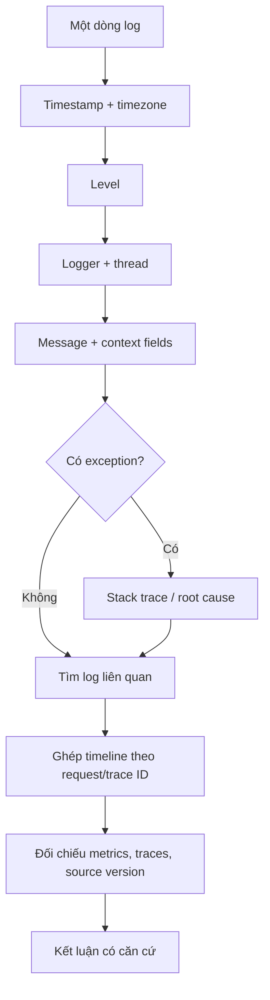

# Đọc timestamp, level, logger, thread và thông điệp

Khi ứng dụng Spring Boot khởi động, xử lý HTTP request, chạy scheduled job hoặc gặp lỗi, console thường hiển thị rất nhiều dòng log. Nếu chỉ đọc từ trái sang phải như một câu văn, bạn dễ bỏ sót thông tin quan trọng: lỗi xảy ra **lúc nào**, **nghiêm trọng ra sao**, **thành phần nào ghi log**, **thread nào đang thực hiện** và **điều gì đã xảy ra**.

Một dòng log thường có cấu trúc gồm các trường như:

```text
2026-11-13T09:32:04.127+07:00  INFO 18352 --- [shop-service] [           main] c.e.shop.ShopApplication : Starting ShopApplication
```

Tùy phiên bản Spring Boot, cấu hình Logback và môi trường chạy, hình thức có thể khác. Nhưng năm thành phần cần đọc được vẫn rất hữu ích:

1. **Timestamp** — thời điểm sự kiện được ghi nhận.
2. **Level** — mức độ ưu tiên/nghiêm trọng của thông điệp.
3. **Logger** — tên nguồn phát thông điệp, thường gắn với class hoặc thành phần.
4. **Thread** — luồng thực thi nơi lệnh ghi log được gọi.
5. **Message** — nội dung diễn giải sự kiện, có thể kèm exception và dữ liệu ngữ cảnh.

Bài học thuộc chương **Logging** của *Spring Boot Fundamentals*. Ta sẽ học cách phân tích từng trường, đọc log startup và HTTP request, hiểu stack trace, phân biệt logger với thread, xác định log có đến từ cùng một request hay không, cấu hình mức log và thực hành chẩn đoán bằng ví dụ cụ thể.

Các ví dụ sử dụng Java 21 và Spring Boot 3.x theo cấu hình logging văn bản phổ biến. Dòng log mẫu được viết để minh họa cấu trúc; **không phải cam kết về pattern mặc định chính xác của mọi phiên bản Spring Boot**.

## 1. Hãy bắt đầu bằng cách chia một dòng log thành các vùng

Xem dòng ví dụ:

```text
2026-11-13T09:32:04.127+07:00  INFO 18352 --- [shop-service] [           main] c.e.shop.ShopApplication : Starting ShopApplication
```

Có thể chia thành:

| Phần hiển thị | Giá trị trong ví dụ | Câu hỏi được trả lời |
|---|---|---|
| Timestamp | `2026-11-13T09:32:04.127+07:00` | Sự kiện được log lúc nào? |
| Level | `INFO` | Framework/tác giả log đánh giá mức độ ra sao? |
| Process ID (phụ trợ) | `18352` | Process JVM nào ghi log? |
| Application name (nếu có) | `shop-service` | Log thuộc ứng dụng/instance nào? |
| Thread | `main` | Thread nào gọi logger? |
| Logger | `c.e.shop.ShopApplication` | Class/thành phần nào phát log? |
| Message | `Starting ShopApplication` | Điều gì được thông báo? |

Trong một số bản Boot hoặc pattern khác, bạn có thể thấy:

```text
2026-11-13T09:32:04.127+07:00  INFO 18352 --- [           main] c.e.shop.ShopApplication : Starting ShopApplication
```

hoặc pattern tự cấu hình:

```text
09:32:04.127 INFO  [main] com.example.shop.ShopApplication - Starting ShopApplication
```

Vị trí và độ dài mỗi vùng có thể thay đổi; bạn nên nhận biết **ý nghĩa của trường** thay vì chỉ dựa vào số thứ tự cột.

### 1.1. Dấu phân cách không phải nội dung nghiệp vụ

Các phần như `---`, `[ ... ]` và dấu `:` trước message thường là ký tự phân cách do logging pattern tạo ra. Chúng giúp con người nhìn rõ các trường, nhưng không phải một phần tên logger hay message.

Ví dụ:

```text
... [           main] c.e.shop.ShopApplication : Started ShopApplication
```

`main` là thread, `c.e.shop.ShopApplication` là logger, còn `Started ShopApplication` là message.

### 1.2. Đọc một dòng log như một câu có cấu trúc

Hãy tự diễn đạt:

> “Vào 09:32:04.127 ngày 13/11/2026 theo múi giờ +07:00, JVM process 18352, thread main, logger của ShopApplication ghi một thông điệp INFO rằng ứng dụng đang bắt đầu khởi động.”

Cách diễn giải này tốt hơn kết luận vội “ứng dụng đã chạy xong”, bởi message ở đây mới là `Starting`, chưa phải `Started` hoặc một tín hiệu readiness.

## 2. Timestamp: sự kiện xảy ra lúc nào?

Timestamp là trường đầu tiên trong nhiều pattern log Spring Boot:

```text
2026-11-13T09:32:04.127+07:00
```

Ta đọc được:

| Thành phần | Giá trị | Giải thích |
|---|---|---|
| Ngày | `2026-11-13` | Ngày 13 tháng 11 năm 2026. |
| Dấu `T` | `T` | Ngăn phần ngày và phần giờ theo kiểu ISO-8601. |
| Giờ | `09:32:04` | 9 giờ 32 phút 4 giây. |
| Mili-giây | `.127` | Thêm 127 mili-giây sau mốc giây. |
| UTC offset | `+07:00` | Giờ hiển thị nhanh hơn UTC 7 giờ. |

Offset `+07:00` không nhất thiết mô tả “múi giờ cố định của toàn hệ thống”; nó cho biết độ lệch UTC **của timestamp đó**. Nếu một hệ thống cấu hình UTC, timestamp có thể kết thúc bằng `Z` hoặc `+00:00`.

### 2.1. So sánh hai log ở những múi giờ khác nhau

Ví dụ:

```text
2026-11-13T09:00:00.000+07:00 INFO ... Started application A
2026-11-13T02:00:00.000Z      INFO ... Started application B
```

Hai timestamp trên chỉ cùng một thời điểm tuyệt đối:

```text
09:00 theo UTC+07:00 = 02:00 UTC
```

Nếu so sánh log của service ở nhiều khu vực mà chỉ nhìn phần giờ, bạn có thể dựng sai thứ tự sự kiện. Luôn chuẩn hóa timestamp về cùng timezone khi điều tra lỗi phân tán.

### 2.2. Độ chính xác hiển thị và độ chính xác thực tế

Một timestamp có ba chữ số sau dấu chấm như `.127` hiển thị đến mili-giây. Điều đó **không bảo đảm** đồng hồ hệ điều hành hoặc hệ thống thu thập log có độ chính xác thực đúng 1 ms.

Hai dòng:

```text
2026-11-13T09:32:04.127+07:00 INFO ... Started operation
2026-11-13T09:32:04.127+07:00 INFO ... Finished operation
```

có thể xảy ra trong cùng một mili-giây hiển thị. Không thể kết luận thời gian xử lý bằng đúng 0 ns.

### 2.3. Dùng timestamp để ước lượng khoảng thời gian

Ví dụ:

```text
2026-11-13T10:15:00.100+07:00 INFO  ... Started importing file
2026-11-13T10:15:01.850+07:00 INFO  ... Finished importing file
```

Khoảng cách giữa hai mốc là khoảng **1,75 giây**. Đây chỉ là thời gian giữa hai lần ghi log, không nhất thiết bao trùm chính xác toàn bộ nghiệp vụ nếu log đặt chưa đúng ranh giới.

Để đo duration cho một operation trong code, có thể dùng `System.nanoTime()` hoặc timer của thư viện observability thay vì lấy `System.currentTimeMillis()` rồi giả định wall-clock luôn đơn điệu. Đồng hồ hệ thống có thể được đồng bộ/chỉnh lại.

### 2.4. Timestamp của log và thời gian sự kiện nghiệp vụ

Xét message:

```text
2026-11-13T10:15:02.000+07:00 INFO ... Processed payment event createdAt=2026-11-13T10:14:50Z
```

Timestamp đầu là **thời điểm log được ghi**, còn `createdAt` trong message là **thời điểm sự kiện thanh toán được tạo**. Hai mốc có vai trò khác nhau. Đừng tự xem chúng là một.

### 2.5. Thứ tự các dòng không luôn là thứ tự sự kiện tuyệt đối

Trong ứng dụng nhiều thread hoặc có asynchronous logging:

- Các thread có thể tạo log gần như đồng thời.
- Buffer và hệ thống thu thập có thể giao log theo thứ tự khác.
- Các process/host có thể lệch đồng hồ.

Vì vậy, timestamp là dữ liệu quan trọng để dựng timeline nhưng cần kết hợp thread, request/trace ID và các quan hệ nhân quả khác.

## 3. Level: mức ưu tiên của thông điệp

Trong hệ thống logging phổ biến của Spring Boot, các level thường gặp là:

| Level | Ý nghĩa thực tế | Ví dụ |
|---|---|---|
| `TRACE` | Chi tiết rất sâu, thường hữu ích khi điều tra nội bộ một luồng xử lý. | Ghi từng bước mapping, parsing hoặc lời gọi framework. |
| `DEBUG` | Thông tin chẩn đoán dành cho lập trình viên. | Method đã chọn nhánh nào, cache hit/miss. |
| `INFO` | Sự kiện vận hành bình thường đáng chú ý. | Ứng dụng started, batch hoàn tất. |
| `WARN` | Bất thường nhưng hệ thống có thể tiếp tục. | Một dependency chậm, đang dùng fallback. |
| `ERROR` | Lỗi mà thành phần ghi log cho là nghiêm trọng. | Không xử lý được yêu cầu hoặc job thất bại. |

Theo thứ tự mức độ phổ biến từ chi tiết nhất đến nghiêm trọng nhất:

```text
TRACE < DEBUG < INFO < WARN < ERROR
```

Đây là thứ tự lọc log, không phải quy tắc tuyệt đối để xác định mức độ ảnh hưởng nghiệp vụ.

### 3.1. Level là quyết định của người hoặc framework ghi log

Ví dụ:

```text
WARN ... Retrying payment provider after timeout
ERROR ... Payment provider unavailable after 3 attempts
```

Một timeout tạm thời có thể được log `WARN` khi có cơ chế retry. Khi retry hết, thành phần có thể log `ERROR`. Nhưng mỗi thư viện có chính sách riêng: không phải mọi WARN đều vô hại và không phải mọi ERROR đều làm cả JVM dừng.

**Không thể chỉ dựa vào chữ ERROR để kết luận ứng dụng đã crash.** Cần xem exception, các log sau đó, trạng thái process và health/readiness.

### 3.2. Level ảnh hưởng điều gì được ghi ra

Giả sử logger `com.example.shop` đang cấu hình level `INFO`. Thông thường:

- `TRACE` và `DEBUG` của logger đó bị lọc.
- `INFO`, `WARN` và `ERROR` có thể được ghi, nếu không có filter/appender khác chặn.

Ví dụ:

```java
log.debug("Preparing orderId={}", orderId);
log.info("Order accepted, orderId={}", orderId);
log.warn("Inventory is low for productCode={}", productCode);
```

Với ngưỡng INFO, dòng DEBUG thường không xuất hiện. Điều đó **không chứng minh code `log.debug(...)` không được chạy tới**; có thể nó chỉ bị lọc theo level.

### 3.3. Cấu hình log level bằng application.yml

```yaml
logging:
  level:
    root: INFO
    com.example.shop: DEBUG
    org.springframework.web: WARN
```

Giải thích:

- `root: INFO` là ngưỡng tổng quát cho những logger không có cấu hình cụ thể hơn.
- `com.example.shop: DEBUG` cho phép log DEBUG của package ứng dụng và các logger con theo quan hệ tên.
- `org.springframework.web: WARN` giảm log ở vùng Spring Web xuống WARN hoặc cao hơn.

Bạn cũng có thể viết trong `application.properties`:

```properties
logging.level.root=INFO
logging.level.com.example.shop=DEBUG
logging.level.org.springframework.web=WARN
```

Mục tiêu là tăng độ chi tiết ở **đúng phạm vi cần điều tra** thay vì bật DEBUG/TRACE cho toàn bộ hệ thống trong thời gian dài.

### 3.4. Level cấu hình không thay đổi message đã được tạo

Nếu ứng dụng đã phát một log rồi sau đó bạn đổi level, những dòng trong quá khứ không được tạo lại. Việc tăng level chỉ ảnh hưởng các lần ghi log tiếp theo theo khả năng cấu hình runtime của logging system.

Ngoài ngưỡng logger, appender và logging backend có thể thêm filter. Khi điều tra “vì sao không thấy DEBUG”, cần xem cả cấu hình đầu ra.

### 3.5. Không dùng level như một mã lỗi

Ví dụ:

```text
ERROR ... Invalid coupon entered by user
```

Một coupon không hợp lệ do người dùng nhập có thể là kết quả nghiệp vụ dự kiến, không nhất thiết là lỗi vận hành cần báo động. Hãy chọn level dựa trên ý nghĩa và khả năng hành động; tránh log ERROR cho mọi validation failure để hệ thống cảnh báo không bị quá tải.

## 4. Logger: thành phần nào đã ghi log?

Logger là **tên của nguồn ghi log**, thường dùng tên đầy đủ của class:

```java
import org.slf4j.Logger;
import org.slf4j.LoggerFactory;

public class PaymentService {

    private static final Logger log =
            LoggerFactory.getLogger(PaymentService.class);
}
```

Với class `com.example.shop.payment.PaymentService`, logger thường có tên:

```text
com.example.shop.payment.PaymentService
```

Logger không nhất thiết là địa chỉ HTTP endpoint, tên file log hoặc thread đang xử lý.

### 4.1. Logger name có thể bị rút gọn trong console

Ví dụ:

```text
c.e.shop.payment.PaymentService
```

Tên này có thể là dạng viết ngắn của:

```text
com.example.shop.payment.PaymentService
```

Một logging pattern có thể dùng độ rộng tối đa cho logger, chẳng hạn `%logger{36}`, khiến các phần của tên package được rút gọn.

Đừng tự kết luận tên class thực sự là `c.e.shop.payment.PaymentService` chỉ vì console hiển thị như vậy. Khi cần xác định class, xem source code, stack trace, logging pattern hoặc bật dạng logger name đầy đủ trong môi trường chẩn đoán.

### 4.2. Logger có thể có tên tùy chọn

Đôi khi code dùng:

```java
private static final Logger auditLogger =
        LoggerFactory.getLogger("audit.payments");
```

Khi đó tên logger là `audit.payments`, không phải tên class. Việc phân nhóm logger theo chức năng cũng hợp lệ, nhưng cần được tài liệu hóa rõ để đội ngũ hiểu nguồn message.

### 4.3. Logger giúp khoanh vùng code và dependency

Xét hai dòng:

```text
2026-11-13T10:22:16.314+07:00 DEBUG 18352 --- [shop-service] [nio-8080-exec-2] c.e.shop.order.OrderService : Loading orderId=125
2026-11-13T10:22:16.328+07:00 WARN  18352 --- [shop-service] [nio-8080-exec-2] o.s.web.servlet.PageNotFound : No mapping for GET /old-endpoint
```

Logger đầu thuộc code của ứng dụng. Logger thứ hai thuộc Spring Web. Chúng có thể cùng xuất hiện trong một request hoặc các request khác nhau, nhưng chỉ bằng tên logger ta đã biết nên tìm source ở đâu:

- `com.example.shop.order` → package code nghiệp vụ.
- `org.springframework.web...` → framework Spring Web.

### 4.4. Logger name là manh mối, không phải call stack

Một logger ở `OrderService` chỉ cho biết lệnh ghi log thuộc logger đó. Nó không chứng minh method đã được gọi trực tiếp từ controller nào. Để biết đường gọi chính xác khi có lỗi, cần stack trace hoặc trace/span/correlation ID.

## 5. Thread: luồng thực thi nào ghi log?

Trường thread thường nằm trong dấu ngoặc vuông:

```text
[           main]
[nio-8080-exec-2]
[   scheduling-1]
[         task-1]
```

Khoảng trắng có thể chỉ là phần căn chỉnh của console pattern. Tên thực tế thường là `main`, `nio-8080-exec-2`, `scheduling-1` và `task-1`.

### 5.1. Một số tên thread thường gặp

| Tên thread ví dụ | Thường gợi ý |
|---|---|
| `main` | Thread chính, thường thấy trong startup và runner. |
| `restartedMain` | Thread liên quan việc khởi động lại của DevTools trong môi trường phát triển. |
| `http-nio-8080-exec-4` hoặc `nio-8080-exec-4` | Thread xử lý yêu cầu HTTP trong một cấu hình servlet container phổ biến. |
| `scheduling-1` | Worker chạy tác vụ được scheduling. |
| `task-1` | Worker của task executor, có thể phục vụ `@Async`. |
| `reactor-http-nio-2` | Event-loop thread trong ứng dụng dựa trên Reactor Netty. |
| Tên virtual thread | Thread ảo nếu ứng dụng/framework được cấu hình sử dụng virtual threads. |

**Tên thread có thể thay đổi** do servlet container, executor, cấu hình thread name prefix và phiên bản dependency. Đây chỉ là manh mối, không phải chuẩn cố định.

### 5.2. Thread giúp phân biệt startup và xử lý request

Ví dụ:

```text
10:00:00.000 INFO  [main] ShopApplication - Starting ShopApplication
10:00:02.200 INFO  [main] ShopApplication - Started ShopApplication
10:00:06.510 INFO  [http-nio-8080-exec-1] OrderController - Received order request
```

Hai dòng đầu trên thread main thường thuộc quá trình khởi động; dòng sau trên một HTTP worker thread thường liên quan xử lý request. Không phải mọi log trên main đều là startup, nhưng đây là suy luận ban đầu hữu ích.

### 5.3. Cùng thread không đồng nghĩa cùng request

Thread pool tái sử dụng thread.

```text
10:03:01.100 INFO [http-nio-8080-exec-2] OrderController - Request A received
10:03:01.220 INFO [http-nio-8080-exec-2] OrderController - Request A completed
10:03:04.300 INFO [http-nio-8080-exec-2] OrderController - Request B received
```

Vẫn là `http-nio-8080-exec-2`, nhưng đã là **hai request khác nhau**. Muốn liên kết log chắc chắn hơn, cần request ID hoặc trace ID được truyền và ghi theo từng request.

### 5.4. Một request có thể chuyển qua nhiều thread

Với `@Async`, `CompletableFuture`, message consumer, reactive pipeline hoặc virtual thread execution, một operation có thể tiếp tục trên thread khác:

```text
10:05:00.100 INFO [http-nio-8080-exec-1] OrderController - Accepted orderId=125
10:05:00.150 INFO [task-2] OrderWorker - Sending notification for orderId=125
```

Hai dòng có thể thuộc cùng workflow nhưng khác thread. Nếu chỉ tìm log theo thread đầu tiên, bạn có thể bỏ sót bước xử lý tiếp theo.

### 5.5. Thread name không tự thể hiện user hoặc request

Không suy luận từ `task-2` rằng đây là task thứ hai của một user, cũng không từ `nio-8080-exec-3` rằng đây là request thứ ba. Các số trong tên thường liên quan việc đặt tên worker/executor.

## 6. Message: điều gì đã được ghi nhận?

Message là nội dung được ứng dụng hoặc framework chọn để mô tả sự kiện:

```text
Order accepted orderId=125
Connection to payment provider timed out
Started ShopApplication in 2.341 seconds
```

Một message tốt giúp trả lời:

- Operation nào đang được thực hiện?
- Kết quả là thành công, thất bại hay đang retry?
- Đối tượng được xử lý là gì? Ví dụ `orderId` hoặc `batchId`.
- Hệ thống đã làm gì tiếp theo?
- Lỗi hoặc giới hạn nào cần được điều tra?

Message không có cấu trúc bắt buộc trong log văn bản. Một project có thể dùng câu tự nhiên; project khác dùng cặp `key=value` để dễ tìm kiếm.

### 6.1. Ghi message với tham số

Trong Java, ứng dụng Spring Boot thường ghi log thông qua SLF4J:

```java
package com.example.shop.order;

import org.slf4j.Logger;
import org.slf4j.LoggerFactory;
import org.springframework.stereotype.Service;

@Service
public class OrderService {

    private static final Logger log =
            LoggerFactory.getLogger(OrderService.class);

    public void confirm(long orderId) {
        log.info("Confirming orderId={}", orderId);
        // Thực hiện nghiệp vụ...
        log.info("Order confirmed orderId={}", orderId);
    }
}
```

Trong message format, `{}` được thay bằng giá trị tham số theo API logging. Ví dụ:

```text
Order confirmed orderId=125
```

Đừng nhầm placeholder `{}` của SLF4J với placeholder `${...}` dùng trong Spring configuration. Hai cú pháp thuộc hai cơ chế khác nhau.

### 6.2. Message nên có động từ và ngữ cảnh

So sánh:

```text
INFO  ... OrderService : Done
INFO  ... OrderService : Order confirmed orderId=125 status=PAID
```

Dòng thứ hai giàu thông tin hơn: nó cho biết **đã làm gì**, **đối tượng nào** và **kết quả**.

Tuy nhiên, không cần đưa toàn bộ object hay payload vào log. Chỉ ghi những trường vận hành cần thiết và phù hợp với chính sách bảo mật.

### 6.3. Log message khác log event schema

Trong log văn bản, `orderId=125` thường chỉ là ký tự nằm trong message. Trong log có cấu trúc JSON, `orderId` có thể là một field riêng để hệ thống tìm kiếm truy vấn trực tiếp.

Khi dùng công cụ thu thập log, việc phân tích message tự do bằng regex có thể mong manh hơn so với dùng structured fields.

## 7. Phần phụ trợ thường thấy: PID, ứng dụng và mã tương quan

Năm trường chính không phải mọi thứ có thể xuất hiện trong log. Pattern Spring Boot còn có thể cho thấy:

- Process ID (PID).
- Application name/instance identifier.
- Correlation identifiers như `traceId` và `spanId`.
- Dấu phân cách/căn chỉnh.
- Mã màu ANSI trong console.

Ví dụ:

```text
2026-11-13T10:11:12.125+07:00  INFO 18352 --- [shop-service] [http-nio-8080-exec-4] c.e.s.order.OrderController : Received orderId=125
```

`18352` là PID ví dụ. Nếu cùng máy có hai process ứng dụng, PID có thể giúp phân biệt log của chúng. Nhưng khi chạy trong container, PID có thể lặp giữa namespace khác nhau; cần thêm container/pod/instance identity từ hệ thống triển khai.

### 7.1. Tên ứng dụng không phải logger name

`shop-service` có thể là application name; `c.e.s.order.OrderController` là logger name. Một application có hàng trăm logger nhưng cùng application name.

Ví dụ cấu hình:

```yaml
spring:
  application:
    name: shop-service
```

Một số version/pattern logging có thể đưa application name vào console. Không phải mọi pattern đều có trường này.

### 7.2. Mã màu không phải dữ liệu logic

Ở console, `INFO` có thể hiện màu khác `ERROR`. Khi log được ghi ra file hoặc hệ thống tập trung, màu có thể bị bỏ hoặc được biểu diễn bằng escape sequences. Hãy dựa vào level text và structured field thay vì chỉ nhìn màu.

## 8. Đọc log khởi động Spring Boot

Một đoạn log startup minh họa:

```text
2026-11-13T09:32:04.127+07:00  INFO 18352 --- [shop-service] [main] c.e.shop.ShopApplication : Starting ShopApplication using Java 21
2026-11-13T09:32:04.250+07:00  INFO 18352 --- [shop-service] [main] c.e.shop.ShopApplication : The following 1 profile is active: "dev"
2026-11-13T09:32:05.031+07:00  INFO 18352 --- [shop-service] [main] o.s.b.w.e.tomcat.TomcatWebServer : Tomcat initialized with port 8080 (http)
2026-11-13T09:32:05.742+07:00  INFO 18352 --- [shop-service] [main] o.s.b.w.e.tomcat.TomcatWebServer : Tomcat started on port 8080 (http)
2026-11-13T09:32:05.817+07:00  INFO 18352 --- [shop-service] [main] c.e.shop.ShopApplication : Started ShopApplication in 1.94 seconds
```

Hãy phân tích:

1. Cả năm dòng cùng PID `18352` và ứng dụng `shop-service`.
2. Các logger thuộc class main và thành phần Tomcat của framework.
3. Thread `main` cho thấy log xuất hiện trong chuỗi khởi động thông thường.
4. Timestamp tăng dần từ `09:32:04` đến `09:32:05`.
5. Message phân biệt các mốc `Starting`, khởi tạo web server, web server started và `Started`.

### 8.1. “Started” không nhất thiết là “Ready”

Spring Boot có `ApplicationStartedEvent` sau khi context refresh nhưng trước `ApplicationRunner` và `CommandLineRunner`. `ApplicationReadyEvent` được phát sau runners. Vì vậy log `Started ShopApplication` thường là mốc quan trọng, nhưng không tự bảo đảm mọi startup task do runner đã hoàn tất hoặc mọi external dependency đều khỏe mạnh.

Nếu một runner tiếp tục nạp dữ liệu và thất bại, ứng dụng có thể không đạt trạng thái ready mặc dù trước đó đã ghi một dòng “Started”.

### 8.2. Không phải log nào trước Started cũng là lỗi

Ứng dụng có thể ghi `WARN` khi thiếu một optional configuration nhưng vẫn khởi động. Để xác định startup failure, hãy tìm những dấu hiệu như:

```text
ERROR ... Application run failed
Caused by: ...
```

và kiểm tra context có đóng, process có exit hoặc readiness có đạt hay không. Không quyết định chỉ từ một dòng WARN.

## 9. Đọc log HTTP request

Giả sử code:

```java
@RestController
@RequestMapping("/orders")
public class OrderController {

    private static final Logger log =
            LoggerFactory.getLogger(OrderController.class);

    @PostMapping("/{orderId}/confirm")
    public ResponseEntity<Void> confirm(@PathVariable long orderId) {
        log.info("Confirm request orderId={}", orderId);
        // Gọi service xác nhận đơn hàng...
        log.info("Confirm request accepted orderId={}", orderId);
        return ResponseEntity.accepted().build();
    }
}
```

Ví dụ log:

```text
2026-11-13T10:08:01.100+07:00 INFO 18352 --- [shop-service] [http-nio-8080-exec-3] c.e.s.order.OrderController : Confirm request orderId=125
2026-11-13T10:08:01.115+07:00 INFO 18352 --- [shop-service] [http-nio-8080-exec-3] c.e.s.order.OrderController : Confirm request accepted orderId=125
```

Ta suy ra:

- Cùng process/application theo phần đầu log.
- Hai message của cùng logger `OrderController`.
- Cùng thread trong ví dụ; có khả năng chúng thuộc cùng request đồng bộ.
- Khoảng cách timestamp khoảng 15 ms.
- Message cho biết request được nhận và phản hồi theo luồng nghiệp vụ mẫu.

**Không suy ra chắc chắn** request thành công hoàn toàn chỉ vì message nói “accepted”. `ResponseEntity.accepted()` biểu thị HTTP 202 Accepted, không nhất thiết công việc phía sau đã hoàn tất. Muốn biết trạng thái cuối, cần log và dữ liệu ở những bước xử lý tiếp theo.

### 9.1. Nhiều request đồng thời

```text
10:08:01.100 INFO [http-nio-8080-exec-3] OrderController - Confirm request orderId=125
10:08:01.102 INFO [http-nio-8080-exec-4] OrderController - Confirm request orderId=126
10:08:01.110 INFO [http-nio-8080-exec-4] OrderController - Confirm request accepted orderId=126
10:08:01.115 INFO [http-nio-8080-exec-3] OrderController - Confirm request accepted orderId=125
```

Đây không phải một request “nhảy qua lại” trong controller; có thể hai thread đang xử lý hai request đồng thời. Để dựng dòng thời gian chính xác, hãy phân nhóm theo request ID hoặc trace ID khi có.

## 10. Đọc log có exception và stack trace

Một log lỗi có thể bắt đầu bằng một dòng đầy đủ năm trường rồi tiếp tục bằng nhiều dòng stack trace:

```text
2026-11-13T10:12:45.203+07:00 ERROR 18352 --- [shop-service] [http-nio-8080-exec-2] c.e.s.payment.PaymentService : Payment failed orderId=125
java.lang.IllegalStateException: Provider returned an invalid response
    at com.example.shop.payment.PaymentService.charge(PaymentService.java:87)
    at com.example.shop.order.OrderService.confirm(OrderService.java:132)
    at com.example.shop.order.OrderController.confirm(OrderController.java:48)
Caused by: java.net.SocketTimeoutException: Read timed out
    at com.example.shop.payment.ProviderClient.send(ProviderClient.java:61)
```

Dòng đầu có timestamp, level `ERROR`, logger `PaymentService`, thread xử lý request và message. Những dòng phía sau **không phải các sự kiện log độc lập theo cùng pattern**, mà là phần stack trace được in kèm một logging event.

### 10.1. Đọc exception theo từng tầng

1. **Message của log event:** `Payment failed orderId=125`.
2. **Loại exception ngoài:** `IllegalStateException`.
3. **Thông điệp exception:** `Provider returned an invalid response`.
4. **Stack frames:** nơi exception đi qua, có file và số dòng.
5. **Caused by:** nguyên nhân nằm bên dưới, ở đây là `SocketTimeoutException`.

Một lỗi có nhiều tầng exception wrapper. Khi điều tra, thường nên đọc từ message log xuống **root cause hữu ích**, rồi lần lại những frame thuộc code của ứng dụng.

### 10.2. File và số dòng giúp làm gì?

```text
PaymentService.java:87
```

là manh mối cho vị trí code được ghi trong stack trace của binary đang chạy. Hãy đối chiếu với commit/version của bản build thực tế; số dòng trên nhánh code hiện tại có thể không trùng với bản đã triển khai.

### 10.3. ERROR không tự động có stack trace

Ví dụ:

```java
log.error("Payment failed orderId={}", orderId);
```

chỉ tạo message ERROR. Muốn ghi exception, thông thường truyền throwable cuối lời gọi:

```java
log.error("Payment failed orderId={}", orderId, exception);
```

Với SLF4J và logging backend phù hợp, exception được trình bày thành stack trace. Chỉ ghi `exception.getMessage()` có thể làm mất loại exception và chuỗi nguyên nhân.

### 10.4. Không xem mỗi dòng stack trace là một request

Nếu dùng lệnh đếm dòng `ERROR` trong file, nhiều stack trace có thể làm việc tìm kiếm khó hơn. Các hệ thống log aggregation nên hỗ trợ **multiline grouping** để gom phần stack trace vào cùng event thay vì cắt thành những record rời.

## 11. Logger khác thread: hai trục phân tích độc lập

Một logger có thể được gọi từ nhiều thread:

```text
10:21:01.100 INFO [http-nio-8080-exec-1] OrderService - Loading orderId=125
10:21:01.101 INFO [http-nio-8080-exec-5] OrderService - Loading orderId=126
```

Ngược lại, cùng một thread có thể lần lượt gọi nhiều logger:

```text
10:21:01.100 INFO [http-nio-8080-exec-1] OrderController - Confirm orderId=125
10:21:01.104 INFO [http-nio-8080-exec-1] OrderService    - Loading orderId=125
10:21:01.115 INFO [http-nio-8080-exec-1] PaymentService  - Charging orderId=125
```

Vì vậy:

- **Logger** nói nhiều về vị trí code hoặc thành phần ghi log.
- **Thread** nói về ngữ cảnh thực thi ở thời điểm ghi log.

Không cái nào, khi đứng một mình, là định danh request ổn định.

### 11.1. Phân tích theo cặp logger và thread

Khi một request diễn ra đồng bộ trên servlet worker thread, ta có thể theo thứ tự log của nhiều logger trên cùng thread để hình dung đường xử lý. Nhưng với thread pooling, async hoặc reactive, bạn cần kết hợp timestamp và correlation ID để tránh gộp nhầm các request.

## 12. MDC và request ID: đọc thêm bối cảnh bên ngoài năm trường

**Mapped Diagnostic Context (MDC)** là một cách gắn metadata vào ngữ cảnh logging, thường dùng cho `requestId`, `traceId` hoặc một khóa tương quan khác.

Ví dụ hai log có thêm `requestId`:

```text
2026-11-13T10:25:05.101+07:00 INFO [http-nio-8080-exec-2] requestId=7f4a OrderController - Confirm orderId=125
2026-11-13T10:25:05.109+07:00 INFO [http-nio-8080-exec-2] requestId=7f4a PaymentService  - Payment initiated orderId=125
```

Ở đây `requestId=7f4a` là giá trị minh họa. Trong một hệ thống thật, request ID thường dài và được tạo theo quy tắc đảm bảo xác suất trùng thấp.

### 12.1. Vì sao cần request ID?

Trong ứng dụng có nhiều request đồng thời:

```text
10:25:05.100 INFO [http-nio-8080-exec-2] requestId=A OrderController - Request A
10:25:05.101 INFO [http-nio-8080-exec-3] requestId=B OrderController - Request B
10:25:05.103 INFO [http-nio-8080-exec-2] requestId=A OrderService    - Step 1 A
10:25:05.108 INFO [task-1]             requestId=A NotificationJob - Step 2 A
```

Request A có thể xuất hiện ở thread khác. Nếu correlation ID được truyền đúng sang executor, bạn vẫn truy được các log cùng một flow.

### 12.2. Ví dụ gắn MDC trong servlet filter

Một ví dụ tối giản:

```java
package com.example.shop.logging;

import java.io.IOException;
import java.util.UUID;

import jakarta.servlet.FilterChain;
import jakarta.servlet.ServletException;
import jakarta.servlet.http.HttpServletRequest;
import jakarta.servlet.http.HttpServletResponse;
import org.slf4j.MDC;
import org.springframework.stereotype.Component;
import org.springframework.web.filter.OncePerRequestFilter;

@Component
public class RequestIdFilter extends OncePerRequestFilter {

    @Override
    protected void doFilterInternal(
            HttpServletRequest request,
            HttpServletResponse response,
            FilterChain filterChain)
            throws ServletException, IOException {

        String requestId = UUID.randomUUID().toString();
        response.setHeader("X-Request-ID", requestId);

        try (MDC.MDCCloseable ignored =
                     MDC.putCloseable("requestId", requestId)) {
            filterChain.doFilter(request, response);
        }
    }
}
```

Ví dụ sinh request ID phía server để tránh tin hoàn toàn vào header do caller cung cấp. Dự án thật có thể cần tương thích với hệ thống tracing hoặc reverse proxy đã có cơ chế correlation riêng.

### 12.3. Phải đưa MDC vào logging pattern

Chỉ gọi `MDC.put(...)` không bảo đảm request ID tự xuất hiện ở mọi dòng. Backend logging cần một pattern hoặc encoder đọc MDC.

Một custom Logback console pattern minh họa:

```yaml
logging:
  pattern:
    console: "%d{yyyy-MM-dd'T'HH:mm:ss.SSSXXX} %-5level [%thread] requestId=%X{requestId} %logger{40} - %msg%n"
```

Pattern này được dùng để minh họa các conversion word của Logback. Khi thay toàn bộ `logging.pattern.console`, bạn cũng thay định dạng console mặc định của Boot; trước khi áp dụng trên production, cần xem cấu hình logger, trace correlation và encoding đang có.

### 12.4. MDC cần được dọn dẹp và truyền qua async boundary

MDC thường có semantics gắn với thread trong logging backend phổ biến. Nếu không dọn `requestId` sau request, một thread được tái sử dụng có thể ghi nhầm ID của request cũ.

Sử dụng `try/finally` hoặc `MDC.putCloseable(...)` để dọn trong phạm vi đồng bộ phù hợp. Khi chuyển sang thread khác, context MDC không tự động được truyền đúng trong mọi executor/reactive pipeline. Hãy dùng cơ chế context propagation hoặc observability được framework hỗ trợ thay vì tự sao chép ngữ cảnh một cách thiếu kiểm soát.

### 12.5. Trace ID và span ID không phải thread ID

Nếu có distributed tracing, log có thể có:

```text
traceId=9b4d... spanId=73ac... 
```

- **Trace ID:** thường liên kết các bước thuộc một luồng xử lý xuyên dịch vụ.
- **Span ID:** định danh một đơn vị công việc trong trace.
- **Thread name:** cho biết worker thực thi tại thời điểm ghi log.

Một trace có thể chạy qua nhiều service, process và thread. Thread ID không thay thế được distributed trace ID.

## 13. Tại sao thứ tự log có thể gây hiểu lầm?

Giả sử:

```text
10:28:00.101 INFO [http-nio-8080-exec-1] OrderService - Submitting notification
10:28:00.102 INFO [http-nio-8080-exec-1] OrderService - HTTP response accepted
10:28:00.350 ERROR [task-4] NotificationWorker - Notification failed
```

Hai dòng đầu trên HTTP thread thông báo request đã được chấp nhận; dòng thứ ba trên worker thread nói background notification thất bại.

Không có mâu thuẫn bắt buộc: request có thể trả kết quả trước khi background work kết thúc. Khi đọc, hãy xác định **ranh giới đồng bộ và bất đồng bộ**.

### 13.1. Log “completed” có thể chỉ nói một bước đã xong

`Completed HTTP request` khác `Payment settled`. Message phải được hiểu theo ngữ nghĩa của tác giả và operation cụ thể.

### 13.2. Log collector có thể nhận muộn

Trong hệ thống nhiều container, một log có timestamp sớm có thể được chuyển tới dashboard sau log của container khác. Hãy phân biệt **event timestamp** với **ingestion timestamp** nếu công cụ quan sát hiển thị cả hai.

## 14. Cấu hình pattern để nhìn rõ năm trường

Spring Boot thường dùng logging abstraction cùng một logging backend, phổ biến là Logback khi dùng starter logging mặc định. Bạn có thể tùy chỉnh pattern console.

Ví dụ trong `application.yml`:

```yaml
logging:
  level:
    root: INFO
    com.example.shop: DEBUG
  pattern:
    console: "%d{yyyy-MM-dd'T'HH:mm:ss.SSSXXX} %-5level [%thread] %logger{40} - %msg%n"
```

Trong pattern minh họa:

| Token | Ý nghĩa thường gặp trong Logback |
|---|---|
| `%d{...}` | Timestamp theo định dạng yêu cầu. |
| `%-5level` | Log level, căn trái trong vùng rộng tối thiểu 5 ký tự. |
| `%thread` | Thread name. |
| `%logger{40}` | Logger name, giới hạn độ dài theo định dạng backend. |
| `%msg` | Message đã format. |
| `%n` | Ký tự xuống dòng. |
| `%X{requestId}` | Giá trị `requestId` trong MDC nếu có. |

Kết quả ví dụ:

```text
2026-11-13T10:30:01.234+07:00 INFO  [http-nio-8080-exec-4] com.example.shop.order.OrderService - Order confirmed orderId=125
```

### 14.1. Vì sao ví dụ custom pattern không có PID?

Vì pattern chỉ chứa những trường mà chúng ta khai báo. Khi thay pattern mặc định bằng custom pattern, bạn có thể **làm mất** những trường bổ sung như PID, application name hoặc trace correlation nếu không đưa chúng vào.

Do đó, trước khi sửa pattern, hãy xác định dashboard và hệ thống thu thập đang cần trường nào. Cấu hình pattern sai có thể làm khả năng chẩn đoán kém hơn mặc định.

### 14.2. Nếu cần cấu hình nâng cao

Bạn có thể dùng `logback-spring.xml` để tùy chỉnh appenders, encoders và pattern chi tiết. Đây là lựa chọn phù hợp khi cần nhiều destination hoặc structured logging phức tạp.

Không nên tùy chỉnh chỉ để đổi vài khoảng trắng nếu pattern của Spring Boot hiện tại đã đủ thông tin.

## 15. Structured logging: cùng thông tin nhưng ở dạng dữ liệu

Log văn bản thuận tiện cho người đọc:

```text
2026-11-13T10:33:00.320+07:00 INFO [http-nio-8080-exec-1] OrderService - Order confirmed orderId=125
```

Log có cấu trúc có thể biểu diễn cùng sự kiện dưới dạng JSON:

```json
{
  "timestamp": "2026-11-13T10:33:00.320+07:00",
  "level": "INFO",
  "logger": "com.example.shop.order.OrderService",
  "thread": "http-nio-8080-exec-1",
  "message": "Order confirmed",
  "orderId": 125
}
```

Đây là schema minh họa, không phải schema JSON cố định của mọi cấu hình Spring Boot.

### 15.1. Structured log giúp gì?

- Có thể lọc `level=ERROR` chính xác.
- Có thể tìm theo `logger` hoặc `thread` mà không phải parse vị trí cột.
- Có thể nhóm theo `traceId`, `requestId` hoặc `orderId`.
- Có thể làm dashboard/tổng hợp theo field.
- Giảm phụ thuộc vào một text pattern đã bị thay đổi.

Một số phiên bản Spring Boot có hỗ trợ structured logging theo cấu hình; framework/backend khác cũng có thể dùng encoder JSON. Hãy chọn format theo hệ thống observability thực tế, thay vì giả định mọi project bật JSON bằng cùng một property.

### 15.2. Một logging event có thể xuất hiện thành nhiều dòng text

Trong log text, exception stack trace làm một event trải dài nhiều dòng. Với structured logging, exception có thể nằm trong field chuỗi `stack_trace` hoặc một cấu trúc riêng. Khi chuyển format, cần kiểm tra pipeline ingest để tránh cắt vụn stack trace.

## 16. Đọc log trong môi trường phát triển và production

### 16.1. Development

Trong môi trường local, bạn thường muốn:

- Mức log mặc định `INFO`.
- Tạm mở `DEBUG` cho package cần điều tra.
- Timestamp có offset rõ ràng.
- Thread và logger name dễ nhận diện.
- Stack trace đầy đủ khi có lỗi.

Một file `application-dev.yml` minh họa:

```yaml
logging:
  level:
    root: INFO
    com.example.shop: DEBUG
    org.springframework.web: INFO
```

### 16.2. Production

Ở production, nên chú ý:

- Không bật TRACE cho toàn hệ thống trừ khi có mục đích và thời gian kiểm soát.
- Dùng correlation ID để theo dõi yêu cầu.
- Bảo đảm log không chứa secret, token, password hoặc thông tin cá nhân quá mức.
- Hạn chế message có độ dài rất lớn hoặc objects in toàn bộ.
- Thiết lập retention và quyền truy cập log.
- Đồng bộ clock giữa host/container và thống nhất cách hiển thị timezone.
- Dùng structured fields hoặc format nhất quán khi tập trung log.

Log là một nguồn dữ liệu vận hành, không phải một nơi lưu dữ liệu nghiệp vụ không giới hạn.

### 16.3. Không chỉ lọc theo ERROR

Một lỗi thực tế có thể có chuỗi:

```text
WARN  PaymentClient - Provider slow, retrying attempt=1
WARN  PaymentClient - Provider slow, retrying attempt=2
ERROR PaymentClient - Provider unavailable orderId=125
```

Chỉ xem dòng ERROR làm mất thông tin số lần retry và quá trình lỗi tiến triển. Khi điều tra, lấy thêm những WARN/INFO có liên quan theo thời gian, request ID hoặc logger.

## 17. Phân biệt log trong cùng một lần chạy và khác lần chạy

Xét:

```text
09:00:00.000 INFO 18352 --- [main] ShopApplication - Starting ShopApplication
09:00:03.000 INFO 18352 --- [main] ShopApplication - Started ShopApplication
09:15:00.000 INFO 19401 --- [main] ShopApplication - Starting ShopApplication
09:15:02.000 INFO 19401 --- [main] ShopApplication - Started ShopApplication
```

PID khác nhau là dấu hiệu hai process khác nhau trên cùng phạm vi PID. Trong container, PID không đủ để phân biệt hai lần triển khai; nên có instance/pod/container ID, deployment version và startup timestamp.

Điều này quan trọng khi dashboard gộp log nhiều instance. Nếu không biết log thuộc bản phát hành nào, bạn có thể chẩn đoán trên source code sai phiên bản.

## 18. Từ dòng log tới nguyên nhân lỗi: một kịch bản cụ thể

Giả sử người dùng báo “xác nhận đơn hàng đôi khi bị lỗi”. Bạn thấy:

```text
2026-11-13T11:02:10.100+07:00 INFO  18352 --- [shop-service] [http-nio-8080-exec-1] c.e.s.order.OrderController : Confirm requested orderId=125 requestId=REQ-8
2026-11-13T11:02:10.105+07:00 DEBUG 18352 --- [shop-service] [http-nio-8080-exec-1] c.e.s.order.OrderService : Loading orderId=125
2026-11-13T11:02:10.140+07:00 WARN  18352 --- [shop-service] [http-nio-8080-exec-1] c.e.s.payment.PaymentClient : Provider timeout, retry=1 orderId=125
2026-11-13T11:02:11.150+07:00 ERROR 18352 --- [shop-service] [http-nio-8080-exec-1] c.e.s.payment.PaymentService : Payment failed orderId=125 requestId=REQ-8
```

Phân tích theo năm trường:

| Trường | Quan sát | Hướng điều tra |
|---|---|---|
| Timestamp | Từ 11:02:10.100 đến 11:02:11.150, khoảng 1,05 giây. | Có timeout/retry làm kéo dài request không? |
| Level | INFO → DEBUG → WARN → ERROR. | Điểm nào chuyển từ bất thường tạm thời sang thất bại? |
| Logger | Controller → OrderService → PaymentClient → PaymentService. | Thành phần thanh toán có lỗi gì? |
| Thread | Cùng `http-nio-8080-exec-1`. | Có khả năng cùng luồng đồng bộ, nhưng vẫn cần correlation. |
| Message | OrderId và requestId nhất quán. | Tập trung vào `REQ-8` và order 125, tìm stack trace đi kèm. |

**Kết luận có thể rút ra:** có dấu hiệu một timeout ở payment provider, đã retry và cuối cùng thanh toán thất bại. **Chưa thể kết luận:** nguyên nhân timeout là network, server phía provider hay cấu hình client — cần stack trace, metrics, network telemetry và dữ liệu provider.

### 18.1. Tránh suy luận vượt quá log

Nếu log nói “Provider timeout”, đó là thông tin về cách client nhận biết lỗi; không tự chứng minh provider đã outage toàn bộ. Cần kiểm tra nhiều request, tần suất lỗi và trạng thái dependency khác.

### 18.2. Kết hợp nhiều logger, không chỉ một dòng ERROR

Dòng ERROR cho biết nơi phát hiện thất bại. Dòng WARN trước đó có thể cho biết chính sách retry và mốc ban đầu. Dòng controller cho biết request ID giúp tìm thêm những log phía trước và sau.

## 19. Cách tìm kiếm log khi không biết vị trí lỗi

Với một file log văn bản trên máy local, bạn có thể bắt đầu từ một từ khóa ổn định.

Ví dụ trên Linux/macOS:

```bash
grep "orderId=125" application.log
grep "ERROR" application.log
grep "PaymentService" application.log
```

Với PowerShell:

```powershell
Select-String -Path .\application.log -Pattern "orderId=125"
Select-String -Path .\application.log -Pattern "ERROR"
Select-String -Path .\application.log -Pattern "PaymentService"
```

Trong thực tế, một dashboard log tập trung cho phép lọc theo field hiệu quả hơn, đặc biệt nếu log là JSON.

### 19.1. Phải xác định phạm vi thời gian

Nếu order ID hoặc request ID lặp ở những môi trường khác nhau, kết quả tìm kiếm có thể lẫn nhiều bản ghi. Hãy giới hạn:

- Application/service name.
- Environment.
- Instance/container khi cần.
- Time window.
- Request ID/trace ID.
- Logger hoặc exception type.

Chỉ grep `ERROR` toàn bộ log một tuần thường khó thấy quan hệ nhân quả hơn việc chọn một cửa sổ vài phút quanh sự kiện.

### 19.2. Stack trace cần tìm theo một sự kiện

Một dòng `ERROR` có thể kèm nhiều dòng stack trace ở phía dưới. Nếu chỉ lấy những dòng có chữ ERROR, bạn có thể không thấy `Caused by`. Khi điều tra, hãy mở đoạn văn bản liên tiếp quanh dòng lỗi hoặc xem event đầy đủ trong hệ thống logging.

## 20. Kiểm tra cấu hình logging đang có hiệu lực

Một project có thể có:

```properties
logging.level.root=INFO
logging.level.com.example.shop.payment=DEBUG
logging.file.name=logs/shop.log
```

Trong đó:

- Log level tổng quát là INFO.
- Package payment của ứng dụng có thể ghi thêm DEBUG.
- Log được cấu hình ra file `logs/shop.log` theo logging setup tương ứng.

Với ứng dụng có Logback/Actuator và endpoint được bật, có thể xem hoặc thay mức log của logger qua `/actuator/loggers`. Tính năng này cần cấu hình và quyền truy cập phù hợp.

Ví dụ chỉ dành cho môi trường chẩn đoán được bảo vệ:

```yaml
management:
  endpoints:
    web:
      exposure:
        include: health,loggers
```

Không expose actuator loggers công khai mà không có cơ chế bảo vệ; khả năng đổi log level có thể làm lộ nhiều dữ liệu nội bộ hoặc tạo tải logging lớn.

### 20.1. Không phải cứ thêm @Slf4j là logger tự xuất hiện

Lombok `@Slf4j` có thể sinh field logger tại compile time nếu project có Lombok và annotation processing đúng. Nó **không tự ghi log**: code vẫn phải gọi `log.info(...)`, `log.warn(...)`, v.v.

Ví dụ:

```java
@Slf4j
@Service
public class InventoryService {

    public void reserve(long orderId) {
        log.info("Reserving inventory for orderId={}", orderId);
    }
}
```

Bạn có thể dùng SLF4J trực tiếp mà không cần Lombok. Với mọi cách, logger name thường gắn với class chứa field logger.

## 21. Những nhận định sai khi đọc năm trường log

| Nhận định | Cách hiểu chính xác |
|---|---|
| “Timestamp giống nhau thì hai log xảy ra cùng nanosecond.” | Độ chính xác hiển thị có giới hạn; nhiều event có thể chung mili-giây. |
| “ERROR nghĩa là ứng dụng chắc chắn đã dừng.” | ERROR là level của logging event; cần xem trạng thái process/health. |
| “Không thấy DEBUG nghĩa là method không chạy.” | DEBUG có thể bị lọc do level hoặc appender. |
| “Logger là tên thread.” | Logger là nguồn log; thread là ngữ cảnh thực thi. |
| “Logger ngắn là tên class thật.” | Logging pattern có thể rút gọn package name. |
| “Cùng thread thì cùng request.” | Thread pool có thể tái sử dụng worker cho request khác. |
| “Khác thread thì khác request.” | Async/reactive processing có thể chuyển thread trong cùng workflow. |
| “Sau dấu hai chấm chỉ có text không cấu trúc.” | Message có thể chứa cặp key=value; exception có thể theo sau nhiều dòng. |
| “Một dòng Caused by là một event log mới.” | Thường là phần tiếp nối stack trace của event lỗi. |
| “Ứng dụng Started nghĩa là mọi việc đã sẵn sàng.” | Startup runner/readiness và dependency bên ngoài cần được xét thêm. |
| “Có requestId trong MDC thì tự động xuất hiện ở mọi log.” | Pattern/encoder và context propagation phải hỗ trợ. |
| “Thứ tự xuất hiện trong dashboard luôn là thứ tự thực thi.” | Thu thập async, nhiều thread và lệch đồng hồ có thể làm thay đổi thứ tự. |

## 22. Quy trình chẩn đoán từ một dòng log

Khi nhận một đoạn log bất kỳ, hãy thực hiện theo thứ tự:

1. **Xác định định dạng.** Đây là console text, file text hay structured JSON?
2. **Đọc timestamp cùng offset.** Chuẩn hóa timezone nếu so sánh nhiều hệ thống.
3. **Đọc level.** Đây là log quan sát, cảnh báo hay thất bại theo chính sách tác giả?
4. **Xác định logger.** Nguồn là code ứng dụng hay framework/thư viện?
5. **Xác định thread.** Startup, HTTP worker, scheduled task, async executor hay event loop?
6. **Đọc message đầy đủ.** Operation nào, đối tượng nào, trạng thái nào?
7. **Đọc phần tiếp nối.** Có stack trace, `Caused by`, suppressed exception không?
8. **Lấy correlation key.** Có requestId, traceId, batchId hoặc orderId nào phù hợp?
9. **Tìm sự kiện trước/sau.** Lấy một cửa sổ thời gian ngắn và các logger liên quan.
10. **Kiểm tra bằng dữ liệu khác.** Health, metrics, traces, database status và cấu hình runtime khi cần.



Điểm quan trọng nhất là **không bỏ qua ngữ cảnh**. Một dòng log có thể chỉ ghi nhận triệu chứng, không phải nguyên nhân gốc.

## 23. Bài thực hành: đọc một số dòng log

### Bài 1 — Xác định năm trường

```text
2026-11-13T14:07:22.431+07:00 DEBUG 22540 --- [billing-service] [http-nio-8090-exec-6] c.e.b.invoice.InvoiceService : Calculating invoiceId=743
```

Hãy xác định timestamp, level, logger, thread và message, rồi trả lời liệu có thể kết luận method đã thành công chưa.

**Gợi ý đối chiếu:**

- Timestamp: `2026-11-13T14:07:22.431+07:00`.
- Level: `DEBUG`.
- Logger: `c.e.b.invoice.InvoiceService`.
- Thread: `http-nio-8090-exec-6`.
- Message: `Calculating invoiceId=743`.
- Chưa có dữ liệu xác nhận tính hóa đơn thành công; message mới cho biết hành động đang diễn ra.

### Bài 2 — Vì sao không thấy DEBUG?

```properties
logging.level.root=INFO
logging.level.com.example.billing=INFO
```

Và code:

```java
log.debug("Calculating invoiceId={}", invoiceId);
```

**Giải thích:** logger ứng dụng đang có ngưỡng INFO nên log DEBUG thường bị lọc. Có thể tạm đổi logger package cần điều tra sang DEBUG, thay vì bật DEBUG toàn bộ production.

### Bài 3 — Cùng thread nhưng khác request

```text
14:10:00.100 INFO [http-nio-8090-exec-1] RequestLogger - requestId=A start
14:10:00.180 INFO [http-nio-8090-exec-1] RequestLogger - requestId=A end
14:10:00.300 INFO [http-nio-8090-exec-1] RequestLogger - requestId=B start
```

**Giải thích:** cả ba dòng cùng worker thread nhưng thuộc hai request khác nhau theo `requestId`. Thread pool tái sử dụng worker.

### Bài 4 — Đọc lỗi có nguyên nhân gốc

```text
14:12:10.000 ERROR [http-nio-8090-exec-2] InvoiceService - Failed to create invoiceId=743
org.springframework.dao.DataAccessResourceFailureException: Could not obtain connection
    at com.example.billing.InvoiceService.create(InvoiceService.java:52)
Caused by: java.net.ConnectException: Connection refused
```

**Giải thích:** cần xem datasource/network/DB endpoint vì root cause là lỗi kết nối bị từ chối. Nhưng chưa đủ dữ liệu để khẳng định database đã sập; có thể cấu hình sai host/port hoặc có sự cố mạng.

### Bài 5 — Hai timestamp có cùng thời điểm không?

```text
2026-11-13T16:00:00.000+07:00
2026-11-13T09:00:00.000Z
```

**Giải thích:** hai timestamp tương đương cùng một thời điểm tuyệt đối, vì UTC+07:00 nhanh hơn UTC bảy giờ.

## 24. Tạo một ứng dụng nhỏ để tự quan sát log

Bạn có thể dùng một Spring Boot project có `spring-boot-starter-web` và `spring-boot-starter-logging` được kéo theo từ starter thông thường.

Tạo controller:

```java
package com.example.demo;

import java.util.concurrent.atomic.AtomicLong;
import org.slf4j.Logger;
import org.slf4j.LoggerFactory;
import org.springframework.web.bind.annotation.GetMapping;
import org.springframework.web.bind.annotation.RestController;

@RestController
public class DemoLogController {

    private static final Logger log =
            LoggerFactory.getLogger(DemoLogController.class);

    private final AtomicLong sequence = new AtomicLong();

    @GetMapping("/demo-log")
    public String demoLog() {
        long id = sequence.incrementAndGet();

        log.debug("Request {} entering controller", id);
        log.info("Demo request received id={}", id);

        if (id % 3 == 0) {
            log.warn("Demo request triggered warning id={}", id);
        }

        log.info("Demo request completed id={}", id);
        return "Request " + id;
    }
}
```

Khai báo cấu hình trong `application.yml`:

```yaml
spring:
  application:
    name: logging-demo

logging:
  level:
    root: INFO
    com.example.demo: DEBUG
```

Chạy project theo công cụ build đang dùng. Sau đó gọi:

```bash
curl http://localhost:8080/demo-log
curl http://localhost:8080/demo-log
curl http://localhost:8080/demo-log
```

Quan sát:

1. Timestamp có tăng theo lần request không?
2. Logger name có tương ứng `DemoLogController` không?
3. Có mấy thread HTTP worker được dùng? Có thể tái sử dụng không?
4. Với cấu hình DEBUG cho package ứng dụng, dòng DEBUG có hiện không?
5. Khi request thứ ba đến, dòng WARN có xuất hiện không?
6. Nếu đặt `logging.level.com.example.demo=INFO`, dòng DEBUG còn hiện không?

Đây là ví dụ đơn giản, không dùng request ID thực. Nếu muốn tìm hiểu correlation, có thể bổ sung filter MDC ở mục 12 và xem request ID qua pattern.

## 25. Khi nào cần thêm thông tin ngoài năm trường?

Năm trường là nền tảng để đọc log, nhưng một hệ thống phân tán còn cần:

| Thông tin bổ sung | Khi hữu ích |
|---|---|
| `serviceName` | Phân biệt microservice. |
| `environment` | Phân biệt dev/staging/prod. |
| `instanceId`/pod/container | Biết instance nào có lỗi. |
| `requestId` | Gom log một HTTP request. |
| `traceId` và `spanId` | Theo dõi hoạt động qua nhiều service. |
| `orderId` hoặc `batchId` | Tìm theo đối tượng nghiệp vụ. |
| `deploymentVersion` | Đối chiếu stack trace và source code đúng bản. |
| Error/exception type | Nhóm các lỗi cùng nguyên nhân. |

Không nhất thiết đưa tất cả các field vào mọi message. Hãy chọn dữ liệu đủ phục vụ chẩn đoán, có kiểm soát về bảo mật và cardinality.

### 25.1. Bảo vệ thông tin nhạy cảm

Một dòng log như:

```text
INFO PaymentService - Calling provider token=secret-value cardNumber=...
```

là ví dụ **không nên làm**. Password, bearer token, API key, số thẻ thanh toán, cookie session và dữ liệu cá nhân nhạy cảm không nên bị in ra log. Khi cần quan sát, sử dụng ID tham chiếu không nhạy cảm hoặc mask theo quy định.

### 25.2. Logger name và message nên ổn định

Đặt logger theo class/package giúp lọc lâu dài. Message với cấu trúc ổn định như `Order confirmed orderId={}` thường dễ tìm kiếm hơn một message xây dựng tùy hứng.

## 26. Câu hỏi tự đánh giá

1. Năm trường quan trọng nhất để đọc một dòng log Spring Boot là gì?
2. Trong timestamp `2026-11-13T09:32:04.127+07:00`, dấu `+07:00` cho biết điều gì?
3. Hai log có cùng timestamp đến mili-giây có chắc xảy ra cùng thời điểm tuyệt đối không?
4. `INFO` và `WARN` khác nhau ra sao? Có thể kết luận mọi WARN đều là lỗi nghiêm trọng không?
5. Nếu đặt logger level `INFO`, điều gì thường xảy ra với lệnh `log.debug(...)`?
6. Tên logger trong `LoggerFactory.getLogger(PaymentService.class)` thường là gì?
7. Vì sao logger có thể bị rút gọn thành `c.e...PaymentService`?
8. Logger name và thread name khác nhau ở điểm nào?
9. Vì sao cùng `http-nio-8080-exec-2` không bảo đảm hai log thuộc cùng request?
10. Một request có thể có log trên hai thread khác nhau không? Trong tình huống nào?
11. Tại sao `Order accepted` chưa chắc có nghĩa mọi tác vụ bất đồng bộ của đơn hàng đã hoàn tất?
12. Vì sao các dòng `Caused by` thường phải được đọc cùng một log event ERROR?
13. Ghi `log.error("Failed")` khác `log.error("Failed", exception)` như thế nào?
14. MDC giúp gì cho việc liên kết log? Có tự đi qua mọi executor không?
15. `traceId` khác tên thread như thế nào?
16. Khi muốn debug một package, vì sao không nên bật TRACE cho toàn bộ production?
17. Một custom console pattern có thể làm mất PID hoặc application name không?
18. Khi log của hai server có timezone khác nhau, cần làm gì để so sánh?
19. Vì sao log ERROR chỉ là một manh mối, không luôn là nguyên nhân gốc?
20. Ngoài năm trường, bạn cần thêm dữ liệu nào để chẩn đoán sự cố xuyên microservice?

### Mẫu giải thích hoàn chỉnh

> Trong một dòng log Spring Boot, **timestamp** cho biết thời điểm ghi nhận sự kiện, cần đọc cả timezone/UTC offset; **level** cho biết mức ưu tiên theo chính sách ghi log, chẳng hạn DEBUG, INFO, WARN hoặc ERROR; **logger** xác định nguồn ghi log, thường là tên class hoặc package và có thể bị rút gọn bởi pattern; **thread** là luồng thực thi đã gọi logger tại thời điểm đó; còn **message** mô tả điều đã xảy ra, có thể chứa những trường ngữ cảnh như orderId, requestId và exception. Khi gặp lỗi, cần đọc cả stack trace và chuỗi Caused by. Thread không phải request ID vì thread pool tái sử dụng worker và một workflow có thể chuyển qua nhiều thread. Trong hệ thống nhiều service, nên kết hợp timestamp đã chuẩn hóa timezone, application/instance identity và trace/request ID để dựng timeline. Không nên kết luận ứng dụng sập chỉ vì một dòng ERROR, hoặc suy ra method không chạy chỉ vì log DEBUG bị lọc.

Khi bạn nhìn vào một dòng log và trả lời được **lúc nào — mức nào — từ đâu — trên thread nào — chuyện gì xảy ra**, bạn đã có nền tảng để đọc log Spring Boot một cách có hệ thống. Bước tiếp theo là liên kết nhiều dòng bằng thời gian và correlation ID, đối chiếu với stack trace và metrics để đi từ triệu chứng đến nguyên nhân có căn cứ.
