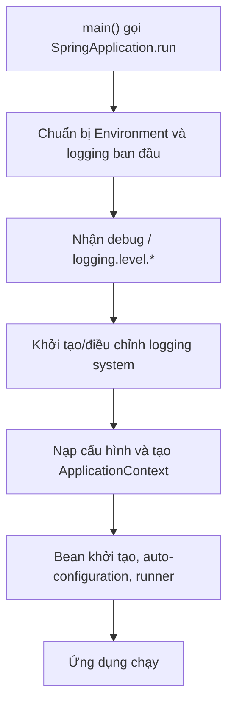

# Phân biệt --debug với bật DEBUG cho toàn bộ ứng dụng

Khi ứng dụng Spring Boot không khởi động được hoặc một auto-configuration bất ngờ không được áp dụng, ta thường thử:

```bash
java -jar app.jar --debug
```

Trong khi đó, khi muốn thấy các lời gọi `log.debug(...)` của chính ứng dụng, nhiều người cấu hình:

```properties
logging.level.root=DEBUG
```

Hai cách này **không đồng nghĩa**. `--debug` bật **debug mode của Spring Boot**, tập trung vào những logger lõi được Boot lựa chọn và giúp quan sát thông tin chẩn đoán khởi động, đặc biệt là **Condition Evaluation Report**. Ngược lại, đặt `logging.level.root=DEBUG` thay đổi ngưỡng của **root logger** trong hệ thống logging, có khả năng cho phép log DEBUG từ phần lớn ứng dụng và thư viện — trừ các logger có cấu hình riêng hoặc bộ lọc khác.

Đây là một khác biệt quan trọng trong chương Logging: khi muốn biết *vì sao Boot chọn hoặc bỏ một cấu hình*, ta cần công cụ chẩn đoán startup; khi muốn *theo dõi luồng xử lý của code*, ta cần chọn logger và mức log phù hợp. Bật tất cả DEBUG thường tạo ra rất nhiều log mà vẫn chưa chắc giải đáp đúng vấn đề.

## 1. Câu trả lời ngắn gọn

| Cách bật | Mục đích chính | Ảnh hưởng đến log của ứng dụng |
|---|---|---|
| `--debug` | Debug mode của Spring Boot; tăng thông tin của một số logger lõi và hỗ trợ Condition Evaluation Report | **Không mặc định bật DEBUG cho mọi package/class ứng dụng** |
| `debug=true` | Tương đương yêu cầu bật Boot debug mode qua property | Giống `--debug` khi giá trị hiệu lực là `true` |
| `logging.level.root=DEBUG` | Đặt ngưỡng root logger thành DEBUG | Cho phép DEBUG từ những logger kế thừa root mà không có ngưỡng chặn riêng |
| `logging.level.com.example=DEBUG` | Chỉ bật DEBUG cho package `com.example` và các logger con | Tập trung vào code liên quan, ít nhiễu hơn |
| `logging.level.org.springframework.web=DEBUG` | Chẩn đoán một vùng framework cụ thể | Không cần mở DEBUG cho toàn bộ JVM |

**Quy tắc ghi nhớ:** `--debug` là **công tắc chẩn đoán của Boot**; `logging.level.*` là **cấu hình mức log của logger**.

Chúng có thể dùng đồng thời. Nếu đặt `--debug --logging.level.com.example.orders=DEBUG`, bạn vừa có thông tin debug của Spring Boot vừa thấy DEBUG cho package xử lý đơn hàng.

## 2. Mức log và root logger hoạt động ra sao?

Spring Boot thường dùng SLF4J làm facade cho ứng dụng. Khi dùng các starter thông dụng, backend mặc định thường là Logback; dự án cũng có thể dùng Log4j2 hoặc backend phù hợp khác.

Các mức log thường gặp, từ nghiêm trọng đến chi tiết hơn:

```text
ERROR → WARN → INFO → DEBUG → TRACE
```

Nếu một logger có ngưỡng `INFO`, thông điệp `INFO`, `WARN` và `ERROR` được phép đi tiếp qua bộ lọc logging; `DEBUG` và `TRACE` thông thường bị chặn.

Nếu ngưỡng là `DEBUG`, thông điệp DEBUG được phép đi tiếp, nhưng TRACE vẫn thấp hơn ngưỡng. Việc một log thực sự xuất hiện còn phụ thuộc cấu hình backend, appender, filter, output và các điều kiện vận hành khác.

### Root logger

Root là gốc của cây logger. Trong Logback và các backend có logger hierarchy, một logger chưa được cấu hình mức riêng thường kế thừa ngưỡng hiệu lực từ ancestor gần nhất.

Ví dụ:

```text
ROOT [INFO]
├── com.example.shop
│   ├── com.example.shop.web.OrderController
│   └── com.example.shop.service.OrderService
└── org.springframework.web.servlet.DispatcherServlet
```

Nếu các logger con không có mức riêng, root INFO làm các thông điệp DEBUG của chúng không được phát.

Khi đặt:

```properties
logging.level.root=DEBUG
```

ta chuyển ngưỡng hiệu lực của những logger **kế thừa root** sang DEBUG.

```text
ROOT [DEBUG]
├── com.example.shop.service.OrderService     → có thể thấy DEBUG
├── org.springframework.web.servlet...         → có thể thấy DEBUG
├── org.hibernate...                           → có thể thấy DEBUG
└── com.vendor.thirdparty...                   → có thể thấy DEBUG
```

Đây là lý do root DEBUG có thể làm lượng log tăng mạnh, đặc biệt khi ứng dụng có nhiều dependency.

### Logger con có cấu hình riêng vẫn được ưu tiên

Giả sử:

```properties
logging.level.root=DEBUG
logging.level.org.springframework=INFO
logging.level.com.example.shop.service=TRACE
```

Khi đó, ở mức đơn giản:

- Các logger không bị cấu hình riêng vẫn có thể kế thừa root DEBUG.
- Logger thuộc `org.springframework` có mức hiệu lực INFO nếu không có override gần hơn.
- Logger thuộc `com.example.shop.service` có mức hiệu lực TRACE nếu không có override khác.

Vì vậy “bật DEBUG cho toàn bộ ứng dụng” là cách nói tắt về **đổi root threshold**; không phải cam kết rằng mọi logger bất chấp cấu hình riêng đều phát mọi thông điệp DEBUG.

## 3. --debug thực sự làm gì?

Khi chạy:

```bash
java -jar app.jar --debug
```

Spring Boot nhìn thấy property `debug` được bật trong đối số dòng lệnh. Trong quá trình chuẩn bị logging, Boot tăng độ chi tiết của **một nhóm logger lõi được lựa chọn**. Tài liệu Spring Boot mô tả nhóm này liên quan tới các phần như embedded container, Hibernate và Spring Boot.

Điều này có nghĩa:

1. Bạn thường nhận nhiều thông tin hơn về quá trình khởi động hoặc cấu hình framework.
2. Boot có thể xuất **Condition Evaluation Report**, cho biết những auto-configuration/condition khớp và không khớp.
3. Root logger không mặc nhiên được chuyển sang DEBUG chỉ vì có `--debug`.
4. Logger tùy ý của ứng dụng, chẳng hạn `com.example.shop.OrderService`, không tự động được đặt DEBUG chỉ do công tắc này.

Tên chính xác của các logger lõi được Boot điều chỉnh có thể thay đổi theo phiên bản. Đừng dựa vào một danh sách logger nội bộ cố định để suy luận rằng mọi package `org.springframework.*` đều nhất thiết được bật DEBUG.

### Tại sao Boot không bật root DEBUG?

Nếu Boot bật DEBUG cho toàn bộ thư viện theo mặc định mỗi khi bạn dùng `--debug`, log khởi động của một ứng dụng lớn sẽ rất khó đọc. Người dùng đang cần biết vì sao một Bean được cấu hình lại phải lọc qua vô số log HTTP client, connection pool, JDBC, thư viện khác hoặc code nghiệp vụ.

Boot debug mode hướng tới thông tin chẩn đoán có liên quan hơn, không phải việc mở tất cả log chi tiết trong tiến trình.

### --debug và debug=true

Có thể bật bằng property:

```properties
debug=true
```

Hoặc YAML ở mức top-level:

```yaml
debug: true
```

Hoặc command line:

```bash
java -jar app.jar --debug
```

Ý nghĩa chung là yêu cầu bật debug mode của Boot. Với đối số dòng lệnh, Spring Boot thông thường đưa command-line properties vào `Environment` và chúng có mức ưu tiên cao hơn giá trị cùng key trong nhiều file cấu hình; tuy nhiên ứng dụng có thể tùy chỉnh cách command-line properties được xử lý.

Đừng nhầm `debug=true` với:

```properties
logging.level.root=DEBUG
```

Đó là hai key khác nhau, tác động lên hai cơ chế khác nhau.

## 4. Condition Evaluation Report là gì?

Spring Boot có hệ thống auto-configuration: tự phát hiện thư viện trên classpath và kiểm tra các điều kiện để quyết định có đăng ký Bean mặc định hay không.

Ví dụ các condition:

- `@ConditionalOnClass`: một class cần thiết có trên classpath.
- `@ConditionalOnBean`: một Bean phù hợp đã được đăng ký.
- `@ConditionalOnMissingBean`: chưa có Bean phù hợp, nên có thể tạo Bean mặc định.
- `@ConditionalOnProperty`: một property có giá trị phù hợp.
- `@ConditionalOnWebApplication`: ứng dụng có kiểu web environment tương ứng.

Khi bật `--debug`, **Condition Evaluation Report** giúp giải thích tại sao một số auto-configuration được áp dụng hoặc bị bỏ qua. Ví dụ nội dung log minh họa (không phải output nguyên văn cố định của một phiên bản):

```text
CONDITIONS EVALUATION REPORT

Positive matches:
  ExampleWebAutoConfiguration:
    - Found required class 'ExampleWebServer'

Negative matches:
  ExampleCacheAutoConfiguration:
    - Did not find required class 'ExampleCacheProvider'
```

Bạn có thể thấy các nhóm positive matches, negative matches và thông tin liên quan khác theo phiên bản. Tên class, kiểu output và cách trình bày phụ thuộc auto-configuration thực tế.

### Khi nào báo cáo này hữu ích?

Giả sử ứng dụng không có Bean `DataSource` hoặc `ObjectMapper` mà bạn kỳ vọng. Thay vì thử bật toàn bộ DEBUG, hãy:

1. Chạy ứng dụng với `--debug`.
2. Tìm tên auto-configuration liên quan.
3. Đọc lý do condition khớp hoặc không khớp.
4. Kiểm tra classpath, properties, các Bean đã tồn tại và thứ tự cấu hình.
5. Chỉ bật logger chuyên sâu hơn nếu báo cáo chưa giải thích đủ.

Báo cáo là **ảnh chụp quyết định cấu hình**; nó không tự mô tả mọi request runtime hoặc mọi lần gọi method.

### Root DEBUG có tự thay thế --debug không?

Không. `logging.level.root=DEBUG` tăng lượng log được phép xuất từ logger hierarchy, nhưng **không tương đương việc đặt property `debug=true` của Spring Boot**. Một số thông tin từ condition-report logger có thể xuất hiện nếu mức logging cho phép hoặc khi startup thất bại, tùy tích hợp/phiên bản, song bạn không nên xem root DEBUG là công tắc chính thức để yêu cầu Boot debug mode.

Nếu mục tiêu là điều tra auto-configuration, dùng `--debug` trực tiếp giúp diễn đạt ý định rõ và nhất quán hơn.

## 5. logging.level.root=DEBUG: phạm vi và tác động

Khi đặt:

```properties
logging.level.root=DEBUG
```

Spring Boot cấu hình backend logging để root logger có mức DEBUG. Logger không có mức riêng thường kế thừa cấu hình này, nên log DEBUG từ code ứng dụng và nhiều dependency có thể xuất hiện.

Giả sử service:

```java
package com.example.shop.service;

import org.slf4j.Logger;
import org.slf4j.LoggerFactory;
import org.springframework.stereotype.Service;

@Service
public class OrderService {
    private static final Logger log =
            LoggerFactory.getLogger(OrderService.class);

    public void createOrder(long id) {
        log.debug("Begin createOrder: id={}", id);
        log.info("Order creation requested: id={}", id);
        // Business logic.
    }
}
```

Với root INFO thông thường, thông điệp `log.debug(...)` có thể không xuất hiện; `log.info(...)` vẫn có thể xuất.

Với root DEBUG và không có override cho package này, bạn thường thấy cả DEBUG lẫn INFO của `OrderService`.

Nhưng thay root DEBUG cho toàn ứng dụng có tác dụng phụ:

- Log framework, ORM, HTTP stack, connection pool hoặc dependency tăng mạnh.
- Tốn tài nguyên CPU, bộ nhớ đệm, ổ đĩa, truyền log và chi phí thu thập.
- Khó tìm thông điệp quan trọng trong lượng log lớn.
- Dễ ghi lộ payload, header, ID hoặc dữ liệu cá nhân nếu thư viện/ứng dụng có log chi tiết.
- Có thể làm các vấn đề timing hoặc concurrency khó tái hiện hơn do overhead logging.

**Khuyến nghị:** khi chỉ muốn chẩn đoán một luồng, bật DEBUG cho package hoặc class cụ thể thay vì toàn bộ root.

## 6. Bật DEBUG theo package hoặc class

Ví dụ chỉ quan sát các service của ứng dụng:

```properties
logging.level.com.example.shop.service=DEBUG
```

Với YAML:

```yaml
logging:
  level:
    com.example.shop.service: DEBUG
```

Theo một class cụ thể:

```properties
logging.level.com.example.shop.service.OrderService=DEBUG
```

Để chẩn đoán Spring MVC:

```properties
logging.level.org.springframework.web=DEBUG
```

Để chẩn đoán một vùng JPA/JDBC, có thể bật các logger liên quan theo nhu cầu. Ví dụ log SQL từ Hibernate:

```properties
logging.level.org.hibernate.SQL=DEBUG
```

Tuy nhiên log câu SQL không đồng nghĩa log giá trị tham số bind; logger chi tiết cho bind parameters phụ thuộc phiên bản Hibernate và có thể gây lộ dữ liệu. Chỉ bật khi cần, trong môi trường và thời gian được kiểm soát.

### Kết hợp --debug và logger package

```bash
java -jar app.jar --debug --logging.level.com.example.shop=DEBUG
```

Cách này vừa yêu cầu Boot debug mode vừa cho phép DEBUG trong package `com.example.shop`. Đó là một cấu hình **kết hợp**, không phải một lệnh tự động biến `--debug` thành root DEBUG.

### Bật DEBUG bằng lệnh chạy tạm thời

```bash
java -jar app.jar --logging.level.com.example.shop.service=DEBUG
```

Tại đây không có `--debug`, nên bạn chỉ đang thay ngưỡng logger theo package. Đây là lựa chọn thích hợp nếu mục tiêu là xem debug log của service và không cần condition report.

## 7. Ví dụ tối thiểu để quan sát trực tiếp

Tạo project Spring Boot với starter nền tảng và class sau:

```java
package com.example.loggingdemo;

import org.slf4j.Logger;
import org.slf4j.LoggerFactory;
import org.springframework.boot.ApplicationRunner;
import org.springframework.boot.SpringApplication;
import org.springframework.boot.autoconfigure.SpringBootApplication;
import org.springframework.context.annotation.Bean;

@SpringBootApplication
public class LoggingDemoApplication {
    private static final Logger log =
            LoggerFactory.getLogger(LoggingDemoApplication.class);

    public static void main(String[] args) {
        SpringApplication.run(LoggingDemoApplication.class, args);
    }

    @Bean
    ApplicationRunner demoRunner() {
        return args -> {
            log.info("ApplicationRunner is executing");
            log.debug("Application-specific DEBUG message");

            Logger gatewayLogger = LoggerFactory.getLogger(
                    "com.example.integration.RemoteGateway");
            gatewayLogger.debug("Gateway DEBUG message");
        };
    }
}
```

Giả định project đã dùng `spring-boot-starter` hoặc starter khác đưa Spring Boot và SLF4J lên classpath.

### Lần chạy A — Không bật debug

```bash
java -jar build/libs/logging-demo.jar
```

Với cấu hình logging mặc định thông thường, bạn sẽ thấy `ApplicationRunner is executing` ở INFO, nhưng chưa thấy hai thông điệp DEBUG của ví dụ.

### Lần chạy B — Chỉ bật --debug

```bash
java -jar build/libs/logging-demo.jar --debug
```

Bạn thường thấy log bổ sung từ một số logger lõi của Spring Boot và thông tin Condition Evaluation Report. Tuy nhiên, **hai DEBUG message trong class ví dụ có thể vẫn không xuất hiện**, vì `com.example.loggingdemo` và `com.example.integration` không mặc nhiên thuộc nhóm logger Boot bật DEBUG.

Đây là quan sát quan trọng nhất của bài.

### Lần chạy C — Bật root DEBUG

```bash
java -jar build/libs/logging-demo.jar --logging.level.root=DEBUG
```

Bây giờ hai log DEBUG của ví dụ thường được phép xuất, cùng với nhiều log DEBUG từ các thư viện không đặt ngưỡng riêng. Lượng log có thể tăng rõ rệt.

### Lần chạy D — Bật DEBUG cho đúng package

```bash
java -jar build/libs/logging-demo.jar --logging.level.com.example.loggingdemo=DEBUG
```

Log DEBUG từ `LoggingDemoApplication` có thể xuất, trong khi log từ logger `com.example.integration.RemoteGateway` vẫn không xuất ở mức DEBUG nếu nó đang kế thừa root INFO.

Lần chạy này cho thấy **phạm vi package** hoạt động độc lập với Boot debug mode.

### Lần chạy E — Kết hợp

```bash
java -jar build/libs/logging-demo.jar --debug --logging.level.com.example.loggingdemo=DEBUG
```

Bạn nhận cả thông tin startup/condition của Boot và log DEBUG của package `com.example.loggingdemo`.

Tên JAR trong các lệnh là tên minh họa; hãy thay bằng artifact thực tế được project build ra. Không cần chạy Gradle hay web server để hiểu cơ chế: khác biệt nằm ở **công tắc Boot** so với **mức log của logger hierarchy**.

## 8. Bảng so sánh kết quả kỳ vọng

Giả sử root mặc định INFO, không có override khác cho hai package ví dụ và backend ghi ra console:

| Cách chạy | Boot core debug diagnostics | `com.example.loggingdemo` DEBUG | `com.example.integration` DEBUG |
|---|---|---|---|
| Không cấu hình | Mức mặc định | Không | Không |
| `--debug` | Tăng thông tin core + condition report | Không tự bật | Không tự bật |
| `logging.level.root=DEBUG` | Nhiều logger kế thừa root có thể phát DEBUG | Có | Có |
| `logging.level.com.example.loggingdemo=DEBUG` | Mức mặc định | Có | Không |
| `--debug` + DEBUG package | Boot debug mode | Có | Không |

Đây là bảng **hành vi điển hình**, không phải cam kết mọi backend và mỗi cấu hình tùy chỉnh đều ghi đúng cùng một số dòng. Log có thể bị filter, appender loại bỏ, hoặc logger con được cấu hình mức riêng; nội dung Condition Evaluation Report cũng thay đổi theo phiên bản Boot.

## 9. --debug có phải bật mức TRACE hay không?

Không. `DEBUG` và `TRACE` là hai mức khác nhau; TRACE thường chi tiết hơn DEBUG.

Spring Boot còn có công tắc:

```bash
java -jar app.jar --trace
```

Theo tài liệu Spring Boot, trace mode cũng điều chỉnh một nhóm core logger để hiển thị thông tin chi tiết hơn. Nó không phải lời bảo đảm rằng root của toàn ứng dụng được đặt TRACE.

Muốn một package phát TRACE:

```properties
logging.level.com.example.shop=TRACE
```

Khi cần điều tra sâu, chỉ bật TRACE cho vùng rất hẹp và tắt sau khi lấy đủ dữ liệu. TRACE có thể tạo log cực lớn, thậm chí ghi thông tin nhạy cảm tùy nơi đặt log.

## 10. Tại sao chạy --debug mà log.debug của tôi vẫn không in?

Đây là câu hỏi phổ biến nhất.

Code:

```java
private static final Logger log =
        LoggerFactory.getLogger(OrderService.class);

public void submitOrder() {
    log.debug("Submitting order");
}
```

Lệnh:

```bash
java -jar app.jar --debug
```

Và kết quả là không thấy `Submitting order`.

Điều này **không chứng minh annotation Spring hay logging framework bị lỗi**. `--debug` không mặc nhiên bật DEBUG cho logger `OrderService`. Hãy cấu hình:

```properties
logging.level.com.example.shop.service.OrderService=DEBUG
```

hoặc:

```bash
java -jar app.jar --debug --logging.level.com.example.shop.service=DEBUG
```

Nếu vẫn không có log, lần lượt kiểm tra:

1. Code path có thực sự chạy `log.debug(...)` hay không?
2. Tên logger có đúng package/class đang cấu hình không?
3. Có cấu hình mức logger cụ thể hơn đang chặn không?
4. Backend logging có appender/filter ghi ra console/file như mong đợi không?
5. Cấu hình XML hoặc bootstrap logging có ghi đè kết quả không?
6. Bạn có chạy đúng artifact và đúng profile không?

Phân biệt **logger không cho phép mức DEBUG** với **code không đi qua nhánh đó**; hai trường hợp cần cách chẩn đoán khác nhau.

## 11. Ưu tiên cấu hình và nơi đặt cờ

Spring Boot đọc cấu hình từ nhiều property source. Những cách đặt sau có thể cùng diễn đạt ý định bật Boot debug mode:

```bash
java -jar app.jar --debug
```

```bash
java -jar app.jar --debug=true
```

```properties
# application.properties
debug=true
```

Đối với root DEBUG:

```bash
java -jar app.jar --logging.level.root=DEBUG
```

```properties
logging.level.root=DEBUG
```

Hoặc YAML:

```yaml
logging:
  level:
    root: DEBUG
```

### Phân biệt JVM system property với application argument

JVM system property dùng cú pháp đặt **trước** `-jar`:

```bash
java -Ddebug=true -jar app.jar
```

Ứng dụng argument nằm **sau** tên JAR:

```bash
java -jar app.jar --debug
```

Đặt sai vị trí hoặc dùng một dạng option mà chương trình không parse có thể khiến property không được áp dụng như dự định.

### Tại sao --debug thường ghi đè file?

Trong Spring Boot mặc định, command-line properties thường có ưu tiên cao hơn các giá trị tương ứng từ application files. Ví dụ `debug=false` ở file và chạy `--debug` thường dẫn đến debug mode được bật cho lần chạy này.

Tuy nhiên nếu ứng dụng dùng `SpringApplication.setAddCommandLineProperties(false)` hoặc tự thay đổi Environment/property source handling, thứ tự và cách đọc đối số có thể khác. Đừng mặc định mọi ứng dụng đều dùng cùng cấu hình bootstrap.

## 12. Logging được cấu hình rất sớm trong startup

Spring Boot chuẩn bị logging từ những giai đoạn đầu của quá trình `SpringApplication.run(...)`. Điều này cần thiết vì ngay cả lỗi khi đọc cấu hình hoặc tạo ApplicationContext cũng phải được ghi log.

Một luồng đơn giản:



Vì logging được khởi tạo trước nhiều Bean thông thường, việc chỉ dùng `@PostConstruct` hoặc một `ApplicationRunner` để thay mức log có thể là **quá muộn** nếu mục tiêu là xem log trong giai đoạn Boot xử lý cấu hình.

Ví dụ:

```java
@Component
public class LateLoggerSetup {
    @PostConstruct
    void configure() {
        // Đến đây nhiều bước startup và logging setup đã diễn ra.
    }
}
```

Nếu đang điều tra lỗi auto-configuration, hãy đặt `--debug` hoặc `logging.level.*` ngay ở lệnh khởi động hay property source được Boot đọc từ sớm.

### Cấu hình logging không phải mọi property đều đọc tại cùng thời điểm

Một số thuộc tính logging được áp dụng trong giai đoạn bootstrap sớm, trước khi các Bean ứng dụng có mặt. Vì vậy đừng giả định rằng tự đặt `@PropertySource` trên một `@Configuration` là cách phù hợp để thay toàn bộ logging bootstrap; class cấu hình có thể được xử lý sau thời điểm logging system đã khởi tạo.

Đối với các nhu cầu cơ bản, ưu tiên:

- `application.properties` hoặc `application.yml`.
- Command-line options.
- System properties hoặc environment variables tương ứng.
- Cấu hình backend chuyên dụng như `logback-spring.xml` khi cần điều khiển appenders, encoder, filter hoặc rolling policy.

Nếu dùng custom logging configuration, cần hiểu quan hệ giữa `logging.level.*`, cấu hình file backend và các giá trị được Boot áp dụng vào logging system.

## 13. Phạm vi logging theo package, class và group

Khi điều tra lỗi, ưu tiên mở log theo thứ tự từ hẹp đến rộng:

1. Một class cụ thể.
2. Một package chức năng.
3. Một nhóm logger có ý nghĩa.
4. Một subsystem của framework.
5. Root DEBUG nếu thật sự cần và có biện pháp kiểm soát.

Ví dụ:

```properties
# Một service
logging.level.com.example.shop.service.OrderService=DEBUG

# Cả package persistence của ứng dụng
logging.level.com.example.shop.persistence=DEBUG
```

Spring Boot hỗ trợ **logging groups** để gom nhiều logger thành một tên cấu hình. Ví dụ:

```properties
logging.group.payment=\
  com.example.shop.payment,\
  com.example.shop.gateway,\
  com.example.shop.audit

logging.level.payment=DEBUG
```

Lúc đó `payment` là tên nhóm do ứng dụng định nghĩa; các logger được liệt kê nhận mức DEBUG thông qua nhóm. Cách này hữu ích khi một luồng nghiệp vụ trải qua nhiều package nhưng bạn không muốn bật DEBUG cho toàn bộ root.

Ví dụ YAML:

```yaml
logging:
  group:
    payment:
      - com.example.shop.payment
      - com.example.shop.gateway
      - com.example.shop.audit
  level:
    payment: DEBUG
```

Spring Boot cũng có những logging groups được định nghĩa sẵn ở một số dòng, chẳng hạn `web` và `sql`. Tập logger thành viên có thể thay đổi theo phiên bản; hãy xem cấu hình Boot thực tế khi sử dụng những tên nhóm đó.

### Một lỗi dễ gặp với biến môi trường

Trong container, người ta thường truyền:

```text
LOGGING_LEVEL_ROOT=DEBUG
```

để đặt root logger, hoặc:

```text
LOGGING_LEVEL_COM_EXAMPLE_SHOP=DEBUG
```

cho package tương ứng trong những trường hợp phù hợp với relaxed binding.

Tuy nhiên, việc chuyển property name qua biến môi trường có thể **làm mất phân biệt chữ hoa/chữ thường** của tên logger. Với một logger tên đầy đủ theo class như `com.example.shop.OrderService`, cấu hình chính xác bằng command-line property hoặc `application.properties` thường đáng tin cậy hơn so với cố biểu diễn tên class có chữ hoa bằng biến môi trường.

## 14. Thay mức log khi ứng dụng đã chạy

Một câu hỏi vận hành: “Ứng dụng đã chạy trong production, không muốn restart chỉ để xem một luồng lỗi thì làm sao?”

Spring Boot Actuator có endpoint `loggers` để xem và thay đổi log level tại runtime trong những cấu hình hỗ trợ endpoint. Ví dụ:

```http
GET /actuator/loggers/com.example.shop.service.OrderService
```

Endpoint có thể trả thông tin như mức đã cấu hình và mức hiệu lực. Ví dụ response minh họa:

```json
{
  "configuredLevel": null,
  "effectiveLevel": "INFO"
}
```

Để thay mức log ở runtime:

```http
POST /actuator/loggers/com.example.shop.service.OrderService
Content-Type: application/json

{
  "configuredLevel": "DEBUG"
}
```

Để xóa mức override được cấu hình qua endpoint và trở lại kế thừa:

```json
{
  "configuredLevel": null
}
```

Những lệnh trên chỉ mang tính minh họa; endpoint phải có Actuator, được enable/expose và có quyền truy cập phù hợp. Thay đổi này thường là **trạng thái runtime**, không nhất thiết được ghi ngược vào file `application.yml` hoặc tồn tại sau restart.

**An toàn:** không mở endpoint điều khiển logger công khai. Chỉ cho phép truy cập qua kênh quản trị đã xác thực, phân quyền và giám sát. Thay root sang DEBUG ở production có thể gây bùng nổ log và phát lộ dữ liệu trong một thời gian rất ngắn.

### Actuator không thay thế startup --debug

Nếu app chưa khởi động thành công, HTTP endpoint Actuator chưa sẵn sàng để dùng. Với lỗi startup, `--debug` ở lệnh chạy và log của process vẫn là lựa chọn trực tiếp. Actuator `loggers` thích hợp hơn cho chẩn đoán **sau khi ứng dụng đang hoạt động**.

## 15. Đừng nhầm --debug với debugger IDE

Có ba khái niệm dễ cùng được gọi là “debug”:

| Khái niệm | Cơ chế | Dùng khi |
|---|---|---|
| Boot `--debug` | Bật debug mode của Spring Boot | Điều tra khởi động và quyết định auto-configuration |
| Logger DEBUG | Thay ngưỡng của logger theo root/package/class | Xem log chi tiết của một đoạn code |
| Debugger IDE / JDWP | Tạm dừng tại breakpoint, đọc biến và stack frame | Theo dõi thực thi từng bước |

`--debug` **không bật JDWP, không mở cổng debug JVM và không khiến breakpoint IDE tự dừng**.

Ngược lại, chạy ứng dụng bằng Debug trong IDE không tự bảo đảm Boot property `debug=true`, và cũng không mặc nhiên đổi root logger thành DEBUG. Nhiều IDE có thể hiển thị tab Debug/Run nhưng nội dung logging vẫn phụ thuộc cấu hình của ứng dụng.

Nếu thực sự cần debug một JVM bằng IDE, dùng cách chạy/attach debugger được Java và IDE hỗ trợ; đó là một chủ đề khác với logging của Spring Boot.

## 16. Root DEBUG và các vấn đề bảo mật/vận hành

Trong môi trường local, bật root DEBUG có thể chấp nhận được trong một khoảng thời gian ngắn để khám phá hệ thống. Trong production, hậu quả có thể nghiêm trọng hơn:

- **Dữ liệu nhạy cảm:** message/payload hoặc tham số SQL có thể chứa email, số điện thoại, credential hoặc token.
- **Chi phí:** log tăng nhiều lần làm tốn disk, network và log ingestion.
- **Độ trễ:** việc format và ghi log có thể tăng CPU, thread contention hoặc I/O.
- **Khả năng quan sát:** quá nhiều dòng DEBUG có thể đẩy WARN/ERROR quan trọng ra khỏi cửa sổ quan sát hoặc vượt hạn lưu trữ.
- **Noise:** log của nhiều dependency khiến việc tìm root cause khó hơn.
- **Duy trì cấu hình:** nếu quên tắt DEBUG, ứng dụng có thể tiếp tục ghi quá nhiều log sau khi sự cố đã giải quyết.

### Chiến lược chẩn đoán an toàn

Nếu cần điều tra một request bị lỗi:

1. Xác định package hoặc class liên quan nhất.
2. Bật DEBUG ở phạm vi đó trong một khoảng thời gian có kiểm soát.
3. Bảo đảm log không chứa secret, raw authentication header hay payload nhạy cảm.
4. Dùng correlation ID, request ID và các thuộc tính định danh kỹ thuật an toàn để ghép các log trong cùng luồng.
5. Thu thập đủ bằng chứng, rồi đưa logger trở về mức INFO hoặc mức vận hành bình thường.
6. Chỉ nâng lên TRACE hoặc mở root DEBUG khi phương án hẹp chưa đủ, có đánh giá rủi ro và giới hạn thời gian.

Nếu log hiện tại không có thông tin cần thiết, viết một vài log DEBUG có cấu trúc ở đúng boundary đôi khi hiệu quả hơn mở hàng nghìn dòng log của framework.

## 17. Tình huống thực tế: ứng dụng không tạo DataSource

Giả sử ứng dụng cần kết nối database nhưng startup báo không có `DataSource` phù hợp. Có hai cách thử:

**Cách A:**

```bash
java -jar app.jar --debug
```

**Cách B:**

```bash
java -jar app.jar --logging.level.root=DEBUG
```

Cách A thường phù hợp hơn với câu hỏi: “Vì sao Spring Boot không tạo DataSource?” Bạn muốn xem các condition của DataSource/JDBC auto-configuration.

Cách B có thể tạo thêm nhiều log chi tiết từ toàn bộ các thư viện. Nó cũng có thể chứa thông tin hữu ích, nhưng khó tập trung vào quyết định auto-configuration và không mang cùng ý nghĩa cấu hình Boot debug mode.

Quy trình đề xuất:

1. Xem root cause của stack trace trước tiên.
2. Bật `--debug` để đọc Condition Evaluation Report.
3. Kiểm tra JDBC driver có trên classpath không, `spring.datasource.*` có được cung cấp đúng không, và ứng dụng có tự khai báo DataSource hay không.
4. Nếu condition khớp nhưng kết nối vẫn thất bại, bật logger hẹp liên quan đến JDBC/connection pool và kiểm tra thông báo lỗi.
5. Tránh ghi password, connection string có credential hoặc secret trong log.

### Khi root DEBUG có ích hơn?

Đôi khi lỗi không nằm ở auto-configuration mà ở tương tác giữa nhiều thư viện không thuộc nhóm logger Boot debug mode. Khi chưa xác định được package nào, root DEBUG **trong môi trường kiểm soát** có thể giúp khảo sát ban đầu. Nhưng khi đã khoanh vùng được subsystem, hãy thu hẹp mức log để giảm nhiễu.

## 18. Tình huống thực tế: request trả 500 khi ứng dụng đã chạy

Giả sử endpoint `POST /orders` trả 500 dù context đã khởi động thành công. Bạn có thể bắt đầu bằng exception stack trace và log lỗi hiện có.

Nếu cần biết service chọn nhánh nào, thay vì:

```bash
java -jar app.jar --debug
```

hãy ưu tiên:

```properties
logging.level.com.example.shop.order=DEBUG
```

Và dùng log có cấu trúc:

```java
@Service
public class OrderWorkflow {
    private static final Logger log =
            LoggerFactory.getLogger(OrderWorkflow.class);

    public void process(long orderId) {
        log.debug("Starting order workflow: orderId={}", orderId);

        // Kiểm tra rule, gọi repository, gọi gateway...

        log.debug("Order workflow completed: orderId={}", orderId);
    }
}
```

Nếu code throw exception giữa hai log DEBUG, bạn có mốc để khoanh vùng quá trình thực thi. `--debug` không tự tạo những log nghiệp vụ này.

Với hệ thống nhiều request đồng thời, nên thêm trace ID/correlation ID và ngữ cảnh an toàn. Không đưa nguyên đối tượng request chứa thông tin cá nhân vào log chỉ để thuận tiện debug.

## 19. Cách chọn nhanh theo câu hỏi cần trả lời

| Câu hỏi | Nên bắt đầu bằng |
|---|---|
| Vì sao auto-configuration A không được áp dụng? | `--debug` và Condition Evaluation Report |
| Vì sao một Bean mặc định không được tạo? | `--debug`, kiểm tra điều kiện `@Conditional...` |
| Vì sao `log.debug(...)` trong service không xuất hiện? | `logging.level.<package>=DEBUG` |
| Controller gọi service theo nhánh nào? | DEBUG cho controller/service package |
| Framework xử lý request mapping thế nào? | DEBUG ở logger Spring Web liên quan |
| Hibernate chạy SQL nào? | Logger SQL/Hibernate có phạm vi phù hợp |
| Nhiều thư viện có hành vi lạ nhưng chưa rõ vùng nào? | Tạm mở phạm vi rộng hơn, chỉ khi kiểm soát log output |
| Cần tạm đổi mức log trong app đang chạy? | Actuator `loggers` nếu được bật và bảo vệ |
| Cần dừng ở breakpoint để xem biến Java? | IDE/JDWP debugger; không phải `--debug` |

Đây không phải các công cụ loại trừ nhau. Có những sự cố cần cả Condition Evaluation Report, DEBUG theo package và debugger. Điều quan trọng là biết mỗi công cụ trả lời **câu hỏi nào**.

## 20. Các hiểu nhầm phổ biến

**“`--debug` tương đương `logging.level.root=DEBUG`.”** Sai. Boot debug mode điều chỉnh tập logger lõi được chọn và hỗ trợ chẩn đoán startup; root DEBUG mở ngưỡng của cây logger.

**“Bật `--debug` chắc chắn thấy mọi `log.debug(...)` của code tôi.”** Sai. Logger ứng dụng có thể vẫn đang kế thừa INFO.

**“Bật root DEBUG thì mọi thư viện nhất định phát DEBUG.”** Không hẳn. Logger con có thể có mức INFO/WARN riêng; appender/filter và backend configuration cũng ảnh hưởng.

**“`--debug` bật JVM debugger.”** Sai. Nó không bật breakpoint hay JDWP.

**“Có `debug=true` thì không cần cấu hình `logging.level.*`.”** Không đúng khi bạn cần xem log nghiệp vụ của những package không thuộc nhóm core logger Boot điều chỉnh.

**“Bật root DEBUG là cách tốt nhất để tìm mọi lỗi.”** Không. Nó có thể tạo log khổng lồ, tốn tài nguyên và gây lộ dữ liệu. Chọn package/class cụ thể thường hiệu quả hơn.

**“Condition Evaluation Report là toàn bộ log runtime.”** Không. Nó mô tả kết quả đánh giá điều kiện auto-configuration, không ghi lại mọi request hay method call.

**“Đặt `logging.level.root=DEBUG` vào file nào cũng có tác dụng ở thời điểm sớm như nhau.”** Không. Một số nguồn được xử lý muộn; cấu hình logging startup cần property source mà Boot đọc được đủ sớm.

**“Đã bật DEBUG thì không cần cấu hình security cho Actuator.”** Hai việc độc lập. Endpoint đổi log level phải được bảo vệ như các giao diện quản trị khác.

**“Một dòng DEBUG không có nghĩa là nhánh code đó không chạy.”** Không đúng. Logger có thể bị chặn, filter hoặc ghi ra output khác. Hãy xác minh logging configuration trước khi suy luận từ sự vắng mặt của thông điệp.

## 21. Bài thực hành

Từ ứng dụng `LoggingDemoApplication` ở phần 7, hãy thử:

1. Chạy không có cấu hình debug; ghi lại thông điệp INFO và DEBUG nào được in.
2. Chạy `--debug`, quan sát những logger lõi và Condition Evaluation Report. Kiểm tra xem log DEBUG của class ứng dụng có tự xuất hiện không.
3. Chạy `--logging.level.root=DEBUG` và so sánh số lượng log với `--debug`.
4. Chạy `--logging.level.com.example.loggingdemo=DEBUG`, kiểm tra DEBUG của class `LoggingDemoApplication` và logger `RemoteGateway`.
5. Kết hợp `--debug` với DEBUG package và quan sát hai loại thông tin cùng xuất hiện.
6. Đặt root DEBUG nhưng `logging.level.com.example.loggingdemo=INFO`; kiểm tra override con.
7. Thay DEBUG của một package thành TRACE và so sánh với `--trace` của Boot.
8. Đổi `debug=true` trong `application.yml` rồi ghi đè bằng command-line property phù hợp; quan sát property source precedence.
9. Nếu có Actuator loggers trong môi trường test được bảo vệ, thử thay mức log tại runtime và đưa về mức ban đầu.
10. Trong một bài thử auto-configuration, loại một dependency tùy chọn khỏi classpath và quan sát condition report giải thích tại sao cấu hình không khớp.

Sau mỗi lần thử, trả lời ba câu hỏi:

- **Property nào đã thay đổi?** `debug` hay `logging.level.*`?
- **Nhóm logger nào chịu ảnh hưởng?** Core của Boot, root, package hay class?
- **Mục đích thông tin nhận được là gì?** Chẩn đoán cấu hình khởi động hay quan sát luồng code?

Phân biệt được ba câu hỏi này là bạn đã nắm được khác biệt giữa `--debug` và root DEBUG trong Spring Boot.

## 22. Sơ đồ ra quyết định

```mermaid
flowchart TD
    A["Cần thêm log để điều tra lỗi"] --> B{"Đang hỏi điều gì?"}
    B -->|Vì sao Bean / auto-config không có?| C["Dùng --debug"]
    C --> D["Đọc Condition Evaluation Report"]
    B -->|Muốn thấy log.debug của code?| E["Bật logging.level.package=DEBUG"]
    B -->|Muốn quan sát thư viện cụ thể?| F["Bật logging.level.logger=DEBUG"]
    B -->|Chưa xác định vùng cần xem?| G["Thu hẹp bằng ERROR/WARN và stack trace trước"]
    G --> H["Mở phạm vi có kiểm soát nếu cần"]
    D --> I["Xác định nguyên nhân"]
    E --> I
    F --> I
    H --> I
    I --> J["Giảm/tắt DEBUG sau khi chẩn đoán"]
```



## 23. Tổng kết

Hãy nhớ ba dòng cấu hình khác nhau:

```bash
# Debug mode của Spring Boot: tập trung startup/core diagnostics
java -jar app.jar --debug

# Cho phép log DEBUG rộng qua root logger
java -jar app.jar --logging.level.root=DEBUG

# Cho phép DEBUG cho phần code bạn đang điều tra
java -jar app.jar --logging.level.com.example.shop=DEBUG
```

`--debug` giúp Spring Boot cung cấp thêm thông tin chẩn đoán khởi động và không mặc nhiên bật DEBUG cho mọi logger của ứng dụng. `logging.level.root=DEBUG` mở rộng ngưỡng root logger, có thể làm lượng log tăng mạnh và gây rủi ro vận hành. `logging.level.<package>=DEBUG` thường là lựa chọn hiệu quả nhất khi bạn đã biết luồng code cần quan sát.

**Chọn chế độ dựa trên câu hỏi bạn muốn giải đáp, không dựa trên việc cả hai cùng có chữ “DEBUG”.** Khi điều tra startup và auto-configuration, ưu tiên `--debug`. Khi điều tra hành vi runtime, bật logging đúng class hoặc package, thu thập bằng chứng rồi đưa log level trở về mức bình thường.
