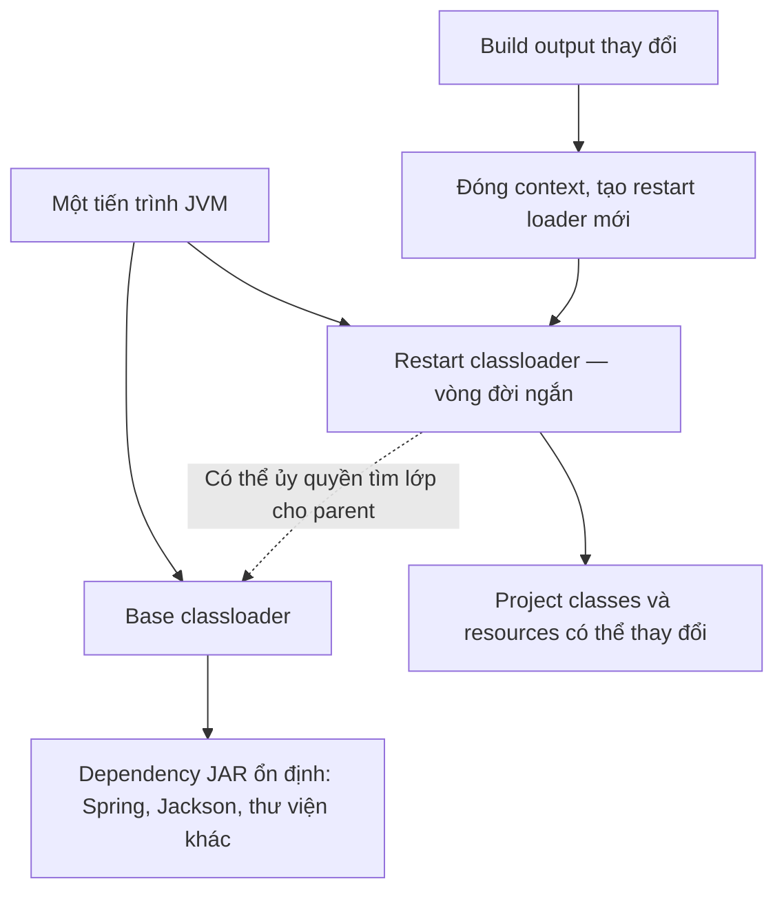
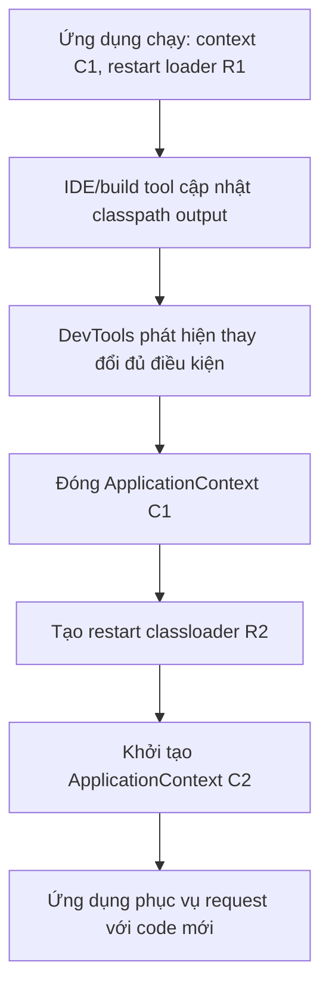
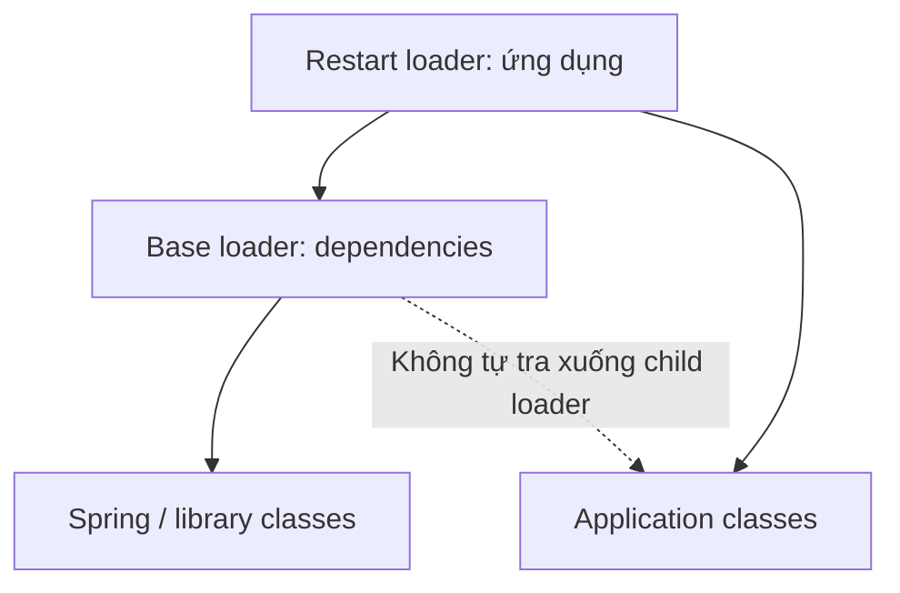

# Restart classloader, base classloader và vấn đề tương thích

> **Spring Boot Fundamentals · Công cụ phát triển**  
> Spring Boot DevTools giúp rút ngắn chu kỳ sửa code – biên dịch – chạy thử bằng cơ chế **automatic restart**. Thay vì luôn tắt và khởi động lại toàn bộ JVM, DevTools phân chia các lớp giữa **base classloader** và **restart classloader**. Cách làm này thường nhanh hơn một lần chạy mới hoàn toàn, nhưng cũng tạo ra những tình huống khó hiểu: class cùng tên không cast được cho nhau, thư viện không tìm thấy class của ứng dụng, proxy hoặc serializer giữ object từ lần restart cũ, hay một thay đổi dependency không có hiệu lực như mong đợi. Bài học này giải thích mô hình hai classloader, cách nhận diện giới hạn và cách xử lý có chủ đích.

## 1. Vì sao Spring Boot DevTools cần restart?

Khi phát triển ứng dụng Spring Boot, người lập trình thường lặp lại các bước:

1. Sửa một class Java hoặc file tài nguyên.
2. Biên dịch hoặc đồng bộ output vào classpath.
3. Chạy thử hành vi mới.
4. Tiếp tục sửa lỗi.

Nếu sau mỗi lần sửa Java đều phải dừng toàn bộ JVM, tạo JVM mới, nạp lại mọi JAR và khởi tạo lại Spring ApplicationContext, thời gian chờ có thể đáng kể, đặc biệt ở project nhiều dependency.

`spring-boot-devtools` cung cấp cơ chế restart tối ưu cho môi trường phát triển. Một phần classpath ổn định được giữ lại, trong khi các lớp có khả năng thay đổi thường xuyên được nạp lại bằng một classloader mới.

### 1.1. Restart khác với khởi động lại JVM

| Cách chạy | JVM | Classloader ứng dụng | Spring ApplicationContext |
| --- | --- | --- | --- |
| Khởi động lần đầu | Mới | Được tạo | Được tạo |
| DevTools restart | Thường vẫn là JVM cũ | Restart classloader được thay mới | Context cũ được đóng, context mới được khởi tạo |
| Dừng process rồi chạy lại | JVM mới | Các classloader được tạo lại | Context mới được tạo |

DevTools restart không phải chỉ gọi lại một method Java tùy ý. Spring Boot thiết lập lại ứng dụng trong cùng một tiến trình, với classloader mới cho phần classpath mà cơ chế restart quản lý.

### 1.2. Restart khác với hot swap

Một số IDE/JVM debugger hỗ trợ **HotSwap** để thay bytecode của class đã được nạp trong những giới hạn nhất định. DevTools restart là cơ chế khác: nó tạo lại restart classloader và Spring context để sử dụng class definitions được biên dịch mới.

| Cơ chế | Đặc điểm |
| --- | --- |
| JVM HotSwap qua debugger | Thay đổi bytecode của class đang nạp, tùy khả năng JVM/IDE |
| DevTools restart | Nạp lại lớp từ phần classpath có thể restart, tạo lại context |
| Full process restart | Dừng JVM và chạy JVM khác từ đầu |
| LiveReload cho trình duyệt | Yêu cầu trình duyệt refresh khi tài nguyên đổi; không phải Java class reload |

Không nên dùng các thuật ngữ này thay thế nhau. Một file CSS thay đổi có thể kích hoạt LiveReload mà không cần restart Java context, trong khi thay đổi một class Java thường cần output `.class` mới để DevTools nhận diện.

## 2. Hai classloader của DevTools là gì?

Trong mô hình restart của Spring Boot DevTools, classpath thường được chia thành hai phần.

**Base classloader** giữ những lớp ít thay đổi, điển hình là dependency JAR từ thư viện bên ngoài. **Restart classloader** nạp những lớp thường xuyên thay đổi trong quá trình phát triển, điển hình là các thư mục output của project đang mở trong IDE.



Sơ đồ khái niệm trên không có nghĩa chỉ tồn tại đúng hai classloader trong toàn bộ JVM. JVM, module system, app server hoặc thư viện vẫn có thể sử dụng thêm các classloader khác. Hai tên `base` và `restart` ở đây mô tả **cấu trúc mà DevTools dùng để tối ưu chu kỳ phát triển**.

### 2.1. Base classloader

Phần base thường chứa:

- Các dependency JAR được coi là ổn định.
- Nhiều class của Spring Framework và Spring Boot.
- Các library phổ biến do ứng dụng sử dụng.
- Những artifact khác được cấu hình rõ để nằm ở base.

Vì base classloader được tái sử dụng qua các lần DevTools restart, JVM không cần nạp lại toàn bộ bytecode của các dependency này trong mỗi chu kỳ.

Tuy nhiên, **base classloader không đồng nghĩa với “không bao giờ thay đổi trong mọi tình huống”**. Khi bạn cập nhật một JAR dependency hoặc thay đổi dependency graph, việc restart toàn bộ tiến trình thường là cách chắc chắn để class definitions từ artifact mới được nạp.

### 2.2. Restart classloader

Phần restart thường chứa:

- Các class biên dịch từ project ứng dụng.
- Các module project được mở/import và xuất hiện trên classpath như thư mục classes.
- Những artifact được cấu hình rõ để chuyển sang restart loader.
- Các tài nguyên tương ứng thuộc phần classpath do restart loader quản lý.

Khi DevTools phát hiện thay đổi cần restart, nó đóng ApplicationContext đang chạy và tạo restart classloader mới để nạp class definitions hiện tại.

Nếu ứng dụng được phát triển dưới dạng multi-module project, **không phải mọi module tự động nằm ở cùng loader**. Điều đó phụ thuộc cách IDE/build tool đưa module vào classpath: thư mục classes trực tiếp hay JAR dependency, cùng các quy tắc include/exclude nếu có.

### 2.3. Phụ thuộc JAR và output directory thường được phân loại khác nhau

Một cách hình dung:

```text
Classpath:
  build/classes/java/main/           -> thường ở restart
  build/resources/main/              -> thường đi cùng phần project thay đổi
  target/classes/                    -> thường ở restart
  ~/.m2/.../spring-context.jar       -> thường ở base
  ~/.m2/.../jackson-databind.jar     -> thường ở base
  ~/.m2/.../acme-common.jar          -> thường ở base nếu là JAR
```

Đây là mô hình thường gặp trong IDE, **không phải hợp đồng bất biến cho mọi project**. DevTools dựa trên classpath thực tế và cấu hình restart; vì vậy một module `acme-common` có thể nằm ở restart khi IDE dùng module output directory, nhưng nằm ở base khi ứng dụng phụ thuộc một JAR đã publish.

## 3. DevTools restart diễn ra theo vòng đời nào?

Giả sử ứng dụng đang chạy ở trạng thái `R1`. Người lập trình sửa `GreetingService.java` và IDE biên dịch thành `GreetingService.class`.

Luồng khái niệm:



Base classloader tiếp tục có thể được giữ lại và phục vụ các dependency ổn định. Các lớp ứng dụng có thể được nạp bằng `R2`, thay cho các class definitions từ `R1`.

### 3.1. DevTools theo dõi classpath output, không đơn thuần là thao tác Save

Với Java source:

```text
src/main/java/com/example/GreetingService.java
```

chỉ lưu file `.java` chưa chắc tạo ra `.class` mới trong classpath. DevTools chủ yếu phản ứng với các thay đổi được nhìn thấy ở output hoặc đường dẫn được theo dõi.

Trong IDE có incremental compilation, thao tác Save đôi khi kéo theo build tự động. Ở môi trường khác, bạn phải chạy build/make project.

Ví dụ:

- IntelliJ IDEA có cơ chế build project và tùy chọn cho phép auto make khi app đang chạy.
- Eclipse/STS có cơ chế build tự động khi source được lưu.
- Maven/Gradle có thể biên dịch và đưa output lên classpath khi lệnh hoặc plugin phù hợp chạy.

Nếu đổi code nhưng không thấy restart, kiểm tra **file `.class` có thực sự được cập nhật không** trước khi nghi ngờ classloader.

### 3.2. Restart cần một ApplicationContext có thể đóng đúng cách

Một ứng dụng Spring Boot thông thường có shutdown hook để đóng context. DevTools cần đóng context cũ đúng cách để tránh:

- Kết nối database không được giải phóng.
- Executor hoặc scheduler tiếp tục chạy.
- Thread giữ classloader cũ.
- Port server chưa được nhả.
- Object của lần chạy trước bị giữ trong bộ nhớ.

Nếu ứng dụng hoặc thư viện tự tạo thread/tài nguyên mà không quản lý lifecycle, restart có thể bộc lộ lỗi rò rỉ tài nguyên vốn đã tồn tại từ trước.

### 3.3. Restart không xóa sạch mọi trạng thái trong JVM

Các object thuộc các class được nạp lại bởi restart loader có thể được tạo mới cùng context. Nhưng các singleton hoặc static field của class nằm ở base loader vẫn có thể còn tồn tại.

Ví dụ một thư viện trong base loader lưu cache tĩnh:

```java
public final class GlobalRegistry {

    private static final Map<String, Object> ITEMS =
            new ConcurrentHashMap<>();

    public static void register(String key, Object value) {
        ITEMS.put(key, value);
    }

    public static Object find(String key) {
        return ITEMS.get(key);
    }
}
```

Nếu `value` là object của ứng dụng được nạp bằng restart loader `R1`, cache ở base loader có thể giữ tham chiếu tới object đó sau restart.

Hệ quả có thể gồm memory leak, dữ liệu cũ hoặc `ClassCastException` khi code từ `R2` dùng object của `R1`.

Đây là khác biệt lớn giữa **restart trong cùng JVM** và **khởi động lại tiến trình**.

## 4. Java nhận diện class không chỉ bằng tên

Một trong những vấn đề tương thích quan trọng nhất là **class identity**.

Trong JVM, class được nhận diện dựa trên cặp:

```text
(tên nhị phân của class, classloader định nghĩa class đó)
```

Giả sử có class:

```java
package com.example.shared;

public class MessageEnvelope {
    private final String payload;

    public MessageEnvelope(String payload) {
        this.payload = payload;
    }

    public String payload() {
        return payload;
    }
}
```

Nếu cùng tên class được định nghĩa bởi hai classloader khác nhau, JVM coi đó là **hai kiểu khác nhau**.

### 4.1. Ví dụ cùng tên nhưng không cùng kiểu

```text
com.example.shared.MessageEnvelope được nạp bởi R1
com.example.shared.MessageEnvelope được nạp bởi R2
```

Mặc dù cả hai có cùng tên đầy đủ và thậm chí cùng bytecode, chúng vẫn là hai kiểu riêng nếu được định nghĩa bởi hai loader khác nhau.

Có thể hình dung:

```java
Class<?> oldType = oldObject.getClass();
Class<?> newType = MessageEnvelope.class;

System.out.println(oldType.getName().equals(newType.getName()));
// Có thể in true.

System.out.println(oldType == newType);
// False nếu hai Class object do hai defining loader khác nhau tạo.
```

Mọi phép cast phải tuân theo class identity thực tế, không chỉ so sánh tên string.

### 4.2. Lỗi “X cannot be cast to X”

Một thông báo khó hiểu thường có dạng:

```text
java.lang.ClassCastException:
  class com.example.shared.MessageEnvelope
  cannot be cast to class com.example.shared.MessageEnvelope
  (classes are in unnamed modules of different class loaders)
```

Nghe như class không cast được chính nó, nhưng thực ra một bên do classloader A định nghĩa, bên kia do classloader B định nghĩa.

Các nguyên nhân thường gặp:

- Object từ lần restart trước còn nằm trong cache/static holder.
- Cùng một API/DTO bị nạp bởi những loader khác nhau.
- Một thư viện deserialize object bằng loader không trùng với loader mà consumer mong đợi.
- Code reflection hoặc service-loading chọn classloader không phù hợp.

Không sửa bằng cách ép cast mạnh hơn hoặc bỏ generic warning. Phải tìm ra **đường đi của object và loader đã định nghĩa hai bên**.

## 5. Kiểm tra classloader bằng code

Khi nghi ngờ lỗi phân tách classloader, hãy quan sát class và object trong runtime.

### 5.1. In tên class và loader

```java
public final class ClassLoaderDiagnostics {

    private ClassLoaderDiagnostics() {
    }

    public static void printClass(Class<?> type) {
        ClassLoader loader = type.getClassLoader();

        System.out.printf(
                "Class=%s, loader=%s, loaderId=%s%n",
                type.getName(),
                loader,
                loader == null
                        ? "bootstrap"
                        : Integer.toHexString(
                                System.identityHashCode(loader))
        );
    }
}
```

Sử dụng:

```java
ClassLoaderDiagnostics.printClass(OrdersApplication.class);
ClassLoaderDiagnostics.printClass(MessageEnvelope.class);
ClassLoaderDiagnostics.printClass(String.class);
```

Lưu ý:

- `String.class.getClassLoader()` thường là `null`, biểu thị bootstrap loader, không phải lỗi.
- Tên `RestartClassLoader` có thể xuất hiện khi DevTools restart đang hoạt động.
- `System.identityHashCode` hỗ trợ quan sát một instance loader, không phải ID toàn cục bảo đảm duy nhất.
- Muốn chứng minh hai class khác nhau, so sánh trực tiếp `Class<?>` bằng `==` trong cùng JVM khi có được hai reference.

### 5.2. In loader của object

```java
public static void printObject(Object value) {
    if (value == null) {
        System.out.println("value=null");
        return;
    }

    Class<?> type = value.getClass();

    System.out.println("type = " + type.getName());
    System.out.println("loader = " + type.getClassLoader());
}
```

Đừng chỉ in `value.toString()`. Một DTO có thể in dữ liệu hợp lệ nhưng vẫn không tương thích kiểu với class mà consumer đang dùng.

### 5.3. Ghi nhận mỗi lần restart

Có thể tạo một bean khởi động:

```java
@Component
public class StartupLoaderReporter implements ApplicationRunner {

    @Override
    public void run(ApplicationArguments args) {
        ClassLoaderDiagnostics.printClass(
                StartupLoaderReporter.class);
        ClassLoaderDiagnostics.printClass(
                OrdersApplication.class);
    }
}
```

Quan sát nhiều lần restart: loader của lớp ứng dụng có thể đổi, còn loader của dependency ổn định có thể giữ nguyên.

Nếu chương trình chạy từ packaged JAR ở chế độ không dùng DevTools restart, bạn có thể không thấy sự thay đổi như mô tả. Kết quả phụ thuộc **cách khởi động thực tế**.

## 6. Parent delegation và ranh giới nhìn thấy class

Trong Java, classloader có thể ủy quyền tìm class cho parent. Mô hình phổ biến là **parent-first delegation**: trước khi tự định nghĩa class, loader hỏi parent có class phù hợp chưa.

Trong mô hình DevTools:

- Restart loader thường có thể nhìn thấy các class do base loader cung cấp.
- Base loader không tự động nhìn thấy tất cả class do restart loader con định nghĩa.
- Một class trong base có thể không tìm được type chỉ tồn tại ở restart nếu thư viện dùng sai loader để resolve tên.



Đây là một khác biệt quan trọng giữa quan hệ **phụ thuộc code** và quan hệ **hiển thị class tại runtime**.

### 6.1. Tại sao thư viện base loader khó load class ứng dụng?

Giả sử thư viện có:

```java
Class<?> type = Class.forName(
        "com.example.orders.OrderEvent");
```

`Class.forName(String)` có cách chọn loader dựa trên ngữ cảnh class gọi nó. Khi code chạy trong một thư viện nạp từ base loader, nó có thể dùng loader không nhìn thấy `OrderEvent` nằm ở restart loader.

Kết quả có thể là:

```text
ClassNotFoundException: com.example.orders.OrderEvent
```

Dù `OrderEvent.class` có tồn tại trong project, vấn đề vẫn xảy ra vì **loader được hỏi không có quyền nhìn thấy class đó qua quan hệ delegation hiện tại**.

### 6.2. Classpath có file không có nghĩa mọi loader đều load được

Hãy phân biệt:

1. File `OrderEvent.class` hiện diện trong thư mục build.
2. Thư mục đó có nằm trong classpath của DevTools không?
3. Loader nào được giao trách nhiệm nạp class trong thư mục đó?
4. Thư viện đang dùng loader nào để gọi `loadClass` hoặc reflection?

Một file có mặt trên đĩa chỉ đáp ứng bước đầu; nó không tự giải quyết loader visibility.

## 7. Thread context classloader (TCCL)

Java cung cấp **thread context classloader**, đọc bằng:

```java
ClassLoader tccl =
        Thread.currentThread().getContextClassLoader();
```

TCCL là cơ chế cho phép những framework/library ở một loader có thể dùng một loader khác do môi trường thực thi chỉ định. Điều này hữu ích trong môi trường plugin, service discovery hoặc khi framework cần tìm class của ứng dụng.

### 7.1. Dùng TCCL để đọc resource hoặc class

Ví dụ:

```java
ClassLoader tccl =
        Thread.currentThread().getContextClassLoader();

Class<?> eventType = tccl.loadClass(
        "com.example.orders.OrderEvent");
```

Nếu TCCL được cấu hình đúng với loader có thể nhìn thấy lớp ứng dụng, code có thể tìm được class mà base loader trực tiếp không tìm thấy.

Tuy nhiên, **đừng mặc định TCCL luôn là restart loader trong mọi thread**. Thư viện có thể tạo thread riêng, scheduler/executor có thể kế thừa hoặc thay TCCL, và async task có thể chạy ở thread có ngữ cảnh khác.

### 7.2. Đừng sửa TCCL toàn cục để che lỗi

Một workaround không được kiểm soát:

```java
Thread.currentThread().setContextClassLoader(
        SomeApplicationClass.class.getClassLoader());
```

có thể giúp một thao tác cụ thể, nhưng nếu không khôi phục loader cũ trong `finally`, thread pool dùng lại thread đó có thể giữ loader của lần restart cũ.

Nếu buộc phải đặt TCCL tạm thời:

```java
Thread thread = Thread.currentThread();
ClassLoader previous = thread.getContextClassLoader();

try {
    thread.setContextClassLoader(
            SomeApplicationClass.class.getClassLoader());
    // Thực hiện thao tác cần loader này.
} finally {
    thread.setContextClassLoader(previous);
}
```

Hãy cân nhắc chi phí và giới hạn của kỹ thuật này trước khi áp dụng. Cách tốt hơn thường là sửa integration hoặc chỉnh phân chia classloader để thư viện dùng loader phù hợp.

### 7.3. `ServiceLoader` cũng có liên quan

`ServiceLoader` có thể khám phá provider từ `META-INF/services` qua loader được chỉ định hoặc thông qua TCCL tùy overload.

Ví dụ:

```java
ServiceLoader<NotificationProvider> providers =
        ServiceLoader.load(
                NotificationProvider.class,
                Thread.currentThread().getContextClassLoader());
```

Nếu interface `NotificationProvider` ở base loader nhưng implementation ở restart loader, cần bảo đảm loader khám phá nhìn thấy provider và chúng dùng cùng identity của interface.

Cũng cần tránh giữ mãi các provider instance được nạp từ restart loader cũ trong một cache ở base loader.

## 8. Vấn đề tương thích khi module chia thành nhiều artifact

Giả sử project có cấu trúc:

```text
commerce/
├── commerce-app/
│   └── build/classes/java/main/...
├── commerce-domain/
│   └── build/classes/java/main/...
└── commerce-sdk/
    └── commerce-sdk-1.0.jar
```

Nếu IDE đưa `commerce-app` và `commerce-domain` lên classpath dưới dạng output directory, cả hai thường có khả năng nằm ở restart loader. `commerce-sdk` đóng gói thành JAR thường nằm ở base loader.

### 8.1. Khi SDK cần class của ứng dụng

Giả sử SDK dùng reflection để tìm:

```text
com.example.commerce.domain.OrderEvent
```

Nhưng class này do restart loader nạp, SDK base loader tự dùng `Class.forName` có thể không tìm thấy. Hoặc SDK giữ static cache của một class đã tìm được trong lần restart trước, khiến lần restart sau phát sinh conflict.

Các hướng xử lý cần cân nhắc:

- Điều chỉnh thiết kế để SDK nhận `Class<?>` hoặc factory từ ứng dụng thay vì tự tìm bằng tên.
- Dùng classloader phù hợp trong integration.
- Đưa artifact tương tác chặt với class ứng dụng vào cùng restart loader khi hợp lý.
- Tránh giữ class/object ứng dụng trong static cache của dependency được giữ lâu.
- Chỉ khi không còn cách khác mới cân nhắc tắt DevTools restart cho môi trường phát triển đó.

### 8.2. Từ module output directory sang JAR có thể đổi loader

Điều này quan trọng khi chuyển từ:

```text
IDE: commerce-domain/build/classes/java/main/
```

sang:

```text
Maven repository: commerce-domain-1.0.jar
```

Bytecode có thể gần như giống nhau nhưng DevTools phân loại classpath entry khác. Một lỗi chỉ xảy ra khi chạy qua IDE mà không xảy ra khi chạy JAR, hoặc ngược lại, có thể liên quan tới thay đổi này.

### 8.3. API dùng chung nên có class identity ổn định

Nếu hai bên của integration trao đổi interface, DTO hoặc exception class, hãy quyết định những type nào là **hợp đồng chung** và đảm bảo chúng được nhìn thấy nhất quán.

Ví dụ interface `MessageHandler` được định nghĩa trong một library ổn định ở base loader, còn implementation của ứng dụng nằm ở restart loader. Restart loader có thể tham chiếu interface ở base loader, nên việc implement interface thường thuận lợi.

Nhưng nếu bạn vô tình để một bản `MessageHandler` khác được định nghĩa trong restart loader và một bản trong base loader, việc cast hoặc đăng ký service có thể thất bại dù tên đầy đủ giống nhau.

**Mục tiêu không phải “mọi class đều nằm ở base” hay “mọi class đều nằm ở restart”**, mà là cùng một contract phải có class identity nhất quán tại nơi giao tiếp.

## 9. Cấu hình lại việc chia classpath bằng `spring-devtools.properties`

Khi mặc định phân loại classpath không phù hợp, Spring Boot DevTools cho phép bổ sung **restart include/exclude** trong file:

```text
META-INF/spring-devtools.properties
```

File này có thể nằm trong resources của project hoặc trong JAR của một thư viện. Khi DevTools khởi động, nó xét các file cấu hình phù hợp trên classpath để điều chỉnh quy tắc phân chia.

### 9.1. `restart.include`: đưa artifact vào restart loader

Giả sử `acme-shared-1.0.jar` chứa type tương tác rất chặt với code đang thay đổi và cần được reload cùng phần ứng dụng.

Ví dụ:

```properties
# META-INF/spring-devtools.properties
restart.include.acme-shared=/acme-shared-[^/]+[.]jar
```

Ý nghĩa: classpath entry khớp pattern `acme-shared` được đưa vào phía restart loader thay vì giữ ở base theo phân loại thông thường.

Pattern là biểu thức chính quy áp dụng cho classpath entry. Cần kiểm tra **đường dẫn entry thực tế** nếu không khớp; tên file và vị trí của artifact có thể khác giữa IDE, Maven và Gradle.

### 9.2. `restart.exclude`: đưa artifact về base loader

Nếu một module output directory bị xem là thay đổi thường xuyên nhưng thực chất là stable library, có thể cân nhắc chuyển nó về base:

```properties
restart.exclude.acme-generated=/acme-generated/target/classes/
```

Pattern minh họa giả định classpath entry chứa chuỗi tương ứng. Nếu dùng Gradle, đường dẫn output có thể là `build/classes/java/main` và pattern cần điều chỉnh.

Cần thận trọng: nếu đưa class đang phát triển vào base loader, DevTools restart sẽ **không tự nạp lại class đó** sau mỗi lần sửa. Có thể phải full process restart để thấy thay đổi.

### 9.3. Có thể khai báo nhiều entry

```properties
restart.include.shared=/acme-shared-[^/]+[.]jar
restart.include.adapters=/acme-adapters-[^/]+[.]jar
restart.exclude.generated=/acme-generated/target/classes/
```

Mỗi khóa có tên phân biệt sau prefix `restart.include.` hoặc `restart.exclude.`. Tên suffix giúp phân biệt quy tắc; giá trị mới là regex dùng để match classpath entry.

Không nên viết một pattern quá rộng khiến mọi dependency JAR cùng được nạp bằng restart loader. Điều đó có thể giảm lợi ích tốc độ restart và làm tăng rủi ro loader churn.

### 9.4. File này có thể được cung cấp từ dependency

Một starter hoặc thư viện tự phát triển có thể đóng gói `META-INF/spring-devtools.properties` để đề xuất cách phân chia các artifact của nó khi người dùng dùng DevTools.

Đây là một lợi ích trong hệ sinh thái multi-module, nhưng có mặt trái: một library có thể ảnh hưởng classpath split của ứng dụng tiêu thụ. Vì vậy, hãy tài liệu hóa pattern, giới hạn phạm vi và kiểm chứng trong sample consumer.

### 9.5. Include/exclude có thể phải đi kèm sửa kiến trúc

Việc đổi loader phân loại là workaround hợp lệ trong một số trường hợp, nhưng không nên là phản ứng đầu tiên với mọi lỗi reflection/caching.

Nếu thư viện cố giữ object ứng dụng trong cache tĩnh vô thời hạn hoặc tạo thread không đóng, đặt cả thư viện ở restart loader có thể giảm một lỗi nhưng không giải quyết thiết kế lifecycle thiếu an toàn.

## 10. Phân biệt loader include/exclude với restart file exclusions

Spring Boot DevTools có **hai nhóm cấu hình dễ nhầm**:

1. **`restart.include.*` và `restart.exclude.*`** trong `META-INF/spring-devtools.properties`: điều chỉnh **classpath entry nào do base hay restart loader nạp**.
2. **`spring.devtools.restart.exclude` và `spring.devtools.restart.additional-exclude`**: điều chỉnh **những thay đổi resource nào không kích hoạt application restart**.

Đây là hai câu hỏi khác nhau.

| Mục tiêu | Cấu hình |
| --- | --- |
| Chuyển một dependency JAR từ base vào restart loader | `restart.include.*` |
| Chuyển một classpath entry từ restart vào base loader | `restart.exclude.*` |
| Thay đổi tài nguyên nào không cần restart Java context | `spring.devtools.restart.exclude` |
| Thêm exclusion mà vẫn giữ defaults | `spring.devtools.restart.additional-exclude` |
| Theo dõi một directory bổ sung | `spring.devtools.restart.additional-paths` |
| Dùng file trigger để điều khiển khi nào restart | `spring.devtools.restart.trigger-file` |

### 10.1. Ví dụ thay đổi resource không cần restart

```properties
spring.devtools.restart.additional-exclude=generated-docs/**,reports/**
```

Ví dụ này yêu cầu DevTools tránh restart ứng dụng chỉ vì những thay đổi trong các đường dẫn resource được loại trừ, bên cạnh các exclusion mặc định.

DevTools mặc định đã xử lý đặc biệt một số nhóm resource tĩnh như static assets/templates để không phải restart context cho mọi thay đổi. Tùy integration, LiveReload hoặc refresh có thể được kích hoạt.

### 10.2. `exclude` và `additional-exclude` không giống nhau

`spring.devtools.restart.exclude` có thể thay thế danh sách resource exclusion mặc định. Nếu chỉ muốn **bổ sung** đường dẫn của dự án mà không mất defaults, dùng `spring.devtools.restart.additional-exclude`.

Không nên đưa regex của `restart.include.*` vào `spring.devtools.restart.additional-exclude` rồi kỳ vọng dependency được chuyển classloader; đó là một nhóm cấu hình khác.

### 10.3. Additional paths không đồng nghĩa nạp lại bằng restart loader

Ví dụ:

```properties
spring.devtools.restart.additional-paths=../shared-config
```

Điều này cho phép DevTools quan sát thay đổi ở đường dẫn bổ sung, nhưng **không tự biến mọi class/resource ở đó thành classpath entries của restart loader**.

Nó giải quyết câu hỏi theo dõi file; còn chuyện class nào được nạp bởi loader nào vẫn phụ thuộc classpath và quy tắc phân chia loader.

## 11. Khi nào DevTools quyết định restart?

DevTools theo dõi thay đổi classpath theo cơ chế poll/quiescence phù hợp. Khi nhận được thay đổi, nó có thể restart ứng dụng.

Một số tình huống:

| Thay đổi | Hành vi điển hình |
| --- | --- |
| Biên dịch lại class ứng dụng trên watched classpath | Có thể kích hoạt restart |
| Cập nhật resource được theo dõi và không bị exclude | Có thể kích hoạt restart |
| Sửa static resource trong danh sách exclusion | Thường không restart Java context |
| Chỉ Save `.java` nhưng IDE chưa compile | Có thể chưa thấy thay đổi classpath output |
| Thay JAR dependency thuộc base loader | Thường cần dừng/chạy lại cả tiến trình để chắc chắn nạp version mới |
| Thêm dependency mới vào Maven/Gradle | Thường cần reimport classpath và full process restart |
| Chỉ đổi file ở ngoài mọi đường dẫn được theo dõi | DevTools có thể không phát hiện |

Đừng đồng nhất thao tác Save source với một lần restart chắc chắn. Chuỗi thực tế còn phụ thuộc IDE/compiler, output directory và cấu hình theo dõi.

### 11.1. Poll interval và quiet period

DevTools có thể điều chỉnh thời gian polling và khoảng yên lặng trước khi kết luận một đợt thay đổi đã hoàn tất:

```properties
spring.devtools.restart.poll-interval=2s
spring.devtools.restart.quiet-period=1s
```

Điều chỉnh này có ích khi build tool sao chép nhiều file liên tiếp hoặc filesystem nhận event chậm. Nhưng tăng polling không sửa lỗi classloader identity; nó chỉ ảnh hưởng cách phát hiện và gom các thay đổi file.

### 11.2. Trigger file

Nếu muốn kiểm soát thời điểm restart khi IDE/build tool cập nhật nhiều file, có thể cấu hình:

```properties
spring.devtools.restart.trigger-file=.reloadtrigger
```

Trigger file phải tồn tại ở vị trí classpath phù hợp theo cơ chế DevTools. Với chế độ này, DevTools chỉ restart khi điều kiện trigger được thỏa, thay vì restart ngay mọi lần một file thông thường thay đổi.

Cách này hữu ích trong project lớn khi biên dịch nhiều module; bạn có thể cập nhật file trigger sau khi toàn bộ output đã sẵn sàng.

### 11.3. Restart không phải incremental compilation

DevTools không thay compiler. Nếu class chưa được biên dịch, restart loader sẽ vẫn đọc bytecode cũ. Việc thêm `spring-boot-devtools` không tự động biến mọi source edit thành build task.

## 12. Vấn đề với serialization và deserialization

Serialization có thể đưa class identity qua nhiều boundary: lưu dữ liệu trong Redis, truyền object, đọc từ stream hoặc deserialize JSON thành type Java.

### 12.1. Java native serialization

Giả sử một thư viện trong base loader dùng `ObjectInputStream` để deserialize object. Mặc định `ObjectInputStream` có quy tắc resolve class riêng; trong môi trường nhiều loader, nó có thể chọn loader không nhìn thấy class ứng dụng.

Kết quả có thể là:

```text
ClassNotFoundException: com.example.orders.OrderSnapshot
```

hoặc object được tái tạo bằng class identity không phù hợp với nơi consumer muốn cast.

Spring Boot DevTools có hỗ trợ `ConfigurableObjectInputStream` của Spring Framework cho những tình huống cần chỉ định loader. Ví dụ khái niệm:

```java
try (ConfigurableObjectInputStream stream =
             new ConfigurableObjectInputStream(
                     inputStream,
                     Thread.currentThread().getContextClassLoader())) {

    Object restored = stream.readObject();
}
```

Đoạn minh họa chỉ giải quyết việc **chọn loader phù hợp khi deserialize** trong ngữ cảnh được kiểm soát. Không dùng native Java serialization cho dữ liệu không tin cậy: deserialization có thể gây rủi ro bảo mật nghiêm trọng. Với dữ liệu trao đổi qua mạng, ưu tiên định dạng và thư viện serialization an toàn, có giới hạn type rõ ràng.

### 12.2. Jackson và JSON

Với JSON, người ta thường tưởng không có vấn đề classloader vì dữ liệu trên dây chỉ là text. Nhưng bước ánh xạ JSON thành DTO vẫn cần một `Class<?>` hoặc thông tin type mà Jackson có thể resolve.

Nếu một `ObjectMapper` hoặc module Jackson trong base loader giữ class/type metadata, cache hoặc plugin của restart loader cũ, hành vi sau restart có thể khác lần chạy đầu.

Cách xử lý:

- Dùng `ObjectMapper` được quản lý đúng lifecycle trong ApplicationContext.
- Không giữ `Class<?>` hay object mapper/configuration của một phiên restart trong static holder ở thư viện sống lâu hơn.
- Khi dùng polymorphic type mapping hoặc reflection, kiểm tra loader được chọn.
- Test serialization/deserialization cả sau khi restart nếu đây là vấn đề thực tế.

Không phải mọi lỗi Jackson đều do DevTools. Cần phân biệt JSON field/type mismatch, cấu hình module và classloader identity.

### 12.3. DTO ổn định và boundary

Khi trao đổi dữ liệu giữa subsystem với vòng đời khác nhau, hãy ưu tiên một trong hai chiến lược:

1. Trao đổi dữ liệu dạng trung lập, ví dụ JSON/Map với schema rõ, rồi tạo lại DTO bằng loader của ngữ cảnh hiện tại.
2. Đặt những interface/DTO chung cần giữ class identity ở một loader ổn định và đảm bảo không có bản định nghĩa thứ hai cùng tên.

Không giữ object của một restart loader đã đóng trong hệ thống tồn tại lâu hơn lần restart đó.

## 13. JPA, Hibernate và reflection

JPA/Hibernate, serializer, mapper, proxy generator hoặc plugin framework đều có thể dùng reflection và cache metadata.

Ví dụ một entity:

```java
@Entity
public class PurchaseOrder {

    @Id
    private Long id;

    // ...
}
```

Trong DevTools restart, entity có thể được nạp lại bằng restart classloader mới. Nếu một framework hoặc custom helper giữ metadata `Class<PurchaseOrder>` của lần chạy cũ trong static cache thuộc base loader, lần restart tiếp theo có thể gặp khó khăn.

### 13.1. Vì sao JPA có thể nhạy với classloader?

Một ORM cần làm việc với:

- Entity class và field.
- Proxy/subclass.
- Mapping metadata.
- Session/EntityManagerFactory.
- Query/result mapping.

Các phần này có thể tham chiếu object `Class<?>` hoặc loader cụ thể. Nếu persistence infrastructure được tạo lại cùng ApplicationContext đúng cách thì nhiều trường hợp hoạt động bình thường. Nhưng custom cache/static plugin/third-party integration có thể giữ reference cũ.

### 13.2. Phương án điều tra

Nếu ứng dụng chỉ lỗi sau vài lần DevTools restart:

1. Thử full JVM restart để kiểm tra lỗi có biến mất không.
2. In loader của entity class và loader của class object đang được mapper/cache sử dụng.
3. Xem entity manager factory, session factory và scheduler có được đóng khi context shutdown không.
4. Tìm static cache hoặc ThreadLocal giữ entity metadata.
5. Xác định dependency JAR nào nằm ở base; có cần chuyển artifact cụ thể sang restart loader không.
6. Tránh dùng DevTools restart làm lý do bỏ qua lifecycle cleanup.

Nếu lỗi vẫn xảy ra khi full JVM restart từ đầu, nguyên nhân có thể nằm ở mapping, dependency version hoặc code nghiệp vụ, không phải lifecycle của restart classloader.

## 14. Proxy, AOP và annotation không giải quyết classloader identity

Spring AOP tạo proxy để intercept method. Nó không xóa sự khác biệt giữa các classloader.

Một tình huống:

- Interface `PaymentClient` nằm trong library stable ở base.
- Implementation `DefaultPaymentClient` thuộc ứng dụng và nằm trong restart loader.
- Spring tạo proxy cho bean tùy điều kiện và proxy strategy.

Nếu mọi bên cùng tham chiếu interface `PaymentClient` do base định nghĩa, việc injection qua interface có thể hoạt động tốt.

Nhưng nếu cùng tên interface `PaymentClient` được nạp riêng bởi hai loader khác nhau, proxy implement interface của loader A không nhất thiết cast được sang interface cùng tên của loader B.

### 14.1. Lỗi injection có thể giống lỗi AOP

Ví dụ:

```text
BeanNotOfRequiredTypeException
ClassCastException
IllegalArgumentException: object is not an instance of declaring class
```

Có thể phát sinh khi type mismatch hoặc reflection dùng `Method` thuộc class identity khác.

Tuy nhiên, các lỗi trên còn có nhiều nguyên nhân khác. Không kết luận “do DevTools” chỉ từ một exception class. Cần đọc full stack trace và in loader hai phía khi nghi ngờ.

### 14.2. Đừng dùng `@Order` để chữa loader mismatch

`@Order` chỉ liên quan tới thứ tự/ưu tiên ở những cơ chế Spring phù hợp. Nó không thay đổi loader định nghĩa một class.

Nếu vấn đề là `MyType cannot be cast to MyType`, điều chỉnh precedence của advisor thường không giải quyết vấn đề. Hướng đúng là xác định class identity và lifetime của các object được giữ.

## 15. Static state, thread và memory leak sau nhiều lần restart

Restart trong cùng JVM làm những reference sống lâu trở nên đặc biệt quan trọng.

### 15.1. Static cache của dependency ở base loader

```java
public final class SharedCache {

    private static final List<Object> VALUES =
            new CopyOnWriteArrayList<>();

    public static void add(Object value) {
        VALUES.add(value);
    }
}
```

Nếu thư viện `SharedCache` ở base loader, danh sách static có thể tiếp tục giữ object được nạp từ `R1` sau khi `R2` được tạo. Chỉ cần một reference mạnh từ một object sống lâu có thể khiến loader cũ không được garbage collect.

Sau nhiều lần restart, heap usage có thể tăng dù context cũ đã đóng.

### 15.2. Thread được tạo thủ công

Ví dụ:

```java
new Thread(() -> {
    while (true) {
        // Tác vụ nền không có cơ chế dừng.
    }
}, "custom-worker").start();
```

Thread có thể tiếp tục chạy sau khi context đóng, giữ class/object của restart loader cũ, TCCL hoặc ThreadLocal.

Nên dùng lifecycle được Spring quản lý, executor có shutdown, hoặc `@PreDestroy`/`DisposableBean` khi tạo resource tùy chỉnh.

Ví dụ đơn giản:

```java
@Component
public class BackgroundWorker implements AutoCloseable {

    private final ExecutorService executor =
            Executors.newSingleThreadExecutor();

    @PostConstruct
    public void start() {
        executor.submit(this::workUntilStopped);
    }

    private void workUntilStopped() {
        // Implement kiểm tra interruption / shutdown.
    }

    @PreDestroy
    @Override
    public void close() {
        executor.shutdownNow();
    }
}
```

Đây là khung minh họa, không phải worker production hoàn chỉnh; code cần xử lý interruption, timeout, exception và đảm bảo task thực sự dừng.

### 15.3. ThreadLocal và context classloader

Một `ThreadLocal<Class<?>>` hoặc cache chứa object của restart loader có thể giữ reference nếu thread sống lâu hơn context. Executor thread được tạo bởi thư viện base có thể tồn tại qua restart, khiến ThreadLocal hoặc TCCL của nó giữ classloader cũ.

Nên:

- Xóa ThreadLocal khi kết thúc request/task.
- Đóng executor khi context shutdown.
- Khôi phục TCCL sau các thao tác thay đổi nó.
- Tránh lưu object application trong singleton global ngoài lifecycle Spring.

### 15.4. Dấu hiệu memory leak

Một số dấu hiệu:

- Restart đầu hoạt động, restart sau bắt đầu chậm.
- Heap tăng dần sau mỗi vòng restart.
- Gặp lỗi `OutOfMemoryError` dù request load không cao.
- Heap dump cho thấy nhiều `RestartClassLoader` cũ vẫn reachable.
- Có thread hoặc static collection giữ object thuộc loader cũ.

Cần điều tra bằng profiler/heap dump khi có bằng chứng, không mặc định mọi tăng heap nhất thời là leak. JVM GC có thể chưa thu hồi object dù chúng đã đủ điều kiện giải phóng.

## 16. Khi nào cần full process restart?

Automatic restart của DevTools rất hữu ích khi thay đổi code ứng dụng, nhưng có những trường hợp **khởi động lại JVM từ đầu** là lựa chọn đúng.

### 16.1. Cập nhật dependency JAR

Nếu thay version `jackson-databind` hoặc một SDK ở base loader, DevTools restart có thể tiếp tục dùng class definitions cũ trong JVM.

Hãy:

1. Đồng bộ dependency graph của Maven/Gradle.
2. Dừng tiến trình ứng dụng.
3. Khởi động ứng dụng mới để JVM nạp dependency version mới.

Không coi DevTools restart là một công cụ hot-reload arbitrary JAR dependency.

### 16.2. Thay đổi JVM startup options

Ví dụ thay:

- `-Xmx` hoặc `-Xms`.
- JVM module access flags.
- `--add-opens`.
- Java agent.
- Một số system properties cần có trước bootstrap.
- Native library loading configuration.

Những lựa chọn này thuộc giai đoạn khởi động JVM hoặc classloading sớm. DevTools restart trong cùng process thường không thay thế được một JVM launch mới với flags khác.

### 16.3. Native libraries và JNI

Native library có các giới hạn riêng liên quan tới việc load trong một classloader/process. Nếu integration JNI/native dùng class hoặc state không thích hợp với restart loader, full JVM restart có thể cần thiết.

Không giả định chỉ cần chuyển JAR chứa JNI sang restart loader là có thể reload native binary an toàn nhiều lần.

### 16.4. Third-party libraries không tương thích

Một số thư viện giả định:

- Chỉ có một application classloader.
- Class identity không đổi trong suốt vòng đời JVM.
- Static singleton sống suốt đời ứng dụng.
- Reflection luôn dùng loader cố định.
- Thread được tạo một lần và chạy tới khi process kết thúc.

DevTools có thể làm lộ giả định này. Nếu không thể điều chỉnh integration một cách an toàn, **tắt restart khi phát triển module liên quan** là lựa chọn hợp lý hơn việc áp dụng workaround dễ gây lỗi.

## 17. Tắt hoặc điều chỉnh DevTools restart

### 17.1. Tắt restart qua application properties

```properties
spring.devtools.restart.enabled=false
```

Cách này vô hiệu hóa cơ chế theo dõi/restart tự động theo cấu hình khi ứng dụng chạy với DevTools. Tuy nhiên, trong một số cơ chế khởi tạo DevTools, restart classloader vẫn có thể được thiết lập ban đầu.

Nếu mục tiêu là **tắt hẳn cơ chế restart classloader**, cần đặt system property trước khi `SpringApplication.run(...)` được gọi.

### 17.2. Tắt hẳn từ rất sớm

```java
@SpringBootApplication
public class OrdersApplication {

    public static void main(String[] args) {
        System.setProperty(
                "spring.devtools.restart.enabled",
                "false");

        SpringApplication.run(OrdersApplication.class, args);
    }
}
```

Điểm khác biệt là system property được đặt **trước khi Spring Boot khởi động**. Điều này phù hợp khi DevTools restart gây lỗi classloader và bạn muốn kiểm tra hành vi mà không thay đổi dependency graph.

Đừng bỏ quên đoạn `System.setProperty` vào build chính thức chỉ để xử lý một lỗi local; nếu cần thiết, hãy quản lý bằng development launch configuration hoặc cơ chế cấu hình có chủ đích.

### 17.3. Loại DevTools khỏi classpath

Một cách xác nhận mạnh là chạy cùng ứng dụng **không có spring-boot-devtools** trong runtime classpath.

Đây là cách phân biệt lỗi do restart infrastructure với lỗi vẫn xảy ra trong ứng dụng production-like. Cần kiểm tra build tool để biết dependency có thật sự được loại khỏi runtime hay không.

### 17.4. Tắt LiveReload không đồng nghĩa tắt restart

```properties
spring.devtools.livereload.enabled=false
```

Thuộc tính này điều khiển LiveReload integration, không phải cơ chế two-classloader restart. Nếu có lỗi `ClassCastException` do restart loader, tắt LiveReload thường không đủ.

## 18. Thêm DevTools đúng cách trong Maven và Gradle

DevTools dành cho môi trường phát triển. Không nên để nó trở thành một dependency mà ứng dụng production bắt buộc phải có.

### 18.1. Maven

```xml
<dependency>
    <groupId>org.springframework.boot</groupId>
    <artifactId>spring-boot-devtools</artifactId>
    <optional>true</optional>
</dependency>
```

`optional` giúp giảm nguy cơ truyền DevTools sang các module consumer như một transitive dependency thông thường.

Các plugin đóng gói Spring Boot thường xử lý DevTools theo hướng không đưa nó vào executable archive mặc định. Tuy vậy, hãy kiểm tra artifact và cấu hình build thực tế; không nên phụ thuộc duy nhất vào suy đoán về scope để bảo đảm production không dùng DevTools.

### 18.2. Gradle

Trong project áp dụng Spring Boot Gradle plugin và configuration `developmentOnly` phù hợp:

```groovy
dependencies {
    developmentOnly 'org.springframework.boot:spring-boot-devtools'
}
```

`developmentOnly` giúp phân tách dependency phát triển khỏi những artifact/runtime distribution thông thường theo cấu hình plugin.

Nếu build dùng Gradle convention riêng, cần xem cách configuration được wire vào `bootRun`, test và packaging; đừng giả định mọi Java project tự có `developmentOnly` khi chưa áp dụng plugin hỗ trợ nó.

### 18.3. Packaged app và DevTools

DevTools mặc định nhận diện các trường hợp chạy từ ứng dụng đóng gói đầy đủ và thường vô hiệu hóa restart khi đó. Mục tiêu chính của automatic restart là **chạy từ IDE hoặc dạng exploded classpath trong development**, không phải hot-update một production JAR.

Vì vậy, một bài test chạy bằng `java -jar app.jar` có thể không tái hiện DevTools restart dù dependency có mặt trong source build. Cần xác nhận chế độ DevTools thực tế đã hoạt động trước khi kết luận tính năng lỗi.

## 19. Theo dõi lỗi thực tế theo từng triệu chứng

| Triệu chứng | Nguyên nhân có thể | Hướng xử lý |
| --- | --- | --- |
| Save Java nhưng app không restart | Chưa compile hoặc output classpath không đổi | Kiểm tra build output và IDE auto-build |
| Restart chạy nhưng behavior cũ còn | Class ở base loader, stale static cache, hoặc output chưa cập nhật | In loader, kiểm tra artifact và classpath |
| `X cannot be cast to X` | Cùng tên class từ hai defining loaders | In loader hai phía, tìm object cũ |
| `ClassNotFoundException` trong dependency | Library base loader không nhìn thấy class restart | Kiểm tra `Class.forName`, TCCL, classpath split |
| `NoClassDefFoundError` sau restart | Class dependency vắng mặt hoặc loader dùng sai | Xem cause gốc và loader |
| Classloader leak sau nhiều restart | Static cache, thread, ThreadLocal giữ loader cũ | Heap dump, đóng resources |
| Serializer chạy lần đầu nhưng lỗi lần hai | Class metadata/cache hoặc resolver giữ loader cũ | Kiểm tra lifecycle serializer và loader |
| JPA metadata lỗi sau restart | ORM/plugin/cache giữ entity class cũ | Kiểm tra EntityManagerFactory lifecycle |
| AOP proxy cast thất bại | Duplicate interface identity hoặc proxy type khác | Kiểm tra target/proxy/interface loaders |
| SDK mới không có hiệu lực | Dependency JAR ở base loader | Full process restart |
| LiveReload hoạt động nhưng Java chưa đổi | Chỉ resource/browser refresh, class chưa compile | Kiểm tra restart và class output |
| Lỗi chỉ khi chạy IDE, không xảy ra với JAR | Hai chế độ phân chia loader khác nhau | So sánh exploded classpath và packaged run |
| Lỗi chỉ sau nhiều lần restart | State sống lâu hơn context | Tìm static refs, scheduler, TCCL |
| `restart.include` không có tác dụng | Regex không khớp classpath entry | Xem entry path thực tế |
| Mọi restart trở nên rất chậm | Pattern include quá rộng hoặc quá nhiều class phải nạp lại | Thu hẹp include, xem dependency split |
| Tắt `spring.devtools.restart.enabled` nhưng còn hành vi lạ | Restart loader vẫn được thiết lập ban đầu hoặc lỗi không do restart | Tắt từ system property sớm hoặc bỏ DevTools |

### 19.1. Lỗi `ClassCastException` cần những bằng chứng nào?

Tối thiểu cần:

1. Full stack trace.
2. Tên class nguồn và class đích.
3. Loader của object thực tế.
4. Loader của `Class<?>` mà code muốn cast sang.
5. Số lần DevTools đã restart trước khi lỗi xuất hiện.
6. Dependency/module chứa hai type.
7. Cách ứng dụng được chạy: IDE, `bootRun` hay packaged JAR.

Không nên sửa lỗi bằng cách thêm random dependency exclusion hoặc đổi package name khi chưa biết type bị nạp bởi loader nào.

### 19.2. Kiểm tra kết quả bằng full restart

Một phép thử hữu ích:

- Chạy ứng dụng với DevTools restart hoạt động.
- Thực hiện thay đổi và kích hoạt restart nhiều lần.
- Quan sát lỗi.
- Dừng hẳn process, chạy JVM mới với cùng code/dependency.

Nếu lỗi chỉ xuất hiện sau DevTools restart, có thêm bằng chứng về stale state hoặc loader boundary. Nếu lỗi còn ngay từ startup mới, cần mở rộng điều tra sang dependency version, cấu hình hoặc logic ứng dụng.

## 20. Hướng xử lý có hệ thống cho xung đột classloader

Khi gặp lỗi tương thích, ưu tiên sửa theo nguyên nhân cụ thể.

### Cấp 1 — Xác minh ứng dụng và classpath

- Có đang chạy với DevTools restart thực sự không?
- Source code đã được biên dịch chưa?
- Artifact đang dùng là directory hay JAR?
- Có dependency version trùng hoặc shadow JAR không?
- Lỗi xảy ra ngay lần đầu hay chỉ sau restart?

### Cấp 2 — Xác minh loader của type

- In loader của class source và destination.
- Kiểm tra loader của interface/DTO dùng để trao đổi dữ liệu.
- Quan sát TCCL ở thread phát sinh lỗi.
- Xác định thư viện nào đang giữ reference hoặc cache type đó.

### Cấp 3 — Sửa integration/lifecycle

- Để Spring quản lý vòng đời resource.
- Đóng executor, scheduler, connection và object có thể giữ loader cũ.
- Tránh static cache chứa class/object của application.
- Chọn loader rõ ràng khi reflection/deserialization.
- Giữ một definition identity nhất quán cho shared API.

### Cấp 4 — Chỉnh classloader split có mục tiêu

- Dùng `restart.include.*` cho artifact cần reload cùng ứng dụng.
- Dùng `restart.exclude.*` cho artifact cần nằm trong base nếu hợp lý.
- Viết regex hẹp, kiểm tra entry path và thử sau nhiều vòng restart.
- Không kéo hàng loạt dependency JAR vào restart loader chỉ để chữa một symptom.

### Cấp 5 — Full restart hoặc tắt restart

Khi cập nhật JAR ổn định, thay JVM options hoặc gặp library không hỗ trợ dynamic restart, full JVM restart là giải pháp chính xác. Với integration không tương thích và khó thay đổi, tắt DevTools restart ở môi trường dev đó cũng hợp lý.

## 21. Bài thực hành: chứng minh hai classloader

### Mục tiêu

Tạo một ứng dụng Spring Boot nhỏ có DevTools và quan sát:

- Classloader của ứng dụng khác classloader của dependency ổn định như thế nào.
- Classloader ứng dụng thay đổi qua các lần restart.
- Cách đặt một artifact vào base hoặc restart loader.
- Khác biệt giữa disable watching và disable restart classloader.
- Vì sao object từ lần restart cũ có thể gây type mismatch.

### Bước 1 — Tạo project

Tạo một ứng dụng Spring Boot dùng Java 17+ với dependency Web hoặc core starter phù hợp. Thêm `spring-boot-devtools` làm dependency dành cho development.

Ví dụ Gradle:

```groovy
dependencies {
    implementation 'org.springframework.boot:spring-boot-starter'
    developmentOnly 'org.springframework.boot:spring-boot-devtools'
}
```

Chạy ứng dụng từ IDE hoặc `bootRun` theo cấu hình cho phép DevTools restart hoạt động.

### Bước 2 — Thêm code in loader

```java
@SpringBootApplication
public class LoaderDemoApplication {

    public static void main(String[] args) {
        SpringApplication.run(
                LoaderDemoApplication.class, args);
    }
}
```

```java
@Component
public class LoaderProbe implements ApplicationRunner {

    @Override
    public void run(ApplicationArguments args) {
        ClassLoaderDiagnostics.printClass(
                LoaderDemoApplication.class);
        ClassLoaderDiagnostics.printClass(
                LoaderProbe.class);
        ClassLoaderDiagnostics.printClass(
                org.springframework.context.ApplicationContext.class);
    }
}
```

Quan sát lớp ứng dụng và lớp Spring có loader nào.

### Bước 3 — Kích hoạt restart

Sửa một chuỗi log trong `LoaderProbe`, biên dịch và đưa `.class` mới vào classpath. Kiểm tra:

- ApplicationContext có được khởi tạo lại không.
- Loader của `LoaderProbe` có thay đổi qua lần restart không.
- Loader của `ApplicationContext` có còn ổn định không.

Đừng kết luận thất bại chỉ vì Save source mà không thấy restart; kiểm tra output class trước.

### Bước 4 — Tạo module chung

Tạo một module `acme-shared` có class `MessageEnvelope`. Thêm module này vào ứng dụng theo hai cách:

1. Dependency là project/module output directory.
2. Dependency là một JAR được build/publish.

So sánh loader của `MessageEnvelope`. Việc phân loại có thể thay đổi theo loại classpath entry.

### Bước 5 — Thử `restart.include`

Đặt file `META-INF/spring-devtools.properties` với pattern chỉ match JAR `acme-shared`. Khởi động lại ứng dụng từ đầu để chắc chắn cấu hình classloader split mới được áp dụng.

Sau đó xác nhận loader của `MessageEnvelope` và quan sát hành vi sau DevTools restart.

### Bước 6 — Thử `restart.exclude`

Tạo một module ổn định ở output directory và cấu hình exclude entry đó về base. Sửa bytecode của module rồi thử DevTools restart. Quan sát lý do class cũ có thể còn trong base và tại sao phải full process restart mới thấy thay đổi.

### Bước 7 — Thử TCCL

In:

```java
Thread.currentThread().getContextClassLoader()
```

Tạo một task trên executor và in lại TCCL. Không mặc định hai kết quả luôn giống nhau trong mọi cấu hình thread.

### Bước 8 — Thử cache sống lâu

Tạo một cache tĩnh thuộc thư viện được giữ ở base và cố ý lưu object thuộc lớp ứng dụng. Sau một lần restart, quan sát object cũ nếu cache vẫn tồn tại.

Đây là bài thử **chỉ dùng trong môi trường học tập**; đừng giữ pattern cache đó trong ứng dụng thật. Có thể dùng profiler để thấy reference tới classloader cũ.

### Bước 9 — Tắt restart để đối chiếu

Thử:

```properties
spring.devtools.restart.enabled=false
```

và sau đó tắt hoàn toàn từ system property trước `SpringApplication.run` hoặc chạy không có DevTools. So sánh sự khác biệt về classloader và behavior.

### Bước 10 — Viết kết luận

Ghi bảng:

| Thử nghiệm | Classpath entry | Loader quan sát | Sau DevTools restart |
| --- | --- | --- | --- |
| Application class | Project output directory | Restart hoặc loader tương ứng | Có thể được nạp lại |
| Stable framework dependency | JAR | Base hoặc loader tương ứng | Thường được giữ lại |
| Shared JAR có include | JAR | Restart nếu pattern khớp | Có thể được nạp lại |
| Module directory có exclude | Directory | Base nếu pattern khớp | Không tự nạp lại ở restart |
| Full process restart | Mọi entry | Loader mới của JVM mới | Toàn bộ class definitions được nạp lại |

Quan sát thực tế thay vì viết cứng tên loader; kết quả phụ thuộc IDE, build tool và phiên bản Spring Boot DevTools.

### Câu hỏi tự kiểm tra

1. Vì sao DevTools dùng hai classloader?
2. Base classloader thường chứa loại dependency nào?
3. Restart classloader thường nạp những class nào?
4. DevTools restart có tạo JVM mới không?
5. Save `.java` có luôn đủ để DevTools phát hiện code mới không?
6. Java định nghĩa class identity dựa trên những yếu tố nào?
7. Vì sao `OrderEvent cannot be cast to OrderEvent` có thể xảy ra?
8. Base loader có tự động tìm thấy class chỉ do restart child loader định nghĩa không?
9. TCCL hỗ trợ những trường hợp nào?
10. Vì sao không nên thay TCCL rồi bỏ qua việc khôi phục?
11. Static cache ở base loader có thể giữ object của restart loader cũ như thế nào?
12. Thread không shutdown ảnh hưởng khả năng GC restart loader ra sao?
13. `restart.include.*` khác `spring.devtools.restart.additional-exclude` thế nào?
14. Vì sao `spring.devtools.restart.additional-paths` không tự làm class thuộc đường dẫn đó nằm trong restart loader?
15. Tại sao thay JAR dependency thường cần full JVM restart?
16. Vì sao Java native serialization có thể gặp classloader issue?
17. Nếu lỗi chỉ xảy ra sau lần restart thứ ba, nên điều tra điều gì?
18. Tắt `spring.devtools.restart.enabled` trong file có luôn đồng nghĩa không tạo restart classloader ban đầu không?
19. Vì sao một lỗi Jackson hoặc JPA không nên lập tức kết luận do DevTools?
20. Những thông tin nào cần thu thập trước khi thay đổi classloader split?

## 22. Bảng ghi nhớ nhanh

| Chủ đề | Ghi nhớ |
| --- | --- |
| DevTools restart | Khởi tạo lại ứng dụng trong cùng JVM với restart classloader mới |
| Base classloader | Giữ những dependency ổn định để giảm chi phí reload |
| Restart classloader | Nạp phần classpath thường thay đổi khi phát triển |
| Class identity | Tên class + defining classloader |
| `X cannot be cast to X` | Có thể do cùng tên type từ hai loader khác nhau |
| Parent delegation | Child có thể hỏi parent; parent không tự nhìn xuống child |
| TCCL | Loader theo ngữ cảnh thread, không phải bảo đảm mọi thread đều giống nhau |
| Multi-module | Directory/JAR dependency có thể được phân loại khác nhau |
| `META-INF/spring-devtools.properties` | Định nghĩa loader include/exclude patterns |
| `restart.include.*` | Đưa classpath entry phù hợp vào restart loader |
| `restart.exclude.*` | Đưa classpath entry phù hợp vào base loader |
| `spring.devtools.restart.additional-exclude` | Bỏ qua một số thay đổi resource để không restart |
| `spring.devtools.restart.additional-paths` | Theo dõi đường dẫn file bổ sung |
| `spring.devtools.restart.trigger-file` | Kiểm soát thời điểm restart bằng file trigger |
| File `.java` vừa lưu | Cần build/copy thành output để DevTools thấy thay đổi |
| Static caches | Có thể giữ object/class từ restart loader cũ |
| Thread/ThreadLocal | Có thể giữ loader cũ nếu không cleanup |
| Reflection/serialization | Cần loader phù hợp khi resolve class |
| Thay dependency JAR | Thường cần full process restart |
| Disable restart | Có thể tắt watching, tắt từ system property sớm hoặc bỏ DevTools |
| Production | Không nên phụ thuộc automatic restart của DevTools |
| Chẩn đoán | Log classloader, kiểm tra loader của hai phía và lifetime của object |

## 23. Kết luận

Spring Boot DevTools restart dựa trên một ý tưởng tối ưu đơn giản: **giữ phần classpath ổn định ở base classloader và thay phần ứng dụng có thể thay đổi bằng restart classloader mới**. Thiết kế này cải thiện trải nghiệm phát triển nhưng làm lộ các ranh giới mà một ứng dụng chạy trong một JVM mới thường ít gặp hơn.

Khi gặp vấn đề tương thích, đừng chỉ nhìn tên class hay stack trace của một method. Hãy tìm hiểu **defining classloader**, **đường đi của object**, **cách dependency được đưa lên classpath**, **static cache/thread còn tồn tại**, và **liệu DevTools restart thực sự đang hoạt động hay không**. Chỉnh `restart.include`/`restart.exclude` khi cần, nhưng ưu tiên sửa lifecycle và thiết kế integration. Với thay đổi dependency, JVM flags hoặc thư viện không hỗ trợ reload an toàn, full process restart vẫn là công cụ đúng.
