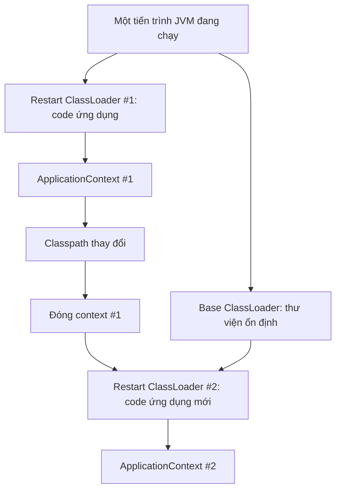
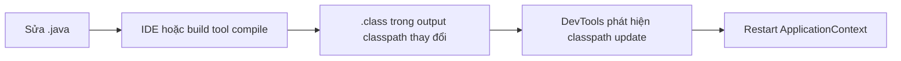
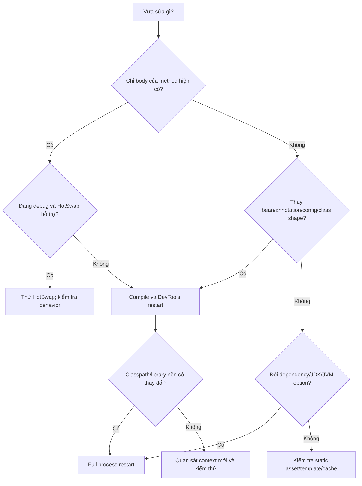

# Phân biệt restart ứng dụng với hot swap của JVM

Khi phát triển Spring Boot, một thay đổi trong mã nguồn đôi khi xuất hiện ngay ở request tiếp theo, nhưng cũng có lúc phải đợi ứng dụng “khởi động lại”, và có những thay đổi buộc bạn dừng hẳn tiến trình Java rồi chạy lại. Nếu không phân biệt rõ các cơ chế, bạn có thể lãng phí thời gian chờ khởi động, hiểu sai trạng thái của bean hoặc kết luận rằng annotation và cấu hình mới đã được áp dụng dù thực tế chưa.

Ba cơ chế cần phân biệt:

1. **JVM HotSwap / Hot Code Replace (HCR):** debugger thay thế bytecode của một số class đang được JVM nạp, thường không tạo lại Spring ApplicationContext.
2. **Spring Boot DevTools restart:** phát hiện classpath của ứng dụng thay đổi, đóng context cũ rồi xây dựng context mới, thường **trong cùng một tiến trình JVM**, bằng mô hình classloader phục vụ phát triển.
3. **Full process restart:** dừng tiến trình JVM đang chạy và khởi chạy tiến trình JVM mới, nạp lại cả ứng dụng lẫn các thư viện liên quan.

Trong tài liệu này, “restart ứng dụng” cần được hiểu theo ngữ cảnh. **DevTools restart không đồng nghĩa với restart toàn bộ JVM**, còn HotSwap không đồng nghĩa với khởi tạo lại Spring context.

## 1. Nhìn nhanh: ba cơ chế khác nhau thế nào?

| Khía cạnh | JVM HotSwap | DevTools restart | Full process restart |
|---|---|---|---|
| Ai thực hiện? | Debugger/IDE và khả năng redefine class của JVM | Spring Boot DevTools | IDE, terminal, process manager, container/platform |
| Có cần debug session? | Thông thường có, với cơ chế HCR chuẩn | Không | Không |
| Có tạo JVM mới không? | Không | Thông thường không | Có |
| Có tạo lại ApplicationContext không? | Không | Có | Có |
| Có tạo lại singleton bean không? | Không chỉ vì HotSwap | Có, khi context được dựng lại | Có |
| Có gọi lại constructor của bean hiện có không? | Không | Có khi bean mới được tạo | Có |
| Có chạy lại `@PostConstruct` của bean mới không? | Không | Có theo lifecycle bình thường | Có |
| Thay method body | Thường hỗ trợ | Hỗ trợ sau khi compile và restart | Hỗ trợ |
| Thêm bean, thay `@Bean`, thay component scan | Không cập nhật context đang chạy | Thường phù hợp | Phù hợp |
| Đổi thư viện/dependency trong base classloader | Không phải đường xử lý chính | Thường cần JVM mới | Phù hợp |
| PID JVM | Giữ nguyên | Thường giữ nguyên | Thay đổi |
| Chi phí | Thường rất nhỏ | Nhỏ hơn full JVM restart trong nhiều trường hợp | Thường lớn nhất |
| Dữ liệu chỉ nằm trong RAM | Phần lớn object hiện tại vẫn giữ | State của bean/context được tạo lại; JVM-level state có thể còn | JVM heap cũ biến mất |

Bảng này là định hướng. Kết quả thực tế còn phụ thuộc JDK, IDE, Spring Boot, cách chạy ứng dụng, build tool và classloader mà một class được nạp.

## 2. Ví dụ dẫn nhập: thay một lời chào

Giả sử có service sau:

```java
package com.example.demo;

import org.springframework.stereotype.Service;

@Service
public class GreetingService {

    public String greet(String name) {
        return "Xin chào, " + name;
    }
}
```

Controller sử dụng service:

```java
package com.example.demo;

import org.springframework.web.bind.annotation.GetMapping;
import org.springframework.web.bind.annotation.RequestParam;
import org.springframework.web.bind.annotation.RestController;

@RestController
public class GreetingController {

    private final GreetingService service;

    public GreetingController(GreetingService service) {
        this.service = service;
    }

    @GetMapping("/greeting")
    public String greeting(
            @RequestParam(defaultValue = "bạn") String name
    ) {
        return service.greet(name);
    }
}
```

Khi gọi:

```http
GET /greeting?name=Lan
```

Kết quả ban đầu:

```text
Xin chào, Lan
```

Bây giờ sửa method:

```java
public String greet(String name) {
    return "Chào mừng trở lại, " + name;
}
```

Có ba cách để mã mới được thực thi:

- **HotSwap:** IDE compile class, debugger yêu cầu JVM redefine bytecode; request tiếp theo có thể chạy thân method mới trên **bean hiện có**.
- **DevTools restart:** IDE/build tool cập nhật classpath; DevTools phát hiện thay đổi, đóng context và tạo bean mới; request tiếp theo chạy trên **bean của context mới**.
- **Full process restart:** dừng tiến trình cũ, build/chạy lại; toàn bộ JVM và context mới được tạo.

Chỉ thấy chuỗi mới trong response **không chứng minh cơ chế nào đã xảy ra**. Bạn phải quan sát thêm lifecycle, classloader hoặc process.

## 3. JVM HotSwap / Hot Code Replace là gì?

**HotSwap** trong bối cảnh phát triển Java thường chỉ khả năng debugger thay thế bytecode của class đã được nạp trong một JVM đang chạy. Trong IDE, nó có thể được gọi là **Hot Code Replace**, **HotSwap classes**, **Reload changed classes** hoặc một tên tương tự.

Luồng khái quát:


Khác với restart, quá trình này **không yêu cầu ứng dụng đăng ký lại toàn bộ bean**.

### 3.1. Cái gì được giữ nguyên khi HotSwap thành công?

Trong kịch bản HotSwap thông thường:

- Tiến trình JVM vẫn chạy.
- ApplicationContext hiện tại vẫn là context cũ.
- Các singleton bean hiện có vẫn là những object đang được dùng.
- Field và trạng thái runtime của các object hiện tại thường được giữ nguyên.
- Constructor và init callback không tự chạy lại.
- Những cấu hình Spring đã được parse và đăng ký thường không được tính toán lại chỉ vì bytecode method đổi.

Nếu `GreetingService` giữ một counter trong field, HotSwap method `greet()` không làm counter quay về 0.

### 3.2. Giới hạn của HotSwap chuẩn

Khả năng redefine class theo cơ chế chuẩn của JVM/debugger chủ yếu phục vụ **thay phần triển khai của method trên một cấu trúc class tương thích**.

Các thay đổi sau thường **không được hỗ trợ bởi HotSwap chuẩn** hoặc không đem lại hiệu ứng bạn kỳ vọng:

- Thêm hoặc xóa field.
- Thêm hoặc xóa method, thay signature.
- Thay quan hệ kế thừa hoặc interface của class.
- Thay đổi lớn trong cấu trúc class.
- Thay Spring bean definition, component scanning, handler mapping hoặc cấu hình đã được xử lý trước đó.
- Thêm annotation AOP rồi kỳ vọng advisor/proxy hiện tại tự được tạo lại.

Một số JVM, IDE hoặc agent nâng cao có thể hỗ trợ **enhanced class redefinition** vượt giới hạn HotSwap chuẩn. Đừng xem khả năng mở rộng đó là tính năng mặc định của mọi JVM Java.

### 3.3. Sửa constructor body có giống tạo lại object không?

Ngay cả khi một môi trường cho phép thay code của constructor, **constructor không tự được chạy lại trên những instance đã tồn tại**.

Ví dụ:

```java
public class PriceCalculator {

    private final int rate;

    public PriceCalculator() {
        this.rate = 10;
    }

    public int calculate(int base) {
        return base + rate;
    }
}
```

Nếu bean hiện tại đã được tạo với `rate = 10`, việc sửa giá trị gán trong constructor thành `20` không tự cập nhật field của instance đang tồn tại.

Muốn constructor chạy lại, phải tạo object mới, ví dụ qua DevTools restart hoặc full restart.

## 4. HotSwap không làm Spring quét lại annotation

Giả sử service:

```java
@Service
public class GreetingService {

    public String greet(String name) {
        return "Xin chào " + name;
    }
}
```

Bạn sửa thành:

```java
@Service
public class GreetingService {

    @Transactional
    public String greet(String name) {
        return "Xin chào " + name;
    }
}
```

Đây không phải thay đổi chỉ ở business logic. Spring thường tạo transaction proxy/advisor khi xây dựng bean trong quá trình khởi tạo context. **HotSwap không phải một thao tác refresh ApplicationContext**.

Ngay cả khi JVM chấp nhận thay đổi bytecode/annotation, bạn không nên kỳ vọng Spring tự đọc lại metadata và dựng proxy/advisor mới cho bean đã tồn tại.

Các thay đổi thường cần tạo lại context:

- Thêm/bỏ `@Component`, `@Service`, `@Repository`.
- Thêm/bỏ `@Bean` hoặc đổi điều kiện cấu hình bean.
- Đổi `@ConfigurationProperties` theo cách cần rebind.
- Thêm `@Transactional`, `@Cacheable`, `@Async`.
- Đổi `@RequestMapping`, `@GetMapping`, đường dẫn endpoint.
- Đổi `@Scheduled` hoặc lịch đăng ký theo annotation.
- Thêm listener, filter, security chain hoặc các bean hạ tầng mới.

Ngay cả những annotation có thể được JVM lưu trong metadata mới cũng không có nghĩa mọi framework đã quan sát lại chúng.

## 5. HotSwap không phải LiveReload của trình duyệt

Tên gọi dễ gây nhầm:

- **JVM HotSwap:** thay bytecode của class đang chạy.
- **Spring Boot DevTools restart:** tái tạo Spring context khi classpath thay đổi.
- **LiveReload:** báo cho trình duyệt refresh trang khi tài nguyên tương ứng thay đổi.

LiveReload có thể cập nhật phần hiển thị browser mà không cần JVM HotSwap. Thay CSS, HTML template hoặc static asset không giống thay implementation của Java method.

Không dùng việc trình duyệt tự refresh làm bằng chứng rằng Spring đã tạo bean mới hoặc JVM đã redefine class.

## 6. Spring Boot DevTools restart là gì?

**Spring Boot DevTools** là bộ công cụ hỗ trợ phát triển. Chức năng restart theo dõi những thay đổi phù hợp trong classpath của ứng dụng và thực hiện restart ở cấp Spring application.

Cốt lõi của cơ chế này là mô hình **hai classloader**:

1. **Base classloader:** thường nạp thư viện/dependency ổn định.
2. **Restart classloader:** thường nạp những class thuộc project đang phát triển, vốn thường xuyên được compile lại.

Khi phát hiện thay đổi cần restart, DevTools có thể bỏ restart classloader cũ, tạo restart classloader mới và dựng lại ứng dụng, trong khi base classloader vẫn được tái sử dụng.



Sơ đồ khái quát: base classloader được tái sử dụng, context và các class thuộc phần restart được dựng lại. Không nên suy luận rằng mọi state của toàn JVM đều được reset như khi khởi chạy tiến trình mới.

### 6.1. Vì sao DevTools restart có thể nhanh hơn full restart?

Một số thư viện lớn không cần nạp lại trong mỗi lần sửa code ứng dụng. Khi base classloader giữ các dependency ổn định, DevTools giảm chi phí của một số bước so với việc khởi động một JVM mới từ đầu.

Tuy nhiên, DevTools restart vẫn phải thực hiện nhiều việc:

- Xây dựng ApplicationContext mới.
- Xử lý bean definitions.
- Tạo và khởi tạo bean cần thiết.
- Cấu hình hạ tầng web, database, event listeners.
- Thực hiện các callback startup phù hợp.

Vì vậy, DevTools restart **không miễn phí và không phải thay method body tức thời như HotSwap**.

### 6.2. DevTools restart không tạo một JVM mới

Khi DevTools restart xảy ra thông thường:

- PID của JVM vẫn giữ nguyên.
- Heap và các thành phần JVM-level vẫn thuộc cùng process.
- ApplicationContext cũ được đóng, context mới được tạo.
- Singleton bean trong context mới thường là instance mới.
- Các class nằm trong restart classloader được nạp lại.
- Những static field trong class được nạp lại có thể được khởi tạo lại.
- Những static field thuộc class vẫn nằm trong base classloader **có thể vẫn giữ giá trị**.

Nói DevTools “reset tất cả static state” hoặc “tạo JVM mới” đều không chính xác.

## 7. Cài đặt DevTools trong Spring Boot

### 7.1. Gradle Kotlin DSL

```kotlin
dependencies {
    developmentOnly("org.springframework.boot:spring-boot-devtools")
}
```

### 7.2. Gradle Groovy DSL

```groovy
dependencies {
    developmentOnly 'org.springframework.boot:spring-boot-devtools'
}
```

### 7.3. Maven

```xml
<dependency>
    <groupId>org.springframework.boot</groupId>
    <artifactId>spring-boot-devtools</artifactId>
    <scope>runtime</scope>
    <optional>true</optional>
</dependency>
```

`optional` thể hiện rằng dependency này dành cho workflow phát triển, không nên trở thành dependency bắt buộc lan truyền sang project tiêu thụ thư viện. Cách đóng gói cụ thể còn phụ thuộc build setup.

Các build plugin Spring Boot thông thường có quy tắc không đóng gói DevTools vào executable artifact production theo mặc định hoặc cung cấp option để kiểm soát việc đó. Hãy dùng cấu hình đúng phiên bản đang sử dụng, thay vì triển khai DevTools như thành phần của production.

### 7.4. Khi nào DevTools có hiệu lực?

DevTools chủ yếu phục vụ ứng dụng **chạy trong môi trường development**, ví dụ qua IDE hoặc build tool. Auto restart có thể bị vô hiệu trong những cách chạy packaged archive/production.

Vì thế, không nên kiểm tra DevTools bằng cách mặc định giả định rằng mọi file `.jar` được build rồi chạy đều sẽ auto restart.

## 8. Điều gì thật sự kích hoạt DevTools restart?

Một hiểu lầm phổ biến: “Bấm Save trong IDE là Spring Boot khởi động lại”.

Thực tế, DevTools restart chủ yếu quan sát **thay đổi trên những đường dẫn classpath được theo dõi**, không chỉ nội dung file `.java` trong source folder.

Luồng thường gặp:



Vì vậy:

- Nếu IDE chỉ lưu source nhưng không compile, classpath có thể chưa đổi.
- Nếu IDE compile-on-save, thay đổi có thể được phát hiện tự động.
- Một số IDE cần nhấn **Build Project**, **Make Project** hoặc bật automatic build.
- Khi chạy qua build tool, output classpath cần là nơi DevTools theo dõi.

### 8.1. Source file và class file là hai thứ khác nhau

Ví dụ:

```text
src/main/java/com/example/demo/GreetingService.java
          |
          | compile
          v
build/classes/java/main/com/example/demo/GreetingService.class
```

DevTools thường quan sát thay đổi ở classpath output như `build/classes/java/main` hoặc `target/classes`, không phải nội dung `.java` chưa được biên dịch.

### 8.2. IDE có thể kết hợp compile và HotSwap

Khi debug, một lần compile có thể khiến:

1. IDE thử HotSwap bytecode vào JVM.
2. Class file trong output directory được cập nhật.
3. DevTools nhìn thấy classpath thay đổi và bắt đầu restart.

Vì vậy hai cơ chế có thể **đồng thời được kích hoạt** và gây cảm giác khó hiểu: ban đầu HotSwap thông báo thành công, sau đó ứng dụng vẫn restart.

Muốn thử nghiệm riêng HotSwap, hãy kiểm soát DevTools restart. Muốn thử nghiệm DevTools restart, hãy bảo đảm bạn biết IDE có đang gửi HCR trước đó hay không.

## 9. Quan sát DevTools restart bằng lifecycle callback

Một cách phân biệt thực tế là ghi log khi Spring tạo và destroy bean.

Ví dụ:

```java
package com.example.demo;

import java.util.concurrent.atomic.AtomicInteger;

import jakarta.annotation.PostConstruct;
import jakarta.annotation.PreDestroy;
import org.springframework.stereotype.Service;

@Service
public class CounterService {

    private final AtomicInteger counter = new AtomicInteger();

    @PostConstruct
    public void init() {
        System.out.println(
                "CounterService initialized: "
                        + System.identityHashCode(this)
        );
    }

    @PreDestroy
    public void destroy() {
        System.out.println(
                "CounterService destroyed: "
                        + System.identityHashCode(this)
        );
    }

    public int next() {
        return counter.incrementAndGet();
    }
}
```

Controller:

```java
@RestController
public class CounterController {

    private final CounterService counterService;

    public CounterController(CounterService counterService) {
        this.counterService = counterService;
    }

    @GetMapping("/counter")
    public int counter() {
        return counterService.next();
    }
}
```

Gọi endpoint hai lần:

```text
GET /counter  -> 1
GET /counter  -> 2
```

### 9.1. Nếu HotSwap method body thành công

Giả sử chỉ sửa implementation của `next()`, sau đó debugger thay bytecode trong JVM mà không làm context restart.

Kỳ vọng:

- Không có cặp log destroy rồi initialized do thao tác này.
- Bean hiện tại vẫn giữ counter.
- Nếu logic thay đổi hợp lệ, lời gọi sau chạy body mới.
- State hiện tại không tự reset.

### 9.2. Nếu DevTools restart thành công

Sau khi output classpath đổi và DevTools restart:

- Spring đóng ApplicationContext cũ.
- `@PreDestroy` có cơ hội chạy trên bean cũ.
- Context mới được tạo.
- `@PostConstruct` chạy trên bean mới.
- Counter của bean mới bắt đầu từ 0.

Request tiếp theo có thể trả:

```text
GET /counter  -> 1
```

**Cẩn thận:** `System.identityHashCode` chỉ là dấu hiệu quan sát hỗ trợ; nó không phải ID duy nhất tuyệt đối giữa mọi object và mọi lần chạy. Quan trọng hơn là log lifecycle và trạng thái bean.

### 9.3. Nếu full process restart

Bạn cũng thấy bean được tạo lại và counter reset, nhưng đồng thời:

- Tiến trình JVM cũ kết thúc.
- Một JVM mới được khởi chạy.
- PID thường thay đổi.
- Classloader và heap thuộc JVM cũ không còn.

Muốn phân biệt DevTools và full restart, cần quan sát thêm process/PID, không chỉ lifecycle của bean.

## 10. In PID để phân biệt DevTools restart với JVM mới

Bạn có thể in PID theo Java API:

```java
long pid = ProcessHandle.current().pid();
System.out.println("JVM PID = " + pid);
```

Có thể in khi ApplicationContext sẵn sàng hoặc trong một endpoint chẩn đoán nội bộ.

Với DevTools restart bình thường:

```text
JVM PID = 15420
ApplicationContext initialized
...
ApplicationContext destroyed
ApplicationContext initialized
JVM PID = 15420
```

Với full restart:

```text
JVM PID = 15420
... old process stops ...

JVM PID = 16736
... new process starts ...
```

Các PID chỉ là ví dụ. Hệ điều hành có thể tái sử dụng PID vào lúc khác nên khi chẩn đoán nghiêm túc, kết hợp process start time hoặc quan sát process lifecycle, không chỉ dựa vào việc số PID tình cờ trùng nhau.

## 11. Bảng thay đổi: nên dùng HotSwap, DevTools hay full restart?

| Bạn vừa thay đổi | HotSwap chuẩn | DevTools restart | Full restart |
|---|---|---|---|
| Sửa câu lệnh trong thân một method | Thường được | Được | Được |
| Đổi message trả về từ service | Thường được | Được | Được |
| Đổi thuật toán nhưng giữ class/method shape | Thường được | Được | Được |
| Thêm field hoặc method mới | Thường không | Thường được | Được |
| Đổi constructor signature | Thường không | Thường được | Được |
| Thêm `@Service` hoặc `@Component` | Không cập nhật component scan hiện tại | Thường được | Được |
| Thêm `@Bean` hoặc bean điều kiện | Không cập nhật context hiện tại | Thường được | Được |
| Đổi `@GetMapping` hoặc router mapping | Không nên trông đợi cập nhật route hiện có | Thường được | Được |
| Thay property cần bind lại vào bean | Không phải nhiệm vụ HotSwap | Thường được nếu restart được kích hoạt | Được |
| Thêm `@Scheduled` | Không tự đăng ký lịch mới | Thường được | Được |
| Thêm `@Transactional` / `@Cacheable` | Không tự tái dựng proxy | Thường được | Được |
| Đổi dependency jar hoặc JVM flags | Không | Thường không đủ | Nên dùng |
| Đổi JDK version | Không | Không | Bắt buộc chạy JVM mới |
| Thay class nằm trong base classloader | Không phải giải pháp đáng tin cậy | Có thể không reload class đó | Nên dùng |
| Kiểm tra ứng dụng khởi động sạch từ đầu | Không | Không tương đương hoàn toàn | Nên dùng |

“Được” nghĩa cơ chế có thể đưa thay đổi vào ứng dụng sau khi build và cấu hình phù hợp; không có nghĩa mọi thay đổi đều an toàn hoặc nhanh.

## 12. Tại sao thêm dependency thường cần full process restart?

Một dependency mới có thể thay đổi:

- Cấu trúc classpath.
- Auto-configuration được phát hiện.
- Class và resource được nạp vào base classloader.
- Thư viện native hoặc resource JVM-level.
- Spring Boot plugin/runtime classpath được build tool cung cấp.

DevTools thường giữ base classloader ổn định qua các lần restart. Nếu bạn thêm/sửa dependency nằm trong base classloader, một context restart không nhất thiết tạo ra classpath và classloader phù hợp với thay đổi.

Cách làm đáng tin cậy:

1. Cập nhật Gradle/Maven.
2. Đồng bộ dependency và compile.
3. Dừng process đang chạy.
4. Chạy lại ứng dụng với runtime classpath mới.

Nếu không làm vậy, bạn có thể gặp `ClassNotFoundException`, `NoClassDefFoundError` hoặc behavior không nhất quán do classloader vẫn giữ phiên bản cũ.

## 13. DevTools trigger file: chỉ restart khi bạn chủ động cho phép

Trong dự án lớn, bạn có thể không muốn DevTools restart mỗi lần IDE compile một phần code. DevTools hỗ trợ mô hình **trigger file**: sau khi classpath đổi, restart chỉ được phép khi file trigger được cập nhật theo cơ chế theo dõi.

Cấu hình ví dụ:

```properties
spring.devtools.restart.trigger-file=.reloadtrigger
```

Tạo file trigger ở nơi được đưa vào classpath, ví dụ:

```text
src/main/resources/.reloadtrigger
```

Quy trình:

1. Sửa code.
2. Compile để classpath output cập nhật.
3. Khi muốn restart, sửa/touch file trigger.
4. DevTools quan sát và thực hiện restart phù hợp.

Đường dẫn và hành vi cụ thể phụ thuộc cấu hình resource/classpath của build tool. File trigger phải thực sự tồn tại ở vị trí DevTools quan sát được, không phải một file tùy ý nằm ngoài classpath.

### 13.1. Trigger file có ích khi kết hợp HotSwap

Bạn có thể:

- Dùng HotSwap cho các sửa đổi method body trong debug session.
- Trì hoãn DevTools restart cho tới khi thực sự cần dựng lại context.
- Chỉnh trigger file sau khi thay bean/configuration để khởi động lại context.

Cách phối hợp này giúp giảm xung đột “HotSwap thành công nhưng DevTools restart ngay sau đó”.

### 13.2. Trigger file không mở rộng khả năng của HotSwap

Nếu bạn thêm field hoặc đổi class structure, debugger chuẩn vẫn có thể từ chối HotSwap. Trigger file chỉ điều khiển **thời điểm DevTools restart**, không thay đổi giới hạn JVM redefine class.

## 14. Tắt DevTools restart khi cần kiểm tra HotSwap riêng

Có thể cấu hình:

```properties
spring.devtools.restart.enabled=false
```

Khi đặt trong application properties, setting này vô hiệu hóa cơ chế giám sát/tự restart phù hợp trong DevTools. Tuy nhiên, tùy cách DevTools được khởi tạo, restart classloader vẫn có thể đã tham gia vào bootstrap.

Nếu cần **vô hiệu hóa hoàn toàn restart classloader** cho một phép kiểm chứng cụ thể, Spring Boot cho phép đặt system property **trước khi gọi `SpringApplication.run(...)`**:

```java
public static void main(String[] args) {
    System.setProperty("spring.devtools.restart.enabled", "false");
    SpringApplication.run(DemoApplication.class, args);
}
```

Đây là ví dụ phục vụ debug; không nên commit một system property vô hiệu hóa tooling cho cả team nếu mục tiêu chỉ là kiểm chứng cục bộ. Có thể đặt nó từ VM arguments hoặc cấu hình chạy trong IDE thay vì sửa source chính.

### 14.1. Khi tắt restart, việc compile có làm bean mới xuất hiện không?

Không. Tắt DevTools restart không đồng nghĩa HotSwap được kích hoạt, và cũng không đồng nghĩa Spring quét lại bean definitions.

Bạn vẫn phải:

- Attach debugger và thực hiện Hot Code Replace cho thay đổi method body tương thích; hoặc
- Chủ động restart context/process khi thay đổi cần xử lý cấu hình lại.

## 15. Phân biệt thay đổi tài nguyên tĩnh với thay đổi class Java

Không phải mọi chỉnh sửa trong một dự án Spring Boot đều cần restart.

Ví dụ:

- File CSS hoặc JavaScript được phục vụ như static resource.
- HTML template và template engine có cache tắt trong development.
- File message bundle hoặc resource được đọc lại theo cơ chế riêng.
- Java class đã được compile.

Chúng có cơ chế cập nhật khác nhau.

### 15.1. Static asset có thể được cập nhật độc lập

Thay `src/main/resources/static/app.css` thường không yêu cầu HotSwap Java bytecode. Trình duyệt có thể cần refresh; LiveReload có thể giúp thực hiện việc đó.

### 15.2. Template và caching

Nếu template engine có cache, template đổi mà giao diện không đổi có thể là do cache, không phải vì JVM HotSwap không hoạt động.

Cần xem cấu hình caching của đúng template engine và chế độ development.

### 15.3. Java source cần được compile

Khi sửa Java method, thứ JVM chạy là bytecode đã được nạp, không phải file `.java` trong editor. Nếu class output chưa được cập nhật, cả DevTools và debugger đều có thể không có bytecode mới để áp dụng.

## 16. Restart classloader và trạng thái static

DevTools có đặc điểm dễ gây bất ngờ: **cùng một JVM, nhưng có thể có nhiều thế hệ classloader qua các lần restart**.

Trong JVM, class được nhận diện không chỉ bằng tên đầy đủ mà còn bởi classloader đã nạp nó.

Ví dụ về mặt khái niệm:

```text
com.example.app.Widget loaded by RestartClassLoader#1
com.example.app.Widget loaded by RestartClassLoader#2
```

Hai class có thể có cùng tên nhưng không là cùng `Class<?>` runtime nếu được nạp bởi hai classloader khác nhau.

### 16.1. Trạng thái static có thể reset hoặc vẫn còn

Trường hợp A: class ứng dụng nằm trong restart classloader.

```java
public final class DebugCounter {

    public static int value;
}
```

Khi class này được nạp lại bởi restart classloader mới, static field của class mới bắt đầu từ trạng thái khởi tạo mới.

Trường hợp B: class thuộc thư viện nằm trong base classloader.

Static field của class thư viện có thể vẫn tồn tại sau DevTools restart vì base classloader được giữ lại.

**Không nên dùng static field làm nơi lưu state cần sống qua mọi DevTools restart hoặc được reset một cách chắc chắn.** Hãy thiết kế lifecycle/state ở cấp ứng dụng một cách rõ ràng.

### 16.2. ClassCastException do classloader

Một lỗi kinh điển:

```text
ClassCastException: com.example.Widget cannot be cast to com.example.Widget
```

Thông báo trông vô lý, nhưng hai `Widget` có thể được nạp bởi hai classloader khác nhau.

Các nguyên nhân có thể gồm:

- Thư viện nằm trong base classloader giữ reference tới class ứng dụng từ restart classloader cũ.
- Thread hoặc cache không được dọn khi context cũ đóng.
- Serialization/deserialization hoặc proxy được xử lý qua sai classloader.
- Một dependency đa module được nạp vào layer không phù hợp.

Khi gặp lỗi như vậy, kiểm tra classloader của hai class và cân nhắc cấu hình restart classloader hoặc full restart.

## 17. Chỉnh classloader cho multi-module hoặc thư viện đặc biệt

DevTools hỗ trợ quy tắc include/exclude khi phân chia class giữa base và restart classloader. Trong dự án đa module, bạn có thể cần điều chỉnh để một module đang phát triển cũng được nạp bởi restart classloader.

Có thể dùng file cấu hình:

```text
META-INF/spring-devtools.properties
```

Ví dụ minh họa:

```properties
restart.include.my-shared-module=/my-shared-module-[\\w.-]+\\.jar
restart.exclude.stable-lib=/stable-lib-[\\w.-]+\\.jar
```

Các pattern và classpath URL cụ thể phải khớp với cấu trúc project thực tế. Đây là cấu hình nâng cao; không nên sao chép pattern ví dụ rồi cho rằng nó phù hợp với mọi Gradle/Maven project.

### 17.1. Khi nào nên xem xét?

- Sửa code trong module phụ nhưng DevTools restart không phản ánh thay đổi.
- Gặp `ClassCastException` hoặc lỗi classloader khó hiểu.
- Một dependency dự án được coi là thư viện ổn định dù đang được phát triển.
- Một framework giữ reference tới class từ restart classloader cũ.

### 17.2. Khi nào không nên xem xét?

Nếu chỉ muốn sửa một dòng business logic, đừng bắt đầu bằng cấu hình classloader phức tạp. Hãy xác định IDE đã compile class và DevTools thực sự restart chưa.

Không dùng include/exclude để che giấu resource leak hoặc thay đổi dependency cần full restart.

## 18. DevTools restart và lifecycle của Spring bean

Khi DevTools restart context, Spring có cơ hội chạy các bước lifecycle:

- Dừng một số `SmartLifecycle` bean.
- Gọi destroy callback như `@PreDestroy` và `@Bean(destroyMethod = "...")` theo cơ chế quản lý.
- Đóng tài nguyên do các bean phù hợp sở hữu.
- Xây dựng context mới.
- Tạo bean mới và gọi `@PostConstruct`/init callbacks.

Đây là khác biệt quan trọng so với HotSwap: HotSwap method body không phải context close/open.

### 18.1. Vì sao tài nguyên tự tạo có thể gây vấn đề?

Nếu bean tự tạo `ExecutorService` hoặc scheduler nhưng không đóng khi context bị destroy, worker thread có thể tiếp tục sống sau DevTools restart.

Khi đó:

- Thread cũ vẫn giữ reference tới class của restart classloader cũ.
- Tài nguyên mạng/file vẫn được giữ.
- Classloader cũ có thể không được garbage collect.
- Các lần restart liên tiếp có thể tích lũy thread hoặc memory.

Ví dụ cần cleanup:

```java
@Service
public class BackgroundWorker {

    private final ExecutorService executor =
            Executors.newSingleThreadExecutor();

    public void submit(Runnable job) {
        executor.submit(job);
    }

    @PreDestroy
    public void shutdown() {
        executor.shutdown();
    }
}
```

Ví dụ này cho thấy **đường cleanup**, nhưng `shutdown()` không chờ mọi task kết thúc. Trong ứng dụng thực, nên có timeout và `awaitTermination()` hoặc cơ chế hủy thích hợp.

### 18.2. Restart nhiều lần là phép thử lifecycle hữu ích

Trong development, sửa code và để DevTools restart nhiều lần có thể giúp bộc lộ:

- Resource leak.
- Thread chưa dừng.
- Cache tĩnh giữ classloader cũ.
- Listener đăng ký lặp.
- Port/socket chưa giải phóng.
- Tác vụ định kỳ bị tạo trùng.

Dù vậy, không nên dùng DevTools restart để thay thế kiểm thử shutdown/restart chuẩn của ứng dụng.

## 19. DevTools restart không phải graceful production rolling restart

Một khác biệt về mục tiêu:

- **DevTools restart:** tối ưu vòng lặp phát triển trên một JVM cục bộ.
- **Graceful shutdown:** cho request/task có cơ hội kết thúc trước khi context/process dừng.
- **Rolling deployment:** hệ thống triển khai thay dần instance để duy trì khả năng phục vụ.
- **Full production restart:** dừng/chạy process hoặc container theo chính sách nền tảng.

DevTools restart không phải công cụ zero-downtime deployment. Trong lúc context bị đóng và dựng lại, ứng dụng có thể tạm thời không phục vụ request.

Không bật DevTools trong production để mong ứng dụng tự cập nhật code khi upload classfile; điều đó không thay thế quy trình build, deploy, rollback và kiểm soát phiên bản.

## 20. JVM HotSwap và AOP proxy: khi method mới xuất hiện?

Giả sử có:

```java
@Service
public class InvoiceService {

    @Transactional
    public void saveInvoice() {
        // Logic hiện tại.
    }
}
```

Nếu chỉ thay phần code bên trong `saveInvoice()` và JVM cho phép HotSwap, lời gọi qua **proxy hiện có** có thể tiếp tục đi qua transaction interceptor rồi chạy body mới.

Nhưng nếu bạn thay đổi:

- Vị trí `@Transactional`.
- Tên/signature method được pointcut tham chiếu.
- `@Aspect` expression.
- Bean registration hoặc cấu hình proxy.

thì cần tạo lại infrastructure/proxy phù hợp. DevTools restart hoặc full restart sẽ an toàn hơn để kiểm chứng những thay đổi này.

### 20.1. HotSwap không sửa self-invocation

Nếu bean gọi:

```java
this.saveInvoice();
```

trong một method khác của cùng target, lời gọi nội bộ vẫn có thể bypass Spring proxy dù body method đã được HotSwap.

HotSwap và AOP là hai cơ chế khác nhau: thay code của method không thay đổi đường đi của lời gọi qua proxy.

## 21. Ví dụ thực hành: phân biệt ba cơ chế bằng quan sát

Ta sử dụng một ứng dụng có endpoint và lifecycle log.

### 21.1. Tạo service có trạng thái

```java
package com.example.demo;

import java.util.concurrent.atomic.AtomicInteger;
import jakarta.annotation.PostConstruct;
import jakarta.annotation.PreDestroy;
import org.springframework.stereotype.Service;

@Service
public class ProbeService {

    private final AtomicInteger calls = new AtomicInteger();

    @PostConstruct
    public void initialized() {
        System.out.println(
                "PROBE_INIT pid=" + ProcessHandle.current().pid()
                        + " instance=" + System.identityHashCode(this)
        );
    }

    @PreDestroy
    public void destroyed() {
        System.out.println(
                "PROBE_DESTROY instance="
                        + System.identityHashCode(this)
        );
    }

    public String describe() {
        return "v1 / call=" + calls.incrementAndGet();
    }
}
```

Controller:

```java
package com.example.demo;

import org.springframework.web.bind.annotation.GetMapping;
import org.springframework.web.bind.annotation.RestController;

@RestController
public class ProbeController {

    private final ProbeService service;

    public ProbeController(ProbeService service) {
        this.service = service;
    }

    @GetMapping("/probe")
    public String probe() {
        return service.describe();
    }
}
```

### 21.2. Ghi nhận trạng thái ban đầu

Chạy ứng dụng và gọi:

```text
GET /probe
v1 / call=1

GET /probe
v1 / call=2
```

Ghi nhận log `PROBE_INIT` và PID.

### 21.3. Thử HotSwap

Trong debug session, sửa thân method:

```java
public String describe() {
    return "v2 / call=" + calls.incrementAndGet();
}
```

Compile và dùng chức năng Hot Code Replace của IDE. Trong phép thử này, phải tránh DevTools restart xen vào (ví dụ tạm vô hiệu hóa restart hoặc dùng trigger file).

Nếu HotSwap thành công, kỳ vọng:

```text
GET /probe
v2 / call=3
```

Không có chu kỳ destroy/init của Spring do thao tác này và PID không thay đổi.

### 21.4. Thử DevTools restart

Bật DevTools restart, compile code để classpath output thay đổi và chờ context mới hoàn tất startup. Nếu dùng trigger file, cập nhật trigger sau khi compile.

Kỳ vọng:

```text
PROBE_DESTROY instance=...
PROBE_INIT pid=<PID cũ> instance=...

GET /probe
v2 / call=1
```

Bean mới có counter mới nhưng JVM PID vẫn như trước.

### 21.5. Thử full restart

Dừng ứng dụng rồi chạy lại từ IDE hoặc terminal.

Kỳ vọng:

```text
PROBE_INIT pid=<PID mới> instance=...

GET /probe
v2 / call=1
```

Lúc này process thực sự mới. Log của ứng dụng sau restart không phải bằng chứng duy nhất; hãy kiểm tra process lifecycle hoặc PID khi cần.

### 21.6. Kết luận từ thực nghiệm

| Quan sát | HotSwap | DevTools | Full restart |
|---|---|---|---|
| Method body đổi hiệu ứng | Có thể | Có | Có |
| Counter bean reset | Không | Có | Có |
| `@PreDestroy` và `@PostConstruct` chạy lại vì thao tác đó | Không | Thường có | Thường có với dừng/chạy bình thường |
| PID JVM đổi | Không | Không | Có |
| Framework parse lại bean definitions | Không | Có | Có |

Nếu kết quả khác bảng, xem IDE compile behavior, debug HotSwap, DevTools trigger và khả năng lifecycle callback có thực sự chạy.

## 22. IDE workflow: nên bấm gì sau khi sửa code?

Một workflow thực tế có thể chia theo mức thay đổi.

### 22.1. Chỉ sửa thân method

Ví dụ sửa phép tính hoặc message:

1. Lưu source.
2. Compile class.
3. Nếu đang debug, thử HotSwap/HCR.
4. Gọi lại endpoint hoặc test behavior.
5. Nếu HotSwap bị từ chối hoặc framework state cần refresh, dùng DevTools restart.

Ưu điểm: không phải chờ Spring tạo lại toàn bộ bean nếu chỉ đổi code method đơn giản.

### 22.2. Thêm field, method, DTO hoặc class mới

1. Compile code.
2. Dùng DevTools restart để classloader/context mới xử lý class shape.
3. Quan sát app đã start và endpoint/test hoạt động.
4. Nếu có lỗi classloader hoặc dependency, cân nhắc full restart.

Một số JVM enhanced HotSwap có thể xử lý structural changes, nhưng quy trình DevTools vẫn đáng tin cậy hơn cho thay đổi bean/context của Spring.

### 22.3. Thay configuration hoặc annotation

Ví dụ đổi:

```java
@GetMapping("/old")
```

thành:

```java
@GetMapping("/new")
```

Đây là thay đổi mapping do Spring MVC đăng ký trong quá trình xây dựng context. Hãy restart context thay vì chỉ dựa vào HCR.

### 22.4. Thêm dependency, thay runtime hoặc nâng JDK

Đồng bộ build rồi dừng/chạy lại JVM. Không kỳ vọng DevTools restart classloader tái tạo toàn bộ classpath nền.

## 23. Gradle bootRun, Maven spring-boot:run và packaged jar

Cách chạy ảnh hưởng khả năng tự cập nhật.

### 23.1. Gradle bootRun

Ví dụ:

```bash
./gradlew bootRun
```

Khi chạy theo cấu hình phát triển có DevTools và output classpath được cập nhật, DevTools có thể phát hiện compile result.

Tuy nhiên, không phải mọi IDE/build setup tự compile lại class trong lúc `bootRun` đang hoạt động. Có thể cần dùng chức năng Build/Make của IDE hoặc một workflow compile phù hợp.

### 23.2. Maven spring-boot:run

Ví dụ:

```bash
./mvnw spring-boot:run
```

Tương tự, DevTools phụ thuộc việc classpath output thay đổi. Việc thay file source mà không tạo classfile mới chưa chắc kích hoạt restart.

### 23.3. Chạy executable jar

Ví dụ:

```bash
java -jar build/libs/demo.jar
```

Một packaged archive thông thường không phải môi trường tiêu chuẩn để DevTools tự restart mỗi khi source đổi. Hãy build lại artifact và restart process theo workflow triển khai.

Đừng nhầm việc build một jar mới trên disk với việc JVM đang chạy tự nạp jar mới vào classloader hiện tại.

## 24. Khi sửa code nhưng response không đổi: checklist chẩn đoán

Tình huống: đã sửa `GreetingService` từ `v1` sang `v2` nhưng API vẫn trả `v1`.

Kiểm tra theo trình tự:

1. **Đúng project/module đang chạy?** Có thể IDE đang chạy một module hoặc process khác.
2. **Đúng port và endpoint?** Có thể request đi tới một instance khác.
3. **Source đã compile chưa?** Kiểm tra build output/classpath.
4. **Debugger có attach không?** Nếu chờ HotSwap, cần debug session phù hợp.
5. **IDE có báo HCR thành công hay bị từ chối?**
6. **DevTools đã được thêm đúng scope chưa?**
7. **DevTools có đang bị vô hiệu hóa không?**
8. **Có trigger file hoặc restart exclusion không?**
9. **Có log context restart không?**
10. **Class thuộc restart hay base classloader?**
11. **Response có bị cache ở client/CDN/server không?**
12. **Có nhiều ứng dụng chạy đồng thời không?**

Nếu output classfile chưa thay đổi, đừng vội chỉnh AOP, cache, bean scope hoặc classloader. Trước tiên phải đưa code mới vào runtime.

### 24.1. Restart thành công nhưng vẫn thấy response cũ

Có thể do:

- Request đang vào một process khác.
- Class mới không nằm trong output classpath mà DevTools quan sát.
- Một cache/layer phía trước giữ dữ liệu.
- Module chứa class nằm trong base classloader.
- Build tool copy resource hoặc compile sang một directory khác.
- Ứng dụng đang dùng cấu hình profile khác với bạn nghĩ.

Ghi log version/build commit và process PID tại startup giúp giảm nhầm lẫn.

## 25. Khi DevTools restart liên tục

Nguyên nhân có thể gồm:

- IDE tự compile hoặc copy resource nhiều lần.
- Build tool ghi vào classpath output liên tục.
- Một task trong ứng dụng tự ghi file vào directory được DevTools theo dõi.
- Nhiều tool cùng sửa classpath.
- Restart trigger hoặc exclusion chưa được cấu hình phù hợp.

Các lựa chọn:

- Dùng trigger file.
- Điều chỉnh `spring.devtools.restart.exclude` cho resource không cần restart.
- Cân nhắc `spring.devtools.restart.additional-exclude` nếu muốn bổ sung pattern thay vì thay toàn bộ exclusion.
- Đưa file runtime được ứng dụng tự ghi ra ngoài classpath.
- Kiểm tra IDE automatic build và các task copy resource.

Ví dụ cấu hình bổ sung exclusion:

```properties
spring.devtools.restart.additional-exclude=**/generated-reports/**
```

Pattern phải phù hợp với đường dẫn classpath thực tế. Không nên loại toàn bộ output classpath chỉ để che hiện tượng restart loop, vì sẽ vô hiệu hóa lợi ích chính của DevTools.

## 26. Khi classloader lỗi sau restart

Các triệu chứng:

- `ClassCastException` với hai tên class giống nhau.
- `NoClassDefFoundError` sau khi sửa dependency.
- Thread cũ vẫn tồn tại sau nhiều lần restart.
- Listener/scheduler chạy trùng.
- Một class không được reload như dự kiến.

Cách điều tra:

1. In tên classloader của object liên quan:
   
   ```java
   System.out.println(
           someObject.getClass().getClassLoader()
   );
   ```

2. Kiểm tra module nào thuộc base/restart classloader.
3. Kiểm tra resource lifecycle và cleanup khi context đóng.
4. Nếu thay dependency, thử full process restart.
5. Chỉ điều chỉnh `spring-devtools.properties` khi xác định được vấn đề phân lớp classloader.

Full restart là một phép đối chứng quan trọng: nếu lỗi biến mất sau JVM mới nhưng tái hiện khi chỉ DevTools restart, khả năng cao có state/classloader/dependency được giữ qua restart.

## 27. HotSwap, DevTools và thay đổi database

Điều quan trọng: **khởi động lại code không có nghĩa database tự reset**.

Khi HotSwap:

- Spring context vẫn sống.
- Database và connection pool thường vẫn giữ nguyên.

Khi DevTools restart:

- Context và pool bean có thể được tạo lại.
- Database bên ngoài vẫn lưu dữ liệu của nó.
- Migration hoặc initialization logic có thể chạy lại theo cấu hình, nhưng không nhất thiết xóa/khôi phục dữ liệu.

Khi full process restart:

- JVM mới được tạo.
- Database bên ngoài vẫn là một hệ thống độc lập và giữ state theo cơ chế của nó.
- Một số database in-memory có lifecycle phụ thuộc process/connection/configuration; cần kiểm tra cách chúng được tạo và đóng.

**Không dùng “restart ứng dụng” làm chiến lược rollback dữ liệu.** Với thay đổi schema, dùng Flyway/Liquibase hoặc quy trình migration phù hợp.

## 28. Trạng thái thread, scheduler và connection khi DevTools restart

Một ứng dụng có background worker có thể làm DevTools restart khó đoán nếu cleanup không đúng.

Ví dụ:

```java
@Component
public class PollingWorker {

    private final ScheduledExecutorService scheduler =
            Executors.newSingleThreadScheduledExecutor();

    @PostConstruct
    public void start() {
        scheduler.scheduleAtFixedRate(
                this::poll,
                0,
                30,
                TimeUnit.SECONDS
        );
    }

    @PreDestroy
    public void stop() {
        scheduler.shutdownNow();
    }

    private void poll() {
        // Thực hiện công việc định kỳ.
    }
}
```

Khi context restart bình thường, callback destroy của bean có cơ hội dừng scheduler cũ trước khi bean mới tạo scheduler mới.

Nhưng `shutdownNow()` là yêu cầu interrupt, không bảo đảm task đang chạy dừng ngay. Công việc nền cần timeout và xử lý interruption phù hợp.

Nếu không cleanup:

- Scheduler cũ tiếp tục chạy.
- Scheduler mới được tạo sau restart.
- Hai scheduler có thể cùng xử lý công việc.
- Classloader cũ không giải phóng được vì worker thread còn giữ reference.

Điều này cũng giải thích vì sao DevTools restart đôi khi gây leak khi code tự tạo thread thay vì dùng resource được Spring quản lý.

## 29. Test nào chứng minh cần restart thật?

Trong phát triển, một số thay đổi “nhìn thấy” sau HotSwap chưa đủ để chứng minh application wiring đúng.

Ví dụ thay:

```java
@Service
public class PaymentService {

    @Transactional
    public void pay() {
        // ...
    }
}
```

Nếu bạn thêm annotation mới, cần test context mới để xác nhận:

- Bean được scan.
- Transaction manager tồn tại.
- Proxy/advisor được áp dụng.
- Lời gọi qua Spring-managed bean thực sự mở transaction.

HotSwap body chỉ giúp kiểm thử nhanh logic bên trong method đã tồn tại; **nó không thay thế integration test về wiring mới**.

Tương tự khi thêm controller mapping, filter, security rule hoặc scheduled task, cần test trong context đã được dựng lại.

## 30. Mô hình quyết định nhanh



Quy tắc nhớ:

- **Logic trong method cũ:** thử HotSwap.
- **Cấu trúc Spring context hoặc class mới:** DevTools restart.
- **JVM, dependency nền, classpath lớn hoặc môi trường:** full process restart.

Không nên cố dùng cơ chế nhẹ hơn khi nó không thể cập nhật phần runtime mà bạn đã thay đổi.

## 31. Những hiểu lầm thường gặp

| Nhận định | Đúng hay sai? | Giải thích |
|---|---|---|
| HotSwap là restart Spring Boot | **Sai** | HotSwap redefine bytecode, thường không đóng/mở context |
| DevTools restart luôn tạo JVM mới | **Sai** | Thông thường dùng lại JVM và base classloader |
| Full restart chỉ tạo lại Spring bean, không thay JVM | **Sai** | Process restart tạo một JVM mới |
| Save Java source luôn kích hoạt DevTools | **Sai** | Output classpath thường phải thay đổi qua compile/copy |
| Mọi thay đổi Java đều HotSwap được | **Sai** | HotSwap chuẩn có giới hạn class structure |
| HotSwap làm chạy lại `@PostConstruct` | **Sai** | Bean hiện tại không tự được tạo lại |
| DevTools restart giữ nguyên mọi singleton bean | **Sai** | Context và bean được tái tạo |
| DevTools restart reset mọi static field | **Sai** | Phụ thuộc classloader của class đó |
| Thêm `@Transactional` rồi HotSwap là proxy tự cập nhật | **Sai** | Spring không tự dựng lại advisor/proxy từ context cũ |
| LiveReload của browser là JVM HotSwap | **Sai** | LiveReload chủ yếu giúp refresh trình duyệt |
| Tạo jar mới là JVM đang chạy tự dùng jar mới | **Sai** | Runtime classpath đã nạp không tự cập nhật |
| Đổi dependency thường chỉ cần DevTools | **Sai** | Thường cần full JVM restart |
| DevTools restart giống zero-downtime deployment | **Sai** | Context bị đóng và dựng lại, có thể gián đoạn request |
| Bean mới sau DevTools restart chứng minh PID đổi | **Sai** | Context mới có thể chạy trong cùng JVM |
| Database sẽ xóa dữ liệu khi DevTools restart | **Sai** | Dữ liệu ngoài process không tự reset |
| Có thể bỏ qua resource cleanup vì chỉ là development | **Sai** | Restart lặp có thể làm lộ thread/classloader leak |

## 32. Câu hỏi tự kiểm tra

**Câu 1.** Bạn chỉ sửa phép tính trong body của method `calculateTotal()`. Muốn xem kết quả nhanh khi đang debug, nên thử gì trước?

**Đáp án:** Compile rồi thử JVM HotSwap/Hot Code Replace nếu IDE và JVM hỗ trợ. Không cần tạo lại toàn bộ context chỉ vì đổi method body tương thích.

**Câu 2.** Bạn thêm `@GetMapping("/new-endpoint")`. HotSwap body method có đủ để Spring MVC nhận route mới không?

**Đáp án:** Không. Handler mapping được xây dựng từ metadata khi context được cấu hình; cần restart context hoặc process phù hợp.

**Câu 3.** Vì sao DevTools restart có thể nhanh hơn full process restart?

**Đáp án:** DevTools thường tái sử dụng JVM và base classloader chứa các thư viện ổn định, đồng thời tạo lại restart classloader và ApplicationContext.

**Câu 4.** Sau DevTools restart, PID giữ nguyên nhưng counter trong singleton service trở về 0. Có bất thường không?

**Đáp án:** Không. JVM có thể là cùng process nhưng Spring context và singleton bean đã được tạo lại.

**Câu 5.** Vì sao chỉ bấm Save source không luôn kích hoạt restart?

**Đáp án:** Vì DevTools thường theo dõi output classpath; nếu IDE chưa compile thành `.class` mới, có thể chưa có thay đổi runtime để quan sát.

**Câu 6.** Thêm một dependency mới vào Gradle. Nên dùng HotSwap hay full restart?

**Đáp án:** Thường nên đồng bộ dependency, build rồi full process restart để tạo runtime classpath/classloader nền mới.

**Câu 7.** Vì sao một thread cũ có thể tồn tại sau DevTools restart?

**Đáp án:** Nếu ứng dụng tự tạo thread/executor mà không shutdown khi context bị destroy, thread có thể sống trong JVM cũ và giữ reference tới classloader cũ.

**Câu 8.** `spring.devtools.restart.trigger-file` giải quyết vấn đề gì?

**Đáp án:** Cho phép chủ động chọn thời điểm DevTools restart thay vì restart sau mọi classpath update phù hợp.

**Câu 9.** Đổi text trong Java service có hiệu lực, nhưng `@PostConstruct` không chạy lại. Dấu hiệu gợi ý cơ chế nào?

**Đáp án:** Có thể là JVM HotSwap thành công, vì method body đổi trên instance hiện tại mà Spring context không restart.

**Câu 10.** Vì sao không nên chỉ nhìn response API để kết luận cơ chế nào đã xảy ra?

**Đáp án:** Cả HotSwap, DevTools restart và full process restart đều có thể làm response dùng logic mới. Cần thêm lifecycle log, PID và context/bean state để phân biệt.

## 33. Ghi nhớ

- **JVM HotSwap** thay bytecode của class đang chạy, thường giữ nguyên JVM, ApplicationContext và object hiện tại.
- **Spring Boot DevTools restart** thường tạo lại restart classloader, ApplicationContext và bean trong **cùng một JVM**.
- **Full process restart** tạo tiến trình JVM mới, nạp lại runtime classpath và xây dựng context mới.
- Thay body method tương thích là trường hợp phù hợp với HotSwap; thay bean/annotation/configuration nên restart context.
- Source `.java` phải được compile để classpath/runtime có bytecode mới; Save không luôn đồng nghĩa restart.
- DevTools dùng base và restart classloader, nên static state hoặc classloader leak có thể có hành vi khác full restart.
- `@PostConstruct`/`@PreDestroy` của Spring bean giúp quan sát context có bị dựng lại không.
- PID giúp phân biệt JVM mới với DevTools restart, nhưng nên kết hợp thêm log lifecycle.
- Thêm dependency, đổi JDK/JVM option hoặc sửa thư viện nền thường cần full process restart.
- LiveReload của trình duyệt, HotSwap JVM và DevTools restart là ba khái niệm khác nhau.
- Test AOP, mapping, bean registration và auto-configuration nên được thực hiện trong context đã dựng lại khi metadata thay đổi.
- Các worker thread, scheduler và connection pool tự tạo phải được cleanup khi context đóng; nếu không, DevTools restart lặp có thể làm lộ resource leak.

Khi muốn cập nhật code trong lúc phát triển, hãy tự hỏi: **“Tôi chỉ thay code mà object hiện tại sẽ thực thi, hay tôi đã thay cấu trúc mà Spring phải đọc lại khi tạo context, hay thậm chí đã thay môi trường JVM/classpath?”** Câu trả lời xác định lúc nào nên HotSwap, lúc nào nên DevTools restart và lúc nào cần khởi chạy một JVM mới.
