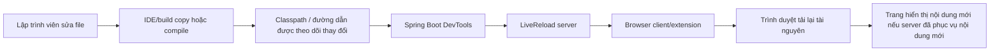
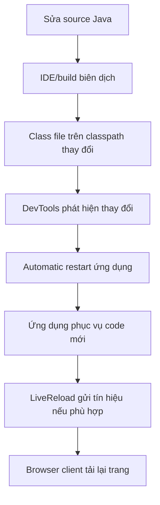
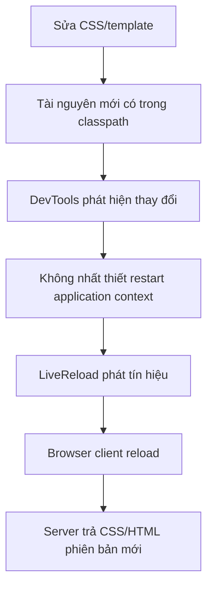

# LiveReload và điều kiện để trình duyệt cập nhật

Trong lúc phát triển một ứng dụng Spring Boot, lập trình viên thường sửa giao diện HTML, CSS, JavaScript hoặc một đoạn code Java, sau đó quay lại trình duyệt để xem kết quả. Nếu mỗi lần chỉnh sửa đều phải tắt ứng dụng, chạy lại JAR và tự tải lại trang, vòng lặp phát triển sẽ chậm. **Spring Boot DevTools** cung cấp các tiện ích để rút ngắn vòng lặp này, trong đó có **LiveReload**.

Tuy nhiên, “đã có DevTools” **không đồng nghĩa** “lưu bất kỳ file nào thì mọi tab trình duyệt lập tức cập nhật”. LiveReload là một cơ chế **thông báo cho client đang kết nối rằng tài nguyên ứng dụng đã thay đổi và nên tải lại**. Để thấy giao diện mới, cần có chuỗi điều kiện từ file nguồn đến ứng dụng đang chạy, LiveReload server, browser client và cuối cùng là nội dung HTTP được phục vụ.

Trong chương **Công cụ phát triển** của *Spring Boot Fundamentals*, bài học này làm rõ:

- LiveReload của Spring Boot DevTools là gì và khác automatic restart ra sao.
- Vì sao **lưu file**, **biên dịch/copy vào classpath**, **reload trang** và **code mới có hiệu lực** là các bước khác nhau.
- Điều kiện cần để trình duyệt tự cập nhật, kể cả vai trò của browser extension hoặc client tương thích.
- Cách làm việc với Java code, Thymeleaf, static HTML/CSS/JS, frontend build tools và môi trường container.
- Những cấu hình DevTools liên quan, các tình huống không cập nhật và cách điều tra có hệ thống.

> **Phạm vi:** Nội dung mô tả nguyên lý và các thuộc tính phổ biến của Spring Boot DevTools. Hành vi cụ thể có thể phụ thuộc phiên bản Spring Boot, IDE/build tool, web server, frontend tooling và browser client được dùng. Không nên xem tốc độ hay thời điểm reload trong ví dụ là cam kết cho mọi môi trường.

## 1. LiveReload là gì?

**LiveReload** là một giao thức và cơ chế hỗ trợ phát triển web: một tiến trình theo dõi sự thay đổi ở phía ứng dụng có thể gửi thông điệp tới client ở trình duyệt, yêu cầu client cập nhật trang hoặc tài nguyên liên quan.

Với Spring Boot DevTools, một LiveReload server có thể được khởi động cùng ứng dụng trong môi trường phát triển. Khi DevTools phát hiện thay đổi ở những tài nguyên được theo dõi, nó có thể phát tín hiệu reload tới các browser client đang kết nối.

Sơ đồ đơn giản:



Ở đây, **Spring Boot không trực tiếp thao tác giao diện của mọi trình duyệt**. Server gửi tín hiệu theo giao thức; một client hỗ trợ LiveReload phải nhận tín hiệu và kích hoạt hành vi cập nhật.

### 1.1. LiveReload không phải một trình duyệt

LiveReload server không phải tab web, browser automation hay một phần của HTML template. Nó là một dịch vụ kết nối dành cho các LiveReload clients. Browser extension tương thích thường là cách để một tab thông thường nhận thông điệp reload.

### 1.2. LiveReload không phải frontend Hot Module Replacement

Với các công cụ frontend như Vite hoặc Webpack, **Hot Module Replacement (HMR)** có thể cập nhật một module JavaScript hoặc CSS đang chạy mà không tải lại toàn bộ trang.

LiveReload của Spring Boot DevTools thường mang ý nghĩa khác: **thông báo trình duyệt reload để lấy lại nội dung từ server**. Nó không mặc định thay thế một module JavaScript trong bộ nhớ, bảo toàn state của SPA, cập nhật component React/Vue hoặc hot-swap mọi method Java.

### 1.3. LiveReload không phải Java HotSwap

Java HotSwap là khả năng của debugger/JVM thay đổi một số class đang chạy trong những giới hạn cụ thể. Spring Boot DevTools **automatic restart** lại là cơ chế theo dõi classpath và khởi động lại application context bằng hệ thống classloader phù hợp.

Ba kỹ thuật giải quyết các nhu cầu khác nhau:

| Kỹ thuật | Đối tượng chính | Hành vi |
| --- | --- | --- |
| DevTools LiveReload | Trình duyệt/client | Gửi tín hiệu để tải lại trang hoặc tài nguyên |
| DevTools automatic restart | Ứng dụng Java | Khởi động lại ứng dụng theo cơ chế DevTools khi classpath thay đổi phù hợp |
| IDE/JVM HotSwap | Class Java đang được debug | Thay code của một số class trong JVM theo khả năng của debugger |
| Frontend HMR | Module frontend trong trình duyệt | Thay module theo cơ chế bundler mà không nhất thiết reload toàn trang |

Một project có thể dùng nhiều cơ chế cùng lúc, nhưng chúng **không phải cùng một chức năng**.

## 2. Điều kiện cần để trình duyệt tự cập nhật

Đây là câu hỏi trung tâm của bài học. Một chuỗi tự động reload thông thường cần những điều kiện sau:

1. **DevTools đã được thêm đúng vào ứng dụng phát triển** và khả năng LiveReload không bị tắt.
2. **Ứng dụng đang chạy theo cách DevTools hoạt động**, thường từ IDE hoặc `bootRun`/`spring-boot:run` trong môi trường phát triển.
3. **LiveReload server khởi động thành công**, không bị xung đột cổng hay cấu hình vô hiệu hóa.
4. **Browser client/extension tương thích đã được cài đặt và kích hoạt**, đồng thời kết nối được tới LiveReload server.
5. **File thay đổi được đưa vào một vị trí mà DevTools theo dõi**, ví dụ output classpath hoặc đường dẫn bổ sung được cấu hình.
6. **Cơ chế phát hiện thay đổi thực sự nhận thấy phiên bản file mới**, có thể cần IDE biên dịch/copy resources hoặc build frontend.
7. **Server đang phục vụ nội dung đã cập nhật** khi browser yêu cầu lại tài nguyên.
8. **Browser không bị cache, service worker hoặc thành phần trung gian giữ phiên bản cũ** theo cách khiến reload không cho thấy thay đổi.

Nếu thiếu một mắt xích, có thể xảy ra các hiện tượng:

- Không có tín hiệu reload.
- Có tín hiệu nhưng tab không thực hiện reload.
- Tab thực hiện reload nhưng nội dung không thay đổi.
- Java backend đã restart nhưng giao diện vẫn dùng bundle JavaScript cũ.
- CSS/HTML thay đổi nhưng chưa được copy từ `src/main/resources` vào classpath chạy.

**Đừng chỉ hỏi “LiveReload có hoạt động không?”** Hãy xác định lỗi nằm ở bước phát hiện file, khởi chạy server, kết nối client hay phục vụ nội dung.

## 3. Thêm spring-boot-devtools vào project

Spring Boot DevTools là tập tiện ích phát triển. Khi sử dụng các starter phổ biến, **DevTools thường không được thêm tự động chỉ vì có `spring-boot-starter-web`**. Cần khai báo dependency phù hợp.

### 3.1. Maven

Ví dụ:

```xml
<dependency>
    <groupId>org.springframework.boot</groupId>
    <artifactId>spring-boot-devtools</artifactId>
    <scope>runtime</scope>
    <optional>true</optional>
</dependency>
```

Thuộc tính `optional=true` giúp hạn chế việc module khác vô tình nhận DevTools như một dependency transitive thông thường. Đây là dependency phục vụ phát triển, không phải thành phần nghiệp vụ bắt buộc của ứng dụng production.

Nếu ứng dụng sử dụng Spring Boot dependency management, thông thường không cần pin version DevTools riêng. Hãy để DevTools khớp với **dòng Spring Boot đang chạy**.

### 3.2. Gradle

Ví dụ:

```groovy
dependencies {
    developmentOnly 'org.springframework.boot:spring-boot-devtools'
}
```

Trong project dùng Spring Boot Gradle plugin, configuration `developmentOnly` phù hợp để tách dependency phát triển khỏi runtime đóng gói production. Tên configuration và cách tích hợp với task cần đối chiếu build setup và plugin version đang dùng.

Không nên khai báo DevTools cùng một phiên bản Spring Boot khác với phiên bản ứng dụng rồi mong mọi cơ chế restart/LiveReload vẫn tương thích.

### 3.3. Chỉ có dependency chưa đủ

Sau khi thêm dependency, cần chạy ứng dụng theo một chế độ mà Spring Boot DevTools được kích hoạt và có thể quan sát classpath. Một fully packaged application chạy bằng `java -jar` thường có DevTools tự bị vô hiệu hóa theo cơ chế production detection, ngay cả khi dependency vô tình hiện diện.

Để thử LiveReload, nên bắt đầu bằng cách chạy từ IDE, `mvn spring-boot:run` hoặc `gradle bootRun` với setup phát triển được hỗ trợ.

### 3.4. DevTools không phải tính năng cần phơi ra Internet

Các tính năng development-only nhằm phục vụ môi trường tin cậy của lập trình viên. Đừng bật chúng trong production chỉ để dễ reload trang. Một số chức năng DevTools có tác động tới security posture hoặc hiệu năng, và LiveReload port cũng không nên được mở công khai.

## 4. LiveReload server và browser client là hai thành phần riêng

Spring Boot DevTools có thể khởi chạy một **embedded LiveReload server**, sử dụng cổng mặc định thông dụng **35729** cho giao thức LiveReload.

Kết nối minh họa:

```text
Spring Boot HTTP server      http://localhost:8080
Spring Boot LiveReload       localhost:35729
Browser tab                  http://localhost:8080
Browser LiveReload client    kết nối tới server LiveReload
```

Cổng HTTP 8080 ở đây là ví dụ; ứng dụng có thể dùng cổng khác. Cổng LiveReload là một endpoint riêng, không phải `/livereload` ở cùng cổng HTTP của ứng dụng theo mặc định.

### 4.1. Tại sao cần browser extension hoặc LiveReload client?

Một trình duyệt mở `http://localhost:8080` không tự biết có file Java/CSS vừa thay đổi trong IDE. Web page thông thường cũng không tự kết nối tới DevTools LiveReload server.

Do đó, cần một browser extension hoặc client hỗ trợ LiveReload protocol, được **bật và kết nối** với server đang chạy. Việc “đã cài extension” và việc “extension đang hoạt động ở tab này” có thể khác nhau tùy browser/extension.

Khi nhận tín hiệu, client yêu cầu browser reload hoặc cập nhật tài nguyên theo khả năng của implementation. Nếu client không hoạt động, backend vẫn có thể restart nhưng browser không tự refresh.

### 4.2. Browser nào được hỗ trợ?

Khả năng hỗ trợ phụ thuộc extension và phiên bản trình duyệt tại thời điểm sử dụng. Không nên coi danh sách extension hoặc đường dẫn cửa hàng cũ là vĩnh viễn chính xác. Hãy kiểm tra client hiện còn tương thích với browser, giao thức và chính sách cài extension của tổ chức.

Một số trình duyệt/IDE hoặc hệ thống frontend có cơ chế auto-refresh riêng, không nhất thiết dùng LiveReload server của Spring Boot. Khi đang sử dụng cơ chế khác, cần phân biệt nguồn nào phát tín hiệu reload.

### 4.3. Cổng 35729 có thể bị chiếm

Nếu đã có một ứng dụng khác hoặc tool khác dùng cùng cổng LiveReload, DevTools có thể không mở được LiveReload server như mong muốn.

Điều này đặc biệt hay gặp khi lập trình viên chạy **hai ứng dụng Spring Boot cùng bật LiveReload trên một máy**. HTTP ports có thể khác nhau, nhưng cả hai LiveReload server mặc định cùng muốn dùng cổng 35729.

Một cách xử lý đơn giản là tắt LiveReload của ứng dụng không cần gửi tín hiệu:

```properties
spring.devtools.livereload.enabled=false
```

Hoặc cấu hình cổng LiveReload riêng khi bản DevTools đang dùng hỗ trợ:

```properties
spring.devtools.livereload.port=35730
```

Khi đổi cổng, browser client cũng cần có cách kết nối đến đúng địa chỉ/cổng. Không nên đổi ngẫu nhiên nếu extension chỉ tìm cổng mặc định hoặc không cho cấu hình lại.

## 5. Bật và tắt LiveReload

Thuộc tính tiêu biểu:

```properties
spring.devtools.livereload.enabled=true
```

Để vô hiệu hóa:

```properties
spring.devtools.livereload.enabled=false
```

Ví dụ trong YAML dành cho phát triển:

```yaml
spring:
  devtools:
    livereload:
      enabled: true
```

Khi LiveReload đã được bật và server có thể hoạt động, DevTools mới có khả năng phát tín hiệu. **Bật property không tự cài extension cho browser**, không biên dịch file Java và cũng không tạo nội dung frontend mới.

### 5.1. Cấu hình trong application-dev.yml

Một project có thể đặt:

```yaml
# src/main/resources/application-dev.yml
spring:
  devtools:
    livereload:
      enabled: true
```

Nhưng **DevTools không được kích hoạt đơn giản chỉ vì profile mang tên `dev`**. Profile quyết định những cấu hình nào được tải; dependency và chế độ chạy quyết định DevTools có hoạt động hay không.

Một ứng dụng đang chạy với `spring.profiles.active=dev` nhưng không có DevTools trên runtime classpath sẽ không tự có LiveReload server.

### 5.2. Khi nào nên tắt?

- Đang chạy nhiều ứng dụng và chỉ một ứng dụng cần LiveReload.
- Có frontend dev server/HMR riêng xử lý phần giao diện.
- Browser client không sử dụng LiveReload và cổng không cần mở.
- Môi trường integration test hoặc demo không mong muốn chạy server phát tín hiệu.
- Muốn tách việc test automatic restart và LiveReload.

Không nên bật LiveReload trong production hoặc môi trường không tin cậy.

## 6. Lưu file không đồng nghĩa classpath đã thay đổi

Đây là nguyên nhân lớn nhất khiến người học nghĩ “DevTools bị lỗi”.

Project Spring Boot thường có hai khu vực:

```text
src/
  main/
    java/                 <- Java source
    resources/
      templates/          <- Thymeleaf / Freemarker / ...
      static/             <- HTML, CSS, JavaScript

target/classes/           <- output classpath của Maven
hoặc
build/classes/...         <- compiled classes của Gradle
build/resources/main/     <- copied resources của Gradle
```

DevTools theo dõi **classpath và các location được cấu hình**, không nhất thiết theo dõi trực tiếp mọi file source trong repository.

### 6.1. Sửa Java

Ví dụ thay:

```java
@GetMapping("/greeting")
public String greeting() {
    return "Hello";
}
```

thành:

```java
@GetMapping("/greeting")
public String greeting() {
    return "Hello from DevTools";
}
```

Lưu `GreetingController.java` mới chỉ thay đổi source file. Để DevTools phát hiện code mới theo cơ chế classpath, IDE hoặc build tool phải tạo `GreetingController.class` đã được biên dịch trong output đang dùng.

Nếu IDE không tự build khi lưu, có thể cần thao tác Build Project/Compile hoặc bật cơ chế build tự động phù hợp. Sau khi output class thay đổi, DevTools có thể automatic restart.

### 6.2. Sửa resource

Với `src/main/resources/static/site.css`, IDE/build tool có thể cần copy file vào output resources được ứng dụng đang chạy sử dụng.

Một số IDE/dev setup có thể cấu hình đọc tài nguyên trực tiếp từ source directories, còn setup khác yêu cầu resource-copy. Vì vậy không thể dùng một quy tắc “cứ Ctrl+S là LiveReload” cho mọi project.

### 6.3. Cách nhận biết file output đã đổi

Hãy tự hỏi:

- Ứng dụng đang chạy bằng classpath nào?
- File đã lưu có được compile/copy sang output đó không?
- Output timestamp hoặc nội dung có thực sự thay đổi không?
- Có compiler error làm build bị hủy không?
- IDE có đang bật automatic build phù hợp không?

Nếu output classpath không đổi, DevTools có thể không có sự kiện nào để xử lý.

## 7. Automatic restart và LiveReload phối hợp thế nào?

Spring Boot DevTools có cơ chế **automatic restart** khi classpath thay đổi. Đối với thay đổi code Java, thường cần restart ứng dụng để class mới có hiệu lực. Đối với tài nguyên tĩnh hoặc template, nhiều thay đổi có thể được phản ánh mà không cần restart cả application context.

### 7.1. Trường hợp Java class thay đổi



**Hai điều kiện riêng:** Java code mới cần được đưa vào ứng dụng đang chạy, và browser phải tải lại nội dung để thấy kết quả nếu đang hiển thị trang cũ.

Một REST API không có tab browser nào kết nối LiveReload vẫn có thể hoạt động bằng code mới sau restart. Ngược lại, browser reload trước khi code mới sẵn sàng có thể tạm thời nhận lỗi hoặc nội dung cũ.

### 7.2. Trường hợp CSS hoặc template thay đổi



Mục tiêu là rút ngắn thời gian xem giao diện. Tuy nhiên, “không restart” chỉ có ích khi server/template engine thực sự phục vụ resource mới; nếu cache vẫn giữ nội dung cũ, reload tab có thể không thay đổi gì.

### 7.3. Restart không đồng nghĩa browser reload

Có thể xảy ra:

```text
DevTools restart thành công
        |
        +--> curl /greeting thấy kết quả mới
        |
        +--> tab trình duyệt vẫn hiển thị HTML cũ
             vì không có LiveReload client/extension
```

Thử nhấn reload thủ công. Nếu trang lúc đó hiển thị nội dung mới, vấn đề nằm ở tầng browser auto-refresh hoặc LiveReload connection, không phải việc Java code chưa cập nhật.

### 7.4. Browser reload không đồng nghĩa backend restart

Nếu chỉ thay CSS, DevTools có thể phát tín hiệu reload mà không restart application context. Đó là hành vi mong muốn, không phải bằng chứng rằng DevTools “không chạy”.

## 8. Những tài nguyên thường không kích hoạt restart toàn ứng dụng

Spring Boot DevTools có các quy tắc exclude mặc định cho một số đường dẫn tài nguyên, đặc biệt các thư mục dùng phục vụ template/static resources, chẳng hạn:

```text
META-INF/resources/
resources/
static/
public/
templates/
```

Những đường dẫn này, trong cách xử lý thông thường của DevTools, có thể được bỏ qua đối với **automatic restart** để tránh restart toàn bộ application context chỉ vì một file giao diện. Tuy nhiên, thay đổi của chúng vẫn có thể dẫn tới **LiveReload**.

### 8.1. Exclude khỏi restart không phải bỏ qua mọi thay đổi

Phân biệt:

- **Restart exclude:** thay đổi được phát hiện nhưng không yêu cầu Java application restart.
- **LiveReload:** thay đổi ở static/template resource có thể vẫn kích hoạt tín hiệu reload.
- **Không được theo dõi:** DevTools không nhận ra file thay đổi vì không nằm trong classpath/location quan sát.

Không nên kết luận rằng file `static/site.css` “bị DevTools bỏ qua hoàn toàn” chỉ vì context không restart.

### 8.2. Điều chỉnh restart excludes

Có thể bổ sung các pattern không nên gây restart:

```properties
spring.devtools.restart.additional-exclude=docs/**,generated-preview/**
```

Nếu muốn thay thế các exclude mặc định bằng danh sách tùy chỉnh:

```properties
spring.devtools.restart.exclude=static/**,templates/**,public/**
```

**Cảnh báo:** `restart.exclude` thay thế default exclusions theo cấu hình của DevTools; `restart.additional-exclude` bổ sung mà không thay thế toàn bộ danh sách. Khi tự thay thế, có thể vô tình làm một số tài nguyên vốn không restart nay lại restart app.

Giá trị pattern áp dụng tương đối theo cách DevTools tổ chức classpath resources. Cần xác nhận các pattern của dự án đang khớp đúng đường dẫn.

## 9. Template engine: tải lại trang nhưng vẫn thấy HTML cũ

Đối với Spring MVC với Thymeleaf, server render HTML ở mỗi lần request hoặc dùng cơ chế cache theo cấu hình. Nếu template bị cache, browser reload không tự bảo đảm template mới được đọc.

Ví dụ:

```text
src/main/resources/templates/home.html
```

Controller:

```java
package com.example.demo.web;

import org.springframework.stereotype.Controller;
import org.springframework.ui.Model;
import org.springframework.web.bind.annotation.GetMapping;

@Controller
public class HomeController {

    @GetMapping("/")
    public String home(Model model) {
        model.addAttribute("message", "Hello Spring Boot");
        return "home";
    }
}
```

Template:

```html
<!doctype html>
<html xmlns:th="http://www.thymeleaf.org">
<head>
    <meta charset="UTF-8">
    <title>DevTools demo</title>
</head>
<body>
    <h1 th:text="${message}">Fallback message</h1>
</body>
</html>
```

Ở đây cú pháp `th:text` nhận giá trị model qua biểu thức Thymeleaf `${message}`; đó là biểu thức template, không phải Spring property placeholder.

### 9.1. DevTools thường điều chỉnh cache cho môi trường phát triển

Khi DevTools được kích hoạt, nó có thể cung cấp các **development-time property defaults** để tắt cache của một số template engines và static resources được hỗ trợ. Mục tiêu là giúp nội dung thay đổi có thể được phục vụ mà không cần restart.

Tuy nhiên, nếu project đặt property override riêng hoặc template engine được cấu hình đặc biệt, cache vẫn có thể còn hiệu lực. Một property phổ biến cần hiểu:

```properties
spring.thymeleaf.cache=false
```

Nó liên quan tới việc Thymeleaf cache templates, **không trực tiếp bật LiveReload server**.

### 9.2. Những bước cần kiểm tra khi sửa home.html

1. File `home.html` trong source đã được lưu chưa?
2. File mới đã được copy vào output resources hoặc được server đọc trực tiếp chưa?
3. Thymeleaf có đang cache phiên bản cũ không?
4. Mở trang và nhấn F5 thủ công thì thấy bản mới chưa?
5. Nếu F5 thấy mới nhưng không tự reload, kiểm tra LiveReload client/connection.

Phân chia như vậy giúp tránh việc đổi hàng loạt thuộc tính DevTools khi lỗi thực tế chỉ là template caching.

## 10. Static CSS/JavaScript và browser cache

Giả sử project có:

```text
src/main/resources/static/
├── index.html
├── css/site.css
└── js/site.js
```

Trong `index.html`:

```html
<!doctype html>
<html lang="vi">
<head>
    <meta charset="UTF-8">
    <title>LiveReload demo</title>
    <link rel="stylesheet" href="/css/site.css">
</head>
<body>
    <h1 id="title">Trang thử nghiệm</h1>
    <script src="/js/site.js"></script>
</body>
</html>
```

CSS:

```css
h1 {
    font-size: 32px;
}
```

JavaScript:

```javascript
document.getElementById("title").dataset.initialized = "true";
```

Khi sửa CSS và file mới được phục vụ từ classpath, browser có thể thấy thay đổi sau reload.

### 10.1. Browser cache có thể giữ nội dung cũ

Kể cả khi tab reload, browser còn chịu ảnh hưởng của:

- Cache-Control và ETag/Last-Modified headers.
- Caching policy của reverse proxy/CDN.
- Service worker.
- Asset fingerprinting và các URL versioned.
- Frontend dev server hoặc bundler phục vụ file riêng.

Nếu thấy giao diện cũ, hãy kiểm tra DevTools Network trong browser: request mới có đi tới server không, response có status `200` hay `304`, nội dung CSS/JS response có đúng phiên bản mới không?

`304 Not Modified` không tự động là lỗi: nó có thể hợp lệ khi cached resource vẫn đúng. Nhưng nếu nội dung thật đã thay đổi mà hệ thống vẫn trả caching response khiến browser dùng file cũ, cần kiểm tra metadata caching hoặc nơi đang phục vụ tài nguyên.

### 10.2. Hard reload chỉ phục vụ chẩn đoán

Hard reload hoặc tạm tắt cache trong browser DevTools có thể giúp xác định vấn đề caching. Nó không phải giải pháp lâu dài cho cơ chế phát hành asset production.

Nếu ứng dụng dùng service worker, có thể cần kiểm tra lifecycle và caching strategy của service worker. Đừng xóa dữ liệu trình duyệt của người dùng thật chỉ để điều tra một project demo.

### 10.3. Frontend asset versioning

Trong production, assets có fingerprint `app.83e4a1.js` sẽ hữu ích cho cache busting. Nhưng trong development, nếu HTML vẫn tham chiếu bundle cũ hoặc quá trình frontend build chưa tạo bundle mới, LiveReload chỉ tải lại nội dung cũ.

**Reload là hành động lấy lại tài nguyên, không phải quá trình biên dịch frontend.**

## 11. Ví dụ demo hoàn chỉnh: Thymeleaf + DevTools + LiveReload

Một project minh họa sử dụng Spring MVC và Thymeleaf để phân biệt bước compile/copy với refresh browser.

### 11.1. Dependencies

Maven:

```xml
<dependencies>
    <dependency>
        <groupId>org.springframework.boot</groupId>
        <artifactId>spring-boot-starter-web</artifactId>
    </dependency>
    <dependency>
        <groupId>org.springframework.boot</groupId>
        <artifactId>spring-boot-starter-thymeleaf</artifactId>
    </dependency>
    <dependency>
        <groupId>org.springframework.boot</groupId>
        <artifactId>spring-boot-devtools</artifactId>
        <scope>runtime</scope>
        <optional>true</optional>
    </dependency>
</dependencies>
```

Trong Spring Boot 4.x hoặc các dòng starter được tái cấu trúc, hãy đối chiếu artifact starter web/MVC tương ứng với dòng Boot đang dùng; ý tưởng cấu trúc demo không thay đổi. Không cần thêm version từng starter nếu BOM đã quản lý.

### 11.2. Main class

```java
package com.example.livereload;

import org.springframework.boot.SpringApplication;
import org.springframework.boot.autoconfigure.SpringBootApplication;

@SpringBootApplication
public class LiveReloadDemoApplication {

    public static void main(String[] args) {
        SpringApplication.run(LiveReloadDemoApplication.class, args);
    }
}
```

### 11.3. Controller

```java
package com.example.livereload;

import org.springframework.stereotype.Controller;
import org.springframework.ui.Model;
import org.springframework.web.bind.annotation.GetMapping;

@Controller
class PreviewController {

    @GetMapping("/")
    String index(Model model) {
        model.addAttribute("message", "Xin chào từ Spring Boot");
        return "index";
    }
}
```

### 11.4. Template

File `src/main/resources/templates/index.html`:

```html
<!doctype html>
<html lang="vi" xmlns:th="http://www.thymeleaf.org">
<head>
    <meta charset="UTF-8">
    <title>LiveReload Demo</title>
    <link rel="stylesheet" href="/css/site.css">
</head>
<body>
    <main>
        <h1 th:text="${message}">Tiêu đề mặc định</h1>
        <p>Sửa nội dung HTML hoặc CSS để quan sát cập nhật.</p>
    </main>
</body>
</html>
```

### 11.5. CSS

File `src/main/resources/static/css/site.css`:

```css
body {
    font-family: sans-serif;
    margin: 3rem auto;
    max-width: 50rem;
}

main {
    padding: 1rem;
    border: 1px solid #ddd;
}
```

### 11.6. Cấu hình phát triển

File `src/main/resources/application-dev.yml`:

```yaml
spring:
  devtools:
    livereload:
      enabled: true
  thymeleaf:
    cache: false
```

Lưu ý: file theo profile chỉ có hiệu lực khi `dev` active. Một cấu hình theo profile không tự biến một packaged production JAR thành môi trường DevTools.

### 11.7. Cách thử

1. Khởi động từ IDE hoặc lệnh development run của build tool.
2. Kích hoạt profile `dev` nếu muốn áp dụng file YAML trên.
3. Xác nhận LiveReload server khởi động và cổng không xung đột.
4. Cài và bật browser LiveReload client/extension tương thích.
5. Mở `http://localhost:8080/`.
6. Sửa một câu trong `templates/index.html`.
7. Đảm bảo IDE đã copy resource mới vào classpath đang chạy.
8. Quan sát browser tự reload khi client nhận tín hiệu.
9. Sửa `static/css/site.css` và lặp lại.
10. Thử tắt extension: file vẫn có thể thay đổi ở server, nhưng tab không còn tự refresh qua LiveReload.

Nếu chỉ một bước không thành công, dùng quy trình chẩn đoán ở các phần sau thay vì thay toàn bộ cấu hình.

## 12. Sửa Java controller: khi nào cần restart?

Trong demo, thay method:

```java
@GetMapping("/")
String index(Model model) {
    model.addAttribute("message", "Nội dung A");
    return "index";
}
```

thành:

```java
@GetMapping("/")
String index(Model model) {
    model.addAttribute("message", "Nội dung B");
    return "index";
}
```

Đây là thay đổi code Java. DevTools có thể restart ứng dụng sau khi class file được compile lại. Browser LiveReload có thể giúp cập nhật trang sau đó, nhưng **không compile source thay bạn**.

### 12.1. Trường hợp IDE không build tự động

Sửa source rồi nhấn Save, nhưng output class không đổi:

```text
GreetingController.java mới   ✓
GreetingController.class mới  ✗
Application restart          ✗
Browser reload signal        chưa chắc có
```

Hãy tìm chức năng compile/build phù hợp trong IDE hoặc cấu hình auto-build. Nếu sau khi compile thủ công DevTools restart, nguyên nhân chính là chuỗi build chứ không phải browser extension.

### 12.2. Classloader restart khác restart JVM từ đầu

DevTools automatic restart thường sử dụng kiến trúc classloader để nạp lại code ứng dụng nhanh hơn. Nó không nhất thiết kill và khởi chạy một JVM mới theo đúng nghĩa OS.

Một số trạng thái do static fields, thư viện hoặc thread không được quản lý đúng có thể tạo hành vi khác so với restart sạch. Không nên xem DevTools restart là phép thử đầy đủ cho một lần triển khai production.

### 12.3. Không dùng LiveReload để kiểm chứng migration hoặc startup behavior

Nếu thay cấu hình transaction, connection pool, bean lifecycle hoặc database migration, cần kiểm thử khởi động lại thực tế trong môi trường gần deployment. DevTools tối ưu vòng lặp coding, không bảo đảm mọi hiệu ứng classloader giống packaged application.

## 13. Frontend bundler và LiveReload của Spring Boot

Nhiều ứng dụng Spring Boot có phần giao diện xây bằng React, Vue, Angular hoặc công cụ khác. Thường tồn tại hai server:

```text
Spring Boot backend     localhost:8080
Frontend dev server     localhost:5173   (ví dụ)
LiveReload server       localhost:35729  (nếu DevTools bật)
```

Nếu đang truy cập giao diện qua frontend dev server, công cụ frontend thường có HMR/reload riêng. LiveReload của Spring Boot **không điều khiển mọi nguồn asset của frontend dev server**.

### 13.1. HMR thường xử lý thay đổi frontend

Với Vite/React/Vue, thay `src/App.jsx` có thể khiến Vite cập nhật module trong browser. DevTools của backend không nhất thiết nhận ra file đó vì nó nằm ngoài Spring Boot classpath.

Nếu chỉnh Java controller hoặc API của Spring Boot, backend DevTools có thể restart. Nhưng frontend đang mở qua Vite có thể không reload trang chỉ vì backend restart; behavior còn phụ thuộc proxy, HMR client và application code.

### 13.2. Build frontend thành static assets

Trong mô hình khác, frontend được build thành file tĩnh do Spring Boot phục vụ:

```text
frontend/src/...
       |
       v  npm run build
frontend/dist/...
       |
       v  copy
src/main/resources/static/...
       |
       v  copy/build resource
runtime classpath
```

Nếu chỉ sửa `frontend/src/App.jsx` nhưng không chạy bundler và không copy output mới vào classpath, Spring Boot có thể tiếp tục phục vụ bundle cũ. LiveReload không tạo lại bundle JavaScript.

### 13.3. Chọn một cơ chế làm nguồn sự thật

Trong development có thể chọn:

- Giao diện do Spring Boot trực tiếp render: DevTools LiveReload thường hữu ích.
- Frontend SPA có dev server/HMR: để frontend tooling quản lý reload, backend DevTools quản lý Java restart.
- Frontend build ra `static` cho backend: cần quy trình build/copy rõ trước khi mong LiveReload cập nhật.

Tránh chạy nhiều reload clients cạnh tranh mà không biết thành phần nào đang gửi tín hiệu.

## 14. Additional paths: theo dõi tài nguyên ngoài classpath

Một số project cần theo dõi thư mục ngoài runtime classpath, ví dụ source assets hoặc output do tool khác tạo.

Spring Boot DevTools cung cấp khả năng bổ sung đường dẫn được theo dõi thông qua thuộc tính như:

```properties
spring.devtools.restart.additional-paths=../shared-ui/generated
```

Đây là một ví dụ đường dẫn tương đối. Ý nghĩa và việc resolve đường dẫn phụ thuộc working directory/dev setup; cần dùng đường dẫn tồn tại và quyền đọc phù hợp.

### 14.1. Additional-paths không tự chuyển đổi file

Nếu theo dõi `frontend/src`, DevTools có thể biết file nguồn thay đổi nhưng không có nghĩa backend tự biên dịch TypeScript, Sass hoặc JSX. Để browser nhận tài nguyên mới, vẫn cần frontend build tool hoặc development server phù hợp.

### 14.2. Additional-paths có thể gây restart ngoài ý muốn

Nếu đưa một thư mục chứa hàng nghìn file thay đổi liên tục vào watcher, DevTools có thể phát hiện nhiều thay đổi và restart/reload quá thường xuyên. Hãy giới hạn phạm vi theo dõi.

Khi muốn path bổ sung chỉ dẫn đến reload thay vì restart, cần xem cách `spring.devtools.restart.additional-exclude` và các pattern liên quan áp dụng trong version đang dùng.

### 14.3. Theo dõi trực tiếp nguồn không giống phục vụ trực tiếp nguồn

Một file có thể thuộc watched path nhưng không được web server dùng để trả HTTP response. LiveReload phát tín hiệu chỉ báo “có thay đổi”; browser tải lại URL cũ nhưng server vẫn trả asset cũ nếu chưa có bước copy/build.

**Watched path và served path phải được nối bằng một quy trình cập nhật thực tế.**

## 15. Restart trigger file và ảnh hưởng tới tốc độ làm việc

Với project lớn, thay đổi classpath có thể diễn ra liên tục vì IDE compile nhiều class liên tiếp. DevTools có thể restart quá thường xuyên. Một tùy chọn dành cho tình huống này là **trigger file**.

Ví dụ:

```properties
spring.devtools.restart.trigger-file=.reloadtrigger
```

Ý tưởng: DevTools có thể đợi một file kích hoạt đặc biệt được cập nhật thay vì restart sau mỗi lần output classpath thay đổi. Tên và vị trí của trigger file cần được thiết lập đúng theo cách DevTools tìm trên classpath.

### 15.1. Cách dùng trigger file

Quy trình minh họa:

1. Tạo file trigger ở một vị trí thuộc classpath được DevTools theo dõi.
2. Sửa nhiều Java source files.
3. Biên dịch/copy các file đã thay đổi vào output.
4. Khi sẵn sàng cập nhật ứng dụng, chỉnh/touch trigger file.
5. DevTools xem xét các thay đổi tích lũy và thực hiện restart/reload theo cơ chế hỗ trợ.

### 15.2. Vì sao bật trigger file có thể khiến người học ngỡ LiveReload hỏng?

Nếu đã đặt `trigger-file` mà chưa cập nhật file kích hoạt, DevTools có thể **chưa tiến hành chu kỳ xử lý thay đổi như kỳ vọng**. Người học chỉ sửa CSS, thấy trình duyệt không reload rồi kết luận extension lỗi.

Hãy kiểm tra cấu hình trigger file trước. Đừng bật tính năng này cho project nhỏ nếu chưa có nhu cầu điều khiển các lần restart thủ công.

## 16. Cấu hình restart liên quan tới LiveReload

Các thuộc tính thường được gặp trong DevTools:

```properties
# Bật/tắt LiveReload server:
spring.devtools.livereload.enabled=true

# Tùy chỉnh cổng LiveReload nếu hỗ trợ và client phù hợp:
spring.devtools.livereload.port=35729

# Điều khiển automatic restart:
spring.devtools.restart.enabled=true

# Bổ sung đường dẫn quan sát:
spring.devtools.restart.additional-paths=../shared-resources

# Bổ sung đường dẫn không cần restart toàn bộ:
spring.devtools.restart.additional-exclude=docs/**

# Điều khiển trigger file nếu cần:
spring.devtools.restart.trigger-file=.reloadtrigger
```

Các thuộc tính không phải lời đảm bảo rằng tất cả kết hợp đều có cùng behavior trên mọi phiên bản. Đặc biệt, `spring.devtools.restart.enabled` điều khiển automatic restart, **không phải chính thuộc tính kích hoạt browser client**.

### 16.1. Tắt automatic restart

```properties
spring.devtools.restart.enabled=false
```

Cấu hình này có thể được dùng khi không muốn DevTools restart application context sau classpath changes. Tuy nhiên, việc LiveReload còn phát tín hiệu trong một số loại thay đổi hay không phụ thuộc cơ chế theo dõi đang được kích hoạt và dòng phiên bản. Nếu cần nhận thay đổi resource mà không restart Java, hãy xác định behavior trong setup thực tế, thay vì suy luận “restart false thì LiveReload chắc chắn vẫn chạy đầy đủ” hoặc “restart false thì LiveReload chắc chắn chết hoàn toàn”.

### 16.2. Tắt hoàn toàn cơ chế restart từ rất sớm

Một số hướng dẫn DevTools phân biệt đặt `spring.devtools.restart.enabled=false` trong `application.properties` với đặt **system property trước khi gọi `SpringApplication.run(...)`**, vì cách thứ hai có thể tắt việc khởi tạo hạ tầng restart sớm hơn.

Ví dụ:

```java
public static void main(String[] args) {
    System.setProperty("spring.devtools.restart.enabled", "false");
    SpringApplication.run(DemoApplication.class, args);
}
```

Đoạn này chỉ minh họa cách cấu hình sớm cho một ứng dụng thử nghiệm, không phải khuyến nghị thêm vào mọi main class. Khi muốn vô hiệu hóa DevTools trong production, cách tốt nhất vẫn là **không đưa các development-only features vào runtime production**.

### 16.3. Đừng nhầm restart properties với browser settings

Việc chỉnh `spring.devtools.restart.*` có thể ảnh hưởng khi nào DevTools quan sát và xử lý changes. Nhưng để browser tự cập nhật, vẫn phải có LiveReload server và client kết nối. Không có property restart nào thay thế việc kích hoạt extension trong tab.

## 17. Làm sao biết LiveReload server đã khởi động?

Khi chạy Spring Boot từ môi trường phát triển, DevTools có thể ghi các dòng startup liên quan tới LiveReload. Nội dung/level của log tùy phiên bản, nên không cần so sánh từng ký tự với một ví dụ cố định.

Những việc nên xác minh:

- Dependency `spring-boot-devtools` có trên runtime classpath của development run không?
- Có thông báo DevTools được kích hoạt không?
- `spring.devtools.livereload.enabled` có bị đặt `false` ở nguồn cấu hình ưu tiên cao hơn không?
- Có thông báo cổng LiveReload bị chiếm không?
- Port 35729 hoặc port tùy chỉnh có listener đang mở không?
- Browser extension/client có báo trạng thái connected không?

### 17.1. Kiểm tra cổng trên môi trường phát triển

Trên Linux/macOS, có thể dùng các công cụ quan sát socket như:

```bash
ss -ltn
```

Trên Windows PowerShell:

```powershell
Get-NetTCPConnection -State Listen |
    Where-Object LocalPort -eq 35729
```

Những lệnh này chỉ cho biết **có process lắng nghe cổng**, không tự chứng minh process đó là LiveReload server của đúng ứng dụng hoặc browser client đã kết nối.

### 17.2. Kiểm tra WebSocket trong browser developer tools

LiveReload clients thường dùng kết nối theo giao thức dựa trên WebSocket. Trong browser Network panel, một client đang hoạt động có thể hiển thị WebSocket connection liên quan đến LiveReload server.

Nếu không thấy connection:

1. Kiểm tra extension có bật tại tab này không.
2. Kiểm tra địa chỉ và cổng mà client cố kết nối.
3. Kiểm tra browser permissions hoặc chính sách của tổ chức.
4. Kiểm tra firewall, proxy hoặc Docker port forwarding khi app chạy ngoài máy.

Nếu có connection nhưng không nhận thông điệp khi sửa file, chuyển sang điều tra classpath watcher.

## 18. LiveReload khi ứng dụng chạy trong Docker

Trong một container, `localhost` có nghĩa khác nhau tùy bên:

```text
Container:
  localhost:35729 = bên trong network namespace container

Browser trên host:
  localhost:35729 = máy host
```

Nếu Spring Boot LiveReload server chạy trong container, browser trên host chưa chắc truy cập được cổng đó trừ khi có network routing và port publishing phù hợp.

### 18.1. Ví dụ compose cho môi trường development

```yaml
services:
  catalog:
    build: .
    ports:
      - "8080:8080"
      - "127.0.0.1:35729:35729"
```

Đây chỉ là cấu hình **port publishing** minh họa. Nó không tự bật DevTools trong packaged JAR, không mount source code và không bật compiler/watch process.

Đặc biệt:

- Nếu container chạy `java -jar` từ executable JAR đóng gói production, DevTools có thể bị vô hiệu hóa.
- Nếu source không được mount và classpath không thay đổi, watcher sẽ không phát hiện gì.
- Nếu LiveReload server chỉ bind tới địa chỉ mà Docker không forward được, browser vẫn không kết nối.
- Nếu chạy nhiều container trên host, cổng 35729 trên host có thể xung đột.

### 18.2. Không mở LiveReload port công khai

Ví dụ trên publish cổng qua `127.0.0.1` trên host, chỉ mang tính gợi ý phát triển local. Không nên công bố LiveReload server trên địa chỉ Internet hoặc môi trường chung. DevTools là tiện ích phát triển, không phải dịch vụ cần khách hàng truy cập.

### 18.3. Dev container và remote workspace

Khi ứng dụng chạy trong VM, SSH session hoặc cloud development workspace, browser local phải kết nối được tới đúng LiveReload endpoint. Có thể cần port forwarding được môi trường đó hỗ trợ.

Nhưng port forwarding chỉ giải quyết **kết nối client-server**, không giải quyết việc classpath file không được compile/copy hoặc backend không phục vụ bản mới.

## 19. LiveReload trên nhiều ứng dụng cùng máy

Giả sử có:

```text
catalog-service  http://localhost:8080
order-service    http://localhost:8081

Cả hai đều có spring-boot-devtools.
```

LiveReload default port là một điểm có thể tranh chấp. Nếu cả hai cố mở cùng cổng trên cùng host, một server có thể không khởi động được LiveReload.

### 19.1. Những lựa chọn

- Chỉ bật LiveReload cho ứng dụng đang phát triển giao diện.
- Tắt LiveReload của service backend không trực tiếp phục vụ HTML:

```yaml
spring:
  devtools:
    livereload:
      enabled: false
```

- Dùng cổng khác nếu server và client hỗ trợ cấu hình tương ứng.
- Dùng frontend dev server/HMR làm nguồn cập nhật giao diện nếu phù hợp.

### 19.2. LiveReload không tự phân biệt mọi ứng dụng cùng kết nối

Browser client thường kết nối tới một LiveReload server/port. Nếu đang chạy nhiều ứng dụng, cần biết client thật sự kết nối tới instance nào và URL tài nguyên nào đang mở trong tab.

Không nên coi việc thấy một LiveReload server đang listen là chứng minh mọi ứng dụng trên máy đều có auto-refresh.

## 20. Đừng nhầm trang đã reload với trạng thái ứng dụng đã sẵn sàng

Khi code Java thay đổi, DevTools có thể automatic restart application context. Trong thời gian restart, server có thể tạm thời ngừng phục vụ request hoặc dependency chưa sẵn sàng.

Nếu browser nhận yêu cầu reload trong khoảng đó, người dùng phát triển có thể thấy:

- Connection refused.
- HTTP 503/500 tạm thời.
- Trang lỗi.
- Một request AJAX thất bại.

Đây có thể chỉ là trạng thái ngắn trong quá trình restart, không nhất thiết là bug kinh doanh. Tuy nhiên, nếu lỗi kéo dài, cần kiểm tra startup logs.

### 20.1. LiveReload không thay thế readiness

Readiness là một khái niệm vận hành: ứng dụng hiện có đủ điều kiện để nhận traffic hay chưa. LiveReload chỉ là cơ chế cho browser cập nhật giao diện trong development.

Một trang đã refresh không chứng minh:

- Database kết nối thành công.
- Background job đã hoàn thành.
- Tất cả dependency sẵn sàng.
- Lần restart mới nhất không có lỗi.

Hãy đọc startup logs, health endpoint hoặc kết quả request thực tế khi cần xác nhận ứng dụng chạy đúng.

## 21. Trình duyệt tải lại nhưng nội dung vẫn cũ: phân tích theo lớp

Giả sử bạn sửa `site.css`, thấy tab có hiệu ứng reload nhưng màu nền không đổi. Điều đó chứng tỏ gì?

**Chỉ chứng tỏ client đã có hành vi reload**; chưa chứng minh tài nguyên mới đã đến browser.

Có thể kiểm tra từng tầng:

| Tầng | Câu hỏi | Dấu hiệu |
| --- | --- | --- |
| Source | File thực sự được lưu? | Nội dung trên disk đổi |
| Output | File đã có trong runtime classpath? | Build output/resource mới |
| Server | URL CSS đang trả phiên bản nào? | Response body/headers |
| Browser | Request mới có được gửi? | Network panel |
| Cache | Có dùng bản cache cũ? | 200/304, service worker |
| HTML | Trang đang tham chiếu file nào? | `href`/`src` thực tế |
| Frontend build | Bundle đã được tạo lại? | Hash/content mới |

### 21.1. Ví dụ sai đường dẫn static asset

HTML:

```html
<link rel="stylesheet" href="/css/main.css">
```

Nhưng lập trình viên sửa:

```text
src/main/resources/static/css/site.css
```

LiveReload có thể khiến browser reload, nhưng HTML vẫn tải `main.css`. Kết quả trông như không cập nhật. Cần xác định **file đang được tham chiếu**, không chỉ file vừa chỉnh.

### 21.2. Ví dụ frontend build chưa chạy

Frontend build output:

```text
static/assets/app.bundle.js
```

Lập trình viên sửa `frontend/src/App.tsx` nhưng không chạy bundler. Browser reload vẫn tải `app.bundle.js` cũ.

Giải pháp nằm ở frontend build/copy pipeline, không phải đổi `spring.devtools.livereload.enabled`.

### 21.3. Ví dụ service worker giữ bản cũ

Ứng dụng PWA có service worker cache asset. Từ góc nhìn browser, reload có thể lấy response từ service worker. Cần kiểm tra service worker registrations, cache strategy và development mode tương ứng.

Không nên vô hiệu hóa caching trên production chỉ vì một vấn đề khi chạy DevTools local.

## 22. Browser extension không hoạt động: kiểm tra gì?

Các trường hợp thường gặp:

1. Extension chưa được cài.
2. Extension đã cài nhưng chưa kích hoạt cho tab/site.
3. Extension không còn tương thích với phiên bản browser.
4. Browser chính sách doanh nghiệp chặn extension hoặc local network access.
5. Extension cố kết nối sai port.
6. Firewall/proxy/container network ngăn kết nối.
7. LiveReload server không chạy vì DevTools bị vô hiệu hóa.
8. Cổng 35729 đang thuộc process khác.

### 22.1. Kiểm tra bằng manual reload

Một bước phân biệt rất hữu ích:

- **F5 thấy trang mới:** nội dung trên server có khả năng đã đổi; vấn đề nhiều khả năng ở auto-refresh hoặc kết nối client.
- **F5 vẫn thấy trang cũ:** cần xem lại compile/copy, template cache, asset URL, browser cache và nguồn response.

Đây là phép phân loại thực dụng, không phải quy tắc tuyệt đối. F5 thông thường vẫn chịu ảnh hưởng của caching; khi nghi cache có thể kiểm tra network và thực hiện hard reload trong môi trường test.

### 22.2. Đừng coi WebSocket connected là đủ

Một WebSocket client kết nối thành công chỉ chứng tỏ đường truyền khả dụng tại thời điểm đó. Nếu file source không vào classpath, DevTools không phát ra thay đổi mới. Nếu server phục vụ bundle cũ, browser reload vẫn không hiển thị code mới.

### 22.3. Phần mềm bảo mật và network policies

Ở máy có quản lý tập trung, extension permissions hoặc kết nối tới local port có thể bị hạn chế. Không nên hướng dẫn người dùng tắt firewall/bảo mật toàn hệ thống để “sửa LiveReload”. Cần dùng chính sách phát triển được tổ chức cho phép, hoặc dựa vào manual reload/IDE tích hợp nếu extension không thể chạy.

## 23. Những cấu hình không nên nhầm với LiveReload

| Cấu hình/cơ chế | Ảnh hưởng chính | Có thay thế LiveReload không? |
| --- | --- | --- |
| `spring.devtools.livereload.enabled` | Bật/tắt LiveReload server | Chính nó không bật browser client |
| `spring.devtools.livereload.port` | Cổng của LiveReload server | Không; client phải kết nối đúng port |
| `spring.devtools.restart.enabled` | Điều khiển DevTools automatic restart | Không trực tiếp bật extension |
| `spring.devtools.restart.exclude` | Không restart app do một số tài nguyên thay đổi | Không đồng nghĩa bỏ qua reload |
| `spring.devtools.restart.additional-paths` | Bổ sung đường dẫn được theo dõi | Không tự compile/build nội dung |
| `spring.devtools.restart.trigger-file` | Điều khiển thời điểm xử lý restart | Không phải trigger HTML click |
| `spring.thymeleaf.cache=false` | Tắt cache template Thymeleaf | Không gửi tín hiệu browser reload |
| `spring.web.resources.cache.*` | Điều chỉnh cache tài nguyên web khi được hỗ trợ | Không phải LiveReload connection |
| `spring.profiles.active=dev` | Kích hoạt profile cấu hình | Không tự thêm DevTools dependency |
| IDE Build Project | Biên dịch/copy output | Không tự điều khiển browser nếu thiếu client |
| Frontend HMR | Cập nhật frontend modules | Là cơ chế khác, không bắt buộc dùng Boot LiveReload |
| HTTP Ctrl+R/F5 | Reload thủ công | Không cần LiveReload server |

Không có một property duy nhất sửa được mọi nguyên nhân “browser không cập nhật”. Hãy xác định đúng chức năng đang bị thiếu.

## 24. So sánh những tình huống thực tế

| Tình huống | App cần restart? | Browser tự cập nhật? | Giải thích |
| --- | --- | --- | --- |
| Sửa class Java, compiler đã cập nhật classpath | Thường có DevTools restart | Có thể nếu LiveReload server + client đang hoạt động | Code Java cần có hiệu lực và browser cần refresh |
| Sửa CSS static, output resource đã đổi | Thường không cần restart toàn context | Có thể | Resource thường được exclude khỏi restart nhưng vẫn kích hoạt reload |
| Sửa template Thymeleaf, output đã đổi, cache phù hợp | Thường không cần restart toàn context | Có thể | Server có thể render bản mới sau reload |
| Sửa Java nhưng chỉ Save, chưa compile | Chưa có thay đổi classpath tương ứng | Không bảo đảm | DevTools không thấy class mới |
| Sửa TypeScript, chưa chạy frontend build | Không liên quan trực tiếp | Reload cũng có thể vẫn thấy bundle cũ | Browser không tự biên dịch TS |
| DevTools không có trên runtime classpath | Không có cơ chế DevTools | Không qua Boot LiveReload | Cần setup dependency/dev run |
| LiveReload server chạy, extension tắt | Restart/resource update vẫn có thể xảy ra | Không tự động qua extension | Thiếu browser client |
| Extension bật, LiveReload server bị chiếm cổng | Không phụ thuộc riêng cổng | Không đáng tin cậy | Client không kết nối đúng server |
| App chạy packaged JAR production | DevTools thường bị vô hiệu hóa | Không nên kỳ vọng | DevTools không dùng làm production reload |
| Frontend chạy Vite HMR | Backend restart độc lập | Có thể cập nhật qua Vite | Đây là frontend HMR, không phải Boot LiveReload |

### 24.1. “Tự cập nhật” có nhiều mức

Khi hỏi “trình duyệt có tự cập nhật không?”, cần làm rõ:

- Tự refresh **toàn trang**?
- Chỉ CSS được tải lại?
- React/Vue component HMR giữ state?
- Browser fetch API lại sau backend restart?
- WebSocket client tự reconnect?

LiveReload của Spring Boot không tự thực hiện mọi loại cập nhật ở trên. Nó chủ yếu cung cấp **tín hiệu reload cho browser client**.

## 25. Quy trình chẩn đoán: từ source đến browser

Khi LiveReload không đem lại kết quả mong đợi, hãy kiểm tra lần lượt:

### Bước 1 — Xác định điều đang sửa

File là Java source, template, static CSS/JS, generated asset hay frontend source nằm ngoài Spring project? Mỗi nhóm có đường cập nhật khác nhau.

### Bước 2 — Xác định runtime thật

Ứng dụng chạy bằng IDE, `bootRun`, `spring-boot:run`, packaged `java -jar`, Docker, remote VM hay cloud workspace? DevTools chỉ hoạt động nếu được kích hoạt trong runtime đang dùng.

### Bước 3 — Xác định output thực sự thay đổi

Đối với Java, kiểm tra compile output. Với template/static resources, kiểm tra resource copy hoặc cơ chế đọc trực tiếp. Với SPA, kiểm tra frontend bundler.

### Bước 4 — Xác định DevTools có nhận thay đổi không

Quan sát application logs khi output classpath đổi. Nếu Java code restart, có thể thấy chu kỳ restart. Nếu static resource thay đổi, không nhất thiết có cùng loại log hoặc restart.

### Bước 5 — Xác định LiveReload server

Kiểm tra `spring.devtools.livereload.enabled`, log khởi động và cổng 35729 hoặc cổng tùy chỉnh.

### Bước 6 — Xác định browser client

Kiểm tra extension được cài, bật cho tab, có kết nối WebSocket và không bị policies/proxy chặn.

### Bước 7 — Xác định server đang phục vụ bản mới

Dùng manual reload, browser Network panel hoặc gọi resource URL trực tiếp trong development. Nếu response vẫn cũ, tập trung vào served path, template cache và frontend build.

### Bước 8 — Xác định caching

Kiểm tra HTTP cache, CDN/reverse proxy nếu có, service worker và asset references.

### Bước 9 — Kiểm tra trigger/exclude/additional paths

Nếu đã tùy chỉnh DevTools watcher, hãy xem trigger file có ngăn xử lý thay đổi không và pattern excludes có đúng không.

### Bước 10 — Ghi nhận nguyên nhân gốc

Một mẫu ghi chú hữu ích:

```text
Spring Boot version:
DevTools dependency present:
Run mode (IDE/bootRun/java -jar/container):
Changed source file:
Runtime output file updated:
DevTools change/restart observed:
LiveReload server address/port:
Browser client connected:
Browser reload observed:
Server response contains new content:
Cache/service worker involved:
Root cause:
Corrective action:
```

Đừng cố sửa đồng thời năm thứ vì khi reload bắt đầu hoạt động sẽ không biết nguyên nhân thật sự là gì.

## 26. Thiết kế vòng lặp phát triển hiệu quả

Một workflow tốt cho ứng dụng MVC render HTML từ server:

```text
Lập trình viên sửa source
         |
         v
IDE tự compile/copy resources
         |
         v
DevTools restart hoặc resource reload
         |
         v
LiveReload client tải lại trang
         |
         v
Lập trình viên nhìn thấy thay đổi
```

Điểm cần chủ động cấu hình là **IDE/build output** và **browser client**, không phải chỉ thêm DevTools dependency.

### 26.1. Chọn phạm vi thay đổi nhỏ

Nếu đang sửa CSS/HTML, cố gắng giữ thay đổi không gây restart Java toàn bộ. Điều này giảm thời gian chờ và tránh làm mất các state không cần thiết trong môi trường development.

### 26.2. Tránh watcher xử lý quá nhiều file

Một thư mục chứa build output thay đổi liên tục có thể gây hàng loạt sự kiện. Nếu DevTools liên tục restart, giới hạn watched paths hoặc dùng trigger file khi cần.

### 26.3. Không sử dụng LiveReload làm test correctness

Browser cập nhật giao diện không chứng minh code đã đúng. Sau khi hoàn thành một thay đổi, vẫn cần unit/integration tests, kiểm tra behavior và review theo workflow của dự án.

### 26.4. Không phụ thuộc vào cơ chế dev khi triển khai

Trong production, ứng dụng được build và deploy theo artifact/release pipeline. LiveReload, automatic restart và editor-linked file watchers không phải cơ chế rollout production.

## 27. An toàn và giới hạn của LiveReload

### 27.1. Không nên bật trong production

DevTools có các đặc tính tiện cho phát triển nhưng không cần cho runtime production. Một số cơ chế như restart classloader, property defaults hoặc LiveReload connection có thể không phù hợp với production security/performance.

### 27.2. Không thay thế build và test

LiveReload chỉ giúp xem thay đổi nhanh hơn. Nó không:

- Kiểm tra Java code đã qua unit tests.
- Bảo đảm template không có lỗi khi render dữ liệu khác.
- Kiểm thử toàn bộ luồng authentication.
- Xác nhận package JAR cuối cùng chứa mọi resource cần thiết.
- Bảo đảm asset caching hoạt động đúng trong CDN production.

### 27.3. Không tự đồng bộ dữ liệu trình duyệt

Khi trang reload, state trong JS memory có thể mất. Form chưa lưu, position trong SPA hoặc dữ liệu client-side có thể được reset. HMR của frontend tooling có thể giữ lại một phần state nhưng LiveReload không hứa hẹn điều này.

### 27.4. Không tự xử lý reverse proxy/base path

Nếu ứng dụng đang được proxy qua một base path hoặc host khác, browser vẫn phải truy cập đúng LiveReload endpoint. Việc HTTP application chạy qua proxy không chứng minh WebSocket connection của extension được route đúng.

## 28. Các hiểu lầm thường gặp

| Hiểu lầm | Cách hiểu đúng |
| --- | --- |
| “Thêm DevTools là mọi tab tự refresh.” | Cần server LiveReload và browser client tương thích đang kết nối |
| “Sửa source Java rồi Save là JVM luôn có code mới.” | Thường cần IDE/build cập nhật class file trên runtime classpath |
| “Không thấy Spring Boot restart khi sửa CSS nghĩa là LiveReload hỏng.” | Static resources có thể reload mà không restart context |
| “Có LiveReload thì không cần cache settings.” | Template/browser/service-worker cache vẫn ảnh hưởng nội dung nhìn thấy |
| “LiveReload là HMR cho React/Vue.” | Frontend HMR là cơ chế khác của bundler |
| “Server chạy cổng 8080 thì LiveReload cũng ở 8080.” | LiveReload thường là server/cổng riêng, mặc định 35729 |
| “Đổi cổng LiveReload server là extension tự biết.” | Client cần kết nối đúng endpoint; không phải extension nào cũng cấu hình được |
| “Bật profile dev là bật DevTools.” | Profile và dependency/chế độ chạy DevTools là hai điều kiện khác nhau |
| “Restart false thì mọi loại LiveReload đều chắc chắn hoạt động.” | Cần xem cơ chế watcher/version và thử với loại file cụ thể |
| “Browser đã reload thì chắc server phục vụ bản mới.” | Output, served path, cache hoặc frontend build có thể vẫn cũ |
| “Docker publish 35729 thì automatic reload luôn chạy.” | Còn cần DevTools active, file changes, compiler và client kết nối |
| “Có hai app thì cả hai cùng có LiveReload mặc định.” | Có thể tranh chấp cổng mặc định |
| “LiveReload có thể thay CI/CD và production deployment.” | LiveReload là development tool, không phải release mechanism |

## 29. Bài tập thực hành

### Bài tập 1 — Phân biệt restart và reload

Tạo một Spring Boot MVC project có DevTools, một controller trả HTML và một file CSS.

1. Sửa một câu trong CSS.
2. Quan sát application context có restart không.
3. Quan sát browser reload nếu client đã kết nối.
4. Sửa một câu trong Java controller, compile lại rồi lặp lại.

Giải thích vì sao Java và static resource có thể dùng hai đường cập nhật khác nhau.

### Bài tập 2 — Chứng minh cần browser client

Chạy LiveReload server ở môi trường phát triển. Mở tab mà **không bật** browser client, sửa resource và copy vào classpath. Nhấn F5 thủ công để xác nhận nội dung mới.

Sau đó bật extension tương thích, sửa tiếp resource và quan sát auto-refresh. Rút ra kết luận về vai trò của client.

### Bài tập 3 — Lưu file nhưng không compile

Sửa response string trong một Java controller khi IDE automatic build bị tắt. Chỉ Save, chưa Build. Quan sát kết quả rồi compile thủ công.

Giải thích khác biệt giữa source file và output classpath.

### Bài tập 4 — Thymeleaf cache

Tạo `templates/index.html`, bật DevTools và cấu hình `spring.thymeleaf.cache=false` trong profile phát triển. Sửa template, bảo đảm resource được copy và quan sát reload.

Sau đó cố tình dùng cấu hình cache không phù hợp trong demo để xác định vì sao browser reload nhưng nội dung vẫn cũ.

### Bài tập 5 — LiveReload port collision

Chạy hai ứng dụng demo Spring Boot cùng bật DevTools trên một máy. Quan sát behavior khi cả hai muốn dùng cổng LiveReload mặc định. Tắt LiveReload của ứng dụng backend không phục vụ trang HTML.

Không dùng ứng dụng production để thực hiện thí nghiệm này.

### Bài tập 6 — Frontend bundler

Tạo frontend bằng một dev server có HMR, còn Spring Boot cung cấp REST API. Sửa JSX/Vue/TypeScript và Java controller.

Xác định cơ chế nào cập nhật frontend và cơ chế nào restart backend. Giải thích vì sao LiveReload của Spring Boot không tự build frontend.

### Bài tập 7 — DevTools additional-paths

Thêm một thư mục resource sinh ra ngoài classpath vào `spring.devtools.restart.additional-paths`. Xác định liệu watcher phát hiện thay đổi hay không và liệu server đã phục vụ được bản mới chưa.

Đề xuất bước copy/build còn thiếu nếu thấy reload mà nội dung cũ.

### Bài tập 8 — Browser cache

Thay `site.css` nhưng thấy trang cũ. Dùng Network panel xác định request CSS, response status, URL, cache headers và service worker. Giải thích nguyên nhân thay vì chỉ tắt mọi cache.

### Bài tập 9 — Trigger file

Thêm `spring.devtools.restart.trigger-file=.reloadtrigger` trong project thử nghiệm. Sửa Java code, compile và quan sát rằng cơ chế xử lý thay đổi phụ thuộc trigger file. Sau khi cập nhật file trigger, ghi lại behavior.

### Bài tập 10 — DevTools chạy trong container

Tạo dev container có JVM và source mounted, ứng dụng có DevTools. Phân biệt các việc:

- Publish HTTP port.
- Publish LiveReload port với phạm vi local.
- Compiler/copy cập nhật output classpath.
- Browser client kết nối đúng port.

Chứng minh rằng hoàn thành một mục không tự động làm các mục còn lại hoạt động.

### Bài tập 11 — Phân loại sự cố

Xem bốn tình huống và xác định bước lỗi:

1. Browser không reload nhưng F5 thấy bản mới.
2. Browser reload nhưng CSS vẫn cũ.
3. Java class đã thay đổi trong source, không có restart.
4. LiveReload extension có trên browser nhưng cổng 35729 thuộc ứng dụng khác.

Với mỗi tình huống, viết một bước kiểm tra nhỏ nhất để khoanh vùng nguyên nhân.

### Bài tập 12 — Thiết kế workflow của nhóm

Nhóm phát triển một hệ thống gồm Spring Boot backend và Vue frontend. Đề xuất workflow bao gồm compile Java, frontend HMR, môi trường Docker/IDE và cơ chế deployment production. Nêu nơi nên dùng DevTools LiveReload và nơi không cần.

## 30. Tổng kết

**LiveReload trong Spring Boot DevTools là cơ chế giúp client trình duyệt nhận tín hiệu cập nhật khi ứng dụng phát hiện tài nguyên đã thay đổi.** Nó là một phần của workflow phát triển, không phải một trình biên dịch Java, frontend bundler, một cơ chế HMR tổng quát hay phương thức triển khai production.

Muốn trình duyệt tự cập nhật, phải đồng thời xem xét:

1. **Có DevTools trong runtime development** và LiveReload không bị tắt.
2. **LiveReload server đã khởi động**, cổng kết nối phù hợp và không bị tranh chấp.
3. **Browser client/extension tương thích đã bật và kết nối** tới đúng server.
4. **File mới thực sự tới classpath hoặc watched location** qua compile/copy/build.
5. **DevTools phát hiện thay đổi** và xử lý restart/reload đúng loại tài nguyên.
6. **Server phục vụ phiên bản nội dung mới** khi browser tải lại URL.
7. **Browser cache, service worker hoặc frontend build** không che khuất bản cập nhật.

Khi sửa **Java**, thường cần compile class mới và DevTools automatic restart. Khi sửa **static HTML/CSS/JS hoặc template**, thường không cần restart cả application context nhưng vẫn phải có resource mới ở nơi server phục vụ và client được thông báo reload. Khi dùng **React/Vue/Vite**, frontend HMR thường là cơ chế riêng và nên phối hợp với backend DevTools theo ranh giới rõ ràng.

Với một trang “không tự cập nhật”, hãy điều tra theo đường đi **source → compile/copy → runtime classpath → DevTools watcher → LiveReload server → browser client → HTTP response/cache**. Xác định đúng mắt xích bị thiếu sẽ giúp quá trình phát triển Spring Boot nhanh hơn mà không phải thay đổi cấu hình một cách mò mẫm.
