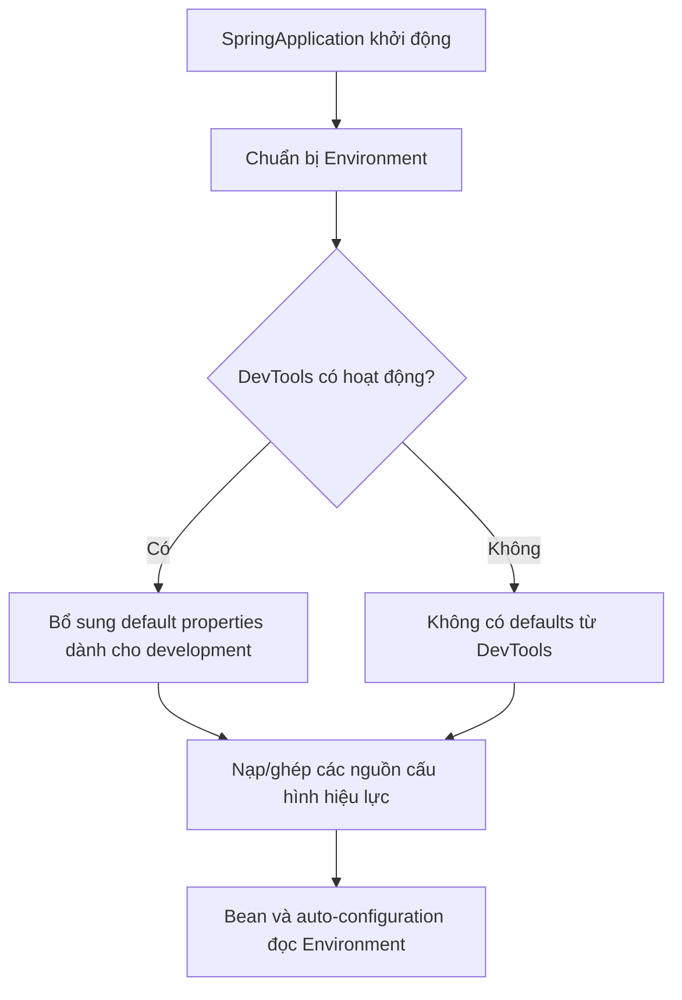
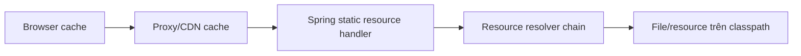
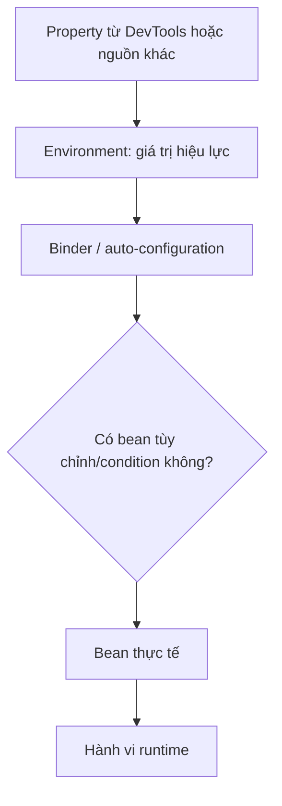
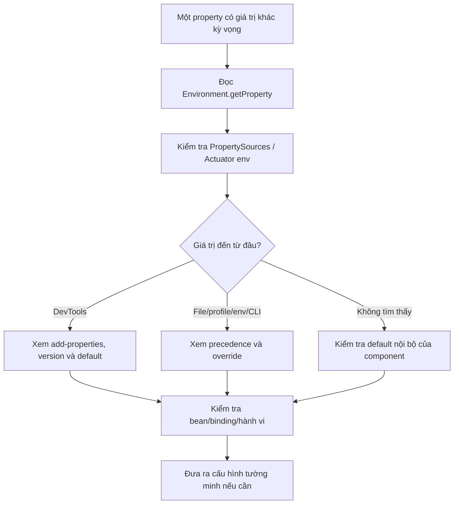

# Các mặc định phục vụ phát triển và cách kiểm tra cấu hình được thay đổi

Khi lập trình với Spring Boot, chúng ta muốn sửa template và xem kết quả ngay, dễ quan sát lỗi, nhận được log đủ chi tiết để tìm nguyên nhân và không phải liên tục xóa cache của framework. Nhưng một số thiết lập phù hợp cho **production** lại không thuận tiện trong **development**. Ví dụ, cache template giúp hệ thống production giảm chi phí xử lý, nhưng có thể khiến người phát triển tưởng file HTML vừa sửa không có hiệu lực.

Spring Boot cung cấp module **Spring Boot DevTools** để hỗ trợ vòng lặp phát triển. Bên cạnh tự động restart và LiveReload, DevTools còn có một chức năng dễ bị bỏ qua: **tự áp dụng một tập giá trị cấu hình mặc định dành cho môi trường phát triển**.

Vấn đề không chỉ là biết DevTools thay đổi property nào. Trong một dự án thực tế, cùng một property có thể đến từ nhiều nơi:

- Giá trị mặc định do Spring Boot hoặc thư viện cung cấp.
- Giá trị mặc định dành cho phát triển do DevTools bổ sung.
- `application.yml` hoặc `application.properties`.
- File theo profile như `application-dev.yml`.
- Biến môi trường, system property hoặc tham số dòng lệnh.

Muốn biết ứng dụng đang chạy với cấu hình nào, chúng ta phải phân biệt **giá trị mặc định**, **giá trị được ghi đè**, **nguồn cung cấp property** và **hành vi thật của component dùng property đó**.

Bài học thuộc chương **Công cụ phát triển** của *Spring Boot Fundamentals*. Ta sẽ tập trung vào các mặc định do DevTools áp dụng, cách tắt hoặc ghi đè chúng, cách đọc giá trị hiệu lực từ `Environment`, cách xem nguồn cấu hình qua Actuator, và cách tránh mang cấu hình debug không an toàn sang production.

Ví dụ dùng Java 21, Spring Boot 3.x và Gradle/Maven. **Danh sách property được DevTools hỗ trợ có thể thay đổi giữa các phiên bản Spring Boot.** Hãy coi các giá trị liệt kê bên dưới là ví dụ tiêu biểu; khi cần một kết luận chính xác cho hệ thống đang chạy, phải kiểm tra phiên bản và `Environment` thực tế.

## 1. “Mặc định phục vụ phát triển” là gì?

Một **development-time property default** là giá trị mà công cụ hoặc framework đưa vào môi trường cấu hình để ứng dụng thuận tiện hơn khi chạy ở chế độ phát triển.

Ví dụ một template engine có property:

```properties
spring.thymeleaf.cache=true
```

Trong production, cache template thường có lợi về hiệu năng. Nhưng khi đang sửa file template, lập trình viên muốn thấy thay đổi mà không phải tìm cách làm mới cache. Với DevTools hoạt động và cấu hình thích hợp, giá trị mặc định phát triển có thể là:

```properties
spring.thymeleaf.cache=false
```

Mục đích của DevTools là làm cho trải nghiệm phát triển thuận tiện, không phải định nghĩa chính sách vận hành production.

### 1.1. Ba loại “mặc định” không được nhầm lẫn

| Loại | Ví dụ | Vai trò |
|---|---|---|
| Mặc định của một auto-configuration/library | Template engine bật cache nếu không có cấu hình khác | Hành vi bình thường do framework chọn. |
| Mặc định được DevTools bổ sung | `spring.thymeleaf.cache=false` | Ưu tiên sự thuận tiện khi phát triển. |
| Giá trị do ứng dụng khai báo tường minh | `spring.thymeleaf.cache=true` trong file ứng dụng | Quyết định cấu hình của dự án, có thể ghi đè mặc định DevTools. |

**DevTools không ép một giá trị bất chấp cấu hình ứng dụng.** Nó bổ sung những default có mức ưu tiên thấp để ứng dụng vẫn có thể chủ động thiết lập khác đi.

### 1.2. Mặc định không có nghĩa tính năng đó luôn tồn tại

Giả sử DevTools cung cấp một default liên quan Thymeleaf. Nếu project **không có Thymeleaf trên classpath** và không có auto-configuration tương ứng, property đó không làm cho Thymeleaf tự xuất hiện.

Tương tự, một default giúp H2 console thuận tiện cho phát triển không đồng nghĩa mọi project đều có H2 database hoặc web console hoạt động. Dependency, loại ứng dụng, security và điều kiện auto-configuration vẫn phải phù hợp.

## 2. DevTools là một dependency dành cho development

Trong Gradle dùng Groovy DSL:

```groovy
dependencies {
    implementation 'org.springframework.boot:spring-boot-starter-web'
    developmentOnly 'org.springframework.boot:spring-boot-devtools'
}
```

Trong Gradle dùng Kotlin DSL:

```kotlin
dependencies {
    implementation("org.springframework.boot:spring-boot-starter-web")
    developmentOnly("org.springframework.boot:spring-boot-devtools")
}
```

Trong Maven:

```xml
<dependency>
    <groupId>org.springframework.boot</groupId>
    <artifactId>spring-boot-devtools</artifactId>
    <scope>runtime</scope>
    <optional>true</optional>
</dependency>
```

Các ví dụ giả định dự án đã sử dụng Spring Boot dependency management tương ứng nên không phải tự chỉ định phiên bản từng starter.

### 2.1. Vì sao không thêm DevTools như dependency production thông thường?

DevTools được thiết kế cho quá trình lập trình. Những tính năng như tự restart, LiveReload, vô hiệu hóa cache template và hiển thị thông tin lỗi chi tiết không phải chính sách mặc định phù hợp cho production.

Với Gradle, cấu hình `developmentOnly` giúp phân biệt dependency phát triển với dependency được đóng gói. Với Maven, `optional` giúp tránh lan truyền DevTools như dependency bắt buộc sang các dự án phụ thuộc.

Trong cách đóng gói Spring Boot phổ biến, DevTools bị loại khỏi executable archive theo mặc định và những khả năng development-time không được dùng như một tính năng production. Không nên dựa vào sự hiện diện của một JAR trong repository để kết luận ứng dụng production đang bật DevTools.

### 2.2. Chạy bằng IDE, bootRun và executable JAR có thể khác nhau

Một lần chạy từ IDE hoặc `bootRun` trong môi trường phát triển có thể bao gồm DevTools trên runtime classpath; trong khi một executable JAR được đóng gói và chạy theo cách thông thường có thể không bao gồm hoặc không kích hoạt DevTools.

Do đó câu hỏi “tại sao máy tôi có default này mà server không có?” cần bắt đầu từ **cách ứng dụng được chạy**, dependency thực sự có mặt và trạng thái kích hoạt DevTools, trước cả việc so sánh `application.yml`.

### 2.3. DevTools không phải một profile tên dev

`spring-boot-devtools` là dependency và tập tính năng development-time. `spring.profiles.active=dev` chỉ kích hoạt Spring profile tên `dev`.

Hai cơ chế độc lập:

- Có DevTools hoạt động nhưng không bật profile `dev`: các development-time defaults của DevTools vẫn có thể được áp dụng.
- Bật profile `dev` nhưng không có DevTools: file `application-dev.yml` có thể được nạp, nhưng các default của DevTools không tự xuất hiện.

Đừng dùng chữ “dev” trong tên profile để suy luận DevTools đã được kích hoạt.

## 3. DevTools bổ sung mặc định vào Environment ra sao?

Spring Boot quản lý cấu hình qua `Environment`, chứa các `PropertySource` có thứ tự ưu tiên. DevTools bổ sung một tập thuộc tính với các giá trị hữu ích cho phát triển thông qua hạ tầng xử lý Environment của nó.

Ở góc nhìn khái niệm:



Sơ đồ nhằm mô tả trách nhiệm, không phải thứ tự nội bộ chính xác từng hook của mọi phiên bản.

### 3.1. PropertySource có thứ tự ưu tiên

Giả sử các nguồn cung cấp:

```text
DevTools default: spring.thymeleaf.cache=false
application.yml: spring.thymeleaf.cache=true
```

Vì giá trị tường minh của ứng dụng có ưu tiên cao hơn default DevTools, giá trị hiệu lực là:

```text
spring.thymeleaf.cache = true
```

Đây là một nguyên tắc thiết kế quan trọng: **DevTools chọn giá trị thuận tiện khi ứng dụng chưa chọn; nó không thay thế quyền kiểm soát của cấu hình ứng dụng**.

### 3.2. “Thay đổi cấu hình” không nhất thiết là sửa file

DevTools có thể thay đổi **giá trị hiệu lực khi ứng dụng chạy** mà không ghi thêm bất kỳ dòng nào vào `application.yml`.

Bạn mở file thấy:

```yaml
spring:
  application:
    name: catalog-service
```

Nhưng đọc từ Environment lại thấy `spring.thymeleaf.cache=false`. Đó có thể là một default được bổ sung bởi DevTools, không phải một thay đổi do ai đó chỉnh file.

Vì vậy, khi chẩn đoán, hãy hỏi: **Property này được khai báo ở đâu?** và **property có thể đến từ một PropertySource được tạo bằng code hay không?**

## 4. Các nhóm mặc định phát triển thường gặp

Các phiên bản DevTools có thể bổ sung default cho một số nhóm tính năng:

| Nhóm | Property ví dụ | Ý nghĩa thường gặp trong development |
|---|---|---|
| Template | `spring.thymeleaf.cache=false` | Hạn chế cache template để sửa giao diện và kiểm tra nhanh. |
| Template | `spring.freemarker.cache=false` | Tắt cache template FreeMarker khi engine có mặt. |
| Template | `spring.mustache.servlet.cache=false` | Hạn chế cache Mustache servlet template trong cấu hình tương ứng. |
| Static resources | `spring.web.resources.cache.period=0` | Hạn chế thời gian cache HTTP của static resources. |
| Resource chain | `spring.web.resources.chain.cache=false` | Hạn chế caching của resource resolver chain. |
| Error diagnostics | `server.error.include-message=always` | Cung cấp thông tin lỗi chi tiết hơn trong response error khi cơ chế tương ứng áp dụng. |
| Error diagnostics | `server.error.include-binding-errors=always` | Cho phép thêm thông tin lỗi binding vào error attributes. |
| Error diagnostics | `server.error.include-stacktrace=always` | Có thể đưa stack trace vào thông tin lỗi của web error handling. |
| Development console | `spring.h2.console.enabled=true` | Thuận tiện dùng H2 console nếu các dependency và điều kiện phù hợp. |
| GraphQL development | `spring.graphql.graphiql.enabled=true` | Thuận tiện khám phá GraphQL khi cấu hình/phiên bản hỗ trợ. |

**Không nên coi bảng này là danh sách đầy đủ hoặc bất biến.** Tên property, module hỗ trợ và giá trị mặc định phụ thuộc phiên bản Spring Boot. Hãy xác minh các mục cần dùng bằng tài liệu đúng phiên bản và giá trị trong context đang chạy.

### 4.1. Tác động lên template rendering

Khi `spring.thymeleaf.cache=false` có hiệu lực và ứng dụng sử dụng Thymeleaf theo đường auto-configuration phù hợp, framework có thể lấy lại template thay vì sử dụng template đã cache.

Đây là lợi ích thiết thực khi sửa:

```text
src/main/resources/templates/orders/detail.html
```

Nhưng việc có thấy thay đổi ngay hay không còn phụ thuộc:

- IDE/build có sao chép resource mới đến runtime classpath không.
- Template resolver có thực sự dùng location đó không.
- Có reverse proxy hoặc browser cache phía ngoài không.
- Đường dẫn controller/view và template có đúng không.

Do vậy **cache=false** là một yếu tố của workflow, không phải bảo đảm mọi file được hot reload tự động.

### 4.2. Tác động lên static resources

Ví dụ với file:

```text
src/main/resources/static/css/site.css
```

Các giá trị mặc định phát triển của `spring.web.resources.cache.period` hoặc `spring.web.resources.chain.cache` giúp giảm ảnh hưởng caching trong quá trình thử nghiệm.

Nhưng cache có thể tồn tại tại nhiều tầng:



Thay đổi cache ở Spring không tự động xóa cache của browser, CDN hoặc quy trình build frontend. Khi file CSS chưa cập nhật, phải kiểm tra đúng tầng đang giữ bản cũ.

### 4.3. Tác động lên trang lỗi

DevTools có thể cấu hình chế độ hiển thị thêm message, binding errors hoặc stack trace trong error attributes của ứng dụng servlet/web tương ứng.

Ví dụ một request sai có thể nhận dữ liệu lỗi phong phú hơn trong phát triển, giúp tìm đúng exception. **Đây là thông tin nhạy cảm về implementation.** Với production, việc đưa stack trace hoặc exception message chi tiết ra HTTP response có thể làm lộ tên class, package, đường dẫn, SQL hoặc cấu trúc nội bộ.

Không nên sử dụng mặc định debug như một hợp đồng API cho client.

## 5. Ví dụ: cùng ứng dụng nhưng chạy có và không có DevTools

Giả sử ứng dụng dùng Thymeleaf và có file cấu hình cơ sở:

```yaml
spring:
  application:
    name: storefront
```

Không có dòng `spring.thymeleaf.cache` nào trong file.

Ta muốn so sánh hai lần chạy:

| Cách chạy | Giá trị `spring.thymeleaf.cache` có thể quan sát |
|---|---|
| Chạy với DevTools đang hoạt động | DevTools có thể bổ sung default `false`. |
| Chạy không có DevTools | Không có default từ DevTools; Thymeleaf auto-configuration tự dùng default tương ứng của nó. |
| Chạy với DevTools nhưng đặt `spring.thymeleaf.cache=true` | Giá trị tường minh `true` có thể ghi đè default DevTools. |

Chú ý một khác biệt quan trọng:

> Nếu `Environment.getProperty("spring.thymeleaf.cache")` trả `null` khi không có DevTools, điều đó **không nhất thiết có nghĩa template cache đang tắt**. Nó có thể chỉ nói Environment chưa có property tường minh; auto-configuration vẫn dùng default nội bộ của component.

Vì vậy, phải phân biệt **giá trị có mặt trong Environment** với **giá trị được binding/auto-configuration áp dụng cho bean cuối cùng**.

## 6. Cách nhanh nhất: đọc giá trị hiệu lực bằng Environment

Một Spring bean có thể inject `Environment` để biết property đang có giá trị gì:

```java
package com.example.storefront.diagnostics;

import org.springframework.boot.ApplicationArguments;
import org.springframework.boot.ApplicationRunner;
import org.springframework.core.env.Environment;
import org.springframework.stereotype.Component;

@Component
public class DevToolsPropertyReporter implements ApplicationRunner {

    private final Environment environment;

    public DevToolsPropertyReporter(Environment environment) {
        this.environment = environment;
    }

    @Override
    public void run(ApplicationArguments args) {
        print("spring.thymeleaf.cache");
        print("spring.web.resources.cache.period");
        print("spring.web.resources.chain.cache");
        print("server.error.include-message");
    }

    private void print(String propertyName) {
        System.out.printf(
                "%s = %s%n",
                propertyName,
                environment.getProperty(propertyName, "<not configured>"));
    }
}
```

Chạy trong môi trường development và xem console. Một kết quả minh họa:

```text
spring.thymeleaf.cache = false
spring.web.resources.cache.period = 0
spring.web.resources.chain.cache = false
server.error.include-message = always
```

Đây là **giá trị mà Environment trả về tại thời điểm runner chạy**, không phải khẳng định DevTools là nguồn cung cấp từng giá trị. Một file `application.yml` hoặc tham số dòng lệnh cũng có thể tạo ra cùng kết quả.

### 6.1. Tại sao cần lấy giá trị từ Environment thay vì chỉ đọc file?

File cấu hình không phản ánh toàn bộ runtime context. Có thể tồn tại:

- File bên ngoài JAR.
- Active profile khác dự kiến.
- Config Data import.
- Biến môi trường.
- Java system properties.
- Command-line overrides.
- PropertySource do DevTools hoặc một thư viện thêm vào.

`Environment` trả lời câu hỏi thực dụng nhất: **Ứng dụng đang nhìn thấy giá trị gì?**

### 6.2. Không in mọi property ra log

Trong ví dụ, ta chỉ in bốn khóa không nhạy cảm liên quan chủ đề. Không nên duyệt và in toàn bộ Environment: nó có thể chứa database password, API key, access token hoặc thông tin nội bộ.

Ngay cả trong phát triển, log có thể được lưu, chia sẻ hoặc upload đến hệ thống tập trung. Hãy chọn allowlist tên property cần kiểm tra.

## 7. Kiểm tra nguồn nào đã cung cấp một property

`Environment.getProperty(...)` cho biết giá trị hiệu lực, nhưng chưa cho biết nó đến từ nguồn nào. Để điều tra precedence, có thể xem danh sách `PropertySource` của `ConfigurableEnvironment`.

### 7.1. Ví dụ liệt kê tên nguồn chứa một property

```java
package com.example.storefront.diagnostics;

import org.springframework.boot.ApplicationArguments;
import org.springframework.boot.ApplicationRunner;
import org.springframework.core.env.ConfigurableEnvironment;
import org.springframework.core.env.PropertySource;
import org.springframework.stereotype.Component;

@Component
public class PropertySourceReporter implements ApplicationRunner {

    private final ConfigurableEnvironment environment;

    public PropertySourceReporter(ConfigurableEnvironment environment) {
        this.environment = environment;
    }

    @Override
    public void run(ApplicationArguments args) {
        String key = "spring.thymeleaf.cache";

        System.out.println("Effective value: "
                + environment.getProperty(key, "<not configured>"));

        int position = 0;
        for (PropertySource<?> source : environment.getPropertySources()) {
            position++;
            if (source.containsProperty(key)) {
                System.out.printf(
                        "Candidate source #%d: %s%n",
                        position,
                        source.getName());
            }
        }
    }
}
```

Trong `MutablePropertySources` của một `ConfigurableEnvironment` thông thường, thứ tự duyệt có ý nghĩa về precedence: nguồn có ưu tiên cao hơn được xét trước. Nếu một key xuất hiện trong nhiều nguồn, nguồn có độ ưu tiên cao hơn thường cung cấp giá trị hiệu lực.

**Lưu ý kỹ thuật:** một số property source có dạng wrapper, composite hoặc hỗ trợ relaxed name mapping. `containsProperty(key)` là manh mối hữu ích, nhưng không phải API truy xuất origin đầy đủ cho mọi loại nguồn và mọi biến thể tên. Khi cần thông tin chính xác hơn, dùng Actuator `env` hoặc công cụ origin tracking của framework phù hợp.

### 7.2. Minh họa khi có DevTools và override tường minh

Giả sử file `application.yml` đặt:

```yaml
spring:
  thymeleaf:
    cache: true
```

Một output minh họa của reporter có thể cho thấy:

```text
Effective value: true
Candidate source #...: Config resource 'class path resource [application.yml]' ...
Candidate source #...: devtools
```

Tên chính xác của PropertySource và các vị trí `#...` phụ thuộc phiên bản/nguồn đã nạp. Điểm cần thấy là **cùng một key có thể xuất hiện ở nhiều source**, nhưng giá trị hiệu lực chỉ lấy theo precedence.

### 7.3. Có thể xem vị trí file nguồn bằng công cụ hỗ trợ origin

Spring Boot Config Data thường lưu metadata giúp biết property đến từ tài nguyên nào. Một API/debug tool hoặc Actuator endpoint có thể hiển thị thông tin origin, chẳng hạn tên file và vị trí dòng. Đừng giả định mọi PropertySource tự viết hoặc mọi nguồn environment variable đều cung cấp chính xác số dòng file.

## 8. Kiểm tra bằng Spring Boot Actuator

Nếu ứng dụng có Spring Boot Actuator, endpoint `env` hỗ trợ quan sát những property đã được nạp và nguồn của chúng.

Thêm dependency Gradle:

```groovy
dependencies {
    implementation 'org.springframework.boot:spring-boot-starter-actuator'
}
```

Trong Maven:

```xml
<dependency>
    <groupId>org.springframework.boot</groupId>
    <artifactId>spring-boot-starter-actuator</artifactId>
</dependency>
```

Để dùng trong môi trường local được kiểm soát:

```yaml
management:
  endpoints:
    web:
      exposure:
        include: health,env,configprops
```

Sau khi ứng dụng khởi động, có thể truy cập:

```text
GET /actuator/env
GET /actuator/env/spring.thymeleaf.cache
GET /actuator/configprops
```

`/actuator/env/spring.thymeleaf.cache` phù hợp để xem một property cụ thể và các property source liên quan, tùy version và cấu hình endpoint. `/actuator/configprops` hữu ích để xem object `@ConfigurationProperties` đã bind, qua đó kiểm tra kết quả cấu hình của component.

### 8.1. Vì sao không chỉ xem /actuator/env?

`env` thể hiện dữ liệu cấu hình trong Environment. Nhưng một component có thể:

- Dùng default nội bộ khi property vắng mặt.
- Bind sang kiểu `Duration`, `boolean` hoặc collection.
- Chỉ được tạo khi auto-configuration condition khớp.
- Bị thay thế bởi một bean tùy chỉnh.

Vì vậy, có lúc `env` cho thấy một giá trị nhưng component cuối cùng vẫn hành động khác vì điều kiện hoặc customization. Khi đó `configprops`, `beans`, `conditions` hoặc kiểm tra trực tiếp bean có thể giúp hoàn thiện bức tranh.

### 8.2. Bảo mật endpoint

Không nên expose `/actuator/env` và `/actuator/configprops` công khai trên production. Chúng có thể tiết lộ tên cấu hình, topology hệ thống hoặc thông tin nhạy cảm nếu quyền truy cập và cơ chế sanitize không đúng.

Một số giá trị bị che khi hiển thị, tùy Spring Boot/Actuator version và cấu hình security. Đừng tắt che giấu chỉ để kiểm tra một property không nhạy cảm. Trong môi trường local, giới hạn endpoint ở loopback/network đáng tin cậy hoặc bảo vệ bằng cơ chế xác thực phù hợp.

### 8.3. Tại sao một giá trị Actuator bị mask?

Actuator có thể trả giá trị bị sanitize hoặc không hiển thị trực tiếp theo chính sách. Điều đó không có nghĩa property bị thiếu trong Environment. Hãy hiểu đây có thể là quyết định bảo vệ dữ liệu, không phải lỗi binding.

## 9. Nhận biết DevTools property defaults đang hoạt động qua log

Khi DevTools áp dụng bộ mặc định, các phiên bản thường ghi một thông điệp tương tự:

```text
Devtools property defaults active! Set 'spring.devtools.add-properties' to 'false' to disable
```

Thông điệp cụ thể, logger và log level có thể khác theo phiên bản. Đây là một dấu hiệu hỗ trợ chẩn đoán, **không phải bằng chứng duy nhất**.

Nếu không thấy dòng này, có thể do:

- DevTools không nằm trên runtime classpath.
- Ứng dụng được chạy theo cách tắt DevTools.
- Bộ defaults đã bị disable.
- Mức logging đã lọc thông điệp.
- Phiên bản DevTools có hành vi/logging khác.

Hãy kết hợp log với `Environment` và các PropertySource thực tế thay vì suy luận chỉ từ một dòng log bị thiếu.

### 9.1. Bật log có chọn lọc khi cần

Trong môi trường local, có thể tạm tăng mức log cho package DevTools:

```properties
logging.level.org.springframework.boot.devtools=DEBUG
```

Điều này có thể làm xuất hiện thêm thông tin từ các logger tương ứng, nhưng không bảo đảm có một thông điệp cụ thể cho mọi property được thay đổi. Để xem giá trị hiệu lực, API Environment và Actuator thường đáng tin hơn.

### 9.2. --debug không phải danh sách property bị thay đổi

Chạy ứng dụng với:

```bash
java -jar app.jar --debug
```

có thể bật thêm log debug và Condition Evaluation Report trong ngữ cảnh Spring Boot phù hợp. Condition report giúp hiểu **tại sao một auto-configuration được áp dụng hoặc bị bỏ qua**.

Nó không phải là một bản diff hoàn chỉnh “trước DevTools / sau DevTools” của mọi property. Muốn so sánh giá trị cấu hình, cần xem Environment ở hai cấu hình chạy phù hợp.

## 10. Tự ghi đè một default do DevTools đề xuất

Giả sử bạn muốn thử tình huống template cache bật ngay trong phát triển để tái hiện một lỗi production. Bạn có thể khai báo:

```yaml
spring:
  thymeleaf:
    cache: true
```

Nếu DevTools đưa default `false` ở mức ưu tiên thấp hơn, giá trị tường minh `true` có hiệu lực.

Hoặc bạn cần giữ error response gọn:

```yaml
server:
  error:
    include-message: never
    include-binding-errors: never
    include-stacktrace: never
```

Đây là ví dụ khi **bản thân developer cũng muốn ghi đè một số mặc định “thuận tiện”** vì yêu cầu bảo mật hoặc muốn kiểm tra hành vi gần production.

### 10.1. Ghi đè trong profile riêng

`application-dev.yml`:

```yaml
spring:
  thymeleaf:
    cache: false
```

`application-prod.yml`:

```yaml
spring:
  thymeleaf:
    cache: true
server:
  error:
    include-message: never
    include-stacktrace: never
```

Profile có thể thể hiện chính sách cụ thể cho từng môi trường, độc lập với việc DevTools có mặt hay không.

### 10.2. Vì sao khai báo tường minh có lợi?

Nếu một hành vi quan trọng với ứng dụng — đặc biệt liên quan bảo mật, cache hoặc chính sách vận hành — việc khai báo tường minh trong cấu hình phù hợp giúp đội ngũ không vô tình phụ thuộc vào những default thay đổi theo phiên bản.

**DevTools cung cấp sự thuận tiện, còn policy quan trọng của dự án nên được tài liệu hóa và cấu hình chủ động.**

## 11. Tắt riêng các development-time property defaults

Spring Boot DevTools cung cấp property:

```properties
spring.devtools.add-properties=false
```

Hoặc dạng YAML:

```yaml
spring:
  devtools:
    add-properties: false
```

Đặt giá trị này để **không áp dụng bộ property defaults phát triển của DevTools**.

### 11.1. Tắt defaults không có nghĩa tắt toàn bộ DevTools

Ba điều sau là những cơ chế khác nhau:

| Cơ chế | Mục đích |
|---|---|
| `spring.devtools.add-properties=false` | Tắt việc DevTools bổ sung các property defaults dành cho phát triển. |
| `spring.devtools.restart.enabled=false` | Điều khiển cơ chế automatic restart của DevTools. |
| `spring.devtools.livereload.enabled=false` | Điều khiển tích hợp LiveReload. |

Khi đặt `spring.devtools.add-properties=false`, khả năng restart/LiveReload không tự động bị tắt chỉ vì property đó. Ngược lại, tắt restart không đồng nghĩa mọi default property đều bị loại bỏ.

### 11.2. Tại sao cần phân biệt?

Giả sử bạn muốn ứng dụng tự restart khi sửa class, nhưng muốn kiểm thử cache và error response giống production. Khi ấy bạn có thể giữ DevTools để hỗ trợ restart, đồng thời:

- Tắt property defaults bằng `spring.devtools.add-properties=false`.
- Hoặc ghi đè những property cần kiểm thử bằng giá trị cụ thể.

Chọn cách nào tùy mục tiêu:

- **Muốn tắt cả bộ defaults:** dùng `add-properties=false`.
- **Chỉ muốn thay đổi một vài default:** khai báo giá trị tường minh cho property tương ứng.

### 11.3. Khi tắt defaults, giá trị hiệu lực có thể biến mất khỏi Environment

Ví dụ trước khi tắt:

```text
spring.thymeleaf.cache = false
```

Sau khi tắt `add-properties`, nếu không có PropertySource nào khác khai báo khóa:

```text
spring.thymeleaf.cache = <not configured>
```

Điều đó không có nghĩa Thymeleaf không còn cache; nó có thể quay về default riêng của auto-configuration. Cần kiểm tra bean/configprops hoặc hành vi template trong lần chạy thực tế.

## 12. Phân biệt property defaults với automatic restart

DevTools thường được biết đến vì tự restart ứng dụng khi classpath thay đổi. Nhưng **restart** và **property defaults** là hai nhóm chức năng riêng.

### 12.1. Restart giải quyết vấn đề gì?

Khi bạn sửa class Java, IDE/build cập nhật compiled classes lên classpath, DevTools có thể nhận diện thay đổi và restart application context để bạn không phải dừng/chạy thủ công.

Đây là chức năng liên quan vòng đời process/context, không phải cơ chế chọn giá trị cache template.

### 12.2. Property defaults giải quyết vấn đề gì?

Nó thay đổi cấu hình hiệu lực của một số thành phần trong lúc phát triển, chẳng hạn tắt template caching. Trong trường hợp đó, một lần truy cập mới có thể đọc template đã thay đổi mà không cần restart toàn bộ ứng dụng, **nếu file cập nhật đã nằm ở location mà runtime sử dụng**.

### 12.3. LiveReload giải quyết vấn đề gì?

LiveReload hỗ trợ trình duyệt tự reload trong workflow phát triển khi có tín hiệu phù hợp. Nó không phải caching policy của template engine, cũng không tự thêm property vào Environment.

### 12.4. Bảng so sánh

| Triệu chứng | Cơ chế có thể liên quan |
|---|---|
| Sửa class Java nhưng server vẫn chạy code cũ | Classpath update / DevTools restart / build output. |
| Sửa HTML nhưng trang vẫn dùng template cũ | Template cache, resource copy, resolver, browser cache. |
| Sửa CSS mà trang không tự reload | LiveReload, browser cache hoặc frontend build pipeline. |
| Error response quá chi tiết | Error handling properties, có thể liên quan DevTools defaults. |
| Cấu hình trong file thay đổi nhưng runtime vẫn đọc giá trị khác | PropertySource precedence, active profiles, env vars và defaults. |

Không nên dùng một property DevTools để sửa mọi vấn đề liên quan “hot reload”.

## 13. Profile dev có thay thế DevTools không?

Không. Một profile như `dev` và DevTools có thể bổ sung cho nhau.

`application-dev.yml`:

```yaml
app:
  external-service:
    base-url: http://localhost:9000

logging:
  level:
    com.example.storefront: DEBUG

spring:
  thymeleaf:
    cache: false
```

Khi profile `dev` active, các giá trị này có thể được dùng **kể cả khi project không có DevTools**.

Ngược lại, nếu DevTools hoạt động mà active profile chỉ là `local` hoặc không có active profile tường minh, các defaults của DevTools vẫn có thể được thêm.

### 13.1. Chọn cách quản lý có chủ đích

Một chiến lược phổ biến:

- DevTools dùng để cải thiện workflow của nhà phát triển.
- Spring profiles dùng để phân biệt nhóm cấu hình môi trường.
- Property tường minh dùng để thể hiện những quyết định quan trọng của ứng dụng.

Cách này tránh việc cấu hình production phụ thuộc tình cờ vào một dependency phát triển.

### 13.2. Nếu có nhiều profile active thì sao?

Ví dụ:

```text
spring.profiles.active=dev,metrics
```

Các property trùng nhau từ profile-specific Config Data có quy tắc ưu tiên riêng theo thứ tự profile và vị trí file. Nhưng defaults DevTools vẫn nằm trong quan hệ precedence của Environment.

Một profile xuất hiện sau không thể được suy luận là “luôn thắng mọi nguồn”, bởi biến môi trường, command-line argument và vị trí Config Data có thể mang mức ưu tiên khác.

## 14. Kiểm tra bằng một ứng dụng Spring Boot nhỏ

Để quan sát thay đổi, ta tạo một ứng dụng chỉ cần Spring Boot starter và DevTools. Không cần database hay web server để đọc Environment.

### 14.1. Khai báo dependency

```groovy
plugins {
    id 'java'
    id 'org.springframework.boot' version '3.3.0'
    id 'io.spring.dependency-management' version '1.1.5'
}

java {
    toolchain {
        languageVersion = JavaLanguageVersion.of(21)
    }
}

dependencies {
    implementation 'org.springframework.boot:spring-boot-starter'
    developmentOnly 'org.springframework.boot:spring-boot-devtools'
}
```

Các phiên bản plugin trong ví dụ chỉ minh họa cấu trúc một project tương thích; khi tạo project mới nên dùng phiên bản Spring Boot/Gradle phù hợp với dự án hiện tại. Không cần sao chép nguyên số phiên bản để hiểu chức năng DevTools.

### 14.2. Tạo main class

```java
package com.example.devtoolslab;

import org.springframework.boot.SpringApplication;
import org.springframework.boot.autoconfigure.SpringBootApplication;

@SpringBootApplication
public class DevToolsLabApplication {

    public static void main(String[] args) {
        SpringApplication.run(DevToolsLabApplication.class, args);
    }
}
```

### 14.3. Tạo runner quan sát cấu hình

```java
package com.example.devtoolslab;

import java.util.List;
import org.springframework.boot.ApplicationArguments;
import org.springframework.boot.ApplicationRunner;
import org.springframework.core.env.ConfigurableEnvironment;
import org.springframework.core.env.PropertySource;
import org.springframework.stereotype.Component;

@Component
public class DefaultsInspectionRunner implements ApplicationRunner {

    private static final List<String> KEYS = List.of(
            "spring.thymeleaf.cache",
            "spring.web.resources.cache.period",
            "spring.web.resources.chain.cache",
            "server.error.include-message");

    private final ConfigurableEnvironment environment;

    public DefaultsInspectionRunner(ConfigurableEnvironment environment) {
        this.environment = environment;
    }

    @Override
    public void run(ApplicationArguments args) {
        for (String key : KEYS) {
            System.out.println(key + " = "
                    + environment.getProperty(key, "<absent>"));

            for (PropertySource<?> source : environment.getPropertySources()) {
                if (source.containsProperty(key)) {
                    System.out.println("  source: " + source.getName());
                }
            }
        }
    }
}
```

Đoạn code có hai tầng quan sát:

1. Giá trị hiệu lực của từng key.
2. Những PropertySource trả lời rằng mình có key đó.

Với các property trong allowlist, cách này hữu ích và không cần expose Actuator endpoint. Nhưng tên nguồn và kết quả có thể khác nhau giữa lần chạy, vì còn phụ thuộc IDE/classpath, profile và version.

### 14.4. Chạy ở local

```bash
./gradlew bootRun
```

Hoặc trên Windows:

```powershell
.\gradlew.bat bootRun
```

Quan sát các dòng do `DefaultsInspectionRunner` in ra. Không cần tự giả định rằng môi trường đã kích hoạt DevTools chỉ vì dependency được khai báo; hãy kiểm tra source và giá trị.

### 14.5. Thêm override

Trong `src/main/resources/application.yml`:

```yaml
spring:
  thymeleaf:
    cache: true
```

Chạy lại và xem giá trị cuối `spring.thymeleaf.cache` là gì. Nếu DevTools defaults hoạt động, đây là ví dụ để thấy giá trị tường minh của ứng dụng có thể ưu tiên hơn default DevTools.

### 14.6. Tắt defaults

Thay cấu hình thành:

```yaml
spring:
  devtools:
    add-properties: false
```

Chạy lại và xem giá trị cùng danh sách nguồn. Nếu không có nguồn nào khác khai báo những key thuộc bộ defaults, Environment có thể không còn thấy chúng được thiết lập tường minh.

Thí nghiệm này kiểm tra **kết quả cấu hình**. Nó không phải test kiểm tra hiệu năng template hay kiểm tra nội bộ class loader của DevTools.

## 15. Phân biệt nguồn giá trị với hành vi của bean

Đây là một trong những kỹ năng quan trọng nhất khi debug Spring Boot.

Giả sử:

```text
Environment.getProperty("spring.thymeleaf.cache") == null
```

Bạn **không thể** kết luận Thymeleaf caching đã tắt. Auto-configuration có thể dùng default nội bộ `true` khi property vắng mặt.

Ngược lại:

```text
Environment.getProperty("spring.thymeleaf.cache") == "false"
```

điều đó cho biết giá trị hiệu lực trong Environment là `false`. Nhưng nếu ứng dụng có cấu hình Thymeleaf resolver hoặc engine bean tùy chỉnh bỏ qua property của Boot, hành vi cuối có thể khác.

### 15.1. Ba câu hỏi riêng

1. **Property có được cung cấp không?** Xem `Environment`.
2. **Auto-configuration có sử dụng property đó không?** Xem `@ConfigurationProperties`, điều kiện và custom bean.
3. **Bean cuối cùng hoạt động ra sao?** Kiểm tra runtime behavior hoặc integration test thích hợp.



Một thao tác kiểm tra duy nhất hiếm khi trả lời đầy đủ cả ba câu.

## 16. Nếu không thấy mặc định DevTools, kiểm tra gì trước?

### 16.1. Dependency có được đưa vào runtime classpath?

Hãy xác định DevTools có tham gia cách chạy hiện tại không. Chạy IDE, `bootRun` và packaged JAR không nhất thiết dùng cùng classpath.

Không cần thêm property `spring.devtools.add-properties=true` vào mọi file để “kích hoạt”; trước hết phải chắc DevTools đã hoạt động.

### 16.2. Có tắt bằng spring.devtools.add-properties?

Tìm giá trị:

```text
spring.devtools.add-properties
```

Trong `application.yml`, environment variable hoặc tham số dòng lệnh. Nếu giá trị hiệu lực là `false`, bộ property defaults của DevTools không được bổ sung.

### 16.3. Có một source khác ghi đè?

Ví dụ:

```text
DevTools default: spring.thymeleaf.cache=false
Command line: --spring.thymeleaf.cache=true
```

Ứng dụng vẫn có thể đang sử dụng DevTools, nhưng giá trị hiệu lực là `true` vì override tường minh.

### 16.4. Có đang đọc nhầm property?

Một số tên thuộc tính thay đổi qua các phiên bản framework; một số chỉ có ý nghĩa khi module/engine tương ứng có mặt. Hãy dùng tên property đúng với phiên bản hiện tại và kiểm tra canonical key, không suy luận từ tên class.

### 16.5. Có đang nhìn nhầm ứng dụng/instance?

Khi nhiều process chạy trên những port khác nhau, bạn có thể gọi Actuator endpoint của instance A nhưng đang sửa cấu hình instance B. Hãy đối chiếu port, PID, application name và thời gian startup.

### 16.6. Có phải thay đổi source chưa đến runtime classpath?

Nếu vấn đề là template hoặc static file không cập nhật, hãy xem đường dẫn source/build output và cơ chế resource copy của IDE/Gradle. DevTools không thể làm một file xuất hiện trong runtime classpath nếu build tooling chưa cập nhật file đó.

## 17. Khi cấu hình được ghi đè bởi biến môi trường hoặc command line

Giả sử `application.yml` có:

```yaml
spring:
  thymeleaf:
    cache: false
```

Ứng dụng được khởi chạy với:

```bash
java -jar app.jar --spring.thymeleaf.cache=true
```

Trong thứ tự cấu hình thông thường của Spring Boot, command-line property có thể thắng cấu hình từ file.

Tương tự, biến môi trường theo quy tắc ánh xạ phù hợp:

```text
SPRING_THYMELEAF_CACHE=true
```

có thể ghi đè giá trị trong file. Khi dùng DevTools, default của DevTools cũng tham gia precedence nhưng không được ưu tiên hơn các giá trị tường minh này.

### 17.1. Đừng chỉ nhìn file trong repository

Một container có thể nhận biến môi trường từ Kubernetes, Docker Compose hoặc hệ thống quản lý cấu hình. Trong repository không có dòng `spring.thymeleaf.cache=true`, nhưng production vẫn có giá trị `true` do environment.

Đây là lý do `Environment` và nguồn origin quan trọng trong việc điều tra.

### 17.2. Dùng tên canonical

Nên khai báo tên property theo dạng canonical kebab-case và chữ thường:

```text
spring.thymeleaf.cache
spring.web.resources.cache.period
spring.devtools.add-properties
```

Khi chuyển sang environment variable, áp dụng quy tắc ánh xạ property names của Spring Boot. Đừng tạo ra hai tên gần giống nhau rồi mặc định cả hai luôn được binder hiểu giống nhau trong mọi ngữ cảnh.

## 18. Kiểm thử thay đổi bằng cách so sánh hai lần chạy

Một kỹ thuật thực dụng là ghi lại **bảng giá trị hiệu lực** từ cùng ứng dụng trong hai lần chạy:

| Property | DevTools defaults bật | `add-properties=false` |
|---|---|---|
| `spring.thymeleaf.cache` | Có thể là `false` do DevTools | Có thể vắng mặt nếu không có nguồn khác. |
| `spring.web.resources.cache.period` | Có thể là `0` do DevTools | Có thể vắng mặt nếu không có nguồn khác. |
| `server.error.include-message` | Có thể là `always` do DevTools | Có thể vắng mặt nếu không có nguồn khác. |

Đây là các **kết quả kỳ vọng minh họa**, không phải số đo bắt buộc của mọi project. Nếu `application.yml` hoặc nguồn có ưu tiên cao hơn cũng đặt những property này, cả hai lần chạy có thể nhận cùng một giá trị.

### 18.1. So sánh phải giữ nguyên các yếu tố khác

Để kiểm chứng nguồn khác biệt có phải DevTools hay không, nên giữ nguyên:

- Phiên bản ứng dụng.
- Active profiles.
- File cấu hình.
- Biến môi trường và tham số dòng lệnh.
- Runtime classpath, trừ thay đổi DevTools cần kiểm tra.
- Cách chạy/IDE nếu có thể.

Nếu đồng thời đổi `dev` thành `prod` và thay cách đóng gói, một giá trị khác không chứng minh nguyên nhân là DevTools.

### 18.2. Test có thể không giống quá trình chạy development thật

`@SpringBootTest` và `ApplicationContextRunner` có lifecycle/test classpath riêng. DevTools có thể bị vô hiệu hoặc không tham gia một số luồng test. Vì vậy một integration test không có default DevTools chưa chắc chứng minh DevTools “bị lỗi” trong `bootRun`.

Nếu mục tiêu là kiểm tra **kết quả cuối của một property** cho một tính năng nghiệp vụ, nên viết test với property được cung cấp tường minh. Nếu mục tiêu là nghiên cứu **DevTools bổ sung defaults lúc development**, thí nghiệm chạy ứng dụng thực tế và quan sát Environment sẽ trực tiếp hơn.

## 19. Ví dụ kiểm thử property được ghi đè tường minh

Một integration test có thể kiểm tra rằng ứng dụng chủ động đặt `spring.thymeleaf.cache=true`:

```java
package com.example.storefront;

import static org.assertj.core.api.Assertions.assertThat;

import org.junit.jupiter.api.Test;
import org.springframework.beans.factory.annotation.Autowired;
import org.springframework.boot.test.context.SpringBootTest;
import org.springframework.core.env.Environment;

@SpringBootTest(properties = "spring.thymeleaf.cache=true")
class ExplicitPropertyOverrideTest {

    @Autowired
    Environment environment;

    @Test
    void explicitPropertyIsVisibleInEnvironment() {
        assertThat(environment.getProperty(
                "spring.thymeleaf.cache", Boolean.class))
                .isTrue();
    }
}
```

Test này xác nhận property đã được đưa vào Environment của **test context** theo cách được chỉ định. Nó không chứng minh DevTools có mặt hoặc default DevTools đang hoạt động trong test.

### 19.1. Vì sao nên test cấu hình quan trọng?

Với cấu hình ảnh hưởng contract hoặc bảo mật, một giá trị thay đổi ngoài ý muốn có thể gây tác động lớn. Test tường minh giúp bảo vệ chính sách dự án khỏi việc thay đổi mặc định do dependency/framework version.

### 19.2. Đừng “test mặc định DevTools” thay cho business behavior

Nếu mục tiêu nghiệp vụ là không rò rỉ stack trace trong response production, nên test HTTP error response hoặc cấu hình security/error handler của production profile. Việc assert rằng “DevTools đang tắt” không thay thế kiểm tra chính sách thực tế.

## 20. Các lỗi hiểu nhầm thường gặp

| Nhận định | Cách hiểu chính xác |
|---|---|
| “Bật profile dev là đã bật Spring Boot DevTools.” | Profile và dependency DevTools là hai cơ chế độc lập. |
| “DevTools luôn sửa application.yml.” | DevTools thường bổ sung một PropertySource; không phải sửa file. |
| “DevTools default luôn thắng giá trị trong file.” | Default DevTools có ưu tiên thấp; cấu hình tường minh có thể ghi đè. |
| “Không thấy property trong Environment nghĩa là component tắt tính năng.” | Component có thể dùng default nội bộ khi property vắng mặt. |
| “Có property Thymeleaf là ứng dụng chắc chắn dùng Thymeleaf.” | Cần dependency, auto-configuration và bean phù hợp. |
| “Tắt spring.devtools.add-properties làm mất automatic restart.” | Đây là những nhóm tính năng riêng. |
| “Tắt restart là tắt mọi property default.” | Không nhất thiết; phải xét từng cấu hình DevTools. |
| “Không thấy log Devtools property defaults active nghĩa là defaults không chạy.” | Log có thể bị lọc hoặc cách ghi khác theo version. |
| “--debug sẽ liệt kê mọi thay đổi của DevTools.” | Condition report không phải bản diff mọi PropertySource. |
| “Environment trả false thì component tùy chỉnh chắc chắn dùng false.” | Component có thể bỏ qua property nếu tự cấu hình bằng bean riêng. |
| “Template không đổi vì DevTools hỏng.” | Cần kiểm tra resource copy, template resolver và browser/proxy cache. |
| “DevTools error defaults an toàn để bật trên production.” | Stack trace và error message chi tiết có thể tiết lộ thông tin nội bộ. |
| “Actuator env phải mở công khai mới điều tra được.” | Có thể dùng runner/log allowlist; Actuator cần bảo vệ truy cập. |

## 21. Quy trình chẩn đoán khi một property không như mong đợi

Khi gặp tình huống “mình không cấu hình property này mà sao ứng dụng lại dùng giá trị khác”, hãy làm theo thứ tự:

1. **Xác định property chính xác.** Ví dụ `spring.thymeleaf.cache` hoặc `server.error.include-message`.
2. **Xác định phiên bản Spring Boot và dependency liên quan.** Property có được hỗ trợ ở phiên bản đó không?
3. **Kiểm tra cách khởi chạy.** IDE/`bootRun` hay executable JAR? DevTools có hoạt động trong run này?
4. **Đọc giá trị hiệu lực bằng Environment.** Không chỉ dựa vào file source.
5. **Liệt kê các PropertySource có key.** Tìm nơi có precedence cao nhất.
6. **Kiểm tra active profiles, external config và command-line.** Chúng có ghi đè default không?
7. **Kiểm tra `spring.devtools.add-properties`.** Bộ defaults có bị tắt không?
8. **Nếu property vắng mặt, xem default nội bộ của component.** Không tự suy diễn hành vi.
9. **Kiểm tra bean hoặc response thật.** Phân biệt property hiệu lực với behavior.
10. **Nếu mục tiêu liên quan bảo mật, chốt policy tường minh.** Không dựa vào tình cờ của development defaults.



Quy trình này hữu ích không chỉ cho DevTools mà cho phần lớn vấn đề cấu hình Spring Boot.

## 22. Một kịch bản chẩn đoán tổng hợp

**Tình huống:** một lập trình viên sửa `src/main/resources/templates/product.html` nhưng khi reload trang, nội dung cũ vẫn xuất hiện. Người đó thấy dự án có `spring-boot-devtools` nên nghĩ cache phải đang tắt.

### Bước 1: kiểm tra giá trị hiệu lực

Đọc:

```java
environment.getProperty("spring.thymeleaf.cache")
```

Giả sử kết quả là `true`.

### Bước 2: xác định nguồn ghi đè

Kiểm tra PropertySource và phát hiện `application-dev.yml` có:

```yaml
spring:
  thymeleaf:
    cache: true
```

Khi đó default DevTools `false` không phải giá trị hiệu lực. Đây không phải bug của template engine; ứng dụng đã chọn cache true tường minh.

### Bước 3: sửa cấu hình nếu phù hợp

Trong môi trường development, có thể đổi:

```yaml
spring:
  thymeleaf:
    cache: false
```

hoặc bỏ override để DevTools áp dụng default, nếu bộ defaults đang hoạt động.

### Bước 4: nếu vẫn còn nội dung cũ

Kiểm tra:

- File template có thực sự được cập nhật trong runtime classpath không?
- Có custom resolver nào dùng location khác không?
- Browser, proxy hoặc một lớp HTML caching khác có can thiệp không?
- Có đang gọi nhầm server/port hoặc một instance cũ không?

### Bước 5: xác nhận kết quả bằng hành vi

Đọc lại Environment, thực hiện request mới và xác minh HTML trả về là phiên bản mong muốn. **Thành công không chỉ là property đã đổi; thành công là ứng dụng thật sự phục vụ nội dung đúng**.

## 23. Một kịch bản khác: trang lỗi hiển thị stack trace

**Tình huống:** khi phát triển local, ứng dụng trả response chứa nhiều thông tin exception chi tiết. Người phát triển lo ngại cùng cấu hình đó sẽ lên production.

### Bước 1: xác định error-related properties

Kiểm tra:

```text
server.error.include-message
server.error.include-binding-errors
server.error.include-stacktrace
```

Nếu giá trị quá rộng, có thể liên quan bộ defaults của DevTools hoặc override tường minh.

### Bước 2: hiểu mục tiêu của môi trường

Trong development, chi tiết lỗi giúp debug. Trong production, chính sách thông thường là hạn chế thông tin nội bộ trong response; exception đầy đủ nên được ghi vào hệ thống quan sát an toàn thay vì gửi cho client.

### Bước 3: đặt chính sách rõ ràng

Ví dụ cho production:

```yaml
server:
  error:
    include-message: never
    include-binding-errors: never
    include-stacktrace: never
```

### Bước 4: kiểm tra thực tế

Gửi một request gây lỗi trong môi trường kiểm thử tương đương production và kiểm tra body response. Nếu ứng dụng dùng `@ControllerAdvice`/custom error handler, property của Boot có thể không quyết định toàn bộ error response. Cần test **HTTP contract** thực tế.

## 24. Hướng dẫn thực hành

Tạo một Spring Boot project có DevTools và thực hiện tuần tự:

**Bước A — Chạy lần đầu.** Thêm `spring-boot-devtools` theo cấu hình development-only, khởi động bằng IDE hoặc `bootRun` và ghi lại log startup.

**Bước B — Đọc Environment.** Tạo `ApplicationRunner` hiển thị `spring.thymeleaf.cache`, `spring.web.resources.cache.period` và `server.error.include-message`.

**Bước C — Liệt kê nguồn.** Với mỗi key không nhạy cảm, in tên những `PropertySource` có key. Tìm nguồn liên quan DevTools nếu được thêm.

**Bước D — Ghi đè một property.** Đặt `spring.thymeleaf.cache=true` trong `application.yml` rồi quan sát giá trị hiệu lực.

**Bước E — Thử profile.** Đặt property khác trong `application-dev.yml`, bật profile `dev` và kiểm tra thứ tự ưu tiên.

**Bước F — Ghi đè bằng command line.** Truyền `--spring.thymeleaf.cache=false` khi chạy và quan sát giá trị cuối.

**Bước G — Tắt toàn bộ defaults.** Đặt `spring.devtools.add-properties=false` rồi xem những key nào không còn được bổ sung từ DevTools.

**Bước H — Phân biệt restart.** Nếu DevTools restart được bật, sửa class rồi kiểm tra chức năng restart vẫn có thể hoạt động dù defaults đã tắt.

**Bước I — Xem Actuator.** Trong môi trường local an toàn, dùng `/actuator/env/spring.thymeleaf.cache` để xem nguồn và giá trị của property.

**Bước J — Kiểm tra hành vi.** Nếu có Thymeleaf, sửa một template và xem kết quả sau reload; nếu có web API, kiểm tra error response theo chính sách đã chọn.

**Bước K — So sánh cách chạy.** Chạy bằng executable JAR theo cách đóng gói bình thường rồi xem những default nào không còn xuất hiện; chú ý đây là so sánh cách chạy, không chỉ so sánh profile.

**Bước L — Tổng kết.** Với mỗi thay đổi, ghi ba thông tin: **giá trị hiệu lực — nguồn cung cấp — hành vi thực tế**.

Đây là cách thực hành trực tiếp giúp bạn không nhầm “đã bật DevTools” với “mọi thiết lập phát triển phải luôn có cùng giá trị”.

## 25. Câu hỏi tự đánh giá

1. Development-time property defaults của DevTools nhằm giải quyết khó khăn gì trong quá trình lập trình?
2. Những giá trị đó có sửa trực tiếp `application.yml` không?
3. Vì sao `spring.thymeleaf.cache=false` hữu ích khi phát triển giao diện?
4. Property mặc định liên quan Thymeleaf có khiến một project không có Thymeleaf tự sử dụng Thymeleaf không?
5. Vì sao giá trị tường minh trong `application.yml` có thể thắng default DevTools?
6. `Environment.getProperty(...)` trả lời câu hỏi gì?
7. Tại sao `Environment.getProperty("spring.thymeleaf.cache")==null` không đủ để kết luận template cache đang tắt?
8. Làm sao biết một property được cung cấp từ Config Data, biến môi trường hay DevTools?
9. Vai trò của `ConfigurableEnvironment.getPropertySources()` là gì?
10. `/actuator/env` khác `/actuator/configprops` ở góc nhìn cấu hình như thế nào?
11. Vì sao không nên expose `env` và `configprops` công khai trên production?
12. `spring.devtools.add-properties=false` làm gì?
13. Thuộc tính đó có đồng thời tắt `spring.devtools.restart.enabled` không?
14. Spring profile `dev` và dependency DevTools giống hay khác nhau?
15. Vì sao một executable JAR có thể cho kết quả khác lần chạy bằng `bootRun`?
16. Những property error diagnostics có thể gây rủi ro bảo mật gì?
17. Nếu template đã đặt cache false mà file HTML vẫn không đổi, cần kiểm tra thêm những tầng nào?
18. Vì sao `--debug` không thể thay thế việc xem giá trị trong Environment?
19. Khi nào nên ghi rõ một policy trong production profile thay vì dựa vào framework default?
20. Khi một PropertySource chứa key nhưng component vẫn hành xử khác, bước kiểm tra tiếp theo là gì?

### Mẫu giải thích hoàn chỉnh

> Spring Boot DevTools hỗ trợ phát triển không chỉ bằng automatic restart và LiveReload mà còn bằng cách bổ sung các **property defaults** thuận tiện như tắt cache template hoặc tăng thông tin chẩn đoán lỗi, tùy phiên bản và các module đang dùng. Các giá trị này được cung cấp qua Environment ở mức ưu tiên dành cho default, nên cấu hình tường minh từ `application.yml`, profile, biến môi trường hoặc command-line argument có thể ghi đè. Để kiểm tra cấu hình thực tế, trước hết đọc giá trị hiệu lực bằng `Environment.getProperty`, sau đó xem những `PropertySource` có key hoặc dùng Actuator `env` để biết nguồn phù hợp. Phải phân biệt việc property xuất hiện trong Environment với việc component có thực sự dùng property đó: auto-configuration có default nội bộ và ứng dụng có thể có custom bean. Nếu không muốn DevTools bổ sung bộ defaults, đặt `spring.devtools.add-properties=false`; thao tác này khác với tắt automatic restart hay LiveReload. Với production, nên cấu hình chủ động các chính sách quan trọng như error detail exposure và không phụ thuộc vào những mặc định dành cho development.

Khi bạn có thể trả lời ba câu hỏi **“Giá trị hiệu lực là gì?”, “Nó đến từ đâu?” và “Component có thực sự áp dụng không?”**, bạn đã hiểu cách sử dụng **các mặc định phục vụ phát triển và kiểm tra cấu hình được thay đổi** trong Spring Boot một cách chủ động.
