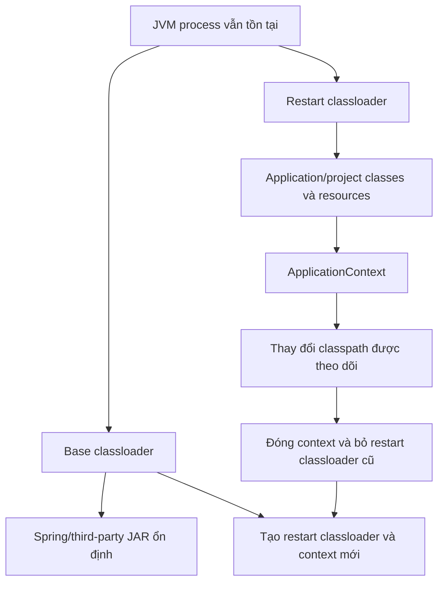
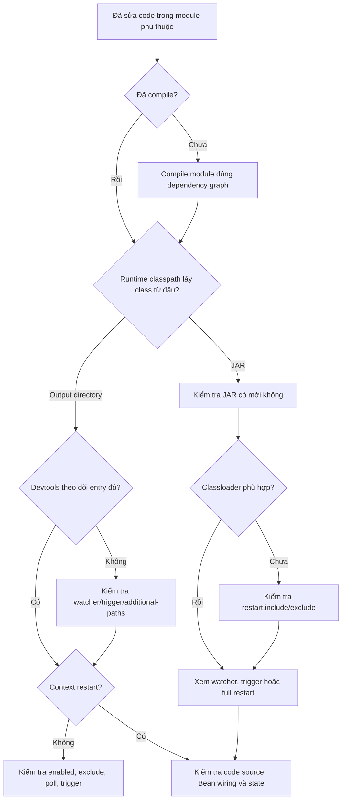

# Devtools trong dự án nhiều module

Một ứng dụng Spring Boot được chia thành nhiều module thường có cấu trúc như sau: module `app` chứa `@SpringBootApplication` và REST controllers; module `domain` chứa nghiệp vụ; module `shared` chứa kiểu dữ liệu hoặc thư viện dùng chung. Khi lập trình, bạn muốn sửa class trong `domain`, lưu file rồi nhìn thấy kết quả ở `app` mà không phải dừng, đóng gói và chạy lại toàn bộ ứng dụng bằng tay.

`spring-boot-devtools` hỗ trợ vòng lặp phát triển này bằng **automatic restart**, **LiveReload** và một số mặc định thuận tiện cho development. Tuy nhiên, trong dự án nhiều module, Devtools chỉ phát hiện thay đổi khi **đầu ra đã biên dịch hoặc resource cập nhật đến những vị trí thích hợp trên runtime classpath**. Nó không tự biến mọi file `.java` vừa được lưu thành class mới, cũng không tự nhận mọi module như một phần của ứng dụng đang phát triển.

Bài học tập trung vào cách phối hợp Devtools với **Gradle/Maven multi-module**, sự khác biệt giữa **base classloader** và **restart classloader**, cách đưa module phụ thuộc vào đúng classloader, kiểm tra đường dẫn compile output, và giải quyết tình trạng “đã sửa module chung nhưng ứng dụng không restart hoặc vẫn chạy code cũ”.

## 1. Devtools là gì và không phải là gì?

Spring Boot Devtools là dependency dành cho môi trường phát triển. Tính năng được dùng nhiều nhất là restart ứng dụng khi nội dung một phần runtime classpath thay đổi.

Một vòng lặp mong muốn:

```text
Sửa file Java trong module domain
        │
        ▼
IDE / build tool compile class mới
        │
        ▼
Class mới xuất hiện ở output trên runtime classpath
        │
        ▼
Devtools phát hiện thay đổi cần restart
        │
        ▼
Spring ApplicationContext khởi động lại
        │
        ▼
Thử lại API với logic mới
```

Ba việc sau **khác nhau**:

- **Compile:** chuyển `.java` thành `.class` và copy resources vào output directory; do IDE hoặc build tool thực hiện.
- **Restart:** đóng context trước và khởi tạo lại ứng dụng bằng restart classloader; Devtools đảm nhiệm khi điều kiện phù hợp.
- **Browser reload:** trình duyệt nạp lại trang sau khi asset thay đổi; LiveReload có thể hỗ trợ nhưng không thay thế compile hay restart.

Devtools **không phải hot code replacement tổng quát**. Nó thường restart application context để dùng các class mới, không vá tùy ý mọi thay đổi bên trong JVM đang chạy như một debugger có khả năng hot swap hoặc các công cụ hotswap chuyên dụng.

## 2. Kiến trúc điển hình của dự án nhiều module

Xét một hệ thống đặt hàng đơn giản:

```text
bookstore/
├── settings.gradle
├── build.gradle
├── app/
│   ├── build.gradle
│   └── src/main/java/com/example/bookstore/
│       ├── BookstoreApplication.java
│       ├── api/BookController.java
│       └── config/DomainConfiguration.java
├── domain/
│   ├── build.gradle
│   └── src/main/java/com/example/bookstore/domain/
│       └── PriceCalculator.java
└── shared/
    ├── build.gradle
    └── src/main/java/com/example/bookstore/shared/
        └── Money.java
```

Ý nghĩa các module:

| Module | Trách nhiệm | Có cần `@SpringBootApplication`? | Có nên đặt Devtools dependency? |
|---|---|---|---|
| `app` | Entry point, web API, cấu hình Spring Boot | Có một entry point chính | Có, trong development runtime |
| `domain` | Mô hình và logic nghiệp vụ | Không | Thường không |
| `shared` | Kiểu dùng chung, utilities | Không | Thường không |

`app` phụ thuộc `domain` và `shared`. Thông thường **chỉ module khởi chạy** cần mang `spring-boot-devtools` trên development classpath. Đặt Devtools vào mọi thư viện không làm mọi thay đổi tự động được biên dịch, và có thể gây rối về dependency.

### Module dependency không đồng nghĩa Devtools nhận ra source change

Khai báo:

```groovy
implementation project(':domain')
```

cho phép module `app` dùng class từ `domain`. Nhưng khi bạn sửa `domain/src/main/java/.../PriceCalculator.java`, cần phân biệt:

1. Source đã được lưu chưa?
2. IDE/Gradle đã compile `PriceCalculator.class` mới chưa?
3. Runtime classpath của tiến trình `app` đang trỏ đến **output directory** hay **JAR** của `domain`?
4. Đường dẫn có nằm trong phạm vi Devtools theo dõi và restart classloader không?

Đây là chuỗi kiểm tra quan trọng nhất của Devtools trong multi-module.

## 3. Thêm Devtools vào đúng module trong Gradle

Trong Gradle multi-project build, root khai báo module:

**settings.gradle**

```groovy
rootProject.name = 'bookstore'

include 'app', 'domain', 'shared'
```

Giả sử root build đã cấu hình repository và phiên bản plugin Spring Boot phù hợp. Các module thuần Java có thể dùng plugin `java-library`.

**domain/build.gradle**

```groovy
plugins {
    id 'java-library'
}
```

**shared/build.gradle**

```groovy
plugins {
    id 'java-library'
}
```

**app/build.gradle**

```groovy
plugins {
    id 'java'
    id 'org.springframework.boot'
    id 'io.spring.dependency-management'
}

dependencies {
    implementation project(':domain')
    implementation project(':shared')

    implementation 'org.springframework.boot:spring-boot-starter-web'

    developmentOnly 'org.springframework.boot:spring-boot-devtools'

    testImplementation 'org.springframework.boot:spring-boot-starter-test'
}
```

Ví dụ này giả định phiên bản `org.springframework.boot` và `io.spring.dependency-management` đã được cấu hình ở root/plugin management. Nếu chưa cấu hình, hãy khai báo phiên bản plugin tương thích với dòng Spring Boot dự án đang dùng; không copy đoạn module `plugins` vào một project trống rồi kỳ vọng Gradle tự biết version.

Điểm cần nhớ là:

```groovy
developmentOnly 'org.springframework.boot:spring-boot-devtools'
```

Trong mô hình Gradle với Spring Boot plugin, configuration `developmentOnly` dành cho dependency chỉ cần ở quá trình phát triển. Nó giúp Devtools có mặt khi chạy phát triển, mà không trở thành dependency runtime production theo cách thông thường.

### Vì sao không đặt trong domain/shared?

Hai module này là thư viện. Chúng không cần khởi động SpringApplication và không sở hữu Devtools lifecycle. Trách nhiệm tự động restart thuộc tiến trình `app`, vì chính tiến trình đó quản lý ApplicationContext, embedded server và runtime classpath.

Nếu nhiều ứng dụng trong cùng monorepo, mỗi module **có entry point riêng** có thể khai báo Devtools cho development runtime của mình:

```text
monorepo/
├── gateway-app/      ← entry point 1, có thể dùng Devtools
├── catalog-app/      ← entry point 2, có thể dùng Devtools
└── shared-domain/    ← thư viện, không tự cần Devtools
```

Hai ứng dụng là hai tiến trình khác nhau, mỗi tiến trình sẽ có cơ chế restart riêng. Thay đổi `shared-domain` không đồng nghĩa mọi ứng dụng đang chạy sẽ đồng loạt tự cập nhật nếu compile output/classpath của từng tiến trình chưa phản ánh thay đổi.

## 4. Khởi chạy Gradle multi-module trong môi trường phát triển

Lệnh chạy module ứng dụng:

```bash
./gradlew :app:bootRun
```

Với Windows PowerShell, có thể dùng:

```powershell
.\gradlew.bat :app:bootRun
```

`bootRun` chạy ứng dụng từ classpath phục vụ development. Khi có Devtools dependency thích hợp và restart được bật, ứng dụng có thể restart khi các classpath entry được theo dõi thay đổi.

### Sửa Java không có nghĩa classpath đã đổi

Ví dụ bạn đang mở:

```text
domain/src/main/java/com/example/bookstore/domain/PriceCalculator.java
```

Sau khi sửa file, nếu IDE không bật build tự động, Gradle cũng không được yêu cầu biên dịch lại, thì `domain/build/classes/java/main/.../PriceCalculator.class` có thể vẫn là bản cũ.

Devtools quan sát classpath output, **không theo dõi mọi source file như một Java compiler**. Thế nên bạn có thể đợi rất lâu mà app không restart dù code đã lưu thành công.

Giải pháp:

- Trong IDE, bật hoặc thực hiện compile/build project cho các module bị thay đổi.
- Đảm bảo output của module phụ thuộc được cập nhật.
- Nếu dùng Gradle tasks, chạy tác vụ compile/classes phù hợp với module phụ thuộc và runtime classpath thực tế.
- Xác định ứng dụng đang dùng class output hay JAR được build trước đó; hai đường dẫn có hành vi khác nhau khi cập nhật.

### Khi nào Gradle project dependency là class directory, khi nào là JAR?

Đừng giả định mọi `implementation project(':domain')` đều được đưa vào runtime dưới dạng thư mục `build/classes`. Cách IDE và Gradle resolve project dependency có thể khác nhau:

```text
Trường hợp A: IDE chạy app với module outputs
  app/build/classes/...
  domain/build/classes/...
  shared/build/classes/...

Trường hợp B: runtime dùng artifact của module phụ thuộc
  app/build/classes/...
  domain/build/libs/domain-...jar
  shared/build/libs/shared-...jar
```

Trường hợp A thường phù hợp với restart detection do các thư mục output thay đổi và có thể được xếp vào restart classloader. Trường hợp B có thể khiến module JAR nằm trong base classloader và không được theo dõi như class directory. Khi đó việc compile class trong `domain/build/classes` chưa chắc làm JAR mà ứng dụng đang dùng thay đổi.

Vì vậy, trước khi điều chỉnh Devtools, hãy kiểm tra **classpath của tiến trình đang chạy**, không chỉ dependency declaration trong file Gradle.

## 5. Ví dụ code xuyên module để quan sát restart

Trong module `domain`, khai báo một class Java thuần:

**domain/src/main/java/com/example/bookstore/domain/PriceCalculator.java**

```java
package com.example.bookstore.domain;

import java.math.BigDecimal;

public final class PriceCalculator {

    public BigDecimal total(BigDecimal unitPrice, int quantity) {
        if (quantity <= 0) {
            throw new IllegalArgumentException(
                    "Quantity must be positive");
        }
        return unitPrice.multiply(BigDecimal.valueOf(quantity));
    }
}
```

Trong `app`, đăng ký Bean cho class từ module `domain`:

**app/src/main/java/com/example/bookstore/config/DomainConfiguration.java**

```java
package com.example.bookstore.config;

import com.example.bookstore.domain.PriceCalculator;
import org.springframework.context.annotation.Bean;
import org.springframework.context.annotation.Configuration;

@Configuration(proxyBeanMethods = false)
public class DomainConfiguration {

    @Bean
    PriceCalculator priceCalculator() {
        return new PriceCalculator();
    }
}
```

Controller thuộc `app`:

```java
package com.example.bookstore.api;

import com.example.bookstore.domain.PriceCalculator;
import java.math.BigDecimal;
import org.springframework.web.bind.annotation.GetMapping;
import org.springframework.web.bind.annotation.RequestMapping;
import org.springframework.web.bind.annotation.RequestParam;
import org.springframework.web.bind.annotation.RestController;

@RestController
@RequestMapping("/prices")
public class PriceController {

    private final PriceCalculator calculator;

    public PriceController(PriceCalculator calculator) {
        this.calculator = calculator;
    }

    @GetMapping("/total")
    public BigDecimal total(
            @RequestParam BigDecimal unitPrice,
            @RequestParam int quantity) {
        return calculator.total(unitPrice, quantity);
    }
}
```

Class chính:

```java
package com.example.bookstore;

import org.springframework.boot.SpringApplication;
import org.springframework.boot.autoconfigure.SpringBootApplication;

@SpringBootApplication
public class BookstoreApplication {
    public static void main(String[] args) {
        SpringApplication.run(BookstoreApplication.class, args);
    }
}
```

Lưu ý package của class main `com.example.bookstore` bao phủ controller/config trong các package con. `PriceCalculator` là class Java thuần và được đăng ký bằng `@Bean`; nó không cần `@Component`.

Thử request:

```bash
curl "http://localhost:8080/prices/total?unitPrice=12.5&quantity=3"
```

Response JSON có giá trị số tương ứng với tổng tiền, theo cách serialize `BigDecimal` của ứng dụng. Sau đó thử sửa `PriceCalculator.total(...)` để thêm một logic minh họa, compile lại `domain`, và quan sát app có restart/nhận class mới hay không.

Nếu kết quả chưa đổi, không nên kết luận Devtools lỗi ngay. Hãy kiểm tra app đang load `PriceCalculator` từ output directory hay từ JAR cũ.

## 6. Cơ chế hai classloader: nền tảng của Devtools restart

Devtools sử dụng kiến trúc **hai classloader** để giảm thời gian restart:

- **Base classloader:** thường chứa các dependency JAR ổn định, chẳng hạn framework và thư viện ít thay đổi.
- **Restart classloader:** thường chứa class và resources của các project đang phát triển, đặc biệt những classpath entry dạng folder mà IDE/build tạo.



Khi restart, Devtools có thể giữ lại những phần không đổi trong base classloader và tạo lại restart classloader cho code đang phát triển. Vì thế restart thường nhanh hơn một lần dừng toàn bộ JVM rồi khởi chạy lại từ đầu.

Nhưng ranh giới giữa hai classloader có thể gây vấn đề trong multi-module.

### Tại sao JAR của một module nội bộ có thể ở base?

Nếu `domain` được resolve như JAR, Devtools có thể xếp nó cùng các dependency library ổn định. Lúc đó:

- `app` được load bằng restart classloader.
- `domain` có thể được load bằng base classloader.
- Nếu JAR không được cập nhật hoặc không nằm trong classpath đang được theo dõi, thay đổi trong source `domain` không tự xuất hiện.

Mối quan hệ này phụ thuộc **classpath entry thực tế**, chứ không phải việc module có nằm trong cùng Git repository hay cùng file `settings.gradle`.

### Class identity và lỗi khó hiểu

Trong JVM, danh tính class phụ thuộc vào **tên đầy đủ và classloader đã load nó**. Hai class cùng FQCN nhưng được load bởi hai classloader khác nhau là hai kiểu khác nhau đối với JVM.

Một biểu hiện có thể gặp ở hệ thống dùng proxy, serialization hoặc static cache:

```text
ClassCastException: com.example.domain.Order
  cannot be cast to com.example.domain.Order
```

Tên class giống nhau nhưng classloader khác nhau. Điều này có thể xảy ra khi giữ tham chiếu tới object/class từ restart classloader cũ, hoặc thư viện sử dụng classloader không phù hợp.

Không nên sửa mọi `ClassCastException` bằng cách tắt Devtools. Trước hết xác định class đã được load bởi loader nào và có bản JAR/trùng class trên classpath hay không.

## 7. Điều chỉnh base/restart classloader cho module nội bộ

Khi một module nội bộ được phân phối dưới dạng JAR trên classpath, Devtools có thể coi JAR đó như một thư viện ổn định. Nếu bạn liên tục thay đổi module này trong quá trình phát triển, đôi khi cần yêu cầu Devtools **đưa classpath entry tương ứng vào restart classloader**.

Spring Boot hỗ trợ resource:

```text
META-INF/spring-devtools.properties
```

Ví dụ đặt trong module `app`:

```text
app/
└── src/
    └── main/
        └── resources/
            └── META-INF/
                └── spring-devtools.properties
```

Nội dung minh họa:

```properties
# Các classpath URL chứa tên module domain/shared
# cần được load bằng restart classloader.
restart.include.bookstore-domain=.*domain.*[.]jar
restart.include.bookstore-shared=.*shared.*[.]jar
```

Hai giá trị ở đây là **regular expression khớp với classpath URL**, không phải Gradle project path. Cụm `.*domain.*[.]jar` chỉ là ví dụ đơn giản, có thể quá rộng nếu classpath chứa các dependency khác có chữ "domain". Trong dự án thật, hãy kiểm tra tên và đường dẫn JAR, sau đó viết pattern cụ thể hơn.

Các key `restart.include.*` và `restart.exclude.*` có **hậu tố phân biệt**; nên đặt hậu tố đủ đặc trưng như `bookstore-domain` thay vì cùng dùng `common` ở nhiều thư viện. Devtools có thể đọc những properties resource này từ nhiều entry trên classpath, nên trùng key dễ tạo cấu hình khó đoán.

### include làm được gì?

`restart.include.*` giúp điều chỉnh ranh giới phân loại classpath entry: những entry khớp pattern có thể được đưa vào **restart classloader** thay vì base classloader.

Nhưng nó **không**:

- Tự compile file Java của module.
- Tự build lại JAR của module bị thay đổi.
- Tự biến một JAR cũ thành JAR mới.
- Tự thêm classpath entry mà tiến trình không dùng.
- Bảo đảm mọi JAR đều được file watcher quan sát giống một directory.

Do đó, nếu ứng dụng đang load `domain-1.0.jar` cũ, thêm `restart.include` nhưng không cập nhật artifact mà runtime dùng thì app vẫn có thể tiếp tục thấy code cũ.

### exclude dùng khi nào?

Ngược lại, có thể giữ một classpath entry ở **base classloader**:

```properties
restart.exclude.bookstore-stable=.*stable-client.*[.]jar
```

Ví dụ một thư viện nội bộ ít thay đổi, hoặc một phần classpath không nên được load lại qua restart classloader. Dùng exclude khi biết rõ lý do, không phải để che giấu việc build chưa cập nhật.

### Cần kiểm tra pattern với classpath thực tế

Một regex chỉ có tác dụng khi nó khớp URL Devtools quan sát được. Đường dẫn có thể chứa tên artifact/version, dấu phân cách đường dẫn, output `build/classes` hoặc `target/classes`, một JAR trong `build/libs`, hoặc output riêng của IDE. Không nên copy một pattern mẫu rồi mặc định mọi project đều đúng.

## 8. Nhận diện class đang được load từ module nào

Một cách chẩn đoán hiệu quả là in **code source** và **classloader** của class trong module phụ thuộc:

```java
import com.example.bookstore.domain.PriceCalculator;
import org.slf4j.Logger;
import org.slf4j.LoggerFactory;
import org.springframework.boot.ApplicationRunner;
import org.springframework.context.annotation.Bean;
import org.springframework.context.annotation.Configuration;

@Configuration(proxyBeanMethods = false)
public class ClasspathDiagnosticConfiguration {
    private static final Logger log =
            LoggerFactory.getLogger(ClasspathDiagnosticConfiguration.class);

    @Bean
    ApplicationRunner showDomainClasspathLocation() {
        return args -> {
            Class<?> type = PriceCalculator.class;
            var protectionDomain = type.getProtectionDomain();
            var codeSource = protectionDomain != null
                    ? protectionDomain.getCodeSource()
                    : null;

            log.info("PriceCalculator code source: {}",
                    codeSource != null
                            ? codeSource.getLocation()
                            : "not available");
            log.info("PriceCalculator classloader: {}",
                    type.getClassLoader());
        };
    }
}
```

Đây là log chỉ phục vụ chẩn đoán local. Code source có thể null với một số cách nạp class; đừng giả định mọi class đều có location khả dụng.

Hai dạng đường dẫn có thể xuất hiện:

```text
.../domain/build/classes/java/main/
.../domain/build/libs/domain-0.0.1-SNAPSHOT.jar
```

Nếu đó là class directory, hãy kiểm tra có file `.class` mới sau khi compile không. Nếu đó là JAR, hãy kiểm tra JAR có được build lại và tiến trình đang chạy có thể nhận artifact mới hay không.

Đừng nhầm path source `domain/src/main/java/...` với runtime path bytecode `domain/build/classes/java/main/...`. Devtools chủ yếu quan sát runtime output.

### In classloader để biết ranh giới

Classloader có thể được hiển thị trong log. Không dựa vào chuỗi `toString()` chính xác của classloader vì implementation/format có thể đổi giữa các phiên bản. Hãy xem class module bị sửa đang thuộc chu kỳ nạp lại của restart classloader hay còn bị giữ trong base classloader.

## 9. Quy trình phát triển với IntelliJ IDEA và Eclipse

IDE thường giúp giải quyết hai việc: nhận diện module là project đang mở và compile source thay đổi.

### IntelliJ IDEA

1. Đảm bảo `app`, `domain`, `shared` được IDE import/nhận diện như các module.
2. Chạy main class của `app` bằng development run configuration có Devtools.
3. Sửa class thuộc `domain`.
4. Thực hiện **Build Project/Build Module** hoặc bật auto-build phù hợp.
5. Xác nhận file `.class` mới được cập nhật ở runtime classpath.
6. Quan sát ứng dụng có restart và logic mới xuất hiện không.

Một số cấu hình IntelliJ không tự build khi app đang chạy. Tên setting và cách auto-make thay đổi theo phiên bản IDE. Vì vậy hãy kiểm tra log build hoặc output file thật, không chỉ tin rằng file nguồn đã được lưu.

### Eclipse / Spring Tools

Eclipse có **Build Automatically** để compile project khi source thay đổi. Với multi-module:

- Import đầy đủ các project phụ thuộc.
- Kiểm tra module `domain` đã được build tự động và không có compiler error.
- Xem project reference có trỏ tới output workspace hay JAR từ repository.
- Đảm bảo process Spring Boot sử dụng classpath đúng với workspace đó.

### Vì sao chạy bằng IDE và bằng Gradle khác nhau?

IDE có thể tạo runtime classpath dựa trên **module output directories**, còn `bootRun` có thể resolve dependency nội bộ thành **JAR** tùy build. Khi đó:

- Chạy từ IDE: sửa class trong `domain` rồi compile có thể restart ngay.
- Chạy từ Gradle: nếu vẫn load `domain.jar` cũ, compile class directory chưa đủ.

Hãy so sánh code source của class trước khi thay config Devtools. Sự khác biệt không nhất thiết là lỗi của IDE hay Gradle; đó có thể là hai runtime classpath khác nhau.

## 10. Quy trình phát triển với Gradle từ terminal

Terminal thứ nhất chạy ứng dụng:

```bash
./gradlew :app:bootRun
```

Terminal khác có thể compile module phụ thuộc:

```bash
./gradlew :domain:classes
```

`classes` biên dịch/copy output của module. **Nó chỉ tác động trực tiếp đến mã mà Devtools đang quan sát nếu runtime dùng output phù hợp trên classpath.** Nếu process đang dùng JAR, có thể cần build lại JAR và khởi chạy lại theo workflow của dự án; chỉ chạy `classes` chưa chắc cập nhật JAR.

Có thể cân nhắc Gradle continuous build:

```bash
./gradlew :domain:classes --continuous
```

Chế độ continuous build theo dõi input và chạy lại task phù hợp; nó không phải Devtools restart. Đừng khởi động nhiều build process đồng thời cùng ghi một output tree rồi tạo cạnh tranh file hoặc những lần restart thừa.

Nếu bạn thay đổi dependency version, build script, Java agent hoặc những thành phần được giữ trong base classloader, dừng và chạy lại `:app:bootRun` có thể rõ ràng và đáng tin cậy hơn cố ép Devtools nạp lại mọi thay đổi.

## 11. Multi-module với Maven

Cùng ý tưởng với Maven reactor:

```text
bookstore/
├── pom.xml                 (parent/aggregator)
├── app/pom.xml             (Spring Boot app)
├── domain/pom.xml          (thư viện nghiệp vụ)
└── shared/pom.xml          (thư viện dùng chung)
```

Parent có:

```xml
<modules>
    <module>shared</module>
    <module>domain</module>
    <module>app</module>
</modules>
```

Trong `app/pom.xml`, khai báo dependency tới module nội bộ theo thông tin của reactor:

```xml
<dependency>
    <groupId>com.example.bookstore</groupId>
    <artifactId>domain</artifactId>
    <version>${project.version}</version>
</dependency>
```

Và Devtools:

```xml
<dependency>
    <groupId>org.springframework.boot</groupId>
    <artifactId>spring-boot-devtools</artifactId>
    <scope>runtime</scope>
    <optional>true</optional>
</dependency>
```

Trong Maven, `optional=true` hạn chế việc Devtools trở thành transitive dependency của project khác. Chạy từ IDE với reactor modules được import đầy đủ thường cho trải nghiệm compile outputs thuận tiện hơn so với chạy một packaged JAR rồi mong source change được tự nhận ra.

Nếu sửa module phụ thuộc, có thể yêu cầu reactor biên dịch các module liên quan:

```bash
mvn -pl app -am compile
```

Nhưng **build thành công không chứng minh tiến trình đang chạy đã nạp artifact mới**. Vẫn cần kiểm tra runtime classpath, build output và Devtools watcher.

## 12. LiveReload khác với application restart

Devtools còn hỗ trợ một LiveReload server để trình duyệt hoặc client tương thích nạp lại trang khi asset đổi.

Ví dụ sửa:

```text
app/src/main/resources/static/css/site.css
app/src/main/resources/templates/home.html
```

Một số đường dẫn resource mặc định không khiến Spring ApplicationContext restart, ví dụ:

```text
/META-INF/maven
/META-INF/resources
/resources
/static
/public
/templates
```

Thay đổi những resource này có thể được xử lý qua LiveReload hoặc cơ chế template/resource development mà không cần restart toàn bộ context.

| Sửa gì? | Hành vi điển hình |
|---|---|
| Java class đã compile trong watched classpath directory | Thường kích hoạt restart |
| Template/static resource trong nhóm loại trừ | Có thể LiveReload, không nhất thiết restart |
| Source Java chưa compile | Không có classpath change để restart |
| JAR ở ngoài runtime classpath được build lại | App đang chạy không tự nhận artifact |
| Build script hoặc phiên bản dependency đổi | Thường cần sync/restart build và app đầy đủ |

**LiveReload không phải Java hot reload.** Browser refresh không giúp chạy code Java mới nếu bytecode mà server dùng chưa đổi.

Có thể tắt LiveReload nếu không dùng:

```properties
spring.devtools.livereload.enabled=false
```

Nếu nhiều ứng dụng Devtools chạy cùng một máy, LiveReload server có thể cạnh tranh cổng. Việc một instance không khởi động được LiveReload không nhất thiết làm auto restart của ứng dụng đó ngừng hoạt động.

## 13. Theo dõi thêm đường dẫn và cấu hình exclude

Khi công cụ sinh resource ra ngoài classpath, Devtools có thể theo dõi thêm đường dẫn:

```properties
spring.devtools.restart.additional-paths=../generated-assets
```

Nhưng:

- `additional-paths` chỉ thêm nơi **theo dõi sự thay đổi**.
- Nó **không tự thêm đường dẫn vào Java classpath**.
- Nó không compile Java và không bắt Java classloader dùng bytecode từ đường dẫn đó.

Nếu `domain` build class ở một thư mục không nằm trên runtime classpath, thêm `additional-paths` có thể khiến restart xảy ra nhưng app vẫn load mã từ JAR cũ.

Để thêm đường dẫn loại khỏi restart:

```properties
spring.devtools.restart.additional-exclude=assets/**,reports/**
```

`additional-exclude` bổ sung đường dẫn vào tập loại trừ mặc định. Còn `spring.devtools.restart.exclude` đặt tập exclude thay thế. Nếu muốn giữ các mặc định và chỉ bổ sung, ưu tiên `additional-exclude`.

**Hai cấu hình không giống nhau:** `spring.devtools.restart.additional-exclude` nói về *đường dẫn thay đổi có nên restart hay không*, còn `restart.include.*` / `restart.exclude.*` trong `spring-devtools.properties` nói về *phân loại classpath entry vào classloader nào*.

## 14. Trigger file: gom nhiều thay đổi trước khi restart

Trong một project lớn, IDE có thể cập nhật nhiều file `.class` ở các thời điểm liên tiếp. Nếu Devtools phản ứng với mỗi lần thay đổi, ứng dụng có thể restart ngay khi các module chưa compile xong hoặc restart nhiều lần trong một lượt build.

Devtools cho phép dùng **trigger file**:

```properties
spring.devtools.restart.trigger-file=.reloadtrigger
```

Tạo file trong resources:

```text
app/src/main/resources/.reloadtrigger
```

và đảm bảo nó xuất hiện trên classpath sau khi resource processing, ví dụ:

```text
app/build/resources/main/.reloadtrigger
```

Khi trigger file được cấu hình, Devtools có thể ghi nhận các thay đổi của classpath nhưng trì hoãn việc restart cho tới khi trigger file được cập nhật.

Quy trình minh họa:

```text
Sửa code ở domain + shared
            │
            ▼
IDE hoặc Gradle compile xong
            │
            ▼
Cập nhật .reloadtrigger trên runtime classpath
            │
            ▼
Devtools thực hiện một lần restart có chủ đích
```

Trong IDE, có thể thao tác cập nhật/touch file trigger phù hợp với workflow. Nếu chỉ sửa file nguồn dưới `src/main/resources` mà IDE chưa copy nó vào output Devtools theo dõi, trigger có thể không được nhận ra. Vì vậy khi không có restart, hãy kiểm tra **file trigger trong runtime classpath**.

Trigger file giảm restart thừa, **không sửa lỗi JAR phụ thuộc cũ**. Một lần restart có chủ đích vẫn không thể nạp bytecode mới nếu Java classloader chỉ nhìn thấy artifact chưa được cập nhật.

### Poll interval và quiet period

Với các môi trường phát triển dùng file watcher polling, Devtools cung cấp những cấu hình như:

```properties
spring.devtools.restart.poll-interval=2s
spring.devtools.restart.quiet-period=1s
```

`poll-interval` là khoảng cách giữa các lần kiểm tra thay đổi; `quiet-period` là khoảng lặng giúp tránh phản ứng khi một loạt file vẫn đang được cập nhật. Giá trị phù hợp phụ thuộc tốc độ compile/copy output và dung lượng dự án.

Đừng tăng hoặc giảm các giá trị một cách tùy tiện khi nguyên nhân thật là runtime dùng JAR cũ. Trước hết xác nhận Devtools có thể nhìn thấy entry đúng và file thực sự đổi.

## 15. Troubleshooting: sửa module phụ thuộc nhưng không restart

Đây là tình huống phổ biến:

```text
Sửa domain/PriceCalculator.java
        │
        ▼
Lưu file
        │
        ▼
Gọi lại API
        │
        ▼
Kết quả vẫn là logic cũ
```

Hãy kiểm tra theo thứ tự để tránh mò mẫm:

### Bước 1 — Devtools có thật sự nằm trên development classpath?

Kiểm tra dependency của **module đang chạy**, thường là `app`. Nếu Devtools chỉ được khai báo trong `domain` mà không có trong runtime classpath của `app`, bạn có thể không có automatic restart như kỳ vọng.

Với Gradle:

```groovy
developmentOnly 'org.springframework.boot:spring-boot-devtools'
```

Không cần thêm dependency này vào mọi module.

### Bước 2 — Bạn đang chạy development app hay packaged JAR?

Devtools mặc định không được dùng như một cơ chế restart production trên ứng dụng đóng gói đầy đủ. Chạy từ IDE hoặc `bootRun` thường phù hợp với development classpath; chạy một executable JAR đã repackaged có thể không kích hoạt cơ chế restart theo cách bạn kỳ vọng.

Nếu bạn build một JAR rồi chạy lại JAR đó, hãy phân biệt **đã restart process Java** với **Devtools automatic restart trong process**.

### Bước 3 — Source đã được compile thành bytecode mới chưa?

Sửa `.java` không tự làm đổi `.class`. Nếu compile lỗi hoặc auto-build bị tắt, Devtools sẽ không có class mới để load.

Kiểm tra:

```text
domain/src/main/java/.../PriceCalculator.java
domain/build/classes/java/main/.../PriceCalculator.class
```

Hoặc output tương ứng của Maven/IDE. Nếu compiled class không thay đổi, xử lý build trước khi đụng tới `spring-devtools.properties`.

### Bước 4 — App đang load class từ đâu?

In:

```java
PriceCalculator.class.getProtectionDomain()
        .getCodeSource()
        .getLocation()
```

Nếu đường dẫn là JAR cũ, compile vào `build/classes` chưa đủ. Có thể cần cập nhật JAR, điều chỉnh runtime classpath, hoặc chạy theo cấu hình IDE dùng module output.

### Bước 5 — Class thuộc classloader nào?

Nếu compiled class và runtime artifact đã cập nhật nhưng logic cũ vẫn tồn tại, kiểm tra classloader và liệu module nội bộ đang ở base classloader hay restart classloader. Cân nhắc `META-INF/spring-devtools.properties` với `restart.include.*` cho entry chính xác.

### Bước 6 — Có trigger/exclude cấu hình không?

Kiểm tra:

```properties
spring.devtools.restart.enabled
spring.devtools.restart.trigger-file
spring.devtools.restart.additional-exclude
spring.devtools.restart.exclude
```

Trigger file có thể khiến Devtools đợi tín hiệu; exclude có thể loại bỏ những resource thay đổi khỏi automatic restart.

### Bước 7 — Log có cho thấy restart thật không?

Quan sát log theo thời gian. Khi Devtools restart, bạn có thể thấy luồng hoặc log cho biết ứng dụng được khởi động lại, nhưng chuỗi log cụ thể không phải API ổn định. Nếu application context không được tạo lại, việc endpoint vẫn dùng Bean cũ là điều dễ hiểu.

Nếu context đã restart mà class vẫn cũ, tập trung kiểm tra classpath/JAR hoặc classloader. Nếu context không restart, kiểm tra watch/build/trigger.

## 16. Bảng lỗi thường gặp trong multi-module

| Triệu chứng | Nguyên nhân có thể | Hướng khắc phục |
|---|---|---|
| Sửa Java trong `app`, không restart | Chưa compile, Devtools thiếu/disabled, runtime packaged | Kiểm tra dependency và output classpath |
| Sửa `domain`, IDE restart nhưng `bootRun` không | Runtime classpath khác nhau | Kiểm tra `CodeSource`; JAR vs directory |
| Có restart nhưng logic `domain` vẫn cũ | Module phụ thuộc load từ artifact cũ/base classloader | Build đúng artifact, kiểm tra classloader và include |
| Sửa `shared` nhưng request không đổi | Không có compile output hoặc test path không dùng class đó | Kiểm tra build output, code path và classpath |
| Devtools restart nhiều lần khi build | Compile/copy output theo nhiều đợt | Trigger file, quiet period hoặc thống nhất workflow build |
| Thay template, app không restart | Resource thuộc default restart exclusions | Kiểm tra browser reload/resource output |
| Browser reload nhưng server logic chưa đổi | LiveReload chỉ làm mới client | Compile class và kiểm tra restart |
| ClassCastException với cùng tên class | Khác classloader hoặc trùng classpath artifact | Kiểm tra base/restart split, static cache, duplicate JAR |
| Bean không xuất hiện sau restart | Package scan, condition hoặc BeanDefinition sai | Phân biệt lỗi cấu hình Spring với lỗi Devtools |
| Thêm dependency mới nhưng app không nhận | Classpath của JVM đang chạy chưa phản ánh dependency mới | Đồng bộ build và khởi động lại process đầy đủ |
| Có nhiều tiến trình Devtools, LiveReload không chạy ở một app | Cổng LiveReload bị chiếm | Tắt LiveReload không cần thiết; restart độc lập |
| Devtools hoạt động ở IDE nhưng không ở production JAR | Devtools được thiết kế cho development và thường disabled/excluded ở packaged app | Không dùng Devtools thay cơ chế deployment/restart production |

### Restart nhưng Bean không được scan

Ví dụ module `domain` chứa:

```java
package com.acme.domain;

@Service
public class BillingService {
}
```

Trong khi main class của `app` nằm ở:

```java
package com.example.bookstore;

@SpringBootApplication
public class BookstoreApplication {
}
```

Nếu không cấu hình mở rộng phạm vi scan/import, package `com.acme.domain` nằm ngoài cây package mặc định của main class. Việc Devtools restart không làm Spring tự phát hiện Bean ở package đó.

Đây là lỗi **component scan scope**, không phải lỗi Devtools. Có thể điều chỉnh cấu trúc package, thêm cấu hình scan có chủ đích hoặc dùng `@Import`/`@Bean`. Không nên sửa classloader patterns để giải quyết một Bean chưa được đăng ký vì điều kiện Spring.

## 17. Điều gì xảy ra với state khi Devtools restart?

Restart không chỉ nạp Java class mới. Nó thường đóng ApplicationContext cũ rồi tạo một context mới. Vì thế nhiều Bean singleton cũng được tạo lại.

Một số hệ quả:

- **Dữ liệu trong field của singleton** có thể về trạng thái ban đầu.
- **In-memory cache** do Bean giữ có thể bị xóa.
- **H2 in-memory database** có thể bị tái tạo tùy cấu hình database/connection/lifecycle; đừng mặc định dữ liệu còn nguyên.
- **Scheduler, listener và connection pool** thuộc context cũ được đóng rồi tạo lại nếu lifecycle hoạt động đúng.
- **File, database bên ngoài và message broker** vẫn tồn tại bên ngoài JVM; chúng không tự rollback hoặc reset chỉ vì context restart.

Không nên dựa vào một lần Devtools restart để chứng minh ứng dụng xử lý shutdown hoàn chỉnh như khi triển khai production. Ngược lại, Devtools restart lặp lại giúp phát hiện những Bean không cleanup thread/connection đúng cách.

### Thread leak và static state

Nếu một module tạo thread riêng nhưng không quản lý lifecycle, sau restart thread có thể giữ tham chiếu tới classloader cũ. Điều này gây memory leak hoặc những hành vi khó giải thích.

Ví dụ sai về mặt lifecycle:

```java
public class BackgroundWorker {
    public void start() {
        new Thread(() -> {
            while (true) {
                // Polling vô hạn, không có stop condition.
            }
        }).start();
    }
}
```

Thay vì tự tạo loop vô hạn, hãy quản lý executor, stop signal và cleanup bằng các cơ chế lifecycle phù hợp của Spring. Devtools không tự tìm và dừng mọi thread do code bạn tạo.

## 18. Tắt restart khi cần và phân biệt với bỏ Devtools

Khi muốn tạm dừng automatic restart:

```properties
spring.devtools.restart.enabled=false
```

Trong một số tình huống, đặt property trong application configuration sẽ **vô hiệu hóa việc theo dõi restart** nhưng không nhất thiết ngăn toàn bộ cơ chế classloader khởi tạo từ đầu. Nếu cần **vô hiệu hóa restart hoàn toàn ngay từ khi SpringApplication bắt đầu**, có thể đặt system property trước khi gọi `run`:

```java
public static void main(String[] args) {
    System.setProperty("spring.devtools.restart.enabled", "false");
    SpringApplication.run(BookstoreApplication.class, args);
}
```

Tuy nhiên, hardcode dòng này sẽ khiến Devtools restart luôn bị tắt cho mọi lần chạy main method đó. Với công việc phát triển thông thường, chỉ nên dùng cách này khi có lý do chẩn đoán rõ ràng, hoặc điều khiển bằng cấu hình bên ngoài thay vì commit mặc định tắt.

Nếu không dùng Devtools nữa, bỏ dependency khỏi development runtime là lựa chọn đơn giản và rõ ràng hơn. Tắt restart khác với tắt LiveReload:

```properties
spring.devtools.restart.enabled=false
spring.devtools.livereload.enabled=false
```

Hai tính năng này không nên được coi là một công tắc duy nhất.

## 19. Đóng gói production: Devtools không phải cơ chế triển khai

Devtools được thiết kế cho vòng lặp phát triển, không phải cho một cluster production.

Với Gradle, cách khai báo được khuyến nghị:

```groovy
developmentOnly 'org.springframework.boot:spring-boot-devtools'
```

giúp phân biệt dependency dành cho development runtime với nội dung cần đưa vào runtime artifact. Trong packaging thông thường của Spring Boot, Devtools không được dùng làm cơ chế restart của ứng dụng đóng gói để phát hành.

Với Maven:

```xml
<dependency>
    <groupId>org.springframework.boot</groupId>
    <artifactId>spring-boot-devtools</artifactId>
    <scope>runtime</scope>
    <optional>true</optional>
</dependency>
```

và Spring Boot Maven plugin có các quy tắc đóng gói liên quan tới Devtools. Hãy để dependency được quản lý đúng theo môi trường; đừng cố đưa Devtools vào production artifact chỉ để mong code cập nhật theo cách của IDE.

### Không áp Spring Boot packaging lên mọi library module

Trong Gradle multi-project, module `app` cần tạo executable Boot artifact. Còn `domain` và `shared` thường nên là thư viện Java thông thường:

```groovy
// domain/build.gradle
plugins {
    id 'java-library'
}
```

Nếu áp Spring Boot plugin/repackage lên mọi module không cần thiết, artifact của module thư viện có thể có layout dành cho executable application, hoặc build task đòi hỏi main class trong khi module không có entry point. Điều này không giúp Devtools restart tốt hơn và còn làm dependency resolution phức tạp.

Với Maven, nguyên tắc tương tự: thư viện nên xuất bản JAR dùng làm dependency; chỉ ứng dụng cần repackaging/executable artifact. Đừng dùng JAR đã được tổ chức như một Boot executable jar làm thư viện Java thông thường nếu công cụ classpath không hỗ trợ layout đó.

### Tại sao không bật remote Devtools trong production?

Một số phiên bản Spring Boot có tính năng remote Devtools dành cho tình huống development đặc biệt. Tính năng này có bề mặt bảo mật riêng và không phù hợp để mở trên mạng production như một cơ chế hot deployment.

Trong vận hành thật, hãy:

- Build artifact bất biến từ CI.
- Chạy test và kiểm tra compatibility trước triển khai.
- Triển khai phiên bản mới bằng rolling update, blue-green hoặc chiến lược phù hợp.
- Dùng graceful shutdown, readiness và health probes để giảm gián đoạn.
- Dùng rollback để quay lại artifact trước nếu cần.

Một instance production cần khả năng truy vết **đang chạy đúng phiên bản code nào**, thay vì âm thầm nạp lại class khi file thay đổi trên máy chủ.

## 20. Devtools không thay thế testing và cấu hình ứng dụng

Khi Devtools restart thành công, điều bạn biết là **context có thể khởi tạo lại với classpath hiện có**. Điều đó không chứng minh:

- Thay đổi trong module `domain` không làm hỏng API contract.
- Mọi integration test vẫn đúng.
- Dependency giữa các module không có vòng lặp.
- Bean của package phụ thuộc được component scan/import đúng.
- Dữ liệu đang chạy có thể migrate tương thích.
- Class mới được dùng trong artifact production.

Ví dụ sau khi thay method trong `domain`:

```java
public BigDecimal total(BigDecimal unitPrice, int quantity)
```

nếu đổi signature hoặc kiểu trả về, các module dùng nó có thể cần được compile đồng bộ. Devtools restart không thay thế việc build/test toàn project để phát hiện lỗi contract.

### Khi nào cần full restart thay vì Devtools restart?

Một số thay đổi thường hợp lý hơn nếu dừng process và chạy lại:

- Thay version Spring Boot hoặc dependency quan trọng.
- Thêm/xóa một JAR trên runtime classpath.
- Thay JVM arguments, Java agent, system properties được dùng trước `SpringApplication.run`.
- Đổi classpath layout hoặc plugin/build configuration.
- Thay cấu hình của thành phần được khởi tạo ngoài ApplicationContext hoặc giữ state trong base classloader.
- Điều tra lỗi classloader/serialization/cache mà bạn muốn loại trừ tác động của Devtools.

Hãy xem Devtools là **tối ưu cho vòng lặp sửa-compile-thử lại**, không phải cách đảm bảo mọi kiểu thay đổi đều được áp dụng mà không cần full process restart.

## 21. Bài thực hành hoàn chỉnh trong multi-module

Thử theo trình tự sau với ví dụ `bookstore`:

1. Tạo ba Gradle module `app`, `domain`, `shared`. Đảm bảo `app` phụ thuộc vào hai module kia.
2. Khai báo `spring-boot-devtools` bằng `developmentOnly` trong `app`, không khai báo trong `domain` hay `shared`.
3. Chạy `:app:bootRun` hoặc chạy `BookstoreApplication` bằng IDE.
4. Gọi `GET /prices/total?unitPrice=12.5&quantity=3` và ghi lại kết quả.
5. Sửa logic tính toán trong `domain`. Chỉ lưu source mà chưa compile; quan sát xem app có thay đổi không.
6. Compile `domain` rồi xem ứng dụng có restart không; kiểm tra kết quả endpoint.
7. In `PriceCalculator.class.getProtectionDomain().getCodeSource().getLocation()` để xác định app dùng class directory hay JAR.
8. Nếu app dùng JAR và chưa nhận thay đổi, kiểm tra artifact đang được dùng, điều chỉnh workflow compile/build hoặc classpath; cân nhắc `restart.include.*` khi thật sự cần thay classloader.
9. Sửa resource static trong `app` và phân biệt browser LiveReload với Java restart.
10. Cấu hình trigger file, thay nhiều class ở hai module, rồi dùng trigger để thực hiện một lần restart có chủ đích.
11. Chạy một lượt full process restart và so sánh với Devtools restart về việc nạp dependency và state.
12. Build artifact cuối cùng, kiểm tra rằng Devtools không trở thành cơ chế reload code của môi trường phát hành.

Ghi lại kết quả theo bảng:

| Thay đổi | Source saved? | Compiled output changed? | Runtime entry là folder/JAR? | Context restart? | Code mới có hiệu lực? |
|---|---|---|---|---|---|
| Sửa class trong app | ... | ... | ... | ... | ... |
| Sửa class trong domain | ... | ... | ... | ... | ... |
| Sửa class trong shared | ... | ... | ... | ... | ... |
| Sửa template/static | ... | ... | ... | ... | ... |
| Thay dependency version | ... | ... | ... | ... | ... |

Bảng này giúp bạn tìm nguyên nhân dựa trên **sự kiện quan sát được**, thay vì mặc định “Devtools đang bị lỗi” khi kết quả chưa thay đổi.

## 22. Sơ đồ xử lý nhanh khi Devtools không thấy thay đổi



Ba câu hỏi cốt lõi:

**1. Bytecode mới đã xuất hiện chưa?** Không compile thì Devtools không thể tự tạo class mới.

**2. Tiến trình đang nhìn bytecode ở đâu?** Module nằm cùng repository không có nghĩa runtime đang load từ output mới; có thể vẫn là JAR cũ.

**3. Classpath entry được theo dõi và nạp bởi classloader nào?** Đây là điểm Devtools có thể điều chỉnh bằng watcher settings và `META-INF/spring-devtools.properties`.

## 23. Tổng kết

Devtools trong dự án nhiều module hoạt động tốt nhất khi ba lớp được phối hợp đúng:

```text
BUILD LAYER
  IDE / Gradle / Maven biên dịch các module bị thay đổi
        │
        ▼
CLASSPATH LAYER
  App đang dùng đúng class directory hoặc artifact mới
        │
        ▼
DEVTOOLS LAYER
  Watcher phát hiện thay đổi, restart classloader nạp class mới
        │
        ▼
SPRING CONTEXT
  Bean được khởi tạo lại, API/logic mới sẵn sàng để thử
```

Trong multi-module, điều quan trọng không phải có bao nhiêu lần khai báo `spring-boot-devtools`, mà là **module nào khởi chạy ứng dụng, class thực sự nằm ở đâu trên runtime classpath, và việc compile có làm thay đổi entry mà Devtools theo dõi hay không**.

Khi một module phụ thuộc đang nằm trong base classloader, `META-INF/spring-devtools.properties` có thể giúp điều chỉnh phân loại classpath. Nhưng cấu hình đó không biên dịch source, không xây lại JAR và không thay thế full restart khi dependency graph thay đổi. Hãy dùng LiveReload cho tài nguyên trình duyệt, trigger file để kiểm soát những đợt build lớn, và giữ Devtools trong development thay vì production.

**Ghi nhớ:** sửa source → compile đúng module → cập nhật runtime classpath → Devtools restart → kiểm chứng code mới. Nếu một mắt xích bị thiếu, app có thể chạy code cũ dù Devtools đã được thêm làm dependency.
